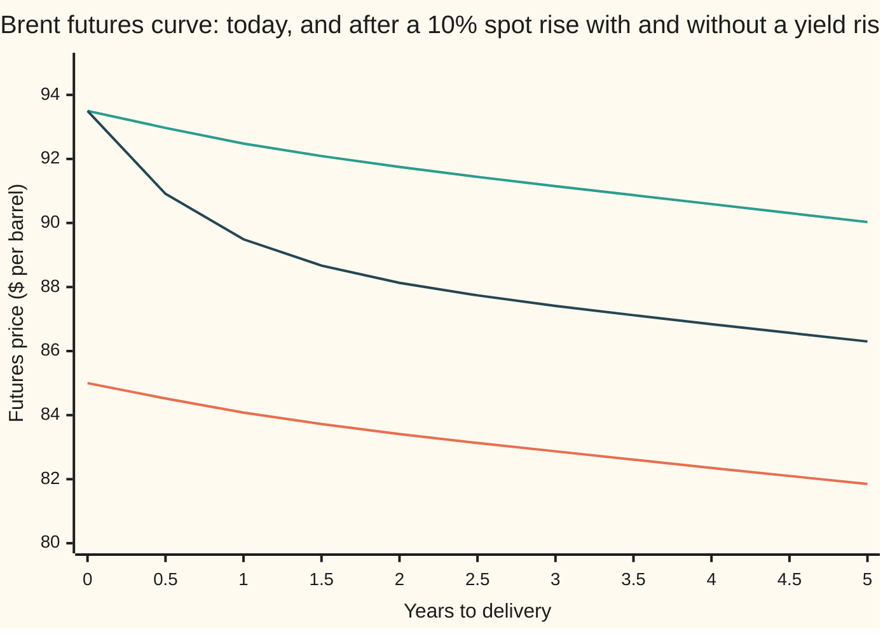
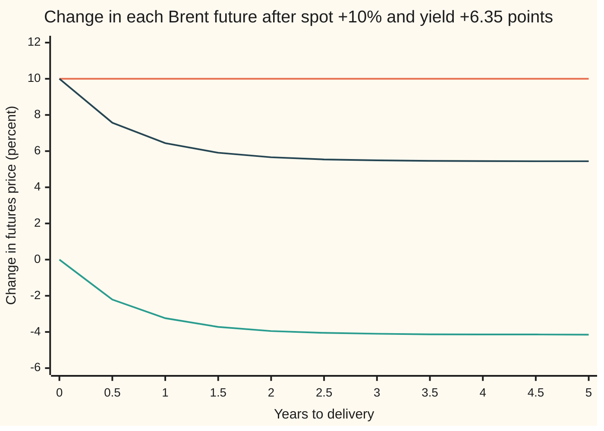

# Gibson-Schwartz: a convenience yield that moves on its own, and the curve twists one factor cannot make

[Syllabus](../../../SYLLABUS.md) → [Financial mathematics](../README.md) → [Commodity forwards - carry, storage, convenience yield and the curve](../README.md#s25) → Gibson-Schwartz

---

## General Overview

A barrel of Brent crude costs $85 today. Refiners and traders who hold physical barrels gain from having them on hand. That gain, written as a yearly rate of the barrel's value, is the **convenience yield**; nobody pays it, holding the barrel earns it ([Convenience yield](03-convenience-yield-implied-by-the-forward.md)). The market is tight, so today that yield is 6 percent. In a normal year it sits near 3 percent.

The convenience yield does not stay put. When stocks run low it jumps; when tanks fill it sinks back. The earlier card on a reverting spot ([A spot price that reverts](06-mean-reverting-spot-and-the-futures-curve.md)) has one random driver. There a future moves only when spot moves, by a fixed share of spot's move that shrinks with maturity, so every day's curve move has the same shape. Real curves also move at the back on their own: some days spot barely changes while the long-dated contracts reprice. A move that breaks the one fixed shape is a **twist**, and one driver cannot make it.

The two-factor model of Gibson and Schwartz (1990) gives the convenience yield its own random path. Spot wanders with 30 percent volatility. The yield is pulled back toward 3 percent at a speed of 1.5 per year, with 25 percent volatility. The two are tied by a correlation of 0.8: when oil gets scarce, spot and the yield tend to rise together. Interest is 5 percent.

Out comes a closed-form futures price for every delivery date: $84.76 for three months, $84.08 for one year, $82.87 for three years. And out comes a correlation between the returns of the 3-month and the 2-year futures of 0.9283, not 1. That sounds close to 1, but a hedge of a 2-year contract with 3-month futures still leaves 37.2 percent of its risk (its standard deviation) in place.

**Give the convenience yield its own random path toward a level, and each future becomes the carry formula run on the expected yield, plus two corrections; spot moves every future equally, the yield moves the long end more, so short and long futures stop moving in lockstep.**

**What kind of fact this is:** a model: two correlated random drivers with constant settings are an assumption that fits crude curves well enough, not a law. Inside the model, the futures formula and the correlation formula are theorems, proved on this card in Why it works.

### The picture: one spot move, two different curves



Bottom line: today's curve, spot $85 and yield 6 percent, gently falling (backwardation). Top line: spot up 10 percent to $93.50 with the yield unchanged; every future rises 10 percent. Middle line: the same spot rise with the yield up 6.35 points, the rise that typically comes with it at correlation 0.8; the 3-month future rises 8.55 percent, the 3-year only 5.49 percent. In the one-factor model the spot move alone fixes how every future moves. One driver gives one fixed pattern of moves; two drivers let the pattern change from day to day.

---

## The formula

Notation first, in the shorthand of Itô calculus ([Ito's lemma](../../11-Stochastic%20processes%20and%20calculus/06-Ito%20Calculus/02-itos-lemma.md)). $`dS_t`$ is the change in spot over a short step of time $`dt`$, and $`dy_t`$ the change in the yield. $`dW_t`$ is a random shock over that step, with average zero and variance $`dt`$. The model is written in the **pricing world** (risk-neutral world). There every asset earns the interest rate on average, and a futures price is an average ([A spot price that reverts](06-mean-reverting-spot-and-the-futures-curve.md), Step 0).

```math
\frac{dS_t}{S_t} = (r - y_t)\,dt + \sigma_S\,dW^S_t, \qquad dy_t = \kappa\,(\alpha - y_t)\,dt + \sigma_y\,dW^y_t, \qquad dW^S_t\,dW^y_t = \rho\,dt
```

**Read it aloud:** spot grows at the interest rate minus today's convenience yield, plus a random kick. The yield is pulled toward its level $`\alpha`$ at speed $`\kappa`$, plus its own kick. The two kicks are correlated by $`\rho`$.

The first equation is the carry formula of [Convenience yield](03-convenience-yield-implied-by-the-forward.md) made random. A holder of the barrel earns the yield $`y_t`$ instead of interest, so in the pricing world spot drifts at $`r - y_t`$. The second is a pulled random walk, an Ornstein-Uhlenbeck process ([Mean reversion](../../11-Stochastic%20processes%20and%20calculus/06-Ito%20Calculus/05-ornstein-uhlenbeck-and-cir-processes.md)). Here $`y_t`$ is the net yield: convenience minus storage cost.

The futures price for delivery in $`T`$ years, with today's spot $`S`$ and today's yield $`y`$:

```math
F(T) = S\,\exp\!\Big((r - \alpha)\,T \;-\; (y - \alpha)\,B(T) \;-\; \rho\,\sigma_S\sigma_y\,I_1(T) \;+\; \tfrac12\,\sigma_y^2\,I_2(T)\Big)
```

with three helper functions of $`T`$:

```math
B(T) = \frac{1 - e^{-\kappa T}}{\kappa}, \qquad I_1(T) = \frac{T - B(T)}{\kappa}, \qquad I_2(T) = \frac{1}{\kappa^2}\Big(T - 2B(T) + \frac{1 - e^{-2\kappa T}}{2\kappa}\Big)
```

**Read it aloud:** grow spot at interest minus the yield's level. Take off today's extra yield for the $`B(T)`$ years it is still felt. Take off a correction for spot and yield moving together, and add one for the yield's own spread.

| Symbol | Plain meaning | In our example | Push it up and the answer… |
| --- | --- | --- | --- |
| $`S`$, $`S_t`$ | spot price of a barrel today, and at time $`t`$ | $85 | every future rises by the same percentage |
| $`y`$, $`y_t`$ | net convenience yield today, and at time $`t`$, a yearly rate | 6% | futures fall, the long ones most |
| $`\alpha`$ | the yield's level: where the pull draws it, in the pricing world (said "alpha") | 3% | long futures fall; the curve tilts down |
| $`\kappa`$ | the speed: the fraction of the yield's gap to its level closed per year (said "kappa") | 1.5 per year | today's yield matters for less time; futures correlate more |
| $`\sigma_S`$ | spot volatility: size of spot's random kicks per year | 30% | the correlation term grows, so long futures fall |
| $`\sigma_y`$ | yield volatility: size of the yield's random kicks per year | 25% | short and long futures drift apart: correlation falls |
| $`\rho`$ | correlation between the spot kick $`dW^S`$ and the yield kick $`dW^y`$ (said "rho") | 0.8 | long futures fall; futures volatility falls |
| $`r`$ | interest rate, continuously compounded | 5% | every future rises |
| $`T`$, $`t`$, $`s`$, $`u`$, $`dt`$, $`dW^S_t`$, $`dW^y_t`$, $`W^S_T`$ | years to delivery; time from today; the time of one past kick; years from that kick to delivery; a short step of time; the spot and yield shocks over that step; spot's shocks added up to delivery | 0.25, 1 and 3 years | |
| $`B(T)`$, $`I_1(T)`$, $`I_2(T)`$ | years of today's yield gap still felt by delivery; the sum of those weights over every kick; the sum of their squares | 0.5179, 0.3214 and 0.1248 at one year | |
| $`F(T)`$, $`\sigma_F(T)`$, $`c(T_1, T_2)`$, $`B_1`$, $`B_2`$ | futures price; its volatility; the correlation of two futures' returns, at maturities $`T_1`$ and $`T_2`$ with weights $`B(T_1)`$, $`B(T_2)`$ | $84.08 and 21.12% at one year; 0.9283 for 3 months against 2 years | |
| $`m(T)`$, $`v(T)`$, $`E[\,\cdot\,]`$, $`X`$, $`a`$, $`\sigma`$ | average and variance of $`\ln S_T`$; the pricing-world average; any normal variable; the one-factor card's level and volatility | | |

Two helper formulas come out of the same model. The first gives a future's volatility, $`\sigma_F(T)`$, and the correlation, $`c(T_1, T_2)`$, between two futures with $`B_1 = B(T_1)`$ and $`B_2 = B(T_2)`$:

```math
\sigma_F(T)^2 = \sigma_S^2 - 2\rho\sigma_S\sigma_y B(T) + \sigma_y^2 B(T)^2, \qquad c(T_1, T_2) = \frac{\sigma_S^2 - \rho\sigma_S\sigma_y\,(B_1 + B_2) + \sigma_y^2 B_1 B_2}{\sigma_F(T_1)\,\sigma_F(T_2)}
```

In words: spot kicks every future equally, the yield kicks a future in proportion to $`B(T)`$, and the correlation compares those two exposures. For the 3-month and 2-year futures it is 0.9283.

The second gives the long end's volatility. As $`T`$ grows, $`B(T)`$ tends to $`1/\kappa`$, so $`\sigma_F`$ settles at $`\sqrt{\sigma_S^2 - 2\rho\sigma_S\sigma_y/\kappa + \sigma_y^2/\kappa^2}`$, 19.44 percent here. In the one-factor card the long end's volatility dies away. Here it never does.

### When it holds

- **The settings are constant.** Volatility and correlation rise in a squeeze. With fixed $`\sigma_S`$, $`\sigma_y`$ and $`\rho`$, the model prices a calm curve and a panicked curve with the same twist.
- **The yield is normal, with no floor.** The yield can run to any value, high or low. In a glut the net yield is negative (storage costs win), which is fine; but the model also allows absurd values with small probability.
- **The level is a pricing-world level.** The $`\alpha`$ read from futures includes the market's charge for bearing yield risk. It is not a forecast of the yield.
- **Interest rates are not random, or at least not tied to oil.** Then a future equals the pricing-world average of spot at delivery. If rates move with oil, futures and forwards separate and a third factor is needed.
- **No jumps.** A sudden outage moves spot and the yield in one step. The model spreads that over a smooth path and understates the front's moves.

---

## Why it works

### Step 0: a future is the average of spot at delivery, and the log of spot is normal

A futures price is the pricing-world average of spot on delivery day, $`F(T) = E[S_T]`$, where $`E[\,\cdot\,]`$ is that average ([A spot price that reverts](06-mean-reverting-spot-and-the-futures-curve.md), Step 0). The log of spot, $`\ln S_T`$, turns out to be a sum of normal kicks, so it is normal. For a normal variable $`X`$ with average $`m`$ and variance $`v`$, the average of $`e^{X}`$ is $`e^{m + v/2}`$. So the whole job is two numbers: the average and the variance of $`\ln S_T`$.

### Step 1: the yield's total over the life of the future

By Itô's lemma, $`d\ln S_t = (r - y_t - \tfrac12\sigma_S^2)\,dt + \sigma_S\,dW^S_t`$. Add up to delivery:

```math
\ln S_T = \ln S + \big(r - \tfrac12\sigma_S^2\big)T - \int_0^T y_t\,dt + \sigma_S W^S_T
```

So what spot loses to the yield is the yield's total over the life of the contract. The yield's average path is $`\alpha + (y - \alpha)e^{-\kappa t}`$: today's gap shrinks at speed $`\kappa`$. Adding that path up from $`0`$ to $`T`$ gives $`\alpha T + (y - \alpha)B(T)`$. That is why $`B(T)`$ is "years of today's gap still felt". A gap of 3 points, felt for $`B(1) = 0.5179`$ years, takes 0.0155 off the log of the one-year future.

### Step 2: the average of the log price

Take averages. The kicks average to zero:

```math
m(T) = \ln S + \big(r - \alpha - \tfrac12\sigma_S^2\big)T - (y - \alpha)\,B(T)
```

This is the carry formula $`\ln F = \ln S + (r - y)T`$, with the fixed yield replaced by the yield expected on average until delivery. The extra $`-\tfrac12\sigma_S^2 T`$ is removed again in Step 4.

### Step 3: the variance of the log price, where the correlation enters

The random part of $`\ln S_T`$ has two pieces: spot's own kicks, $`\sigma_S W^S_T`$, and the yield's kicks summed over the contract's life. A yield kick at time $`s`$ is still felt for $`B(T - s)`$ years, so it costs spot $`\sigma_y B(T-s)\,dW^y_s`$. The variance of a difference of two correlated pieces is each variance plus the cross term:

```math
v(T) = \sigma_S^2 T + \sigma_y^2 I_2(T) - 2\rho\sigma_S\sigma_y I_1(T)
```

Here $`I_1`$ adds up the weights $`B(T-s)`$ and $`I_2`$ adds up their squares. The cross term is negative when $`\rho > 0`$. A high yield comes with a high spot, so the yield's drag hits hardest in the paths where spot is high. The two partly cancel.

<details>
<summary>Detailed proof: the yield's path, the swap of integrals, and the two integrals</summary>

The yield is an Ornstein-Uhlenbeck process, solved on the [Mean reversion](../../11-Stochastic%20processes%20and%20calculus/06-Ito%20Calculus/05-ornstein-uhlenbeck-and-cir-processes.md) card:

$`\displaystyle y_t = \alpha + (y - \alpha)e^{-\kappa t} + \sigma_y \int_0^t e^{-\kappa(t-s)}\,dW^y_s .`$

Integrate from $`0`$ to $`T`$ and swap the order of the two integrals. A kick at time $`s`$ is counted at every later time $`t`$, with weight $`e^{-\kappa(t-s)}`$, and those weights add up to $`B(T-s)`$:

$`\displaystyle \int_0^T y_t\,dt = \alpha T + (y - \alpha)B(T) + \sigma_y\int_0^T B(T-s)\,dW^y_s .`$

The random part of $`\ln S_T`$ is $`\sigma_S W^S_T - \sigma_y\int_0^T B(T-s)\,dW^y_s`$. By Itô's isometry each piece has variance equal to the integral of its weight squared, and the cross term is $`\rho`$ times the integral of the product of the weights. With $`u = T - s`$:

$`\displaystyle \int_0^T B(u)\,du = \frac{T - B(T)}{\kappa} = I_1(T), \qquad \int_0^T B(u)^2\,du = \frac{1}{\kappa^2}\int_0^T \big(1 - 2e^{-\kappa u} + e^{-2\kappa u}\big)\,du = I_2(T).`$

So $`v(T) = \sigma_S^2 T + \sigma_y^2 I_2(T) - 2\rho\sigma_S\sigma_y I_1(T)`$, and $`\ln S_T`$ is normal because it is a fixed number plus integrals of fixed functions against Brownian motion.

</details>

### Step 4: exponentiate, and the spot-volatility terms cancel

Now $`F(T) = e^{m + v/2}`$. The $`-\tfrac12\sigma_S^2 T`$ in $`m`$ cancels the $`+\tfrac12\sigma_S^2 T`$ from $`v/2`$. What is left is the futures formula at the top of the card. At three years its four pieces are: carry $`+0.0600`$, today's yield gap $`-0.0198`$, the correlation term $`-0.0936`$, the yield-spread term $`+0.0280`$. The correlation term is the largest. It is why the long end falls even though interest beats the yield's level by 2 points.

### Step 5: how each future moves, and why the correlation drops below one

Tomorrow the formula prices the same contract from a new spot and a new yield. Log spot enters $`\ln F`$ with coefficient 1, and the yield with coefficient $`-B(T)`$. So the random part of a future's move is

```math
d\ln F(T) = \sigma_S\,dW^S_t - \sigma_y\,B(T)\,dW^y_t .
```

A spot kick lifts every future by the same percentage. A yield kick lowers each future in proportion to $`B(T)`$: little at the front, where $`B`$ is small, up to $`1/\kappa`$ at the back. Two futures with different $`B`$ carry different blends of two shocks, so their correlation is below one. The vol and correlation formulas above are the variance and the correlation of these blends.

The correlation reaches plus or minus one only when a single shock drives the whole curve: $`\sigma_y = 0`$ (the yield never moves), $`\sigma_S = 0`$ (spot has no kick of its own), or $`\rho = \pm 1`$ (both kicks are one shock). The check prints 1.0000 for $`\sigma_y = 0`$ and for the one-factor case of Step 6.

### Step 6: the one-factor model is a special case

Tie the yield to the log of spot: $`y_t = r - \tfrac12\sigma^2 + \kappa(\ln S_t - a)`$. Here $`a`$ and $`\sigma`$ are the level and volatility of [A spot price that reverts](06-mean-reverting-spot-and-the-futures-curve.md). Then the drift of $`\ln S_t`$, $`r - y_t - \tfrac12\sigma^2`$, becomes $`\kappa(a - \ln S_t)`$: exactly the one-factor model. The yield then moves $`\kappa`$ times as much as log spot, by the same shock. In this model's terms that is $`\rho = 1`$, $`\sigma_y = \kappa\sigma`$ and $`\alpha = r - \tfrac12\sigma^2`$.

Put those settings into the two-factor formula with the earlier card's crude example: spot $80, level $75, speed 1, volatility 30 percent. The one-year future comes out at $78.3108, the earlier card's number to four decimals. So the one-factor curve is a two-factor curve whose yield has no will of its own.

### Step 7: fitting the model to a futures strip

A **strip** is the row of quoted futures prices, one per delivery date. The volatilities and the correlation come from options and from history. The strip then fixes three numbers: today's yield $`y`$, its level $`\alpha`$ and the speed $`\kappa`$. The fit makes the model's log prices as close as possible to the quoted ones, in the least-squares sense ([Least squares](../../03-Algebra/06-Dot%20Products%20and%20Best%20Fits/04-least-squares.md)).

- **For a fixed speed, a straight-line fit.** The log price is $`-y\,B(T) + \alpha\,(B(T) - T)`$ plus terms free of $`y`$ and $`\alpha`$. So the best $`y`$ and $`\alpha`$ solve two linear equations, in closed form, for any trial speed. They are unique when the strip has at least two maturities.
- **The speed, by a one-number search.** What remains is a search over $`\kappa`$ alone. The check uses golden-section search: it narrows an interval of speeds by the golden ratio each round.
- **A second road.** Gauss-Newton moves all three numbers at once along the direction a straight-line approximation says will cut the error, halving the step if the error rises.

Both roads find $`\kappa = 1.4927`$, today's yield 5.994 percent and level 2.993 percent. The strip was built from 1.5, 6 and 3 percent, plus a few cents of noise. The quotes and the fitted curve:

| Years to delivery | 0.25 | 0.5 | 1 | 1.5 | 2 | 3 | 4 | 5 |
| --- | --- | --- | --- | --- | --- | --- | --- | --- |
| quoted | 84.78 | 84.50 | 84.09 | 83.70 | 83.42 | 82.88 | 82.33 | 81.86 |
| fitted | 84.76 | 84.52 | 84.08 | 83.72 | 83.41 | 82.87 | 82.35 | 81.85 |

What the strip pins, and what it cannot:

- **The speed, well.** At the best speed the typical gap in log price (the root of the average squared gap) is 0.000187. Holding $`\kappa`$ at 1.0 or 3.0 raises it to 0.000967 or 0.000757, 5.16 and 4.04 times as large. With the volatilities known, the strip pins the speed.
- **Not the level apart from the correlation.** The level enters the log price as $`-\alpha\,(T - B(T))`$. For a fixed speed the correlation term, $`-\rho\sigma_S\sigma_y I_1(T)`$, is $`-(\rho\sigma_S\sigma_y/\kappa)\,(T - B(T))`$: the same shape. So setting $`\rho = 0`$ and raising $`\alpha`$ by $`\rho\sigma_S\sigma_y/\kappa`$ leaves every futures price unchanged. Refit this strip with $`\rho = 0`$ at the same speed and the level comes out at 7.012 percent instead of 2.993, with the same error: a shift of 4.02 points.

---

## Worked numbers, by hand

Brent at $85, yield 6 percent, level 3 percent, speed 1.5, vols 30 and 25 percent, correlation 0.8, interest 5 percent.

| Step | Arithmetic | 3 months | 1 year | 3 years |
| --- | --- | --- | --- | --- |
| years of gap felt, $`B(T)`$ | $`(1 - e^{-1.5T})/1.5`$ | 0.2085 | 0.5179 | 0.6593 |
| carry | $`(0.05 - 0.03)\,T`$ | +0.0050 | +0.0200 | +0.0600 |
| today's yield gap | $`-(0.06 - 0.03)\,B(T)`$ | −0.0063 | −0.0155 | −0.0198 |
| $`I_1(T)`$ | $`(T - B)/1.5`$ | 0.0277 | 0.3214 | 1.5605 |
| correlation term | $`-0.8 \times 0.30 \times 0.25 \times I_1`$ | −0.0017 | −0.0193 | −0.0936 |
| $`I_2(T)`$ | from the formula | 0.0040 | 0.1248 | 0.8955 |
| yield-spread term | $`\tfrac12 \times 0.25^2 \times I_2`$ | +0.0001 | +0.0039 | +0.0280 |
| sum, the log of $`F/S`$ | add the four terms | −0.0028 | −0.0109 | −0.0254 |
| **futures price** | $`85\,e^{\text{sum}}`$ | **$84.76** | **$84.08** | **$82.87** |

The curve falls gently from spot: a tight market today, a yield expected to ease, and a correlation that drags the long end down.

### What breaks if you drop a piece

| Mistake | Comes out at, 3 years | What went wrong |
| --- | --- | --- |
| Drop both variance terms | $88.49 (right: $82.87) | The yield's randomness, and its link to spot, change the average price. |
| Drop only the correlation term | $91.00 | Spot and yield rise together; ignoring that overprices the long end. |
| Carry formula with the yield fixed at today's 6% | $82.49 | Close by luck at three years: the yield's fall and the correction terms happen to offset. The shape is wrong at other maturities. |
| Carry formula with the yield fixed at its level, 3% | $90.26 | Forgets today's tight market and both corrections. |

---

## Two kicks: spot lifts the curve evenly, the yield bends it

The puzzle first. In the one-factor card a future moves only when spot moves, and a given spot move fixes the move of every future. Here spot rises 10 percent, from $85 to $93.50, and the yield rises 6.35 points with it. The 3-month future rises 8.55 percent, the 1-year 6.44 percent, the 3-year 5.49 percent. Had the yield stayed put, all three would have risen 10 percent. The same spot move gives two different curves, depending on the yield.

### One move, traced along the curve

A 10 percent spot rise comes, on average, with a yield rise of $`\rho\,\sigma_y/\sigma_S \times \ln 1.1`$, 6.35 points. Split the move into its two kicks. Each kick multiplies a futures price by a factor, and the two factors multiply: at three months, $`1.10 \times (1 - 0.0132) = 1.0855`$.

| Years to delivery | Today | Spot kick alone | Yield kick alone | Both kicks |
| --- | --- | --- | --- | --- |
| 0.25 | $84.76 | +10.00% | −1.32% | +8.55% |
| 1 | $84.08 | +10.00% | −3.24% | +6.44% |
| 3 | $82.87 | +10.00% | −4.10% | +5.49% |

### Force one: spot lifts every future equally

A spot kick moves every log future by the same amount, so every future rises by the same percentage:

```
spot +10% alone, change in each future, one block = 0.5 points
0.25 years  ████████████████████  +10.00%
1 year      ████████████████████  +10.00%
3 years     ████████████████████  +10.00%
```

### Force two: the yield pulls the back down more

A yield kick moves each log future by $`-B(T)`$ times the kick (Step 5). $`B`$ grows from 0.2085 at three months to 0.6593 at three years, so the back falls furthest:

```
yield +6.35 points alone, change in each future, one block = 0.5 points
0.25 years  ███                   −1.32%
1 year      ██████                −3.24%
3 years     ████████              −4.10%
```

This is the move one factor cannot make. Spot has not changed, yet every future falls, the back most of all. In the one-factor model nothing moves unless spot moves, and the back always moves less than the front.

### The combined picture



Top line: the spot kick alone, +10 percent at every maturity. Bottom line: the yield kick alone, zero for delivery today and falling to −4.15 percent at five years. Middle line: both kicks together, the move drawn at the top of the card.

### Volatility and correlation by maturity

The two forces also set each future's volatility. The front moves almost like spot; the back settles near 19.44 percent and stays there:

```
futures volatility, percent per year, one block = 1 point
0.25 years  ██████████████████████████  26.02%
0.5 years   ████████████████████████    23.56%
1 year      █████████████████████       21.12%
2 years     ████████████████████        19.76%
3 years     ████████████████████        19.51%
5 years     ███████████████████         19.44%
```

And they set each future's correlation with the 3-month contract:

| Years to delivery | 0.5 | 1 | 2 | 3 | 5 |
| --- | --- | --- | --- | --- | --- |
| correlation with 3-month | 0.9945 | 0.9674 | 0.9283 | 0.9167 | 0.9133 |

---

## Code, from first principles, and it actually runs

The futures price is reached by three independent roads. Road one is the closed form. Road two never uses it. It steps five equations forward with a Runge-Kutta scheme (four slope samples per step): the averages, variances and covariance of log spot and the yield. Then it applies $`e^{m + v/2}`$. Road three simulates both paths, 5,000 pairs in steps of 0.01 years, with a random-number generator written in the script. The volatilities and correlations are reached three ways: the formula, sensitivities bumped inside road two, and 100,000 simulated daily moves. The one-factor case is checked against the earlier card's number. The fit runs golden-section search and Gauss-Newton, and both must agree; a refit with $`\rho = 0`$ checks that the level absorbs the correlation exactly.

### Python

```python
# Gibson-Schwartz: Brent 85, a convenience yield 6% pulled to 3% at speed 1.5 -- the card's check.
# Standard library only.  Every road and every number on the card is computed and printed here.
from math import log, exp, sqrt, cos, sin, pi
S0, Y0, KAPPA, ALPHA, SS, SY, RHO, R = 85.0, 0.06, 1.5, 0.03, 0.30, 0.25, 0.8, 0.05
P = dict(S=S0, y=Y0, k=KAPPA, al=ALPHA, ss=SS, sy=SY, rho=RHO)
def B(T, k): return (1 - exp(-k * T)) / k        # years of today's yield gap still felt by T
def terms(T, S, y, k, al, ss, sy, rho):           # road 1: the closed form, piece by piece
    b = B(T, k); i1 = (T - b) / k                 # i1: integral of B(u) du from 0 to T
    i2 = (T - 2 * b + (1 - exp(-2 * k * T)) / (2 * k)) / k**2   # integral of B(u)^2 du
    return [(R - al) * T, -(y - al) * b, -rho * ss * sy * i1, 0.5 * sy * sy * i2], b, i1, i2
def fut(T, **kw): p = {**P, **kw}; return p["S"] * exp(sum(terms(T, **p)[0]))
def fut_ode(T, n=2000, **kw):
    # road 2: moments of log spot X and yield y, stepped by Runge-Kutta; F = exp(mean X + var X / 2)
    p = {**P, **kw}; k, al, ss, sy, rho = p["k"], p["al"], p["ss"], p["sy"], p["rho"]
    def f(s):                                      # s = mean X, mean y, var X, cov(X, y), var y
        mx, my, vx, c, vy = s
        return [R - my - ss * ss / 2, k * (al - my), ss * ss - 2 * c, rho * ss * sy - k * c - vy, sy * sy - 2 * k * vy]
    s, h = [log(p["S"]), p["y"], 0.0, 0.0, 0.0], T / n
    for _ in range(n):
        k1 = f(s); k2 = f([a + h / 2 * b for a, b in zip(s, k1)])
        k3 = f([a + h / 2 * b for a, b in zip(s, k2)]); k4 = f([a + h * b for a, b in zip(s, k3)])
        s = [a + h / 6 * (b + 2 * c + 2 * d + e) for a, b, c, d, e in zip(s, k1, k2, k3, k4)]
    return exp(s[0] + s[2] / 2)
state = 20261123                                   # road 3: our own random numbers (64-bit LCG)
def uniform():
    global state
    state = (state * 6364136223846793005 + 1442695040888963407) % 2**64
    return ((state >> 11) + 0.5) / 2**53
def normals():                                     # two independent normals, then correlate them
    r, t = sqrt(-2 * log(uniform())), 2 * pi * uniform()
    return r * cos(t), RHO * r * cos(t) + sqrt(1 - RHO * RHO) * r * sin(t)
def simulate(times, pairs=5000, dt=0.01):          # Euler steps, antithetic pairs: mean, s.e.
    marks, sums = {round(T / dt): T for T in times}, {T: [0.0, 0.0] for T in times}
    for _ in range(pairs):
        xa = xb = log(S0); ya = yb = Y0
        for step in range(1, max(marks) + 1):
            z1, z2 = normals()
            xa, ya = xa + (R - ya - SS * SS / 2) * dt + SS * sqrt(dt) * z1, ya + KAPPA * (ALPHA - ya) * dt + SY * sqrt(dt) * z2
            xb, yb = xb + (R - yb - SS * SS / 2) * dt - SS * sqrt(dt) * z1, yb + KAPPA * (ALPHA - yb) * dt - SY * sqrt(dt) * z2
            if step in marks: v = (exp(xa) + exp(xb)) / 2; sums[marks[step]][0] += v; sums[marks[step]][1] += v * v
    return {T: (a / pairs, sqrt((b / pairs - (a / pairs) ** 2) / pairs)) for T, (a, b) in sums.items()}
def vol_corr(Ta, Tb, k=KAPPA, ss=SS, sy=SY, rho=RHO):   # formula: d ln F = ss dz1 - sy B dz2
    cov = lambda a, b: ss * ss - rho * ss * sy * (a + b) + sy * sy * a * b
    a, b = B(Ta, k), B(Tb, k)
    return sqrt(cov(a, a)), sqrt(cov(b, b)), cov(a, b) / sqrt(cov(a, a) * cov(b, b))
def bumps(T, e=1e-4):                              # second road: slopes of ln F from the ODE road
    dS = (log(fut_ode(T, S=S0 * exp(e))) - log(fut_ode(T, S=S0 * exp(-e)))) / (2 * e)
    return dS, (log(fut_ode(T, y=Y0 + e)) - log(fut_ode(T, y=Y0 - e))) / (2 * e)
def cv(p1, q1, p2, q2): return SS * SS * p1 * p2 + SY * SY * q1 * q2 + RHO * SS * SY * (p1 * q2 + q1 * p2)
TIMES = [0.25, 0.5, 1.0, 2.0, 3.0, 5.0]
sim = simulate(TIMES)
print("inputs: spot 85, yield today 6%, level 3%, kappa 1.5, vols 30% and 25%, rho 0.8, r 5%")
for T in (0.25, 1.0, 3.0):
    (c, g, q, v), b, i1, i2 = terms(T, **P)
    print(f"by hand T = {T:g}: B {b:.4f}  carry {c:+.4f}  yield gap {g:+.4f}  I1 {i1:.4f}  rho term {q:+.4f}"
          f"  I2 {i2:.4f}  yield-var term {v:+.4f}  sum {c + g + q + v:+.4f}  F {fut(T):.4f}")
print("   T   closed form   ODE road   simulation  (s.e.)")
for T in TIMES: print(f"{T:4.2f}  {fut(T):11.4f}  {fut_ode(T):9.4f}  {sim[T][0]:11.4f}  ({sim[T][1]:.4f})")
print("   T   futures vol   by bumps   correlation with 3-month   by bumps")
rows = []
for T in TIMES:
    va, vb, cr = vol_corr(0.25, T)
    (sa, ya), (sb, yb) = bumps(0.25), bumps(T)
    bv, bc = sqrt(cv(sb, yb, sb, yb)), cv(sa, ya, sb, yb) / sqrt(cv(sa, ya, sa, ya) * cv(sb, yb, sb, yb))
    rows.append((vb, bv, cr, bc)); print(f"{T:4.2f}  {100 * vb:10.2f}%  {100 * bv:8.2f}%  {cr:24.4f}  {bc:9.4f}")
print(f"long-run futures vol sqrt(ss^2 - 2 rho ss sy / k + sy^2 / k^2)  {100 * vol_corr(0.25, 60)[1]:.2f}%")
N, dt, xs = 100000, 1 / 252, []                    # third road: daily moves, sample correlation
for _ in range(N):
    z1, z2 = normals()
    S1, y1 = S0 * exp((R - Y0 - SS * SS / 2) * dt + SS * sqrt(dt) * z1), Y0 + KAPPA * (ALPHA - Y0) * dt + SY * sqrt(dt) * z2
    xs.append((log(fut(0.25 - dt, S=S1, y=y1) / fut(0.25)), log(fut(2 - dt, S=S1, y=y1) / fut(2.0))))
ma, mb = sum(a for a, b in xs) / N, sum(b for a, b in xs) / N
c_mc = sum((a - ma) * (b - mb) for a, b in xs) / sqrt(sum((a - ma) ** 2 for a, b in xs) * sum((b - mb) ** 2 for a, b in xs))
c_th = vol_corr(0.25, 2.0)[2]
print(f"3-month vs 2-year correlation: formula {c_th:.4f}  simulated daily moves {c_mc:.4f}  (s.e. {(1 - c_th**2) / sqrt(N):.4f})")
print(f"share of 2-year risk a 3-month hedge cannot remove, sqrt(1 - corr^2)  {100 * sqrt(1 - c_th**2):.1f}%")
one = fut(1.0, S=80.0, y=R - 0.045 + log(80 / 75), k=1.0, al=R - 0.045, ss=0.3, sy=0.3, rho=1.0)
print(f"one-factor case (rho 1, sy = kappa ss), crude 80 toward 75, 1-year {one:.4f}; earlier card 78.3108")
print(f"3-month vs 2-year correlation, rho 1 and sy = kappa ss: {vol_corr(0.25, 2.0, k=1.0, sy=0.3, rho=1.0)[2]:.4f};"
      f"  sy = 0: {vol_corr(0.25, 2.0, sy=0.0)[2]:.4f}")
jump = RHO * SY / SS * log(1.1)                     # yield move that typically comes with a 10% spot rise
KICKS = [("spot alone", dict(S=S0 * 1.1)), ("yield alone", dict(y=Y0 + jump)), ("both", dict(S=S0 * 1.1, y=Y0 + jump))]
def move(T, kw): return 100 * (fut(T, **kw) / fut(T) - 1)   # percent change in the future after a kick
print(f"spot +10% with the typical yield move {100 * jump:+.2f} points; change in each future, kick by kick")
for T in (0.25, 1.0, 3.0): print(f"  T = {T:4.2f}  today {fut(T):.2f}  " + "  ".join(f"{l} {move(T, kw):+.2f}%" for l, kw in KICKS))
grid = [0.5 * i for i in range(11)]; print(f"chart {'T':11s} " + " ".join(f"{T:6.1f}" for T in grid))
for l, kw in [("today", {})] + KICKS[0::2]: print(f"chart {l:11s} " + " ".join(f"{fut(T, **kw):6.2f}" for T in grid))
for l, kw in KICKS: print(f"move  {l:11s} " + " ".join(f"{move(T, kw):6.2f}" for T in grid))
ST, SF = [0.25, 0.5, 1.0, 1.5, 2.0, 3.0, 4.0, 5.0], [84.78, 84.50, 84.09, 83.70, 83.42, 82.88, 82.33, 81.86]
def sse(k, y, al, **kw): return sum((log(f) - log(fut(T, k=k, y=y, al=al, **kw))) ** 2 for T, f in zip(ST, SF))
def best(k, **kw):                                 # for fixed kappa, ln F is a straight line in (y, al)
    rows = [(-B(T, k), B(T, k) - T, log(f) - log(fut(T, k=k, y=0.0, al=0.0, **kw))) for T, f in zip(ST, SF)]
    p, q, u = sum(a * a for a, b, c in rows), sum(a * b for a, b, c in rows), sum(b * b for a, b, c in rows)
    g, h = sum(a * c for a, b, c in rows), sum(b * c for a, b, c in rows)
    return (u * g - q * h) / (p * u - q * q), (p * h - q * g) / (p * u - q * q)
lo, hi, gr = 0.2, 6.0, (sqrt(5) - 1) / 2           # fit road 1: golden section on kappa alone
for _ in range(200):
    c, d = hi - gr * (hi - lo), lo + gr * (hi - lo); lo, hi = (lo, d) if sse(c, *best(c)) < sse(d, *best(d)) else (c, hi)
k1 = (lo + hi) / 2; y1, a1 = best(k1)
x, e = [1.0, 0.03, 0.03], 1e-6                     # fit road 2: Gauss-Newton on all three at once
for _ in range(100):
    r = [log(f) - log(fut(T, k=x[0], y=x[1], al=x[2])) for T, f in zip(ST, SF)]
    up = lambda j, s: [x[i] + s * e * (i == j) for i in range(3)]
    J = [[(log(fut(T, k=up(j, 1)[0], y=up(j, 1)[1], al=up(j, 1)[2])) -
           log(fut(T, k=up(j, -1)[0], y=up(j, -1)[1], al=up(j, -1)[2]))) / (2 * e) for j in range(3)] for T in ST]
    M = [[sum(J[i][a] * J[i][b] for i in range(8)) for b in range(3)] + [sum(J[i][a] * r[i] for i in range(8))] for a in range(3)]
    for a, b in ((0, 1), (0, 2), (1, 2)):          # Gaussian elimination on the 3 x 3 normal equations
        m = M[b][a] / M[a][a]; M[b] = [u - m * v for u, v in zip(M[b], M[a])]
    dx = [0.0] * 3
    for a in (2, 1, 0): dx[a] = (M[a][3] - sum(M[a][b] * dx[b] for b in range(a + 1, 3))) / M[a][a]
    step = 1.0                                     # halve the step until the error falls
    while step > 1e-9 and (x[0] + step * dx[0] <= 0 or sse(*[u + step * v for u, v in zip(x, dx)]) > sse(*x)): step /= 2
    x = [u + step * v for u, v in zip(x, dx)]
print(f"fit, golden section: kappa {k1:.4f}  yield today {100 * y1:.3f}%  level {100 * a1:.3f}%  rms log error {sqrt(sse(k1, y1, a1) / 8):.6f}")
print(f"fit, Gauss-Newton:   kappa {x[0]:.4f}  yield today {100 * x[1]:.3f}%  level {100 * x[2]:.3f}%  rms log error {sqrt(sse(*x) / 8):.6f}")
print("fit, rms log error with kappa held at 1.0 / 1.5 / 3.0: " + " / ".join(f"{sqrt(sse(k, *best(k)) / 8):.6f}" for k in (1.0, 1.5, 3.0))
      + "  (" + " / ".join(f"{sqrt(sse(k, *best(k)) / sse(k1, y1, a1)):.2f}" for k in (1.0, 1.5, 3.0)) + " times the best)")
y0, a0 = best(k1, rho=0.0)                         # the same strip and speed, fitted as if rho were 0
print(f"fit with rho 0, kappa {k1:.4f}: yield today {100 * y0:.3f}%  level {100 * a0:.3f}%  rms log error {sqrt(sse(k1, y0, a0, rho=0.0) / 8):.6f}"
      f";  level shift {100 * (a0 - a1):.2f} points, rho ss sy / kappa {100 * RHO * SS * SY / k1:.2f}")
print("strip quotes  " + " ".join(f"{f:6.2f}" for f in SF))
print("fitted curve  " + " ".join(f"{fut(T, k=k1, y=y1, al=a1):6.2f}" for T in ST))
print(f"wrong: drop both variance terms, 3-year      {S0 * exp(sum(terms(3.0, **P)[0][:2])):10.4f}")
print(f"wrong: drop the correlation term, 3-year     {fut(3.0, rho=0.0):10.4f}")
print(f"wrong: carry with yield fixed at 6%, 3-year  {S0 * exp((R - Y0) * 3):10.4f}")
print(f"wrong: carry with yield fixed at 3%, 3-year  {S0 * exp((R - ALPHA) * 3):10.4f}")
print(f"try: rho = 0, 3-month vs 2-year correlation      {vol_corr(0.25, 2.0, rho=0.0)[2]:.4f}")
print(f"try: kappa = 0.5, 3-month vs 2-year correlation  {vol_corr(0.25, 2.0, k=0.5)[2]:.4f}")
print(f"try: kappa = 0.5, 3-year future                  {fut(3.0, k=0.5):.4f}")
print(f"try: yield today 3%, 1-year future               {fut(1.0, y=0.03):.4f}")
for T in TIMES:
    assert abs(fut(T) - fut_ode(T)) < 1e-6, "closed form vs Runge-Kutta moments"
    assert abs(sim[T][0] - fut(T)) < 4 * sim[T][1], "simulation within four standard errors"
for vb, bv, cr, bc in rows: assert abs(vb - bv) < 1e-6 and abs(cr - bc) < 1e-6, "futures vol and correlation vs bumps"
assert abs(c_mc - c_th) < 4 * (1 - c_th**2) / sqrt(N), "correlation vs simulated daily moves"
assert abs(one - 78.3108) < 1e-4, "one-factor special case reproduces the earlier card"
assert abs(k1 - x[0]) < 1e-4, "two fits agree on kappa"
assert abs(y1 - Y0) < 0.002 and abs(a1 - ALPHA) < 0.002 and abs(k1 - KAPPA) < 0.25, "fit recovers the settings the strip was built from"
assert abs(a0 - a1 - RHO * SS * SY / k1) < 1e-9 and abs(sse(k1, y0, a0, rho=0.0) - sse(k1, y1, a1)) < 1e-15, "rho 0: the level absorbs rho ss sy / kappa"
print("ALL CHECKS PASS")
```

**Ran 2026-11-23 on macOS, Python 3.14.10, standard library only. All checks passed. Output, pasted from the run:**

```
inputs: spot 85, yield today 6%, level 3%, kappa 1.5, vols 30% and 25%, rho 0.8, r 5%
by hand T = 0.25: B 0.2085  carry +0.0050  yield gap -0.0063  I1 0.0277  rho term -0.0017  I2 0.0040  yield-var term +0.0001  sum -0.0028  F 84.7631
by hand T = 1: B 0.5179  carry +0.0200  yield gap -0.0155  I1 0.3214  rho term -0.0193  I2 0.1248  yield-var term +0.0039  sum -0.0109  F 84.0769
by hand T = 3: B 0.6593  carry +0.0600  yield gap -0.0198  I1 1.5605  rho term -0.0936  I2 0.8955  yield-var term +0.0280  sum -0.0254  F 82.8662
   T   closed form   ODE road   simulation  (s.e.)
0.25      84.7631    84.7631      84.7754  (0.0168)
0.50      84.5158    84.5158      84.5225  (0.0304)
1.00      84.0769    84.0769      84.0484  (0.0493)
2.00      83.4114    83.4114      83.3336  (0.0804)
3.00      82.8662    82.8662      82.8011  (0.1140)
5.00      81.8493    81.8493      81.8880  (0.1787)
   T   futures vol   by bumps   correlation with 3-month   by bumps
0.25       26.02%     26.02%                    1.0000     1.0000
0.50       23.56%     23.56%                    0.9945     0.9945
1.00       21.12%     21.12%                    0.9674     0.9674
2.00       19.76%     19.76%                    0.9283     0.9283
3.00       19.51%     19.51%                    0.9167     0.9167
5.00       19.44%     19.44%                    0.9133     0.9133
long-run futures vol sqrt(ss^2 - 2 rho ss sy / k + sy^2 / k^2)  19.44%
3-month vs 2-year correlation: formula 0.9283  simulated daily moves 0.9279  (s.e. 0.0004)
share of 2-year risk a 3-month hedge cannot remove, sqrt(1 - corr^2)  37.2%
one-factor case (rho 1, sy = kappa ss), crude 80 toward 75, 1-year 78.3108; earlier card 78.3108
3-month vs 2-year correlation, rho 1 and sy = kappa ss: 1.0000;  sy = 0: 1.0000
spot +10% with the typical yield move +6.35 points; change in each future, kick by kick
  T = 0.25  today 84.76  spot alone +10.00%  yield alone -1.32%  both +8.55%
  T = 1.00  today 84.08  spot alone +10.00%  yield alone -3.24%  both +6.44%
  T = 3.00  today 82.87  spot alone +10.00%  yield alone -4.10%  both +5.49%
chart T              0.0    0.5    1.0    1.5    2.0    2.5    3.0    3.5    4.0    4.5    5.0
chart today        85.00  84.52  84.08  83.72  83.41  83.13  82.87  82.61  82.35  82.10  81.85
chart spot alone   93.50  92.97  92.48  92.09  91.75  91.44  91.15  90.87  90.59  90.31  90.03
chart both         93.50  90.91  89.49  88.67  88.13  87.74  87.41  87.12  86.84  86.57  86.30
move  spot alone   10.00  10.00  10.00  10.00  10.00  10.00  10.00  10.00  10.00  10.00  10.00
move  yield alone   0.00  -2.21  -3.24  -3.72  -3.95  -4.05  -4.10  -4.13  -4.14  -4.14  -4.15
move  both         10.00   7.57   6.44   5.91   5.66   5.54   5.49   5.46   5.45   5.44   5.44
fit, golden section: kappa 1.4927  yield today 5.994%  level 2.993%  rms log error 0.000187
fit, Gauss-Newton:   kappa 1.4927  yield today 5.994%  level 2.993%  rms log error 0.000187
fit, rms log error with kappa held at 1.0 / 1.5 / 3.0: 0.000967 / 0.000187 / 0.000757  (5.16 / 1.00 / 4.04 times the best)
fit with rho 0, kappa 1.4927: yield today 5.994%  level 7.012%  rms log error 0.000187;  level shift 4.02 points, rho ss sy / kappa 4.02
strip quotes   84.78  84.50  84.09  83.70  83.42  82.88  82.33  81.86
fitted curve   84.76  84.52  84.08  83.72  83.41  82.87  82.35  81.85
wrong: drop both variance terms, 3-year         88.4886
wrong: drop the correlation term, 3-year        90.9997
wrong: carry with yield fixed at 6%, 3-year     82.4879
wrong: carry with yield fixed at 3%, 3-year     90.2561
try: rho = 0, 3-month vs 2-year correlation      0.9512
try: kappa = 0.5, 3-month vs 2-year correlation  0.3729
try: kappa = 0.5, 3-year future                  80.4656
try: yield today 3%, 1-year future               85.3934
ALL CHECKS PASS
```

The closed form and the Runge-Kutta road agree to four decimals at every maturity. The simulation lands within one standard error of the closed form at every maturity. The bumps reproduce every volatility and correlation, and the simulated daily moves land about one standard error from 0.9283.

### Rust

Same roads, same random numbers, same labels. Compiled with `rustc --edition 2021 -O`.

```rust
// Gibson-Schwartz: Brent 85, a convenience yield 6% pulled to 3% at speed 1.5 -- the card's check.
// No crates.  The same roads as the Python, the same random numbers, the same printed lines.
use std::f64::consts::PI;
const R: f64 = 0.05;
#[derive(Clone, Copy)]
struct Par { s: f64, y: f64, k: f64, al: f64, ss: f64, sy: f64, rho: f64 }
const P: Par = Par { s: 85.0, y: 0.06, k: 1.5, al: 0.03, ss: 0.30, sy: 0.25, rho: 0.8 };
fn bf(t: f64, k: f64) -> f64 { (1.0 - (-k * t).exp()) / k }   // years of today's yield gap still felt by T
fn terms(t: f64, p: Par) -> ([f64; 4], f64, f64, f64) {       // road 1: the closed form, piece by piece
    let b = bf(t, p.k); let i1 = (t - b) / p.k;                // i1: integral of B(u) du from 0 to T
    let i2 = (t - 2.0 * b + (1.0 - (-2.0 * p.k * t).exp()) / (2.0 * p.k)) / p.k.powi(2);
    ([(R - p.al) * t, -(p.y - p.al) * b, -p.rho * p.ss * p.sy * i1, 0.5 * p.sy * p.sy * i2], b, i1, i2)
}
fn fut(t: f64, p: Par) -> f64 { p.s * terms(t, p).0.iter().sum::<f64>().exp() }
fn fut_ode(t: f64, p: Par) -> f64 {
    // road 2: moments of log spot X and yield y, stepped by Runge-Kutta; F = exp(mean X + var X / 2)
    let f = |s: [f64; 5]| [R - s[1] - p.ss * p.ss / 2.0, p.k * (p.al - s[1]), p.ss * p.ss - 2.0 * s[3],
                            p.rho * p.ss * p.sy - p.k * s[3] - s[4], p.sy * p.sy - 2.0 * p.k * s[4]];
    let add = |s: [f64; 5], d: [f64; 5], h: f64| { let mut o = s; for i in 0..5 { o[i] += h * d[i]; } o };
    let (n, mut s) = (2000, [p.s.ln(), p.y, 0.0, 0.0, 0.0]); let h = t / n as f64;
    for _ in 0..n {
        let k1 = f(s); let k2 = f(add(s, k1, h / 2.0)); let k3 = f(add(s, k2, h / 2.0)); let k4 = f(add(s, k3, h));
        for i in 0..5 { s[i] += h / 6.0 * (k1[i] + 2.0 * k2[i] + 2.0 * k3[i] + k4[i]); }
    }
    (s[0] + s[2] / 2.0).exp()
}
struct Lcg(u64);                                                // road 3: our own random numbers
impl Lcg {
    fn uniform(&mut self) -> f64 {                              // 64-bit LCG, top 53 bits
        self.0 = self.0.wrapping_mul(6364136223846793005).wrapping_add(1442695040888963407); ((self.0 >> 11) as f64 + 0.5) / 9007199254740992.0 }
    fn normals(&mut self) -> (f64, f64) {                       // two independent normals, then correlate
        let r = (-2.0 * self.uniform().ln()).sqrt(); let t = 2.0 * PI * self.uniform();
        (r * t.cos(), P.rho * r * t.cos() + (1.0 - P.rho * P.rho).sqrt() * r * t.sin())
    }
}
fn simulate(rng: &mut Lcg, times: &[f64], pairs: usize, dt: f64) -> Vec<(f64, f64)> {
    let (marks, mut sums): (Vec<usize>, _) = (times.iter().map(|t| (t / dt).round() as usize).collect(), vec![(0.0_f64, 0.0_f64); times.len()]);
    let (ss, sy, k, al) = (P.ss, P.sy, P.k, P.al);
    for _ in 0..pairs {
        let (mut xa, mut xb, mut ya, mut yb) = (P.s.ln(), P.s.ln(), P.y, P.y);
        for step in 1..=*marks.iter().max().unwrap() {
            let (z1, z2) = rng.normals();
            (xa, ya) = (xa + (R - ya - ss * ss / 2.0) * dt + ss * dt.sqrt() * z1, ya + k * (al - ya) * dt + sy * dt.sqrt() * z2);
            (xb, yb) = (xb + (R - yb - ss * ss / 2.0) * dt - ss * dt.sqrt() * z1, yb + k * (al - yb) * dt - sy * dt.sqrt() * z2);
            if let Some(i) = marks.iter().position(|&m| m == step) { let v = (xa.exp() + xb.exp()) / 2.0; sums[i].0 += v; sums[i].1 += v * v; }
        }
    }
    let n = pairs as f64; sums.iter().map(|&(a, b)| (a / n, ((b / n - (a / n).powi(2)) / n).sqrt())).collect()
}
fn vol_corr(ta: f64, tb: f64, p: Par) -> (f64, f64, f64) {      // formula: d ln F = ss dz1 - sy B dz2
    let cov = |a: f64, b: f64| p.ss * p.ss - p.rho * p.ss * p.sy * (a + b) + p.sy * p.sy * a * b;
    let (a, b) = (bf(ta, p.k), bf(tb, p.k));
    (cov(a, a).sqrt(), cov(b, b).sqrt(), cov(a, b) / (cov(a, a) * cov(b, b)).sqrt())
}
fn bumps(t: f64) -> (f64, f64) {                                // second road: slopes of ln F from the ODE road
    let e = 1e-4_f64; let ds = (fut_ode(t, Par { s: P.s * e.exp(), ..P }).ln() - fut_ode(t, Par { s: P.s * (-e).exp(), ..P }).ln()) / (2.0 * e);
    (ds, (fut_ode(t, Par { y: P.y + e, ..P }).ln() - fut_ode(t, Par { y: P.y - e, ..P }).ln()) / (2.0 * e))
}
fn cv(p1: f64, q1: f64, p2: f64, q2: f64) -> f64 { P.ss * P.ss * p1 * p2 + P.sy * P.sy * q1 * q2 + P.rho * P.ss * P.sy * (p1 * q2 + q1 * p2) }
fn row(v: &[f64], d: usize) -> String { v.iter().map(|x| format!("{:6.*}", d, x)).collect::<Vec<_>>().join(" ") }
fn main() {
    let (times, mut rng) = ([0.25, 0.5, 1.0, 2.0, 3.0, 5.0], Lcg(20261123));
    let sim = simulate(&mut rng, &times, 5000, 0.01);
    println!("inputs: spot 85, yield today 6%, level 3%, kappa 1.5, vols 30% and 25%, rho 0.8, r 5%");
    for t in [0.25, 1.0, 3.0] {
        let ([c, g, q, v], b, i1, i2) = terms(t, P);
        println!("by hand T = {}: B {:.4}  carry {:+.4}  yield gap {:+.4}  I1 {:.4}  rho term {:+.4}  I2 {:.4}  yield-var term {:+.4}  sum {:+.4}  F {:.4}",
                 t, b, c, g, i1, q, i2, v, c + g + q + v, fut(t, P));
    }
    println!("   T   closed form   ODE road   simulation  (s.e.)");
    for (i, &t) in times.iter().enumerate() { println!("{:4.2}  {:11.4}  {:9.4}  {:11.4}  ({:.4})", t, fut(t, P), fut_ode(t, P), sim[i].0, sim[i].1); }
    println!("   T   futures vol   by bumps   correlation with 3-month   by bumps");
    let mut rows = Vec::new();
    for &t in &times {
        let (_, vb, cr) = vol_corr(0.25, t, P);
        let ((sa, ya), (sb, yb)) = (bumps(0.25), bumps(t));
        let (bv, bc) = (cv(sb, yb, sb, yb).sqrt(), cv(sa, ya, sb, yb) / (cv(sa, ya, sa, ya) * cv(sb, yb, sb, yb)).sqrt());
        rows.push((vb, bv, cr, bc)); println!("{:4.2}  {:10.2}%  {:8.2}%  {:24.4}  {:9.4}", t, 100.0 * vb, 100.0 * bv, cr, bc);
    }
    println!("long-run futures vol sqrt(ss^2 - 2 rho ss sy / k + sy^2 / k^2)  {:.2}%", 100.0 * vol_corr(0.25, 60.0, P).1);
    let (n, dt) = (100000usize, 1.0 / 252.0);                   // third road: daily moves, sample correlation
    let (f25, f2, mut xs) = (fut(0.25, P), fut(2.0, P), Vec::with_capacity(n));
    for _ in 0..n {
        let (z1, z2) = rng.normals();
        let s1 = P.s * ((R - P.y - P.ss * P.ss / 2.0) * dt + P.ss * dt.sqrt() * z1).exp();
        let y1 = P.y + P.k * (P.al - P.y) * dt + P.sy * dt.sqrt() * z2;
        let q = Par { s: s1, y: y1, ..P }; xs.push(((fut(0.25 - dt, q) / f25).ln(), (fut(2.0 - dt, q) / f2).ln()));
    }
    let nf = n as f64;
    let (ma, mb) = (xs.iter().map(|p| p.0).sum::<f64>() / nf, xs.iter().map(|p| p.1).sum::<f64>() / nf);
    let sab = xs.iter().map(|p| (p.0 - ma) * (p.1 - mb)).sum::<f64>();
    let c_mc = sab / (xs.iter().map(|p| (p.0 - ma).powi(2)).sum::<f64>() * xs.iter().map(|p| (p.1 - mb).powi(2)).sum::<f64>()).sqrt();
    let c_th = vol_corr(0.25, 2.0, P).2; let se = (1.0 - c_th * c_th) / nf.sqrt();
    println!("3-month vs 2-year correlation: formula {:.4}  simulated daily moves {:.4}  (s.e. {:.4})", c_th, c_mc, se);
    println!("share of 2-year risk a 3-month hedge cannot remove, sqrt(1 - corr^2)  {:.1}%", 100.0 * (1.0 - c_th * c_th).sqrt());
    let one = fut(1.0, Par { s: 80.0, y: R - 0.045 + (80.0_f64 / 75.0).ln(), k: 1.0, al: R - 0.045, ss: 0.3, sy: 0.3, rho: 1.0 });
    println!("one-factor case (rho 1, sy = kappa ss), crude 80 toward 75, 1-year {:.4}; earlier card 78.3108", one);
    println!("3-month vs 2-year correlation, rho 1 and sy = kappa ss: {:.4};  sy = 0: {:.4}",
             vol_corr(0.25, 2.0, Par { k: 1.0, sy: 0.3, rho: 1.0, ..P }).2, vol_corr(0.25, 2.0, Par { sy: 0.0, ..P }).2);
    let jump = P.rho * P.sy / P.ss * 1.1_f64.ln();               // yield move that typically comes with a 10% spot rise
    let kicks = [("spot alone", Par { s: P.s * 1.1, ..P }), ("yield alone", Par { y: P.y + jump, ..P }), ("both", Par { s: P.s * 1.1, y: P.y + jump, ..P })];
    let mv = |t: f64, q: Par| 100.0 * (fut(t, q) / fut(t, P) - 1.0);   // percent change in the future after a kick
    println!("spot +10% with the typical yield move {:+.2} points; change in each future, kick by kick", 100.0 * jump);
    for t in [0.25, 1.0, 3.0] { println!("  T = {:4.2}  today {:.2}  {}", t, fut(t, P), kicks.iter().map(|&(l, q)| format!("{} {:+.2}%", l, mv(t, q))).collect::<Vec<_>>().join("  ")); }
    let grid: Vec<f64> = (0..11).map(|i| 0.5 * i as f64).collect(); println!("chart {:11} {}", "T", row(&grid, 1));
    for (l, q) in [("today", P), kicks[0], kicks[2]] { println!("chart {:11} {}", l, row(&grid.iter().map(|&t| fut(t, q)).collect::<Vec<_>>(), 2)); }
    for (l, q) in kicks { println!("move  {:11} {}", l, row(&grid.iter().map(|&t| mv(t, q)).collect::<Vec<_>>(), 2)); }
    let (st, sf) = ([0.25, 0.5, 1.0, 1.5, 2.0, 3.0, 4.0, 5.0], [84.78, 84.50, 84.09, 83.70, 83.42, 82.88, 82.33, 81.86]);
    let model = |t: f64, k: f64, y: f64, al: f64, rho: f64| fut(t, Par { k, y, al, rho, ..P }).ln();
    let sse = |k: f64, y: f64, al: f64, rho: f64| st.iter().zip(sf.iter()).map(|(&t, &f): (&f64, &f64)| (f.ln() - model(t, k, y, al, rho)).powi(2)).sum::<f64>();
    let best = |k: f64, rho: f64| {                             // for fixed kappa, ln F is a straight line in (y, al)
        let (mut p, mut q, mut u, mut g, mut h) = (0.0, 0.0, 0.0, 0.0, 0.0);
        for (&t, &f) in st.iter().zip(sf.iter()) {
            let (a, b, c) = (-bf(t, k), bf(t, k) - t, f.ln() - model(t, k, 0.0, 0.0, rho));
            p += a * a; q += a * b; u += b * b; g += a * c; h += b * c;
        }
        ((u * g - q * h) / (p * u - q * q), (p * h - q * g) / (p * u - q * q))
    };
    let (mut lo, mut hi, gr) = (0.2_f64, 6.0_f64, (5f64.sqrt() - 1.0) / 2.0);   // fit road 1: golden section
    for _ in 0..200 {
        let (c, d) = (hi - gr * (hi - lo), lo + gr * (hi - lo)); let (bc, bd) = (best(c, P.rho), best(d, P.rho)); if sse(c, bc.0, bc.1, P.rho) < sse(d, bd.0, bd.1, P.rho) { hi = d } else { lo = c }
    }
    let k1 = (lo + hi) / 2.0; let (y1, a1) = best(k1, P.rho);
    let (mut x, e) = ([1.0_f64, 0.03, 0.03], 1e-6);             // fit road 2: Gauss-Newton on all three at once
    for _ in 0..100 {
        let mut m = [[0.0_f64; 4]; 3];
        for (&t, &f) in st.iter().zip(sf.iter()) {
            let (r, mut jr) = (f.ln() - model(t, x[0], x[1], x[2], P.rho), [0.0; 3]);
            for j in 0..3 { let (mut up, mut dn) = (x, x); up[j] += e; dn[j] -= e;
                jr[j] = (model(t, up[0], up[1], up[2], P.rho) - model(t, dn[0], dn[1], dn[2], P.rho)) / (2.0 * e); }
            for a in 0..3 { for b in 0..3 { m[a][b] += jr[a] * jr[b]; } m[a][3] += jr[a] * r; }
        }
        for (a, b) in [(0, 1), (0, 2), (1, 2)] {                // Gaussian elimination on the 3 x 3 normal equations
            let f = m[b][a] / m[a][a]; for c in 0..4 { m[b][c] -= f * m[a][c]; }
        }
        let mut dx = [0.0; 3]; for a in [2, 1, 0] { dx[a] = (m[a][3] - (a + 1..3).map(|b| m[a][b] * dx[b]).sum::<f64>()) / m[a][a]; }
        let mut step = 1.0;                                     // halve the step until the error falls
        while step > 1e-9 && (x[0] + step * dx[0] <= 0.0 || sse(x[0] + step * dx[0], x[1] + step * dx[1], x[2] + step * dx[2], P.rho) > sse(x[0], x[1], x[2], P.rho)) { step /= 2.0; }
        for i in 0..3 { x[i] += step * dx[i]; }
    }
    println!("fit, golden section: kappa {:.4}  yield today {:.3}%  level {:.3}%  rms log error {:.6}", k1, 100.0 * y1, 100.0 * a1, (sse(k1, y1, a1, P.rho) / 8.0).sqrt());
    println!("fit, Gauss-Newton:   kappa {:.4}  yield today {:.3}%  level {:.3}%  rms log error {:.6}", x[0], 100.0 * x[1], 100.0 * x[2], (sse(x[0], x[1], x[2], P.rho) / 8.0).sqrt());
    let held: Vec<f64> = [1.0, 1.5, 3.0].iter().map(|&k| { let (y, a) = best(k, P.rho); sse(k, y, a, P.rho) }).collect();
    println!("fit, rms log error with kappa held at 1.0 / 1.5 / 3.0: {}  ({} times the best)", held.iter().map(|h| format!("{:.6}", (h / 8.0).sqrt())).collect::<Vec<_>>().join(" / "),
             held.iter().map(|h| format!("{:.2}", (h / sse(k1, y1, a1, P.rho)).sqrt())).collect::<Vec<_>>().join(" / "));
    let (y0, a0) = best(k1, 0.0);                               // the same strip and speed, fitted as if rho were 0
    println!("fit with rho 0, kappa {:.4}: yield today {:.3}%  level {:.3}%  rms log error {:.6};  level shift {:.2} points, rho ss sy / kappa {:.2}",
             k1, 100.0 * y0, 100.0 * a0, (sse(k1, y0, a0, 0.0) / 8.0).sqrt(), 100.0 * (a0 - a1), 100.0 * P.rho * P.ss * P.sy / k1);
    println!("strip quotes  {}", row(&sf, 2));
    println!("fitted curve  {}", row(&st.iter().map(|&t| fut(t, Par { k: k1, y: y1, al: a1, ..P })).collect::<Vec<_>>(), 2));
    println!("wrong: drop both variance terms, 3-year      {:10.4}", P.s * (terms(3.0, P).0[0] + terms(3.0, P).0[1]).exp());
    println!("wrong: drop the correlation term, 3-year     {:10.4}", fut(3.0, Par { rho: 0.0, ..P }));
    println!("wrong: carry with yield fixed at 6%, 3-year  {:10.4}", P.s * ((R - P.y) * 3.0).exp());
    println!("wrong: carry with yield fixed at 3%, 3-year  {:10.4}", P.s * ((R - P.al) * 3.0).exp());
    println!("try: rho = 0, 3-month vs 2-year correlation      {:.4}", vol_corr(0.25, 2.0, Par { rho: 0.0, ..P }).2);
    println!("try: kappa = 0.5, 3-month vs 2-year correlation  {:.4}", vol_corr(0.25, 2.0, Par { k: 0.5, ..P }).2);
    println!("try: kappa = 0.5, 3-year future                  {:.4}", fut(3.0, Par { k: 0.5, ..P }));
    println!("try: yield today 3%, 1-year future               {:.4}", fut(1.0, Par { y: 0.03, ..P }));
    for (i, &t) in times.iter().enumerate() {
        assert!((fut(t, P) - fut_ode(t, P)).abs() < 1e-6, "closed form vs Runge-Kutta moments");
        assert!((sim[i].0 - fut(t, P)).abs() < 4.0 * sim[i].1, "simulation within four standard errors");
    }
    for &(vb, bv, cr, bc) in &rows { assert!((vb - bv).abs() < 1e-6 && (cr - bc).abs() < 1e-6, "futures vol and correlation vs bumps"); }
    assert!((c_mc - c_th).abs() < 4.0 * se, "correlation vs simulated daily moves");
    assert!((one - 78.3108).abs() < 1e-4, "one-factor special case reproduces the earlier card");
    assert!((k1 - x[0]).abs() < 1e-4, "two fits agree on kappa");
    assert!((y1 - P.y).abs() < 0.002 && (a1 - P.al).abs() < 0.002 && (k1 - P.k).abs() < 0.25, "fit recovers the settings the strip was built from");
    assert!((a0 - a1 - P.rho * P.ss * P.sy / k1).abs() < 1e-9 && (sse(k1, y0, a0, 0.0) - sse(k1, y1, a1, P.rho)).abs() < 1e-15, "rho 0: the level absorbs rho ss sy / kappa");
    println!("ALL CHECKS PASS");
}
```

**Ran 2026-11-23 on macOS, rustc 1.98.1, no crates. All checks passed. Output, pasted from the run:**

```
inputs: spot 85, yield today 6%, level 3%, kappa 1.5, vols 30% and 25%, rho 0.8, r 5%
by hand T = 0.25: B 0.2085  carry +0.0050  yield gap -0.0063  I1 0.0277  rho term -0.0017  I2 0.0040  yield-var term +0.0001  sum -0.0028  F 84.7631
by hand T = 1: B 0.5179  carry +0.0200  yield gap -0.0155  I1 0.3214  rho term -0.0193  I2 0.1248  yield-var term +0.0039  sum -0.0109  F 84.0769
by hand T = 3: B 0.6593  carry +0.0600  yield gap -0.0198  I1 1.5605  rho term -0.0936  I2 0.8955  yield-var term +0.0280  sum -0.0254  F 82.8662
   T   closed form   ODE road   simulation  (s.e.)
0.25      84.7631    84.7631      84.7754  (0.0168)
0.50      84.5158    84.5158      84.5225  (0.0304)
1.00      84.0769    84.0769      84.0484  (0.0493)
2.00      83.4114    83.4114      83.3336  (0.0804)
3.00      82.8662    82.8662      82.8011  (0.1140)
5.00      81.8493    81.8493      81.8880  (0.1787)
   T   futures vol   by bumps   correlation with 3-month   by bumps
0.25       26.02%     26.02%                    1.0000     1.0000
0.50       23.56%     23.56%                    0.9945     0.9945
1.00       21.12%     21.12%                    0.9674     0.9674
2.00       19.76%     19.76%                    0.9283     0.9283
3.00       19.51%     19.51%                    0.9167     0.9167
5.00       19.44%     19.44%                    0.9133     0.9133
long-run futures vol sqrt(ss^2 - 2 rho ss sy / k + sy^2 / k^2)  19.44%
3-month vs 2-year correlation: formula 0.9283  simulated daily moves 0.9279  (s.e. 0.0004)
share of 2-year risk a 3-month hedge cannot remove, sqrt(1 - corr^2)  37.2%
one-factor case (rho 1, sy = kappa ss), crude 80 toward 75, 1-year 78.3108; earlier card 78.3108
3-month vs 2-year correlation, rho 1 and sy = kappa ss: 1.0000;  sy = 0: 1.0000
spot +10% with the typical yield move +6.35 points; change in each future, kick by kick
  T = 0.25  today 84.76  spot alone +10.00%  yield alone -1.32%  both +8.55%
  T = 1.00  today 84.08  spot alone +10.00%  yield alone -3.24%  both +6.44%
  T = 3.00  today 82.87  spot alone +10.00%  yield alone -4.10%  both +5.49%
chart T              0.0    0.5    1.0    1.5    2.0    2.5    3.0    3.5    4.0    4.5    5.0
chart today        85.00  84.52  84.08  83.72  83.41  83.13  82.87  82.61  82.35  82.10  81.85
chart spot alone   93.50  92.97  92.48  92.09  91.75  91.44  91.15  90.87  90.59  90.31  90.03
chart both         93.50  90.91  89.49  88.67  88.13  87.74  87.41  87.12  86.84  86.57  86.30
move  spot alone   10.00  10.00  10.00  10.00  10.00  10.00  10.00  10.00  10.00  10.00  10.00
move  yield alone   0.00  -2.21  -3.24  -3.72  -3.95  -4.05  -4.10  -4.13  -4.14  -4.14  -4.15
move  both         10.00   7.57   6.44   5.91   5.66   5.54   5.49   5.46   5.45   5.44   5.44
fit, golden section: kappa 1.4927  yield today 5.994%  level 2.993%  rms log error 0.000187
fit, Gauss-Newton:   kappa 1.4927  yield today 5.994%  level 2.993%  rms log error 0.000187
fit, rms log error with kappa held at 1.0 / 1.5 / 3.0: 0.000967 / 0.000187 / 0.000757  (5.16 / 1.00 / 4.04 times the best)
fit with rho 0, kappa 1.4927: yield today 5.994%  level 7.012%  rms log error 0.000187;  level shift 4.02 points, rho ss sy / kappa 4.02
strip quotes   84.78  84.50  84.09  83.70  83.42  82.88  82.33  81.86
fitted curve   84.76  84.52  84.08  83.72  83.41  82.87  82.35  81.85
wrong: drop both variance terms, 3-year         88.4886
wrong: drop the correlation term, 3-year        90.9997
wrong: carry with yield fixed at 6%, 3-year     82.4879
wrong: carry with yield fixed at 3%, 3-year     90.2561
try: rho = 0, 3-month vs 2-year correlation      0.9512
try: kappa = 0.5, 3-month vs 2-year correlation  0.3729
try: kappa = 0.5, 3-year future                  80.4656
try: yield today 3%, 1-year future               85.3934
ALL CHECKS PASS
```

The two outputs match line for line, the simulations included, since both run the same generator with the same seed.

### Lean

Lean proves the futures formula, the correlation bound and the level shift, for any speed $`\kappa > 0`$.

- Suppose $`S > 0`$, $`T \ge 0`$, and $`\ln S_T`$ is normal with Step 2's average and Step 3's variance. Then the average of $`S_T`$ is exactly the formula for $`F(T)`$.
- On the way, the yield's average path adds up to Step 1's total. The weights and their squares add up to $`I_1(T)`$ and $`I_2(T)`$.
- Suppose both volatilities are above zero, $`-1 < \rho < 1`$ and $`T_1 \ne T_2`$. Then the correlation $`c(T_1, T_2)`$ lies strictly between −1 and 1.
- Take a fixed speed. Then setting $`\rho = 0`$ and raising $`\alpha`$ by $`\rho\sigma_S\sigma_y/\kappa`$ leaves every futures price unchanged.
- Two hand numbers are checked in exact fractions: Step 4's carry piece $`+0.0600`$, and the long end's volatility of 19.44 percent.

Why $`\ln S_T`$ is normal, the dollar prices, the one-factor case, the simulation and the fit are left to the Python and Rust checks.

```lean
-- Gibson-Schwartz: when log spot at delivery is normal with the model's mean and variance, the futures price is the card's closed form; two futures' returns correlate strictly below one in absolute value; and the level absorbs the correlation term exactly.
import Mathlib.Probability.Distributions.Gaussian.Real
import Mathlib.MeasureTheory.Integral.IntervalIntegral.Basic
import Mathlib.Analysis.SpecialFunctions.Sqrt
import Mathlib.Analysis.SpecialFunctions.Log.Basic
import Mathlib.MeasureTheory.Integral.IntervalIntegral.FundThmCalculus

open Real MeasureTheory ProbabilityTheory

/-! ## The model's pieces

Spot `S`, today's net convenience yield `y`, interest `r`, the yield's level `α`, its speed
`κ`, spot volatility `σS`, yield volatility `σy`, correlation `ρ`, years to delivery `T`. -/

/-- `B(T) = (1 - e^(-κT))/κ`: the years of today's yield gap still felt by delivery. -/
noncomputable def gsB (κ T : ℝ) : ℝ := (1 - exp (-κ * T)) / κ

/-- `I₁(T) = (T - B(T))/κ`: the closed form of the integral of `B(u)` from `0` to `T`. -/
noncomputable def gsI1 (κ T : ℝ) : ℝ := (T - gsB κ T) / κ

/-- `I₂(T) = (T - 2B(T) + (1 - e^(-2κT))/(2κ))/κ²`: the closed form of the integral of `B(u)²`. -/
noncomputable def gsI2 (κ T : ℝ) : ℝ :=
  (T - 2 * gsB κ T + (1 - exp (-2 * κ * T)) / (2 * κ)) / κ ^ 2

/-- The card's futures formula:
`F(T) = S exp((r - α)T - (y - α)B(T) - ρ σS σy I₁(T) + ½ σy² I₂(T))`. -/
noncomputable def gsFutures (S y r α κ σS σy ρ T : ℝ) : ℝ :=
  S * exp ((r - α) * T - (y - α) * gsB κ T - ρ * σS * σy * gsI1 κ T
    + 1 / 2 * σy ^ 2 * gsI2 κ T)

/-- `σ_F(T)²` written through `b = B(T)`: `σS² - 2ρ σS σy b + σy² b²`. -/
noncomputable def gsFutVar (σS σy ρ b : ℝ) : ℝ :=
  σS ^ 2 - 2 * ρ * σS * σy * b + σy ^ 2 * b ^ 2

/-- `c(T₁, T₂)` written through `b₁ = B(T₁)`, `b₂ = B(T₂)`:
`(σS² - ρ σS σy (b₁ + b₂) + σy² b₁ b₂) / (σ_F(T₁) σ_F(T₂))`. -/
noncomputable def gsFutCorr (σS σy ρ b₁ b₂ : ℝ) : ℝ :=
  (σS ^ 2 - ρ * σS * σy * (b₁ + b₂) + σy ^ 2 * b₁ * b₂)
    / (√(gsFutVar σS σy ρ b₁) * √(gsFutVar σS σy ρ b₂))

theorem gs_int_yield (α y κ T : ℝ) (hκ : 0 < κ) :
    (∫ t in (0 : ℝ)..T, (α + (y - α) * exp (-κ * t))) = α * T + (y - α) * gsB κ T := by
  have hκ0 : κ ≠ 0 := hκ.ne'
  rw [intervalIntegral.integral_eq_sub_of_hasDerivAt
    (f := fun t => α * t - (y - α) * exp (-κ * t) / κ)]
  · simp only [gsB, mul_zero, Real.exp_zero]
    field_simp
    ring
  · intro t _
    have h1 : HasDerivAt (fun t => -κ * t) (-κ) t := by
      simpa using (hasDerivAt_id t).const_mul (-κ)
    have h2 := (h1.exp.const_mul (y - α)).div_const κ
    have h3 : HasDerivAt (fun t => α * t - (y - α) * exp (-κ * t) / κ)
        (α * 1 - (y - α) * (exp (-κ * t) * -κ) / κ) t :=
      ((hasDerivAt_id' t).const_mul α).sub h2
    convert h3 using 1
    field_simp
    ring
  · exact (continuous_const.add (continuous_const.mul
      (Real.continuous_exp.comp (continuous_const.mul continuous_id)))).intervalIntegrable _ _

theorem gs_int_B (κ T : ℝ) (hκ : 0 < κ) :
    (∫ u in (0 : ℝ)..T, gsB κ u) = gsI1 κ T := by
  have hκ0 : κ ≠ 0 := hκ.ne'
  rw [intervalIntegral.integral_eq_sub_of_hasDerivAt
    (f := fun u => (u + exp (-κ * u) / κ) / κ)]
  · simp only [gsI1, gsB, mul_zero, Real.exp_zero]
    field_simp
    ring
  · intro t _
    have h1 : HasDerivAt (fun t => -κ * t) (-κ) t := by
      simpa using (hasDerivAt_id t).const_mul (-κ)
    have h3 : HasDerivAt (fun u => (u + exp (-κ * u) / κ) / κ)
        ((1 + exp (-κ * t) * -κ / κ) / κ) t :=
      (((hasDerivAt_id' t).add (h1.exp.div_const κ))).div_const κ
    convert h3 using 1
    simp only [gsB]
    field_simp
    ring
  · exact (Continuous.div_const (continuous_const.sub
      (Real.continuous_exp.comp (continuous_const.mul continuous_id))) κ).intervalIntegrable _ _

theorem gs_int_B_sq (κ T : ℝ) (hκ : 0 < κ) :
    (∫ u in (0 : ℝ)..T, gsB κ u ^ 2) = gsI2 κ T := by
  have hκ0 : κ ≠ 0 := hκ.ne'
  rw [intervalIntegral.integral_eq_sub_of_hasDerivAt
    (f := fun u => (u + 2 * exp (-κ * u) / κ - exp (-2 * κ * u) / (2 * κ)) / κ ^ 2)]
  · simp only [gsI2, gsB, mul_zero, Real.exp_zero]
    field_simp
    ring
  · intro t _
    have h1 : HasDerivAt (fun t => -κ * t) (-κ) t := by
      simpa using (hasDerivAt_id t).const_mul (-κ)
    have h2 : HasDerivAt (fun t => -2 * κ * t) (-2 * κ) t := by
      simpa using (hasDerivAt_id t).const_mul (-2 * κ)
    have h3 : HasDerivAt
        (fun u => (u + 2 * exp (-κ * u) / κ - exp (-2 * κ * u) / (2 * κ)) / κ ^ 2)
        ((1 + 2 * (exp (-κ * t) * -κ) / κ - exp (-2 * κ * t) * (-2 * κ) / (2 * κ)) / κ ^ 2) t :=
      ((((hasDerivAt_id' t).add ((h1.exp.const_mul 2).div_const κ))).sub
        (h2.exp.div_const (2 * κ))).div_const (κ ^ 2)
    convert h3 using 1
    have he : exp (-2 * κ * t) = exp (-κ * t) ^ 2 := by
      rw [← Real.exp_nat_mul]; ring_nf
    rw [he]
    simp only [gsB]
    field_simp
    ring
  · exact ((Continuous.div_const (continuous_const.sub
      (Real.continuous_exp.comp (continuous_const.mul continuous_id))) κ).pow 2).intervalIntegrable _ _

#print axioms gs_int_yield
#print axioms gs_int_B
#print axioms gs_int_B_sq

theorem gsFutVar_pos (σS σy ρ b : ℝ) (hσS : 0 < σS) (hρ : |ρ| < 1) :
    0 < gsFutVar σS σy ρ b := by
  have hρ2 : ρ ^ 2 < 1 := by rw [← sq_abs]; nlinarith [abs_nonneg ρ]
  have he : gsFutVar σS σy ρ b = (1 - ρ ^ 2) * σS ^ 2 + (ρ * σS - σy * b) ^ 2 := by
    unfold gsFutVar; ring
  rw [he]
  nlinarith [sq_nonneg (ρ * σS - σy * b), mul_pos (sub_pos.2 hρ2) (pow_pos hσS 2)]

#print axioms gsFutVar_pos

theorem gsFutCorr_abs_lt_one (σS σy ρ b₁ b₂ : ℝ) (hσS : 0 < σS) (hσy : 0 < σy)
    (hρ : |ρ| < 1) (hb : b₁ ≠ b₂) : |gsFutCorr σS σy ρ b₁ b₂| < 1 := by
  have h1 := gsFutVar_pos σS σy ρ b₁ hσS hρ
  have h2 := gsFutVar_pos σS σy ρ b₂ hσS hρ
  have hρ2 : ρ ^ 2 < 1 := by rw [← sq_abs]; nlinarith [abs_nonneg ρ]
  have key : (σS ^ 2 - ρ * σS * σy * (b₁ + b₂) + σy ^ 2 * b₁ * b₂) ^ 2
      < gsFutVar σS σy ρ b₁ * gsFutVar σS σy ρ b₂ := by
    have he : gsFutVar σS σy ρ b₁ * gsFutVar σS σy ρ b₂
        - (σS ^ 2 - ρ * σS * σy * (b₁ + b₂) + σy ^ 2 * b₁ * b₂) ^ 2
        = (1 - ρ ^ 2) * σS ^ 2 * σy ^ 2 * (b₁ - b₂) ^ 2 := by
      unfold gsFutVar; ring
    have hd : 0 < (b₁ - b₂) ^ 2 :=
      lt_of_le_of_ne (sq_nonneg _) (Ne.symm (pow_ne_zero 2 (sub_ne_zero.2 hb)))
    have hp : 0 < (1 - ρ ^ 2) * σS ^ 2 * σy ^ 2 * (b₁ - b₂) ^ 2 :=
      mul_pos (mul_pos (mul_pos (sub_pos.2 hρ2) (pow_pos hσS 2)) (pow_pos hσy 2)) hd
    linarith
  have hq := Real.sqrt_pos.2 (mul_pos h1 h2)
  unfold gsFutCorr
  rw [← Real.sqrt_mul h1.le, abs_div, abs_of_pos hq, div_lt_one hq,
    Real.lt_sqrt (abs_nonneg _), sq_abs]
  exact key

#print axioms gsFutCorr_abs_lt_one

/-- **The Gibson-Schwartz futures price** (The formula; Why it works, Steps 0-4). In the pricing
world, with spot `S > 0`, a yield pulled toward `α` at speed `κ > 0`, and delivery `T ≥ 0` years
out: if the log of spot at delivery, `X = ln S_T`, is normal with average
`m(T) = ln S + (r - ½σS²)T - ∫₀ᵀ (α + (y - α)e^(-κt)) dt` (the yield's expected total taken off)
and variance `v(T) = σS² T + σy² ∫₀ᵀ B(u)² du - 2ρ σS σy ∫₀ᵀ B(u) du`, then the futures price
`E[S_T] = E[e^X]` equals the closed form
`S exp((r - α)T - (y - α)B(T) - ρ σS σy I₁(T) + ½ σy² I₂(T))`. -/
theorem gibson_schwartz_futures_price
    {Ω : Type*} [MeasurableSpace Ω] (P : Measure Ω) [IsProbabilityMeasure P]
    (S y r α κ σS σy ρ T : ℝ) (hS : 0 < S) (hκ : 0 < κ) (hT : 0 ≤ T)
    (X : Ω → ℝ) (v : NNReal)
    (hv : (v : ℝ) = σS ^ 2 * T + σy ^ 2 * (∫ u in (0 : ℝ)..T, gsB κ u ^ 2)
      - 2 * ρ * σS * σy * (∫ u in (0 : ℝ)..T, gsB κ u))
    (hX : HasLaw X
      (gaussianReal (log S + (r - σS ^ 2 / 2) * T - ∫ t in (0 : ℝ)..T, (α + (y - α) * exp (-κ * t)))
        v) P) :
    ∫ ω, exp (X ω) ∂P = gsFutures S y r α κ σS σy ρ T := by
  have hm := mgf_gaussianReal hX 1
  simp only [mgf, one_mul, one_pow, mul_one] at hm
  rw [hm, gs_int_yield α y κ T hκ, hv, gs_int_B κ T hκ, gs_int_B_sq κ T hκ]
  unfold gsFutures
  conv_rhs => rw [← Real.exp_log hS]
  rw [← Real.exp_add]
  congr 1
  ring

/-- **Short and long futures stop moving in lockstep** (The formula, the helper formulas; Why it
works, Step 5). With spot and the yield both random (`σS > 0`, `σy > 0`), their kicks not one
shock (`|ρ| < 1`), speed `κ > 0`, and two different delivery dates `T₁ ≠ T₂`: the correlation of
the two futures' returns is strictly between `-1` and `1`. -/
theorem futures_correlation_below_one
    (κ σS σy ρ T₁ T₂ : ℝ) (hκ : 0 < κ) (hσS : 0 < σS) (hσy : 0 < σy) (hρ : |ρ| < 1)
    (hT : T₁ ≠ T₂) :
    |gsFutCorr σS σy ρ (gsB κ T₁) (gsB κ T₂)| < 1 := by
  apply gsFutCorr_abs_lt_one σS σy ρ _ _ hσS hσy hρ
  intro h
  unfold gsB at h
  rw [div_left_inj' hκ.ne'] at h
  have h' : exp (-κ * T₁) = exp (-κ * T₂) := by linarith
  exact hT (mul_left_cancel₀ (neg_ne_zero.mpr hκ.ne') (Real.exp_injective h'))

/-- **The level absorbs the correlation** (Why it works, Step 7, "Not the level apart from the
correlation"). For a fixed speed `κ > 0`, setting the correlation to `0` and raising the level by
`ρ σS σy / κ` leaves every futures price unchanged. -/
theorem level_absorbs_correlation
    (S y r α κ σS σy ρ T : ℝ) (hκ : 0 < κ) :
    gsFutures S y r α κ σS σy ρ T = gsFutures S y r (α + ρ * σS * σy / κ) κ σS σy 0 T := by
  unfold gsFutures gsI1
  congr 2
  ring

-- Step 4: at three years the carry piece is (r - α)T = (0.05 - 0.03) × 3 = +0.0600.
example : ((5 : ℚ) / 100 - 3 / 100) * 3 = 6 / 100 := by norm_num
-- The long end's volatility: σS² - 2ρσSσy/κ + σy²/κ² = 0.09 - 0.08 + 0.0625/2.25 = 17/450,
-- and its square root is 19.44 percent to two decimals.
example : ((3 : ℚ) / 10) ^ 2 - 2 * (8 / 10) * (3 / 10) * (25 / 100) / (3 / 2)
    + (25 / 100) ^ 2 / (3 / 2) ^ 2 = 17 / 450 := by norm_num
example : ((19435 : ℚ) / 100000) ^ 2 < 17 / 450 ∧ (17 : ℚ) / 450 < (19445 / 100000) ^ 2 := by
  norm_num

#print axioms gibson_schwartz_futures_price
#print axioms futures_correlation_below_one
#print axioms level_absorbs_correlation
```

**Checked 2026-11-23 on macOS, Lean 4.36.0-rc2, Mathlib v4.36.0-rc2. Every proof is complete and uses only Lean's standard axioms. Output, pasted from the run:**

```
'gs_int_yield' depends on axioms: [propext, Classical.choice, Quot.sound]
'gs_int_B' depends on axioms: [propext, Classical.choice, Quot.sound]
'gs_int_B_sq' depends on axioms: [propext, Classical.choice, Quot.sound]
'gsFutVar_pos' depends on axioms: [propext, Classical.choice, Quot.sound]
'gsFutCorr_abs_lt_one' depends on axioms: [propext, Classical.choice, Quot.sound]
'gibson_schwartz_futures_price' depends on axioms: [propext, Classical.choice, Quot.sound]
'futures_correlation_below_one' depends on axioms: [propext, Classical.choice, Quot.sound]
'level_absorbs_correlation' depends on axioms: [propext, Classical.choice, Quot.sound]
```

> [!TIP]
> **Try changing**
> Guess first. Each answer is printed on a `try:` line of the output, so a guess can be checked before editing anything.
> - **Cut the correlation.** Set $`\rho = 0`$, as the first `try:` line does. Do short and long futures move more or less alike? More alike: the correlation rises to **0.9512**. With $`\rho = 0.8`$ the yield kick partly cancels the spot kick at the long end only, which pulls the two ends apart.
> - **Slow the yield.** Set $`\kappa = 0.5`$. Today's yield is felt for longer, so the yield factor dominates the 2-year future. The 3-month to 2-year correlation falls to **0.3729**, and the 3-year future to **$80.47**.
> - **Start the yield at its level.** Set `Y0 = 0.03`, today's yield equal to its level. The one-year future rises to **$85.39**, above spot: the curve now rises at the front, then falls as the correlation term takes over. The fit's asserts stop the run, since the strip was built with a 6 percent yield.
> - **Break the formula.** Change `(2 * k)) / k**2` to `k) / k**2` in `terms`. The first assert stops the run: the closed form no longer matches the Runge-Kutta road.

---

## The usual mistake

> [!warning]
> **Hedging a long-dated contract with front futures as if they moved one for one.** In a one-factor world they do, after scaling. Here the 3-month and 2-year futures correlate at 0.9283, and the best hedge with 3-month futures still leaves 37.2 percent of the 2-year contract's risk. That is the standard deviation left as a share of the original, $`\sqrt{1 - 0.9283^2}`$.
>
> - **Holding the yield fixed at its level.** The carry formula with the yield at its level gives $90.26 for the 3-year future; the model gives $82.87.
> - **Dropping the correlation term.** It is the largest correction at long maturities. Without it the 3-year future is $91.00.
> - **Reading $`\alpha`$ on its own.** The level fitted from futures is a pricing-world level, which includes the market's charge for yield risk, so it is not a forecast. Nor can a strip separate it from the correlation: fit the same strip with $`\rho = 0`$ and the level comes out at 7.012 percent instead of 2.993, with exactly the same fit. Take $`\rho`$ from options or history first.

---

## Where you meet it in real life

- **Rolling hedges of long contracts.** A supplier who sells oil forward for years often hedges with front-month futures and rolls them. The correlation below one is the risk left in that roll.
- **Calendar spreads.** A calendar spread is long one delivery month and short another. Its volatility comes from the two futures' vols and their correlation, which this model supplies in closed form.
- **Valuing oil fields and storage.** The model was built to price claims on oil. A field's cash flows lie mostly at the long end, where this model keeps a volatility of 19.44 percent instead of letting it vanish.
- **Risk systems.** Desks describe curve moves as a shift and a tilt. In this model the spot shock is the shift, in log terms, and the yield shock is the tilt.

> **Say it back**
> Gibson and Schwartz give the convenience yield its own random path, pulled toward a level, and correlated with spot. A future is still the pricing-world average of spot at delivery. That average is the carry formula with the yield replaced by its expected path, plus a correction for the correlation and one for the yield's spread. Spot moves every future equally, while the yield moves the long end more. So short and long futures correlate below one, and the curve can tilt as well as shift.

---

## What this builds on

- [A spot price that reverts](06-mean-reverting-spot-and-the-futures-curve.md): the one-factor model, the future as a pricing-world average, and the strip fit; this card contains it as the case $`\rho = 1`$.
- [Convenience yield](03-convenience-yield-implied-by-the-forward.md): the yield read from a single forward; here it becomes a random path.
- [Contango and backwardation](04-contango-backwardation-and-roll-yield.md): the curve shapes this model produces; today's tight market gives the gentle backwardation in the example.
- [Mean reversion](../../11-Stochastic%20processes%20and%20calculus/06-Ito%20Calculus/05-ornstein-uhlenbeck-and-cir-processes.md): the pulled random walk that the yield follows, its solution and Itô's isometry.

## Where this goes next

- [Implied vol on a futures option and the commodity smile](../26-Options%20on%20commodity%20futures%20and%20spreads/03-commodity-implied-vol-and-the-call-skew.md): options on these futures, where $`\sigma_F(T)`$ becomes an implied volatility that falls with maturity.
- [Spread options](../26-Options%20on%20commodity%20futures%20and%20spreads/04-margrabe-and-kirk-spread-options.md): an option on the gap between two futures prices, where the correlation between the two legs sets the price.

A strip pins today's yield and the speed, but it cannot separate the yield's level from the correlation, and the fit takes the volatilities as given. What option prices and calendar spreads reveal about them is the question left open here.

---

## Sources

Verified 2026-11-23: every link below resolves to the publisher's page.

- Gibson, Rajna, and Eduardo S. Schwartz. "Stochastic Convenience Yield and the Pricing of Oil Contingent Claims." *The Journal of Finance* 45, no. 3 (1990): 959–976. [doi:10.1111/j.1540-6261.1990.tb05114.x](https://doi.org/10.1111/j.1540-6261.1990.tb05114.x). The two-factor model on this card: spot and a mean-reverting convenience yield, applied to oil.
- Schwartz, Eduardo S. "The Stochastic Behavior of Commodity Prices: Implications for Valuation and Hedging." *The Journal of Finance* 52, no. 3 (1997): 923–973. [doi:10.1111/j.1540-6261.1997.tb02721.x](https://doi.org/10.1111/j.1540-6261.1997.tb02721.x). The closed-form futures price of the two-factor model, its fit to futures data, and its comparison with the one-factor model.
- Schwartz, Eduardo, and James E. Smith. "Short-Term Variations and Long-Term Dynamics in Commodity Prices." *Management Science* 46, no. 7 (2000): 893–911. [doi:10.1287/mnsc.46.7.893.12034](https://doi.org/10.1287/mnsc.46.7.893.12034). The same two-factor structure written as a short-term deviation and a long-term level.
