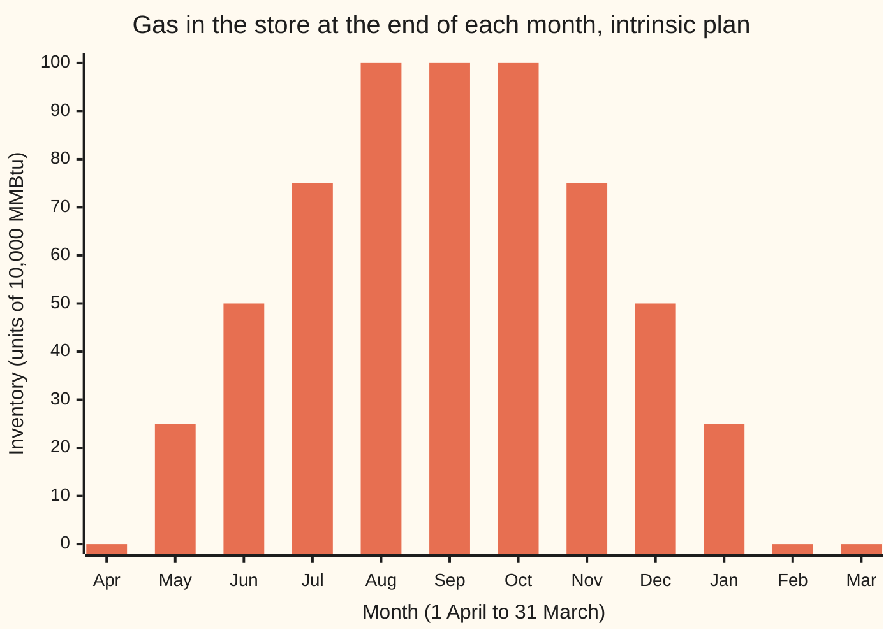

# Gas storage and swing contracts: exercise limited by volume, solved backwards with inventory as part of the state

[Syllabus](../../../SYLLABUS.md) → [Financial mathematics](../README.md) → [Options on commodity futures and spreads](../README.md#s26) → Gas storage and swing contracts

---

## General Overview

A salt cavern in Louisiana can hold natural gas. A trader leases space in it for **100 units**, where one unit is 10,000 MMBtu (a million British thermal units, the unit gas is sold in). So the space holds 1,000,000 MMBtu. The pumps can move at most **25 units a month**, in or out. The space starts empty on 1 April and must be empty again by the end of March.

On 1 April the forward curve is the one from [Seasonal curves](../25-Commodity%20forwards%20-%20carry%2C%20storage%2C%20convenience%20yield%20and%20the%20curve/05-seasonality-and-the-gas-curve.md): July gas at **$2.50**, January gas at **$3.50**. A forward is a price fixed today for gas delivered in a later month. Buying summer forwards and selling winter forwards locks in a profit today. Done in the best order the pumps allow, that profit is worth **$670,772**. This is the store's **intrinsic value**: what it earns with every decision made today.

Prices will move, and the trader does not have to decide everything today. Each month the trader can look at the new price and choose again: inject, hold or withdraw. That freedom has value. On a price model fitted to the same curve, the store is worth **$775,110**. The extra $104,338 is its **extrinsic value**: the value of deciding later.

A **swing contract** has the same shape. A gas buyer holds **4 rights** over the 12 months. Each right lets the buyer take 1 unit at a fixed **$3.00** per MMBtu in one month, at most one right a month. It looks like 4 American options (rights to exercise once, at any chosen date). Four separate options would be worth **$27,485**. The swing is worth **$21,172**, because four separate holders could all exercise in the same lucky month, and the swing allows only one exercise a month.

Both contracts share one feature. Each choice uses up something that later choices need: space in the cavern, or rights left. So the value depends on two things, the price now and what is left. Working backwards from the last month, with both in the state, finds the best decision in every situation.

**A storage facility or swing contract is a chain of linked options: its intrinsic value is a linear program on today's forward curve, and its full value comes from working backwards on a price tree with inventory, or rights left, as part of the state.**

**What kind of fact this is:** a method inside a model. The price model (one mean-reverting factor) is an assumption that fits gas tolerably, not a law. Inside it, three statements are theorems proved in Why it works: intrinsic ≤ rolling intrinsic ≤ full value, the backward recursion gives the best policy, and the swing sits between its fixed-month and American bounds.

### The picture: the intrinsic plan



Bars: inventory under the best plan fixed on 1 April. The plan buys in May, June, July and August, at forwards of $2.55, $2.50, $2.50 and $2.55. It sells in November, December, January and February, at $3.05, $3.35, $3.50 and $3.40. The pump limit is why the plan needs four months to fill and four to empty, so it cannot buy and sell only in the cheapest and dearest months.

---

## The formula

The intrinsic value is the best plan fixed today:

```math
V_{\mathrm{int}} = \max_{x_0,\dots,x_{11}} \sum_{m=0}^{11} D_m\big(-x_m F_m - c\,|x_m|\big), \quad -25 \le x_m \le 25, \quad 0 \le I_m \le 100, \quad I_{11} = 0.
```

**Read it aloud:** choose how much to inject or withdraw each month so that the discounted cash from buying, selling and pumping is as large as possible, without overfilling, emptying below zero, pumping too fast, or ending with gas left.

The full value works backwards from March, one month at a time. In month $`m`$, at price node $`s`$ with inventory $`I`$:

```math
V_m(s, I) = \max_{x \in \{-25,\,0,\,25\},\ 0 \le I + x \le 100} \Big[-x\,S_m(s) - c\,|x| + e^{-r/12}\,\mathbb{E}\big[V_{m+1}(s', I + x) \mid s\big]\Big].
```

**Read it aloud:** the store's value now is the best of three moves, each worth its cash this month plus the discounted average value next month, starting from the inventory the move leaves behind. After March the value is 0 for an empty store and minus infinity for any gas left, which forces the store to end empty.

The swing contract uses the same recursion with rights left, $`n`$, in place of inventory:

```math
W_m(s, n) = \max\Big[e^{-r/12}\,\mathbb{E}\big[W_{m+1}(s', n) \mid s\big],\ \big(S_m(s) - K\big)^{+} + e^{-r/12}\,\mathbb{E}\big[W_{m+1}(s', n-1) \mid s\big]\Big].
```

**Read it aloud:** keep the right for later, or use one now, collect the price minus the strike, and carry one fewer right forward. Here $`(z)^{+}`$ means $`z`$ when it is positive and 0 otherwise.

Values on this card are in units times dollars per MMBtu. Multiply by 10,000 for dollars: 67.0772 is $670,772.

| Symbol | Plain meaning | In our example | Push it up and the answer… |
| --- | --- | --- | --- |
| $`m`$ | month number: 0 is April, 11 is March | 0 to 11 | — |
| $`F_m`$ | forward price on 1 April for gas delivered in month $`m`$ | July 2.50, January 3.50 | a wider summer-winter gap raises the intrinsic value |
| $`x_m`$ | units injected in month $`m`$; negative means withdrawn | +25 in May, −25 in January | — |
| $`I_m`$ | inventory at the end of month $`m`$, the running total of $`x`$ | 0 to 100 units | more space raises value |
| $`c`$ | cost of moving one MMBtu in or out: pump fuel and wear | $0.02 | falls |
| $`r`$, $`D_m`$ | riskless rate, and the discount $`e^{-rm/12}`$ for cash paid in month $`m`$ | 5%; 0.963194 for January | falls a little |
| $`s`$, $`S_m(s)`$ | a node of the price tree, and the month-$`m`$ gas price at that node | 13 nodes a month | — |
| $`\mathbb{E}[\,\cdot \mid s]`$, $`s'`$ | average over next month's nodes $`s'`$, weighted by the tree's branch chances from $`s`$ | — | — |
| $`\kappa`$ | reversion speed: how hard the price is pulled back toward its curve, per year | 3 | raises storage value here (months move more independently) |
| $`\sigma`$ | volatility: yearly spread of percentage price moves | 60% | raises full value; intrinsic unchanged |
| $`V_{\mathrm{int}}`$, $`V_m`$, $`W_m`$ | intrinsic value; value of the store, and of the swing, from month $`m`$ on | 67.0772; 77.5110 and 2.1172 at the start | — |
| $`K`$, $`n`$ | swing strike, and rights left | $3.00, 4 | higher strike lowers the swing; more rights raise it |

### When it holds

- **One price factor.** Every month's price is driven by one random number, so summer and winter move together, damped by distance. Real curves also twist: winter can rise while summer falls. A model with two factors usually gives the store more extrinsic value than this one sees.
- **Fixed pump rates and monthly choices.** Real caverns pump more slowly when nearly full or nearly empty, and owners nominate daily. Rate curves lower the value; daily choices raise it.
- **Forwards can be traded.** Intrinsic and rolling intrinsic values are locked in only by trading forwards against the plan. Without a forward market the extrinsic value is a model number, not cash.
- **The tree is coarse but close.** With 8 steps a month and 13 nodes, each month's European call on the tree agrees with the exact Black-76 price to within 0.003. July is the worst month: 0.0621 on the tree against 0.0646. A coarser tree shifts every value on the card.
- **A plain swing.** Each right is 1 unit, at most one a month, with no minimum amount the buyer must take. Real contracts add minimum takes and penalties, which add states to the same recursion.

---

## Why it works

### Step 0: a choice that uses something up links all later choices

A single option is one decision: exercise or not. [Optimal stopping](../../11-Stochastic%20processes%20and%20calculus/08-Generators%2C%20Densities%20and%20Simulation/07-optimal-stopping-and-snell-envelope.md) solves it by working backwards: at each date, take the better of stopping now and the average value of waiting.

A store makes twelve decisions, and they are linked. Gas injected in May takes space that June cannot use. Gas sold in December cannot be sold again in January. So "what is the store worth now?" has no answer from the price alone. It needs the inventory too. Put inventory into the state, next to the price, and the same backward step works again. The swing contract is identical, with rights left in place of inventory.

### Step 1: intrinsic value is a linear program on the forward curve

Every forward is a price fixed today. So any plan fixed today has a known value: buy forward for the injection months, sell forward for the withdrawal months, and the cash is locked. The best such plan is the intrinsic value.

The plan's value is a sum of prices times amounts, and every limit is a sum of amounts compared with a number. That is a **linear program**: a best choice under straight-line limits. (The pump cost $`c\,|x_m|`$ becomes linear when injections and withdrawals are separate amounts.)

A linear program's best answer sits at a corner of its allowed region. Here every corner has all inventories at whole multiples of 25, because every limit is a multiple of 25 (fold below). So the search can look only at inventories 0, 25, 50, 75 and 100. The code finds the best plan two ways:

1. Backwards over those five inventory levels, month by month, as in the recursion above but with today's forwards as fixed prices.
2. By trying every one of the $`3^{12}`$ = 531,441 schedules of −25, 0 or +25 a month, keeping those that stay between 0 and 100 and end empty.

Both give **67.0772**, with the same plan: inject May to August, withdraw November to February.

<details>
<summary>Detailed proof: every corner sits at multiples of 25</summary>

Write each month's move as injection $`u_m \ge 0`$ minus withdrawal $`w_m \ge 0`$, each at most 25. The inventory limit for month $`k`$ reads

$`\displaystyle 0 \le \sum_{m=0}^{k} u_m - \sum_{m=0}^{k} w_m \le 100.`$

Each limit row has +1 on a run of consecutive months for $`u`$, −1 on the same run for $`w`$, and 0 elsewhere. A matrix whose rows are runs of consecutive ones is an **interval matrix**, and interval matrices are **totally unimodular**: every square block has determinant 0, +1 or −1. Placing $`-A`$ beside $`A`$, or adding the rows of single 1s for the bounds, keeps that property.

A corner is where enough limits hold with equality to fix every variable. By Cramer's rule each variable is then a ratio of two determinants. The denominator is ±1, and the numerator is built from the limits 0, 25 and 100. So every corner has every amount at a multiple of 25. A linear program with a best answer has one at a corner. Hence the five-level search loses nothing.

</details>

### Step 2: rolling intrinsic re-plans each month and never loses

The intrinsic plan ignores news. **Rolling intrinsic** fixes that without any model of the future. On 1 April, lock in the intrinsic plan with forwards. Each later month, look at the new forward curve, re-solve the linear program from the current inventory, and trade forwards to move from the old plan to the new one.

Each re-plan can only gain. The old plan is still allowed at the new prices, so the new best plan is worth at least as much as the old one at those prices. The switch locks in that difference, which is zero or positive. Gains on the forwards held in between average zero under the pricing weights (the risk-neutral probabilities, under which each forward price is a fair bet), so they add nothing to today's value. Hence rolling intrinsic is at least the intrinsic value.

On the tree below, the code values rolling intrinsic exactly. It carries the chance of every (node, inventory) pair forward month by month and adds up the expected discounted cash. The result is **77.3542**, against 67.0772.

### Step 3: a price tree that reverts and matches the curve

The full value needs a model of how prices move. Gas prices are pulled back toward normal levels, as in [A spot price that reverts](../25-Commodity%20forwards%20-%20carry%2C%20storage%2C%20convenience%20yield%20and%20the%20curve/06-mean-reverting-spot-and-the-futures-curve.md). Here the logarithm of the month's price is the log of a seasonal level plus a deviation $`y`$. The deviation is pulled back to zero at speed $`\kappa`$ = 3 a year, with volatility $`\sigma`$ = 60%.

The deviation lives on a trinomial tree, as in [Trinomial trees](../04-Binomial%20Trees/06-trinomial-trees-and-the-grid-connection.md). Each small step moves it up, down or not at all, by 0.1044 in log price. Each month has 8 small steps. The branch chances are chosen so each step has the right average pull and the right spread. At the edges, 6 rungs from the middle, the branches turn inward, so the tree has 13 nodes, not an ever-wider fan.

Last, each month's prices are scaled so that their average over the tree equals that month's forward exactly. The code checks this a second way: it rolls each month's prices back through the tree, node by node, to 1 April, and lands on that month's forward in all twelve months. This step makes the tree price every forward correctly, so storage values on it agree with the market's curve.

<details>
<summary>The branch chances, and the second road for the tree</summary>

Let $`\Delta t`$ be one small step, $`M = e^{-\kappa\Delta t} - 1`$ the average pull per step, and $`j`$ the rung. The rung spacing is $`\Delta y = \sqrt{3v}`$ with $`v = \sigma^2(1 - e^{-2\kappa\Delta t})/(2\kappa)`$, the exact one-step variance. In the middle of the tree the chances of up, level and down are

$`\displaystyle p_u = \tfrac16 + \tfrac12\big(j^2M^2 + jM\big),\quad p_m = \tfrac23 - j^2M^2,\quad p_d = \tfrac16 + \tfrac12\big(j^2M^2 - jM\big).`$

They match the step's average move $`jM\Delta y`$ and its variance. The top rung branches to itself and the two rungs below; the bottom rung does the mirror image. The top rung is the first whole number above $`0.184/(-M)`$: from there on the inward-turned branches have no negative chance. Here that is rung 6.

The second road: a European call on month $`m`$'s price is a Black-76 option with variance $`\sigma^2(1 - e^{-2\kappa t})/(2\kappa)`$, the spread a reverting log price builds up by time $`t`$ ([Options on a futures price](01-options-on-commodity-futures.md)). The code prices all twelve months both ways. The largest gap is in July: 0.0621 on the tree, 0.0646 exact. The strip of twelve is 2.7381 on the tree and 2.7454 exact.

</details>

### Step 4: backwards over price and inventory

Start in March. A store that still holds gas at the end breaks the contract, so the code gives that state a huge negative value, and no policy chooses it. Then step back. In each month, at each node, for each inventory, try the three moves. Three are enough: on the tree each inventory limit is a sum of moves along the path of nodes from 1 April, and such path sums again form a totally unimodular matrix, so whole multiples of 25 lose nothing, as in Step 1. Each move earns its cash now plus the discounted average value next month, from the inventory it leaves. Keep the best. This is the recursion in The formula.

The result is **77.5110**: $775,110. This is the best value any policy can reach on this tree, because at every state the recursion has already kept the best of all moves. Rolling intrinsic is one particular policy, so it cannot beat the full value. The code confirms:

```math
67.0772 \;<\; 77.3542 \;<\; 77.5110.
```

In a one-factor model, rolling intrinsic gets almost all of the extrinsic value: 10.2769 of 10.4338. That is why desks use it. It needs only forward curves, and every gain it books is locked in by a trade.

A third road checks the backward value. The code walks 20,000 random paths through the tree with its own random numbers, follows the policy the recursion chose, and averages the discounted cash. It gets 77.5281 with standard error 0.4506: within one standard error.

The same paths check rolling intrinsic. Re-planning each month along them averages 77.3257, standard error 0.4520, against the exact 77.3542. Path by path, the full policy beats rolling intrinsic by 0.2024 on average, standard error 0.0607, against the exact gap of 0.1568. Both policies see the same prices, so this paired gap is measured far more tightly than either value alone.

### Step 5: the swing contract is the same program

Replace inventory by rights left. In each month, at each node, keeping a right is worth its discounted average next month; using one pays $`S_m(s) - K`$ now and leaves one fewer. Two cases check the recursion:

- **12 rights over 12 months.** No right ever crowds out another, so the swing is a strip of 12 European calls: 2.7381 both ways.
- **1 right.** The swing is a single American option with monthly exercise: 0.6871.

With 4 rights the value is **2.1172**: $21,172. It sits between two bounds:

| Bound | Value | Why |
| --- | --- | --- |
| Best 4 Europeans, months fixed today (Jan, Feb, Dec, Nov) | 1.9302 | one allowed policy, so the swing is worth at least this |
| Swing, 4 rights | 2.1172 | the best policy |
| 4 separate American options | 2.7485 | they may all exercise in the same month; the swing cannot |

The upper bound holds because each right is used at a date the holder picks as prices arrive, which is exactly what one American option allows. So each right is worth at most one American option, and 4 rights at most 4. The bound is strict because 4 American holders may all exercise in the same month.

The walk through the tree gives 2.1295, standard error 0.0151: within one standard error of 2.1172.

The rights left change the decision. The table shows, for each winter month, the lowest tree price at which the holder uses a right:

| Month | 1 right left | 2 left | 3 left | 4 left |
| --- | ---: | ---: | ---: | ---: |
| Dec | 4.45 | 4.01 | 3.25 | 3.25 |
| Jan | 3.77 | 3.40 | 3.06 | 3.06 |
| Feb | 3.30 | 3.30 | 3.30 | 3.30 |
| Mar | 3.29 | 3.29 | 3.29 | 3.29 |

With one right left in December, the holder waits for $4.45, because January and February may bring a better price. With 4 rights left in December, or 3 or 4 in January, there are at least as many rights as months left, so no right crowds out another. The holder uses one at any tree price above the $3.00 strike: $3.25 and $3.06 are December's and January's lowest tree prices above $3.00. With 3 rights left in December, four months remain, so using a right still has a cost; its bar shows $3.25 only because the tree has no December price between $3.00 and $3.25. In February and March every column shows the lowest tree price above $3.00. A right not used by March is lost, so the bar falls as the deadline nears.

---

## Worked numbers, by hand

The intrinsic plan, priced on the forwards of 1 April. Each month's cash is $`D_m(-x_m F_m - c\,|x_m|)`$.

| Step | Arithmetic | Value |
| --- | --- | --- |
| May, inject 25 | −(25 × 2.55 + 25 × 0.02) × 0.995842 | −63.9828 |
| June, inject 25 | −(25 × 2.50 + 25 × 0.02) × 0.991701 | −62.4772 |
| July, inject 25 | −(25 × 2.50 + 25 × 0.02) × 0.987578 | −62.2174 |
| August, inject 25 | −(25 × 2.55 + 25 × 0.02) × 0.983471 | −63.1880 |
| November, withdraw 25 | (25 × 3.05 − 25 × 0.02) × 0.971255 | 73.5725 |
| December, withdraw 25 | (25 × 3.35 − 25 × 0.02) × 0.967216 | 80.5207 |
| January, withdraw 25 | (25 × 3.50 − 25 × 0.02) × 0.963194 | 83.7979 |
| February, withdraw 25 | (25 × 3.40 − 25 × 0.02) × 0.959189 | 81.0515 |
| intrinsic value | sum of the eight lines | **67.0772, or $670,772** |
| full value on the tree | backwards over price and inventory | **77.5110, or $775,110** |

The store is worth $670,772 locked in on 1 April, and $775,110 to a trader who re-decides each month and hedges with forwards. The difference is the value of waiting to see prices.

### What breaks if you drop a piece

| Mistake | Comes out at | What went wrong |
| --- | --- | --- |
| Value the store at its intrinsic plan only | 67.0772, not 77.5110 | Ignores the right to change the plan as prices move |
| Drop the 25-a-month pump limit | 86.3221, not 67.0772 | Lets the store fill all 100 units in July and empty them all in January |
| Value the swing as 4 American options | 2.7485, not 2.1172 | All four would exercise in the same month; the swing allows one |
| Value the swing as 4 Europeans in fixed months | 1.9302, not 2.1172 | Throws away the choice of when to use each right |

---

## Code, from first principles, and it actually runs

The script finds the intrinsic plan two ways: backwards over five inventory levels, and by trying all 531,441 schedules. It builds the reverting tree, checks by rolling prices back through it that it reprices every forward, and checks its twelve European calls against Black-76 with its own bell-curve area. It values the store and the swing backwards, values rolling intrinsic exactly, and checks all three values by walking 20,000 random paths. That is three roads to the intrinsic value (backwards, every schedule, and the hand sum of the eight cash lines), two to each tree European call, and two to each of the three tree values, plus the bounds between them.

### Python

```python
# Gas storage and swing contracts -- the check behind the card.  Standard library only.  The 25-05
# Henry Hub strip (USD/MMBtu, Apr..Mar).  A store holds 100 units (1 unit = 10,000 MMBtu), moves at most
# 25 a month, starts and ends empty.  The price reverts (speed 3 a year, vol 60%) on a tree fitted to the strip.
from math import exp, log, sqrt, ceil, pi
from itertools import product

MON = ["Apr", "May", "Jun", "Jul", "Aug", "Sep", "Oct", "Nov", "Dec", "Jan", "Feb", "Mar"]
F = [2.70, 2.55, 2.50, 2.50, 2.55, 2.62, 2.75, 3.05, 3.35, 3.50, 3.40, 3.05]
r, c, CAP, LIM, KAP, SIG, SUB, K, NR = 0.05, 0.02, 100, 25, 3.0, 0.60, 8, 3.00, 4
D = [exp(-r * m / 12) for m in range(12)]                # discount to 1 April
ACT, g = (-25, 0, 25), exp(-r / 12)                     # withdraw, hold, inject; one month's discount
def cash(a, p): return -a * p - c * abs(a)              # buy a units (sell if a < 0), pay the cost

def intrinsic(curve, m0, I0, lim=LIM):                  # road 1: backwards over inventory
    V = {I: 0.0 if I == 0 else -1e18 for I in range(0, CAP + 1, 25)}
    for m in range(11, m0 - 1, -1):
        W = {I: max((cash(a, curve[m]) * D[m] / D[m0] + V[I + a], a)
                    for a in range(-lim, lim + 1, 25) if 0 <= I + a <= CAP) for I in V}
        V = {I: W[I][0] for I in W}
    return W[I0]
iv, best = intrinsic(F, 0, 0)[0], (-1e18, None)         # road 2: try all 3^12 schedules
for s in product(ACT, repeat=12):
    lev = [sum(s[:m + 1]) for m in range(12)]
    if min(lev) >= 0 and max(lev) <= CAP and lev[-1] == 0:
        best = max(best, (sum(cash(a, F[m]) * D[m] for m, a in enumerate(s)), s))
plan = best[1]

def tree(kap, sig):     # SUB small steps a month, exact step mean and variance, edges turn inward
    dt = 1 / 12 / SUB; M = exp(-kap * dt) - 1
    dy = sqrt(3 * sig * sig * (1 - exp(-2 * kap * dt)) / (2 * kap)); JM = ceil(0.184 / -M); N = 2 * JM + 1
    P = [[0.0] * N for _ in range(N)]
    for j in range(-JM, JM + 1):
        q, m = j * j * M * M, j * M
        br = ([(j, 7/6 + (q + 3*m)/2), (j-1, -1/3 - q - 2*m), (j-2, 1/6 + (q + m)/2)] if j == JM else
              [(j+2, 1/6 + (q - m)/2), (j+1, -1/3 - q + 2*m), (j, 7/6 + (q - 3*m)/2)] if j == -JM else
              [(j+1, 1/6 + (q + m)/2), (j, 2/3 - q), (j-1, 1/6 + (q - m)/2)])
        for k, p in br: P[j + JM][k + JM] += p
    T = P
    for _ in range(SUB - 1): T = [[sum(T[i][k] * P[k][j] for k in range(N)) for j in range(N)] for i in range(N)]
    Q = [[1.0 if i == JM else 0.0 for i in range(N)]]   # chance of each node, month by month
    for m in range(11): Q.append([sum(Q[-1][i] * T[i][k] for i in range(N)) for k in range(N)])
    S = [[exp((i - JM) * dy) for i in range(N)] for m in range(12)]
    for m in range(12):                                 # shift each month onto the strip
        sh = F[m] / sum(Q[m][i] * S[m][i] for i in range(N)); S[m] = [s * sh for s in S[m]]
    return T, Q, S, JM, dy

def dp(T, S, states, moves, end):                       # backwards over (month, node, state)
    N = len(T); V = {s: [end(s)] * N for s in states}; pol = {}
    for m in range(11, -1, -1):
        C = {s: [g * sum(T[i][k] * V[s][k] for k in range(N)) if m < 11 else end(s) for i in range(N)] for s in states}
        for s in states:
            for i in range(N):
                V[s][i], pol[m, i, s] = max((cf + C[s2][i], s2) for s2, cf in moves(s, S[m][i]))
    return V, pol
st = lambda I, p: [(I + a, cash(a, p)) for a in ACT if 0 <= I + a <= CAP]
sw = lambda n, p: [(n, 0.0)] + ([(n - 1, max(p - K, 0.0))] if n else [])
emp = lambda I: 0.0 if I == 0 else -1e18                # the store must end empty
def storage(kap, sig): t = tree(kap, sig); return dp(t[0], t[2], range(0, CAP + 1, 25), st, emp)[0][0][t[3]]
T, Q, S, JM, dy = tree(KAP, SIG); N = len(T)
stor, spol = dp(T, S, range(0, CAP + 1, 25), st, emp)
swv, wpol = dp(T, S, range(13), sw, lambda n: 0.0)

G = [[None] * 12 for _ in range(12)]                    # G[m][t][i]: forward for t at node i, month m
for t in range(12):
    v = S[t][:]
    for m in range(t, -1, -1): G[m][t] = v; v = [sum(T[i][k] * v[k] for k in range(N)) for i in range(N)]
dist, ri, rp = {(JM, 0): 1.0}, 0.0, {}                  # rolling intrinsic: re-plan, do month one
for m in range(12):
    nd = {}
    for (i, I), p in dist.items():
        a = rp[m, i, I] = intrinsic([0.0] * m + [G[m][t][i] for t in range(m, 12)], m, I)[1]
        ri += p * D[m] * cash(a, S[m][i])
        for k in range(N if m < 11 else 0): nd[k, I + a] = nd.get((k, I + a), 0.0) + p * T[i][k]
    dist = nd

def ncdf(x):                                            # bell-curve area, Simpson's rule
    h = x / 2000; s = 1 + exp(-x * x / 2)
    for k in range(1, 2000): s += (4 if k % 2 else 2) * exp(-(k * h) * (k * h) / 2)
    return 0.5 + s * h / 3 / sqrt(2 * pi)
eur, b76 = [], []
for m in range(12):
    eur.append(D[m] * sum(Q[m][i] * max(S[m][i] - K, 0) for i in range(N)))
    v = SIG * SIG * (1 - exp(-2 * KAP * m / 12)) / (2 * KAP); s = sqrt(v)
    d = (log(F[m] / K) + v / 2) / s if s else 0.0
    b76.append(D[m] * (F[m] * ncdf(d) - K * ncdf(d - s)) if s else D[m] * max(F[m] - K, 0))

NP, acc, state, top4 = 20000, [0.0] * 8, 20261123, sum(sorted(eur)[-NR:])  # road 3: walk the tree
for _ in range(NP):
    i, I, n, J, w1, w2, w3 = JM, 0, NR, 0, 0.0, 0.0, 0.0
    for m in range(12):
        I2, n2, a = spol[m, i, I], wpol[m, i, n], rp[m, i, J]; w1 += D[m] * cash(I2 - I, S[m][i])
        w2 += D[m] * max(S[m][i] - K, 0) * (n - n2); w3 += D[m] * cash(a, S[m][i]); I, n, J = I2, n2, J + a
        state = (state * 6364136223846793005 + 1442695040888963407) % 2 ** 64; u, k = (state >> 11) / 2 ** 53, 0
        while k < N - 1 and u > T[i][k]: u -= T[i][k]; k += 1
        i = k
    acc = [x + y for x, y in zip(acc, (w1, w1 * w1, w2, w2 * w2, w3, w3 * w3, w1 - w3, (w1 - w3) * (w1 - w3)))]; assert I == 0 == J, "store ends empty"
mc1, mc2, mc3, mcd = (acc[k] / NP for k in (0, 2, 4, 6))   # storage, swing, rolling, storage minus rolling
se1, se2, se3, sed = (sqrt((acc[k + 1] / NP - (acc[k] / NP) ** 2) / NP) for k in (0, 2, 4, 6))

print(f"store {CAP} units of 10,000 MMBtu, {LIM} a month, cost {c:.2f}, r {r:.2f}, kappa {KAP:.1f}, sigma {SIG:.2f}")
print(f"tree: {SUB} steps a month, {N} nodes, log-price step {dy:.4f}; swing strike {K:.2f}, {NR} rights")
print("month  forward  plan  level  discount  cash today")
for m in range(12):
    print(f"{MON[m]:<6} {F[m]:7.2f} {plan[m]:+5d} {sum(plan[:m + 1]):6d} {D[m]:9.6f} {cash(plan[m], F[m]) * D[m]:11.4f}")
print(f"intrinsic, backwards over inventory  {iv:9.4f}")
print(f"intrinsic, all 3^12 schedules        {best[0]:9.4f}")
print(f"rolling intrinsic, exact on the tree {ri:9.4f}\n  simulated, 20,000 paths            {mc3:9.4f}  s.e. {se3:.4f}")
print(f"storage on the tree, backwards       {stor[0][JM]:9.4f}")
print(f"  simulated, 20,000 paths            {mc1:9.4f}  s.e. {se1:.4f}")
print(f"  full minus rolling, exact {stor[0][JM] - ri:.4f}, same paths {mcd:.4f}  s.e. {sed:.4f}")
print(f"extrinsic: rolling, full tree        {ri - iv:9.4f} {stor[0][JM] - iv:9.4f}")
gap = max(abs(G[0][t][JM] - F[t]) for t in range(12))     # each month's prices rolled back to 1 April
print(f"tree rolled back = strip, every month{'yes' if gap < 1e-12 else 'no':>9}")
print("month  European tree  Black-76")
for m in range(12): print(f"{MON[m]:<6} {eur[m]:13.4f} {b76[m]:9.4f}")
print(f"strip of 12 Europeans, tree, B76     {sum(eur):9.4f} {sum(b76):9.4f}")
print(f"swing, 12 rights on the tree         {swv[12][JM]:9.4f}")
print(f"swing, 1 right = one American        {swv[1][JM]:9.4f}")
print(f"swing, 4 rights                      {swv[NR][JM]:9.4f}")
print(f"  simulated, 20,000 paths            {mc2:9.4f}  s.e. {se2:.4f}")
print(f"4 American options                   {NR * swv[1][JM]:9.4f}")
print(f"best 4 Europeans, fixed months       {top4:9.4f}")
print(f"dollars: intrinsic {iv * 1e4:.0f}, tree {stor[0][JM] * 1e4:.0f}, swing {swv[NR][JM] * 1e4:.0f}, 4 Americans {NR * swv[1][JM] * 1e4:.0f}")
print("lowest price that uses a right, by rights left 1 2 3 4")
for m in (8, 9, 10, 11):
    print(f"  {MON[m]}  " + " ".join(f"{min([S[m][i] for i in range(N) if wpol[m, i, n] < n] or [0.0]):5.2f}" for n in (1, 2, 3, 4)))
print(f"wrong: no 25-a-month limit           {intrinsic(F, 0, 0, 100)[0]:9.4f}")
print(f"try: 50 a month, intrinsic           {intrinsic(F, 0, 0, 50)[0]:9.4f}")
print(f"try: sigma 30%, storage              {storage(KAP, 0.30):9.4f}")
print(f"try: kappa 1, storage                {storage(1.0, SIG):9.4f}")
assert abs(iv - best[0]) < 1e-9 and plan == (0, 25, 25, 25, 25, 0, 0, -25, -25, -25, -25, 0), "two intrinsic roads"
assert abs(iv - sum(D[m] * 25 * ((F[m] - c) if m > 6 else -(F[m] + c)) for m in (1, 2, 3, 4, 7, 8, 9, 10))) < 1e-9, "intrinsic = hand sum"
assert gap < 1e-12, "tree reprices the strip"
assert max(abs(e - b) for e, b in zip(eur, b76)) < 0.003, "tree Europeans match Black-76"
assert abs(swv[12][JM] - sum(eur)) < 1e-9, "12 rights = the strip of Europeans"
assert iv < ri < stor[0][JM], "intrinsic < rolling intrinsic < full tree"
assert top4 < swv[NR][JM] < NR * swv[1][JM], "swing sits between fixed months and 4 Americans"
assert abs(mc1 - stor[0][JM]) < 3 * se1 and abs(mc2 - swv[NR][JM]) < 3 * se2, "simulation agrees"
assert abs(mc3 - ri) < 3 * se3 and abs(mcd - (stor[0][JM] - ri)) < 3 * sed, "rolling intrinsic agrees with its paths"
print("ALL CHECKS PASS")
```

**Ran 2026-11-23 on macOS, Python 3.14.10, standard library only. All checks passed. Output, pasted from the run:**

```
store 100 units of 10,000 MMBtu, 25 a month, cost 0.02, r 0.05, kappa 3.0, sigma 0.60
tree: 8 steps a month, 13 nodes, log-price step 0.1044; swing strike 3.00, 4 rights
month  forward  plan  level  discount  cash today
Apr       2.70    +0      0  1.000000      0.0000
May       2.55   +25     25  0.995842    -63.9828
Jun       2.50   +25     50  0.991701    -62.4772
Jul       2.50   +25     75  0.987578    -62.2174
Aug       2.55   +25    100  0.983471    -63.1880
Sep       2.62    +0    100  0.979382      0.0000
Oct       2.75    +0    100  0.975310      0.0000
Nov       3.05   -25     75  0.971255     73.5725
Dec       3.35   -25     50  0.967216     80.5207
Jan       3.50   -25     25  0.963194     83.7979
Feb       3.40   -25      0  0.959189     81.0515
Mar       3.05    +0      0  0.955201      0.0000
intrinsic, backwards over inventory    67.0772
intrinsic, all 3^12 schedules          67.0772
rolling intrinsic, exact on the tree   77.3542
  simulated, 20,000 paths              77.3257  s.e. 0.4520
storage on the tree, backwards         77.5110
  simulated, 20,000 paths              77.5281  s.e. 0.4506
  full minus rolling, exact 0.1568, same paths 0.2024  s.e. 0.0607
extrinsic: rolling, full tree          10.2769   10.4338
tree rolled back = strip, every month      yes
month  European tree  Black-76
Apr           0.0000    0.0000
May           0.0331    0.0315
Jun           0.0478    0.0495
Jul           0.0621    0.0646
Aug           0.0862    0.0862
Sep           0.1142    0.1124
Oct           0.1602    0.1620
Nov           0.3054    0.3070
Dec           0.4962    0.4958
Jan           0.6023    0.6026
Feb           0.5262    0.5281
Mar           0.3043    0.3056
strip of 12 Europeans, tree, B76        2.7381    2.7454
swing, 12 rights on the tree            2.7381
swing, 1 right = one American           0.6871
swing, 4 rights                         2.1172
  simulated, 20,000 paths               2.1295  s.e. 0.0151
4 American options                      2.7485
best 4 Europeans, fixed months          1.9302
dollars: intrinsic 670772, tree 775110, swing 21172, 4 Americans 27485
lowest price that uses a right, by rights left 1 2 3 4
  Dec   4.45  4.01  3.25  3.25
  Jan   3.77  3.40  3.06  3.06
  Feb   3.30  3.30  3.30  3.30
  Mar   3.29  3.29  3.29  3.29
wrong: no 25-a-month limit             86.3221
try: 50 a month, intrinsic             80.3097
try: sigma 30%, storage                70.1707
try: kappa 1, storage                  70.8434
ALL CHECKS PASS
```

### Rust

```rust
// Gas storage and swing contracts -- the check behind the card.  std only, no crates.
// The 25-05 Henry Hub strip (USD/MMBtu, Apr..Mar).  A store holds 100 units (1 unit =
// 10,000 MMBtu), moves at most 25 a month, and starts and ends empty.  The month's price
// reverts (speed 3 a year, volatility 60%) on a trinomial tree fitted to the strip.
const MON: [&str; 12] = ["Apr", "May", "Jun", "Jul", "Aug", "Sep", "Oct", "Nov", "Dec", "Jan", "Feb", "Mar"];
const F: [f64; 12] = [2.70, 2.55, 2.50, 2.50, 2.55, 2.62, 2.75, 3.05, 3.35, 3.50, 3.40, 3.05];
const R: f64 = 0.05; const C: f64 = 0.02; const CAP: i32 = 100; const LIM: i32 = 25;
const KAP: f64 = 3.0; const SIG: f64 = 0.60; const SUB: usize = 8; const K: f64 = 3.00; const NR: i32 = 4;
type Mat = Vec<Vec<f64>>; type Pol = Vec<Vec<Vec<i32>>>;
fn cash(a: i32, p: f64) -> f64 { (-a) as f64 * p - C * a.abs() as f64 } // buy a units, pay the cost
fn disc() -> Vec<f64> { (0..12).map(|m| (-R * m as f64 / 12.0).exp()).collect() }

fn intrinsic(curve: &[f64], m0: usize, i0: i32, lim: i32) -> (f64, i32) { // road 1: backwards
    let d = disc();
    let mut v: Vec<f64> = (0..5).map(|l| if l == 0 { 0.0 } else { -1e18 }).collect();
    let mut w = vec![(0.0, 0); 5];
    for m in (m0..12).rev() {
        for l in 0..5 {
            let mut b = (f64::NEG_INFINITY, 0);
            for a in (-lim..=lim).step_by(25).filter(|a| (0..=CAP).contains(&(25 * l as i32 + a))) {
                let x = cash(a, curve[m]) * d[m] / d[m0] + v[((25 * l as i32 + a) / 25) as usize];
                if x > b.0 || (x == b.0 && a > b.1) { b = (x, a); }
            }
            w[l] = b;
        }
        for l in 0..5 { v[l] = w[l].0; }
    }
    w[(i0 / 25) as usize]
}

fn tree(kap: f64, sig: f64) -> (Mat, Mat, Mat, usize, f64) {
    let dt = 1.0 / 12.0 / SUB as f64; let mm = (-kap * dt).exp() - 1.0;
    let dy = (3.0 * sig * sig * (1.0 - (-2.0 * kap * dt).exp()) / (2.0 * kap)).sqrt();
    let jm = (0.184 / -mm).ceil() as i64; let n = (2 * jm + 1) as usize;
    let mut p = vec![vec![0.0; n]; n];
    for j in -jm..=jm {
        let (q, m) = ((j * j) as f64 * mm * mm, j as f64 * mm);
        let br = if j == jm {
            [(j, 7.0/6.0 + (q + 3.0*m)/2.0), (j-1, -1.0/3.0 - q - 2.0*m), (j-2, 1.0/6.0 + (q + m)/2.0)]
        } else if j == -jm {
            [(j+2, 1.0/6.0 + (q - m)/2.0), (j+1, -1.0/3.0 - q + 2.0*m), (j, 7.0/6.0 + (q - 3.0*m)/2.0)]
        } else { [(j+1, 1.0/6.0 + (q + m)/2.0), (j, 2.0/3.0 - q), (j-1, 1.0/6.0 + (q - m)/2.0)] };
        for (k, pr) in br { p[(j + jm) as usize][(k + jm) as usize] += pr; }
    }
    let mut t = p.clone();
    for _ in 0..SUB - 1 { t = (0..n).map(|i| (0..n).map(|j| (0..n).fold(0.0, |s, k| s + t[i][k] * p[k][j])).collect()).collect(); }
    let mut qm: Mat = vec![(0..n).map(|i| if i == jm as usize { 1.0 } else { 0.0 }).collect()];
    for m in 0..11 { let row = (0..n).map(|k| (0..n).fold(0.0, |s, i| s + qm[m][i] * t[i][k])).collect(); qm.push(row); }
    let mut s: Mat = vec![(0..n).map(|i| ((i as i64 - jm) as f64 * dy).exp()).collect(); 12];
    for m in 0..12 { let sh = F[m] / (0..n).fold(0.0, |a, i| a + qm[m][i] * s[m][i]); for i in 0..n { s[m][i] *= sh; } }
    (t, qm, s, jm as usize, dy)
}

// backwards over (month, node, state); states are 0, step, 2 step, ...; ties keep the larger state
fn dp(t: &Mat, s: &Mat, ns: usize, step: i32, moves: &dyn Fn(i32, f64) -> Vec<(i32, f64)>, end: &dyn Fn(i32) -> f64) -> (Mat, Pol) {
    let n = t.len(); let g = (-R / 12.0).exp();
    let mut v: Mat = (0..ns).map(|x| vec![end(x as i32 * step); n]).collect();
    let mut pol = vec![vec![vec![0; ns]; n]; 12];
    for m in (0..12).rev() {
        let c: Mat = (0..ns).map(|x| (0..n).map(|i| if m < 11 { g * (0..n).fold(0.0, |a, k| a + t[i][k] * v[x][k]) } else { end(x as i32 * step) }).collect()).collect();
        for x in 0..ns {
            for i in 0..n {
                let mut b = (f64::NEG_INFINITY, -1);
                for (s2, cf) in moves(x as i32 * step, s[m][i]) {
                    let y = cf + c[(s2 / step) as usize][i];
                    if y > b.0 || (y == b.0 && s2 > b.1) { b = (y, s2); }
                }
                v[x][i] = b.0; pol[m][i][x] = b.1;
            }
        }
    }
    (v, pol)
}
fn st(i: i32, p: f64) -> Vec<(i32, f64)> { [-25, 0, 25].iter().filter(|&&a| (0..=CAP).contains(&(i + a))).map(|&a| (i + a, cash(a, p))).collect() }
fn sw(n: i32, p: f64) -> Vec<(i32, f64)> { let mut v = vec![(n, 0.0)]; if n > 0 { v.push((n - 1, (p - K).max(0.0))); } v }
fn emp(i: i32) -> f64 { if i == 0 { 0.0 } else { -1e18 } } // the store must end empty
fn storage(kap: f64, sig: f64) -> f64 { let (t, _, s, jm, _) = tree(kap, sig); dp(&t, &s, 5, 25, &st, &emp).0[0][jm] }
fn ncdf(x: f64) -> f64 { // bell-curve area, Simpson's rule
    let h = x / 2000.0; let mut s = 1.0 + (-x * x / 2.0).exp();
    for k in 1..2000 { let z = k as f64 * h; s += (if k % 2 == 1 { 4.0 } else { 2.0 }) * (-z * z / 2.0).exp(); }
    0.5 + s * h / 3.0 / (2.0 * std::f64::consts::PI).sqrt()
}

fn main() {
    let d = disc(); let iv = intrinsic(&F, 0, 0, LIM).0;
    let (mut best, mut plan) = (-1e18, [0i32; 12]);          // road 2: try all 3^12 schedules
    for code in 0..531441u32 {
        let (mut s, mut x) = ([0i32; 12], code); for m in (0..12).rev() { s[m] = (x % 3) as i32 * 25 - 25; x /= 3; }
        let (mut lev, mut ok, mut val) = (0, true, 0.0);
        for m in 0..12 { lev += s[m]; ok &= (0..=CAP).contains(&lev); val += cash(s[m], F[m]) * d[m]; }
        if ok && lev == 0 && val > best { best = val; plan = s; }
    }
    let (t, q, s, jm, dy) = tree(KAP, SIG); let n = t.len();
    let (stor, spol) = dp(&t, &s, 5, 25, &st, &emp);
    let (swv, wpol) = dp(&t, &s, 13, 1, &sw, &|_| 0.0);
    let mut gg = vec![vec![vec![0.0; n]; 12]; 12];            // gg[m][t][i]: forward for t at node i, month m
    for tt in 0..12 {
        let mut v = s[tt].clone();
        for m in (0..=tt).rev() { gg[m][tt] = v.clone(); v = (0..n).map(|i| (0..n).fold(0.0, |a, k| a + t[i][k] * v[k])).collect(); }
    }
    let (mut dist, mut ri, mut rp): (Vec<((usize, i32), f64)>, f64, Pol) = (vec![((jm, 0), 1.0)], 0.0, vec![vec![vec![0; 5]; n]; 12]); // rolling intrinsic
    for m in 0..12 {
        let mut nd: Vec<((usize, i32), f64)> = Vec::new();
        for &((i, lv), p) in &dist {
            let curve: Vec<f64> = (0..12).map(|tt| if tt < m { 0.0 } else { gg[m][tt][i] }).collect();
            let a = intrinsic(&curve, m, lv, LIM).1; rp[m][i][(lv / 25) as usize] = a;
            ri += p * d[m] * cash(a, s[m][i]);
            for k in 0..(if m < 11 { n } else { 0 }) {
                let key = (k, lv + a); let add = p * t[i][k];
                match nd.iter_mut().find(|e| e.0 == key) { Some(e) => e.1 += add, None => nd.push((key, 0.0 + add)) }
            }
        }
        dist = nd;
    }
    let (mut eur, mut b76) = (vec![], vec![]); for m in 0..12 {
        eur.push(d[m] * (0..n).fold(0.0, |a, i| a + q[m][i] * (s[m][i] - K).max(0.0)));
        let v = SIG * SIG * (1.0 - (-2.0 * KAP * m as f64 / 12.0).exp()) / (2.0 * KAP); let sd = v.sqrt();
        let dd = if sd > 0.0 { ((F[m] / K).ln() + v / 2.0) / sd } else { 0.0 };
        b76.push(if sd > 0.0 { d[m] * (F[m] * ncdf(dd) - K * ncdf(dd - sd)) } else { d[m] * (F[m] - K).max(0.0) });
    }
    let mut srt = eur.clone(); srt.sort_by(|a, b| a.partial_cmp(b).unwrap()); let top4 = srt[12 - NR as usize..].iter().fold(0.0, |a, x| a + x);
    let (np, mut acc, mut state) = (20000, [0.0f64; 8], 20261123u64); // road 3: walk the tree's own paths
    for _ in 0..np {
        let (mut i, mut lv, mut nn, mut lj, mut w1, mut w2, mut w3) = (jm, 0i32, NR, 0i32, 0.0, 0.0, 0.0);
        for m in 0..12 {
            let (i2, n2, a) = (spol[m][i][(lv / 25) as usize], wpol[m][i][nn as usize], rp[m][i][(lj / 25) as usize]); w1 += d[m] * cash(i2 - lv, s[m][i]);
            w2 += d[m] * (s[m][i] - K).max(0.0) * (nn - n2) as f64; w3 += d[m] * cash(a, s[m][i]); lv = i2; nn = n2; lj += a;
            state = state.wrapping_mul(6364136223846793005).wrapping_add(1442695040888963407);
            let (mut u, mut k) = ((state >> 11) as f64 / 9007199254740992.0, 0);
            while k < n - 1 && u > t[i][k] { u -= t[i][k]; k += 1; }
            i = k;
        }
        let add = [w1, w1 * w1, w2, w2 * w2, w3, w3 * w3, w1 - w3, (w1 - w3) * (w1 - w3)]; for k in 0..8 { acc[k] += add[k]; } assert!(lv == 0 && lj == 0, "store ends empty");
    }
    let npf = np as f64; let mc: Vec<f64> = (0..4).map(|k| acc[2 * k] / npf).collect(); // storage, swing, rolling, storage minus rolling
    let sem: Vec<f64> = (0..4).map(|k| ((acc[2 * k + 1] / npf - mc[k] * mc[k]) / npf).sqrt()).collect(); let st0 = stor[0][jm];
    println!("store {} units of 10,000 MMBtu, {} a month, cost {:.2}, r {:.2}, kappa {:.1}, sigma {:.2}\ntree: {} steps a month, {} nodes, \
              log-price step {:.4}; swing strike {:.2}, {} rights", CAP, LIM, C, R, KAP, SIG, SUB, n, dy, K, NR);
    println!("month  forward  plan  level  discount  cash today");
    let mut lev = 0; for m in 0..12 { lev += plan[m]; println!("{:<6} {:7.2} {:+5} {:6} {:9.6} {:11.4}", MON[m], F[m], plan[m], lev, d[m], cash(plan[m], F[m]) * d[m]); }
    println!("intrinsic, backwards over inventory  {:9.4}\nintrinsic, all 3^12 schedules        {:9.4}", iv, best);
    println!("rolling intrinsic, exact on the tree {:9.4}\n  simulated, 20,000 paths            {:9.4}  s.e. {:.4}", ri, mc[2], sem[2]);
    println!("storage on the tree, backwards       {:9.4}\n  simulated, 20,000 paths            {:9.4}  s.e. {:.4}\n  full minus rolling, exact {:.4}, same paths {:.4}  s.e. {:.4}", st0, mc[0], sem[0], st0 - ri, mc[3], sem[3]);
    println!("extrinsic: rolling, full tree        {:9.4} {:9.4}", ri - iv, st0 - iv);
    let gap = (0..12).map(|tt| (gg[0][tt][jm] - F[tt]).abs()).fold(0.0, f64::max); // each month's prices rolled back to 1 April
    println!("tree rolled back = strip, every month{:>9}", if gap < 1e-12 { "yes" } else { "no" });
    println!("month  European tree  Black-76"); for m in 0..12 { println!("{:<6} {:13.4} {:9.4}", MON[m], eur[m], b76[m]); }
    let (se, sb) = (eur.iter().fold(0.0, |a, x| a + x), b76.iter().fold(0.0, |a, x| a + x));
    println!("strip of 12 Europeans, tree, B76     {:9.4} {:9.4}", se, sb);
    println!("swing, 12 rights on the tree         {:9.4}\nswing, 1 right = one American        {:9.4}", swv[12][jm], swv[1][jm]);
    println!("swing, 4 rights                      {:9.4}", swv[NR as usize][jm]);
    println!("  simulated, 20,000 paths            {:9.4}  s.e. {:.4}", mc[1], sem[1]);
    println!("4 American options                   {:9.4}\nbest 4 Europeans, fixed months       {:9.4}", NR as f64 * swv[1][jm], top4);
    println!("dollars: intrinsic {:.0}, tree {:.0}, swing {:.0}, 4 Americans {:.0}", iv * 1e4, st0 * 1e4, swv[NR as usize][jm] * 1e4, NR as f64 * swv[1][jm] * 1e4);
    println!("lowest price that uses a right, by rights left 1 2 3 4");
    for m in [8, 9, 10, 11] {
        let row: Vec<String> = (1..=4).map(|r| format!("{:5.2}", (0..n).filter(|&i| wpol[m][i][r] < r as i32).map(|i| s[m][i]).fold(f64::INFINITY, f64::min))).collect();
        println!("  {}  {}", MON[m], row.join(" "));
    }
    println!("wrong: no 25-a-month limit           {:9.4}\ntry: 50 a month, intrinsic           {:9.4}", intrinsic(&F, 0, 0, 100).0, intrinsic(&F, 0, 0, 50).0);
    println!("try: sigma 30%, storage              {:9.4}\ntry: kappa 1, storage                {:9.4}", storage(KAP, 0.30), storage(1.0, SIG));
    assert!((iv - best).abs() < 1e-9 && plan == [0, 25, 25, 25, 25, 0, 0, -25, -25, -25, -25, 0], "two intrinsic roads");
    assert!(gap < 1e-12, "tree reprices the strip"); let hand = [1usize, 2, 3, 4, 7, 8, 9, 10].iter().fold(0.0, |a, &m| a + d[m] * 25.0 * if m > 6 { F[m] - C } else { -(F[m] + C) });
    assert!((iv - hand).abs() < 1e-9, "intrinsic = hand sum");
    assert!((0..12).all(|m| (eur[m] - b76[m]).abs() < 0.003), "tree Europeans match Black-76"); assert!((swv[12][jm] - se).abs() < 1e-9, "12 rights = the strip of Europeans");
    assert!(iv < ri && ri < st0, "intrinsic < rolling intrinsic < full tree"); assert!(top4 < swv[NR as usize][jm] && swv[NR as usize][jm] < NR as f64 * swv[1][jm], "swing between bounds");
    assert!((mc[0] - st0).abs() < 3.0 * sem[0] && (mc[1] - swv[NR as usize][jm]).abs() < 3.0 * sem[1], "simulation agrees");
    assert!((mc[2] - ri).abs() < 3.0 * sem[2] && (mc[3] - (st0 - ri)).abs() < 3.0 * sem[3], "rolling intrinsic agrees with its paths");
    println!("ALL CHECKS PASS");
}
```

**Ran 2026-11-23 on macOS, rustc 1.98.1, no crates. All checks passed. Output, pasted from the run:**

```
store 100 units of 10,000 MMBtu, 25 a month, cost 0.02, r 0.05, kappa 3.0, sigma 0.60
tree: 8 steps a month, 13 nodes, log-price step 0.1044; swing strike 3.00, 4 rights
month  forward  plan  level  discount  cash today
Apr       2.70    +0      0  1.000000      0.0000
May       2.55   +25     25  0.995842    -63.9828
Jun       2.50   +25     50  0.991701    -62.4772
Jul       2.50   +25     75  0.987578    -62.2174
Aug       2.55   +25    100  0.983471    -63.1880
Sep       2.62    +0    100  0.979382      0.0000
Oct       2.75    +0    100  0.975310      0.0000
Nov       3.05   -25     75  0.971255     73.5725
Dec       3.35   -25     50  0.967216     80.5207
Jan       3.50   -25     25  0.963194     83.7979
Feb       3.40   -25      0  0.959189     81.0515
Mar       3.05    +0      0  0.955201      0.0000
intrinsic, backwards over inventory    67.0772
intrinsic, all 3^12 schedules          67.0772
rolling intrinsic, exact on the tree   77.3542
  simulated, 20,000 paths              77.3257  s.e. 0.4520
storage on the tree, backwards         77.5110
  simulated, 20,000 paths              77.5281  s.e. 0.4506
  full minus rolling, exact 0.1568, same paths 0.2024  s.e. 0.0607
extrinsic: rolling, full tree          10.2769   10.4338
tree rolled back = strip, every month      yes
month  European tree  Black-76
Apr           0.0000    0.0000
May           0.0331    0.0315
Jun           0.0478    0.0495
Jul           0.0621    0.0646
Aug           0.0862    0.0862
Sep           0.1142    0.1124
Oct           0.1602    0.1620
Nov           0.3054    0.3070
Dec           0.4962    0.4958
Jan           0.6023    0.6026
Feb           0.5262    0.5281
Mar           0.3043    0.3056
strip of 12 Europeans, tree, B76        2.7381    2.7454
swing, 12 rights on the tree            2.7381
swing, 1 right = one American           0.6871
swing, 4 rights                         2.1172
  simulated, 20,000 paths               2.1295  s.e. 0.0151
4 American options                      2.7485
best 4 Europeans, fixed months          1.9302
dollars: intrinsic 670772, tree 775110, swing 21172, 4 Americans 27485
lowest price that uses a right, by rights left 1 2 3 4
  Dec   4.45  4.01  3.25  3.25
  Jan   3.77  3.40  3.06  3.06
  Feb   3.30  3.30  3.30  3.30
  Mar   3.29  3.29  3.29  3.29
wrong: no 25-a-month limit             86.3221
try: 50 a month, intrinsic             80.3097
try: sigma 30%, storage                70.1707
try: kappa 1, storage                  70.8434
ALL CHECKS PASS
```

### Lean

Lean proves the store's and the swing's bounds for any price model, not just the tree, and checks the intrinsic plan.

- Suppose each forward is the average future price under the pricing weights. Suppose the full value beats the average discounted cash of every allowed plan fixed today. Then the full value is at least the intrinsic value.
- Suppose each of a swing's $`n`$ rights is used at a date chosen from the prices seen so far. Suppose one American option is worth at least the average payoff of exercising at any such date. Then the swing's average payoff is at most $`n`$ American options.
- Suppose the swing is worth at least using one right in each month of any fixed set of at most $`n`$ months. Then it is worth at least the sum of the discounted European calls on any such set.
- The intrinsic plan moves at most 25 a month, keeps the store between 0 and 100 units, and ends empty. Its inventory each month is the one in the picture.
- Trying −25, 0 or +25 in each of 12 months gives 531,441 schedules.

Rolling intrinsic, the tree, the backward values and every decimal are left to the Python and Rust checks.

```lean
-- Gas storage and swing contracts: if each forward is the average future price under the pricing weights, a store worth at least every fixed plan the pumps and space allow is worth at least its intrinsic value, and a swing contract is worth at least its fixed-month Europeans and at most one American option per right.
import Mathlib.MeasureTheory.Integral.Bochner.Basic
import Mathlib.Probability.Process.Stopping

open MeasureTheory

/-- Full value is at least intrinsic value. A plan `x` buys `x m` units in month `m` (sells them
when `x m < 0`) at the month's price `S m`, pays `c` per unit moved, and discounts by `D m`.
The store allows a plan when it moves at most 25 units a month, keeps the inventory (the running
total of `x`) between 0 and 100 at the end of every month, and ends empty. If each forward is
the average future price under the pricing weights, `F m = E^Q[S m]`, and the full value `V` is
at least the average discounted cash of every allowed plan fixed today, then `V` is at least the
intrinsic value: the best value of an allowed plan on today's forward curve. -/
theorem full_value_ge_intrinsic {Ω : Type*} [MeasurableSpace Ω]
    (Q : Measure Ω) [IsProbabilityMeasure Q] (S : Fin 12 → Ω → ℝ) (hS : ∀ m, Integrable (S m) Q)
    (F D : Fin 12 → ℝ) (c V : ℝ) (hF : ∀ m, F m = ∫ ω, S m ω ∂Q)
    (hV : ∀ x : Fin 12 → ℝ, (∀ m, -25 ≤ x m ∧ x m ≤ 25) →
      (∀ k, 0 ≤ ∑ m ∈ Finset.Iic k, x m ∧ ∑ m ∈ Finset.Iic k, x m ≤ 100) → ∑ m, x m = 0 →
      ∫ ω, ∑ m, D m * (-x m * S m ω - c * |x m|) ∂Q ≤ V) :
    sSup ((fun x : Fin 12 → ℝ => ∑ m, D m * (-x m * F m - c * |x m|)) ''
      {x | (∀ m, -25 ≤ x m ∧ x m ≤ 25) ∧
        (∀ k, 0 ≤ ∑ m ∈ Finset.Iic k, x m ∧ ∑ m ∈ Finset.Iic k, x m ≤ 100) ∧ ∑ m, x m = 0})
      ≤ V := by
  have hval : ∀ x : Fin 12 → ℝ,
      ∫ ω, ∑ m, D m * (-x m * S m ω - c * |x m|) ∂Q = ∑ m, D m * (-x m * F m - c * |x m|) := by
    intro x
    rw [integral_finsetSum (f := fun m ω => D m * (-x m * S m ω - c * |x m|)) _
      (fun m _ => (((hS m).const_mul (-x m)).sub (integrable_const (c * |x m|))).const_mul (D m))]
    refine Finset.sum_congr rfl (fun m _ => ?_)
    rw [integral_const_mul, integral_sub ((hS m).const_mul (-x m)) (integrable_const _),
      integral_const_mul, integral_const, hF m]
    simp
  apply csSup_le
  · refine ⟨_, (0 : Fin 12 → ℝ), ⟨fun m => by norm_num, fun k => by simp, by simp⟩, rfl⟩
  · rintro _ ⟨x, ⟨h1, h2, h3⟩, rfl⟩
    show ∑ m, D m * (-x m * F m - c * |x m|) ≤ V
    rw [← hval x]
    exact hV x h1 h2 h3

/-- Swing at most one American option per right. A right used at date `t` on price path `ω`
pays `pay t ω`, discounted (`t = ⊤` means never used). One American option is worth `A`: at
least the average of `pay τ` for every exercise rule `τ` that decides from the prices seen so far
(a stopping time). A swing with `n` rights uses its `k`-th right by such a rule `τ k`. Then the
swing's average payoff is at most `n` American options. -/
theorem swing_le_n_american {Ω : Type*} {mΩ : MeasurableSpace Ω} (Q : Measure Ω)
    (ℱ : Filtration ℕ mΩ) (pay : WithTop ℕ → Ω → ℝ) (A : ℝ)
    (hint : ∀ τ : Ω → WithTop ℕ, IsStoppingTime ℱ τ → Integrable (fun ω => pay (τ ω) ω) Q)
    (hA : ∀ τ : Ω → WithTop ℕ, IsStoppingTime ℱ τ → ∫ ω, pay (τ ω) ω ∂Q ≤ A)
    (n : ℕ) (τ : Fin n → Ω → WithTop ℕ) (hτ : ∀ k, IsStoppingTime ℱ (τ k)) :
    ∫ ω, ∑ k, pay (τ k ω) ω ∂Q ≤ n * A := by
  rw [integral_finsetSum _ (fun k _ => hint (τ k) (hτ k))]
  calc ∑ k, ∫ ω, pay (τ k ω) ω ∂Q ≤ ∑ _k : Fin n, A :=
        Finset.sum_le_sum (fun k _ => hA (τ k) (hτ k))
    _ = n * A := by simp

/-- Swing at least its fixed-month Europeans. Using one right, at strike `K`, in each month of a
set `s` of at most `n` months fixed today is a policy a swing with `n` rights allows. If the
swing's value `W` is at least the average discounted payoff of every such policy, then for every
such set `W` is at least the sum of the discounted European calls on those months. -/
theorem swing_ge_fixed_months {Ω : Type*} [MeasurableSpace Ω] (Q : Measure Ω)
    [IsProbabilityMeasure Q] (S : Fin 12 → Ω → ℝ) (hS : ∀ m, Integrable (S m) Q)
    (D : Fin 12 → ℝ) (K W : ℝ) (n : ℕ)
    (hW : ∀ s : Finset (Fin 12), s.card ≤ n →
      ∫ ω, ∑ m ∈ s, D m * max (S m ω - K) 0 ∂Q ≤ W) :
    ∀ s : Finset (Fin 12), s.card ≤ n → ∑ m ∈ s, D m * ∫ ω, max (S m ω - K) 0 ∂Q ≤ W := by
  intro s hs
  have h := hW s hs
  rw [integral_finsetSum (f := fun m ω => D m * max (S m ω - K) 0) _
    (fun m _ => (((hS m).sub (integrable_const K)).pos_part).const_mul (D m))] at h
  simpa only [integral_const_mul] using h

-- The intrinsic plan (Apr..Mar) moves at most 25 a month, keeps the store between 0 and 100
-- units, and ends empty.
example : ([0, 25, 25, 25, 25, 0, 0, -25, -25, -25, -25, 0] : List ℤ).all
      (fun a => -25 ≤ a ∧ a ≤ 25) ∧
    (List.scanl (· + ·) 0 ([0, 25, 25, 25, 25, 0, 0, -25, -25, -25, -25, 0] : List ℤ)).all
      (fun l => 0 ≤ l ∧ l ≤ 100) ∧
    ([0, 25, 25, 25, 25, 0, 0, -25, -25, -25, -25, 0] : List ℤ).sum = 0 := by decide

-- Inventory at the end of each month under the intrinsic plan, as in the picture.
example : (List.scanl (· + ·) 0 ([0, 25, 25, 25, 25, 0, 0, -25, -25, -25, -25, 0] : List ℤ)).tail
    = [0, 25, 50, 75, 100, 100, 100, 75, 50, 25, 0, 0] := by decide

-- A move of -25, 0 or +25 in each of 12 months gives 3^12 = 531,441 schedules to try.
example : 3 ^ 12 = 531441 := by norm_num

#print axioms full_value_ge_intrinsic
#print axioms swing_le_n_american
#print axioms swing_ge_fixed_months
```

**Checked 2026-11-23 on macOS, Lean 4.36.0-rc2, Mathlib v4.36.0-rc2. Every proof is complete and uses only Lean's standard axioms. Output, pasted from the run:**

```
'full_value_ge_intrinsic' depends on axioms: [propext, Classical.choice, Quot.sound]
'swing_le_n_american' depends on axioms: [propext, Classical.choice, Quot.sound]
'swing_ge_fixed_months' depends on axioms: [propext, Classical.choice, Quot.sound]
```

> [!TIP]
> **Try changing**
> Guess first, then run it. The printed "try" lines give the answers.
> - **Pumps twice as fast, 50 units a month.** Does the intrinsic value double? No: it rises from 67.0772 to 80.3097. The store can now fill in two months and empty in two, using only the cheapest and dearest months.
> - **Volatility 30% instead of 60%.** The intrinsic value stays 67.0772, since it uses only today's curve. The full value falls from 77.5110 to 70.1707.
> - **Slower reversion, speed 1 instead of 3.** Slower reversion might seem to allow bigger swings and more value. The full value falls to 70.8434. With slow reversion, summer and winter prices move together, so the gap between them, which is what a store earns, moves less.
> - **Swing with 12 rights.** The value equals the strip of 12 European calls, 2.7381. With one right per month, no right crowds out another.

---

## The usual mistake

> [!warning]
> **Treating each right, or each month of space, as a separate option.** A swing with 4 rights is not 4 American options: those would all exercise in the same best month, and the swing allows one exercise a month. Adding them gives 2.7485 against the true 2.1172. A store is not a strip of separate summer-winter [Spread options](04-margrabe-and-kirk-spread-options.md) for the same reason: each month's choice uses space or gas that another month needs.
>
> - **Stopping at intrinsic value.** It is a floor, not a value: 67.0772 against 77.5110 here. Leasing space at the intrinsic value hands the extrinsic part to the buyer.
> - **Forgetting the pump limit.** Without it, the plan fills all 100 units in July and empties them all in January: 86.3221 instead of 67.0772.
> - **Leaving inventory out of the state.** A backward step on price alone cannot know whether the store is full or empty, so it cannot tell whether "inject" is even allowed.
> - **Reading rolling intrinsic as the full value.** It is a lower bound: 77.3542 against 77.5110 here. How large the gap is depends on the price model.

---

## Where you meet it in real life

- **Leasing storage capacity.** Cavern and depleted-field operators sell space, pump rates and terms in auctions. Bidders price a lease as intrinsic value plus extrinsic value, and hedge it by rolling intrinsic.
- **Gas supply contracts with flexibility.** Utilities buy gas under swing contracts. The buyer chooses each month how much to take, between a minimum and a maximum, at a fixed or indexed price.
- **Trading desks that run storage.** A desk that leases a cavern sells the winter forwards and buys the summer ones on day one, then re-plans as the curve moves.
- **Hydro reservoirs.** Water held behind a dam is stored energy with limited release rates. Its value per unit, the **water value**, comes from the same backward recursion with reservoir level in the state.
- **Power plants with start-up costs.** A plant that pays to start carries "running or not" in its state, the case [Power that cannot be stored](07-electricity-and-the-spark-spread.md) left for later.

> **Say it back**
> A gas store and a swing contract are chains of options where each choice uses up space or rights that later choices need. Locking in the best plan on today's forward curve is a linear program; its answer is the intrinsic value, 67.0772 here. Re-planning each month on the new curve, rolling intrinsic, can only add value. The full value comes from working backwards on a price tree with inventory or rights left in the state, and it is the most any policy can earn. A swing with 4 rights sits between 4 fixed-month Europeans and 4 American options, because it allows one exercise a month.

---

## What this builds on

- [Seasonal curves](../25-Commodity%20forwards%20-%20carry%2C%20storage%2C%20convenience%20yield%20and%20the%20curve/05-seasonality-and-the-gas-curve.md): the twelve-month gas strip used here, and storage as the trade that bounds summer-to-winter spreads.
- [A spot price that reverts](../25-Commodity%20forwards%20-%20carry%2C%20storage%2C%20convenience%20yield%20and%20the%20curve/06-mean-reverting-spot-and-the-futures-curve.md): the pull of a log price toward its level, which the tree reproduces.
- [Options on a futures price](01-options-on-commodity-futures.md): Black-76, the exact road for the tree's European calls.
- [Trinomial trees](../04-Binomial%20Trees/06-trinomial-trees-and-the-grid-connection.md): three branches a step, with the node spacing chosen freely.
- [Longstaff-Schwartz](../06-Numerical%20Methods%20for%20Pricing/06-longstaff-schwartz-least-squares-monte-carlo.md): early exercise by regression on simulated paths, the method that replaces the tree when there are many factors.
- [Optimal stopping](../../11-Stochastic%20processes%20and%20calculus/08-Generators%2C%20Densities%20and%20Simulation/07-optimal-stopping-and-snell-envelope.md): working backwards from the deadline, taking the better of stopping and waiting.

## Where this goes next

- [Weather and carbon](09-weather-and-emissions-derivatives.md): the shelf's last card, on contracts written on temperature and on emission allowances.
- [The Hull-White tree](../30-Short-Rate%20Models/06-hull-white-trinomial-tree.md): the same reverting tree with inward-turning edges, fitted to a yield curve instead of a gas curve.
- Least-squares storage valuation (planned): the store valued by regression on simulated curves, which handles several price factors where a tree cannot.

A one-factor tree values a store that sees one random number a month; the open question is how much more a store is worth when summer and winter prices move separately, and how to compute it when a tree has too many dimensions.

---

## Sources

Verified 2026-11-23: every link below resolves to the publisher's page.

- Patrick Jaillet, Ehud I. Ronn and Stathis Tompaidis, "Valuation of Commodity-Based Swing Options", *Management Science* 50(7) (2004), 909–921. [doi:10.1287/mnsc.1040.0240](https://doi.org/10.1287/mnsc.1040.0240). Swing contracts valued by backward recursion on a mean-reverting trinomial tree, with rights left in the state.
- René Carmona and Michael Ludkovski, "Valuation of energy storage: an optimal switching approach", *Quantitative Finance* 10(4) (2010), 359–374. [doi:10.1080/14697680902946514](https://doi.org/10.1080/14697680902946514). Storage as a chain of switching decisions with inventory in the state.
- Alexander Boogert and Cyriel de Jong, "Gas Storage Valuation Using a Monte Carlo Method", *The Journal of Derivatives* 15(3) (2008), 81–98. [doi:10.3905/jod.2008.702507](https://doi.org/10.3905/jod.2008.702507). Storage valued by least-squares regression on simulated prices; intrinsic and extrinsic value compared.
- John Hull and Alan White, "Numerical Procedures for Implementing Term Structure Models I: Single-Factor Models", *The Journal of Derivatives* 2(1) (1994), 7–16. [doi:10.3905/jod.1994.407902](https://doi.org/10.3905/jod.1994.407902). The mean-reverting trinomial tree with inward-turning edges and the shift that fits it to a curve.
