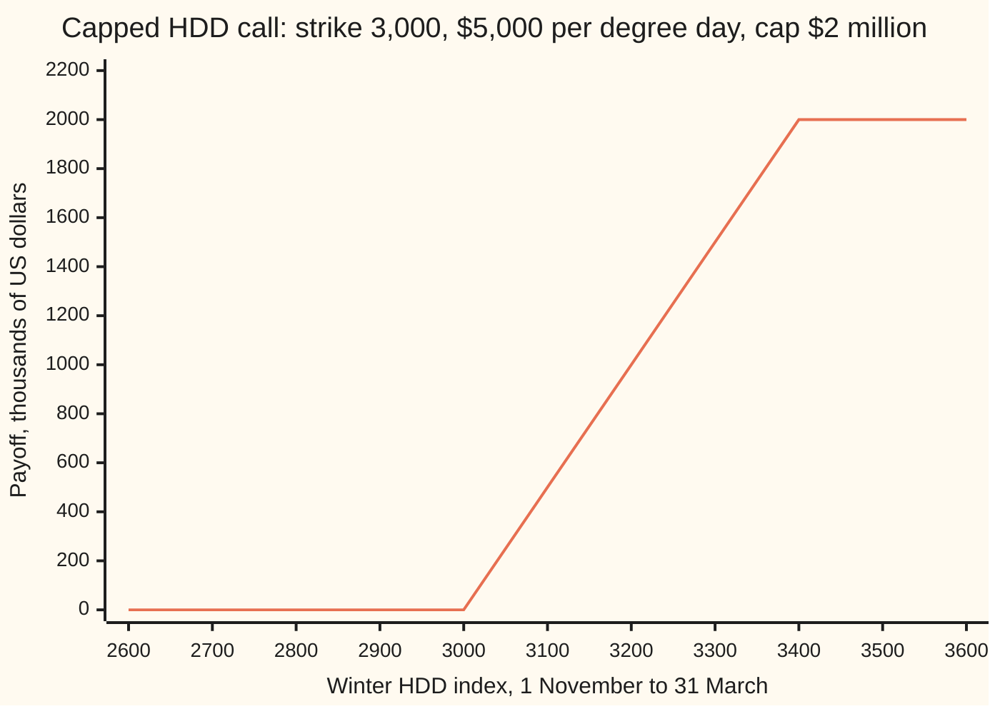
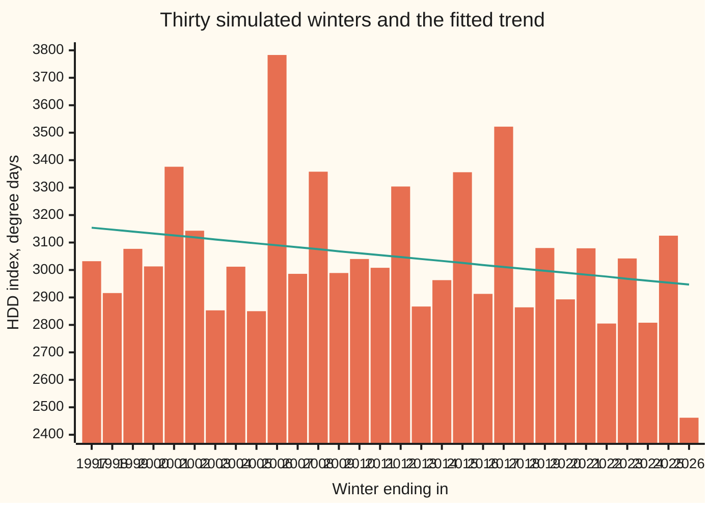

# Weather and carbon: degree-day options on a quantity nobody can store, and allowance forwards that can be banked

[Syllabus](../../../SYLLABUS.md) → [Financial mathematics](../README.md) → [Options on commodity futures and spreads](../README.md#s26) → Weather and carbon

---

## General Overview

A heating-oil distributor has sold its customers fixed-price heating plans for the winter of 2026–27. A cold winter means its customers burn more oil than it priced in, and the distributor pays the difference. On 1 October 2026 it buys protection against cold: a **heating-degree-day call**.

A **heating degree day** (HDD) counts how far a day's average temperature falls below 65°F. A day averaging 62°F is 3 HDD; a day at 70°F is 0. Add up the 151 days from 1 November to 31 March at the local weather station and you have the winter's **HDD index**. Around here a typical winter totals about 3,000.

The call pays **$5,000 for every degree day above 3,000**, up to a cap of **$2 million**. Its worth today, estimated from thirty past winters (simulated for this card, see Step 3), is **$305,736**. A bell curve fitted to the same winters says **$330,484**.

Nobody can buy a degree day, store it and sell it later. So no carry trade pins this price, as carry pins the price of gold and caps the price of oil. The price comes from history and statistics instead.

The card's second contract is the opposite case. An **EU allowance** (EUA) is a permit to emit one tonne of carbon dioxide. It costs €70 today. It costs nothing to keep, and an allowance not used this year can be **banked** for later years. So it carries like gold: the one-year forward is $`70\,e^{0.03}`$ = **€72.13**.

**A degree-day option has no carry trade behind it, so it is priced as the discounted average payoff over a history cleaned of its warming trend, read straight from the winters (burn analysis) or from a bell curve fitted to them; a bankable carbon allowance is a storable good with no income, so its forward is spot grown at the interest rate.**

**What kind of fact this is:** two different kinds. The degree-day price is a statistical estimate: it depends on a model of the weather and on a choice of how much extra a seller charges for risk. The carbon forward is a theorem inside a stated model (banking allowed, one interest rate, no fees), proved in Why it works by an arbitrage argument.

### The picture: what the call pays at the end of March



The line is the payoff. Nothing up to 3,000 degree days. Then $5,000 for each degree day, so $500,000 per 100. At 3,400 it reaches the $2 million cap and goes flat. The cap is 2,000,000 / 5,000 = 400 degree days above the strike.

---

## The formula

Degree days for one day, with the day's average temperature $`A_d`$ in °F, and the winter index $`X`$:

```math
\mathrm{HDD}_d = \max(65 - A_d,\, 0), \qquad \mathrm{CDD}_d = \max(A_d - 65,\, 0), \qquad X = \sum_{d=1}^{151} \mathrm{HDD}_d
```

**Read it aloud:** a cold day scores how far it sits below 65°F, a hot day scores how far it sits above, and the winter index adds up the cold scores.

A **cooling degree day** (CDD) is the summer mirror: it counts how far a day sits above 65°F, and summer indices add those up.

The capped call pays, at the end of March,

```math
\text{payoff}(X) = c\,\min\big(\max(X - K,\, 0),\, L\big)
```

and its value today, by the two roads on this card, is

```math
V_{\text{burn}} = D \cdot \frac{1}{n}\sum_{i=1}^{n} \text{payoff}(X_i'), \qquad V_{\text{fit}} = D\,c\,\big[G(K) - G(K + L)\big], \quad G(k) = (\mu - k)\,N\!\Big(\frac{\mu - k}{s}\Big) + s\,\phi\Big(\frac{\mu - k}{s}\Big)
```

**Read it aloud:** the burn price averages what the contract would have paid in each past winter, moved to today's climate, and discounts it; the fitted price does the same average over a bell curve with the history's mean and spread.

The carbon forward, for an allowance that can be banked:

```math
F = S\,e^{rT}
```

**Read it aloud:** the forward price is today's allowance price grown at the interest rate, because holding an allowance costs nothing and pays nothing.

| Symbol | Plain meaning | In our example | Push it up and the answer… |
| --- | --- | --- | --- |
| $`A_d`$ | day $`d`$'s average temperature: (high + low) / 2, in °F | high 72, low 52: 62°F | lowers that day's HDD |
| $`\mathrm{HDD}_d`$, $`\mathrm{CDD}_d`$, $`X`$ | day $`d`$'s heating and cooling degree days, and the winter HDD index summed over 151 days | 3 and 0 on a 62°F day; $`X`$ unknown until 31 March | — |
| $`K`$ | the strike, in degree days | 3,000 | lowers the call |
| $`c`$ | the tick: dollars paid per degree day | $5,000 | scales the call |
| $`L`$ | the cap in degree days: cap in dollars over tick | 400 | raises the call, more slowly each time |
| $`X_i'`$, $`n`$ | past winter $`i`$'s index moved to the coming winter's climate (detrended), and the number of winters | 30 winters | — |
| $`\mu`$, $`s`$ | mean and standard deviation of the detrended winters | 2,939.75 and 243.12 | both raise the call |
| $`N(x)`$, $`\phi(x)`$ | bell-curve area to the left of $`x`$, and the bell curve's height at $`x`$ | — | — |
| $`G(k)`$ | expected excess of a bell-curve index over level $`k`$, in degree days | 69.8323 at 3,000 | — |
| $`r`$, $`T`$, $`D`$ | interest rate (continuously compounded), years to payment, and discount factor $`e^{-rT}`$ | 3%; 0.5 for weather, 1 for carbon; $`D`$ = 0.985112 | $`r`$ lowers the weather call, raises the forward |
| $`S`$, $`F`$ | the allowance price today, per tonne, and its forward price for delivery in $`T`$ years | €70 and €72.13 | $`S`$ raises the forward one for one, grown |
| $`V_{\text{burn}}`$, $`V_{\text{fit}}`$ | the call's value today by burn analysis and by the bell-curve fit | $305,736 and $330,484 | — |

### When it holds

- **The past winters describe the coming one, once the trend is removed.** If the climate is warming and the history is used raw, the call is overpriced: $466,998 against $305,736 here. A trend estimated from thirty noisy winters is itself uncertain, as Step 3 shows.
- **The index is close to a bell curve.** The fitted price needs this. A winter index sums 151 days, so it is close, but a long cold spell can fatten the upper tail. The burn price makes no shape assumption, but it sees only thirty outcomes.
- **Nobody can hedge the index.** Then the fair price is the discounted average payoff, and a seller adds a loading for risk (Step 5). Where a liquid futures market on the same city exists, its price replaces the history.
- **The allowance can be banked and costs nothing to hold.** Then carry pins the forward. When banking was forbidden across a phase boundary, carry failed (Step 6).
- **No shortage near a compliance date.** If allowances became scarce, holders would earn a benefit from holding them (a convenience yield), and the forward would sit below $`S e^{rT}`$.

---

## Why it works

### Step 0: one quantity cannot be stored, the other can

Every forward on this shelf so far rests on one of two ideas. A stored good's forward is pinned, or at least capped, by **carry**: buy today, hold, deliver later ([Forward price](../03-Contracts%20and%20No-Arbitrage/03-forward-price-by-cash-and-carry.md)). A good that cannot be stored, like power, is priced as an **expected value** under the pricing weights, with the market's own forward as the input ([Power that cannot be stored](07-electricity-and-the-spark-spread.md)).

Temperature goes one step further than power. Power is at least bought and sold, so its forward is a traded price. A degree day is not a good at all. Nobody delivers it, nobody holds it, and most cities have no market quoting it. So the price must come from the distribution of the index itself, estimated from history.

A carbon allowance is the other extreme. It is an entry in a registry. Keeping it costs nothing, it pays nothing, and with banking it is still valid next year. That is a storable good with zero storage cost, and carry applies exactly.

### Step 1: degree days, and why HDD minus CDD is a plain sum

Take one day's average $`A_d`$. Exactly one of $`65 - A_d`$ and $`A_d - 65`$ is positive, unless both are zero. So the day scores HDD or CDD, never both. For any number $`a`$, $`\max(a, 0) - \max(-a, 0) = a`$. With $`a = 65 - A_d`$ that gives

```math
\mathrm{HDD}_d - \mathrm{CDD}_d = 65 - A_d .
```

Summed over a week of shoulder-season days averaging 58, 62, 67, 71, 64, 55 and 60°F:

| Day | 1 | 2 | 3 | 4 | 5 | 6 | 7 | Total |
| --- | ---: | ---: | ---: | ---: | ---: | ---: | ---: | ---: |
| Average °F | 58 | 62 | 67 | 71 | 64 | 55 | 60 | |
| HDD | 7 | 3 | 0 | 0 | 1 | 10 | 5 | 26 |
| CDD | 0 | 0 | 2 | 6 | 0 | 0 | 0 | 8 |

26 − 8 = 18, and 7 × 65 minus the sum of the averages is also 18. The code checks the same identity on every simulated winter.

A summer index is built the same way from cooling degree days. On the simulated station of Step 3, one summer from 1 May to 30 September scores 1,009.16 CDD, while the station's average summer scores 752.47. One season can sit far from the average.

The base of 65°F is a convention: below it, buildings are assumed to need heat. The index is linear in temperature on cold days and flat on warm ones. That kink is why an HDD index is not just the average winter temperature in disguise.

### Step 2: a capped call is two calls

A cap turns one call into a **call spread**: a call bought at $`K`$ and a call sold at $`K + L`$. For any index $`X`$,

```math
\min\big(\max(X - K, 0),\, L\big) = \max(X - K, 0) - \max(X - K - L, 0).
```

Check the three cases. Below 3,000 both calls pay nothing. Between 3,000 and 3,400 only the first pays, $`X - K`$. Above 3,400 the first pays $`X - K`$ and the second takes back $`X - K - L`$, which leaves $`L`$. So any method that prices a call prices the capped call: price it twice and subtract. That is why $`V_{\text{fit}}`$ has $`G(K) - G(K + L)`$.

### Step 3: burn analysis, after removing the trend

**Burn analysis** asks: what would this contract have paid in each past winter? The average of those payoffs, discounted, is the estimate. The name comes from insurance: how much the contract would have "burned".

The thirty winters here, 1996–97 to 2025–26, come from a simulated weather station, built so that every number can be reproduced. Each day's temperature is a seasonal curve, coldest in mid-January, plus a random day-to-day wobble that persists (a cold day tends to follow a cold day), plus a random offset for the whole winter. The station warms by 0.10°F a year, faster than most real stations, so the effect is easy to see. Over 151 days that removes about 15.10 degree days a year, because nearly every winter day sits below 65°F.



Orange bars: each winter's HDD index. Green line: the straight line fitted through them by least squares (the line that makes the squared misses smallest). It falls 7.15 degree days a year, about half the true 15.10: thirty noisy winters pin a trend down only roughly.

The raw winters average 3,050.59. Using them as they stand prices the call for a climate that no longer exists. **Detrending** moves each winter to the coming winter's climate: add the fitted slope times the years between that winter and 2026–27. The moved winters average 2,939.75, which is the trend line carried forward to 2026–27, with a standard deviation of 243.12.

Ten of the thirty moved winters top 3,000, and two of those top 3,400. The burn price is their payoffs, plus twenty zeros, averaged over thirty and discounted half a year.

### Step 4: the bell-curve fit

Burn analysis sees thirty outcomes and no others. A winter at 3,500 never happened in this history, so the burn price gives it no weight. Fitting a bell curve with the history's mean $`\mu`$ and standard deviation $`s`$ fills in the gaps between the outcomes, and the tail beyond them.

For a bell-curve index $`X`$, the expected excess over a level $`k`$ has a closed form: $`G(k)`$ above. The capped call is $`c`$ times $`G(K) - G(K + L)`$, discounted. The code also integrates the payoff against the bell curve slice by slice (Simpson's rule), and the two agree to the cent.

<details>
<summary>Detailed proof: the expected excess of a bell-curve variable over a level</summary>

Write $`X = \mu + s Z`$ with $`Z`$ a standard bell-curve draw, and let $`z_0 = (k - \mu)/s`$. The excess is positive when $`Z > z_0`$, so

$`\displaystyle E[\max(X - k, 0)] = \int_{z_0}^{\infty} (\mu - k + s z)\,\phi(z)\,dz = (\mu - k)\,\big(1 - N(z_0)\big) + s \int_{z_0}^{\infty} z\,\phi(z)\,dz .`$

The bell curve's height has slope $`\phi'(z) = -z\,\phi(z)`$, so the last integral is $`\phi(z_0)`$. Symmetry gives $`1 - N(z_0) = N(-z_0)`$ and $`\phi(z_0) = \phi(-z_0)`$. With $`-z_0 = (\mu - k)/s`$ this is $`G(k)`$.

</details>

### Step 5: the price of risk that nobody can hedge

A stock option seller removes risk by trading the stock. A degree-day seller cannot trade temperature, so the risk stays. The discounted average payoff is the price at which a seller breaks even on average, but a seller who must hold capital against a $2 million loss wants to be paid for it.

A common rule of thumb adds a **loading**: a fraction of the payoff's standard deviation. Here the burn payoffs have a standard deviation of $598,943.74, so a seller charging 0.2 of it, discounted, quotes $423,741.47. The fraction is a business choice, not a result of the maths. This card's fair values are the break-even prices; real quotes sit above them.

### Step 6: the allowance forward, and what banking buys

The trade that pins $`F`$ is the one on [Forward price](../03-Contracts%20and%20No-Arbitrage/03-forward-price-by-cash-and-carry.md), with no income and no storage cost.

- **If the one-year forward trades at €74.00**: borrow €70 at 3%, buy an allowance, hold it, deliver it into the forward. Repay €72.13. Keep €1.87 per tonne, with no risk.
- **If it trades at €70.00**: a company that holds allowances it will not surrender until later sells one today for €70, deposits the cash to grow to €72.13, and buys it back through the forward at €70. It keeps €2.13 per tonne.

Both trades close only at $`F = S e^{rT}`$ = €72.1318. The first trade needs banking: the allowance bought today must still count when delivered next year.

That is not a technicality. In the EU's first trading phase, 2005 to 2007, allowances could not be banked into the second phase. A first-phase allowance was worthless after its last compliance date, so the first trade above was unavailable across the boundary. When the market saw that the phase held more allowances than emissions, the first-phase price fell to cents in 2007 while second-phase forwards held their value. Without banking, an allowance behaves like power: each phase is a separate good.

---

## Worked numbers, by hand

The burn price, from the ten paying winters (detrended, rounded to whole degree days):

| Step | Arithmetic | Value |
| --- | --- | --- |
| cap in degree days, $`L`$ | 2,000,000 / 5,000 | 400 |
| paying winters | 3,633, 3,451, 3,271, 3,223, 3,196, 3,190, 3,110, 3,037, 3,022, 3,013 | ten of thirty |
| payoffs, thousands of $ | 2,000.0, 2,000.0, 1,353.4, 1,113.1, 981.5, 950.8, 552.0, 182.8, 111.9, 65.3 | sum 9,310.7 |
| average over 30 winters | 9,310.7 thousand / 30 | $310,356.75 |
| discount, $`D`$ | $`e^{-0.03 \times 0.5}`$ | 0.985112 |
| **burn price** | 310,356.75 × 0.985112 | **$305,736.14** |

The bell-curve fit, with $`\mu`$ = 2,939.75 and $`s`$ = 243.12:

| Step | Arithmetic | Value |
| --- | --- | --- |
| distance to the strike, $`(\mu - K)/s`$ | (2,939.75 − 3,000) / 243.12 | −0.2478 |
| distance to the cap, $`(\mu - K - L)/s`$ | (2,939.75 − 3,400) / 243.12 | −1.8930 |
| $`G(3{,}000)`$ | (2,939.75 − 3,000) × $`N(-0.2478)`$ + 243.12 × $`\phi(-0.2478)`$ | 69.8323 |
| $`G(3{,}400)`$ | the same at 3,400 | 2.7365 |
| **fitted price** | (69.8323 − 2.7365) × 5,000 × 0.985112 | **$330,484.44** |

The carbon forward:

| Step | Arithmetic | Value |
| --- | --- | --- |
| one year | 70 × $`e^{0.03}`$ | **€72.1318** |
| two years | 70 × $`e^{0.06}`$ | €74.3286 |
| three years | 70 × $`e^{0.09}`$ | €76.5922 |

A seller breaks even on average at between $305,736 and $330,484: two honest readings of the same thirty winters. The carbon forward has one right answer, €72.13, because a trade enforces it.

How good are thirty winters? The simulated station's true mean for 2026–27 is 2,890.12 degree days, from the model's own formulas. Twenty thousand fresh simulated winters price the call at $334,417.58, with a standard error of $4,143.00. A bell curve with the model's exact mean and its spread (304.09, close but not exact, because it ignores the few days above 65°F) gives $336,533.70, within one standard error of the simulation. The burn price sits below both: these thirty winters are less spread out than the station's true winters (243.12 against 304.09), so they contain too few very cold ones, even though moving them by an under-fitted trend left them slightly too cold on average (2,939.75 against 2,890.12). That gap is the cost of a short record, not an error in the method.

### What breaks if you drop a piece

| Mistake | Comes out at | What went wrong |
| --- | --- | --- |
| Burn on the raw winters, no detrending | $466,998.34, not $305,736.14 | Prices the colder climate of the 1990s |
| Bell-curve fit with no cap | $343,963.35, not $330,484.44 | Pays for winters above 3,400 that the contract caps |
| Burn with no discount | $310,356.75, not $305,736.14 | Treats money paid in March as paid in October |
| Payoff at the average winter | $0.00 | The average winter (2,939.75) is below the strike; the option's value lives in the cold winters |
| Carbon forward with simple interest, 70 × 1.03 | €72.1000, not €72.1318 | Rates on this shelf are continuously compounded |

The code prints every one.

---

## Code, from first principles, and it actually runs

The script builds degree-day indices for a hand week, for thirty simulated winters and for one simulated summer, and checks HDD − CDD = Σ(65 − A) on every winter. It detrends the history by least squares and fits the same line a second way, by solving its two equations with Cramer's rule: the moved winters' mean must equal that line at 2026–27, and their spread must equal the spread of the winters around the line. It prices the capped call five ways. They are: burn analysis, checked against the hand table; the bell-curve formula; the same bell curve integrated by Simpson's rule; 20,000 fresh winters simulated from the station's model; and the bell-curve formula fed the model's exact mean and spread. For carbon it computes the forward by carry, then finds it again by bisection as the quote at which the carry trade's ledger breaks even: borrow €70, buy, bank, deliver, and repay the loan rolled month by month. It also averages 50,000 simulated one-year allowance prices in a world where every asset grows at the interest rate. That growth is put in, so the simulation only illustrates that the carry forward is the average price under the pricing weights; it does not test carry. The random numbers, the bell-curve area and the integrator are all written here.

### Python

```python
# Weather and emissions derivatives -- the check behind the card.  Standard library only: the
# normal CDF, the integrator and the random numbers are all written here.  A capped winter HDD call
# (base 65F, strike 3,000, 5,000 USD per degree-day, cap 2 million USD) priced from 30 simulated
# winters, and an EU allowance forward by cost of carry (spot 70 EUR, 3 percent, one year).
from math import exp, log, sqrt, cos, pi, prod

R, BASE, K, TICK, CAP, TW = 0.03, 65.0, 3000.0, 5000.0, 2.0e6, 0.5
LIM = CAP / TICK                            # the cap in degree-days: 400
DAYS, M, B, PHI, SD_A, SD_W, WARM = 151, 57.0, 15.0, 0.7, 7.0, 1.5, 0.10

def N(x):                                   # normal CDF, Marsaglia's series
    if x < -9.0: return 0.0
    if x > 9.0: return 1.0
    s, t, i = x, x, 1
    while abs(t) > 1e-17:
        i += 2; t *= x * x / i; s += t
    return 0.5 + s * exp(-0.5 * x * x) / sqrt(2.0 * pi)
def tot(xs):                                # plain left-to-right sum, as in the Rust check
    t = 0.0
    for x in xs: t += x
    return t
def phi(x): return exp(-0.5 * x * x) / sqrt(2.0 * pi)
state = 88172645463325252
def uniform():                              # xorshift64: own random numbers
    global state
    state ^= (state << 13) & 0xFFFFFFFFFFFFFFFF; state ^= state >> 7
    state ^= (state << 17) & 0xFFFFFFFFFFFFFFFF
    return ((state >> 11) + 0.5) / 9007199254740992.0
def gauss(): return sqrt(-2.0 * log(uniform())) * cos(2.0 * pi * uniform())   # Box-Muller
def row(label, v, d=2): print(f"{label:<44}{v:>16.{d}f}")
def hdd(ts): return tot(max(BASE - t, 0.0) for t in ts)
def cdd(ts): return tot(max(t - BASE, 0.0) for t in ts)
def pay(x): return TICK * min(max(x - K, 0.0), LIM)   # the capped call, in USD
def seasonal(d): return M - B * cos(2.0 * pi * (d - 76) / 365.0)   # day 0 = 1 November
def winter(shift, start=0, days=DAYS):      # one simulated season of daily mean temperatures
    lvl, a, ts = SD_W * gauss(), SD_A * gauss(), []
    for d in range(days):
        a = PHI * a + SD_A * sqrt(1.0 - PHI * PHI) * gauss()
        ts.append(seasonal(start + d) + shift + lvl + a)
    return ts
def g(m, s, k): z = (m - k) / s; return (m - k) * N(z) + s * phi(z)   # E[max(X - k, 0)], X normal
def capped_normal(m, s): return TICK * (g(m, s, K) - g(m, s, K + LIM))
def simpson(f, a, b, n=2000):
    h = (b - a) / n
    return h / 3.0 * (f(a) + f(b) + tot((4 if i % 2 else 2) * f(a + i * h) for i in range(1, n)))
def capped_simpson(m, s):                   # road 3: the payoff against the bell curve, split at the kinks
    f = lambda x: pay(x) * phi((x - m) / s) / s
    return simpson(f, K, K + LIM) + simpson(f, K + LIM, max(m + 12.0 * s, K + LIM + 1.0))

# 1. one shoulder-season week by hand
week = [58.0, 62.0, 67.0, 71.0, 64.0, 55.0, 60.0]
print("week, daily mean F  " + " ".join(f"{t:4.0f}" for t in week))
print("week, HDD           " + " ".join(f"{max(BASE - t, 0):4.0f}" for t in week))
print("week, CDD           " + " ".join(f"{max(t - BASE, 0):4.0f}" for t in week))
row("week: HDD total", hdd(week)); row("week: CDD total", cdd(week)); row("week: sum of (65 - T)", tot(BASE - t for t in week))
print(f"one day: high 72, low 52, mean {(72 + 52) / 2:.1f}, HDD {max(BASE - (72 + 52) / 2, 0):.1f}")
# 2. thirty simulated past winters, 1996-97 to 2025-26, warming WARM F a year
idx, gap = [], 0.0
for y in range(30):
    ts = winter(WARM * (y - 30)); idx.append(hdd(ts))
    gap = max(gap, abs(hdd(ts) - cdd(ts) - tot(BASE - t for t in ts)))
row("identity: max |HDD - CDD - sum(65 - T)|", gap, 9)
ybar, xbar = 14.5, tot(idx) / 30
slope = tot((y - ybar) * (x - xbar) for y, x in enumerate(idx)) / tot((y - ybar) ** 2 for y in range(30))
det = [x + slope * (30 - y) for y, x in enumerate(idx)]   # each winter moved to the coming winter's climate
sy, syy, sx, sxy = tot(range(30)), tot(y * y for y in range(30)), tot(idx), tot(y * x for y, x in enumerate(idx))
dn = 30 * syy - sy * sy; b0, b1 = (sx * syy - sy * sxy) / dn, (30 * sxy - sy * sx) / dn   # road 2: line by Cramer's rule
print("chart, raw index  " + " ".join(f"{x:.0f}" for x in idx))
print("chart, trend line " + " ".join(f"{xbar + slope * (y - ybar):.0f}" for y in range(30)))
row("raw index: mean", xbar); row("trend: HDD per year, fitted", slope); row("trend: HDD per year, true -0.10 x 151", -WARM * DAYS)
mu = tot(det) / 30; sd = sqrt(tot((x - mu) ** 2 for x in det) / 29)
row("detrended: mean", mu); row("detrended: standard deviation", sd)
pays = sorted((x for x in det if x > K), reverse=True)
print("burn: paying winters " + " ".join(f"{x:.0f}" for x in pays))
print("burn: payoffs USD k  " + " ".join(f"{pay(x) / 1000:.1f}" for x in pays))
row("burn: sum of payoffs, USD k", tot(pay(x) for x in pays) / 1000, 1)
z1, z2 = (mu - K) / sd, (mu - K - LIM) / sd
print(f"fit: z {z1:.4f} {z2:.4f}, excess over 3,000 {g(mu, sd, K):.4f}, over 3,400 {g(mu, sd, K + LIM):.4f}")
print("detrended: winters above 3,000, 3,200, 3,400: " + ", ".join(str(sum(x > k for x in det)) for k in (K, 3200.0, K + LIM)))
# 3. the price, five roads
D = exp(-R * TW)
burn_p = [pay(x) for x in det]; burn = D * tot(burn_p) / 30
bsd = sqrt(tot((p - tot(burn_p) / 30) ** 2 for p in burn_p) / 29)
fit, fit_s = D * capped_normal(mu, sd), D * capped_simpson(mu, sd)
row("cap in degree-days, 2,000,000 / 5,000", LIM); row("discount e^(-0.03 x 0.5)", D, 6)
row("price 1 burn, 30 detrended winters", burn); row("price 2 normal fit, formula", fit)
row("price 3 normal fit, Simpson integral", fit_s)
mean_ex = tot(g(BASE, sqrt(SD_A ** 2 + SD_W ** 2), seasonal(d)) for d in range(DAYS))   # exact E[HDD]
var_ex = (DAYS * SD_W) ** 2 + SD_A ** 2 * tot(PHI ** abs(i - j) for i in range(DAYS) for j in range(DAYS))
true_mc = [hdd(winter(0.0)) for _ in range(20000)]
tm = tot(true_mc) / 20000; tp = [pay(x) for x in true_mc]; tpm = D * tot(tp) / 20000
tse = D * sqrt(tot((p - tpm / D) ** 2 for p in tp) / 19999 / 20000)
row("model: exact mean index", mean_ex); row("model: index sd, if no day is above 65F", sqrt(var_ex))
row("model: mean index, 20,000 winters", tm)
row("price 4 model, 20,000 fresh winters", tpm); row("price 4 standard error", tse)
p5 = D * capped_normal(mean_ex, sqrt(var_ex)); row("price 5 model moments, normal formula", p5)
row("burn: sd of payoff", bsd); row("seller's quote, burn + 0.2 sd", burn + 0.2 * D * bsd)
# 4. what breaks
raw_burn = D * tot(pay(x) for x in idx) / 30
row("wrong: burn on raw winters, no detrending", raw_burn)
row("wrong: no cap, normal fit", D * TICK * g(mu, sd, K)); row("wrong: no discount, burn", burn / D)
row("wrong: payoff at the mean winter", D * pay(mu))
# 5. carbon: an allowance costs nothing to keep and can be banked, so it carries
S, T, VOL = 70.0, 1.0, 0.5
F = S * exp(R * T)
row("EUA forward, 70 e^0.03", F, 4)
for n in (2, 3): row(f"EUA forward, {n} years", S * exp(R * n), 4)
row("carry trade profit if quoted 74.00", 74.0 - F, 4); row("reverse trade profit if quoted 70.00", F - 70.0, 4)
sims = []
for _ in range(50000):
    z = gauss(); m = (R - 0.5 * VOL * VOL) * T
    sims.append(0.5 * S * (exp(m + VOL * sqrt(T) * z) + exp(m - VOL * sqrt(T) * z)))
ms = tot(sims) / 50000; mse = sqrt(tot((v - ms) ** 2 for v in sims) / 49999 / 50000)
row("EUA forward, simulated average", ms, 4); row("EUA simulation standard error", mse, 4)
lo, hi, debt = 0.0, 10.0 * S, prod([exp(R / 12.0)] * 12, start=S)   # road 2: borrow S for a year, rolled monthly
for _ in range(100): lo, hi = (lo, (lo + hi) / 2) if (lo + hi) / 2 - debt > 0 else ((lo + hi) / 2, hi)
fb = (lo + hi) / 2; row("EUA forward, carry ledger break-even", fb, 4)   # buy, bank, deliver at the quote, repay
row("wrong: 70 x 1.03, simple interest", S * 1.03, 4)
row("clean spark: 0.37 t/MWh x forward", 0.37 * F, 2)
summer, cmean = winter(0.0, 181, 153), tot(g(seasonal(d), sqrt(SD_A ** 2 + SD_W ** 2), BASE) for d in range(181, 334))
print(f"summer CDD index, May-Sep: simulated {cdd(summer):.2f}, model mean {cmean:.2f}")   # CDD: 1 May to 30 September
# 6. try changing
row("try: strike 3,200, burn", D * tot(TICK * min(max(x - 3200.0, 0.0), LIM) for x in det) / 30)
row("try: cap 1 million, normal fit", D * TICK * (g(mu, sd, K) - g(mu, sd, K + 200.0)))
row("try: EUA rate 4 percent", S * exp(0.04), 4)
print("chart, index at expiry " + " ".join(f"{x:5.0f}" for x in range(2600, 3700, 100)))
print("chart, payoff USD k    " + " ".join(f"{pay(float(x)) / 1000:5.0f}" for x in range(2600, 3700, 100)))

assert abs(tot(BASE - t for t in week) - 18.0) < 1e-12 and abs(hdd(week) - cdd(week) - 18.0) < 1e-12
assert gap < 1e-9, "HDD - CDD must equal sum(65 - T) every winter"
assert abs(fit - fit_s) < 1e-3, "normal-fit formula against Simpson integral"
assert abs(tm - mean_ex) < 3.0 * sqrt(var_ex / 20000), "simulated mean index against the exact model mean"
assert abs(F - 72.1318) < 1e-4 and abs(fb - F) < 1e-9, "spec's forward 70 e^0.03 = 72.13, where the carry ledger breaks even"
assert abs(ms - F) < 3.0 * mse, "simulated EUA average within three standard errors of the carry forward"
assert abs(p5 - tpm) < 3.0 * tse, "model-moment normal price within three standard errors of the simulation"
assert raw_burn > burn, "undetrended history must overprice the call in a warming climate"
assert abs(slope - b1) < 1e-9 and abs(mu - (b0 + 30 * b1)) < 1e-6, "trend by Cramer's rule; moved mean = the line at 2026-27"
assert abs(sd - sqrt(tot((x - b0 - b1 * y) ** 2 for y, x in enumerate(idx)) / 29)) < 1e-6, "moved sd = sd of misses from the line"
assert abs(D - 0.985112) < 1e-6 and abs(burn - 9310.7e3 / 30 * 0.985112) < 2.0, "burn price against the hand table"
print("ALL CHECKS PASS")
```

**Ran 2026-11-23 on macOS, Python 3.14.10, standard library only. All checks passed. Output, pasted from the run:**

```
week, daily mean F    58   62   67   71   64   55   60
week, HDD              7    3    0    0    1   10    5
week, CDD              0    0    2    6    0    0    0
week: HDD total                                        26.00
week: CDD total                                         8.00
week: sum of (65 - T)                                  18.00
one day: high 72, low 52, mean 62.0, HDD 3.0
identity: max |HDD - CDD - sum(65 - T)|          0.000000000
chart, raw index  3032 2916 3077 3013 3376 3143 2853 3012 2850 3783 2986 3358 2989 3040 3008 3304 2867 2963 3356 2913 3522 2864 3080 2893 3079 2805 3042 2808 3125 2462
chart, trend line 3154 3147 3140 3133 3126 3119 3111 3104 3097 3090 3083 3076 3068 3061 3054 3047 3040 3033 3026 3018 3011 3004 2997 2990 2983 2976 2968 2961 2954 2947
raw index: mean                                      3050.59
trend: HDD per year, fitted                            -7.15
trend: HDD per year, true -0.10 x 151                 -15.10
detrended: mean                                      2939.75
detrended: standard deviation                         243.12
burn: paying winters 3633 3451 3271 3223 3196 3190 3110 3037 3022 3013
burn: payoffs USD k  2000.0 2000.0 1353.4 1113.1 981.5 950.8 552.0 182.8 111.9 65.3
burn: sum of payoffs, USD k                           9310.7
fit: z -0.2478 -1.8930, excess over 3,000 69.8323, over 3,400 2.7365
detrended: winters above 3,000, 3,200, 3,400: 10, 4, 2
cap in degree-days, 2,000,000 / 5,000                 400.00
discount e^(-0.03 x 0.5)                            0.985112
price 1 burn, 30 detrended winters                 305736.14
price 2 normal fit, formula                        330484.44
price 3 normal fit, Simpson integral               330484.44
model: exact mean index                              2890.12
model: index sd, if no day is above 65F               304.09
model: mean index, 20,000 winters                    2889.93
price 4 model, 20,000 fresh winters                334417.58
price 4 standard error                               4143.00
price 5 model moments, normal formula              336533.70
burn: sd of payoff                                 598943.74
seller's quote, burn + 0.2 sd                      423741.47
wrong: burn on raw winters, no detrending          466998.34
wrong: no cap, normal fit                          343963.35
wrong: no discount, burn                           310356.75
wrong: payoff at the mean winter                        0.00
EUA forward, 70 e^0.03                               72.1318
EUA forward, 2 years                                 74.3286
EUA forward, 3 years                                 76.5922
carry trade profit if quoted 74.00                    1.8682
reverse trade profit if quoted 70.00                  2.1318
EUA forward, simulated average                       72.2396
EUA simulation standard error                         0.0577
EUA forward, carry ledger break-even                 72.1318
wrong: 70 x 1.03, simple interest                    72.1000
clean spark: 0.37 t/MWh x forward                      26.69
summer CDD index, May-Sep: simulated 1009.16, model mean 752.47
try: strike 3,200, burn                            122137.43
try: cap 1 million, normal fit                     256869.23
try: EUA rate 4 percent                              72.8568
chart, index at expiry  2600  2700  2800  2900  3000  3100  3200  3300  3400  3500  3600
chart, payoff USD k        0     0     0     0     0   500  1000  1500  2000  2000  2000
ALL CHECKS PASS
```

The formula and the Simpson integral agree to the cent. The 20,000 simulated winters average 2,889.93 degree days against the exact 2,890.12. The carry ledger breaks even at €72.1318, the carry forward. The simulated allowance averages €72.2396 against it, within three standard errors of €0.0577.

### Rust

Same seed, same order of operations, same output. No crates.

```rust
// Weather and emissions derivatives -- the same check as the Python script, in
// Rust.  Standard library only, no crates: the normal CDF, the integrator and
// the random numbers are written here, with the same seed and the same order of
// operations, so the output matches line for line.
use std::f64::consts::PI;

const R: f64 = 0.03; const BASE: f64 = 65.0; const K: f64 = 3000.0; const TICK: f64 = 5000.0;
const CAP: f64 = 2.0e6; const TW: f64 = 0.5; const LIM: f64 = CAP / TICK;
const DAYS: usize = 151; const M: f64 = 57.0; const B: f64 = 15.0; const PHI: f64 = 0.7;
const SD_A: f64 = 7.0; const SD_W: f64 = 1.5; const WARM: f64 = 0.10;

fn n_cdf(x: f64) -> f64 {                   // normal CDF, Marsaglia's series
    if x < -9.0 { return 0.0; }
    if x > 9.0 { return 1.0; }
    let (mut s, mut t, mut i) = (x, x, 1.0_f64);
    while t.abs() > 1e-17 { i += 2.0; t *= x * x / i; s += t; }
    0.5 + s * (-0.5 * x * x).exp() / (2.0 * PI).sqrt()
}
fn phi(x: f64) -> f64 { (-0.5 * x * x).exp() / (2.0 * PI).sqrt() }
fn tot<I: Iterator<Item = f64>>(xs: I) -> f64 { let mut t = 0.0; for x in xs { t += x; } t }
struct Rng(u64);
impl Rng {
    fn uniform(&mut self) -> f64 {          // xorshift64: own random numbers
        self.0 ^= self.0 << 13; self.0 ^= self.0 >> 7; self.0 ^= self.0 << 17;
        ((self.0 >> 11) as f64 + 0.5) / 9007199254740992.0
    }
    fn gauss(&mut self) -> f64 {            // Box-Muller, one normal per call
        let a = (-2.0 * self.uniform().ln()).sqrt();
        a * (2.0 * PI * self.uniform()).cos()
    }
}
fn row(label: &str, v: f64, d: usize) { println!("{:<44}{:>16.*}", label, d, v); }
fn hdd(ts: &[f64]) -> f64 { tot(ts.iter().map(|t| (BASE - t).max(0.0))) }
fn cdd(ts: &[f64]) -> f64 { tot(ts.iter().map(|t| (t - BASE).max(0.0))) }
fn pay(x: f64) -> f64 { TICK * (x - K).max(0.0).min(LIM) }     // the capped call, in USD
fn seasonal(d: usize) -> f64 { M - B * (2.0 * PI * (d as f64 - 76.0) / 365.0).cos() }
fn winter(rng: &mut Rng, shift: f64, start: usize, days: usize) -> Vec<f64> {
    let (lvl, mut a, mut ts) = (SD_W * rng.gauss(), SD_A * rng.gauss(), Vec::with_capacity(days));
    for d in 0..days {
        a = PHI * a + SD_A * (1.0 - PHI * PHI).sqrt() * rng.gauss();
        ts.push(seasonal(start + d) + shift + lvl + a);
    }
    ts
}
fn g(m: f64, s: f64, k: f64) -> f64 { let z = (m - k) / s; (m - k) * n_cdf(z) + s * phi(z) }
fn capped_normal(m: f64, s: f64) -> f64 { TICK * (g(m, s, K) - g(m, s, K + LIM)) }
fn simpson<F: Fn(f64) -> f64>(f: &F, a: f64, b: f64, n: usize) -> f64 {
    let h = (b - a) / n as f64;
    h / 3.0 * (f(a) + f(b) + tot((1..n).map(|i| if i % 2 == 1 { 4.0 } else { 2.0 } * f(a + i as f64 * h))))
}
fn capped_simpson(m: f64, s: f64) -> f64 {
    let f = |x: f64| pay(x) * phi((x - m) / s) / s;
    simpson(&f, K, K + LIM, 2000) + simpson(&f, K + LIM, (m + 12.0 * s).max(K + LIM + 1.0), 2000)
}
fn join(xs: &[f64], w: usize) -> String { xs.iter().map(|x| format!("{:w$.0}", x, w = w)).collect::<Vec<_>>().join(" ") }

fn main() {
    let mut rng = Rng(88172645463325252);
    // 1. one shoulder-season week by hand
    let week = [58.0, 62.0, 67.0, 71.0, 64.0, 55.0, 60.0];
    println!("week, daily mean F  {}", join(&week, 4));
    println!("week, HDD           {}", join(&week.map(|t: f64| (BASE - t).max(0.0)), 4));
    println!("week, CDD           {}", join(&week.map(|t: f64| (t - BASE).max(0.0)), 4));
    row("week: HDD total", hdd(&week), 2); row("week: CDD total", cdd(&week), 2);
    let wsum = tot(week.iter().map(|t| BASE - t));
    row("week: sum of (65 - T)", wsum, 2);
    println!("one day: high 72, low 52, mean {:.1}, HDD {:.1}", (72.0 + 52.0) / 2.0, (BASE - (72.0 + 52.0) / 2.0).max(0.0));
    // 2. thirty simulated past winters, 1996-97 to 2025-26
    let (mut idx, mut gap) = (Vec::new(), 0.0_f64);
    for y in 0..30 {
        let ts = winter(&mut rng, WARM * (y as f64 - 30.0), 0, DAYS);
        idx.push(hdd(&ts));
        gap = gap.max((hdd(&ts) - cdd(&ts) - tot(ts.iter().map(|t| BASE - t))).abs());
    }
    row("identity: max |HDD - CDD - sum(65 - T)|", gap, 9);
    let (ybar, xbar) = (14.5, tot(idx.iter().copied()) / 30.0);
    let slope = tot(idx.iter().enumerate().map(|(y, x)| (y as f64 - ybar) * (x - xbar)))
        / tot((0..30).map(|y| (y as f64 - ybar).powf(2.0)));
    let det: Vec<f64> = idx.iter().enumerate().map(|(y, x)| x + slope * (30.0 - y as f64)).collect();
    let (sy, syy) = (tot((0..30).map(|y| y as f64)), tot((0..30).map(|y| (y * y) as f64)));
    let (sx, sxy) = (tot(idx.iter().copied()), tot(idx.iter().enumerate().map(|(y, x)| y as f64 * x)));
    let dn = 30.0 * syy - sy * sy; let (b0, b1) = ((sx * syy - sy * sxy) / dn, (30.0 * sxy - sy * sx) / dn); // road 2: line by Cramer's rule
    println!("chart, raw index  {}", idx.iter().map(|x| format!("{:.0}", x)).collect::<Vec<_>>().join(" "));
    println!("chart, trend line {}", (0..30).map(|y| format!("{:.0}", xbar + slope * (y as f64 - ybar))).collect::<Vec<_>>().join(" "));
    row("raw index: mean", xbar, 2); row("trend: HDD per year, fitted", slope, 2);
    row("trend: HDD per year, true -0.10 x 151", -WARM * DAYS as f64, 2);
    let mu = tot(det.iter().copied()) / 30.0;
    let sd = (tot(det.iter().map(|x| (x - mu).powf(2.0))) / 29.0).sqrt();
    row("detrended: mean", mu, 2); row("detrended: standard deviation", sd, 2);
    let mut pays: Vec<f64> = det.iter().copied().filter(|&x| x > K).collect();
    pays.sort_by(|a, b| b.partial_cmp(a).unwrap());
    println!("burn: paying winters {}", pays.iter().map(|x| format!("{:.0}", x)).collect::<Vec<_>>().join(" "));
    println!("burn: payoffs USD k  {}", pays.iter().map(|&x| format!("{:.1}", pay(x) / 1000.0)).collect::<Vec<_>>().join(" "));
    row("burn: sum of payoffs, USD k", tot(pays.iter().map(|&x| pay(x))) / 1000.0, 1);
    let (z1, z2) = ((mu - K) / sd, (mu - K - LIM) / sd);
    println!("fit: z {:.4} {:.4}, excess over 3,000 {:.4}, over 3,400 {:.4}", z1, z2, g(mu, sd, K), g(mu, sd, K + LIM));
    let above = |k: f64| det.iter().filter(|&&x| x > k).count();
    println!("detrended: winters above 3,000, 3,200, 3,400: {}, {}, {}", above(K), above(3200.0), above(K + LIM));
    // 3. the price, five roads
    let dd = (-R * TW).exp();
    let burn_p: Vec<f64> = det.iter().map(|&x| pay(x)).collect();
    let burn = dd * tot(burn_p.iter().copied()) / 30.0;
    let bmean = tot(burn_p.iter().copied()) / 30.0;
    let bsd = (tot(burn_p.iter().map(|p| (p - bmean).powf(2.0))) / 29.0).sqrt();
    let (fit, fit_s) = (dd * capped_normal(mu, sd), dd * capped_simpson(mu, sd));
    row("cap in degree-days, 2,000,000 / 5,000", LIM, 2); row("discount e^(-0.03 x 0.5)", dd, 6);
    row("price 1 burn, 30 detrended winters", burn, 2); row("price 2 normal fit, formula", fit, 2);
    row("price 3 normal fit, Simpson integral", fit_s, 2);
    let sdt = (SD_A.powf(2.0) + SD_W.powf(2.0)).sqrt();
    let mean_ex = tot((0..DAYS).map(|d| g(BASE, sdt, seasonal(d))));
    let var_ex = (DAYS as f64 * SD_W).powf(2.0)
        + SD_A.powf(2.0) * tot((0..DAYS).flat_map(|i| (0..DAYS).map(move |j| PHI.powf((i as f64 - j as f64).abs()))));
    let true_mc: Vec<f64> = (0..20000).map(|_| hdd(&winter(&mut rng, 0.0, 0, DAYS))).collect();
    let tm = tot(true_mc.iter().copied()) / 20000.0;
    let tp: Vec<f64> = true_mc.iter().map(|&x| pay(x)).collect();
    let tpm = dd * tot(tp.iter().copied()) / 20000.0;
    let tse = dd * (tot(tp.iter().map(|p| (p - tpm / dd).powf(2.0))) / 19999.0 / 20000.0).sqrt();
    row("model: exact mean index", mean_ex, 2); row("model: index sd, if no day is above 65F", var_ex.sqrt(), 2);
    row("model: mean index, 20,000 winters", tm, 2);
    row("price 4 model, 20,000 fresh winters", tpm, 2); row("price 4 standard error", tse, 2);
    let p5 = dd * capped_normal(mean_ex, var_ex.sqrt());
    row("price 5 model moments, normal formula", p5, 2);
    row("burn: sd of payoff", bsd, 2); row("seller's quote, burn + 0.2 sd", burn + 0.2 * dd * bsd, 2);
    // 4. what breaks
    let raw_burn = dd * tot(idx.iter().map(|&x| pay(x))) / 30.0;
    row("wrong: burn on raw winters, no detrending", raw_burn, 2);
    row("wrong: no cap, normal fit", dd * TICK * g(mu, sd, K), 2); row("wrong: no discount, burn", burn / dd, 2);
    row("wrong: payoff at the mean winter", dd * pay(mu), 2);
    // 5. carbon: an allowance costs nothing to keep and can be banked, so it carries
    let (s, t, vol) = (70.0_f64, 1.0_f64, 0.5_f64);
    let f = s * (R * t).exp();
    row("EUA forward, 70 e^0.03", f, 4);
    for n in [2.0_f64, 3.0] { row(&format!("EUA forward, {} years", n), s * (R * n).exp(), 4); }
    row("carry trade profit if quoted 74.00", 74.0 - f, 4); row("reverse trade profit if quoted 70.00", f - 70.0, 4);
    let mut sims = Vec::with_capacity(50000);
    for _ in 0..50000 {
        let z = rng.gauss(); let m = (R - 0.5 * vol * vol) * t;
        sims.push(0.5 * s * ((m + vol * t.sqrt() * z).exp() + (m - vol * t.sqrt() * z).exp()));
    }
    let ms = tot(sims.iter().copied()) / 50000.0;
    let mse = (tot(sims.iter().map(|v| (v - ms).powf(2.0))) / 49999.0 / 50000.0).sqrt();
    row("EUA forward, simulated average", ms, 4); row("EUA simulation standard error", mse, 4);
    let (mut lo, mut hi, debt) = (0.0_f64, 10.0 * s, (0..12).fold(s, |a, _| a * (R / 12.0).exp())); // road 2: the loan, rolled monthly
    for _ in 0..100 { let mid = (lo + hi) / 2.0; if mid - debt > 0.0 { hi = mid; } else { lo = mid; } }
    let fb = (lo + hi) / 2.0; row("EUA forward, carry ledger break-even", fb, 4); // buy, bank, deliver at the quote, repay
    row("wrong: 70 x 1.03, simple interest", s * 1.03, 4);
    row("clean spark: 0.37 t/MWh x forward", 0.37 * f, 2);
    let (summer, cmean) = (winter(&mut rng, 0.0, 181, 153), tot((181..334).map(|d| g(seasonal(d), sdt, BASE))));
    println!("summer CDD index, May-Sep: simulated {:.2}, model mean {:.2}", cdd(&summer), cmean); // CDD: 1 May to 30 September
    // 6. try changing
    row("try: strike 3,200, burn", dd * tot(det.iter().map(|&x| TICK * (x - 3200.0).max(0.0).min(LIM))) / 30.0, 2);
    row("try: cap 1 million, normal fit", dd * TICK * (g(mu, sd, K) - g(mu, sd, K + 200.0)), 2);
    row("try: EUA rate 4 percent", s * 0.04_f64.exp(), 4);
    let xs: Vec<f64> = (0..11).map(|i| 2600.0 + 100.0 * i as f64).collect();
    println!("chart, index at expiry {}", xs.iter().map(|x| format!("{:5.0}", x)).collect::<Vec<_>>().join(" "));
    println!("chart, payoff USD k    {}", xs.iter().map(|&x| format!("{:5.0}", pay(x) / 1000.0)).collect::<Vec<_>>().join(" "));

    assert!((wsum - 18.0).abs() < 1e-12 && (hdd(&week) - cdd(&week) - 18.0).abs() < 1e-12);
    assert!(gap < 1e-9, "HDD - CDD must equal sum(65 - T) every winter");
    assert!((fit - fit_s).abs() < 1e-3, "normal-fit formula against Simpson integral");
    assert!((tm - mean_ex).abs() < 3.0 * (var_ex / 20000.0).sqrt(), "simulated mean against the exact model mean");
    assert!((f - 72.1318).abs() < 1e-4 && (fb - f).abs() < 1e-9, "spec's forward 70 e^0.03 = 72.13, where the carry ledger breaks even");
    assert!((ms - f).abs() < 3.0 * mse, "simulated EUA average within three standard errors of the carry forward");
    assert!((p5 - tpm).abs() < 3.0 * tse, "model-moment normal price within three standard errors of the simulation");
    assert!(raw_burn > burn, "undetrended history must overprice the call in a warming climate");
    assert!((slope - b1).abs() < 1e-9 && (mu - (b0 + 30.0 * b1)).abs() < 1e-6, "trend by Cramer's rule; moved mean = the line at 2026-27");
    assert!((sd - (tot(idx.iter().enumerate().map(|(y, x)| (x - b0 - b1 * y as f64).powf(2.0))) / 29.0).sqrt()).abs() < 1e-6, "moved sd = sd of misses from the line");
    assert!((dd - 0.985112).abs() < 1e-6 && (burn - 9310.7e3 / 30.0 * 0.985112).abs() < 2.0, "burn price against the hand table");
    println!("ALL CHECKS PASS");
}
```

**Ran 2026-11-23 on macOS, rustc 1.98.1, no crates. All checks passed. Output, pasted from the run:**

```
week, daily mean F    58   62   67   71   64   55   60
week, HDD              7    3    0    0    1   10    5
week, CDD              0    0    2    6    0    0    0
week: HDD total                                        26.00
week: CDD total                                         8.00
week: sum of (65 - T)                                  18.00
one day: high 72, low 52, mean 62.0, HDD 3.0
identity: max |HDD - CDD - sum(65 - T)|          0.000000000
chart, raw index  3032 2916 3077 3013 3376 3143 2853 3012 2850 3783 2986 3358 2989 3040 3008 3304 2867 2963 3356 2913 3522 2864 3080 2893 3079 2805 3042 2808 3125 2462
chart, trend line 3154 3147 3140 3133 3126 3119 3111 3104 3097 3090 3083 3076 3068 3061 3054 3047 3040 3033 3026 3018 3011 3004 2997 2990 2983 2976 2968 2961 2954 2947
raw index: mean                                      3050.59
trend: HDD per year, fitted                            -7.15
trend: HDD per year, true -0.10 x 151                 -15.10
detrended: mean                                      2939.75
detrended: standard deviation                         243.12
burn: paying winters 3633 3451 3271 3223 3196 3190 3110 3037 3022 3013
burn: payoffs USD k  2000.0 2000.0 1353.4 1113.1 981.5 950.8 552.0 182.8 111.9 65.3
burn: sum of payoffs, USD k                           9310.7
fit: z -0.2478 -1.8930, excess over 3,000 69.8323, over 3,400 2.7365
detrended: winters above 3,000, 3,200, 3,400: 10, 4, 2
cap in degree-days, 2,000,000 / 5,000                 400.00
discount e^(-0.03 x 0.5)                            0.985112
price 1 burn, 30 detrended winters                 305736.14
price 2 normal fit, formula                        330484.44
price 3 normal fit, Simpson integral               330484.44
model: exact mean index                              2890.12
model: index sd, if no day is above 65F               304.09
model: mean index, 20,000 winters                    2889.93
price 4 model, 20,000 fresh winters                334417.58
price 4 standard error                               4143.00
price 5 model moments, normal formula              336533.70
burn: sd of payoff                                 598943.74
seller's quote, burn + 0.2 sd                      423741.47
wrong: burn on raw winters, no detrending          466998.34
wrong: no cap, normal fit                          343963.35
wrong: no discount, burn                           310356.75
wrong: payoff at the mean winter                        0.00
EUA forward, 70 e^0.03                               72.1318
EUA forward, 2 years                                 74.3286
EUA forward, 3 years                                 76.5922
carry trade profit if quoted 74.00                    1.8682
reverse trade profit if quoted 70.00                  2.1318
EUA forward, simulated average                       72.2396
EUA simulation standard error                         0.0577
EUA forward, carry ledger break-even                 72.1318
wrong: 70 x 1.03, simple interest                    72.1000
clean spark: 0.37 t/MWh x forward                      26.69
summer CDD index, May-Sep: simulated 1009.16, model mean 752.47
try: strike 3,200, burn                            122137.43
try: cap 1 million, normal fit                     256869.23
try: EUA rate 4 percent                              72.8568
chart, index at expiry  2600  2700  2800  2900  3000  3100  3200  3300  3400  3500  3600
chart, payoff USD k        0     0     0     0     0   500  1000  1500  2000  2000  2000
ALL CHECKS PASS
```

The two outputs are identical line for line.

### Lean

Lean proves the card's two identities and the carry argument for every input, and checks the hand arithmetic.

- For any day's average temperature $`A`$, heating minus cooling degree days is $`65 - A`$. Summed over any set of days, the HDD index minus the CDD index is the sum of $`65 - A_d`$.
- For any index value $`X`$, strike $`K`$ and cap $`L \ge 0`$, the capped call's payoff $`\min(\max(X - K, 0), L)`$ equals a call at $`K`$ minus a call at $`K + L`$.
- If neither the carry trade nor the reverse trade makes money at a forward quote $`q`$, then $`q = S e^{rT}`$.
- Banking for $`T_1`$ years and then $`T_2`$ more gives the $`T_1 + T_2`$ forward: $`S e^{rT_1} e^{rT_2} = S e^{r(T_1 + T_2)}`$.
- Simple interest undershoots: $`70 \times 1.03 = 72.10`$, which lies below $`70 e^{0.03}`$.
- The hand week scores 26 HDD and 8 CDD, and 7 × 65 minus the sum of its averages is 18. A day with high 72 and low 52 averages 62°F and scores 3 HDD. The cap is 400 degree days, and the payoff chart's eleven points are exact.

The detrending, the burn and bell-curve prices, the simulations and decimals such as €72.1318 are left to the Python and Rust checks.

```lean
-- Weather and carbon: heating minus cooling degree days is a plain sum of (65 - T), a capped call is a call spread, and a bankable allowance's forward is pinned by carry at spot grown at the interest rate.
import Mathlib.Analysis.SpecialFunctions.Exp
import Mathlib.Algebra.Order.BigOperators.Group.Finset

/-- One day with average temperature `A`: heating degree days minus cooling degree days is
`65 - A`, whatever the day's temperature. -/
theorem hdd_sub_cdd (A : ℝ) : max (65 - A) 0 - max (A - 65) 0 = 65 - A := by
  rcases le_total A 65 with h | h
  · rw [max_eq_left (by linarith), max_eq_right (by linarith)]; ring
  · rw [max_eq_right (by linarith), max_eq_left (by linarith)]; ring

/-- Any set of days: the HDD index minus the CDD index is the sum of `65 - A_d`. -/
theorem hdd_index_sub_cdd_index {ι : Type*} (s : Finset ι) (A : ι → ℝ) :
    ∑ d ∈ s, max (65 - A d) 0 - ∑ d ∈ s, max (A d - 65) 0 = ∑ d ∈ s, (65 - A d) := by
  rw [← Finset.sum_sub_distrib]
  exact Finset.sum_congr rfl (fun d _ => hdd_sub_cdd (A d))

/-- A call capped at `L ≥ 0` degree days above the strike `K` is a call bought at `K` minus a
call sold at `K + L`, for every index value `X`. -/
theorem capped_call_eq_call_spread (X K L : ℝ) (hL : 0 ≤ L) :
    min (max (X - K) 0) L = max (X - K) 0 - max (X - K - L) 0 := by
  rcases le_total X K with h1 | h1
  · rw [max_eq_right (by linarith), max_eq_right (by linarith), min_eq_left hL]; ring
  · rcases le_total (X - K) L with h2 | h2
    · rw [max_eq_left (by linarith), max_eq_right (by linarith), min_eq_left h2]; ring
    · rw [max_eq_left (by linarith), max_eq_left (by linarith), min_eq_right h2]; ring

/-- At a forward quote `q`, the carry trade (borrow `S`, buy the allowance, bank it, deliver it,
repay `S e^{rT}`) earns `q - S e^{rT}`, and the reverse trade (sell a held allowance, deposit
the cash, buy it back through the forward) earns `S e^{rT} - q`. If neither trade makes money,
the forward is `S e^{rT}`. -/
theorem allowance_forward_pinned_by_carry (S r T q : ℝ)
    (hcarry : q - S * Real.exp (r * T) ≤ 0) (hreverse : S * Real.exp (r * T) - q ≤ 0) :
    q = S * Real.exp (r * T) := by
  linarith

/-- Banking for `T₁` years and then `T₂` more gives the `T₁ + T₂` forward. -/
theorem carry_compounds (S r T₁ T₂ : ℝ) :
    S * Real.exp (r * T₁) * Real.exp (r * T₂) = S * Real.exp (r * (T₁ + T₂)) := by
  rw [mul_assoc, ← Real.exp_add, mul_add]

/-- Continuous compounding beats simple interest: `70 × 1.03 = 72.10` lies below `70 e^{0.03}`. -/
theorem simple_interest_undershoots : (70 : ℝ) * 1.03 = 72.1 ∧ (70 : ℝ) * 1.03 < 70 * Real.exp 0.03 := by
  have h := Real.add_one_lt_exp (show (0.03 : ℝ) ≠ 0 by norm_num)
  constructor
  · norm_num
  · linarith

-- The week averaging 58, 62, 67, 71, 64, 55 and 60°F scores 26 HDD and 8 CDD, and 7 × 65 minus the sum of the averages is 18.
example : (([58, 62, 67, 71, 64, 55, 60] : List ℤ).map (fun a => max (65 - a) 0)).sum = 26 ∧
    (([58, 62, 67, 71, 64, 55, 60] : List ℤ).map (fun a => max (a - 65) 0)).sum = 8 ∧
    7 * 65 - ([58, 62, 67, 71, 64, 55, 60] : List ℤ).sum = 18 := by decide

-- A day with high 72 and low 52 averages 62°F and scores 3 HDD.
example : ((72 + 52) / 2 : ℚ) = 62 ∧ max (65 - (72 + 52) / 2 : ℚ) 0 = 3 := by norm_num

-- The cap is 2,000,000 / 5,000 = 400 degree days, and the payoff chart's points from 2,600 to 3,600.
example : (2000000 : ℚ) / 5000 = 400 ∧
    ([2600, 2700, 2800, 2900, 3000, 3100, 3200, 3300, 3400, 3500, 3600] : List ℤ).map
      (fun x => 5000 * min (max (x - 3000) 0) 400) =
      [0, 0, 0, 0, 0, 500000, 1000000, 1500000, 2000000, 2000000, 2000000] := by
  constructor
  · norm_num
  · decide

#print axioms hdd_sub_cdd
#print axioms hdd_index_sub_cdd_index
#print axioms capped_call_eq_call_spread
#print axioms allowance_forward_pinned_by_carry
#print axioms carry_compounds
#print axioms simple_interest_undershoots
```

**Checked 2026-11-23 on macOS, Lean 4.36.0-rc2, Mathlib v4.36.0-rc2. Every proof is complete and uses only Lean's standard axioms. Output, pasted from the run:**

```
'hdd_sub_cdd' depends on axioms: [propext, Classical.choice, Quot.sound]
'hdd_index_sub_cdd_index' depends on axioms: [propext, Classical.choice, Quot.sound]
'capped_call_eq_call_spread' depends on axioms: [propext, Classical.choice, Quot.sound]
'allowance_forward_pinned_by_carry' depends on axioms: [propext, Classical.choice, Quot.sound]
'carry_compounds' depends on axioms: [propext, Classical.choice, Quot.sound]
'simple_interest_undershoots' depends on axioms: [propext, Classical.choice, Quot.sound]
```

> [!TIP]
> **Try changing**
> - Guess first: move the strike from 3,000 to 3,200. Does the burn price fall by a fifth, a half, or more? The line `try: strike 3,200, burn` gives $122,137.43, well under half: only four moved winters top 3,200.
> - Guess first: halve the cap to $1 million, 200 degree days. Does the fitted price halve? The line `try: cap 1 million, normal fit` gives $256,869.23, down from $330,484.44: most of the value lies in the first 200 degree days above the strike.
> - Guess first: raise the carbon rate from 3% to 4%. Up or down, and by how much? The line `try: EUA rate 4 percent` gives €72.8568, up 72 cents: carrying an allowance costs more when money costs more.

---

## The usual mistake

> [!warning]
> **Pricing a weather contract from raw history in a warming climate.** Old winters were colder. Averaged as they stand, they overstate cold-winter payoffs: $466,998.34 against $305,736.14 here. Detrend first, then price.
>
> - **Pricing at the average winter.** The average moved winter, 2,939.75, sits below the strike, so the payoff there is $0.00. An option's value comes from the spread of outcomes, not from the middle one.
> - **Trusting thirty winters too far.** The fitted trend here is −7.15 degree days a year against a true −15.10. The thirty winters also spread less than the station's true winters, 243.12 against 304.09, so the burn price of $305,736.14 sits well under the model's $334,417.58. Report a range, not one number.
> - **Forgetting the cap.** Without it the fitted price is $343,963.35 instead of $330,484.44. A capped call is a call spread.
> - **Carrying an allowance that cannot be banked.** Carry needs the allowance held today to count at delivery. Across a no-banking boundary, as in 2007, the forward has no carry anchor at all.

---

## Where you meet it in real life

- **Exchange-traded degree days.** Futures and options on monthly and seasonal HDD and CDD indices are listed for a set of US cities. Where one covers the distributor's city, its price replaces the burn estimate.
- **Energy retailers and utilities.** Gas and heating-oil sellers lose volume in warm winters and buy HDD puts; sellers of fixed-price plans, like the distributor here, lose in cold ones and buy HDD calls.
- **Summer cooling risk.** Power companies and drinks makers use CDD indices for hot summers, built the same way from days above 65°F.
- **Carbon compliance.** Power plants, steel mills and cement makers covered by the EU scheme buy December allowance futures to fix the cost of next year's emissions. In normal times those futures trade close to carry, as Step 6 predicts. Options on those futures are priced by Black-76, as on [Options on a futures price](01-options-on-commodity-futures.md).
- **Clean spark spreads.** A gas plant emits about 0.37 tonnes of carbon dioxide per MWh, so at the one-year forward its carbon cost is €26.69 per MWh. That is the third leg subtracted from the spark spread on [Power that cannot be stored](07-electricity-and-the-spark-spread.md).

> **Say it back**
> A heating degree day counts how far a day's average falls below 65°F, and a winter index adds them up; a cooling degree day is the summer mirror. A degree day cannot be stored or traded, so no carry trade prices an option on it. Burn analysis averages what the contract would have paid in past winters, moved to today's climate; a fitted bell curve smooths the same history; a seller then adds a loading for risk. A carbon allowance costs nothing to hold and can be banked, so its forward is spot grown at the interest rate: €72.13 from €70 at 3%. Take away banking and the anchor is gone.

---

## What this builds on

- [Options on a futures price](01-options-on-commodity-futures.md): Black-76 on a futures quote, the model for options on allowance futures.
- [Power that cannot be stored](07-electricity-and-the-spark-spread.md): the first good on this shelf with no carry, and the forward as an expected value; weather goes one step further, with no traded price at all.
- [Forward price](../03-Contracts%20and%20No-Arbitrage/03-forward-price-by-cash-and-carry.md): the cash-and-carry argument used, unchanged, for the banked allowance.

## Where this goes next

No later card on this shelf builds on this one. It points three ways, each held for a later shelf:

- Daily temperature models with seasonal mean reversion, fitted to real station data, which price any index, not just one winter.
- Pricing weather risk from a traded futures market rather than history, and what the gap between the two says about the market price of risk.
- Allowance prices under a supply rule that removes surplus permits, where the convenience yield is no longer zero.

The open question: when a contract cannot be hedged, how much should a seller charge for the risk it keeps, and can that charge be read from market prices instead of chosen?

---

## Sources

Verified 2026-11-23: every link below resolves to the publisher's page.

- Stephen Jewson and Anders Brix, with Christine Ziehmann, *Weather Derivative Valuation: The Meteorological, Statistical, Financial and Mathematical Foundations*, Cambridge University Press, 2005. [doi:10.1017/CBO9780511493348](https://doi.org/10.1017/CBO9780511493348). Degree-day indices, burn analysis, detrending, and index modelling with a fitted distribution.
- Sean D. Campbell and Francis X. Diebold, "Weather Forecasting for Weather Derivatives", *Journal of the American Statistical Association* 100 (2005), 6–16. [doi:10.1198/016214504000001051](https://doi.org/10.1198/016214504000001051). Daily temperature as trend, seasonal cycle and persistent noise: the shape of the simulated station here.
- George Daskalakis, Dimitris Psychoyios and Raphael N. Markellos, "Modeling CO2 emission allowance prices and derivatives: Evidence from the European trading scheme", *Journal of Banking & Finance* 33 (2009), 1230–1241. [doi:10.1016/j.jbankfin.2009.01.001](https://doi.org/10.1016/j.jbankfin.2009.01.001). How the ban on banking between phases broke the link between spot and futures allowance prices.
- John C. Hull, *Options, Futures, and Other Derivatives*, 11th ed., Pearson. [Publisher page](https://www.pearson.com/en-us/subject-catalog/p/options-futures-and-other-derivatives/P200000005938). The textbook treatment of weather derivatives and the HDD and CDD definitions.
