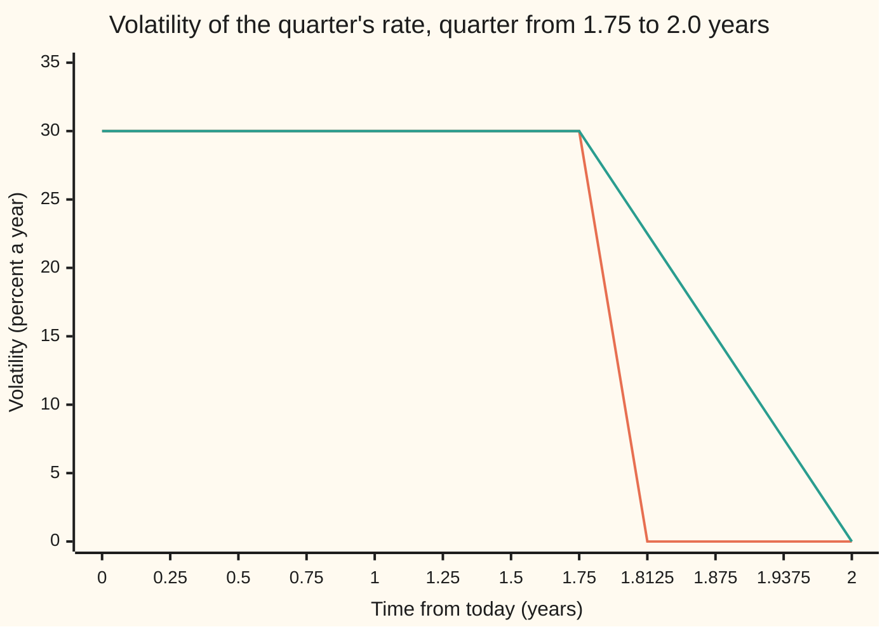
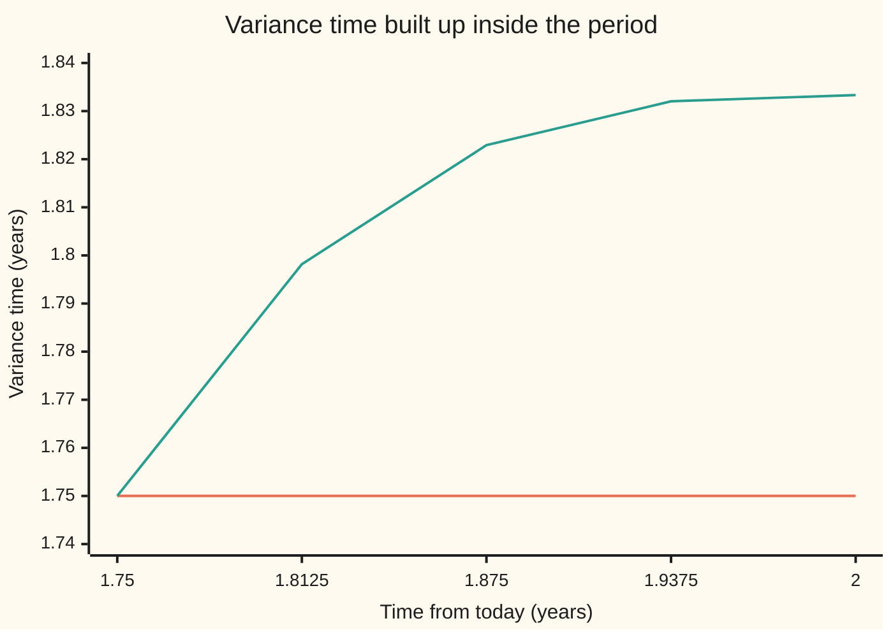

# Caplets on compounded SOFR: a rate still moving after its period starts, and the one-third rule for its variance

[Syllabus](../../../SYLLABUS.md) → [Financial mathematics](../README.md) → [Caps, Floors and Swaptions](../README.md#s29) → Caplets on compounded SOFR

---

## General Overview

A company has a \$10 million two-year loan that charges a floating rate each quarter. It owns a cap: insurance that pays, at the end of each quarter, whatever that quarter's rate exceeds 5 percent by ([Caps and floors](02-caps-floors-and-parity.md)). The last quarter runs from 1.75 years to 2.0 years. Its one-quarter piece of the cap is a **caplet** ([Caplets and floorlets](01-caplets-and-floorlets.md)). This card prices an at-the-money version of it, with the forward set at the 5 percent strike.

Under the old LIBOR loans, the quarter's rate was fixed on its first day, at 1.75 years. From that day the caplet's payment was known. This loan and its cap use compounded SOFR in arrears instead (SOFR is the Secured Overnight Financing Rate, the dollar overnight benchmark): the quarter's rate is the 63 daily overnight rates compounded together. That rate is known only on the quarter's last day, at 2.0 years ([Money markets](../02-Curves/03-money-market-instruments-and-sofr.md)). It is the standard for dealer SOFR caps and is used in some loans. Many dollar loans use Term SOFR instead, a rate quoted at the start of each period from futures prices. A Term SOFR rate is fixed in advance, like LIBOR, so a cap on it is priced like the LIBOR caplet.

So on the morning the quarter starts, the compounded rate can still move. With a forward of 5 percent and 30 percent volatility, one standard deviation of that remaining move is 0.4330 percentage points. A term rate fixed that morning would have no move left at all.

The remaining uncertainty fades as the days set one by one. Add it up, and the quarter is worth one third of its length in extra time at full volatility. The caplet is priced as if it expired at 1.75 + 0.25/3 = 1.8333 years, not at 1.75. At the money, its value per unit of notional, before discounting, rises from 0.0019662 to 0.0020118: 2.32 percent more, or \$456.43 on \$10 million.

**A compounded overnight rate keeps moving until the last day of its period, its volatility falls in a straight line to zero across the period, and squared and added up that fading volatility is worth exactly one third of the period: the caplet is priced with the usual formulas on the clock $`T_s + \tau/3`$, the period's start $`T_s`$ plus a third of its length $`\tau`$.**

**What kind of fact this is:** a model: the straight-line fall of the volatility is an assumption (one shock moves all the unset daily rates together); inside it, the one-third rule is a theorem, proved on this card in Why it works.

### The picture: how much the rate can still move, day by day



Orange: a term rate fixed at the start of the quarter. Its volatility is 30 percent until 1.75 years, then nothing. Green: the compounded SOFR rate. Its volatility is 30 percent until 1.75 years, then falls in a straight line to zero at 2.0 years. The green triangle after 1.75 is the extra uncertainty this card prices.

---

## The formula

Notation first, in words. $`T_s`$ is the start of the interest period and $`T_e`$ its end. $`\tau = T_e - T_s`$ is its length in years. $`F`$ is the forward rate for the period, and $`K`$ the strike. $`\sigma`$ is the rate's lognormal volatility (its yearly spread, as a percentage of the rate). $`g(t)`$ is the **shape**: the share of $`\sigma`$ the rate carries at time $`t`$. $`v`$ is the **variance time**: the number of years at full volatility that the rate's whole uncertainty is worth. $`D(T_e)`$ is today's price of \$1 paid at $`T_e`$.

```math
g(t) = \begin{cases} 1, & t \le T_s \\ (T_e - t)/\tau, & T_s < t \le T_e \end{cases} \qquad v = \int_0^{T_e} g(t)^2\,dt = T_s + \frac{\tau}{3}
```

**Read it aloud:** the rate carries its full volatility until the period starts, then a share that falls in a straight line to zero; squared and added up over time, that is the start date plus one third of the period.

```math
\text{Caplet} = \tau\,D(T_e)\,\bigl[F\,N(d_1) - K\,N(d_2)\bigr], \qquad d_1 = \frac{\ln(F/K) + \tfrac12\sigma^2 v}{\sigma\sqrt{v}}, \qquad d_2 = d_1 - \sigma\sqrt{v}
```

**Read it aloud:** Black's caplet formula, unchanged, with the clock $`T_s`$ replaced by the variance time $`v`$.

The Bachelier (normal) version makes the same swap ([Bachelier](../05-Black-Scholes%20from%20the%20Ground%20Up/07-bachelier-model.md)). With normal volatility $`\sigma_N`$ (the yearly spread in basis points, a basis point being 0.01 percent), $`s = \sigma_N\sqrt{v}`$, $`m = F - K`$ and $`d = m/s`$:

```math
\text{Caplet}_N = \tau\,D(T_e)\,\bigl[m\,N(d) + s\,\varphi(d)\bigr]
```

**Read it aloud:** the head start weighted by the chance of finishing ahead, plus a payment for the spread, with the spread clocked to the variance time.

| Symbol | Plain meaning | In our example | Push it up and the caplet… |
| --- | --- | --- | --- |
| $`T_s`$ | start of the period: a term rate would be fixed here | 1.75 years | rises: more time to move |
| $`T_e`$ | end of the period: the compounded rate is known and paid here | 2.0 years | rises, through $`\tau`$ |
| $`\tau`$, $`n`$, $`h`$ | length of the period in years; number of daily fixings in it; one day's length $`\tau/n`$ | 0.25; 63; 0.25/63 | $`\tau`$: rises, longer cover and more time inside the period; $`n`$, $`h`$: barely moves, as more fixings (a smaller $`h`$) bring the variance time closer to the third |
| $`R`$ | the compounded rate for the period, known only at $`T_e`$ | unknown until 2.0 years | it is what the payoff depends on |
| $`F`$ | forward rate for the period, the same for both conventions | 5% | rises |
| $`K`$ | strike | 5% | falls |
| $`\sigma`$ | lognormal volatility of the rate before the period starts | 30% | rises |
| $`g(t)`$ | shape: the share of $`\sigma`$ left at time $`t`$, equal to the share of days not yet set | 1 before 1.75; 0.75, 0.5, 0.25, 0 at each quarter of the period | — |
| $`v`$ | variance time: years of full volatility the whole uncertainty is worth | 1.833333 (a term rate: 1.75) | rises |
| $`D(T_e)`$ | discount factor to the payment date | left out: all values here are before discounting | rises in proportion |
| $`d_1`$, $`d_2`$, $`N(x)`$, $`\varphi(x)`$ | Black's standardised distances of forward from strike; the bell curve's area left of $`x`$, and its height at $`x`$ | $`d_1`$ = 0.203101, $`d_2`$ = −0.203101, $`N(d_1)`$ = 0.580472 | — |
| $`\sigma_N`$, $`s`$, $`m`$, $`d`$ | normal volatility, its spread over $`v`$, head start $`F - K`$, and $`m/s`$ | 149.02 bp, matched to the term-rate price; $`m`$ = 0 | — |

### When it holds

- **One shock moves every unset daily rate together.** That gives the straight-line shape. If the market expects a central-bank decision inside the period, the unset rates jump together on one date, and the shape is a step, not a line. The variance time then depends on where the meeting falls.
- **The 63 daily rates count equally.** Weekends give Friday's rate three days' weight, and compounding tilts the weights slightly. With 63 equal fixings the variance time depends on when each day's rate counts as set: 1.831360 if at the day's start, 1.835328 if at its end (SOFR is published the next morning). The two sit either side of 1.833333.
- **The payment is at the end of the period.** The compounded forward is a fair bet under the odds of the bond paying at $`T_e`$, so the discount is $`D(T_e)`$. A payment delayed by two days moves the discount, not the variance time.
- **The volatility quote belongs to the same clock.** A volatility stripped from cap prices with the clock $`v`$ must be used with $`v`$ ([Caplet stripping](03-caplet-stripping.md)). Feeding it a different clock misprices every caplet.
- **Black needs a positive rate.** Near or below zero, use the Bachelier form; the one-third rule is the same.

**Conventions, dated 2026-11-23:** standard dealer caps on SOFR compound the daily rates over the period in arrears and pay at the period's end. Caps on Term SOFR fix at the period's start, like LIBOR, and this card's rule does not apply to them. This card uses $`\tau`$ = 0.25 exactly, 63 equal daily fixings and values before discounting.

---

## Why it works

### Step 0: the rate is an average, and only its unset part can move

A compounded rate over 63 days is, to a close approximation, the average of 63 daily rates. On any day inside the period, some of those rates are already published and can never change. The rest are still unknown.

Only the unknown part can move. Its weight in the average is the share of days not yet set, which falls in a straight line from 1 at the start to 0 at the end. That straight line is the shape $`g(t)`$.

### Step 1: the forward is the same, and still a fair bet

Put \$1 on deposit at $`T_s`$ and roll it overnight until $`T_e`$. It grows to $`1 + \tau R`$, where $`R`$ is the compounded rate. That \$1 at $`T_s`$ costs $`D(T_s)`$ today.

So, under the odds of the bond that pays at $`T_e`$, the average of $`1 + \tau R`$ is $`D(T_s)/D(T_e)`$. The average of $`R`$ is the same forward rate a term rate would have. This is the fair-bet argument of [Caplets and floorlets](01-caplets-and-floorlets.md), with the term fixing replaced by the overnight roll. Nothing about volatility has been assumed yet.

### Step 2: one shock moves the rate by the unset share

Take the model's one assumption: a single shock moves every unset daily rate by the same percentage. The set rates do not move.

A shock of 1 percent to the unset rates then moves the average by the unset share times 1 percent: by 0.75 percent when three quarters of the days are unset. On day $`t`$ inside the period, the rate's volatility is $`\sigma`$ times that share:

```math
\sigma\,g(t) = \sigma\,\frac{T_e - t}{\tau}
```

At 1.8125 years, a quarter of the way through, three quarters of the days are unset and the volatility is 22.5 percent.

### Step 3: add variances, not volatilities

Shocks on different days are independent. For independent pieces, the variances (squared spreads) add, never the spreads themselves. So the total variance of the log rate is $`\sigma^2`$ times the area under $`g(t)^2`$:

```math
\int_{T_s}^{T_e}\left(\frac{T_e - t}{\tau}\right)^2 dt = \tau\int_0^1 u^2\,du = \frac{\tau}{3}
```

The substitution $`u = (T_e - t)/\tau`$ turns the period into the interval 0 to 1, and the area under $`u^2`$ there is one third. Add the $`T_s`$ years at full volatility before the period starts, and $`v = T_s + \tau/3`$.

The square is what makes it a third and not a half. Averaging the volatility gives half the period. Squaring first gives more weight to the early days, when most of the period is still unset.

<details>
<summary>Detailed proof: the same third from 63 daily fixings, and from a random walk</summary>

**Daily fixings.** Split the period into $`n`$ days of length $`h = \tau/n`$. The rate for day $`j`$ is set at that day's start, so during day $`j`$ the unset share is $`(n - j)/n`$. Adding the squared shares day by day:

$`\displaystyle h\sum_{j=1}^{n}\left(\frac{n-j}{n}\right)^2 = \frac{h}{n^2}\sum_{i=0}^{n-1} i^2 = \frac{\tau\,(n-1)(2n-1)}{6n^2}`$

For $`n`$ = 1 this is 0: one fixing at the start is a term rate. For $`n`$ = 3, 13 and 63 the variance time is 1.796296, 1.823964 and 1.831360. As $`n`$ grows, $`(n-1)(2n-1)/(6n^2)`$ tends to $`2/6 = 1/3`$.

If each day's rate counts as set at the day's end instead, the unset share during day $`j`$ is $`(n - j + 1)/n`$, and the same sum gives $`\tau(n+1)(2n+1)/(6n^2)`$: a variance time of 1.835328 for 63 days, just over the third. For every $`n`$ the two timings sit either side of the third, and both tend to it.

**A random walk.** Suppose the daily rates follow a random walk $`W`$ (each step an independent shock of variance $`h`$) started at $`T_s`$. The average of the $`n`$ set values has variance

$`\displaystyle \frac{1}{n^2}\sum_{j=0}^{n-1}\sum_{k=0}^{n-1}\mathrm{Cov}(W_{jh}, W_{kh}) = \frac{1}{n^2}\sum_{j,k}\min(j,k)\,h`$

because two points on one walk share exactly the shocks up to the earlier one. The double sum is $`(n-1)n(2n-1)/6`$, so the variance is the same $`\tau(n-1)(2n-1)/(6n^2)`$. The checks add up this double sum term by term as a separate road.

</details>

### Step 4: price with the usual formulas on the new clock

Under the payment-date odds, the log of $`R`$ is a bell curve centred so that $`R`$ averages to $`F`$, with variance $`\sigma^2 v`$. That is exactly Black's setting with $`v`$ in place of the expiry. So Black's caplet formula holds with $`v`$ ([Caplets and floorlets](01-caplets-and-floorlets.md)).

The same steps with a normal rate give Bachelier's formula with spread $`\sigma_N\sqrt{v}`$. At the money, the Bachelier price is proportional to $`\sqrt{v}`$, so the uplift is exactly $`\sqrt{1.833333/1.75} - 1`$ = 2.35 percent.

---

## Worked numbers, by hand

Last caplet of the two-year cap, in an at-the-money version with the forward set at the strike: period 1.75 to 2.0 years, forward 5%, strike 5%, volatility 30%. Values per unit of notional, before discounting.

| Step | Arithmetic | Value |
| --- | --- | --- |
| $`\tau`$ | $`2.0 - 1.75`$ | 0.25 |
| variance time, term rate | $`T_s`$ | 1.750000 |
| variance time, compounded | $`1.75 + 0.25/3`$ | 1.833333 |
| share of variance inside the period | $`0.083333 / 1.833333`$ | 4.55% |
| spread of the log rate, term | $`0.30 \times \sqrt{1.75}`$ | 0.396863 |
| spread of the log rate, compounded | $`0.30 \times \sqrt{1.833333}`$ | 0.406202 |
| $`d_1`$, term and compounded | half of each spread, since $`\ln(F/K) = 0`$ | 0.198431, 0.203101 |
| $`N(d_1)`$, term and compounded | bell-curve table | 0.578646, 0.580472 |
| caplet, term | $`0.25 \times 0.05 \times (2 \times 0.578646 - 1)`$ | 0.0019662 |
| **caplet, compounded** | $`0.25 \times 0.05 \times (2 \times 0.580472 - 1)`$ | **0.0020118** |
| uplift | $`0.0020118 / 0.0019662 - 1`$ | 2.32% |
| on \$10 million | $`10{,}000{,}000 \times`$ each | \$19,661.55 and \$20,117.98 |
| normal volatility with the term price | $`0.0019662 / 0.25 \times \sqrt{2\pi / 1.75}`$ | 149.02 bp |
| Bachelier, compounded | $`0.0019662 \times \sqrt{1.833333 / 1.75}`$ | 0.0020124 (+2.35%) |

At the money, $`d_2 = -d_1`$, so Black's bracket is $`F\,(2N(d_1) - 1)`$. The answer means the compounded caplet costs what a term-rate caplet would cost if its fixing were moved a month later, from 1.75 to 1.8333 years. Black and Bachelier give almost the same uplift, 2.32 and 2.35 percent.

### What breaks if you drop a piece

Same caplet, right answer 0.0020118:

| Mistake | Comes out at | What went wrong |
| --- | --- | --- |
| Clock stops at the period start, $`T_s`$ | 0.0019662 | Prices a term rate: the 63 days of movement inside the period are lost |
| Full volatility to the period end, $`T_e`$ | 0.0020999 | Treats the set days as if they could still move |
| Volatility averaged, $`T_s + \tau/2`$ | 0.0020342 | Adds spreads instead of variances |

---

## How it moves: inside the period

The puzzle: the period is a quarter of a year, but it adds only a twelfth of a year of variance time. Where does the rest go? Trace the quarter in four steps.

| Time (years) | Share of days unset | Volatility of the rate | Variance time so far |
| --- | --- | --- | --- |
| 1.75 | 1 | 30% | 1.750000 |
| 1.8125 | 0.75 | 22.5% | 1.798177 |
| 1.875 | 0.5 | 15% | 1.822917 |
| 1.9375 | 0.25 | 7.5% | 1.832031 |
| 2.0 | 0 | 0% | 1.833333 |

Variance time added in each quarter of the period:

```
first quarter   ████████████████████████████████████████  0.048177
second quarter  █████████████████████                     0.024740
third quarter   ████████                                  0.009115
fourth quarter  █                                         0.001302
```

The first quarter of the period adds more than the last three together. The volatility falls in a straight line, but variance goes with its square, so the early days dominate.



Orange: a term rate, flat at 1.75 once fixed. Green: the compounded rate, climbing fast at first and levelling off at 1.833333. The vertical axis starts at 1.74 to show the climb.

---

## Code, from first principles, and it actually runs

The scripts reach the variance time three ways: the closed form $`T_s + \tau/3`$; Simpson's rule (a numerical integral) on $`g(t)^2`$; and the brute-force double sum of a random walk's shared time over 63 daily fixings, set at the start or at the end of each day, which sit either side of the third. They reach the price two ways: Black's formula, checked against a Simpson integral of the payoff over the lognormal rate with no $`N`$; and a Monte Carlo (a simulation of 200,000 random paths) that moves the rate one shock a day with the unset share as its volatility, using no variance-time formula at all. They also match the Bachelier price and reproduce every wrong number and experiment on the card.

### Python

```python
# Caplets on compounded SOFR -- the check behind the card.  Standard library only.
# Nothing imported knows the answer: the normal CDF is the Taylor series of erf written out,
# the integrals are Simpson's rule, the random numbers come from a xorshift generator.
from math import log, sqrt, exp, pi, cos, sin

def N(x):                                            # bell-curve area left of x (erf series)
    if abs(x) > 8.0: return 0.0 if x < 0 else 1.0
    y = x / sqrt(2.0); term = y; s = y; n = 0
    while abs(term) > 1e-17:
        n += 1; term *= -y * y / n; s += term / (2 * n + 1)
    return 0.5 + s / sqrt(pi)

def phi(x): return exp(-0.5 * x * x) / sqrt(2.0 * pi)

def black(F, K, sig, T):                             # caplet per unit of rate, before discounting
    v = sig * sqrt(T); d1 = (log(F / K) + 0.5 * v * v) / v
    return F * N(d1) - K * N(d1 - v)

def bachelier(F, K, sn, T):                          # normal model: m N(d) + s phi(d)
    s = sn * sqrt(T); d = (F - K) / s
    return (F - K) * N(d) + s * phi(d)

def simpson(f, a, b, n=2000):
    h = (b - a) / n; s = f(a) + f(b)
    for i in range(1, n): s += (4 if i % 2 else 2) * f(a + i * h)
    return s * h / 3.0

def show(label, x, d=7): print(f"{label:<44}{x:>14.{d}f}")

F = K = 0.05; sig = 0.30; Ts = 1.75; Te = 2.0; tau = Te - Ts; notional = 10_000_000; days = 63
g = lambda t: 1.0 if t <= Ts else max(Te - t, 0.0) / tau   # volatility shape: flat, then a straight fall

# Road 1: the one-third rule in closed form.  Road 2: Simpson's rule on the squared shape.
T_fwd = Ts; T_bwd = Ts + tau / 3.0
T_simp = simpson(lambda t: g(t) ** 2, 0.0, Ts) + simpson(lambda t: g(t) ** 2, Ts, Te)
# Road 3: brute force.  Average 63 daily rates, rate j set at the start of day j by a random walk
# (end = 1: set at the end of day j); variance of the average = Ts + (1/n^2) * sum of min(j, k) * h.
def fixings_time(n, end=0):
    h = tau / n; r = range(end, n + end); return Ts + sum(min(j, k) * h for j in r for k in r) / (n * n)
T_day = fixings_time(days); T_end = fixings_time(days, 1)
assert abs(T_simp - T_bwd) < 1e-9 and abs(T_day - (Ts + tau * (days - 1) * (2 * days - 1) / (6 * days * days))) < 1e-12
assert abs(T_end - (Ts + tau * (days + 1) * (2 * days + 1) / (6 * days * days))) < 1e-12 and T_day < T_bwd < T_end
assert abs(fixings_time(1) - T_fwd) < 1e-15 and abs(fixings_time(400) - T_bwd) < 5e-4
show("variance time, forward-looking (years)", T_fwd, 6)
show("variance time, Ts + tau/3 (years)", T_bwd, 6)
show("variance time, Simpson on g squared", T_simp, 6)
show("variance time, 63 daily fixings", T_day, 6)
show("variance time, 63 fixings set at day end", T_end, 6)
for n in (1, 3, 13): show(f"variance time, {n} fixings", fixings_time(n), 6)
show("share of variance inside the period, %", 100 * (tau / 3) / T_bwd, 2)
show("log-sd still to come at Ts", sig * sqrt(tau / 3), 6)
show("rate move of one sd at Ts, % points", 100 * F * sig * sqrt(tau / 3), 4)

# Prices per unit notional, before discounting.  Road 4: Simpson over the lognormal, no N.
p_fwd = tau * black(F, K, sig, T_fwd); p_bwd = tau * black(F, K, sig, T_bwd)
v = sig * sqrt(T_bwd); kink = (log(K / F) + 0.5 * v * v) / v      # payoff starts above the kink
p_int = tau * simpson(lambda z: (F * exp(-0.5 * v * v + v * z) - K) * phi(z), kink, 10.0, 8000)
assert abs(p_int - p_bwd) < 1e-10 and abs(p_bwd / p_fwd - 1 - 0.0232) < 1e-3
for lab, T in (("forward", T_fwd), ("backward", T_bwd)):
    sd = sig * sqrt(T); d1 = (log(F / K) + 0.5 * sd * sd) / sd
    show(f"sd of log rate, {lab}", sd, 6); show(f"d1, {lab}", d1, 6); show(f"d2, {lab}", d1 - sd, 6)
    show(f"N(d1), {lab}", N(d1), 6)
show("Black caplet, forward-looking", p_fwd)
show("Black caplet, backward-looking", p_bwd)
show("Black caplet, backward, Simpson", p_int)
show("Black caplet, 63 daily fixings", tau * black(F, K, sig, T_day))
show("Black uplift, %", 100 * (p_bwd / p_fwd - 1), 2)
show("on $10m, forward-looking, $", notional * p_fwd, 2)
show("on $10m, backward-looking, $", notional * p_bwd, 2)
show("on $10m, difference, $", notional * (p_bwd - p_fwd), 2)

# Bachelier: the normal volatility that matches the forward-looking price, then the one-third clock.
sN = p_fwd / tau * sqrt(2 * pi / T_fwd)              # at the money: price = tau * sN * sqrt(T / 2 pi)
q_fwd = tau * bachelier(F, K, sN, T_fwd); q_bwd = tau * bachelier(F, K, sN, T_bwd)
assert abs(q_fwd - p_fwd) < 1e-12 and abs(q_bwd / q_fwd - sqrt(T_bwd / T_fwd)) < 1e-12
show("normal volatility matched, bp", 1e4 * sN, 2)
show("Bachelier caplet, forward-looking", q_fwd)
show("Bachelier caplet, backward-looking", q_bwd)
show("Bachelier uplift, %", 100 * (q_bwd / q_fwd - 1), 2)

# Road 5: Monte Carlo of the rate itself, one shock a day; during day j its log-volatility is
# sig times the share of days still unset.  Antithetic pairs; no variance formula used.
state = 88172645463325252
def uniform():
    global state
    state ^= (state << 13) & 0xFFFFFFFFFFFFFFFF; state ^= state >> 7; state ^= (state << 17) & 0xFFFFFFFFFFFFFFFF
    return ((state >> 11) + 0.5) / 9007199254740992.0
h = tau / days; vols = [sig * sqrt(Ts)] + [sig * (days - j) / days * sqrt(h) for j in range(1, days + 1)]
drift = -0.5 * sum(s * s for s in vols); pairs = 100_000; total = 0.0; total2 = 0.0
for _ in range(pairs):
    x = drift; y = drift
    for k in range(0, len(vols), 2):
        r = sqrt(-2.0 * log(uniform())); a = 2.0 * pi * uniform()
        x += vols[k] * r * cos(a); y -= vols[k] * r * cos(a)
        if k + 1 < len(vols): x += vols[k + 1] * r * sin(a); y -= vols[k + 1] * r * sin(a)
    pay = 0.5 * tau * (max(F * exp(x) - K, 0.0) + max(F * exp(y) - K, 0.0)); total += pay; total2 += pay * pay
mc = total / pairs; se = sqrt((total2 / pairs - mc * mc) / pairs)
assert abs(mc - tau * black(F, K, sig, T_day)) < 3 * se and abs(mc - p_fwd) > 3 * se
show("Monte Carlo caplet, 63 daily shocks", mc); show("Monte Carlo standard error", se)

# What breaks, and the experiments on the card.
show("wrong: full vol to the period end", tau * black(F, K, sig, Te))
show("wrong: average the vol, Ts + tau/2", tau * black(F, K, sig, Ts + tau / 2))
show("wrong: discount D(Ts), overprice %", 100 * tau * F, 2)      # D(Ts) / D(Te) = 1 + tau F
show("wrong: discount D(Ts), in D(Te) units", (1 + tau * F) * p_bwd)
show("try: first caplet, 0.25 to 0.5, fwd", tau * black(F, K, sig, 0.25))
show("try: first caplet, 0.25 to 0.5, bwd", tau * black(F, K, sig, 0.25 + tau / 3))
show("try: period starting today, bwd", tau * black(F, K, sig, tau / 3))
show("try: six-month period 1.75 to 2.25, bwd", 0.5 * black(F, K, sig, Ts + 0.5 / 3))
show("try: six-month period, fwd", 0.5 * black(F, K, sig, Ts))
times = [0.25 * i for i in range(8)] + [1.8125, 1.875, 1.9375, 2.0]
print("chart, time    ", " ".join(f"{t:g}" for t in times))
print("chart, term vol", " ".join(f"{100 * sig * (t <= Ts):g}" for t in times))
print("chart, sofr vol", " ".join(f"{100 * sig * g(t):g}" for t in times))
cum = [Ts + simpson(lambda t: g(t) ** 2, Ts, u) for u in times[7:]]
print("moves, var time", " ".join(f"{c:.6f}" for c in cum))
print("moves, added   ", " ".join(f"{b - a:.6f}" for a, b in zip(cum, cum[1:])))
print("ALL CHECKS PASS")
```

**Ran 2026-11-23 on macOS, Python 3.14.10, standard library only. All checks passed. Output, pasted from the run:**

```
variance time, forward-looking (years)            1.750000
variance time, Ts + tau/3 (years)                 1.833333
variance time, Simpson on g squared               1.833333
variance time, 63 daily fixings                   1.831360
variance time, 63 fixings set at day end          1.835328
variance time, 1 fixings                          1.750000
variance time, 3 fixings                          1.796296
variance time, 13 fixings                         1.823964
share of variance inside the period, %                4.55
log-sd still to come at Ts                        0.086603
rate move of one sd at Ts, % points                 0.4330
sd of log rate, forward                           0.396863
d1, forward                                       0.198431
d2, forward                                      -0.198431
N(d1), forward                                    0.578646
sd of log rate, backward                          0.406202
d1, backward                                      0.203101
d2, backward                                     -0.203101
N(d1), backward                                   0.580472
Black caplet, forward-looking                    0.0019662
Black caplet, backward-looking                   0.0020118
Black caplet, backward, Simpson                  0.0020118
Black caplet, 63 daily fixings                   0.0020107
Black uplift, %                                       2.32
on $10m, forward-looking, $                       19661.55
on $10m, backward-looking, $                      20117.98
on $10m, difference, $                              456.43
normal volatility matched, bp                       149.02
Bachelier caplet, forward-looking                0.0019662
Bachelier caplet, backward-looking               0.0020124
Bachelier uplift, %                                   2.35
Monte Carlo caplet, 63 daily shocks              0.0020127
Monte Carlo standard error                       0.0000072
wrong: full vol to the period end                0.0020999
wrong: average the vol, Ts + tau/2               0.0020342
wrong: discount D(Ts), overprice %                    1.25
wrong: discount D(Ts), in D(Te) units            0.0020369
try: first caplet, 0.25 to 0.5, fwd              0.0007473
try: first caplet, 0.25 to 0.5, bwd              0.0008627
try: period starting today, bwd                  0.0004317
try: six-month period 1.75 to 2.25, bwd          0.0041127
try: six-month period, fwd                       0.0039323
chart, time     0 0.25 0.5 0.75 1 1.25 1.5 1.75 1.8125 1.875 1.9375 2
chart, term vol 30 30 30 30 30 30 30 30 0 0 0 0
chart, sofr vol 30 30 30 30 30 30 30 30 22.5 15 7.5 0
moves, var time 1.750000 1.798177 1.822917 1.832031 1.833333
moves, added    0.048177 0.024740 0.009115 0.001302
ALL CHECKS PASS
```

The Monte Carlo lands at 0.0020127, with a standard error of 0.0000072, beside the 63-day formula's 0.0020107. It sits far from the term-rate price, 0.0019662. An assert demands both. The brute-force sum with one fixing returns 1.750000 exactly: a single fixing at the start is a term rate.

### Rust

```rust
// Caplets on compounded SOFR -- the check behind the card.  std only, no crates.
// Nothing used knows the answer: the normal CDF is the Taylor series of erf written out,
// the integrals are Simpson's rule, the random numbers come from a xorshift generator.
use std::f64::consts::PI;

fn n_cdf(x: f64) -> f64 {
    if x.abs() > 8.0 { return if x < 0.0 { 0.0 } else { 1.0 }; }
    let y = x / 2f64.sqrt();
    let (mut term, mut s, mut n) = (y, y, 0.0);
    while term.abs() > 1e-17 { n += 1.0; term *= -y * y / n; s += term / (2.0 * n + 1.0); }
    0.5 + s / PI.sqrt()
}
fn phi(x: f64) -> f64 { (-0.5 * x * x).exp() / (2.0 * PI).sqrt() }
fn black(f: f64, k: f64, sig: f64, t: f64) -> f64 { // caplet per unit of rate, before discounting
    let v = sig * t.sqrt();
    let d1 = ((f / k).ln() + 0.5 * v * v) / v;
    f * n_cdf(d1) - k * n_cdf(d1 - v)
}
fn bachelier(f: f64, k: f64, sn: f64, t: f64) -> f64 { // normal model: m N(d) + s phi(d)
    let s = sn * t.sqrt();
    let d = (f - k) / s;
    (f - k) * n_cdf(d) + s * phi(d)
}
fn simpson<G: Fn(f64) -> f64>(f: G, a: f64, b: f64, n: usize) -> f64 {
    let h = (b - a) / n as f64;
    let mut s = f(a) + f(b);
    for i in 1..n { s += if i % 2 == 1 { 4.0 } else { 2.0 } * f(a + i as f64 * h); }
    s * h / 3.0
}
fn show(label: &str, x: f64, d: usize) { println!("{:<44}{:>14.*}", label, d, x); }
fn g_fmt(x: f64) -> String { // like Python's :g for these short numbers
    let s = format!("{:.4}", x);
    s.trim_end_matches('0').trim_end_matches('.').to_string()
}

const F: f64 = 0.05; const K: f64 = 0.05; const SIG: f64 = 0.30; const TS: f64 = 1.75; const TE: f64 = 2.0;
const TAU: f64 = TE - TS;
fn g(t: f64) -> f64 { if t <= TS { 1.0 } else { (TE - t).max(0.0) / TAU } } // flat, then a straight fall

// Brute force: average n daily rates set by a random walk, rate j set at the start of day j
// (end = 1: set at the end of day j); Ts + (1/n^2) * sum of min(j, k) * h.
fn fixings_time(n: usize, end: usize) -> f64 {
    let h = TAU / n as f64;
    let mut s = 0.0;
    for j in end..n + end { for k in end..n + end { s += j.min(k) as f64 * h; } }
    TS + s / (n * n) as f64
}

struct Rng(u64);
impl Rng {
    fn uniform(&mut self) -> f64 {
        self.0 ^= self.0 << 13; self.0 ^= self.0 >> 7; self.0 ^= self.0 << 17;
        ((self.0 >> 11) as f64 + 0.5) / 9007199254740992.0
    }
}

fn main() {
    let notional = 10_000_000.0; let days = 63usize;
    let sq = |t: f64| g(t) * g(t);
    // Road 1: the one-third rule.  Road 2: Simpson on the squared shape.  Road 3: brute force.
    let (t_fwd, t_bwd) = (TS, TS + TAU / 3.0);
    let t_simp = simpson(sq, 0.0, TS, 2000) + simpson(sq, TS, TE, 2000);
    let (t_day, t_end) = (fixings_time(days, 0), fixings_time(days, 1));
    let dn = days as f64;
    assert!((t_simp - t_bwd).abs() < 1e-9 && (t_day - (TS + TAU * (dn - 1.0) * (2.0 * dn - 1.0) / (6.0 * dn * dn))).abs() < 1e-12);
    assert!((t_end - (TS + TAU * (dn + 1.0) * (2.0 * dn + 1.0) / (6.0 * dn * dn))).abs() < 1e-12 && t_day < t_bwd && t_bwd < t_end);
    assert!((fixings_time(1, 0) - t_fwd).abs() < 1e-15 && (fixings_time(400, 0) - t_bwd).abs() < 5e-4);
    show("variance time, forward-looking (years)", t_fwd, 6);
    show("variance time, Ts + tau/3 (years)", t_bwd, 6);
    show("variance time, Simpson on g squared", t_simp, 6);
    show("variance time, 63 daily fixings", t_day, 6);
    show("variance time, 63 fixings set at day end", t_end, 6);
    for n in [1usize, 3, 13] { show(&format!("variance time, {} fixings", n), fixings_time(n, 0), 6); }
    show("share of variance inside the period, %", 100.0 * (TAU / 3.0) / t_bwd, 2);
    show("log-sd still to come at Ts", SIG * (TAU / 3.0).sqrt(), 6);
    show("rate move of one sd at Ts, % points", 100.0 * F * SIG * (TAU / 3.0).sqrt(), 4);

    // Prices per unit notional, before discounting.  Road 4: Simpson over the lognormal, no N.
    let p_fwd = TAU * black(F, K, SIG, t_fwd);
    let p_bwd = TAU * black(F, K, SIG, t_bwd);
    let v = SIG * t_bwd.sqrt();
    let kink = ((K / F).ln() + 0.5 * v * v) / v; // payoff starts above the kink
    let p_int = TAU * simpson(|z| (F * (-0.5 * v * v + v * z).exp() - K) * phi(z), kink, 10.0, 8000);
    assert!((p_int - p_bwd).abs() < 1e-10 && (p_bwd / p_fwd - 1.0 - 0.0232).abs() < 1e-3);
    for (lab, t) in [("forward", t_fwd), ("backward", t_bwd)] {
        let sd = SIG * t.sqrt(); let d1 = ((F / K).ln() + 0.5 * sd * sd) / sd;
        show(&format!("sd of log rate, {}", lab), sd, 6); show(&format!("d1, {}", lab), d1, 6); show(&format!("d2, {}", lab), d1 - sd, 6);
        show(&format!("N(d1), {}", lab), n_cdf(d1), 6);
    }
    show("Black caplet, forward-looking", p_fwd, 7);
    show("Black caplet, backward-looking", p_bwd, 7);
    show("Black caplet, backward, Simpson", p_int, 7);
    show("Black caplet, 63 daily fixings", TAU * black(F, K, SIG, t_day), 7);
    show("Black uplift, %", 100.0 * (p_bwd / p_fwd - 1.0), 2);
    show("on $10m, forward-looking, $", notional * p_fwd, 2);
    show("on $10m, backward-looking, $", notional * p_bwd, 2);
    show("on $10m, difference, $", notional * (p_bwd - p_fwd), 2);

    // Bachelier: the normal volatility that matches the forward-looking price, then the one-third clock.
    let sn = p_fwd / TAU * (2.0 * PI / t_fwd).sqrt(); // at the money: price = tau * sN * sqrt(T / 2 pi)
    let q_fwd = TAU * bachelier(F, K, sn, t_fwd);
    let q_bwd = TAU * bachelier(F, K, sn, t_bwd);
    assert!((q_fwd - p_fwd).abs() < 1e-12 && (q_bwd / q_fwd - (t_bwd / t_fwd).sqrt()).abs() < 1e-12);
    show("normal volatility matched, bp", 1e4 * sn, 2);
    show("Bachelier caplet, forward-looking", q_fwd, 7);
    show("Bachelier caplet, backward-looking", q_bwd, 7);
    show("Bachelier uplift, %", 100.0 * (q_bwd / q_fwd - 1.0), 2);

    // Road 5: Monte Carlo of the rate itself, one shock a day; during day j its log-volatility is
    // sig times the share of days still unset.  Antithetic pairs; no variance formula used.
    let mut rng = Rng(88172645463325252);
    let h = TAU / dn;
    let mut vols = vec![SIG * TS.sqrt()];
    for j in 1..=days { vols.push(SIG * (days - j) as f64 / dn * h.sqrt()); }
    let drift = -0.5 * vols.iter().map(|s| s * s).sum::<f64>();
    let pairs = 100_000usize;
    let (mut total, mut total2) = (0.0, 0.0);
    for _ in 0..pairs {
        let (mut x, mut y) = (drift, drift);
        let mut k = 0;
        while k < vols.len() {
            let r = (-2.0 * rng.uniform().ln()).sqrt();
            let a = 2.0 * PI * rng.uniform();
            x += vols[k] * r * a.cos(); y -= vols[k] * r * a.cos();
            if k + 1 < vols.len() { x += vols[k + 1] * r * a.sin(); y -= vols[k + 1] * r * a.sin(); }
            k += 2;
        }
        let pay = 0.5 * TAU * ((F * x.exp() - K).max(0.0) + (F * y.exp() - K).max(0.0));
        total += pay; total2 += pay * pay;
    }
    let mc = total / pairs as f64;
    let se = ((total2 / pairs as f64 - mc * mc) / pairs as f64).sqrt();
    assert!((mc - TAU * black(F, K, SIG, t_day)).abs() < 3.0 * se && (mc - p_fwd).abs() > 3.0 * se);
    show("Monte Carlo caplet, 63 daily shocks", mc, 7);
    show("Monte Carlo standard error", se, 7);

    // What breaks, and the experiments on the card.
    show("wrong: full vol to the period end", TAU * black(F, K, SIG, TE), 7);
    show("wrong: average the vol, Ts + tau/2", TAU * black(F, K, SIG, TS + TAU / 2.0), 7);
    show("wrong: discount D(Ts), overprice %", 100.0 * TAU * F, 2); // D(Ts) / D(Te) = 1 + tau F
    show("wrong: discount D(Ts), in D(Te) units", (1.0 + TAU * F) * p_bwd, 7);
    show("try: first caplet, 0.25 to 0.5, fwd", TAU * black(F, K, SIG, 0.25), 7);
    show("try: first caplet, 0.25 to 0.5, bwd", TAU * black(F, K, SIG, 0.25 + TAU / 3.0), 7);
    show("try: period starting today, bwd", TAU * black(F, K, SIG, TAU / 3.0), 7);
    show("try: six-month period 1.75 to 2.25, bwd", 0.5 * black(F, K, SIG, TS + 0.5 / 3.0), 7);
    show("try: six-month period, fwd", 0.5 * black(F, K, SIG, TS), 7);
    let mut times: Vec<f64> = (0..8).map(|i| 0.25 * i as f64).collect();
    times.extend([1.8125, 1.875, 1.9375, 2.0]);
    let row = |f: &dyn Fn(f64) -> String| times.iter().map(|&t| f(t)).collect::<Vec<_>>().join(" ");
    println!("chart, time     {}", row(&|t| g_fmt(t)));
    println!("chart, term vol {}", row(&|t| g_fmt(100.0 * SIG * if t <= TS { 1.0 } else { 0.0 })));
    println!("chart, sofr vol {}", row(&|t| g_fmt(100.0 * SIG * g(t))));
    let cum: Vec<f64> = times[7..].iter().map(|&u| TS + simpson(sq, TS, u, 2000)).collect();
    println!("moves, var time {}", cum.iter().map(|c| format!("{:.6}", c)).collect::<Vec<_>>().join(" "));
    println!("moves, added    {}", cum.windows(2).map(|w| format!("{:.6}", w[1] - w[0])).collect::<Vec<_>>().join(" "));
    println!("ALL CHECKS PASS");
}
```

**Ran 2026-11-23 on macOS, rustc 1.98.1, no crates. All checks passed. Output, pasted from the run:**

```
variance time, forward-looking (years)            1.750000
variance time, Ts + tau/3 (years)                 1.833333
variance time, Simpson on g squared               1.833333
variance time, 63 daily fixings                   1.831360
variance time, 63 fixings set at day end          1.835328
variance time, 1 fixings                          1.750000
variance time, 3 fixings                          1.796296
variance time, 13 fixings                         1.823964
share of variance inside the period, %                4.55
log-sd still to come at Ts                        0.086603
rate move of one sd at Ts, % points                 0.4330
sd of log rate, forward                           0.396863
d1, forward                                       0.198431
d2, forward                                      -0.198431
N(d1), forward                                    0.578646
sd of log rate, backward                          0.406202
d1, backward                                      0.203101
d2, backward                                     -0.203101
N(d1), backward                                   0.580472
Black caplet, forward-looking                    0.0019662
Black caplet, backward-looking                   0.0020118
Black caplet, backward, Simpson                  0.0020118
Black caplet, 63 daily fixings                   0.0020107
Black uplift, %                                       2.32
on $10m, forward-looking, $                       19661.55
on $10m, backward-looking, $                      20117.98
on $10m, difference, $                              456.43
normal volatility matched, bp                       149.02
Bachelier caplet, forward-looking                0.0019662
Bachelier caplet, backward-looking               0.0020124
Bachelier uplift, %                                   2.35
Monte Carlo caplet, 63 daily shocks              0.0020127
Monte Carlo standard error                       0.0000072
wrong: full vol to the period end                0.0020999
wrong: average the vol, Ts + tau/2               0.0020342
wrong: discount D(Ts), overprice %                    1.25
wrong: discount D(Ts), in D(Te) units            0.0020369
try: first caplet, 0.25 to 0.5, fwd              0.0007473
try: first caplet, 0.25 to 0.5, bwd              0.0008627
try: period starting today, bwd                  0.0004317
try: six-month period 1.75 to 2.25, bwd          0.0041127
try: six-month period, fwd                       0.0039323
chart, time     0 0.25 0.5 0.75 1 1.25 1.5 1.75 1.8125 1.875 1.9375 2
chart, term vol 30 30 30 30 30 30 30 30 0 0 0 0
chart, sofr vol 30 30 30 30 30 30 30 30 22.5 15 7.5 0
moves, var time 1.750000 1.798177 1.822917 1.832031 1.833333
moves, added    0.048177 0.024740 0.009115 0.001302
ALL CHECKS PASS
```

### Lean

Lean proves the one-third rule and its daily-fixing versions exactly, for any period and any number of fixings.

- Take a period of any positive length $`\tau`$. Then the squared share $`((\tau - u)/\tau)^2`$, added up across the period, is exactly $`\tau/3`$.
- Take the same period. Then the share itself, not squared, adds up to $`\tau/2`$: the wrong answer of averaging the volatility.
- Take any start $`T_s \ge 0`$ and end $`T_e > T_s`$. Then the squared shape $`g(t)^2`$, added up from today to $`T_e`$, is exactly $`T_s + \tau/3`$.
- Take $`n`$ daily fixings, each set at its day's start. Then the squared shares add to $`\tau(n-1)(2n-1)/(6n^2)`$. Set at each day's end instead, they add to $`\tau(n+1)(2n+1)/(6n^2)`$.
- Take any $`n \ge 1`$. Then the first sum is below a third of the period and the second above it, and as $`n`$ grows the first tends to exactly a third.
- Take any $`n`$. Then the random walk's double sum of $`\min(j, k)`$ over $`n`$ fixings is $`(n-1)n(2n-1)/6`$.
- Take the card's example. Then $`1.75 + 0.25/3 = 11/6`$, which prints as 1.833333, and the two 63-fixing variance times round to 1.831360 and 1.835328.
- At the money, $`d_2 = -d_1`$, and the Bachelier caplet priced on two clocks has the price ratio $`\sqrt{v_2/v_1}`$, whatever the normal volatility.

Black's prices, the bell-curve values, the Monte Carlo and the other decimals are left to the Python and Rust checks.

```lean
-- Caplets on compounded SOFR: a volatility that falls in a straight line to zero across the period, squared and added up, is worth exactly one third of the period, so the variance time is the start date plus a third; 63 daily fixings bracket that third, and the random walk's double sum agrees.
import Mathlib.Analysis.SpecialFunctions.Integrals.Basic
import Mathlib.Analysis.SpecialFunctions.Pow.Real
import Mathlib.Algebra.BigOperators.Intervals
import Mathlib.Tactic

open Real Finset intervalIntegral Filter Topology

/-! `Ts` is the start of the interest period and `Te` its end, `τ = Te - Ts` its length in years.
The shape `g(t)`, written `shape Ts Te t`, is the share of the volatility the compounded rate still carries at time `t`:
1 until the period starts, then `(Te - t) / τ`, falling in a straight line to 0 at `Te`.
The variance time is the area under `g(t)²` from today to `Te`. -/

/-- The shape: full volatility until the period starts, then a straight fall to zero. -/
noncomputable def shape (Ts Te t : ℝ) : ℝ := if t ≤ Ts then 1 else (Te - t) / (Te - Ts)

/-- The one-third rule: a share falling in a straight line from 1 to 0 over a period of length
`τ`, squared and added up, is worth exactly `τ / 3`. -/
theorem one_third_rule (τ : ℝ) (hτ : 0 < τ) :
    ∫ u in (0:ℝ)..τ, ((τ - u) / τ) ^ 2 = τ / 3 := by
  have h : ∀ u : ℝ, ((τ - u) / τ) ^ 2 = 1 - (2 / τ) * u + (1 / τ ^ 2) * u ^ 2 := by
    intro u; field_simp; ring
  simp_rw [h]
  rw [integral_add, integral_sub, integral_const_mul, integral_const_mul, integral_pow, integral_id,
    integral_const]
  · simp; field_simp; ring
  all_goals first
    | exact intervalIntegrable_const
    | exact (continuous_const.mul continuous_id).intervalIntegrable _ _
    | exact (continuous_const.mul (continuous_pow 2)).intervalIntegrable _ _
    | exact (continuous_const.sub (continuous_const.mul continuous_id)).intervalIntegrable _ _

/-- Averaging the volatility instead of its square gives half the period, not a third. -/
theorem averaged_volatility_gives_half (τ : ℝ) (hτ : 0 < τ) :
    ∫ u in (0:ℝ)..τ, (τ - u) / τ = τ / 2 := by
  have h : ∀ u : ℝ, (τ - u) / τ = 1 - (1 / τ) * u := by intro u; field_simp
  simp_rw [h]
  rw [integral_sub, integral_const_mul, integral_id, integral_const]
  · simp; field_simp; ring
  · exact intervalIntegrable_const
  · exact (continuous_const.mul continuous_id).intervalIntegrable _ _

/-- The variance time: the squared shape, added up from today to the period's end, is the
start date plus one third of the period, `v = Ts + τ / 3`. -/
theorem variance_time (Ts Te : ℝ) (h0 : 0 ≤ Ts) (h : Ts < Te) :
    ∫ t in (0:ℝ)..Te, shape Ts Te t ^ 2 = Ts + (Te - Ts) / 3 := by
  have hτ : 0 < Te - Ts := by linarith
  have hint1 : IntervalIntegrable (fun t ↦ shape Ts Te t ^ 2) MeasureTheory.volume 0 Ts := by
    refine (intervalIntegrable_const : IntervalIntegrable (fun _ : ℝ ↦ (1:ℝ))
      MeasureTheory.volume 0 Ts).congr ?_
    intro t ht
    rw [Set.uIoc_of_le h0] at ht
    simp [shape, ht.2]
  have hint2 : IntervalIntegrable (fun t ↦ shape Ts Te t ^ 2) MeasureTheory.volume Ts Te := by
    have hc : Continuous (fun t : ℝ ↦ ((Te - t) / (Te - Ts)) ^ 2) := by fun_prop
    refine (hc.intervalIntegrable Ts Te).congr ?_
    intro t ht
    rw [Set.uIoc_of_le h.le] at ht
    simp [shape, not_le.mpr ht.1]
  rw [← integral_add_adjacent_intervals hint1 hint2]
  have e1 : ∫ t in (0:ℝ)..Ts, shape Ts Te t ^ 2 = ∫ t in (0:ℝ)..Ts, (1:ℝ) := by
    refine integral_congr_ae (MeasureTheory.ae_of_all _ ?_)
    intro t ht
    rw [Set.uIoc_of_le h0] at ht
    simp [shape, ht.2]
  have e2 : ∫ t in Ts..Te, shape Ts Te t ^ 2 = ∫ t in Ts..Te, ((Te - t) / (Te - Ts)) ^ 2 := by
    refine integral_congr_ae (MeasureTheory.ae_of_all _ ?_)
    intro t ht
    rw [Set.uIoc_of_le h.le] at ht
    simp [shape, not_le.mpr ht.1]
  have e3 : ∫ t in Ts..Te, ((Te - t) / (Te - Ts)) ^ 2
      = ∫ u in (0:ℝ)..(Te - Ts), (((Te - Ts) - u) / (Te - Ts)) ^ 2 := by
    have hs := integral_comp_add_right (fun t ↦ ((Te - t) / (Te - Ts)) ^ 2) (a := 0)
      (b := Te - Ts) Ts
    simp only [zero_add, sub_add_cancel] at hs
    rw [← hs]
    refine integral_congr (fun u _ ↦ ?_)
    ring_nf
  rw [e1, e2, e3, one_third_rule _ hτ, integral_const]
  simp

/-- The sums of `j` and of `j²` over the first `n` whole numbers. -/
lemma sum_range_id_real (n : ℕ) : ∑ j ∈ range n, (j:ℝ) = (n:ℝ) * (n - 1) / 2 := by
  induction n with
  | zero => simp
  | succ k ih => rw [sum_range_succ, ih]; push_cast; ring

lemma sum_range_sq_real (n : ℕ) : ∑ j ∈ range n, (j:ℝ) ^ 2 = (n:ℝ) * (n - 1) * (2 * n - 1) / 6 := by
  induction n with
  | zero => simp
  | succ k ih => rw [sum_range_succ, ih]; push_cast; ring

/-- Daily fixings, each day's rate set at that day's start: during day `j + 1` the share still
unset is `(n - (j + 1)) / n`, and the squared shares, each held for `h = τ / n`, add to
`τ (n - 1)(2n - 1) / (6 n²)`. -/
theorem fixings_set_at_start (τ : ℝ) (n : ℕ) (hn : 0 < n) :
    ∑ j ∈ range n, (τ / n) * (((n:ℝ) - (j + 1)) / n) ^ 2
      = τ * ((n:ℝ) - 1) * (2 * n - 1) / (6 * (n:ℝ) ^ 2) := by
  have hn' : (n:ℝ) ≠ 0 := by positivity
  have key : ∀ j : ℕ, (τ / n) * (((n:ℝ) - (j + 1)) / n) ^ 2
      = (τ / n ^ 3) * ((n:ℝ) - 1) ^ 2 - (τ / n ^ 3) * (2 * ((n:ℝ) - 1)) * j
        + (τ / n ^ 3) * (j:ℝ) ^ 2 := by
    intro j; field_simp; ring
  simp_rw [key]
  rw [sum_add_distrib, sum_sub_distrib, ← mul_sum, ← mul_sum, ← mul_sum, sum_range_id_real,
    sum_range_sq_real, sum_const, card_range, nsmul_eq_mul]
  field_simp; ring

/-- Each day's rate set at that day's end instead: during day `j + 1` the unset share is
`(n - j) / n`, and the sum is `τ (n + 1)(2n + 1) / (6 n²)`. -/
theorem fixings_set_at_end (τ : ℝ) (n : ℕ) (hn : 0 < n) :
    ∑ j ∈ range n, (τ / n) * (((n:ℝ) - j) / n) ^ 2
      = τ * ((n:ℝ) + 1) * (2 * n + 1) / (6 * (n:ℝ) ^ 2) := by
  have hn' : (n:ℝ) ≠ 0 := by positivity
  have key : ∀ j : ℕ, (τ / n) * (((n:ℝ) - j) / n) ^ 2
      = (τ / n ^ 3) * (n:ℝ) ^ 2 - (τ / n ^ 3) * (2 * (n:ℝ)) * j + (τ / n ^ 3) * (j:ℝ) ^ 2 := by
    intro j; field_simp; ring
  simp_rw [key]
  rw [sum_add_distrib, sum_sub_distrib, ← mul_sum, ← mul_sum, ← mul_sum, sum_range_id_real,
    sum_range_sq_real, sum_const, card_range, nsmul_eq_mul]
  field_simp; ring

/-- The two timings bracket the third: for any number of fixings, set-at-start falls short of
`1/3` of the period and set-at-end overshoots it. -/
theorem fixings_bracket_the_third (n : ℕ) (hn : 0 < n) :
    ((n:ℝ) - 1) * (2 * n - 1) / (6 * (n:ℝ) ^ 2) < 1 / 3 ∧
      1 / 3 < ((n:ℝ) + 1) * (2 * n + 1) / (6 * (n:ℝ) ^ 2) := by
  have h1 : (1:ℝ) ≤ n := by exact_mod_cast hn
  have h6 : (0:ℝ) < 6 * (n:ℝ) ^ 2 := by positivity
  constructor
  · rw [div_lt_iff₀ h6]; nlinarith
  · rw [lt_div_iff₀ h6]; nlinarith

/-- As the fixings get finer, the set-at-start share tends to exactly one third. -/
theorem fixings_tend_to_one_third :
    Tendsto (fun n : ℕ ↦ ((n:ℝ) - 1) * (2 * n - 1) / (6 * (n:ℝ) ^ 2)) atTop (𝓝 (1 / 3)) := by
  have h : Tendsto (fun n : ℕ ↦ 1 / (n:ℝ)) atTop (𝓝 0) := tendsto_one_div_atTop_nhds_zero_nat
  have h2 : Tendsto (fun n : ℕ ↦ 1 / 3 - (1 / 2) * (1 / (n:ℝ)) + (1 / 6) * (1 / (n:ℝ)) ^ 2)
      atTop (𝓝 (1 / 3 - (1 / 2) * 0 + (1 / 6) * 0 ^ 2)) :=
    ((tendsto_const_nhds (x := (1 / 3 : ℝ))).sub (h.const_mul (1 / 2 : ℝ))).add
      ((h.pow 2).const_mul (1 / 6 : ℝ))
  rw [show (1 / 3 : ℝ) - 1 / 2 * 0 + 1 / 6 * 0 ^ 2 = 1 / 3 by norm_num] at h2
  refine h2.congr' ?_
  filter_upwards [eventually_ge_atTop 1] with n hn
  have : (n:ℝ) ≠ 0 := by have : (1:ℝ) ≤ n := by exact_mod_cast hn
                         positivity
  field_simp; ring

/-- The random walk's road: the shared time of two points on one walk is the earlier time, and
over `n` fixings the double sum of `min j k` is `(n - 1) n (2n - 1) / 6`, the same sum of
squares as above. -/
theorem random_walk_double_sum (n : ℕ) :
    ∑ j ∈ range n, ∑ k ∈ range n, ((min j k : ℕ) : ℝ) = ((n:ℝ) - 1) * n * (2 * n - 1) / 6 := by
  induction n with
  | zero => simp
  | succ k ih =>
    have hrow : ∀ j ∈ range k, ((min j k : ℕ) : ℝ) = j := fun j hj ↦ by
      rw [min_eq_left (mem_range.mp hj).le]
    have hcol : ∀ j ∈ range k, ((min k j : ℕ) : ℝ) = j := fun j hj ↦ by
      rw [min_eq_right (mem_range.mp hj).le]
    rw [sum_range_succ]
    simp_rw [sum_range_succ (fun x ↦ ((min _ x : ℕ) : ℝ))]
    rw [sum_add_distrib, ih, sum_congr rfl hrow, sum_congr rfl hcol, sum_range_id_real]
    simp only [min_self]
    push_cast; ring

/-! The card's example: `Ts = 1.75`, `Te = 2.0`, 63 daily fixings. -/

theorem example_variance_times :
    (7 / 4 : ℝ) + (1 / 4) / 3 = 11 / 6 ∧
      |(7 / 4 : ℝ) + (1 / 4) * (63 - 1) * (2 * 63 - 1) / (6 * 63 ^ 2) - 1.831360| < 5e-7 ∧
      |(7 / 4 : ℝ) + (1 / 4) * (63 + 1) * (2 * 63 + 1) / (6 * 63 ^ 2) - 1.835328| < 5e-7 ∧
      |(11 / 6 : ℝ) - 1.833333| < 5e-7 := by
  refine ⟨by norm_num, ?_, ?_, ?_⟩ <;> rw [abs_sub_lt_iff] <;> constructor <;> norm_num

/-- At the money, Black's two distances are mirror images: `d₂ = -d₁`. -/
theorem atm_d2_eq_neg_d1 (F σ v : ℝ) (hF : 0 < F) (hσ : 0 < σ) (hv : 0 < v) :
    let d1 := (log (F / F) + σ ^ 2 * v / 2) / (σ * √v)
    d1 - σ * √v = -d1 := by
  intro d1
  have hs : 0 < √v := Real.sqrt_pos.mpr hv
  have hsq : √v ^ 2 = v := sq_sqrt hv.le
  have hd : d1 = σ * √v / 2 := by
    simp only [d1, div_self hF.ne', log_one, zero_add]
    rw [div_eq_iff (by positivity)]
    linear_combination (-σ ^ 2 / 2) * hsq
  rw [hd]; ring

/-- The bell curve's height at `x`. -/
noncomputable def bellHeight (x : ℝ) : ℝ := rexp (-x ^ 2 / 2) / √(2 * π)

/-- Bachelier's caplet on the clock `v`: `τ D [m N(d) + s φ(d)]` with `s = σ_N √v`, `m = F - K`
and `d = m / s`. The bell-curve area `N` is left as any function: at the money it drops out. -/
noncomputable def bachelierCaplet (N : ℝ → ℝ) (τ D F K σN v : ℝ) : ℝ :=
  τ * D * ((F - K) * N ((F - K) / (σN * √v)) + σN * √v * bellHeight ((F - K) / (σN * √v)))

/-- At the money the Bachelier caplet grows with the square root of the clock: the ratio of the
prices on two clocks is the square root of their ratio, whatever the normal volatility. -/
theorem bachelier_atm_ratio (N : ℝ → ℝ) (τ D F σN v₁ v₂ : ℝ) (hτ : 0 < τ) (hD : 0 < D)
    (hσ : 0 < σN) (h₁ : 0 < v₁) :
    bachelierCaplet N τ D F F σN v₂ / bachelierCaplet N τ D F F σN v₁ = √(v₂ / v₁) := by
  have hs : 0 < √v₁ := Real.sqrt_pos.mpr h₁
  have hφ : 0 < bellHeight 0 := by unfold bellHeight; positivity
  simp only [bachelierCaplet, sub_self, zero_div, zero_mul, zero_add]
  rw [Real.sqrt_div' _ h₁.le]
  field_simp

#print axioms one_third_rule
#print axioms averaged_volatility_gives_half
#print axioms variance_time
#print axioms sum_range_id_real
#print axioms sum_range_sq_real
#print axioms fixings_set_at_start
#print axioms fixings_set_at_end
#print axioms fixings_bracket_the_third
#print axioms fixings_tend_to_one_third
#print axioms random_walk_double_sum
#print axioms example_variance_times
#print axioms atm_d2_eq_neg_d1
#print axioms bachelier_atm_ratio
```

**Checked 2026-11-23 on macOS, Lean 4.36.0-rc2, Mathlib v4.36.0-rc2. Every proof is complete and uses only Lean's standard axioms. Output, pasted from the run:**

```
'one_third_rule' depends on axioms: [propext, Classical.choice, Quot.sound]
'averaged_volatility_gives_half' depends on axioms: [propext, Classical.choice, Quot.sound]
'variance_time' depends on axioms: [propext, Classical.choice, Quot.sound]
'sum_range_id_real' depends on axioms: [propext, Classical.choice, Quot.sound]
'sum_range_sq_real' depends on axioms: [propext, Classical.choice, Quot.sound]
'fixings_set_at_start' depends on axioms: [propext, Classical.choice, Quot.sound]
'fixings_set_at_end' depends on axioms: [propext, Classical.choice, Quot.sound]
'fixings_bracket_the_third' depends on axioms: [propext, Classical.choice, Quot.sound]
'fixings_tend_to_one_third' depends on axioms: [propext, Classical.choice, Quot.sound]
'random_walk_double_sum' depends on axioms: [propext, Classical.choice, Quot.sound]
'example_variance_times' depends on axioms: [propext, Classical.choice, Quot.sound]
'atm_d2_eq_neg_d1' depends on axioms: [propext, Classical.choice, Quot.sound]
'bachelier_atm_ratio' depends on axioms: [propext, Classical.choice, Quot.sound]
```

> [!TIP]
> **Try changing**
> Guess the direction first, then run it.
> - **The first caplet instead of the last.** Period 0.25 to 0.5 years. A term rate prices it at **0.0007473**; compounded, **0.0008627**. The extra twelfth of a year is a much bigger share of a short clock.
> - **A period that starts today.** Set $`T_s`$ = 0. A term rate fixed today has no option value left at the money. The compounded rate still has a twelfth of a year to move: **0.0004317**.
> - **Six-month periods.** Period 1.75 to 2.25 years, $`\tau`$ = 0.5. Term rate **0.0039323**, compounded **0.0041127**: the added clock doubles to a sixth of a year.
> - **Weekly fixings.** Set `days = 13`. The variance time drops to **1.823964**, still close to the third.

---

## The usual mistake

> [!warning]
> **On a compounded-in-arrears cap, stopping the volatility clock at the start of the period, because that is when a LIBOR caplet expired.** A compounded rate is not fixed until the period's last day. With the clock at 1.75 years the last caplet comes out at 0.0019662 instead of 0.0020118, while the right price is 2.32 percent higher, and every caplet of a compounded SOFR cap errs the same way. On a Term SOFR cap the rate is fixed at the period's start, and that clock is the right one.
>
> Three smaller traps:
> - **Running full volatility to the period end.** The set days cannot move. Clocking 2.0 years gives 0.0020999.
> - **Averaging the volatility instead of the variance.** The average share of days unset is a half, but variance needs the average squared share, a third. Using half the period gives 0.0020342.
> - **Discounting from the period start.** The money still moves at the period's end, so the discount is $`D(T_e)`$, exactly as for a term-rate caplet. Using $`D(T_s)`$ multiplies the price by $`D(T_s)/D(T_e) = 1 + \tau F`$ and overstates it by 1.25 percent: 0.0020369 in place of 0.0020118, both in units of $`D(T_e)`$.

---

## Where you meet it in real life

- **SOFR-linked loans.** Lenders often require a floating-rate borrower to buy a cap. Most new syndicated dollar loans float on Term SOFR, fixed at the start of each period, and their caps carry no extra time. A loan that floats on compounded SOFR in arrears is capped on the same rate, and every caplet in that cap has the extra third of a period.
- **Cap price screens.** Brokers quote SOFR caps as volatilities, and the pricing model decides which clock those volatilities run on. Stripping them into caplet volatilities ([Caplet stripping](03-caplet-stripping.md)) must use the same clock.
- **The first quarter of a new cap.** On a term rate, the current period is already fixed and carries no option. On compounded SOFR, the period under way still has value until its last day.
- **Sterling, euro and yen markets.** Caps on compounded SONIA (sterling), €STR (euro) and TONA (yen) use the same in-arrears convention and the same rule.

> **Say it back**
> A compounded overnight rate is set only on its period's last day, so it keeps moving after the period starts. Each day one more daily rate is published, and only the unpublished share can move, so the volatility falls in a straight line to zero. Squared and added up, that fading volatility is worth one third of the period. Black's and Bachelier's caplet formulas then apply unchanged, with the start date plus a third of the period as the clock. For an at-the-money version of the two-year cap's last caplet, that lifts the value from 0.0019662 to 0.0020118 per unit of notional.

---

## What this builds on

- [Caplets and floorlets](01-caplets-and-floorlets.md): Black's caplet formula and the payment-date bond's odds that make the forward a fair bet. This card changes only the clock.
- [Money markets](../02-Curves/03-money-market-instruments-and-sofr.md): how SOFR is published and compounded in arrears over a period. That convention is the reason the rate keeps moving.
- [Bachelier](../05-Black-Scholes%20from%20the%20Ground%20Up/07-bachelier-model.md): the normal model for rates, whose at-the-money price grows with the square root of the clock.
- [Caplet stripping](03-caplet-stripping.md): turning cap quotes into one volatility per caplet. The clock chosen here has to match the clock used there.

## Where this goes next

- [Market models](../31-Forward-Rate%20Models/03-libor-and-sofr-market-models.md): many forward rates moving together. That model covers each rate up to its period's start; inside the period it points to the backward-looking extension, whose fading volatility this card prices.

The straight-line shape assumes every unset day moves together; the question left open is how to price the period when a central-bank meeting makes the unset rates jump on one known date.

---

## Sources

Verified 2026-11-23: every link below resolves to the publisher's page.

- Lyashenko, Andrei, and Fabio Mercurio. "Looking Forward to Backward-Looking Rates: A Modeling Framework for Term Rates Replacing LIBOR." SSRN, 2019. [doi:10.2139/ssrn.3330240](https://doi.org/10.2139/ssrn.3330240). The backward-looking forward rate, its volatility decaying inside the accrual period, and the caplet formula that follows.
- Black, Fischer. "The Pricing of Commodity Contracts." *Journal of Financial Economics* 3, no. 1–2 (1976): 167–179. [doi:10.1016/0304-405X(76)90024-6](https://doi.org/10.1016/0304-405X(76)90024-6). The formula for options on forwards that caplets are priced with.
- Bachelier, Louis. "Théorie de la spéculation." *Annales scientifiques de l'École normale supérieure* 17 (1900): 21–86. [doi:10.24033/asens.476](https://doi.org/10.24033/asens.476). The normal model behind the Bachelier caplet.
- Brigo, Damiano, and Fabio Mercurio. *Interest Rate Models: Theory and Practice*, 2nd ed. Springer, 2006. [Publisher page](https://doi.org/10.1007/978-3-540-34604-3). Caplets under the forward measure and the market model that this card's rate sits inside.
