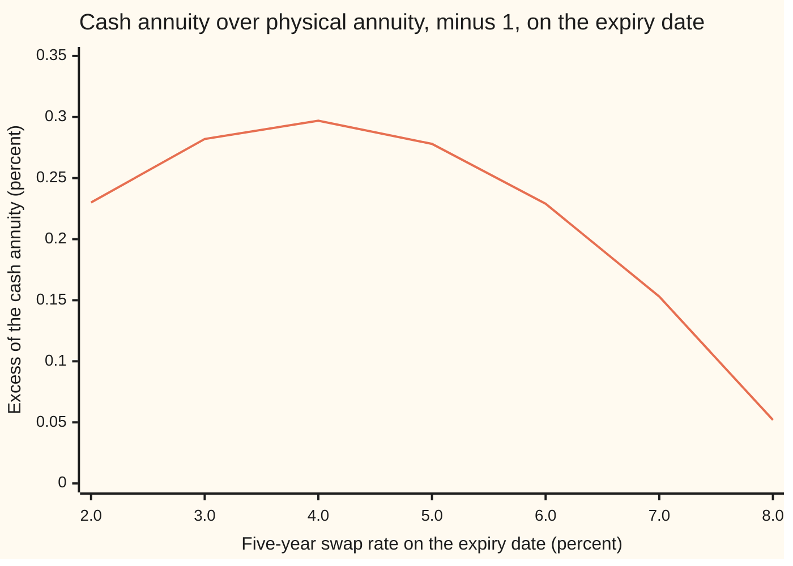
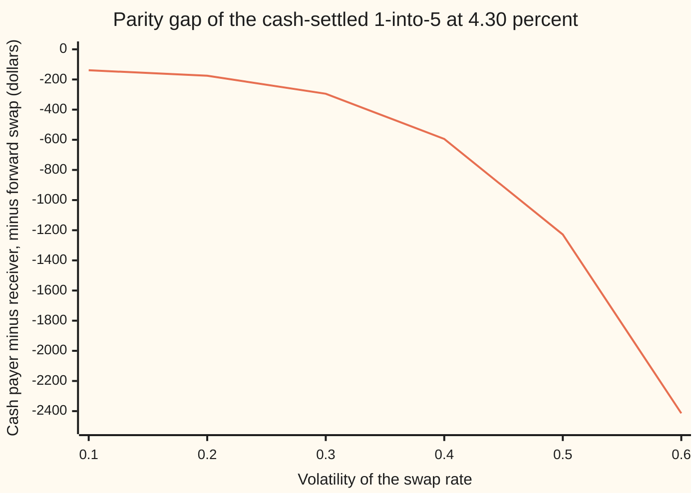

# Cash-settled swaptions: an annuity computed at the swap rate itself, and the convexity it adds

[Syllabus](../../../SYLLABUS.md) → [Financial mathematics](../README.md) → [Caps, Floors and Swaptions](../README.md#s29) → Cash-settled swaptions

---

## General Overview

Take the shelf's 1-into-5 payer swaption: the right, one year from now, to enter a five-year swap paying a fixed 4.30 percent on 10 million dollars ([Swaptions](04-swaptions-payer-and-receiver.md)). Settled physically, the holder receives the swap itself. On this morning's curve, at 30 percent volatility, that right costs 191,292.21 dollars.

In the sterling and euro markets the same contract has long been written in a **cash-settled** form. On the expiry date no swap changes hands. The seller pays a cash sum instead, worked out from one published number, the five-year swap rate that fixes that morning.

The contract's formula values the swap's five yearly payments by discounting each one at that same swap rate. That sum is the **IRR annuity**: IRR stands for internal rate of return, the single rate that discounts a stream of payments. It is a formula in the swap rate alone. The true value of the five payments, the **physical annuity**, depends on the whole curve on that day.

That swap of one annuity for the other has two effects. The cash payer is worth 191,647.01 dollars, 354.80 dollars more than the physical one. And parity breaks: cash payer minus cash receiver is −44,983.41 dollars, while the forward swap it should equal is worth −44,688.80 dollars. The gap, −294.61 dollars, is −0.070 basis points a year of annuity (a basis point is a hundredth of a percentage point).

**A cash-settled swaption pays the rate gap times an annuity computed at the swap rate itself; counted in true annuities that factor no longer cancels, so pricing it needs a rule tying the true annuity to the swap rate, and payer minus receiver drifts from the forward swap for two reasons: the cash annuity sits above the true one at the forward, and the ratio between them changes with the rate.**

**What kind of fact this is:** a model. The pricing rule in annuities is a theorem, from [The annuity measure](05-the-annuity-measure.md). The link between the true annuity and the swap rate, called the linear terminal swap rate model below, is an assumption chosen for convenience, not a law. The two prices it gives are theorems inside it.

### The picture: how far the cash annuity sits above the true one

The chart divides the IRR annuity by the model's physical annuity on the expiry date, for each possible swap rate, and shows the excess in percent.



The one line is the excess. The cash annuity pays about 0.3 percent more than the true one near today's forward swap rate of 4.19 percent. The excess falls away on both sides: the line is a hump, peaking just below the forward, and it falls furthest on the high side. Its height at the forward makes a gap even if the rate cannot move. Its fall at high rates, where a payer is paid, makes the part of the gap that grows with volatility.

---

## The formula

Notation first, in words. $`T`$ is the expiry date in years, here 1, which is also the swap's start. $`S_T`$ is the five-year swap rate that fixes on that date, unknown today. $`n`$ is the number of yearly fixed payments, here 5, and $`i`$ counts them. $`(x)^+`$ means $`x`$ if it is positive and 0 otherwise.

$`A`$ is today's physical annuity, built from the curve on [Swaptions](04-swaptions-payer-and-receiver.md), and $`F`$ is the forward swap rate. $`A_T`$ is the physical annuity as it will stand on the expiry date. $`\mathbb{E}^{A}[\,\cdot\,]`$ is an average under the annuity measure: the weights that price claims counted in annuities ([The annuity measure](05-the-annuity-measure.md)).

The cash sum is $`L\,a(S_T)\,(S_T - K)^+`$ for the payer, with the IRR annuity

```math
a(S) = \sum_{i=1}^{n} (1+S)^{-i}
```

The price, under the linear terminal swap rate model:

```math
V^{\text{cash}}_{\text{pay}} = L\,A\,\mathbb{E}^{A}\!\left[\,m(S_T)\,(S_T - K)^+\right], \qquad m(S) = a(S)\,\big(\alpha_0 + b\,S\big)
```

**Read it aloud:** the cash payer is worth today's annuity times the average payoff, counted in true annuities, where each unit of rate gap pays the cash annuity divided by the true one.

The model says one dollar on the expiry date is worth $`\alpha_0 + b\,S_T`$ annuities then, that is $`1/A_T = \alpha_0 + b\,S_T`$. Its two numbers are fixed by

```math
\alpha_0 = \frac{1}{n}, \qquad \alpha_0 + b\,F = \frac{D(T)}{A}
```

The receiver swaps $`(S_T - K)^+`$ for $`(K - S_T)^+`$. Payer minus receiver then misses the forward swap by

```math
\text{gap} = L\,A\,\Big(\mathbb{E}^{A}\big[\,m(S_T)\,(S_T - K)\big] - (F - K)\Big)
```

| Symbol | Plain meaning | In our example | Push it up and the answer… |
| --- | --- | --- | --- |
| $`V^{\text{cash}}_{\text{pay}}`$, $`V^{\text{cash}}_{\text{rec}}`$ | today's price of the cash-settled payer and receiver | 191,647.01 and 236,630.42 dollars | — |
| $`L`$ | the notional: the amount the interest is worked out on, never exchanged | 10,000,000 dollars | prices and gap scale in proportion |
| $`A`$, $`A_T`$ | the physical annuity: value of one unit of rate paid on each fixed date, today and on the expiry date | 4.204423 today; 4.414645 forward at $`S_T = F`$ | — |
| $`F`$, $`S_T`$ | the forward swap rate today; the swap rate that fixes on the expiry date | 4.1937 percent; unknown | payer rises, receiver falls |
| $`K`$ | the strike: the fixed rate written into the swaption | 4.30 percent | payer falls, receiver rises |
| $`\sigma`$ | volatility: the yearly spread of the log of the swap rate | 0.30 | both rise; the gap grows fast |
| $`T`$, $`D(T)`$ | expiry in years; today's price of one dollar paid then | 1; 0.952381 | — |
| $`a(S)`$, $`n`$, $`i`$ | the IRR annuity: the five payments discounted at $`S`$ itself; the number of payments; their count | 4.427700 at $`S = F`$; 5; 1 to 5 | $`a`$ falls as $`S`$ rises, and bends upward |
| $`\alpha_0`$, $`b`$ | the model's intercept and slope: one dollar on the expiry date is worth $`\alpha_0 + b\,S_T`$ annuities | 0.2 and 0.632347 | a bigger intercept lowers the cash premium |
| $`m(S)`$ | cash annuity counted in true annuities: the extra each unit of rate gap pays | 1.002957 at $`F`$; average 1.002696 | the cash price rises with it |
| $`\mathbb{E}^{A}`$, $`(x)^+`$ | an average with annuity-measure weights; $`x`$ if positive, else 0 | — | — |
| $`g(s)`$, $`P(k)`$, $`R(k)`$ | the payoff in annuities, $`m(s)(s - K)^+`$; the physical payer and receiver at strike $`k`$ per unit annuity (Black's bracket) | — | — |

**Conventions verified 23 Nov 2026.** Accruals are exactly one year and the cash is paid on the expiry date, as on the rest of this shelf. Real contracts pay cash two business days after the fixing and compound the IRR annuity at the fixed leg's frequency; neither changes the method.

### When it holds

- **The true annuity is a function of the swap rate alone.** In reality the curve can twist while $`S_T`$ stays put. A model with a second curve factor changes the price; the linear rule is the simplest choice that reprices today's bond.
- **The swap rate is lognormal with one volatility.** With a smile, average with the market's swaption prices at every strike, as the replication in Why it works does. The price then follows the smile ([SABR for rates](07-sabr-for-rates-and-the-volatility-cube.md)).
- **The intercept is sensible.** $`\alpha_0 = 1/n`$ makes the annuity equal $`n`$ at a zero rate, as a flat curve would. Set $`\alpha_0 = 0`$ and the whole line rests on a much steeper slope. The model annuity then explodes at low rates and shrinks too fast at high ones. At high rates, where the payer is paid, each unit of rate gap now buys far more than one true annuity, and the payer jumps to 271,282.86 dollars.
- **One curve, no default.** As for the physical swaption, the forward swap rate and both annuities come from one curve that both forecasts and discounts ([Multi-curve](../28-Swaps/04-basis-swaps-and-the-multi-curve-framework.md)).

---

## Why it works

### Step 0: count in true annuities, and the cash annuity no longer cancels

A physical swaption delivers $`A_T`$ times the rate gap. Counted in annuities, that $`A_T`$ divides out and leaves a plain option on one rate. A cash swaption delivers $`a(S_T)`$ times the rate gap. Divide by $`A_T`$ and a ratio $`a(S_T)/A_T`$ is left behind. The rate alone does not fix $`A_T`$, so a rule must tie the two. Once it does, the price is again an average over one rate.

### Step 1: what cash settlement pays

On the expiry date the five-year rate fixes at $`S_T`$. The payer receives $`L\,a(S_T)\,(S_T - K)^+`$ in cash, the receiver $`L\,a(S_T)\,(K - S_T)^+`$.

The formula $`a(S)`$ is what the five payments would be worth if the whole curve were flat at $`S`$. It needs no curve, which is why it was chosen: two parties can agree on it from one screen number. At today's forward rate it is 4.427700, against a forward physical annuity $`A/D(T)`$ of 4.414645.

$`a(S)`$ is a sum of falling, upward-bending terms, so it falls and bends upward too. Its slope at $`F`$ is −12.399570 and its second derivative +54.763957, both checked against nudges in the code.

### Step 2: price in annuities

The annuity measure gives the rule: a claim $`X`$ paid on the expiry date is worth $`A\,\mathbb{E}^{A}[X/A_T]`$ today. For the cash payer,

```math
V^{\text{cash}}_{\text{pay}} = L\,A\,\mathbb{E}^{A}\!\left[\frac{a(S_T)}{A_T}\,(S_T - K)^+\right]
```

The ratio $`a(S_T)/A_T`$ is what Step 0 warned of. Under the annuity measure the swap rate still averages $`F`$, but nothing yet says what $`1/A_T`$ does.

### Step 3: tie the true annuity to the swap rate

$`1/A_T`$ is the price of one dollar on the expiry date, counted in annuities. The **linear terminal swap rate model** (terminal because it holds on the expiry date) takes it to be a straight line in $`S_T`$: $`\alpha_0 + b\,S_T`$. Two facts fix the line.

1. **It reprices today's bond.** The rule of Step 2, applied to one dollar paid on the expiry date, says $`D(T) = A\,\mathbb{E}^{A}[1/A_T]`$. The swap rate averages $`F`$, so the line must satisfy $`\alpha_0 + b\,F = D(T)/A`$.
2. **It behaves at a zero rate.** If rates were zero, every payment would be worth a dollar and the annuity would be $`n`$. So $`\alpha_0 = 1/n`$ = 0.2.

That gives $`b`$ = 0.632347. The code checks the first fact by averaging the line under the lognormal: it returns 0.952381, which is $`D(T)`$.

The model annuity $`1/(\alpha_0 + b\,S)`$ tracks the IRR annuity closely:

| Swap rate on the expiry date | 2.0% | 3.0% | 4.0% | 5.0% | 6.0% | 7.0% | 8.0% |
| --- | ---: | ---: | ---: | ---: | ---: | ---: | ---: |
| cash annuity $`a(S)`$ | 4.713 | 4.580 | 4.452 | 4.329 | 4.212 | 4.100 | 3.993 |
| model annuity $`1/(\alpha_0 + b\,S)`$ | 4.703 | 4.567 | 4.439 | 4.317 | 4.203 | 4.094 | 3.991 |

Both fall and bend upward as the rate rises. The cash one sits a little higher because today's curve slopes down. Their ratio is $`m(S)`$, the hump in the first picture.

### Step 4: average over the lognormal swap rate

Take the swap rate lognormal with volatility $`\sigma`$, centred so that it averages $`F`$, exactly as on [Swaptions](04-swaptions-payer-and-receiver.md). Then $`V^{\text{cash}}_{\text{pay}} = L\,A\,\mathbb{E}^{A}[m(S_T)(S_T - K)^+]`$ is a one-variable average, done by Simpson's rule (adding thin slices under a curve), split at the strike, where the payoff has a corner. The payer comes to 191,647.01 dollars.

A second road needs no lognormal assumption at all: build the cash payoff out of physical swaptions. Any payoff that is zero below $`K`$ is a payer at $`K`$, sized by its slope there, plus payers at every higher strike, sized by its bend. Each physical payer has a market price, so their total is the cash price. With Black prices it lands on the same 191,647.01 dollars.

<details>
<summary>Detailed proof: the cash payoff as a strip of physical swaptions</summary>

Write the payoff counted in annuities as $`g(s) = m(s)(s - K)^+`$. Above $`K`$ it is smooth, with $`g(K) = 0`$ and slope $`g'(K) = m(K)`$ just above $`K`$.

For any $`s > K`$, Taylor's theorem with the remainder written as an integral gives

$`\displaystyle g(s) = g'(K)\,(s - K) + \int_K^{s} g''(k)\,(s - k)\,dk = g'(K)\,(s - K)^+ + \int_K^{\infty} g''(k)\,(s - k)^+\,dk`$

and both sides are zero for $`s \le K`$. Average under the annuity measure. The average of $`(s - k)^+`$ is the physical payer price per unit annuity, $`P(k)`$. So

$`\displaystyle \mathbb{E}^{A}[g(S_T)] = m(K)\,P(K) + \int_K^{\infty} \big(m''(k)(k - K) + 2\,m'(k)\big)\,P(k)\,dk`$

The receiver is the mirror image, with receivers $`R(k)`$ at strikes below $`K`$ and weight $`m''(k)(K - k) - 2\,m'(k)`$. The derivatives of $`m`$ come from those of $`a`$ by the product rule. Because $`m`$ is close to 1 and nearly flat, the strip is almost one payer at $`K`$: the extra strikes add only the small correction.

</details>

### Step 5: why parity breaks, and the two parts of the gap

For any rate, $`(s - K)^+ - (K - s)^+ = s - K`$. So cash payer minus cash receiver pays $`L\,a(S_T)(S_T - K)`$, worth $`L\,A\,\mathbb{E}^{A}[m(S_T)(S_T - K)]`$ today. The forward swap is $`L\,A\,(F - K)`$. Subtract, and the gap is $`L\,A\,\mathbb{E}^{A}[(m(S_T) - 1)(S_T - K)]`$: it is zero only if $`m`$ is 1.

The gap splits in two:

- **The zero-volatility part: the level of $`m`$.** If the rate could not move, $`S_T = F`$ and the gap would be $`L\,A\,(m(F) - 1)(F - K)`$ = −132.16 dollars. It comes from the curve's slope alone: at $`F`$ the IRR annuity is 0.30 percent above the forward physical annuity. No bend is needed.
- **The volatility part: $`m`$ changes with the rate.** The rest, −162.45 dollars. It splits again, into a tilt $`L\,A\,\mathbb{E}^{A}[m(S_T)(S_T - F)]`$ = −174.15 dollars and a bend term $`L\,A\,(F - K)(\mathbb{E}^{A}[m] - m(F))`$ = +11.70 dollars. Both are zero if the rate cannot move.

The tilt is the big one. The swap's payoff $`S_T - F`$ is positive at high rates and negative at low ones, and $`m`$ scales it. Past its peak at 3.93 percent, just below the forward, $`m`$ falls as the rate rises, and faster the higher the rate goes. A lognormal rate also reaches much further above $`F`$ than below it. So the gains at high rates get the smallest multipliers, and the average comes out negative.

The bend term comes from the hump's bend. The average of $`m`$, 1.002696, is below its value at $`F`$, 1.002957, and $`F - K`$ is negative, so this term adds 11.70 dollars, against the rest. A hump is not needed for a volatility part: a straight-line $`m`$ with the same slope would already give a tilt, its slope times the variance of $`S_T`$.

Struck at $`F`$ itself, the forward swap is worth nothing, and so are the zero-volatility part and the bend term. Yet cash payer minus cash receiver is −174.15 dollars: the tilt alone.

---

## Worked numbers, by hand

The curve, $`A`$ and $`F`$ are those of [Swaptions](04-swaptions-payer-and-receiver.md).

| Step | Arithmetic | Value |
| --- | --- | --- |
| physical annuity today, $`A`$ | from the six forward rates | 4.204423 |
| forward swap rate $`F`$ | from the same curve, as on Swaptions | 4.1937 percent |
| forward physical annuity | $`A/D(1)`$ = 4.204423 ÷ 0.952381 | 4.414645 |
| model intercept $`\alpha_0`$ | 1 ÷ 5 | 0.2 |
| model slope $`b`$ | (1 ÷ 4.414645 − 0.2) ÷ 0.041937 | 0.632347 |
| IRR annuity at $`F`$ | $`1.041937^{-1} + \dots + 1.041937^{-5}`$ | 4.427700 |
| multiplier at $`F`$, $`m(F)`$ | 4.427700 ÷ 4.414645 | 1.002957 |
| average multiplier | Simpson average of $`m(S_T)`$ over the lognormal | 1.002696 |
| physical payer, for comparison | Black, from Swaptions | 191,292.21 dollars |
| **cash payer** | $`L\,A\,\mathbb{E}^{A}[m(S_T)(S_T - K)^+]`$ | **191,647.01 dollars** |
| cash receiver | the same with $`(K - S_T)^+`$ | 236,630.42 dollars |
| cash payer − cash receiver | 191,647.01 − 236,630.42 | −44,983.41 dollars |
| forward swap | $`L\,A\,(F - K)`$ | −44,688.80 dollars |
| parity gap | −44,983.41 + 44,688.80 | −294.61 dollars |
| money value of one basis point a year | 10,000,000 × 4.204423 × 0.0001 | 4,204.42 dollars |
| **gap in basis points** | −294.61 ÷ 4,204.42 | **−0.070 basis points** |

The cash payer costs 354.80 dollars more than the physical one, and parity is off by 294.61 dollars, seven hundredths of a basis point a year. Small on a 1-into-5 at 30 percent, but not zero, and it grows quickly with volatility.

### What breaks if you drop a piece

Right answers: cash payer 191,647.01 dollars, cash receiver 236,630.42 dollars.

| Mistake | Comes out at | What went wrong |
| --- | --- | --- |
| Price the cash payer with the physical formula | 191,292.21 dollars | The contract pays $`a(S_T)`$, not $`A_T`$; the 0.3 percent difference is real money |
| Use $`L\,a(F)`$ times Black's bracket, undiscounted | 201,450.81 dollars | The cash arrives in a year; $`a(S)`$ values the swap on the expiry date, not today |
| Run the IRR dates from $`i = 0`$ to 4 | 203,771.39 dollars | The first fixed payment falls a year after the swap starts, so it is discounted once |
| Receiver = payer − forward swap | 236,335.81 dollars | That parity holds only when the annuities cancel; here $`m`$ sits above 1 at $`F`$ and changes with the rate |

---

## How the gap moves

### The puzzle

The forward swap has no volatility in it. The cash payer minus cash receiver does, because $`m`$ changes with the rate. So the gap should grow with volatility. The table traces it, holding everything else fixed.

| Volatility $`\sigma`$ | Gap, dollars | Gap, basis points |
| ---: | ---: | ---: |
| 0.1 | −138.80 | −0.0330 |
| 0.2 | −175.32 | −0.0417 |
| 0.3 | −294.61 | −0.0701 |
| 0.4 | −594.32 | −0.1414 |
| 0.5 | −1,228.17 | −0.2921 |
| 0.6 | −2,414.40 | −0.5743 |

### One force at a time, at 30 percent volatility

```
zero-volatility part  ##########################                 132.16 dollars
volatility part       ################################           162.45 dollars
```

Both parts push the same way. The first is fixed by today's curve. The second grows with volatility, and faster than its square: at high volatility the lognormal reaches the high rates where $`m`$ falls below 1.

### The combined picture



The one line is the gap. Near zero volatility it settles at the curve-shape part, −132.16 dollars; past 0.4 the volatility part takes over.

---

## Code, from first principles, and it actually runs

The code builds the curve, the IRR annuity with its slope and bend, and the linear model, then checks that the model reprices today's one-year bond. It prices the cash payer by **three independent roads**: a Simpson average over the lognormal swap rate, split at the strike; a static replication by a strip of physical swaptions priced with Black's formula; and a 200,000-path simulation with its own random-number generator. The simulation draws only the cash payoff minus the physical payoff, then adds back the physical payer's Black price: a control variate (a known price that cancels most of the noise). Its standard error is 1.95 dollars, small enough to tell the cash price from the physical one. The cash receiver and the parity gap are reached by the first two roads, and the volatility part is checked against its tilt and bend terms. Then come the wrong answers, the experiments, the volatility sweep and the chart points.

### Python

```python
# Cash-settled swaptions and the IRR annuity -- the check behind the card.  Standard library only.
# The bell-curve area, the integrator and the random numbers are all written here;
# nothing imported already knows a swaption price.
from math import log, sqrt, exp, cos, pi

FWD = [0.050, 0.046, 0.043, 0.041, 0.040, 0.039]    # one-year forward rates, years 1..6
L, K, SIG, T, N = 10_000_000.0, 0.043, 0.30, 1.0, 5  # notional, strike, volatility, expiry, swap years
MASK = (1 << 64) - 1

def phi(x): return exp(-0.5 * x * x) / sqrt(2.0 * pi)   # bell-curve height at x

def simpson(f, a, b, n):                                 # area under f from a to b, n even slices
    h = (b - a) / n
    s = f(a) + f(b)
    for i in range(1, n):
        s += (4 if i % 2 else 2) * f(a + i * h)
    return s * h / 3.0

def ncdf(x):                                             # N(x): bell-curve area left of x
    if x < -12.0: return 0.0
    if x > 12.0: return 1.0
    return 0.5 + simpson(phi, 0.0, x, 2000)

D = [1.0]                                                # D[i]: today's price of 1 dollar at year i
for f in FWD: D.append(D[-1] / (1.0 + f))
A = sum(D[2:7])                                          # physical annuity from the curve, years 2..6
F = (D[1] - D[6]) / A                                    # forward swap rate

def irr(s): return sum((1 + s) ** -i for i in range(1, N + 1))            # cash annuity a(s)
def irr1(s): return sum(-i * (1 + s) ** (-i - 1) for i in range(1, N + 1))  # its slope a'(s)
def irr2(s): return sum(i * (i + 1) * (1 + s) ** (-i - 2) for i in range(1, N + 1))  # its bend a''(s)

AL0 = 1.0 / N                                            # linear TSR: 1/A_T = AL0 + B s
B = (D[1] / A - AL0) / F                                 # chosen so today's D(1) is repriced
def m(s): return irr(s) * (AL0 + B * s)                  # cash annuity counted in physical annuities
def m1(s): return irr1(s) * (AL0 + B * s) + irr(s) * B
def m2(s): return irr2(s) * (AL0 + B * s) + 2 * irr1(s) * B

def avg(g, sig=SIG, n=20000):                            # road 1: average of g(S) under the annuity measure,
    v = sig * sqrt(T)                                    # split at zk, where S = K and the payoff kinks
    zk = (log(K / F) + 0.5 * v * v) / v
    f = lambda z: g(F * exp(-0.5 * v * v + v * z)) * phi(z)
    return simpson(f, -10.0, zk, n // 2) + simpson(f, zk, 10.0, n // 2)

def black(k, sig=SIG):                                   # physical payer, receiver per unit annuity
    v = sig * sqrt(T)
    d1 = (log(F / k) + 0.5 * v * v) / v
    d2 = d1 - v
    return F * ncdf(d1) - k * ncdf(d2), k * ncdf(-d2) - F * ncdf(-d1)

pay_c = L * A * avg(lambda s: m(s) * max(s - K, 0.0))
rec_c = L * A * avg(lambda s: m(s) * max(K - s, 0.0))
pay_p, rec_p = (L * A * x for x in black(K))
swap = L * A * (F - K)                                   # the forward swap, physical
# road 2: static replication by physical swaptions, g = g'(K) (s-K)+ + integral of g''(k) (s-k)+ dk
pay_r = L * A * (m(K) * black(K)[0] + simpson(lambda k: (m2(k) * (k - K) + 2 * m1(k)) * black(k)[0], K, 0.30, 1200))
rec_r = L * A * (m(K) * black(K)[1] + simpson(lambda k: (m2(k) * (K - k) - 2 * m1(k)) * black(k)[1], 1e-6, K, 600))

state = 20261123
def uniform():                                           # xorshift64*, then a number in (0, 1)
    global state
    state ^= state >> 12
    state ^= (state << 25) & MASK
    state ^= state >> 27
    return (((state * 0x2545F4914F6CDD1D) & MASK) >> 11) / 9007199254740992.0 + 1.0 / 18014398509481984.0

def by_simulation(paths):                                # road 3: draw swap rates, average the cash payoff
    v = SIG * sqrt(T)                                    # minus the physical one, then add the physical
    tot = tot2 = 0.0                                     # payer's Black price (a control variate)
    for _ in range(paths):
        z = sqrt(-2.0 * log(uniform())) * cos(2.0 * pi * uniform())
        s = F * exp(-0.5 * v * v + v * z)
        p = (m(s) - 1.0) * max(s - K, 0.0)
        tot += p; tot2 += p * p
    mu = tot / paths
    return L * A * (black(K)[0] + mu), L * A * sqrt((tot2 / paths - mu * mu) / paths)

mc, se = by_simulation(200_000)
gap = (pay_c - rec_c) - swap
bp = L * A * 1e-4                                        # dollars per basis point a year of annuity
h, H2 = 1e-5, 1e-4                                     # nudges for slope and bend
mkt = L * D[1] * irr(F)                                  # market formula: a(F), discounted to expiry
lo, hi = 0.0, 0.10                                       # peak of m: bisect for the zero of its slope m'
for _ in range(60):
    mid = 0.5 * (lo + hi)
    if m1(mid) > 0: lo = mid
    else: hi = mid
zero_vol = L * A * (m(F) - 1) * (F - K)
tilt, bend = L * A * avg(lambda s: m(s) * (s - F)), L * A * (F - K) * (avg(m) - m(F))
rows = [("annuity A, curve", A), ("F, forward swap rate", F), ("TSR intercept 1/n", AL0), ("TSR slope b", B),
        ("cash annuity a(F)", irr(F)), ("forward annuity A/D(1)", A / D[1]), ("multiplier m(F)", m(F)),
        ("a'(F), formula", irr1(F)), ("a'(F), nudge", (irr(F + h) - irr(F - h)) / (2 * h)),
        ("a''(F), formula", irr2(F)), ("a''(F), nudge", (irr(F + H2) - 2 * irr(F) + irr(F - H2)) / (H2 * H2)),
        ("TSR check: A x avg of 1/A_T", A * avg(lambda s: AL0 + B * s)), ("  D(1)", D[1]),
        ("average multiplier E[m]", avg(m)), ("peak of m, swap rate", lo),
        ("physical payer, Black", pay_p), ("physical receiver, Black", rec_p),
        ("1 cash payer, Simpson", pay_c), ("2 cash payer, replication", pay_r), ("3 cash payer, simulation", mc),
        ("  simulation std error", se), ("  simulation gap, std errors", (pay_c - mc) / se),
        ("cash receiver, Simpson", rec_c), ("cash receiver, replication", rec_r),
        ("cash payer - receiver, Simpson", pay_c - rec_c), ("  same, replication", pay_r - rec_r),
        ("L A times one bp", bp), ("forward swap L A (F - K)", swap), ("parity gap, dollars", gap), ("parity gap, bp", gap / bp),
        ("  zero-vol part L A (m(F)-1)(F-K)", zero_vol), ("  volatility part", gap - zero_vol),
        ("    tilt: L A E[m(S)(S - F)]", tilt), ("    bend: L A (F - K)(E[m] - m(F))", bend),
        ("cash premium over physical, payer", pay_c - pay_p),
        ("market formula payer", mkt * black(K)[0]), ("market formula receiver", mkt * black(K)[1]),
        ("  market minus TSR, payer", mkt * black(K)[0] - pay_c),
        ("wrong: cash annuity not discounted", L * irr(F) * black(K)[0]),
        ("wrong: annuity from i = 0", L * A * avg(lambda s: irr(s) * (1 + s) * (AL0 + B * s) * max(s - K, 0.0))),
        ("wrong: receiver = payer - swap", pay_c - swap),
        ("try: strike = F, cash pay - rec", L * A * avg(lambda s: m(s) * (s - F))),
        ("try: intercept 0, cash payer", L * A * avg(lambda s: irr(s) * D[1] / (A * F) * s * max(s - K, 0.0)))]
for name, v in rows:
    print(f"{name:<36} {v:>16.6f}")
for sg in [0.1, 0.2, 0.3, 0.4, 0.5, 0.6]:
    g = L * A * avg(lambda s: m(s) * (s - K), sg, 8000) - swap
    print(f"sigma {sg:.1f}: gap dollars, bp       {g:>12.2f} {g / bp:>9.4f}")
ss = [0.02 + 0.01 * i for i in range(7)]
print("chart, swap rate at expiry %   " + " ".join(f"{100 * s:6.1f}" for s in ss))
print("chart, cash annuity a(S)       " + " ".join(f"{irr(s):6.3f}" for s in ss))
print("chart, TSR annuity 1/(1/n+bS)  " + " ".join(f"{1 / (AL0 + B * s):6.3f}" for s in ss))
print("chart, m(S) - 1, percent       " + " ".join(f"{100 * (m(s) - 1):6.3f}" for s in ss))

assert abs(pay_r - pay_c) < 0.001,                  "cash payer: replication = direct average"
assert abs(rec_r - rec_c) < 0.001,                  "cash receiver: replication = direct average"
assert abs(mc - pay_c) < 4.0 * se,                  "simulation within four standard errors"
assert abs(mc - pay_p) > 20.0 * se,                 "simulation tells the cash price from the physical"
assert abs(tilt + bend - (gap - zero_vol)) < 1e-3, "volatility part = tilt + bend"
assert lo < F and m(lo) > max(m(lo - 1e-3), m(lo + 1e-3)), "m peaks just below the forward"
assert abs(irr1(F) - (irr(F + h) - irr(F - h)) / (2 * h)) < 1e-6, "IRR annuity slope"
assert abs(irr2(F) - (irr(F + H2) - 2 * irr(F) + irr(F - H2)) / (H2 * H2)) < 1e-3, "IRR annuity bend"
assert abs(A * avg(lambda s: AL0 + B * s) - D[1]) < 1e-9, "TSR reprices the expiry bond"
assert abs((pay_p - rec_p) - swap) < 0.01,          "physical parity holds"
assert gap < -100.0,                                "cash parity misses the forward swap"
print("ALL CHECKS PASS")
```

**Ran 2026-11-23 on macOS, Python 3.14.10, standard library only. All checks passed. Output, pasted from the run:**

```
annuity A, curve                             4.204423
F, forward swap rate                         0.041937
TSR intercept 1/n                            0.200000
TSR slope b                                  0.632347
cash annuity a(F)                            4.427700
forward annuity A/D(1)                       4.414645
multiplier m(F)                              1.002957
a'(F), formula                             -12.399570
a'(F), nudge                               -12.399570
a''(F), formula                             54.763957
a''(F), nudge                               54.763959
TSR check: A x avg of 1/A_T                  0.952381
  D(1)                                       0.952381
average multiplier E[m]                      1.002696
peak of m, swap rate                         0.039260
physical payer, Black                   191292.207551
physical receiver, Black                235981.009894
1 cash payer, Simpson                   191647.009406
2 cash payer, replication               191647.009407
3 cash payer, simulation                191648.579260
  simulation std error                       1.948429
  simulation gap, std errors                -0.805702
cash receiver, Simpson                  236630.422017
cash receiver, replication              236630.422017
cash payer - receiver, Simpson          -44983.412611
  same, replication                     -44983.412610
L A times one bp                          4204.423349
forward swap L A (F - K)                -44688.802343
parity gap, dollars                       -294.610268
parity gap, bp                              -0.070072
  zero-vol part L A (m(F)-1)(F-K)         -132.158690
  volatility part                         -162.451578
    tilt: L A E[m(S)(S - F)]              -174.146789
    bend: L A (F - K)(E[m] - m(F))          11.695211
cash premium over physical, payer          354.801855
market formula payer                    191857.918113
market formula receiver                 236678.879146
  market minus TSR, payer                  210.908707
wrong: cash annuity not discounted      201450.814019
wrong: annuity from i = 0               203771.388018
wrong: receiver = payer - swap          236335.811749
try: strike = F, cash pay - rec           -174.146789
try: intercept 0, cash payer            271282.858786
sigma 0.1: gap dollars, bp            -138.80   -0.0330
sigma 0.2: gap dollars, bp            -175.32   -0.0417
sigma 0.3: gap dollars, bp            -294.61   -0.0701
sigma 0.4: gap dollars, bp            -594.32   -0.1414
sigma 0.5: gap dollars, bp           -1228.17   -0.2921
sigma 0.6: gap dollars, bp           -2414.40   -0.5743
chart, swap rate at expiry %      2.0    3.0    4.0    5.0    6.0    7.0    8.0
chart, cash annuity a(S)        4.713  4.580  4.452  4.329  4.212  4.100  3.993
chart, TSR annuity 1/(1/n+bS)   4.703  4.567  4.439  4.317  4.203  4.094  3.991
chart, m(S) - 1, percent        0.230  0.282  0.297  0.278  0.229  0.153  0.052
ALL CHECKS PASS
```

Replication and the direct average agree to well under a cent. The simulation is 0.81 standard errors above them, an ordinary sampling miss.

### Rust

The same checks with the same inputs, std only. The random-number generator is the same algorithm, so the simulated numbers agree too.

```rust
// Cash-settled swaptions and the IRR annuity -- the same check as the Python, in Rust.  std only.
// The bell-curve area, the integrator and the random numbers are all written here.
use std::f64::consts::PI;

const FWD: [f64; 6] = [0.050, 0.046, 0.043, 0.041, 0.040, 0.039]; // one-year forwards, years 1..6
const L: f64 = 10_000_000.0; // notional, dollars
const K: f64 = 0.043; // strike
const SIG: f64 = 0.30; // volatility of the swap rate
const T: f64 = 1.0; // expiry, years
const N: i32 = 5; // swap length, years

fn phi(x: f64) -> f64 { (-0.5 * x * x).exp() / (2.0 * PI).sqrt() }

fn simpson<G: Fn(f64) -> f64>(f: G, a: f64, b: f64, n: usize) -> f64 {
    let h = (b - a) / n as f64;
    let mut s = f(a) + f(b);
    for i in 1..n { s += if i % 2 == 1 { 4.0 } else { 2.0 } * f(a + i as f64 * h); }
    s * h / 3.0
}

fn ncdf(x: f64) -> f64 {
    if x < -12.0 { return 0.0; }
    if x > 12.0 { return 1.0; }
    0.5 + simpson(phi, 0.0, x, 2000)
}

fn irr(s: f64) -> f64 { (1..=N).map(|i| (1.0 + s).powi(-i)).sum() } // cash annuity a(s)
fn irr1(s: f64) -> f64 { (1..=N).map(|i| -(i as f64) * (1.0 + s).powi(-i - 1)).sum() }
fn irr2(s: f64) -> f64 { (1..=N).map(|i| (i * (i + 1)) as f64 * (1.0 + s).powi(-i - 2)).sum() }

struct Rng(u64);
impl Rng {
    fn uniform(&mut self) -> f64 { // xorshift64*, then a number in (0, 1)
        self.0 ^= self.0 >> 12;
        self.0 ^= self.0 << 25;
        self.0 ^= self.0 >> 27;
        (self.0.wrapping_mul(0x2545F4914F6CDD1D) >> 11) as f64 / 9007199254740992.0 + 1.0 / 18014398509481984.0
    }
}

fn main() {
    let mut d = vec![1.0_f64]; // d[i]: today's price of 1 dollar at year i
    for f in FWD { let last = d[d.len() - 1]; d.push(last / (1.0 + f)); }
    let a: f64 = d[2..7].iter().sum(); // physical annuity from the curve
    let fsw = (d[1] - d[6]) / a; // forward swap rate
    let al0 = 1.0 / N as f64; // linear TSR: 1/A_T = al0 + b s
    let b = (d[1] / a - al0) / fsw;
    let m = |s: f64| irr(s) * (al0 + b * s);
    let m1 = |s: f64| irr1(s) * (al0 + b * s) + irr(s) * b;
    let m2 = |s: f64| irr2(s) * (al0 + b * s) + 2.0 * irr1(s) * b;
    let avg = |g: &dyn Fn(f64) -> f64, sig: f64, n: usize| { // road 1: average under the annuity measure,
        let v = sig * T.sqrt(); // split at zk, where S = K and the payoff kinks
        let zk = ((K / fsw).ln() + 0.5 * v * v) / v;
        let f = |z: f64| g(fsw * (-0.5 * v * v + v * z).exp()) * phi(z);
        simpson(f, -10.0, zk, n / 2) + simpson(f, zk, 10.0, n / 2)
    };
    let black = |k: f64| { // physical payer, receiver per unit annuity
        let v = SIG * T.sqrt();
        let d1 = ((fsw / k).ln() + 0.5 * v * v) / v;
        let d2 = d1 - v;
        (fsw * ncdf(d1) - k * ncdf(d2), k * ncdf(-d2) - fsw * ncdf(-d1))
    };

    let pay_c = L * a * avg(&|s| m(s) * (s - K).max(0.0), SIG, 20000);
    let rec_c = L * a * avg(&|s| m(s) * (K - s).max(0.0), SIG, 20000);
    let (pay_p, rec_p) = (L * a * black(K).0, L * a * black(K).1);
    let swap = L * a * (fsw - K);
    // road 2: static replication by physical swaptions
    let pay_r = L * a * (m(K) * black(K).0 + simpson(|k| (m2(k) * (k - K) + 2.0 * m1(k)) * black(k).0, K, 0.30, 1200));
    let rec_r = L * a * (m(K) * black(K).1 + simpson(|k| (m2(k) * (K - k) - 2.0 * m1(k)) * black(k).1, 1e-6, K, 600));

    let mut rng = Rng(20261123); // road 3: simulation of cash minus physical, plus the physical payer's Black price
    let paths = 200_000usize;
    let v = SIG * T.sqrt();
    let (mut tot, mut tot2) = (0.0_f64, 0.0_f64);
    for _ in 0..paths {
        let u1 = rng.uniform();
        let u2 = rng.uniform();
        let z = (-2.0 * u1.ln()).sqrt() * (2.0 * PI * u2).cos();
        let s = fsw * (-0.5 * v * v + v * z).exp();
        let p = (m(s) - 1.0) * (s - K).max(0.0);
        tot += p; tot2 += p * p;
    }
    let mu = tot / paths as f64;
    let mc = L * a * (black(K).0 + mu);
    let se = L * a * ((tot2 / paths as f64 - mu * mu) / paths as f64).sqrt();

    let gap = (pay_c - rec_c) - swap;
    let bp = L * a * 1e-4;
    let (h, h2) = (1e-5, 1e-4); // nudges for slope and bend
    let mkt = L * d[1] * irr(fsw);
    let zero_vol = L * a * (m(fsw) - 1.0) * (fsw - K);
    let (mut lo, mut hi) = (0.0_f64, 0.10_f64); // peak of m: bisect for the zero of its slope m'
    for _ in 0..60 {
        let mid = 0.5 * (lo + hi);
        if m1(mid) > 0.0 { lo = mid; } else { hi = mid; }
    }
    let tilt = L * a * avg(&|s| m(s) * (s - fsw), SIG, 20000);
    let bend = L * a * (fsw - K) * (avg(&|s| m(s), SIG, 20000) - m(fsw));
    let tsr_check = a * avg(&|s| al0 + b * s, SIG, 20000);
    let rows: Vec<(&str, f64)> = vec![
        ("annuity A, curve", a), ("F, forward swap rate", fsw), ("TSR intercept 1/n", al0), ("TSR slope b", b),
        ("cash annuity a(F)", irr(fsw)), ("forward annuity A/D(1)", a / d[1]), ("multiplier m(F)", m(fsw)),
        ("a'(F), formula", irr1(fsw)), ("a'(F), nudge", (irr(fsw + h) - irr(fsw - h)) / (2.0 * h)),
        ("a''(F), formula", irr2(fsw)), ("a''(F), nudge", (irr(fsw + h2) - 2.0 * irr(fsw) + irr(fsw - h2)) / (h2 * h2)),
        ("TSR check: A x avg of 1/A_T", tsr_check), ("  D(1)", d[1]),
        ("average multiplier E[m]", avg(&|s| m(s), SIG, 20000)), ("peak of m, swap rate", lo),
        ("physical payer, Black", pay_p), ("physical receiver, Black", rec_p),
        ("1 cash payer, Simpson", pay_c), ("2 cash payer, replication", pay_r), ("3 cash payer, simulation", mc),
        ("  simulation std error", se), ("  simulation gap, std errors", (pay_c - mc) / se),
        ("cash receiver, Simpson", rec_c), ("cash receiver, replication", rec_r),
        ("cash payer - receiver, Simpson", pay_c - rec_c), ("  same, replication", pay_r - rec_r),
        ("L A times one bp", bp), ("forward swap L A (F - K)", swap), ("parity gap, dollars", gap), ("parity gap, bp", gap / bp),
        ("  zero-vol part L A (m(F)-1)(F-K)", zero_vol), ("  volatility part", gap - zero_vol),
        ("    tilt: L A E[m(S)(S - F)]", tilt), ("    bend: L A (F - K)(E[m] - m(F))", bend),
        ("cash premium over physical, payer", pay_c - pay_p),
        ("market formula payer", mkt * black(K).0), ("market formula receiver", mkt * black(K).1),
        ("  market minus TSR, payer", mkt * black(K).0 - pay_c),
        ("wrong: cash annuity not discounted", L * irr(fsw) * black(K).0),
        ("wrong: annuity from i = 0", L * a * avg(&|s| irr(s) * (1.0 + s) * (al0 + b * s) * (s - K).max(0.0), SIG, 20000)),
        ("wrong: receiver = payer - swap", pay_c - swap),
        ("try: strike = F, cash pay - rec", L * a * avg(&|s| m(s) * (s - fsw), SIG, 20000)),
        ("try: intercept 0, cash payer", L * a * avg(&|s| irr(s) * d[1] / (a * fsw) * s * (s - K).max(0.0), SIG, 20000)),
    ];
    for (name, x) in &rows { println!("{:<36} {:>16.6}", name, x); }
    for sg in [0.1, 0.2, 0.3, 0.4, 0.5, 0.6] {
        let g = L * a * avg(&|s| m(s) * (s - K), sg, 8000) - swap;
        println!("sigma {:.1}: gap dollars, bp       {:>12.2} {:>9.4}", sg, g, g / bp);
    }
    let ss: Vec<f64> = (0..7).map(|i| 0.02 + 0.01 * i as f64).collect();
    let row = |label: &str, xs: Vec<String>| println!("{:<31}{}", label, xs.join(" "));
    row("chart, swap rate at expiry %", ss.iter().map(|s| format!("{:6.1}", 100.0 * s)).collect());
    row("chart, cash annuity a(S)", ss.iter().map(|s| format!("{:6.3}", irr(*s))).collect());
    row("chart, TSR annuity 1/(1/n+bS)", ss.iter().map(|s| format!("{:6.3}", 1.0 / (al0 + b * s))).collect());
    row("chart, m(S) - 1, percent", ss.iter().map(|s| format!("{:6.3}", 100.0 * (m(*s) - 1.0))).collect());

    assert!((pay_r - pay_c).abs() < 0.001, "cash payer: replication = direct average");
    assert!((rec_r - rec_c).abs() < 0.001, "cash receiver: replication = direct average");
    assert!((mc - pay_c).abs() < 4.0 * se, "simulation within four standard errors");
    assert!((mc - pay_p).abs() > 20.0 * se, "simulation tells the cash price from the physical");
    assert!((tilt + bend - (gap - zero_vol)).abs() < 1e-3, "volatility part = tilt + bend");
    assert!(lo < fsw && m(lo) > m(lo - 1e-3).max(m(lo + 1e-3)), "m peaks just below the forward");
    assert!((irr1(fsw) - (irr(fsw + h) - irr(fsw - h)) / (2.0 * h)).abs() < 1e-6, "IRR annuity slope");
    assert!((irr2(fsw) - (irr(fsw + h2) - 2.0 * irr(fsw) + irr(fsw - h2)) / (h2 * h2)).abs() < 1e-3, "IRR annuity bend");
    assert!((tsr_check - d[1]).abs() < 1e-9, "TSR reprices the expiry bond");
    assert!(((pay_p - rec_p) - swap).abs() < 0.01, "physical parity holds");
    assert!(gap < -100.0, "cash parity misses the forward swap");
    println!("ALL CHECKS PASS");
}
```

**Ran 2026-11-23 on macOS, rustc 1.98.1, no crates. All checks passed. Output, pasted from the run:**

```
annuity A, curve                             4.204423
F, forward swap rate                         0.041937
TSR intercept 1/n                            0.200000
TSR slope b                                  0.632347
cash annuity a(F)                            4.427700
forward annuity A/D(1)                       4.414645
multiplier m(F)                              1.002957
a'(F), formula                             -12.399570
a'(F), nudge                               -12.399570
a''(F), formula                             54.763957
a''(F), nudge                               54.763959
TSR check: A x avg of 1/A_T                  0.952381
  D(1)                                       0.952381
average multiplier E[m]                      1.002696
peak of m, swap rate                         0.039260
physical payer, Black                   191292.207551
physical receiver, Black                235981.009894
1 cash payer, Simpson                   191647.009406
2 cash payer, replication               191647.009407
3 cash payer, simulation                191648.579260
  simulation std error                       1.948429
  simulation gap, std errors                -0.805702
cash receiver, Simpson                  236630.422017
cash receiver, replication              236630.422017
cash payer - receiver, Simpson          -44983.412611
  same, replication                     -44983.412610
L A times one bp                          4204.423349
forward swap L A (F - K)                -44688.802343
parity gap, dollars                       -294.610268
parity gap, bp                              -0.070072
  zero-vol part L A (m(F)-1)(F-K)         -132.158690
  volatility part                         -162.451578
    tilt: L A E[m(S)(S - F)]              -174.146789
    bend: L A (F - K)(E[m] - m(F))          11.695211
cash premium over physical, payer          354.801855
market formula payer                    191857.918113
market formula receiver                 236678.879146
  market minus TSR, payer                  210.908707
wrong: cash annuity not discounted      201450.814019
wrong: annuity from i = 0               203771.388018
wrong: receiver = payer - swap          236335.811749
try: strike = F, cash pay - rec           -174.146789
try: intercept 0, cash payer            271282.858786
sigma 0.1: gap dollars, bp            -138.80   -0.0330
sigma 0.2: gap dollars, bp            -175.32   -0.0417
sigma 0.3: gap dollars, bp            -294.61   -0.0701
sigma 0.4: gap dollars, bp            -594.32   -0.1414
sigma 0.5: gap dollars, bp           -1228.17   -0.2921
sigma 0.6: gap dollars, bp           -2414.40   -0.5743
chart, swap rate at expiry %      2.0    3.0    4.0    5.0    6.0    7.0    8.0
chart, cash annuity a(S)        4.713  4.580  4.452  4.329  4.212  4.100  3.993
chart, TSR annuity 1/(1/n+bS)   4.703  4.567  4.439  4.317  4.203  4.094  3.991
chart, m(S) - 1, percent        0.230  0.282  0.297  0.278  0.229  0.153  0.052
ALL CHECKS PASS
```

The two outputs agree line for line.

### Lean

Lean proves the IRR annuity's shape for any number of payments, and the parity identity, the model's repricing of today's bond and the split of the gap for any law of the swap rate. It also checks the curve's numbers.

- Take any number of payments $`n`$. Then $`a(0) = n`$: at a zero rate each payment is worth a dollar.
- Take $`n \ge 1`$ and any rate above −100 percent. Then $`a(S)`$ is positive, falls as $`S`$ rises, and bends upward (it is strictly convex).
- Take the same. Then its slope is $`a'(S) = -\sum_{i=1}^{n} i\,(1+S)^{-(i+1)}`$, the formula the checks compare with nudges.
- Take any rate $`s`$ and strike $`K`$. Then $`(s - K)^+ - (K - s)^+ = s - K`$.
- Take any law of the swap rate that averages $`F`$. Then the line with $`\alpha_0 = 1/n`$ and $`b = (D(T)/A - \alpha_0)/F`$ gives $`A\,\mathbb{E}^{A}[\alpha_0 + b\,S_T] = D(T)`$: it reprices today's bond.
- Take any law and any multiplier $`m`$. Then the gap per unit of $`L\,A`$ is exactly the zero-volatility part plus the tilt plus the bend term. If the rate cannot move, the tilt and the bend term are both zero.
- Take a straight-line $`m`$ and a law averaging $`F`$. Then the tilt is the line's slope times the variance of $`S_T`$: no hump is needed.
- Take the card's curve. Then $`b`$, $`a(F)`$ and $`m(F)`$ round to 0.632347, 4.427700 and 1.002957.

The annuity-measure pricing rule, the lognormal averages, the strip of swaptions, the simulation and the other decimals are left to the Python and Rust checks.

```lean
-- Cash-settled swaptions: the IRR annuity equals n at a zero rate, is positive, falls as the swap rate rises and bends upward; the linear terminal swap rate model reprices today's bond; and payer minus receiver misses the forward swap by a zero-volatility part, a tilt and a bend term, the last two zero when the rate cannot move.
import Mathlib

open Real Finset MeasureTheory

/-! `n` yearly fixed payments. The IRR annuity `a(S) = ∑_{i=1}^{n} (1 + S)^{-i}` discounts each
payment at the swap rate `S` itself. In the code the sum runs over `i ∈ range n`, standing for the
payments `i + 1 = 1, …, n`. `m` is the cash annuity counted in true annuities, `F` the forward swap
rate and `K` the strike; a law `μ` of the swap rate on the expiry date stands for the annuity
measure's weights. -/

/-- The IRR annuity `a(S)`. -/
noncomputable def irrAnnuity (n : ℕ) (S : ℝ) : ℝ := ∑ i ∈ range n, ((1 + S) ^ (i + 1))⁻¹

/-- At a zero rate every payment is worth a dollar, so the IRR annuity is `n`. -/
theorem irrAnnuity_at_zero (n : ℕ) : irrAnnuity n 0 = n := by simp [irrAnnuity]

/-- For any rate above `-100` percent the IRR annuity is positive. -/
theorem irrAnnuity_pos (n : ℕ) (hn : 0 < n) (S : ℝ) (hS : -1 < S) : 0 < irrAnnuity n S := by
  have h : 0 < 1 + S := by linarith
  exact sum_pos (fun i _ ↦ by positivity) (nonempty_range_iff.mpr hn.ne')

/-- The IRR annuity falls as the swap rate rises. -/
theorem irrAnnuity_strictAnti (n : ℕ) (hn : 0 < n) :
    StrictAntiOn (irrAnnuity n) (Set.Ioi (-1)) := by
  intro x hx y hy hxy
  have hx' : 0 < 1 + x := by simp only [Set.mem_Ioi] at hx; linarith
  have hy' : 0 < 1 + y := by linarith
  apply sum_lt_sum_of_nonempty (nonempty_range_iff.mpr hn.ne')
  intro i _
  rw [inv_lt_inv₀ (by positivity) (by positivity)]
  exact pow_lt_pow_left₀ (by linarith) hx'.le (by omega)

/-- Its slope: `a'(S) = -∑_{i=1}^{n} i (1 + S)^{-(i+1)}`, the formula the checks compare with
nudges. -/
theorem hasDerivAt_irrAnnuity (n : ℕ) (S : ℝ) (hS : -1 < S) :
    HasDerivAt (irrAnnuity n) (∑ i ∈ range n, -((i:ℝ) + 1) * ((1 + S) ^ (i + 2))⁻¹) S := by
  have h : 0 < 1 + S := by linarith
  have hsum : HasDerivAt (fun y ↦ ∑ i ∈ range n, ((1 + y) ^ (i + 1))⁻¹)
      (∑ i ∈ range n, -((i:ℝ) + 1) * ((1 + S) ^ (i + 2))⁻¹) S := by
    apply HasDerivAt.fun_sum
    intro i _
    have hp : HasDerivAt (fun y ↦ (1 + y) ^ (i + 1)) (((i + 1 : ℕ) : ℝ) * (1 + S) ^ (i + 1 - 1) * 1) S :=
      ((hasDerivAt_id S).const_add 1).pow (i + 1)
    convert hp.inv (by positivity) using 1
    simp only [Nat.add_sub_cancel, mul_one]
    push_cast
    field_simp
    ring
  exact hsum

/-- Each payment's value `(1 + S)^{-(i+1)}` bends upward in the rate. -/
lemma payment_strictConvexOn (i : ℕ) :
    StrictConvexOn ℝ (Set.Ioi (-1)) (fun S : ℝ ↦ ((1 + S) ^ (i + 1))⁻¹) := by
  have h := (strictConvexOn_zpow (m := -((i:ℤ) + 1)) (by omega) (by omega)).translate_right 1
  have hs : ((fun z : ℝ ↦ 1 + z) ⁻¹' Set.Ioi 0) = Set.Ioi (-1) := by
    ext z; simp only [Set.mem_preimage, Set.mem_Ioi]; constructor <;> intro hz <;> linarith
  have hf : ((fun x : ℝ ↦ x ^ (-((i:ℤ) + 1))) ∘ fun z ↦ 1 + z)
      = fun S : ℝ ↦ ((1 + S) ^ (i + 1))⁻¹ := by
    funext S
    simp only [Function.comp]
    rw [show -((i:ℤ) + 1) = -((i + 1 : ℕ) : ℤ) by push_cast; ring, zpow_neg, zpow_natCast]
  rw [hs, hf] at h
  exact h

/-- The IRR annuity bends upward: it is strictly convex in the swap rate. -/
theorem irrAnnuity_strictConvexOn (n : ℕ) (hn : 0 < n) :
    StrictConvexOn ℝ (Set.Ioi (-1)) (irrAnnuity n) := by
  have hstep : ∀ k, irrAnnuity (k + 1) = irrAnnuity k + fun S ↦ ((1 + S) ^ (k + 1))⁻¹ := by
    intro k; funext S; simp [irrAnnuity, sum_range_succ]
  have hc : ∀ k, ConvexOn ℝ (Set.Ioi (-1)) (irrAnnuity k) := by
    intro k
    induction k with
    | zero =>
      have h0 : irrAnnuity 0 = fun _ ↦ (0:ℝ) := by funext S; simp [irrAnnuity]
      rw [h0]; exact convexOn_const 0 (convex_Ioi _)
    | succ j ih => rw [hstep]; exact ih.add (payment_strictConvexOn j).convexOn
  obtain ⟨k, rfl⟩ : ∃ k, n = k + 1 := ⟨n - 1, by omega⟩
  rw [hstep]
  exact (hc k).add_strictConvexOn (payment_strictConvexOn k)

/-- For any rate, a payer's payoff minus a receiver's is the swap's payoff: `(s - K)⁺ - (K - s)⁺ = s - K`. -/
theorem payer_minus_receiver (s K : ℝ) : max (s - K) 0 - max (K - s) 0 = s - K := by
  rcases le_total s K with h | h
  · rw [max_eq_right (by linarith), max_eq_left (by linarith)]; ring
  · rw [max_eq_left (by linarith), max_eq_right (by linarith)]; ring

/-- The linear terminal swap rate model `1/A_T = α₀ + b S_T`, with `α₀ = 1/n` and slope
`b = (D(T)/A - α₀)/F`, reprices today's bond: for any law of the swap rate averaging `F`,
`A × E[α₀ + b S_T] = D(T)`. -/
theorem tsr_reprices_bond (μ : Measure ℝ) [IsProbabilityMeasure μ] (hint : Integrable id μ)
    (n : ℕ) (hn : 0 < n) (A D F : ℝ) (hA : 0 < A) (hF : F ≠ 0) (hmean : ∫ s, s ∂μ = F) :
    A * ∫ s, (1 / (n:ℝ) + (D / A - 1 / n) / F * s) ∂μ = D := by
  have hn' : (n:ℝ) ≠ 0 := by positivity
  have hi : Integrable (fun s : ℝ ↦ (D / A - 1 / n) / F * s) μ := hint.const_mul _
  rw [integral_add (integrable_const _) hi, integral_const, integral_const_mul, hmean]
  simp only [probReal_univ, one_smul]
  field_simp
  ring

/-- Payer minus receiver misses the forward swap by three pieces: the zero-volatility part
`(m(F) - 1)(F - K)`, the tilt `E[m(S)(S - F)]` and the bend term `(F - K)(E[m] - m(F))`.
It holds for any law of the swap rate and any multiplier `m`. -/
theorem gap_split (μ : Measure ℝ) (m : ℝ → ℝ) (F K : ℝ) (hm : Integrable m μ)
    (hms : Integrable (fun s ↦ m s * s) μ) :
    (∫ s, m s * (s - K) ∂μ) - (F - K)
      = (m F - 1) * (F - K) + (∫ s, m s * (s - F) ∂μ) + (F - K) * ((∫ s, m s ∂μ) - m F) := by
  have e : ∀ c, ∫ s, m s * (s - c) ∂μ = (∫ s, m s * s ∂μ) - c * ∫ s, m s ∂μ := by
    intro c
    have : (fun s ↦ m s * (s - c)) = fun s ↦ m s * s - c * m s := by funext s; ring
    rw [this, integral_sub hms (hm.const_mul c), integral_const_mul]
  rw [e K, e F]
  ring

/-- If the rate cannot move, its law is the single point `F`; the tilt and the bend term are
both zero, and the whole gap is the zero-volatility part. -/
theorem no_volatility_no_tilt_or_bend (m : ℝ → ℝ) (F K : ℝ) :
    (∫ s, m s * (s - F) ∂(Measure.dirac F)) = 0 ∧
      (F - K) * ((∫ s, m s ∂(Measure.dirac F)) - m F) = 0 := by
  simp

/-- A straight-line multiplier `m(s) = c₀ + c₁ s` already has a tilt: for a law averaging `F`,
the tilt is `c₁` times the variance of the swap rate. No hump is needed. -/
theorem linear_multiplier_tilt (μ : Measure ℝ) [IsProbabilityMeasure μ] (c₀ c₁ F : ℝ)
    (h1 : Integrable id μ) (h2 : Integrable (fun s ↦ s ^ 2) μ) (hmean : ∫ s, s ∂μ = F) :
    ∫ s, (c₀ + c₁ * s) * (s - F) ∂μ = c₁ * ∫ s, (s - F) ^ 2 ∂μ := by
  have ha : (fun s ↦ (c₀ + c₁ * s) * (s - F))
      = fun s ↦ (c₁ * s ^ 2 + (c₀ - c₁ * F) * s) - c₀ * F := by funext s; ring
  have hb : (fun s ↦ (s - F) ^ 2) = fun s ↦ (s ^ 2 - 2 * F * s) + F ^ 2 := by funext s; ring
  have i1 : Integrable (fun s ↦ c₁ * s ^ 2) μ := h2.const_mul _
  have i2 : Integrable (fun s ↦ (c₀ - c₁ * F) * s) μ := h1.const_mul _
  have i3 : Integrable (fun s ↦ 2 * F * s) μ := h1.const_mul _
  have i12 : Integrable (fun s ↦ c₁ * s ^ 2 + (c₀ - c₁ * F) * s) μ := i1.add i2
  have i23 : Integrable (fun s ↦ s ^ 2 - 2 * F * s) μ := h2.sub i3
  have m1 : ∫ s, (c₀ - c₁ * F) * s ∂μ = (c₀ - c₁ * F) * F := by rw [integral_const_mul, hmean]
  have m2 : ∫ s, 2 * F * s ∂μ = 2 * F * F := by rw [integral_const_mul, hmean]
  have m3 : ∫ s, c₁ * s ^ 2 ∂μ = c₁ * ∫ s, s ^ 2 ∂μ := integral_const_mul _ _
  rw [ha, hb, integral_sub i12 (integrable_const _), integral_add i1 i2,
    integral_add i23 (integrable_const _), integral_sub h2 i3, m1, m2, m3]
  simp only [integral_const, probReal_univ, one_smul]
  ring

/-! The card's curve: one-year forward rates 5.0, 4.6, 4.3, 4.1, 4.0 and 3.9 percent. -/

/-- The model's slope `b = (D(1)/A - 1/5)/F` rounds to 0.632347, the IRR annuity at the forward
`a(F)` to 4.427700, and the multiplier `m(F) = a(F) (α₀ + b F) = a(F) D(1)/A` to 1.002957. -/
theorem example_curve_numbers :
    let d1 : ℚ := 1 / (105 / 100)
    let d2 := d1 / (1046 / 1000)
    let d3 := d2 / (1043 / 1000)
    let d4 := d3 / (1041 / 1000)
    let d5 := d4 / (1040 / 1000)
    let d6 := d5 / (1039 / 1000)
    let A := d2 + d3 + d4 + d5 + d6
    let F := (d1 - d6) / A
    let b := (d1 / A - 1 / 5) / F
    let aF := ∑ i ∈ range 5, ((1 + F) ^ (i + 1))⁻¹
    |b - 632347 / 10 ^ 6| < 5 / 10 ^ 7 ∧ |aF - 4427700 / 10 ^ 6| < 5 / 10 ^ 7 ∧
      |aF * (1 / 5 + b * F) - 1002957 / 10 ^ 6| < 5 / 10 ^ 7 := by
  intro d1 d2 d3 d4 d5 d6 A F b aF
  simp only [d1, d2, d3, d4, d5, d6, A, F, b, aF, sum_range_succ, sum_range_zero]
  refine ⟨?_, ?_, ?_⟩ <;> rw [abs_sub_lt_iff] <;> constructor <;> norm_num

#print axioms irrAnnuity_at_zero
#print axioms irrAnnuity_pos
#print axioms irrAnnuity_strictAnti
#print axioms hasDerivAt_irrAnnuity
#print axioms payment_strictConvexOn
#print axioms irrAnnuity_strictConvexOn
#print axioms payer_minus_receiver
#print axioms tsr_reprices_bond
#print axioms gap_split
#print axioms no_volatility_no_tilt_or_bend
#print axioms linear_multiplier_tilt
#print axioms example_curve_numbers
```

**Checked 2026-11-23 on macOS, Lean 4.36.0-rc2, Mathlib v4.36.0-rc2. Every proof is complete and uses only Lean's standard axioms. Output, pasted from the run:**

```
'irrAnnuity_at_zero' depends on axioms: [propext, Classical.choice, Quot.sound]
'irrAnnuity_pos' depends on axioms: [propext, Classical.choice, Quot.sound]
'irrAnnuity_strictAnti' depends on axioms: [propext, Classical.choice, Quot.sound]
'hasDerivAt_irrAnnuity' depends on axioms: [propext, Classical.choice, Quot.sound]
'payment_strictConvexOn' depends on axioms: [propext, Classical.choice, Quot.sound]
'irrAnnuity_strictConvexOn' depends on axioms: [propext, Classical.choice, Quot.sound]
'payer_minus_receiver' depends on axioms: [propext, Classical.choice, Quot.sound]
'tsr_reprices_bond' depends on axioms: [propext, Classical.choice, Quot.sound]
'gap_split' depends on axioms: [propext, Classical.choice, Quot.sound]
'no_volatility_no_tilt_or_bend' depends on axioms: [propext, Classical.choice, Quot.sound]
'linear_multiplier_tilt' depends on axioms: [propext, Classical.choice, Quot.sound]
'example_curve_numbers' depends on axioms: [propext, Classical.choice, Quot.sound]
```

> [!TIP]
> **Try changing**
> - Guess first: double the volatility to 0.60. Does the gap double? Read the sweep's last row: −2,414.40 dollars, −0.5743 basis points, about eight times the gap at 0.30.
> - Guess first: strike the swaption at $`F`$, where the forward swap is worth nothing. Is cash payer minus receiver zero? No: −174.15 dollars, all of it the tilt, from $`m`$ falling as the rate rises past the forward.
> - Guess first: drop the model's intercept, so $`1/A_T = b\,S_T`$ with $`b = D(T)/(A\,F)`$. The cash payer becomes 271,282.86 dollars. The model choice matters: this one makes the true annuity far too small at high rates, where the payer is paid.

---

## The usual mistake

> [!warning]
> **Assuming cash payer minus cash receiver is the forward swap.** That parity rests on the physical annuity cancelling, and the IRR annuity does not. Backing out the receiver from the payer this way gives 236,335.81 dollars instead of 236,630.42, and the error grows with volatility: 2,414.40 dollars at 60 percent.
>
> Smaller traps:
> - **The market formula as if it were exact.** Desks long priced cash swaptions as $`L\,D(T)\,a(F)`$ times Black's bracket: the IRR annuity frozen at today's forward. It gives 191,857.92 dollars for the payer and 236,678.88 for the receiver, 210.91 dollars above the model payer. It ignores that $`a(S_T)`$ moves with the rate, and it is not free of arbitrage.
> - **Using the physical price.** 191,292.21 dollars, 354.80 short.
> - **Forgetting to discount the cash.** 201,450.81 dollars: the IRR annuity values the swap on the expiry date, a year away.
> - **The wrong IRR dates.** Running the sum from $`i = 0`$ to 4 gives 203,771.39 dollars.

---

## Where you meet it in real life

- **Sterling and euro swaption markets.** For years most interbank swaptions in these currencies were cash-settled with the IRR annuity, while dollar swaptions settled physically. The same volatility quote then meant slightly different prices in the two forms.
- **A change of settlement method.** In 2018 the standard trade definitions added a cash method that values the swap on the day's discount curve, the collateralised cash price, and much new euro business moved to it. The IRR form still lives in older trades and some other markets.
- **Pension funds and insurers.** Sterling liability hedgers buy receiver swaptions. On a cash-settled receiver the IRR annuity sets the sum they actually get on exercise.
- **Risk systems.** A book priced with the market formula carries a model gap of the size on this card. Replacing it with a terminal swap rate model and a smile-consistent strip removes the arbitrage.
- **CMS products.** A similar tie between the annuity and the swap rate, a flat-curve weight, prices coupons that pay a swap rate on one date ([Constant-maturity swaps](../32-Convexity%20and%20Exotics/02-cms-and-the-convexity-adjustment.md)).

> **Say it back**
> A cash-settled swaption pays the rate gap times the IRR annuity, the swap's payments discounted at the fixing rate itself. Counted in true annuities, that factor no longer cancels. The linear terminal swap rate model ties the true annuity to the swap rate, with an intercept of one over the number of payments and a slope that reprices today's bond. The price is then an average over the swap rate, or a strip of physical swaptions. Payer minus receiver then drifts from the forward swap, by 294.61 dollars here: 132.16 because the cash annuity sits 0.30 percent above the true one at the forward, and 162.45 because their ratio changes with the rate, a part that grows with volatility.

---

## What this builds on

- [Swaptions](04-swaptions-payer-and-receiver.md): the 1-into-5 payer at 4.30 percent, Black's formula, physical settlement and the parity that this card breaks.
- [The annuity measure](05-the-annuity-measure.md): the pricing rule in annuities and the driftless forward swap rate, both used in Steps 2 and 3.
- [Swaption Greeks](08-swaption-greeks-and-hedging.md): the annuity's own fall as rates rise; here the IRR annuity writes that fall as a formula in the swap rate.

## Where this goes next

- [Constant-maturity swaps](../32-Convexity%20and%20Exotics/02-cms-and-the-convexity-adjustment.md): the same strip of swaptions and the same flat-curve annuity, applied to a coupon that pays the swap rate itself.
- [CMS spread options](../32-Convexity%20and%20Exotics/07-cms-spread-options.md): options on the gap between two swap rates, where two swap-rate convexity effects meet a correlation.

This card leaves open how to choose the link between the true annuity and the swap rate: the linear model is a convenient guess, and a model with a second curve factor would move the cash price.

---

## Sources

Verified 2026-11-23: every link below resolves to the publisher's page.

- Hagan, Patrick S. "Convexity Conundrums: Pricing CMS Swaps, Caps, and Floors." *Wilmott* 2003, no. 2 (March 2003): 38–45. [doi:10.1002/wilm.42820030211](https://doi.org/10.1002/wilm.42820030211). The flat-curve annuity and the linear swap rate model with intercept one over the sum of accruals, used in Step 3.
- Henrard, Marc. "Cash-Settled Swaptions: How Wrong Are We?" SSRN working paper, 2010. [doi:10.2139/ssrn.1703846](https://doi.org/10.2139/ssrn.1703846). The comparison of the market formula with an arbitrage-free price, and the failure of parity for cash settlement.
- Jamshidian, Farshid. "LIBOR and Swap Market Models and Measures." *Finance and Stochastics* 1 (1997): 293–330. [doi:10.1007/s007800050026](https://doi.org/10.1007/s007800050026). The annuity as the unit of account, and the driftless swap rate under it.
- Brigo, Damiano, and Fabio Mercurio. *Interest Rate Models: Theory and Practice*, 2nd ed. Springer, 2006. [doi:10.1007/978-3-540-34604-3](https://doi.org/10.1007/978-3-540-34604-3). Swaptions, the swap measure and Black's formula for swaptions in textbook form.
