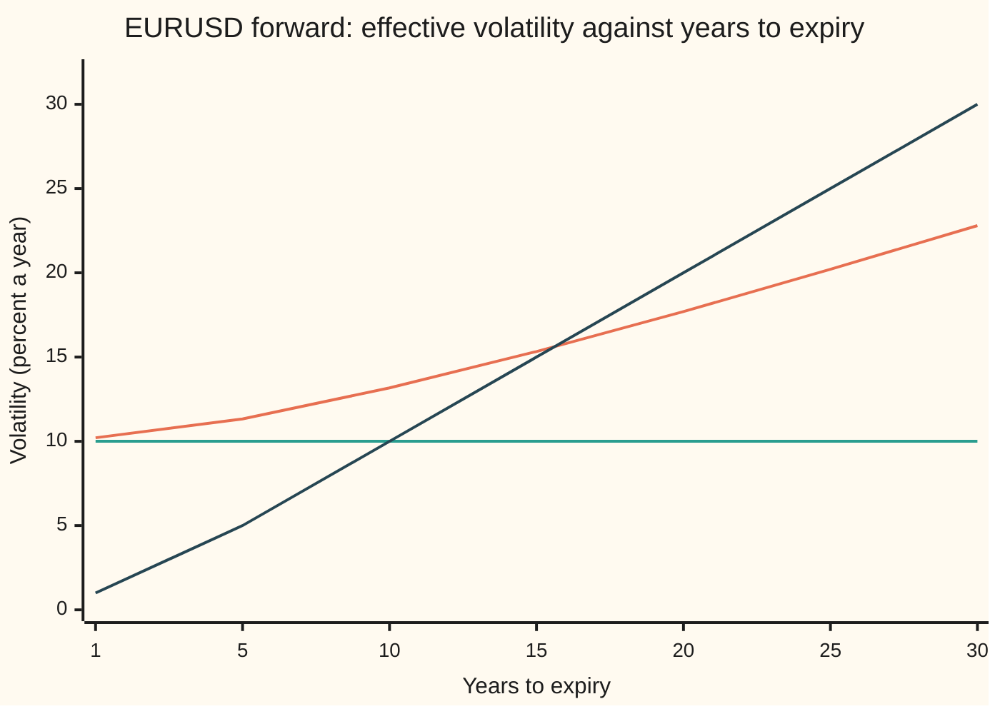

# Long-dated FX: the forward's volatility once both interest rates move, and the PRDC note that is a strip of such options

[Syllabus](../../../SYLLABUS.md) → [Financial mathematics](../README.md) → [Short-Rate Models](../README.md#s30) → Long-dated FX

---

## General Overview

A euro costs 1.10 dollars today. An investor buys a 30-year note from a bank, with 10,000,000 dollars of face value. Each year it pays a coupon of 6% times the euro's price on that day divided by 1.10, less 3%, and never less than zero. If the euro stays at 1.10, the coupon is 3%. If the euro climbs to 1.40, it is 4.64%. If the euro falls to 0.55 or below, it is zero.

A note like this is a **power reverse dual currency note**, PRDC for short. "Dual currency" means the coupon depends on an exchange rate. "Reverse" means the face value is repaid in the investor's home currency, here dollars, while the coupon follows the foreign one, the euro. "Power" means leverage: the coupon is a multiple of the exchange rate minus a fixed rate, so it moves faster than the rate. A 10% rise in the euro, from 1.10 to 1.21, lifts the coupon from 3% to 3.6%, a 20% rise.

Each coupon is a call option on the euro that expires far in the future. A one-year option on EURUSD (the euro's price in dollars) moves with the exchange rate's own volatility, about 10% a year. A 30-year option does not. Over 30 years the dollar and euro interest rates also wander, and past about twelve years they push the forward exchange rate around more than the spot does.

In a model where both rates have a volatility of 1 percentage point a year, the forward's effective volatility is 10.21% at 1 year, 13.17% at 10 years and **22.80% at 30 years**. Priced with that, the year-10 coupon is worth 280,878.58 dollars today. The year-30 coupon is worth 244,435.23 dollars. With the spot's 10% alone it would be 224,968.18, which is 19,467.05 dollars too little.

**A long-dated FX forward is the spot times a euro bond over a dollar bond, so its variance adds the bonds' variance, which grows with their life; past 12.33 years the rates carry most of it, and each PRDC coupon is a call priced with that larger volatility.**

**What kind of fact this is:** a model. The spot is taken to move lognormally with constant volatility and each short rate to follow Hull-White, an assumption rather than a law. Inside the model, the variance formula is a theorem, derived on this card in Why it works.

### The picture: three volatilities against the option's life



Orange, rising: the forward's effective volatility, from 10.21% to 22.80%. Green, flat: the spot's 10%. Dark, straight: the price volatility of a zero-coupon bond of the same life, when its rate moves 1 point a year. The dark line crosses the green one at 10 years: there a 10-year bond's price swings as much as the exchange rate. The rates' share of the forward's variance passes half a little later, at 12.33 years.

---

## The formula

Notation first.

- $`S_t`$ is the spot rate, dollars per euro, at time $`t`$ in years. Today $`S_0`$ = 1.10.
- $`T`$ is a coupon's payment date. $`\tau = T - t`$ (tau) is the time left before it.
- $`F(t,T)`$ is the forward rate: the rate agreed at $`t`$ for exchange at $`T`$.
- $`P_d(t,T)`$ and $`P_f(t,T)`$ are the prices at $`t`$ of a zero-coupon bond paying one dollar, or one euro, at $`T`$. Today they are the discount factors $`D_d(T)`$ and $`D_f(T)`$.

The forward is fixed by covered interest parity (the no-arbitrage link between spot, forward and the two bonds):

```math
F(t,T) = \frac{S_t\,P_f(t,T)}{P_d(t,T)}
```

Its variance rate (variance per year, at a moment $`\tau`$ years before $`T`$) collects six terms:

```math
\sigma_F^2(\tau) = \sigma_S^2 + \sigma_d^2 B_d^2 + \sigma_f^2 B_f^2 + 2\rho_{Sd}\,\sigma_S\sigma_d B_d - 2\rho_{Sf}\,\sigma_S\sigma_f B_f - 2\rho_{df}\,\sigma_d\sigma_f B_d B_f, \qquad B = \frac{1 - e^{-a\tau}}{a}
```

With no mean reversion, $`a = 0`$ and $`B = \tau`$. Adding the variance rate over the coupon's whole life gives the total variance:

```math
V(T) = \sigma_S^2\,T \;+\; \sigma_S\,(\rho_{Sd}\,\sigma_d - \rho_{Sf}\,\sigma_f)\,T^2 \;+\; (\sigma_d^2 + \sigma_f^2 - 2\rho_{df}\,\sigma_d\sigma_f)\,\frac{T^3}{3}, \qquad \sigma_{\mathrm{eff}}(T) = \sqrt{V(T)/T}
```

**Read it aloud:** the forward's total variance is the spot's variance growing with the years, plus a spot-and-rates cross term growing with the square of the years, plus the rate differential's variance growing with the cube. The effective volatility is the square root of the average.

The coupon $`\max(0,\ c_f S_T/S_0 - c_d)`$ is a call on $`S_T`$, priced by Black's formula on the forward:

```math
C(T) = g\,D_d(T)\,\big[F\,N(d_1) - K\,N(d_2)\big], \qquad g = \frac{c_f}{S_0}, \quad K = \frac{c_d\,S_0}{c_f}, \quad d_{1,2} = \frac{\ln(F/K) \pm \tfrac12 V(T)}{\sqrt{V(T)}}
```

**Read it aloud:** the coupon is $`g`$ calls struck at $`K`$, each worth the dollar discount factor times the forward's expected excess over the strike.

| Symbol | Plain meaning | In our example | Push it up and the year-30 coupon… |
| --- | --- | --- | --- |
| $`S_0`$, $`S_T`$ | spot EURUSD, dollars per euro, today and on the coupon date | 1.10 today | — ($`g`$ and $`K`$ are set from it on day one) |
| $`F`$ | the forward for the coupon date, $`S_0\,D_f(T)/D_d(T)`$ | 1.278018 at 10 years, 1.725143 at 30 | rises: the call is deeper in the money |
| $`T`$, $`t`$, $`\tau`$, $`dW`$ | payment date in years; any earlier time; time left, $`T - t`$; a random kick with variance $`dt`$ | 1 to 30 | — |
| $`\sigma_S`$ | the spot's volatility: yearly spread of its log moves | 10% | rises: wider forward |
| $`\sigma_d`$, $`\sigma_f`$ | normal volatility of the dollar and euro short rates: the yearly spread of their moves, in rate points | 1% each | rise: wider forward at the long end |
| $`a`$ | mean reversion speed of both rates, from [Hull-White](04-hull-white-model.md) | 0 | falls: bond volatility stops growing |
| $`B_d`$, $`B_f`$ | how far each bond's log price falls per unit rise in its rate; with $`a = 0`$, the bond's remaining life $`\tau`$ | 10 at 10 years left | — |
| $`\rho_{Sd}`$, $`\rho_{Sf}`$, $`\rho_{df}`$ | correlations, from −1 to +1: spot with the dollar rate, spot with the euro rate, dollar rate with euro rate | 0.2, −0.2, 0.5 | first rises, second and third fall |
| $`r_d`$, $`r_f`$, $`P_d`$, $`P_f`$, $`D_d`$, $`D_f`$ | today's flat dollar and euro rates, continuously compounded; dollar and euro zero-coupon bond prices at time $`t`$; today's values of those bonds, $`e^{-rT}`$ | 3.5%, 2.0%; $`D_d(10)`$ = 0.704688 | $`r_d`$ raises $`F`$ but cuts $`D_d`$ |
| $`\sigma_F^2`$, $`V`$, $`\sigma_{\mathrm{eff}}`$ | the forward's variance rate, its total variance to $`T`$, and the effective volatility | $`V(10)`$ = 0.173333, $`\sigma_{\mathrm{eff}}`$ = 13.17% | rises: the floor gains |
| $`c_f`$, $`c_d`$, $`g`$, $`K`$ | the coupon's two rates; the number of calls per unit face, $`c_f/S_0`$; their strike, $`c_d S_0/c_f`$ | 6%, 3%; 0.054545; 0.55 | $`c_f`$ rises it, $`c_d`$ cuts it |
| $`N(x)`$, $`Z`$, $`d_1`$, $`d_2`$, $`C`$ | bell-curve area left of $`x`$; one standard bell-curve draw; the two cut-offs; the coupon's value per unit face | $`d_1`$ = 2.233341 at 10 years; $`C(10)`$ = 0.028088 | — |

### When it holds

- **Rates follow Hull-White with fixed volatilities.** Each rate moves by normally distributed amounts, so it can go negative, and its volatility is a fixed number fitted as on [Calibrating Hull-White](08-calibrating-a-short-rate-model.md). If rate volatility itself changes over 30 years, the bond-volatility line is wrong.
- **No mean reversion here.** With $`a = 0`$ a 30-year bond's price moves 30 times its rate. Real long rates are pulled back, which slows that growth; with $`a`$ = 0.05 the 30-year volatility falls from 22.80% to 17.01%. Choosing $`a`$ is the biggest single modelling choice.
- **One flat spot volatility, no smile.** The strike 0.55 is half of today's spot. Far from the money the market's volatility differs from the at-the-money level, and a flat 10% misprices exactly the region the floor lives in.
- **Constant correlations.** Correlations between an exchange rate and two interest rates are estimated from history, not quoted. The cross term is 0.36 of the 1.56 total variance at 30 years, so a wrong sign is a wrong price.
- **No early redemption.** Real PRDC notes are usually callable by the bank. A call right turns the strip into a Bermudan option, which needs a tree, a PDE or regression, not one Black formula per coupon.

---

## Why it works

### Step 0: the forward is a product of three prices

Covered interest parity writes the forward as spot times euro bond divided by dollar bond. Logs turn a product into a sum:

```math
\ln F(t,T) = \ln S_t + \ln P_f(t,T) - \ln P_d(t,T)
```

So the forward's log moves are the sum of three log moves. The variance of a sum is each variance plus twice each covariance (the average product of two deviations). That is the [Composite option](../24-Quantos%20and%20composites/04-composite-option.md)'s volatility of a product, now with three factors instead of two.

### Step 1: a bond's price volatility grows with its life

A zero-coupon bond with $`\tau`$ years left loses about $`\tau`$ percent of its price when its rate rises one point. That is its duration. In [Hull-White](04-hull-white-model.md) the bond's log price moves by $`-B(\tau)`$ times the short rate's move, and $`B = \tau`$ when $`a = 0`$.

So a rate with 1 point a year of normal volatility gives a bond price volatility of $`\sigma_d \tau`$: 1% for a 1-year bond, 10% for a 10-year bond, 30% for a 30-year bond. This is the dark line in the picture.

### Step 2: add the three pieces with their signs

Each factor enters the forward with a sign:

| Factor moves up | Its bond | Forward | Sign in $`\ln F`$ |
| --- | --- | --- | --- |
| spot $`S`$ | — | up | $`+\sigma_S`$ |
| dollar rate $`r_d`$ | $`P_d`$ falls | up (dividing by less) | $`+\sigma_d B_d`$ |
| euro rate $`r_f`$ | $`P_f`$ falls | down | $`-\sigma_f B_f`$ |

Square the sum $`\sigma_S\,dW_S + \sigma_d B_d\,dW_d - \sigma_f B_f\,dW_f`$, where each $`dW`$ is a random kick with variance $`dt`$ and correlated kicks have covariance $`\rho\,dt`$. The six terms of $`\sigma_F^2(\tau)`$ come out, each cross term carrying the product of its two signs.

The dollar-euro term enters with a minus sign. When the two rates move together, the two bonds move together, and their ratio barely moves. Only the gap between the rates (the rate differential) moves the forward, and its variance is $`\sigma_d^2 + \sigma_f^2 - 2\rho_{df}\sigma_d\sigma_f`$.

### Step 3: add up the variance over the coupon's life

From today to the coupon date, the time left $`\tau`$ runs from $`T`$ down to 0. With $`a = 0`$, the variance rate is a quadratic in $`\tau`$. Its integral uses only $`\int_0^T d\tau = T`$, $`\int_0^T \tau\,d\tau = T^2/2`$ and $`\int_0^T \tau^2\,d\tau = T^3/3`$.

That gives $`V(T)`$ above. The spot term grows like $`T`$, the cross term like $`T^2`$ and the rate term like $`T^3`$. Whatever the sizes, the cube wins in the end.

The cross term is counted with the rates, because it disappears when both rate volatilities are zero. With the card's numbers the spot's share of $`V`$ drops below one half where $`\sigma_S^2 T`$ equals the other two terms:

```math
0.01\,T = 0.0004\,T^2 + 0.0001\,T^3/3 \iff T^2 + 12\,T - 300 = 0 \iff T = 12.3303
```

So the rates take over after about twelve years. At 10 years the rates already carry 42.31% of the variance; at 30 years, 80.77%.

### Step 4: in the right units the forward is lognormal

Measure every price in units of the dollar bond that matures on the coupon date. [Changing the unit of account](../05-Black-Scholes%20from%20the%20Ground%20Up/05-change-of-numeraire-in-pricing.md) shows that in those units every traded dollar asset is a martingale (it has no expected drift). The euro bond, converted to dollars, is traded; divided by the dollar bond it is exactly $`F(t,T)`$. So $`F`$ has no drift, and its volatility $`\sigma_F(\tau)`$ is a known function of time.

A driftless price with known, time-varying volatility is lognormal at $`T`$, with log variance $`V(T)`$. At $`T`$ the forward equals the spot, $`F(T,T) = S_T`$. A dollar paid at $`T`$ is worth $`D_d(T)`$ today. So each coupon is Black's formula with total variance $`V(T)`$, the forward form of [Garman-Kohlhagen](../21-FX%20vanilla%20options%20-%20Garman-Kohlhagen%20and%20the%20desk%20conventions/01-garman-kohlhagen.md) with $`\sigma^2 T`$ replaced by $`V(T)`$.

<details>
<summary>Detailed proof: the forward's dynamics in the dollar-bond units</summary>

In Hull-White a zero-coupon bond satisfies $`dP(t,T)/P(t,T) = r_t\,dt - \sigma B(T-t)\,dW_t`$ in its own currency's pricing world. Ito's lemma on $`\ln F = \ln S + \ln P_f - \ln P_d`$ gives a noise term

$`\displaystyle \sigma_S\,dW_S - \sigma_f B_f\,dW_f + \sigma_d B_d\,dW_d`$

whose variance rate is $`\sigma_F^2(\tau)`$. The volatilities are deterministic, so the noise is a Gaussian with variance $`\int_0^T \sigma_F^2(T - t)\,dt = V(T)`$.

$`F(t,T)\,P_d(t,T) = S_t P_f(t,T)`$ is the dollar price of a euro bond, a traded dollar asset. By [Changing the unit of account](../05-Black-Scholes%20from%20the%20Ground%20Up/05-change-of-numeraire-in-pricing.md), a traded asset divided by the numeraire (the unit prices are counted in) $`P_d(\cdot,T)`$ is a martingale under the $`T`$-forward measure, the measure that uses that bond as the unit. So $`F`$ has zero drift there, and

$`\displaystyle \ln S_T = \ln F(0,T) - \tfrac12 V(T) + \sqrt{V(T)}\,Z, \qquad Z \sim N(0,1).`$

The value today of a dollar payoff $`h(S_T)`$ at $`T`$ is $`D_d(T)\,E^T[h(S_T)]`$, where $`E^T`$ is the average under the $`T`$-forward measure. For $`h = g\max(S_T - K, 0)`$ the expectation is Black's formula, which gives $`C(T)`$. $`\blacksquare`$

</details>

### Step 5: the coupon is a call, and the note is a strip

Factor $`c_f/S_0`$ out of the coupon:

```math
\max\Big(0,\ c_f\frac{S_T}{S_0} - c_d\Big) = \frac{c_f}{S_0}\,\max\Big(0,\ S_T - \frac{c_d S_0}{c_f}\Big) = g\,\max(0,\ S_T - K)
```

So each coupon is $`g`$ = 0.054545 euro calls struck at $`K`$ = 0.55. The note's coupons are a strip: one call per year, each with its own date, forward and $`\sigma_{\mathrm{eff}}(T)`$. The face value is repaid in dollars at the end, so it is a plain dollar bond and needs no option model.

Put-call parity splits each coupon into a forward part and a floor. The forward part, $`D_d(T)\,(g F - c_d)`$, is what the coupon would be worth if it could go negative. The floor is $`g`$ puts struck at $`K`$, which pay when the euro is below 0.55. Only the floor depends on volatility.

### The other road: simulate all three factors

The checks also step the spot and both rates forward in the dollar pricing world, a quarter-year at a time, over 40,000 paths. Two drifts matter there:

- The dollar rate drifts up by $`\sigma_d^2 t`$ a year. This is Hull-White's fitted drift with $`a = 0`$ on a flat curve (the Ho-Lee model).
- The euro rate gets the same Ho-Lee drift $`\sigma_f^2 t`$, shifted by $`-\rho_{Sf}\,\sigma_S\,\sigma_f`$ = +0.0002 a year. The shift is [The quanto adjustment](../24-Quantos%20and%20composites/01-quanto-forward-and-adjustment.md), applied to a euro rate seen from the dollar world.

The simulation never uses $`V(T)`$. Its spread of $`\ln S_T`$, divided by $`\sqrt{T}`$ to give a yearly volatility, comes out at 0.132154 at 10 years and 0.228341 at 30, against 0.131656 and 0.228035 from the formula. Its 30-year floor is 0.002004 ± 0.000035 against Black's 0.002013.

---

## Worked numbers, by hand

The year-10 coupon. Inputs: $`S_0`$ = 1.10, $`\sigma_S`$ = 10%, $`\sigma_d = \sigma_f`$ = 1%, $`\rho_{Sd}`$ = 0.2, $`\rho_{Sf}`$ = −0.2, $`\rho_{df}`$ = 0.5, $`r_d`$ = 3.5%, $`r_f`$ = 2.0%, $`c_f`$ = 6%, $`c_d`$ = 3%, face 10,000,000 dollars.

| Step | Arithmetic | Value |
| --- | --- | --- |
| spot term | $`0.10^2 \times 10`$ | 0.100000 |
| cross term | $`0.10 \times (0.2 \times 0.01 - (-0.2) \times 0.01) \times 10^2`$ | 0.040000 |
| rate term | $`(0.0001 + 0.0001 - 0.0001) \times 10^3 / 3`$ | 0.033333 |
| total variance $`V(10)`$ | $`0.100000 + 0.040000 + 0.033333`$ | 0.173333 |
| $`\sigma_{\mathrm{eff}}`$, $`\sqrt{V}`$ | $`\sqrt{0.173333/10}`$; $`\sqrt{0.173333}`$ | 0.131656; 0.416333 |
| forward $`F`$ | $`1.10 \times e^{(0.035 - 0.020) \times 10}`$ | 1.278018 |
| $`D_d(10)`$ | $`e^{-0.35}`$ | 0.704688 |
| $`g`$, $`K`$ | $`0.06 / 1.10`$; $`0.03 \times 1.10 / 0.06`$ | 0.054545; 0.55 |
| $`\ln(F/K)`$ | $`\ln(1.278018 / 0.55)`$ | 0.843147 |
| $`d_1`$, $`d_2`$ | $`(0.843147 \pm 0.086667) / 0.416333`$ | 2.233341, 1.817007 |
| $`N(d_1)`$, $`N(d_2)`$ | bell-curve table | 0.987237, 0.965392 |
| $`F N(d_1) - K N(d_2)`$ | $`1.278018 \times 0.987237 - 0.55 \times 0.965392`$ | 0.730740 |
| **coupon value** | $`0.054545 \times 0.704688 \times 0.730740`$ | **0.028088 per dollar of face** |
| on the note | $`10{,}000{,}000 \times 0.028088`$, the coupon value before rounding | 280,878.58 USD |
| forward part | $`0.704688 \times (0.069710 - 0.03)`$ | 0.027983 |
| floor | $`0.028088 - 0.027983`$ | 0.000105 |

So the year-10 coupon is worth 280,878.58 dollars today, and almost all of it is the forward part. The euro would have to fall from a forward of 1.28 to below 0.55 for the floor to pay, and at 10 years that is unlikely.

### The whole strip

| Coupon year | $`\sigma_{\mathrm{eff}}`$ | Forward | Coupon value | Floor | Floor at 10% spot vol |
| --- | --- | --- | --- | --- | --- |
| 1 | 0.102144 | 1.116624 | 0.029844 | 0.000000 | 0.000000 |
| 5 | 0.113284 | 1.185673 | 0.029110 | 0.000003 | 0.000001 |
| 10 | 0.131656 | 1.278018 | 0.028088 | 0.000105 | 0.000012 |
| 15 | 0.153297 | 1.377555 | 0.027128 | 0.000425 | 0.000032 |
| 20 | 0.177012 | 1.484845 | 0.026242 | 0.000920 | 0.000049 |
| 25 | 0.202073 | 1.600491 | 0.025368 | 0.001482 | 0.000061 |
| 30 | 0.228035 | 1.725143 | 0.024444 | 0.002013 | 0.000066 |

The 30 coupons together are worth 0.813092 per dollar of face, 8,130,919.70 dollars. With the spot's 10% for every coupon they would be 7,935,434.03 dollars, 195,485.67 too little. At 30 years the floor priced with the full volatility is 30.38 times the floor priced with the spot's alone.

### What breaks if you drop a piece

The year-30 coupon, correct value 0.024444 per dollar of face.

| Mistake | Comes out at | What went wrong |
| --- | --- | --- |
| Spot volatility 10% for every date | 0.022497 | Ignores the 1.26 of the 1.56 variance that the rates bring |
| Correlations dropped | 0.025267 | Volatility 26.46%: the two rates' 0.5 correlation partly cancels, and that cancelling is lost; the 0.36 spot-rate cross term, which works the other way, is lost too |
| Bond volatility taken as the rate volatility, 1% | 0.022518 | Volatility 10.44%: a 30-year bond moves 30 times its rate, not once |
| Discounted at the euro rate | 0.038335 | The coupon is paid in dollars, so it is discounted at the dollar rate |

### How the variance shifts from the spot to the rates

The rates' share of the forward's variance (cross term plus rate term), by years to expiry:

```
 1 year   ##                                         4.15%
 5 years  #########                                 22.08%
10 years  #################                         42.31%
15 years  #######################                   57.45%
20 years  ###########################               68.09%
25 years  ##############################            75.51%
30 years  ################################          80.77%
```

Below about 12 years the spot is most of the story. Above it, the forward's spread is mostly the two interest rates. At 1 year the variance is 0.010000 from the spot and 0.000433 from everything else; at 30 years it is 0.300000 from the spot and 1.260000 from the rest.

---

## Code, from first principles, and it actually runs

The scripts write their own normal CDF (Simpson slices under the bell curve), their own Simpson integrator and their own random numbers (xorshift and Box-Muller). They reach the forward's variance by **two independent roads**. The first is the variance rate $`\sigma_F^2(\tau)`$ from Steps 0 to 2, added up two ways: by hand, as the closed form $`V(T)`$, and by a Simpson integral that also allows mean reversion. The second is a simulation of spot and both rates in the dollar pricing world that never uses either. At 10 and 30 years the simulation also checks that the dollar bond and the euro bond come back at today's curve prices, and that its floor matches Black's floor within four standard errors. The 1-year row is printed for reference only: its floor is zero on every path, and its bond's sampling error is smaller than the error from quarter-year steps. The year at which the spot loses half its share is found by bisection and checked against the quadratic's root.

### Python

```python
# Long-dated FX and PRDC notes -- the check behind the card.  Standard library only.
# Three factors: EURUSD spot (lognormal), USD and EUR short rates (Hull-White, no
# mean reversion).  The normal CDF, the integrals and the random numbers are
# written out here; nothing imported knows the answer.
from math import log, sqrt, exp, pi, cos
def phi(x): return exp(-0.5 * x * x) / sqrt(2.0 * pi)
def simpson(f, a, b, n):
    h = (b - a) / n
    return (f(a) + f(b) + sum((4 if i % 2 else 2) * f(a + i * h) for i in range(1, n))) * h / 3.0
def N(x): return 0.0 if x < -12 else 1.0 if x > 12 else 0.5 + simpson(phi, 0.0, x, 2000)
S0, sS, sd, sf = 1.10, 0.10, 0.01, 0.01        # spot USD per EUR; spot vol; USD and EUR rate vols
rSd, rSf, rdf = 0.2, -0.2, 0.5                 # correlations spot-USD, spot-EUR, USD-EUR
rd, rf = 0.035, 0.020                          # flat USD and EUR curves, continuously compounded
cf, cd, NOTE = 0.06, 0.03, 10_000_000          # coupon 6% x S_T/1.10 - 3%, floored at 0
g = cf / S0; K = cd / g                        # coupon = g max(S_T - K, 0), K = 0.55
def B(a, tau): return tau if a == 0 else (1 - exp(-a * tau)) / a
def inst_var(tau, a=0.0, s=sS, rho=(rSd, rSf, rdf)):   # variance rate of the forward, tau years before T
    bd, bf = B(a, tau), B(a, tau)
    return (s * s + sd * sd * bd * bd + sf * sf * bf * bf + 2 * rho[0] * s * sd * bd
            - 2 * rho[1] * s * sf * bf - 2 * rho[2] * sd * sf * bd * bf)
def var_closed(T, s=sS):                       # road 1: the integral done by hand (a = 0)
    return (s * s * T, s * (rSd * sd - rSf * sf) * T ** 2, (sd * sd + sf * sf - 2 * rdf * sd * sf) * T ** 3 / 3)
def vol_eff(T, **kw): return sqrt(simpson(lambda u: inst_var(u, **kw), 0.0, T, 600) / T)   # road 2
def coupon(T, v, rd=rd, rf=rf, disc=None):     # Black on the forward: (value, linear part, floor)
    F, Pd = S0 * exp((rd - rf) * T), exp(-(rd if disc is None else disc) * T)
    d1 = (log(F / K) + 0.5 * v * v * T) / (v * sqrt(T)); d2 = d1 - v * sqrt(T)
    return g * Pd * (F * N(d1) - K * N(d2)), Pd * (g * F - cd), g * Pd * (K * N(-d2) - F * N(-d1))
# ---- road 3: simulate all three factors in the dollar pricing world ----
state = 0x2545F4914F6CDD1D
def unif():                                    # xorshift64, a uniform in (0, 1)
    global state
    state ^= (state << 13) & 0xFFFFFFFFFFFFFFFF; state ^= state >> 7
    state ^= (state << 17) & 0xFFFFFFFFFFFFFFFF
    return ((state >> 11) + 0.5) / 9007199254740992.0
def normal_pair():
    r, t = sqrt(-2.0 * log(unif())), 2.0 * pi * unif()
    return r * cos(t), r * cos(t - 0.5 * pi)
l21, l31 = rSd, rSf                            # Cholesky factor of the 3 x 3 correlation matrix
l22 = sqrt(1 - l21 * l21); l32 = (rdf - l31 * l21) / l22; l33 = sqrt(1 - l31 * l31 - l32 * l32)
PAIRS, DT, MARKS = 20000, 0.25, (1, 10, 30)
acc = {T: [0.0, 0.0] for T in MARKS}           # sum ln S, sum ln S^2
prs = {T: [] for T in MARKS}                   # per antithetic pair: mean D, D S, floor
for p in range(PAIRS):
    zs = []
    for k in range(int(30 / DT)):
        a, b = normal_pair(); c, _ = normal_pair(); zs.append((a, b, c))
    fl = {T: [0.0, 0.0, 0.0] for T in MARKS}
    for sign in (1.0, -1.0):
        x, ud, uf, I, t = log(S0), rd, rf, 0.0, 0.0
        for k, (z1, z2, z3) in enumerate(zs):
            w1 = sign * z1; w2 = sign * (l21 * z1 + l22 * z2); w3 = sign * (l31 * z1 + l32 * z2 + l33 * z3)
            nd = ud + sd * sd * (t + 0.5 * DT) * DT + sd * sqrt(DT) * w2              # Ho-Lee drift
            nf = uf + (sf * sf * (t + 0.5 * DT) - rSf * sS * sf) * DT + sf * sqrt(DT) * w3   # quanto shift
            x += 0.5 * ((ud - uf) + (nd - nf)) * DT - 0.5 * sS * sS * DT + sS * sqrt(DT) * w1
            I += 0.5 * (ud + nd) * DT; ud, uf, t = nd, nf, t + DT
            if abs(t - round(t)) < 1e-9 and round(t) in MARKS:
                T, D, ST = round(t), exp(-I), exp(x)
                acc[T][0] += x; acc[T][1] += x * x
                for i, v in enumerate((D, D * ST, D * g * max(K - ST, 0.0))): fl[T][i] += 0.5 * v
    for T in MARKS: prs[T].append(fl[T])
n = 2 * PAIRS
def mean_se(xs):
    m = sum(xs) / len(xs); return m, sqrt(sum((v - m) ** 2 for v in xs) / (len(xs) - 1) / len(xs))
def mc(T):                                     # spread of ln S_T, and (mean, standard error) of D, D S, floor
    m1, m2 = (v / n for v in acc[T])
    return (sqrt((m2 - m1 * m1) / T),) + tuple(mean_se([q[i] for q in prs[T]]) for i in range(3))
grid = (1, 5, 10, 15, 20, 25, 30)
for T in (1, 10, 30):
    print(f"forward variance at {T}y: spot, cross, rates, total ", " ".join(f"{v:.6f}" for v in var_closed(T)),
          f"{sum(var_closed(T)):.6f} rest {var_closed(T)[1] + var_closed(T)[2]:.6f}")
print("coupon % at S_T = 1.10, 1.21, 1.40, 0.55:", " ".join(f"{100 * max(0.0, cf * x / S0 - cd):.2f}" for x in (1.10, 1.21, 1.40, 0.55)),
      f"| 10% euro rise lifts it {100 * ((cf * 1.21 / S0 - cd) / (cf - cd) - 1):.2f}% | EUR rate drift shift {-rSf * sS * sf:.6f} | half V at 10y {0.5 * sum(var_closed(10)):.6f}")
print("year  vol closed  vol Simpson  bond vol  spot share  rates+cross share")
for T in grid:
    v = var_closed(T); vc = sqrt(sum(v) / T)
    print(f"{T:4d} {vc:11.6f} {vol_eff(T):12.6f} {sd * B(0.0, T):9.4f} {v[0] / sum(v):11.4f} {(v[1] + v[2]) / sum(v):18.4f}")
def crossover(s):                              # bisection: the year the spot's share drops below half
    lo, hi = 1.0, 60.0
    for _ in range(60):
        mid = 0.5 * (lo + hi); v = var_closed(mid, s); lo, hi = (mid, hi) if v[0] > v[1] + v[2] else (lo, mid)
    return lo
lo = crossover(sS)
print(f"spot share falls below half at year {lo:.4f}; quadratic root {(-12 + sqrt(1344)) / 2:.4f}")
print("year  MC vol    D(T) MC   exp(-rd T)  D S MC    S0 exp(-rf T)  floor MC   +- se     floor Black")
for T in MARKS:
    v, (mD, _), (mDS, _), (mfl, se) = mc(T)
    print(f"{T:4d} {v:9.6f} {mD:9.6f} {exp(-rd * T):10.6f} {mDS:9.6f} {S0 * exp(-rf * T):13.6f}"
          f" {mfl:9.6f} {se:9.6f} {coupon(T, vol_eff(T))[2]:11.6f}")
for T in (10, 30):
    v = vol_eff(T); F = S0 * exp((rd - rf) * T); d1 = (log(F / K) + 0.5 * v * v * T) / (v * sqrt(T))
    c, lin, fl = coupon(T, v)
    print(f"{T}y coupon: forward {F:.6f} D(T) {exp(-rd * T):.6f} d1 {d1:.6f} d2 {d1 - v * sqrt(T):.6f}"
          f" N(d1) {N(d1):.6f} N(d2) {N(d1 - v * sqrt(T)):.6f}")
    print(f"{T}y coupon: g {g:.6f} K {K:.6f} g F {g * F:.6f} ln(F/K) {log(F / K):.6f} sd {v * sqrt(T):.6f}"
          f" F N(d1) - K N(d2) {F * N(d1) - K * N(d1 - v * sqrt(T)):.6f}")
    print(f"{T}y coupon: value {c:.6f} = linear {lin:.6f} + floor {fl:.6f}; USD on 10m {NOTE * c:,.2f}")
    print(f"{T}y coupon: spot vol only {coupon(T, sS)[0]:.6f}; USD on 10m {NOTE * coupon(T, sS)[0]:,.2f};"
          f" gap {NOTE * (c - coupon(T, sS)[0]):,.2f}")
print("strip year  vol      forward   value     floor     floor at spot vol")
tot = tot0 = 0.0
for T in range(1, 31):
    c, lin, fl = coupon(T, vol_eff(T)); c0, _, fl0 = coupon(T, sS); tot += c; tot0 += c0
    if T in grid: print(f"strip {T:4d} {vol_eff(T):8.6f} {S0 * exp((rd - rf) * T):8.6f} {c:9.6f} {fl:9.6f} {fl0:9.6f}")
print(f"strip of 30 coupons: {tot:.6f} (USD {NOTE * tot:,.2f}); spot vol only {tot0:.6f} (USD {NOTE * tot0:,.2f}); gap {NOTE * (tot - tot0):,.2f}")
v30 = vol_eff(30)
print(f"30y floor, full vol over spot vol: {coupon(30, v30)[2] / coupon(30, sS)[2]:.2f}")
wrong = [("spot vol only", sS), ("correlations dropped", vol_eff(30, rho=(0, 0, 0))),
         ("bond vol = rate vol, not rate vol x years", sqrt(inst_var(0.0) + (sd * sd + sf * sf - 2 * rdf * sd * sf) + 2 * sS * (rSd * sd - rSf * sf)))]
for name, v in wrong: print(f"wrong 30y: {name:<42} vol {v:.6f} value {coupon(30, v)[0]:.6f}")
print(f"wrong 30y: {'discounted at the EUR rate':<42} vol {v30:.6f} value {coupon(30, v30, disc=rf)[0]:.6f}")
print(f"try: a = 0.05 vol at 30y {vol_eff(30, a=0.05):.6f}; spot vol 15% crossover year {crossover(0.15):.4f}")
sw = [coupon(T, vol_eff(T), rd=rf, rf=rd) for T in range(1, 31)]
sw0 = [coupon(T, sS, rd=rf, rf=rd) for T in range(1, 31)]
print(f"try: rates swapped, 30y forward {S0 * exp((rf - rd) * 30):.6f}, 30y floor {sw[-1][2]:.6f} (spot vol {sw0[-1][2]:.6f}); strip {sum(c[0] for c in sw):.6f} (spot vol {sum(c[0] for c in sw0):.6f})")
print("chart, vol %  " + " ".join(f"{100 * vol_eff(T):6.2f}" for T in grid))
print("chart, spot % " + " ".join(f"{100 * sS:6.2f}" for T in grid))
print("chart, bond % " + " ".join(f"{100 * sd * B(0.0, T):6.2f}" for T in grid))
assert all(abs(sqrt(sum(var_closed(T)) / T) - vol_eff(T)) < 1e-9 for T in grid), "closed form vs Simpson"
assert [round(100 * vol_eff(T), 2) for T in MARKS] == [10.21, 13.17, 22.80], "the spec's three volatilities"
for T in MARKS:
    v, (mD, eD), (mDS, eDS), (mfl, se) = mc(T)
    assert abs(v - vol_eff(T)) < 4 * sqrt(0.5 / PAIRS) * vol_eff(T), "simulated spread of ln S_T vs the formula"
    if T == 1: continue                        # 1 year: printed for reference only (floor 0 on every path)
    assert abs(mD - exp(-rd * T)) < 4 * eD + 1e-6, "simulated dollar bond vs today's curve"
    assert abs(mDS - S0 * exp(-rf * T)) < 4 * eDS + 1e-6, "EUR deposit is worth S0 P_f in USD"
    assert abs(mfl - coupon(T, vol_eff(T))[2]) < 4 * se + 1e-6, "simulated floor vs Black floor"
assert abs(coupon(10, vol_eff(10))[0] - (coupon(10, vol_eff(10))[1] + coupon(10, vol_eff(10))[2])) < 1e-9, "coupon = linear + floor"
assert abs(lo - (-12 + sqrt(1344)) / 2) < 1e-6, "bisection vs the quadratic root"
print("ALL CHECKS PASS")
```

**Ran 2026-11-23 on macOS, Python 3.14.10, standard library only. All checks passed. Output, pasted from the run:**

```
forward variance at 1y: spot, cross, rates, total  0.010000 0.000400 0.000033 0.010433 rest 0.000433
forward variance at 10y: spot, cross, rates, total  0.100000 0.040000 0.033333 0.173333 rest 0.073333
forward variance at 30y: spot, cross, rates, total  0.300000 0.360000 0.900000 1.560000 rest 1.260000
coupon % at S_T = 1.10, 1.21, 1.40, 0.55: 3.00 3.60 4.64 0.00 | 10% euro rise lifts it 20.00% | EUR rate drift shift 0.000200 | half V at 10y 0.086667
year  vol closed  vol Simpson  bond vol  spot share  rates+cross share
   1    0.102144     0.102144    0.0100      0.9585             0.0415
   5    0.113284     0.113284    0.0500      0.7792             0.2208
  10    0.131656     0.131656    0.1000      0.5769             0.4231
  15    0.153297     0.153297    0.1500      0.4255             0.5745
  20    0.177012     0.177012    0.2000      0.3191             0.6809
  25    0.202073     0.202073    0.2500      0.2449             0.7551
  30    0.228035     0.228035    0.3000      0.1923             0.8077
spot share falls below half at year 12.3303; quadratic root 12.3303
year  MC vol    D(T) MC   exp(-rd T)  D S MC    S0 exp(-rf T)  floor MC   +- se     floor Black
   1  0.101446  0.965605   0.965605  1.078133      1.078219  0.000000  0.000000    0.000000
  10  0.132154  0.704681   0.704688  0.901188      0.900604  0.000108  0.000004    0.000105
  30  0.228341  0.350122   0.349938  0.607985      0.603693  0.002004  0.000035    0.002013
10y coupon: forward 1.278018 D(T) 0.704688 d1 2.233341 d2 1.817007 N(d1) 0.987237 N(d2) 0.965392
10y coupon: g 0.054545 K 0.550000 g F 0.069710 ln(F/K) 0.843147 sd 0.416333 F N(d1) - K N(d2) 0.730740
10y coupon: value 0.028088 = linear 0.027983 + floor 0.000105; USD on 10m 280,878.58
10y coupon: spot vol only 0.027995; USD on 10m 279,951.33; gap 927.25
30y coupon: forward 1.725143 D(T) 0.349938 d1 1.539750 d2 0.290750 N(d1) 0.938189 N(d2) 0.614379
30y coupon: g 0.054545 K 0.550000 g F 0.094099 ln(F/K) 1.143147 sd 1.249000 F N(d1) - K N(d2) 1.280603
30y coupon: value 0.024444 = linear 0.022431 + floor 0.002013; USD on 10m 244,435.23
30y coupon: spot vol only 0.022497; USD on 10m 224,968.18; gap 19,467.05
strip year  vol      forward   value     floor     floor at spot vol
strip    1 0.102144 1.116624  0.029844  0.000000  0.000000
strip    5 0.113284 1.185673  0.029110  0.000003  0.000001
strip   10 0.131656 1.278018  0.028088  0.000105  0.000012
strip   15 0.153297 1.377555  0.027128  0.000425  0.000032
strip   20 0.177012 1.484845  0.026242  0.000920  0.000049
strip   25 0.202073 1.600491  0.025368  0.001482  0.000061
strip   30 0.228035 1.725143  0.024444  0.002013  0.000066
strip of 30 coupons: 0.813092 (USD 8,130,919.70); spot vol only 0.793543 (USD 7,935,434.03); gap 195,485.67
30y floor, full vol over spot vol: 30.38
wrong 30y: spot vol only                              vol 0.100000 value 0.022497
wrong 30y: correlations dropped                       vol 0.264575 value 0.025267
wrong 30y: bond vol = rate vol, not rate vol x years  vol 0.104403 value 0.022518
wrong 30y: discounted at the EUR rate                 vol 0.228035 value 0.038335
try: a = 0.05 vol at 30y 0.170147; spot vol 15% crossover year 18.4955
try: rates swapped, 30y forward 0.701391, 30y floor 0.006638 (spot vol 0.002156); strip 0.502584 (spot vol 0.449092)
chart, vol %   10.21  11.33  13.17  15.33  17.70  20.21  22.80
chart, spot %  10.00  10.00  10.00  10.00  10.00  10.00  10.00
chart, bond %   1.00   5.00  10.00  15.00  20.00  25.00  30.00
ALL CHECKS PASS
```

The three variance results agree: closed form and Simpson to nine decimals, the simulation within its sampling error. The simulated dollar bond at 30 years, 0.350122, sits on the curve's 0.349938, and the simulated euro bond, 0.607985 dollars, on 0.603693, both within four standard errors.

### Rust

The same checks, the same random numbers, the same labels. No crates.

```rust
// Long-dated FX and PRDC notes -- the same check as long_dated_fx_and_prdc_notes_check.py,
// in Rust.  Standard library only, no crates.  Same grids, same random numbers, same labels.
use std::f64::consts::PI;
const S0: f64 = 1.10; const SS: f64 = 0.10; const SD: f64 = 0.01; const SF: f64 = 0.01;
const RSD: f64 = 0.2; const RSF: f64 = -0.2; const RDF: f64 = 0.5;
const RD: f64 = 0.035; const RF: f64 = 0.020;
const CF: f64 = 0.06; const CD: f64 = 0.03; const NOTE: f64 = 10_000_000.0;
const G: f64 = CF / S0; const K: f64 = CD / G;
fn nsum(xs: &[f64]) -> f64 {              // compensated sum, as Python's built-in sum does
    let (mut s, mut c) = (0.0_f64, 0.0_f64);
    for &x in xs { let t = s + x; if s.abs() >= x.abs() { c += (s - t) + x } else { c += (x - t) + s }; s = t; }
    s + c
}
fn phi(x: f64) -> f64 { (-0.5 * x * x).exp() / (2.0 * PI).sqrt() }
fn simpson<F: Fn(f64) -> f64>(f: F, a: f64, b: f64, n: usize) -> f64 {
    let h = (b - a) / n as f64;
    let inner: Vec<f64> = (1..n).map(|i| (if i % 2 == 1 { 4.0 } else { 2.0 }) * f(a + i as f64 * h)).collect();
    (f(a) + f(b) + nsum(&inner)) * h / 3.0
}
fn ncdf(x: f64) -> f64 { if x < -12.0 { 0.0 } else if x > 12.0 { 1.0 } else { 0.5 + simpson(phi, 0.0, x, 2000) } }
fn bfac(a: f64, tau: f64) -> f64 { if a == 0.0 { tau } else { (1.0 - (-a * tau).exp()) / a } }
fn inst_var(tau: f64, a: f64, s: f64, rho: (f64, f64, f64)) -> f64 {
    let (bd, bf) = (bfac(a, tau), bfac(a, tau));
    s * s + SD * SD * bd * bd + SF * SF * bf * bf + 2.0 * rho.0 * s * SD * bd
        - 2.0 * rho.1 * s * SF * bf - 2.0 * rho.2 * SD * SF * bd * bf
}
fn var_closed(t: f64, s: f64) -> [f64; 3] {   // road 1: the integral done by hand (a = 0)
    [s * s * t, s * (RSD * SD - RSF * SF) * t.powf(2.0), (SD * SD + SF * SF - 2.0 * RDF * SD * SF) * t.powf(3.0) / 3.0]
}
fn vol_gen(t: f64, a: f64, rho: (f64, f64, f64)) -> f64 { (simpson(|u| inst_var(u, a, SS, rho), 0.0, t, 600) / t).sqrt() }
fn vol_eff(t: f64) -> f64 { vol_gen(t, 0.0, (RSD, RSF, RDF)) }        // road 2
fn coupon_g(t: f64, v: f64, rd: f64, rf: f64, disc: f64) -> (f64, f64, f64) {
    let (f, pd) = (S0 * ((rd - rf) * t).exp(), (-disc * t).exp());
    let d1 = ((f / K).ln() + 0.5 * v * v * t) / (v * t.sqrt()); let d2 = d1 - v * t.sqrt();
    (G * pd * (f * ncdf(d1) - K * ncdf(d2)), pd * (G * f - CD), G * pd * (K * ncdf(-d2) - f * ncdf(-d1)))
}
fn coupon(t: f64, v: f64) -> (f64, f64, f64) { coupon_g(t, v, RD, RF, RD) }
fn commas(x: f64) -> String {
    let s = format!("{:.2}", x); let (ip, fp) = s.split_at(s.find('.').unwrap());
    let mut out = String::new();
    for (i, ch) in ip.chars().enumerate() { if i > 0 && (ip.len() - i) % 3 == 0 { out.push(','); } out.push(ch); }
    out + fp
}
struct Rng(u64);
impl Rng {
    fn unif(&mut self) -> f64 {           // xorshift64, a uniform in (0, 1)
        self.0 ^= self.0 << 13; self.0 ^= self.0 >> 7; self.0 ^= self.0 << 17;
        ((self.0 >> 11) as f64 + 0.5) / 9007199254740992.0
    }
    fn normal_pair(&mut self) -> (f64, f64) {
        let r = (-2.0 * self.unif().ln()).sqrt(); let t = 2.0 * PI * self.unif();
        (r * t.cos(), r * (t - 0.5 * PI).cos())
    }
}
fn mean_se(xs: &[f64]) -> (f64, f64) {
    let n = xs.len() as f64; let m = nsum(xs) / n;
    let sq: Vec<f64> = xs.iter().map(|v| (v - m) * (v - m)).collect();
    (m, (nsum(&sq) / (n - 1.0) / n).sqrt())
}
fn crossover(s: f64) -> f64 {             // bisection: the year the spot's share drops below half
    let (mut lo, mut hi) = (1.0_f64, 60.0_f64);
    for _ in 0..60 { let mid = 0.5 * (lo + hi); let v = var_closed(mid, s); if v[0] > v[1] + v[2] { lo = mid } else { hi = mid } }
    lo
}
fn main() {
    let (l21, l31) = (RSD, RSF);          // Cholesky factor of the 3 x 3 correlation matrix
    let l22 = (1.0 - l21 * l21).sqrt(); let l32 = (RDF - l31 * l21) / l22; let l33 = (1.0 - l31 * l31 - l32 * l32).sqrt();
    let (pairs, dt, marks) = (20000usize, 0.25_f64, [1i64, 10, 30]);
    let mut rng = Rng(0x2545F4914F6CDD1D);
    let mut acc = [[0.0_f64; 2]; 3]; let mut prs: Vec<Vec<[f64; 3]>> = vec![Vec::new(), Vec::new(), Vec::new()];
    for _ in 0..pairs {
        let mut zs = Vec::new();
        for _ in 0..(30.0 / dt) as usize { let (a, b) = rng.normal_pair(); let (c, _) = rng.normal_pair(); zs.push((a, b, c)); }
        let mut fl = [[0.0_f64; 3]; 3];
        for sign in [1.0_f64, -1.0] {
            let (mut x, mut ud, mut uf, mut ii, mut t) = (S0.ln(), RD, RF, 0.0_f64, 0.0_f64);
            for &(z1, z2, z3) in &zs {
                let w1 = sign * z1; let w2 = sign * (l21 * z1 + l22 * z2); let w3 = sign * (l31 * z1 + l32 * z2 + l33 * z3);
                let nd = ud + SD * SD * (t + 0.5 * dt) * dt + SD * dt.sqrt() * w2;               // Ho-Lee drift
                let nf = uf + (SF * SF * (t + 0.5 * dt) - RSF * SS * SF) * dt + SF * dt.sqrt() * w3; // quanto shift
                x += 0.5 * ((ud - uf) + (nd - nf)) * dt - 0.5 * SS * SS * dt + SS * dt.sqrt() * w1;
                ii += 0.5 * (ud + nd) * dt; ud = nd; uf = nf; t += dt;
                if (t - t.round()).abs() < 1e-9 {
                    if let Some(m) = marks.iter().position(|&mk| mk == t.round() as i64) {
                        let (d, st) = ((-ii).exp(), x.exp());
                        acc[m][0] += x; acc[m][1] += x * x;
                        for (i, v) in [d, d * st, d * G * (K - st).max(0.0)].iter().enumerate() { fl[m][i] += 0.5 * v; }
                    }
                }
            }
        }
        for m in 0..3 { prs[m].push(fl[m]); }
    }
    let n = 2.0 * pairs as f64;
    let mc = |m: usize| {
        let (m1, m2) = (acc[m][0] / n, acc[m][1] / n);
        let col = |i: usize| -> Vec<f64> { prs[m].iter().map(|q| q[i]).collect() };
        (((m2 - m1 * m1) / marks[m] as f64).sqrt(), mean_se(&col(0)), mean_se(&col(1)), mean_se(&col(2)))
    };
    let grid = [1.0_f64, 5.0, 10.0, 15.0, 20.0, 25.0, 30.0];
    for t in [1.0_f64, 10.0, 30.0] {
        let v = var_closed(t, SS);
        println!("forward variance at {}y: spot, cross, rates, total  {:.6} {:.6} {:.6} {:.6} rest {:.6}", t, v[0], v[1], v[2], nsum(&v), v[1] + v[2]);
    }
    let cps: Vec<String> = [1.10_f64, 1.21, 1.40, 0.55].iter().map(|x| format!("{:.2}", 100.0 * (CF * x / S0 - CD).max(0.0))).collect();
    println!("coupon % at S_T = 1.10, 1.21, 1.40, 0.55: {} | 10% euro rise lifts it {:.2}% | EUR rate drift shift {:.6} | half V at 10y {:.6}", cps.join(" "),
             100.0 * ((CF * 1.21 / S0 - CD) / (CF - CD) - 1.0), -RSF * SS * SF, 0.5 * nsum(&var_closed(10.0, SS)));
    println!("year  vol closed  vol Simpson  bond vol  spot share  rates+cross share");
    for &t in &grid {
        let v = var_closed(t, SS); let tot = nsum(&v);
        println!("{:4} {:11.6} {:12.6} {:9.4} {:11.4} {:18.4}", t, (tot / t).sqrt(), vol_eff(t), SD * bfac(0.0, t), v[0] / tot, (v[1] + v[2]) / tot);
    }
    let lo = crossover(SS);
    println!("spot share falls below half at year {:.4}; quadratic root {:.4}", lo, (-12.0 + 1344.0_f64.sqrt()) / 2.0);
    println!("year  MC vol    D(T) MC   exp(-rd T)  D S MC    S0 exp(-rf T)  floor MC   +- se     floor Black");
    for m in 0..3 {
        let t = marks[m] as f64; let (v, (md, _), (mds, _), (mfl, se)) = mc(m);
        println!("{:4} {:9.6} {:9.6} {:10.6} {:9.6} {:13.6} {:9.6} {:9.6} {:11.6}", marks[m], v, md, (-RD * t).exp(), mds,
                 S0 * (-RF * t).exp(), mfl, se, coupon(t, vol_eff(t)).2);
    }
    for t in [10.0_f64, 30.0] {
        let v = vol_eff(t); let f = S0 * ((RD - RF) * t).exp(); let d1 = ((f / K).ln() + 0.5 * v * v * t) / (v * t.sqrt());
        let (c, lin, fl) = coupon(t, v); let c0 = coupon(t, SS).0; let d2 = d1 - v * t.sqrt();
        println!("{}y coupon: forward {:.6} D(T) {:.6} d1 {:.6} d2 {:.6} N(d1) {:.6} N(d2) {:.6}", t, f, (-RD * t).exp(), d1,
                 d1 - v * t.sqrt(), ncdf(d1), ncdf(d1 - v * t.sqrt()));
        println!("{}y coupon: g {:.6} K {:.6} g F {:.6} ln(F/K) {:.6} sd {:.6} F N(d1) - K N(d2) {:.6}", t, G, K, G * f,
                 (f / K).ln(), v * t.sqrt(), f * ncdf(d1) - K * ncdf(d2));
        println!("{}y coupon: value {:.6} = linear {:.6} + floor {:.6}; USD on 10m {}", t, c, lin, fl, commas(NOTE * c));
        println!("{}y coupon: spot vol only {:.6}; USD on 10m {}; gap {}", t, c0, commas(NOTE * c0), commas(NOTE * (c - c0)));
    }
    println!("strip year  vol      forward   value     floor     floor at spot vol");
    let (mut tot, mut tot0) = (0.0_f64, 0.0_f64);
    for y in 1..=30 {
        let t = y as f64; let (c, _, fl) = coupon(t, vol_eff(t)); let (c0, _, fl0) = coupon(t, SS); tot += c; tot0 += c0;
        if grid.contains(&t) { println!("strip {:4} {:8.6} {:8.6} {:9.6} {:9.6} {:9.6}", y, vol_eff(t), S0 * ((RD - RF) * t).exp(), c, fl, fl0); }
    }
    println!("strip of 30 coupons: {:.6} (USD {}); spot vol only {:.6} (USD {}); gap {}", tot, commas(NOTE * tot), tot0, commas(NOTE * tot0), commas(NOTE * (tot - tot0)));
    let v30 = vol_eff(30.0);
    println!("30y floor, full vol over spot vol: {:.2}", coupon(30.0, v30).2 / coupon(30.0, SS).2);
    let wrong = [("spot vol only", SS), ("correlations dropped", vol_gen(30.0, 0.0, (0.0, 0.0, 0.0))),
        ("bond vol = rate vol, not rate vol x years", (inst_var(0.0, 0.0, SS, (RSD, RSF, RDF)) + (SD * SD + SF * SF - 2.0 * RDF * SD * SF) + 2.0 * SS * (RSD * SD - RSF * SF)).sqrt())];
    for (name, v) in wrong { println!("wrong 30y: {:<42} vol {:.6} value {:.6}", name, v, coupon(30.0, v).0); }
    println!("wrong 30y: {:<42} vol {:.6} value {:.6}", "discounted at the EUR rate", v30, coupon_g(30.0, v30, RD, RF, RF).0);
    println!("try: a = 0.05 vol at 30y {:.6}; spot vol 15% crossover year {:.4}", vol_gen(30.0, 0.05, (RSD, RSF, RDF)), crossover(0.15));
    let sw: Vec<(f64, f64, f64)> = (1..=30).map(|y| coupon_g(y as f64, vol_eff(y as f64), RF, RD, RF)).collect();
    let sw0: Vec<(f64, f64, f64)> = (1..=30).map(|y| coupon_g(y as f64, SS, RF, RD, RF)).collect();
    let s1: Vec<f64> = sw.iter().map(|c| c.0).collect(); let s0: Vec<f64> = sw0.iter().map(|c| c.0).collect();
    println!("try: rates swapped, 30y forward {:.6}, 30y floor {:.6} (spot vol {:.6}); strip {:.6} (spot vol {:.6})", S0 * ((RF - RD) * 30.0).exp(), sw[29].2, sw0[29].2, nsum(&s1), nsum(&s0));
    let cv: Vec<String> = grid.iter().map(|&t| format!("{:6.2}", 100.0 * vol_eff(t))).collect();
    println!("chart, vol %  {}", cv.join(" "));
    let sp: Vec<String> = grid.iter().map(|_| format!("{:6.2}", 100.0 * SS)).collect();
    println!("chart, spot % {}", sp.join(" "));
    let bv: Vec<String> = grid.iter().map(|&t| format!("{:6.2}", 100.0 * SD * bfac(0.0, t))).collect();
    println!("chart, bond % {}", bv.join(" "));
    assert!(grid.iter().all(|&t| ((nsum(&var_closed(t, SS)) / t).sqrt() - vol_eff(t)).abs() < 1e-9), "closed form vs Simpson");
    let spec: Vec<f64> = marks.iter().map(|&t| (100.0 * vol_eff(t as f64) * 100.0).round() / 100.0).collect();
    assert!(spec == vec![10.21, 13.17, 22.80], "the spec's three volatilities");
    for m in 0..3 {
        let t = marks[m] as f64; let (v, (md, ed), (mds, eds), (mfl, se)) = mc(m);
        assert!((v - vol_eff(t)).abs() < 4.0 * (0.5 / pairs as f64).sqrt() * vol_eff(t), "simulated spread of ln S_T vs the formula");
        if m == 0 { continue; }           // 1 year: printed for reference only (floor 0 on every path)
        assert!((md - (-RD * t).exp()).abs() < 4.0 * ed + 1e-6, "simulated dollar bond vs today's curve");
        assert!((mds - S0 * (-RF * t).exp()).abs() < 4.0 * eds + 1e-6, "EUR deposit is worth S0 P_f in USD");
        assert!((mfl - coupon(t, vol_eff(t)).2).abs() < 4.0 * se + 1e-6, "simulated floor vs Black floor");
    }
    let c10 = coupon(10.0, vol_eff(10.0));
    assert!((c10.0 - (c10.1 + c10.2)).abs() < 1e-9, "coupon = linear + floor");
    assert!((lo - (-12.0 + 1344.0_f64.sqrt()) / 2.0).abs() < 1e-6, "bisection vs the quadratic root");
    println!("ALL CHECKS PASS");
}
```

**Ran 2026-11-23 on macOS, rustc 1.98.1, no crates. All checks passed. Output, pasted from the run:**

```
forward variance at 1y: spot, cross, rates, total  0.010000 0.000400 0.000033 0.010433 rest 0.000433
forward variance at 10y: spot, cross, rates, total  0.100000 0.040000 0.033333 0.173333 rest 0.073333
forward variance at 30y: spot, cross, rates, total  0.300000 0.360000 0.900000 1.560000 rest 1.260000
coupon % at S_T = 1.10, 1.21, 1.40, 0.55: 3.00 3.60 4.64 0.00 | 10% euro rise lifts it 20.00% | EUR rate drift shift 0.000200 | half V at 10y 0.086667
year  vol closed  vol Simpson  bond vol  spot share  rates+cross share
   1    0.102144     0.102144    0.0100      0.9585             0.0415
   5    0.113284     0.113284    0.0500      0.7792             0.2208
  10    0.131656     0.131656    0.1000      0.5769             0.4231
  15    0.153297     0.153297    0.1500      0.4255             0.5745
  20    0.177012     0.177012    0.2000      0.3191             0.6809
  25    0.202073     0.202073    0.2500      0.2449             0.7551
  30    0.228035     0.228035    0.3000      0.1923             0.8077
spot share falls below half at year 12.3303; quadratic root 12.3303
year  MC vol    D(T) MC   exp(-rd T)  D S MC    S0 exp(-rf T)  floor MC   +- se     floor Black
   1  0.101446  0.965605   0.965605  1.078133      1.078219  0.000000  0.000000    0.000000
  10  0.132154  0.704681   0.704688  0.901188      0.900604  0.000108  0.000004    0.000105
  30  0.228341  0.350122   0.349938  0.607985      0.603693  0.002004  0.000035    0.002013
10y coupon: forward 1.278018 D(T) 0.704688 d1 2.233341 d2 1.817007 N(d1) 0.987237 N(d2) 0.965392
10y coupon: g 0.054545 K 0.550000 g F 0.069710 ln(F/K) 0.843147 sd 0.416333 F N(d1) - K N(d2) 0.730740
10y coupon: value 0.028088 = linear 0.027983 + floor 0.000105; USD on 10m 280,878.58
10y coupon: spot vol only 0.027995; USD on 10m 279,951.33; gap 927.25
30y coupon: forward 1.725143 D(T) 0.349938 d1 1.539750 d2 0.290750 N(d1) 0.938189 N(d2) 0.614379
30y coupon: g 0.054545 K 0.550000 g F 0.094099 ln(F/K) 1.143147 sd 1.249000 F N(d1) - K N(d2) 1.280603
30y coupon: value 0.024444 = linear 0.022431 + floor 0.002013; USD on 10m 244,435.23
30y coupon: spot vol only 0.022497; USD on 10m 224,968.18; gap 19,467.05
strip year  vol      forward   value     floor     floor at spot vol
strip    1 0.102144 1.116624  0.029844  0.000000  0.000000
strip    5 0.113284 1.185673  0.029110  0.000003  0.000001
strip   10 0.131656 1.278018  0.028088  0.000105  0.000012
strip   15 0.153297 1.377555  0.027128  0.000425  0.000032
strip   20 0.177012 1.484845  0.026242  0.000920  0.000049
strip   25 0.202073 1.600491  0.025368  0.001482  0.000061
strip   30 0.228035 1.725143  0.024444  0.002013  0.000066
strip of 30 coupons: 0.813092 (USD 8,130,919.70); spot vol only 0.793543 (USD 7,935,434.03); gap 195,485.67
30y floor, full vol over spot vol: 30.38
wrong 30y: spot vol only                              vol 0.100000 value 0.022497
wrong 30y: correlations dropped                       vol 0.264575 value 0.025267
wrong 30y: bond vol = rate vol, not rate vol x years  vol 0.104403 value 0.022518
wrong 30y: discounted at the EUR rate                 vol 0.228035 value 0.038335
try: a = 0.05 vol at 30y 0.170147; spot vol 15% crossover year 18.4955
try: rates swapped, 30y forward 0.701391, 30y floor 0.006638 (spot vol 0.002156); strip 0.502584 (spot vol 0.449092)
chart, vol %   10.21  11.33  13.17  15.33  17.70  20.21  22.80
chart, spot %  10.00  10.00  10.00  10.00  10.00  10.00  10.00
chart, bond %   1.00   5.00  10.00  15.00  20.00  25.00  30.00
ALL CHECKS PASS
```

### Lean

Lean proves the variance sum and the coupon split for any inputs, and the twelve-year crossover for the card's numbers.

- Take no mean reversion, so $`B = \tau`$. Then adding $`\sigma_F^2(\tau)`$ from 0 to $`T`$ gives exactly $`V(T)`$, for any volatilities, correlations and $`T`$.
- Suppose $`S_0`$ and $`c_f`$ are above zero. Then each coupon is exactly $`g`$ calls on $`S_T`$ struck at $`K`$.
- Take the card's numbers and any $`T`$ above zero. Then the spot's term is less than the other two exactly when $`T`$ exceeds $`-6 + \sqrt{336}`$, about 12.33.
- The total variances $`V(10)`$ and $`V(30)`$ are exactly 13/75 and 39/25, that is 0.173333 and 1.56.
- The strike is exactly 0.55, and the rate differential's variance is exactly 0.0001.
- The coupon is 3% at $`S_T`$ = 1.10, 3.6% at 1.21, and zero at 0.55.

The six-term variance rate itself, Black's price, the simulation and every coupon value are left to the Python and Rust checks.

```lean
-- Long-dated FX: the forward's variance rate adds up to the cubic V(T), the rates outweigh the spot past about 12.33 years, and each PRDC coupon is a block of calls.
import Mathlib.Analysis.SpecialFunctions.Integrals.Basic
import Mathlib.Analysis.SpecialFunctions.Pow.Real

/-- With no mean reversion (`a = 0`, so each bond factor `B` is the time left `τ`), the forward's
variance rate `σS² + σd²τ² + σf²τ² + 2ρSd σS σd τ - 2ρSf σS σf τ - 2ρdf σd σf τ·τ`, added up over
the coupon's whole life `0 ≤ τ ≤ T`, is the total variance
`V(T) = σS² T + σS (ρSd σd - ρSf σf) T² + (σd² + σf² - 2ρdf σd σf) T³ / 3`. -/
theorem forward_total_variance_eq_cubic (σS σd σf ρSd ρSf ρdf T : ℝ) :
    ∫ τ in (0 : ℝ)..T,
        (σS ^ 2 + σd ^ 2 * τ ^ 2 + σf ^ 2 * τ ^ 2 + 2 * ρSd * σS * σd * τ
          - 2 * ρSf * σS * σf * τ - 2 * ρdf * σd * σf * τ * τ)
      = σS ^ 2 * T + σS * (ρSd * σd - ρSf * σf) * T ^ 2
          + (σd ^ 2 + σf ^ 2 - 2 * ρdf * σd * σf) * T ^ 3 / 3 := by
  have hd : ∀ x ∈ Set.uIcc (0 : ℝ) T, HasDerivAt
      (fun τ : ℝ => σS ^ 2 * τ + σS * (ρSd * σd - ρSf * σf) * τ ^ 2
          + (σd ^ 2 + σf ^ 2 - 2 * ρdf * σd * σf) * τ ^ 3 / 3)
      (σS ^ 2 + σd ^ 2 * x ^ 2 + σf ^ 2 * x ^ 2 + 2 * ρSd * σS * σd * x
          - 2 * ρSf * σS * σf * x - 2 * ρdf * σd * σf * x * x) x := by
    intro x _
    have h1 := (((hasDerivAt_id x).const_mul (σS ^ 2)).add
      ((hasDerivAt_pow 2 x).const_mul (σS * (ρSd * σd - ρSf * σf)))).add
      (((hasDerivAt_pow 3 x).const_mul (σd ^ 2 + σf ^ 2 - 2 * ρdf * σd * σf)).div_const 3)
    convert h1 using 1
    · rfl
    · push_cast; ring
  rw [intervalIntegral.integral_eq_sub_of_hasDerivAt hd
    (by apply Continuous.intervalIntegrable; fun_prop)]
  ring

/-- The coupon `max(0, c_f S_T / S_0 - c_d)` is `g = c_f / S_0` calls on `S_T` struck at
`K = c_d S_0 / c_f`. -/
theorem prdc_coupon_eq_calls (S₀ c_f c_d S_T : ℝ) (hS₀ : 0 < S₀) (hc_f : 0 < c_f) :
    max 0 (c_f * S_T / S₀ - c_d) = c_f / S₀ * max 0 (S_T - c_d * S₀ / c_f) := by
  rw [mul_max_of_nonneg _ _ (le_of_lt (div_pos hc_f hS₀)), mul_zero]
  congr 1
  field_simp

/-- With the card's numbers (spot volatility 10%, both rate volatilities 1%, correlations
0.2, -0.2, 0.5), for a coupon `T > 0` years away the spot's term `σS² T` is less than the cross
term plus the rate term exactly when `T` is past the root `-6 + √336 ≈ 12.33` of
`T² + 12T - 300 = 0`. -/
theorem rates_outweigh_spot_iff (T : ℝ) (hT : 0 < T) :
    (1 / 10 : ℝ) ^ 2 * T
        < (1 / 10) * ((1 / 5) * (1 / 100) - (-1 / 5) * (1 / 100)) * T ^ 2
          + ((1 / 100) ^ 2 + (1 / 100) ^ 2 - 2 * (1 / 2) * (1 / 100) * (1 / 100)) * T ^ 3 / 3
      ↔ -6 + Real.sqrt 336 < T := by
  have key : (1 / 10 : ℝ) ^ 2 * T
        < (1 / 10) * ((1 / 5) * (1 / 100) - (-1 / 5) * (1 / 100)) * T ^ 2
          + ((1 / 100) ^ 2 + (1 / 100) ^ 2 - 2 * (1 / 2) * (1 / 100) * (1 / 100)) * T ^ 3 / 3
      ↔ 300 < T ^ 2 + 12 * T := by
    constructor
    · intro h
      by_contra hc
      push Not at hc
      nlinarith [mul_le_mul_of_nonneg_left hc hT.le]
    · intro h
      nlinarith [mul_lt_mul_of_pos_left h hT]
  rw [key, neg_add_lt_iff_lt_add, add_comm, Real.sqrt_lt' (by linarith)]
  constructor <;> intro h <;> nlinarith

-- V(10) = 0.100000 + 0.040000 + 0.033333 = 0.173333 = 13/75.
example : (1 / 10 : ℚ) ^ 2 * 10 + (1 / 10) * ((1 / 5) * (1 / 100) - (-1 / 5) * (1 / 100)) * 10 ^ 2
    + ((1 / 100) ^ 2 + (1 / 100) ^ 2 - 2 * (1 / 2) * (1 / 100) * (1 / 100)) * 10 ^ 3 / 3
    = 13 / 75 := by norm_num

-- V(30) = 0.30 + 0.36 + 0.90 = 1.56; the rates carry 1.26 of it.
example : (1 / 10 : ℚ) ^ 2 * 30 + (1 / 10) * ((1 / 5) * (1 / 100) - (-1 / 5) * (1 / 100)) * 30 ^ 2
    + ((1 / 100) ^ 2 + (1 / 100) ^ 2 - 2 * (1 / 2) * (1 / 100) * (1 / 100)) * 30 ^ 3 / 3
    = 39 / 25 := by norm_num

-- The strike K = 0.03 × 1.10 / 0.06 = 0.55, and the rate-differential variance is 0.0001.
example : (3 / 100 : ℚ) * (11 / 10) / (6 / 100) = 11 / 20 := by norm_num
example : ((1 / 100 : ℚ) ^ 2 + (1 / 100) ^ 2 - 2 * (1 / 2) * (1 / 100) * (1 / 100)) = 1 / 10000 := by
  norm_num

-- Coupons: 3% at S_T = 1.10, 3.6% at 1.21, zero at 0.55.
example : max 0 ((6 / 100 : ℚ) * (11 / 10) / (11 / 10) - 3 / 100) = 3 / 100 := by norm_num
example : max 0 ((6 / 100 : ℚ) * (121 / 100) / (11 / 10) - 3 / 100) = 9 / 250 := by norm_num
example : max 0 ((6 / 100 : ℚ) * (55 / 100) / (11 / 10) - 3 / 100) = 0 := by norm_num

#print axioms forward_total_variance_eq_cubic
#print axioms prdc_coupon_eq_calls
#print axioms rates_outweigh_spot_iff
```

**Checked 2026-11-23 on macOS, Lean 4.36.0-rc2, Mathlib v4.36.0-rc2. Every proof is complete and uses only Lean's standard axioms. Output, pasted from the run:**

```
'forward_total_variance_eq_cubic' depends on axioms: [propext, Classical.choice, Quot.sound]
'prdc_coupon_eq_calls' depends on axioms: [propext, Classical.choice, Quot.sound]
'rates_outweigh_spot_iff' depends on axioms: [propext, Classical.choice, Quot.sound]
```

> [!TIP]
> **Try changing**
> - Guess first: give both rates mean reversion $`a`$ = 0.05. Does the 30-year volatility stay near 22.80%? Set `a=0.05` in `vol_eff`. It falls to 17.01%: pulled-back rates stop long bonds from swinging 30 times their rate.
> - Guess first: swap the rates, dollar 2.0% and euro 3.5%, the classic PRDC setting where the investor's home rate is the lower one. Now the forwards fall, from 1.10 to 0.701391 at 30 years. The 30-year floor becomes 0.006638, against 0.002156 at the spot's 10%, and the strip falls to 0.502584 against 0.449092. The floor is now a real part of the price.
> - Guess first: raise the spot volatility to 15%. When do the rates take over? Run `crossover(0.15)`. At year 18.50 instead of 12.33: a noisier spot keeps its share longer.
> - Guess first: set all three correlations to zero. Higher or lower than 22.80% at 30 years? Higher, 26.46%: the 0.5 dollar-euro correlation was cancelling part of the rate variance. The 0.36 spot-rate cross term is lost too, which pulls the other way, but by less.

---

## The usual mistake

> [!warning]
> **Pricing a 30-year FX option with the spot's volatility.** Short-dated EURUSD options quote about 10%, and it is tempting to use that number for every coupon. It ignores the two interest rates, whose bonds swing more and more as the date moves out. At 30 years the right volatility is 22.80%, the floor is worth 0.002013 instead of 0.000066, 30.38 times as much, and the 30-coupon strip is worth 195,485.67 dollars more on 10,000,000 of face.
>
> Smaller traps:
> - **Using the rate's volatility as the bond's.** A 1-point rate volatility is a 30-point price volatility for a 30-year bond. Using 1% gives 10.44% and a year-30 coupon of 0.022518.
> - **Dropping the correlations.** Correlated rates partly cancel in the forward. Without the correlations that cancelling is lost, along with the 0.36 spot-rate cross term that pulls the other way; the 30-year volatility is 26.46% and the coupon 0.025267.
> - **Discounting at the wrong currency's rate.** The coupon is paid in dollars; discounting at the euro rate gives 0.038335 instead of 0.024444.
> - **Reading the forward as a forecast.** The 30-year forward of 1.725143 is spot carried at the rate gap. It is a no-arbitrage price, not a prediction of the euro.

---

## Where you meet it in real life

- **Japanese retail notes.** PRDC notes were sold in large volumes to Japanese investors when yen rates were near zero. The coupons were linked to USDJPY or AUDJPY over 30 years, with the investor's home rate far below the foreign one: the swapped-rates case above.
- **The issuing bank's hybrid desk.** The bank owes the coupons, so it is short a strip of long-dated FX calls. No exchange lists 30-year FX options. The desk hedges with spot, interest-rate swaps in both currencies and shorter options, and carries the correlation and long-dated volatility as model risk.
- **Long cross-currency hedges.** A company or pension fund that locks in a 20-year FX forward, or the final notional exchange of a cross-currency swap, has an exposure whose spread is $`\sigma_{\mathrm{eff}}(T)`$. Counterparty credit charges on these trades use the same three-factor variance.
- **Model choice and calibration.** The rate volatilities come from each currency's swaptions, the spot volatility from FX options, and the correlations from history. Mean reversion sets how fast bond volatility grows, which is why desks argue about it.

> **Say it back**
> A long-dated FX forward is the spot times a foreign bond divided by a home bond. Its variance is the spot's, plus each bond's, plus their cross terms. A bond's price volatility grows with its life, so the rates' terms grow like the cube of the years and overtake the spot after about twelve years here. A PRDC coupon is a number of calls on the exchange rate, so each coupon is Black's formula with that larger variance. At 30 years the full volatility is 22.80% instead of 10%, and the floor that protects the investor is worth about 30 times more.

---

## What this builds on

- [The quanto adjustment](../24-Quantos%20and%20composites/01-quanto-forward-and-adjustment.md): the drift shift a foreign quantity gets in the home pricing world; here it moves the euro rate by +0.0002 a year in the simulation.
- [Garman-Kohlhagen](../21-FX%20vanilla%20options%20-%20Garman-Kohlhagen%20and%20the%20desk%20conventions/01-garman-kohlhagen.md): the FX call in its forward form; this card keeps the form and replaces $`\sigma^2 T`$ by $`V(T)`$.
- [Composite option](../24-Quantos%20and%20composites/04-composite-option.md): the volatility of a product of correlated prices; the forward is a product of three.
- [Hull-White](04-hull-white-model.md): the short-rate model, its bond volatility $`\sigma B(\tau)`$ and the fitted drift; each currency gets one.
- [Changing the unit of account](../05-Black-Scholes%20from%20the%20Ground%20Up/05-change-of-numeraire-in-pricing.md): pricing in units of a bond, so that a traded price divided by that bond has no drift; Step 4 uses the dollar bond that pays on the coupon date.

## Where this goes next

- [Forward measures](../31-Forward-Rate%20Models/02-forward-measures-for-rates.md): the same bond-as-unit pricing turned on interest-rate payoffs, where the forward rate itself has no drift and a caplet is Black's formula.
- [Bermudan swaptions](../31-Forward-Rate%20Models/06-bermudan-swaptions-by-regression.md): exercise decisions on many dates priced by regression on simulated paths, the method a callable PRDC needs once the bank can redeem the note.

The open question: real PRDC notes are callable and live on the far wing of the FX smile, so how are they priced when one Black formula per coupon is no longer enough?

---

## Sources

Verified 2026-11-23: every link below resolves to the publisher's page.

- Iain J. Clark, [*Foreign Exchange Option Pricing: A Practitioner's Guide*](https://www.wiley.com/en-us/Foreign+Exchange+Option+Pricing%3A+A+Practitioner%27s+Guide-p-9780470683682) (Wiley, 2011). Chapter 11, "Long-dated FX", covers the three-factor model and PRDC structures.
- Kaushik I. Amin and Robert A. Jarrow, "Pricing foreign currency options under stochastic interest rates", *Journal of International Money and Finance* 10(3) (1991), [doi:10.1016/0261-5606(91)90013-A](https://doi.org/10.1016/0261-5606(91)90013-A). The FX option with random domestic and foreign rates, priced on the forward.
- John Hull and Alan White, "Pricing Interest-Rate-Derivative Securities", *Review of Financial Studies* 3(4) (1990), [doi:10.1093/rfs/3.4.573](https://doi.org/10.1093/rfs/3.4.573). The short-rate model used for each currency and its bond volatility.
- Thomas S. Y. Ho and Sang-Bin Lee, "Term Structure Movements and Pricing Interest Rate Contingent Claims", *Journal of Finance* 41(5) (1986), [doi:10.1111/j.1540-6261.1986.tb02528.x](https://doi.org/10.1111/j.1540-6261.1986.tb02528.x). The no-mean-reversion case, $`a = 0`$, used in the example and the simulation.
