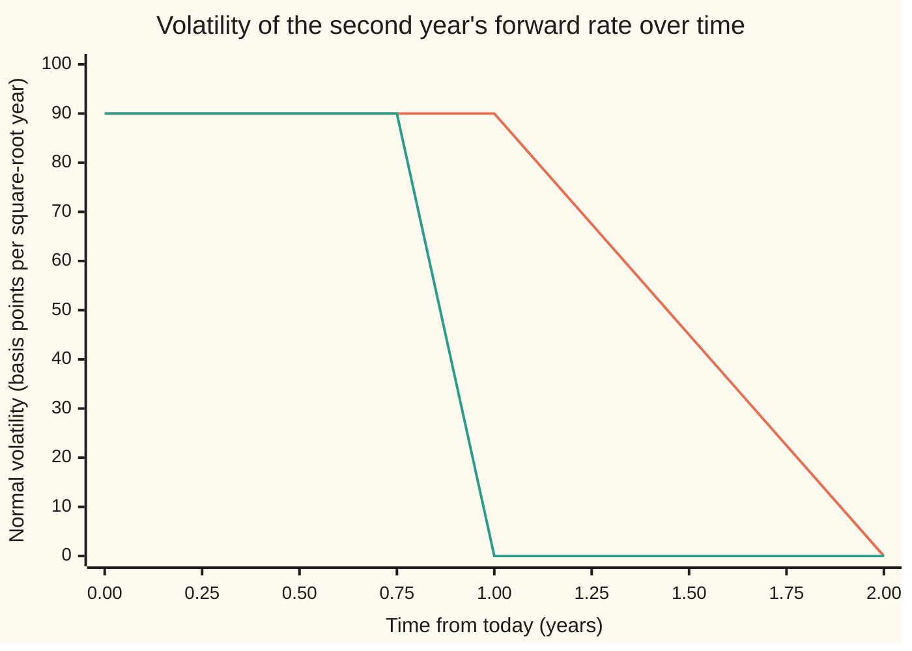
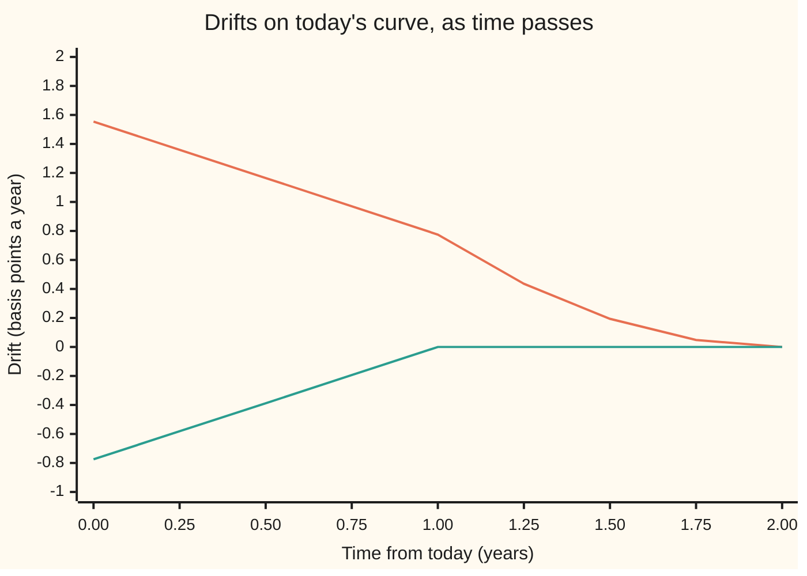

# The forward market model: compounded overnight rates that stay random through their own period, simulated in one framework

[Syllabus](../../../SYLLABUS.md) → [Financial mathematics](../README.md) → [Forward-Rate Models](../README.md#s31) → The forward market model

---

## General Overview

A company borrows $1,000,000 for two years. It pays interest once a year at SOFR (the Secured Overnight Financing Rate, the US benchmark for overnight loans backed by Treasury bonds), compounded day by day through each year. Today's curve says the first year should compound to 4% and the second to 4.5%.

The company buys a **cap**: two **caplets** (insurance contracts), one per year. Each caplet pays $1,000,000 times the amount by which that year's compounded rate ends above its strike. Both strikes sit at today's forward rate, so both caplets are **at the money**.

Here is what is new. The old benchmark, LIBOR (the London Interbank Offered Rate), was fixed on the first day of its period. A compounded SOFR rate is known only on the last day. So the second year's rate keeps moving all through the second year, while the overnight rates that make it up are being published.

The sibling card [Market models](03-libor-and-sofr-market-models.md) simulates rates that freeze when their period starts. That card cannot simulate a rate inside its own period. The **forward market model** of Lyashenko and Mercurio (2019) can. It adds two things:

- an **extended bond**: a bond that, after it matures, keeps its $1 rolled at the overnight rate, so it never disappears;
- a **decay function**: a factor that shrinks each rate's volatility to zero across its own period, as the days that are still unknown run out.

With both in place, both caplets come from one simulation. Caplet 1 is worth **$2,214.71** and caplet 2 **$3,814.80** in closed form; 60,000 simulated paths give $2,215.63 and $3,812.98.

**Model each compounded overnight rate as a forward that stays random until its period ends, with a volatility that decays to zero across the period; extended bonds keep the market-model drifts valid at every date, plus one new term for the rate accruing now.**

**What kind of fact this is:** a model: an assumption that fits the market well enough, not a law. Inside the model the drifts are a theorem, proved on this card in Why it works. The linear shape of the decay is a modelling choice.

### The picture: when the second year's rate stops moving



Orange: the compounded rate in the forward market model. It moves at full strength until its period starts at year 1, then its volatility falls in a straight line to zero at year 2. Green: a rate fixed at the start of its period, as LIBOR was. It stops dead at year 1. The area under the square of each line is the rate's total variance. The orange line has a third of a year more variance time, and caplet 2 is worth more because of it.

---

## The formula

Notation first, in words. The periods are numbered $`j = 1, 2`$. Period $`j`$ runs from $`T_{j-1}`$ to $`T_j`$ and has length $`\tau`$ in years. $`R_j(t)`$ is the forward rate for period $`j`$ seen at time $`t`$: the compounded rate the market expects, as a simple annual rate. $`P(t,T)`$ is the price at time $`t`$ of the bond that pays $1 at $`T`$. For $`t`$ after $`T`$, it is the extended bond: that $1, rolled overnight since $`T`$.

This numbering is one ahead of [Market models](03-libor-and-sofr-market-models.md), whose rate $`i`$ runs from $`T_i`$ to $`T_{i+1}`$. The code counts from 0, so its rate `j` is $`R_{j+1}`$ here.

The forward rate, defined by two bonds at every date $`t`$, before, during and after its period:

```math
1 + \tau R_j(t) = \frac{P(t,T_{j-1})}{P(t,T_j)}.
```

The model, in the unit of the bond paying at $`T_j`$ (normal, or Bachelier, dynamics: the rate moves by amounts, not percentages):

```math
dR_j(t) = \sigma_j\, g_j(t)\, dW_j^{T_j}(t), \qquad g_j(t) = \begin{cases} 1, & t \le T_{j-1} \\ (T_j - t)/\tau, & T_{j-1} < t < T_j \\ 0, & t \ge T_j \end{cases}
```

The drifts when all rates share one unit, with weights $`a_k = \tau/(1 + \tau R_k)`$:

```math
\boxed{\;\mu_j^{\,T_M} = -\,\sigma_j g_j \sum_{k=j+1}^{M} \rho_{jk}\,\sigma_k g_k\, a_k \;\;\text{(terminal bond)},\qquad \mu_j^{\,B} = \sigma_j g_j \sum_{k=1}^{j} \rho_{jk}\,\sigma_k g_k\, a_k \;\;\text{(bank account)}\;}
```

The caplet on period $`j`$, struck at $`K`$ and paid at $`T_j`$:

```math
V_j = \tau\,P(0,T_j)\Big[(R_j(0) - K)\,N(d) + \sigma_j\sqrt{v_j}\;\varphi(d)\Big],\qquad v_j = T_{j-1} + \frac{\tau}{3},\qquad d = \frac{R_j(0) - K}{\sigma_j\sqrt{v_j}}.
```

**Read it aloud:** each compounded forward is driftless in its own payment bond's unit, with a volatility that fades across its period; in a shared unit it drifts by a covariance; and its caplet is Bachelier's formula at a variance time of the period's start plus a third of a period.

| Symbol | Plain meaning | In our example | Push it up and the answer… |
| --- | --- | --- | --- |
| $`R_j(t)`$, $`R_j(0)`$, $`R_k`$, $`j`$, $`k`$ | forward compounded rate for period $`j`$ at time $`t`$; today's value | $`R_1(0) = 4\%`$, $`R_2(0) = 4.5\%`$ | caplet dearer |
| $`T_j`$, $`T_{j-1}`$, $`T_M`$, $`M`$, $`t`$, $`n`$, $`h`$ | period $`j`$ runs $`T_{j-1}`$ to $`T_j`$; $`T_M`$ is the last date; $`t`$ is now; $`n`$ is the period running at $`t`$; $`h`$ is one simulation step | $`T_0 = 0`$, $`T_1 = 1`$, $`T_2 = 2`$; $`M = 2`$; $`h = 0.1`$ | later start: more variance |
| $`\tau`$, $`u`$ | length of each period, in years; $`u`$ is time since the period began | 1 | longer accrual, more variance inside it |
| $`P(t,T)`$, $`D_j`$ | price at $`t`$ of $1 paid at $`T`$; after $`T`$, that $1 rolled overnight (extended bond); $`D_j`$ is the $`T_j`$ bond counted in $`T_M`$ bonds | $`P(0,1) = 0.961538`$, $`P(0,2) = 0.920132`$ | caplet scales with it |
| $`\sigma_j`$ | normal volatility of $`R_j`$: yearly standard deviation of its moves, in rate units | 1.0% and 0.9% (100 and 90 basis points) | caplet dearer, drifts larger |
| $`g_j(t)`$ | decay function: share of $`R_j`$'s volatility left at $`t`$ | 1 before the period, falling linearly to 0 | — |
| $`\rho_{jk}`$, $`\rho`$, $`c_{jk}`$ | correlation of the shocks to $`R_j`$ and $`R_k`$, with $`\rho_{jj} = 1`$; $`c_{jk} = \rho_{jk}\sigma_j g_j \sigma_k g_k`$ is their covariance per year | $`\rho = 0.9`$ | larger drifts |
| $`W_j^{T}`$, $`dW`$, $`Q^{T}`$ | the random shock to $`R_j`$ (a Brownian motion) under $`Q^{T}`$, the pricing rule whose unit is the bond paying at $`T`$; $`dW`$ is its kick over an instant | — | — |
| $`\mu_j^{T_M}`$, $`\mu_j^{B}`$ | drift of $`R_j`$, in rate units per year, in the terminal-bond unit and in the bank-account unit | $`\mu_1^{T_2}(0) = -0.7751`$ bp/yr, $`\mu_2^{B}(0) = 1.5540`$ bp/yr | — |
| $`a_k`$ | weight of rate $`k`$: how much a move in $`R_k`$ moves $`\ln(1+\tau R_k)`$ | $`1/1.04`$ and $`1/1.045`$ | — |
| $`B(t)`$, $`Q^{B}`$ | the bank account: $1 rolled at the overnight rate since today; $`Q^{B}`$ is its pricing rule, the spot measure | $`B(2) = (1 + R_1)(1 + R_2)`$ on every path | — |
| $`V_j`$, $`K`$, $`v_j`$, $`d`$, $`N`$, $`\varphi`$ | caplet value; strike; variance time; distance to strike in standard deviations; bell-curve area left of a point and bell-curve height | $`K = R_j(0)`$; $`v_1 = 1/3`$, $`v_2 = 4/3`$; $`\varphi(0) = 0.398942`$ | higher $`K`$: cheaper caplet |

A basis point (bp) is 0.01%. A **fair bet** (a martingale) is a quantity whose average future value, given everything known now, equals its value now.

### When it holds

- **Normal moves with fixed volatilities.** The rate moves by bell-curve amounts, so it can go below zero, and every strike shares one volatility. Real caplet prices show a smile (a different volatility at each strike). A model fitted at the money then misprices the wings.
- **The decay is linear.** A straight-line decay matches a period in which one common shock moves every remaining day's overnight rate by the same amount. Independent day-by-day shocks, payment lags, lookback days or a rate that jumps on central-bank meeting dates change the shape, and the one-third becomes another fraction.
- **One curve.** The same bonds set the forwards and discount the cash, and the bank account earns exactly the rate being compounded. If the payoff compounds one overnight rate and the cash is discounted on another, the drifts need the spread between the two curves.
- **Accrual periods tile the time line.** The periods sit end to end, so exactly one rate is accruing at any time. Overlapping periods need extra rates in the drift sums.
- **The step is an approximation.** The simulation's noise is exact, but its drift uses the curve at the start of each step. That is exact for the terminal unit's bond test and only approximate for the bank-account unit.

---

## Why it works

### Step 0: a bond that never matures keeps the forward a traded ratio

In [Market models](03-libor-and-sofr-market-models.md) every forward is a ratio of two bond prices. That stops working once a period starts: the bond paying at $`T_{j-1}`$ has matured and is gone.

The extended bond fixes this. After $`T_{j-1}`$, it is the $1 that bond paid, kept in the bank at the overnight rate. It is still a traded thing with a positive price. So the ratio $`P(t,T_{j-1})/P(t,T_j)`$ stays the price of something traded, counted in units of another traded thing, at every date.

At $`T_j`$ the ratio becomes $`P(T_j, T_{j-1})`$: $1 rolled overnight through the whole period. That is exactly 1 plus the compounded rate times $`\tau`$. So the forward lands on the compounded rate the caplet pays on.

### Step 1: the forward is a fair bet right up to the end of its period

[Forward measures](02-forward-measures-for-rates.md) proves that any traded price, counted in units of the bond paying at $`T_j`$, is a fair bet under that bond's pricing rule $`Q^{T_j}`$. So $`R_j(t)`$ has no drift there, for every $`t`$ up to $`T_j`$, not only up to $`T_{j-1}`$. The model gives it a drift-free normal law, as in the formula.

### Step 2: why the volatility decays in a straight line

Inside the period, the compounded rate is built from overnight rates. The days already gone are published, so they carry no risk. A shock at time $`t`$ moves only the days still to come. Those days are a share $`(T_j - t)/\tau`$ of the period.

Assume one shock moves every unset day's rate by the same amount, as in [Caplets on compounded SOFR](../29-Caps%2C%20Floors%20and%20Swaptions/10-compounded-rfr-caplets.md). Then the forward's sensitivity to a shock at $`t`$ falls in a straight line, from 1 at the start of the period to 0 at its end. That is $`g_j(t)`$. At $`T_j`$ nothing is left unknown, and the volatility is zero.

### Step 3: the caplet, and the one-third rule

$`R_j(T_j)`$ is today's forward plus a sum of independent normal kicks. Its variance is $`\sigma_j^2`$ times the area under $`g_j^2`$:

```math
v_j = \int_0^{T_j} g_j(t)^2\,dt = T_{j-1} + \int_0^{\tau}\Big(\frac{\tau - u}{\tau}\Big)^2 du = T_{j-1} + \frac{\tau}{3}.
```

A normal payoff average gives Bachelier's formula ([Bachelier](../05-Black-Scholes%20from%20the%20Ground%20Up/07-bachelier-model.md)) with that variance. [Caplets on compounded SOFR](../29-Caps%2C%20Floors%20and%20Swaptions/10-compounded-rfr-caplets.md) derives this rule and prices single caplets with it. This card's job is to show that one simulation of the whole strip reproduces it.

### Step 4: the terminal unit, and its drift

To simulate both rates on one path, count everything in one bond. Take the last one, paying at $`T_2`$. The exchange rate from rate $`j`$'s own unit is a bond ratio, and by the identity in the formula it telescopes:

```math
\frac{P(t,T_j)}{P(t,T_M)} = \prod_{k=j+1}^{M}\big(1 + \tau R_k(t)\big).
```

Because of the extended bonds, this holds at every date, including inside a period. Girsanov's theorem gives the drift: switching to a new unit adds to each rate's drift its covariance with the log of the new unit counted in the old unit ([Girsanov](../../11-Stochastic%20processes%20and%20calculus/07-Changing%20Measure/02-girsanov-theorem.md)). Here the new unit counted in the old is the reciprocal of the product above, so the covariance enters with a minus sign. A move $`dR_k`$ moves $`\ln(1 + \tau R_k)`$ by $`a_k\,dR_k`$. The covariance of $`dR_j`$ with $`a_k\,dR_k`$ is $`\rho_{jk}\sigma_j g_j \sigma_k g_k a_k`$ per year. Sum over the later rates, flip the sign, and that is $`\mu_j^{T_M}`$.

For the first year's rate today: $`-0.01 \times 0.9 \times 0.009 / 1.045 \times 10{,}000 = -0.7751`$ basis points a year (the $`\times 10{,}000`$ turns a rate into basis points). It fades as $`g_1`$ fades and is zero from year 1. The decay function also switches off the drift of a rate whose period is over, with no extra bookkeeping.

### Step 5: the bank-account unit, and the new term

The **spot measure** is the pricing rule whose unit is the bank account $`B(t)`$. With extended bonds, $`B(t)`$ is exactly $1 rolled overnight, and on each payment date it equals the product of $`1 + \tau R_k`$ over the finished periods.

Say the period running now is period $`n`$. The new unit, the bank account, counted in the old unit, rate $`j`$'s payment bond, is

```math
\frac{B(t)}{P(t,T_j)} = B(T_{n-1})\prod_{k=n}^{j}\big(1 + \tau R_k(t)\big),
```

and $`B(T_{n-1})`$ is already known. This time the product sits on top, so the drift is plus the covariance with the rates from $`n`$ to $`j`$. Since $`g_k = 0`$ for finished periods, the sum may start at $`k = 1`$.

The new term is $`k = n`$: the rate that is accruing now. In the LIBOR market model that rate was already fixed and dropped out of the sum. Here it is still random, so it stays in.

For the second year's rate today, two terms:

- the first year's rate, accruing now: $`0.9 \times 0.009 \times 0.01 / 1.04 \times 10{,}000 = 0.7788`$ basis points a year;
- its own term: $`0.009^2 / 1.045 \times 10{,}000 = 0.7751`$ basis points a year;
- total: $`\mu_2^{B}(0) = 1.5540`$ basis points a year.



Orange: the second year's rate in the bank-account unit. Its first-year term fades to zero across year 1; its own term fades as the square of its decay across year 2. Green: the first year's rate in the terminal unit, fading to zero across year 1. Both curves hold the rates at today's values, to show the effect of time alone.

<details>
<summary>Detailed proof: the bond ratios are fair bets with these drifts</summary>

Work under the terminal rule $`Q^{T_M}`$ with fixed volatilities and the decay functions above. Write $`c_{jk} = \rho_{jk}\sigma_j g_j \sigma_k g_k`$ for the instantaneous covariance of $`R_j`$ and $`R_k`$.

*The terminal drift makes every bond ratio a fair bet.* Let $`D_j = \prod_{k>j}(1+\tau R_k)`$. By Itô's lemma (the chain rule for random paths; see [Ito's lemma](../../11-Stochastic%20processes%20and%20calculus/06-Ito%20Calculus/02-itos-lemma.md)) for a product, the drift of $`D_j`$ divided by $`D_j`$ is

$`\displaystyle \sum_{k>j} a_k\,\mu_k^{T_M} + \sum_{j<k<l} a_k a_l\, c_{kl}.`$

Insert $`\mu_k^{T_M} = -\sum_{l>k} c_{kl} a_l`$. The first sum becomes $`-\sum_{j<k<l} a_k a_l c_{kl}`$ and cancels the second exactly. So $`D_j`$ has no drift: it is a fair bet under $`Q^{T_M}`$, as no-arbitrage demands of the $`T_j`$ bond counted in $`T_M`$ bonds.

*Back to rate j's own unit.* Use $`D_j(t)/D_j(0)`$ as the density of $`Q^{T_j}`$ against $`Q^{T_M}`$. Its shock is $`\sum_{k>j} a_k\,dR_k`$. By Girsanov's theorem, under $`Q^{T_j}`$ the shock to $`R_j`$ gains the drift $`+\sum_{k>j} c_{jk} a_k`$, which cancels $`\mu_j^{T_M}`$. So $`R_j`$ is driftless under $`Q^{T_j}`$, as the model says.

*The bank account.* For $`t`$ in period $`n`$, $`B(t)/P(t,T_M) = B(T_{n-1})\prod_{k=n}^{M}(1+\tau R_k(t))`$. Moving from $`Q^{T_M}`$ to the spot rule therefore adds $`+\sum_{k=n}^{M} c_{jk}a_k`$ to the drift of $`R_j`$. Added to $`\mu_j^{T_M}`$, the terms with $`k > j`$ cancel and

$`\displaystyle \mu_j^{B} = \sum_{k=n}^{j} c_{jk}\,a_k = \sum_{k=1}^{j} c_{jk}\,a_k,`$

the last step because $`c_{jk} = 0`$ when period $`k`$ is over.

</details>

### Step 6: the simulation step

Over a step from $`t`$ to $`t+h`$, each rate's kick is a normal draw whose variance and covariance are the exact integrals of $`c_{jk}`$ over the step. So the noise has no time-step error at all. Only the drift uses the curve at the start of the step, as in [Stepping an SDE](../06-Numerical%20Methods%20for%20Pricing/05-discretisation-schemes-for-sdes.md).

In the terminal unit this makes the bond ratio an exact fair bet step by step: the drift of $`R_1`$ and the covariance of the two kicks cancel in expectation. In the bank-account unit the test quantity $`1/B(2)`$ is curved in the rates, so a small time-step error remains. At 20 steps it is far below the noise.

---

## Worked numbers, by hand

The two caplets, at the money, on $1,000,000:

| Step | Arithmetic | Value |
| --- | --- | --- |
| bond paying at year 1 | $`1/1.04`$ | 0.961538 |
| bond paying at year 2 | $`1/(1.04 \times 1.045)`$ | 0.920132 |
| variance time, caplet 1 | $`0 + 1/3`$ | 0.333333 |
| variance time, caplet 2 | $`1 + 1/3`$ | 1.333333 |
| standard deviation, caplet 1 | $`1.0\% \times \sqrt{0.333333}`$ | 0.577350% |
| standard deviation, caplet 2 | $`0.9\% \times \sqrt{1.333333}`$ | 1.039230% |
| at the money $`d = 0`$, bell height | $`1/\sqrt{2\pi}`$ | 0.398942 |
| caplet 1 | $`1{,}000{,}000 \times 0.961538 \times 0.577350\% \times 0.398942`$ | $2,214.71 |
| caplet 2 | $`1{,}000{,}000 \times 0.920132 \times 1.039230\% \times 0.398942`$ | **$3,814.80** |

Caplet 2 is worth more than caplet 1 partly because it has a year of full volatility before its period, and partly because of the extra third of a year inside it.

The simulation, 60,000 paths in 20 steps of a tenth of a year:

| Unit | Caplet 1 | Caplet 2 | No-arbitrage test |
| --- | --- | --- | --- |
| terminal bond | $2,215.63 (standard error $9.78) | $3,812.98 (standard error $16.61) | 1.0868002 against 1.0868000, off by +0.45 standard errors |
| bank account | $2,215.58 (standard error $9.52) | $3,812.99 (standard error $16.12) | 0.9201325 against 0.9201325, off by −0.04 standard errors |

Both units land within a quarter of a standard error of the closed form. The simulated variance time of the second rate is 1.3309 (standard error 0.0108), against the one-third rule's 1.3333.

The test column checks no-arbitrage. In the terminal unit, $`(1+R_1)(1+R_2)`$ must average $`1/P(0,2) = 1.0868000`$. In the bank-account unit, $`1/B(2)`$ must average $`P(0,2) = 0.9201325`$.

### What breaks if you drop a piece

The first two rows are closed forms. The last two reuse the correct run's random numbers, so their differences are measured to well under a cent.

| Mistake | Comes out at | What went wrong |
| --- | --- | --- |
| Treat each rate as fixed when its period starts (LIBOR timing) | caplet 1 $0.00, caplet 2 $3,303.72 | Variance times 0 and 1: the risk inside each period is ignored. Caplet 1 starts today, so it looks riskless. |
| Keep full volatility until the payment date | caplet 1 $3,835.98, caplet 2 $4,672.16 | Variance times 1 and 2: the days already published are treated as still unknown. |
| Terminal unit, no drift | caplet 1 +$18.64 too dear; test off by +97.87 standard errors | $`R_1`$ is driftless only in the year-1 bond's unit. Counted in year-2 bonds it must drift down. |
| Bank-account unit, accruing rate's term dropped (the LIBOR habit) | caplet 1 −$15.28, caplet 2 −$29.27; test off by +71.69 standard errors | The rate accruing now is still random, so its covariance belongs in the drift. Without it, $`\mu_2^{B}(0)`$ falls from 1.5540 to 0.7751 bp a year. |

---

## Code, from first principles, and it actually runs

The code computes the variance times by Simpson's rule (adding up an area from evenly spaced samples, weighted 1, 4, 2, 4, …, 1) on $`g_j^2`$ and checks them against $`T_{j-1} + \tau/3`$. It prices both caplets in closed form, with its own bell-curve area. It computes each drift from the formula and a second way: it rebuilds every bond from the rates, bumps each rate, reads how far the log of the new unit (counted in the rate's own payment bond) moves, and multiplies by the covariance. That road has no $`a_k`$ and no hand-written range of rates in it; which rates enter comes from the bonds themselves.

Then it simulates the strip in two units, the terminal bond and the bank account, and runs the no-arbitrage test in each. So there are three roads to each caplet price: closed form, terminal-unit simulation and bank-account simulation. It reruns with each mistake from the table on the same random numbers.

Random numbers come from a hand-written xorshift generator and the Box-Muller recipe, which turns two uniform random numbers into two bell-curve ones. Each draw is also used with its sign flipped (antithetic pairs) to cut the noise.

### Python

```python
# Forward market model: two compounded overnight forwards, terminal and spot measures -- the check.
# Standard library only.  The normal CDF, the random numbers and every integral are written here.
from math import exp, log, sqrt, cos, sin, pi

tau, T = 1.0, [0.0, 1.0, 2.0]            # two annual accrual periods: [0, 1] and [1, 2] years
R0, s, rho = [0.04, 0.045], [0.010, 0.009], 0.9   # forwards, normal vols, correlation
P = [1.0, 1 / 1.04, 1 / (1.04 * 1.045)]  # 1 + tau R_j(0) = P(0,T_j) / P(0,T_(j+1))
K, USD = R0[:], 1e6                      # at-the-money strikes; $1,000,000 notional
corr = lambda j, k: 1.0 if j == k else rho

inside = {"lin": lambda u: 1 - u, "flat": lambda u: 1.0, "fixed": lambda u: 0.0}   # u: share of period gone
def g(j, t, decay="lin"):                # decay of R_j's volatility; rate j accrues over T[j]..T[j+1]
    return 1.0 if t <= T[j] else 0.0 if t >= T[j + 1] else inside[decay]((t - T[j]) / tau)

def simpson(f, a, b, m=200):
    hh = (b - a) / m
    return hh / 3 * (f(a) + f(b) + sum((4 if i % 2 else 2) * f(a + i * hh) for i in range(1, m)))

def vtime(j, decay="lin"):               # variance time: integral of g_j^2 up to the payment date
    return T[j] + tau * simpson(lambda u: inside[decay](u) ** 2, 0.0, 1.0)

def N(x, m=2000):                        # bell-curve area left of x, by Simpson's rule from 0
    return 0.5 + simpson(lambda u: exp(-0.5 * u * u) / sqrt(2 * pi), 0.0, x, m) if x else 0.5

def bachelier(j, v, k):                  # caplet on R_j paid at T_(j+1), normal variance s_j^2 v
    sd = s[j] * sqrt(v)
    if sd == 0: return tau * P[j + 1] * max(R0[j] - k, 0.0)
    d = (R0[j] - k) / sd
    return tau * P[j + 1] * ((R0[j] - k) * N(d) + sd * exp(-0.5 * d * d) / sqrt(2 * pi))

def cov(t):                              # instantaneous covariance of R_j and R_k per year at time t
    return [[corr(j, k) * s[j] * s[k] * g(j, t) * g(k, t) for k in (0, 1)] for j in (0, 1)]

def drift(j, t, R, rule, c=None):        # drift of R_j at time t (per year, or over a step if c is a step's covariance)
    a, c = [tau / (1 + tau * R[k]) for k in (0, 1)], c or cov(t)
    if rule == "T": return -sum(c[j][k] * a[k] for k in range(j + 1, 2))
    if rule == "S": return sum(c[j][k] * a[k] for k in range(0, j + 1))
    if rule == "X": return sum(c[j][k] * a[k] for k in range(0, j + 1) if not T[k] <= t < T[k + 1])
    return 0.0

def logbond(i, R):                       # ln P(t,T_i)/P(t,T_2): every bond rebuilt from the rates (extended after T_i)
    return sum(log(1 + tau * R[k]) for k in range(i, 2))
def bump(j, t, R, rule, e=1e-7):         # road 2: bump each rate, read ln(new unit / R_j's payment bond)
    num = 2 if rule == "T" else max(i for i in (0, 1, 2) if T[i] <= t)   # bank account B(t) = B(T_n) P(t,T_n)
    lr = lambda Rb: logbond(num, Rb) - logbond(j + 1, Rb)
    up = lambda k, d: [R[m] + d * (m == k) for m in (0, 1)]
    return sum(cov(t)[j][k] * (lr(up(k, e)) - lr(up(k, -e))) / (2 * e) for k in (0, 1))

h, steps = 0.1, 20                       # exact noise and covariance per step; curve frozen at its start
C = []
for n in range(steps):
    t0, t1 = n * h, (n + 1) * h
    c = [[corr(j, k) * s[j] * s[k] * simpson(lambda t: g(j, t) * g(k, t), t0, t1, 2) for k in (0, 1)] for j in (0, 1)]
    l0 = sqrt(c[0][0]); l1 = c[1][0] / l0 if l0 else 0.0
    C.append((t0, c, l0, l1, sqrt(max(c[1][1] - l1 * l1, 0.0))))

state = 20261123                         # xorshift64* random numbers, Box-Muller normals
def unif():
    global state
    state ^= state >> 12; state ^= (state << 25) & 0xFFFFFFFFFFFFFFFF; state ^= state >> 27
    return (((state * 0x2545F4914F6CDD1D) & 0xFFFFFFFFFFFFFFFF) >> 11) * 2.0 ** -53 + 2.0 ** -54
def normals():
    r, t = sqrt(-2 * log(unif())), 2 * pi * unif()
    return (r * cos(t), r * sin(t))

def path(rule, zs, sg):
    R = R0[:]
    for (t0, c, l0, l1, l2), (z1, z2) in zip(C, zs):
        mu = [drift(0, t0, R, rule, c), drift(1, t0, R, rule, c)]
        R = [R[0] + mu[0] + l0 * sg * z1, R[1] + mu[1] + l1 * sg * z1 + l2 * sg * z2]
    G = [(1 + tau * R[0]), (1 + tau * R[1])]       # realised growth of $1 rolled overnight, per period
    c1, c2 = tau * max(R[0] - K[0], 0.0), tau * max(R[1] - K[1], 0.0)
    if rule in "TN": return [P[2] * c1 * G[1], P[2] * c2, G[0] * G[1], (R[1] - R0[1]) ** 2]
    return [c1 / G[0], c2 / (G[0] * G[1]), 1 / (G[0] * G[1]), 0.0]

rules, M = "TSNX", 30000                 # antithetic pairs, the same draws for every rule
tot = {r: [[0.0, 0.0] for _ in range(4)] for r in rules}
dif = {r: [[0.0, 0.0] for _ in range(2)] for r in rules}
for _ in range(M):
    zs, val = [normals() for _ in range(steps)], {}
    for r in rules:
        a, b = path(r, zs, 1), path(r, zs, -1)
        val[r] = [0.5 * (x + y) for x, y in zip(a, b)]
        for k in range(4): tot[r][k][0] += val[r][k]; tot[r][k][1] += val[r][k] ** 2
        base = val["T" if r in "TN" else "S"]
        for k in range(2): d = val[r][k] - base[k]; dif[r][k][0] += d; dif[r][k][1] += d * d
ms = lambda q: (q[0] / M, sqrt(max(q[1] / M - (q[0] / M) ** 2, 0.0) / M))

print("forward market model: compounded forwards on [0,1] and [1,2], annual accrual")
print(f"P(0,1) {P[1]:.6f}  P(0,2) {P[2]:.6f}  R_1(0) 4.0%  R_2(0) 4.5%  normal vols 1.0% 0.9%  rho 0.9")
vt = [vtime(j) for j in (0, 1)]
print(f"variance time, Simpson on g^2: R_1 {vt[0]:.6f}  R_2 {vt[1]:.6f}   rule T_s + tau/3: {T[0] + tau / 3:.6f} {T[1] + tau / 3:.6f}")
cf = [bachelier(j, vt[j], K[j]) for j in (0, 1)]
print(f"caplet sd: R_1 {s[0] * sqrt(vt[0]) * 100:.6f}%  R_2 {s[1] * sqrt(vt[1]) * 100:.6f}%  bell height at 0 {1 / sqrt(2 * pi):.6f}")
print(f"closed form, ATM, per $1m: caplet 1 {cf[0] * USD:.2f}  caplet 2 {cf[1] * USD:.2f}")
for name, dec in (("fixed at period start", "fixed"), ("flat to payment date", "flat")):
    v = [vtime(j, dec) for j in (0, 1)]
    print(f"  vol {name:<22} variance times {v[0]:.4f} {v[1]:.4f}  caplets {bachelier(0, v[0], K[0]) * USD:8.2f}"
          f" {bachelier(1, v[1], K[1]) * USD:8.2f}")
print(f"try: caplet 2 per $1m at K = 4% {bachelier(1, vt[1], 0.04) * USD:.2f}, at K = 5% {bachelier(1, vt[1], 0.05) * USD:.2f}")
print("drift at t = 0, today's curve, bp/yr        formula     bump road")
for lab, j, r in (("R_1 under terminal Q^T2", 0, "T"), ("R_2 under spot (bank account)", 1, "S"), ("R_1 under spot", 0, "S")):
    print(f"  {lab:<34} {drift(j, 0.0, R0, r) * 1e4:10.4f}  {bump(j, 0.0, R0, r) * 1e4:10.4f}")
print(f"  R_2 spot, accruing rate's term dropped {drift(1, 0.0, R0, 'X') * 1e4:.4f}")
a0, a1 = tau / (1 + tau * R0[0]), tau / (1 + tau * R0[1])
print(f"  R_2 spot terms: rho s_2 s_1 a_1 {rho * s[1] * s[0] * a0 * 1e4:.4f}  s_2^2 a_2 {s[1] ** 2 * a1 * 1e4:.4f}")
grid = [0.25 * i for i in range(9)]
print("chart, t        " + " ".join(f"{t:6.2f}" for t in grid))
print("chart, vol R_2  " + " ".join(f"{s[1] * g(1, t) * 1e4:6.1f}" for t in grid))
print("chart, LIBOR    " + " ".join(f"{s[1] * (t < T[1]) * 1e4:6.1f}" for t in grid))
print("chart, mu2 spot " + " ".join(f"{drift(1, t, R0, 'S') * 1e4 + 0.0:6.3f}" for t in grid))
print("chart, mu1 term " + " ".join(f"{drift(0, t, R0, 'T') * 1e4 + 0.0:6.3f}" for t in grid))
print(f"Monte Carlo, {2 * M} paths, {steps} steps of {h} years, per $1m      caplet 1        caplet 2")
names = {"T": "terminal Q^T2, drift", "S": "spot, drift", "N": "terminal, no drift", "X": "spot, accruing dropped"}
for r in rules:
    (m1, e1), (m2, e2) = ms(tot[r][0]), ms(tot[r][1])
    print(f"  {names[r]:<24} {m1 * USD:8.2f} se {e1 * USD:4.2f}  {m2 * USD:8.2f} se {e2 * USD:4.2f}")
for r in "NX":
    (d1, f1), (d2, f2) = ms(dif[r][0]), ms(dif[r][1])
    print(f"  {names[r]:<24} minus correct: {d1 * USD:+7.2f} se {f1 * USD:.2f}  {d2 * USD:+7.2f} se {f2 * USD:.2f}")
vm, ve = ms(tot["T"][3])
print(f"simulated variance time of R_2: {vm / s[1] ** 2:.4f}  se {ve / s[1] ** 2:.4f}  (one-third rule {T[1] + tau / 3:.4f})")
tg = {"T": 1 / P[2], "N": 1 / P[2], "S": P[2], "X": P[2]}
print("no-arbitrage test: terminal must average 1/P(0,2), spot must average P(0,2)")
for r in rules:
    m, e = ms(tot[r][2])
    print(f"  {names[r]:<24} {m:.7f} se {e:.7f}  target {tg[r]:.7f}  off by {(m - tg[r]) / e:+7.2f} se")

assert all(abs(vt[j] - (T[j] + tau / 3)) < 1e-12 for j in (0, 1)), "one-third rule vs Simpson"
assert all(abs(bump(j, t, R0, r) - drift(j, t, R0, r)) < 1e-12 for j in (0, 1) for t in grid for r in "TS"), "drift"
for r in "TS":
    for k in (0, 1): assert abs(ms(tot[r][k])[0] - cf[k]) < 3 * ms(tot[r][k])[1], "MC caplet vs closed form"
    assert abs(ms(tot[r][2])[0] - tg[r]) < 3 * ms(tot[r][2])[1], "numeraire ratio is a fair bet"
for r in "NX": assert abs(ms(tot[r][2])[0] - tg[r]) > 3 * ms(tot[r][2])[1], "wrong drift must fail the test"
assert abs(ms(dif["N"][0])[0]) > 3 * ms(dif["N"][0])[1], "dropping the drift must move caplet 1"
assert abs(vm / s[1] ** 2 - 4 / 3) < 3 * ve / s[1] ** 2, "simulated variance time"
print("ALL CHECKS PASS")
```

**Ran 2026-11-23 on macOS, Python 3.14.10, standard library only. All checks passed. Output, pasted from the run:**

```
forward market model: compounded forwards on [0,1] and [1,2], annual accrual
P(0,1) 0.961538  P(0,2) 0.920132  R_1(0) 4.0%  R_2(0) 4.5%  normal vols 1.0% 0.9%  rho 0.9
variance time, Simpson on g^2: R_1 0.333333  R_2 1.333333   rule T_s + tau/3: 0.333333 1.333333
caplet sd: R_1 0.577350%  R_2 1.039230%  bell height at 0 0.398942
closed form, ATM, per $1m: caplet 1 2214.71  caplet 2 3814.80
  vol fixed at period start  variance times 0.0000 1.0000  caplets     0.00  3303.72
  vol flat to payment date   variance times 1.0000 2.0000  caplets  3835.98  4672.16
try: caplet 2 per $1m at K = 4% 6548.34, at K = 5% 1947.68
drift at t = 0, today's curve, bp/yr        formula     bump road
  R_1 under terminal Q^T2               -0.7751     -0.7751
  R_2 under spot (bank account)          1.5540      1.5540
  R_1 under spot                         0.9615      0.9615
  R_2 spot, accruing rate's term dropped 0.7751
  R_2 spot terms: rho s_2 s_1 a_1 0.7788  s_2^2 a_2 0.7751
chart, t          0.00   0.25   0.50   0.75   1.00   1.25   1.50   1.75   2.00
chart, vol R_2    90.0   90.0   90.0   90.0   90.0   67.5   45.0   22.5    0.0
chart, LIBOR      90.0   90.0   90.0   90.0    0.0    0.0    0.0    0.0    0.0
chart, mu2 spot  1.554  1.359  1.165  0.970  0.775  0.436  0.194  0.048  0.000
chart, mu1 term -0.775 -0.581 -0.388 -0.194  0.000  0.000  0.000  0.000  0.000
Monte Carlo, 60000 paths, 20 steps of 0.1 years, per $1m      caplet 1        caplet 2
  terminal Q^T2, drift      2215.63 se 9.78   3812.98 se 16.61
  spot, drift               2215.58 se 9.52   3812.99 se 16.12
  terminal, no drift        2234.27 se 9.78   3812.98 se 16.61
  spot, accruing dropped    2200.30 se 9.52   3783.72 se 16.12
  terminal, no drift       minus correct:  +18.64 se 0.00    +0.00 se 0.00
  spot, accruing dropped   minus correct:  -15.28 se 0.00   -29.27 se 0.02
simulated variance time of R_2: 1.3309  se 0.0108  (one-third rule 1.3333)
no-arbitrage test: terminal must average 1/P(0,2), spot must average P(0,2)
  terminal Q^T2, drift     1.0868002 se 0.0000004  target 1.0868000  off by   +0.45 se
  spot, drift              0.9201325 se 0.0000012  target 0.9201325  off by   -0.04 se
  terminal, no drift       1.0868407 se 0.0000004  target 1.0868000  off by  +97.87 se
  spot, accruing dropped   0.9202179 se 0.0000012  target 0.9201325  off by  +71.69 se
ALL CHECKS PASS
```

The bump road matches the drift formula to every printed digit. Each simulated caplet sits within a quarter of a standard error of its closed form. The two wrong drifts fail the no-arbitrage test by 97.87 and 71.69 standard errors.

### Rust

Same algorithm, generator and seed.

```rust
// Forward market model: two compounded overnight forwards, terminal and spot measures -- the same check in Rust.
// std only, no crates.  The normal CDF, the random numbers and every integral are written here.
use std::f64::consts::PI;
const TAU: f64 = 1.0; const T: [f64; 3] = [0.0, 1.0, 2.0];   // two annual accrual periods
const R0: [f64; 2] = [0.04, 0.045]; const S: [f64; 2] = [0.010, 0.009]; const RHO: f64 = 0.9;
const USD: f64 = 1e6; const H: f64 = 0.1; const STEPS: usize = 20;
type M2 = [[f64; 2]; 2];
fn corr(j: usize, k: usize) -> f64 { if j == k { 1.0 } else { RHO } }
fn inside(d: char, u: f64) -> f64 { match d { 'l' => 1.0 - u, 'f' => 1.0, _ => 0.0 } }   // u: share of period gone
fn g(j: usize, t: f64, d: char) -> f64 {   // decay of R_j's volatility; rate j accrues over T[j]..T[j+1]
    if t <= T[j] { 1.0 } else if t >= T[j + 1] { 0.0 } else { inside(d, (t - T[j]) / TAU) }
}
fn simpson(f: &dyn Fn(f64) -> f64, a: f64, b: f64, m: usize) -> f64 {
    let hh = (b - a) / m as f64;
    let mut s = 0.0;
    for i in 1..m { s += if i % 2 == 1 { 4.0 } else { 2.0 } * f(a + i as f64 * hh); }
    hh / 3.0 * (f(a) + f(b) + s)
}
fn vtime(j: usize, d: char) -> f64 { T[j] + TAU * simpson(&|u| inside(d, u).powi(2), 0.0, 1.0, 200) }
fn ncdf(x: f64) -> f64 {   // bell-curve area left of x, by Simpson's rule from 0
    if x == 0.0 { 0.5 } else { 0.5 + simpson(&|u| (-0.5 * u * u).exp() / (2.0 * PI).sqrt(), 0.0, x, 2000) }
}
fn p() -> [f64; 3] { [1.0, 1.0 / 1.04, 1.0 / (1.04 * 1.045)] }   // 1 + tau R_j(0) = P(0,T_j) / P(0,T_(j+1))
fn bachelier(j: usize, v: f64, k: f64) -> f64 {   // caplet on R_j paid at T_(j+1), normal variance s_j^2 v
    let sd = S[j] * v.sqrt();
    if sd == 0.0 { return TAU * p()[j + 1] * (R0[j] - k).max(0.0); }
    let d = (R0[j] - k) / sd;
    TAU * p()[j + 1] * ((R0[j] - k) * ncdf(d) + sd * (-0.5 * d * d).exp() / (2.0 * PI).sqrt())
}
fn cov(t: f64) -> M2 {   // instantaneous covariance of R_j and R_k per year at time t
    let mut c = [[0.0; 2]; 2];
    for j in 0..2 { for k in 0..2 { c[j][k] = corr(j, k) * S[j] * S[k] * g(j, t, 'l') * g(k, t, 'l'); } }
    c
}
// drift of R_j at time t (per year, or over a step if c is a step's covariance)
fn drift(j: usize, t: f64, r: &[f64; 2], rule: char, c: Option<&M2>) -> f64 {
    let a = [TAU / (1.0 + TAU * r[0]), TAU / (1.0 + TAU * r[1])];
    let c = match c { Some(m) => *m, None => cov(t) };
    match rule {
        'T' => -((j + 1)..2).fold(0.0, |s, k| s + c[j][k] * a[k]),
        'S' => (0..=j).fold(0.0, |s, k| s + c[j][k] * a[k]),
        'X' => (0..=j).filter(|&k| !(T[k] <= t && t < T[k + 1])).fold(0.0, |s, k| s + c[j][k] * a[k]),
        _ => 0.0,
    }
}
fn logbond(i: usize, r: &[f64; 2]) -> f64 {   // ln P(t,T_i)/P(t,T_2): every bond rebuilt from the rates (extended after T_i)
    (i..2).fold(0.0, |s, k| s + (1.0 + TAU * r[k]).ln())
}
fn bump(j: usize, t: f64, r: &[f64; 2], rule: char) -> f64 {   // road 2: bump each rate, read ln(new unit / R_j's payment bond)
    let e = 1e-7;
    let num = if rule == 'T' { 2 } else { (0..3).filter(|&i| T[i] <= t).max().unwrap() };   // bank account B(t) = B(T_n) P(t,T_n)
    let lr = |rb: [f64; 2]| logbond(num, &rb) - logbond(j + 1, &rb);
    let up = |k: usize, d: f64| { let mut u = *r; u[k] += d; u };
    (0..2).fold(0.0, |s, k| s + cov(t)[j][k] * (lr(up(k, e)) - lr(up(k, -e))) / (2.0 * e))
}
struct Rng(u64);   // xorshift64* random numbers, Box-Muller normals
impl Rng {
    fn unif(&mut self) -> f64 {
        self.0 ^= self.0 >> 12; self.0 ^= self.0 << 25; self.0 ^= self.0 >> 27;
        (self.0.wrapping_mul(0x2545F4914F6CDD1D) >> 11) as f64 * 2f64.powi(-53) + 2f64.powi(-54)
    }
    fn normals(&mut self) -> [f64; 2] {
        let r = (-2.0 * self.unif().ln()).sqrt(); let t = 2.0 * PI * self.unif();
        [r * t.cos(), r * t.sin()]
    }
}
struct Step { t0: f64, c: M2, l0: f64, l1: f64, l2: f64 }
fn path(rule: char, steps: &[Step], zs: &[[f64; 2]], sg: f64) -> [f64; 4] {
    let mut r = R0;
    let pp = p();
    for (st, z) in steps.iter().zip(zs) {
        let mu = [drift(0, st.t0, &r, rule, Some(&st.c)), drift(1, st.t0, &r, rule, Some(&st.c))];
        r = [r[0] + mu[0] + st.l0 * sg * z[0], r[1] + mu[1] + st.l1 * sg * z[0] + st.l2 * sg * z[1]];
    }
    let gr = [1.0 + TAU * r[0], 1.0 + TAU * r[1]];   // realised growth of $1 rolled overnight, per period
    let (c1, c2) = (TAU * (r[0] - R0[0]).max(0.0), TAU * (r[1] - R0[1]).max(0.0));
    if rule == 'T' || rule == 'N' { [pp[2] * c1 * gr[1], pp[2] * c2, gr[0] * gr[1], (r[1] - R0[1]).powi(2)] }
    else { [c1 / gr[0], c2 / (gr[0] * gr[1]), 1.0 / (gr[0] * gr[1]), 0.0] }
}

fn main() {
    let pp = p();
    let mut steps = Vec::new();
    for n in 0..STEPS {
        let (t0, t1) = (n as f64 * H, (n + 1) as f64 * H);
        let mut c = [[0.0; 2]; 2];
        for j in 0..2 { for k in 0..2 { c[j][k] = corr(j, k) * S[j] * S[k] * simpson(&|t| g(j, t, 'l') * g(k, t, 'l'), t0, t1, 2); } }
        let l0 = c[0][0].sqrt(); let l1 = if l0 != 0.0 { c[1][0] / l0 } else { 0.0 };
        steps.push(Step { t0, c, l0, l1, l2: (c[1][1] - l1 * l1).max(0.0).sqrt() });
    }
    let (rules, m, mut rng) = (['T', 'S', 'N', 'X'], 30000usize, Rng(20261123));
    let (mut tot, mut dif) = ([[[0.0f64; 2]; 4]; 4], [[[0.0f64; 2]; 2]; 4]);
    for _ in 0..m {
        let zs: Vec<[f64; 2]> = (0..STEPS).map(|_| rng.normals()).collect();
        let mut val = [[0.0f64; 4]; 4];
        for (ri, &r) in rules.iter().enumerate() {
            let (a, b) = (path(r, &steps, &zs, 1.0), path(r, &steps, &zs, -1.0));
            for k in 0..4 { val[ri][k] = 0.5 * (a[k] + b[k]); tot[ri][k][0] += val[ri][k]; tot[ri][k][1] += val[ri][k].powi(2); }
            let base = if r == 'T' || r == 'N' { 0 } else { 1 };
            for k in 0..2 { let d = val[ri][k] - val[base][k]; dif[ri][k][0] += d; dif[ri][k][1] += d * d; }
        }
    }
    let mf = m as f64;
    let ms = |q: [f64; 2]| (q[0] / mf, ((q[1] / mf - (q[0] / mf).powi(2)).max(0.0) / mf).sqrt());

    println!("forward market model: compounded forwards on [0,1] and [1,2], annual accrual");
    println!("P(0,1) {:.6}  P(0,2) {:.6}  R_1(0) 4.0%  R_2(0) 4.5%  normal vols 1.0% 0.9%  rho 0.9", pp[1], pp[2]);
    let vt = [vtime(0, 'l'), vtime(1, 'l')];
    println!("variance time, Simpson on g^2: R_1 {:.6}  R_2 {:.6}   rule T_s + tau/3: {:.6} {:.6}", vt[0], vt[1], T[0] + TAU / 3.0, T[1] + TAU / 3.0);
    let cf = [bachelier(0, vt[0], R0[0]), bachelier(1, vt[1], R0[1])];
    println!("caplet sd: R_1 {:.6}%  R_2 {:.6}%  bell height at 0 {:.6}", S[0] * vt[0].sqrt() * 100.0, S[1] * vt[1].sqrt() * 100.0, 1.0 / (2.0 * PI).sqrt());
    println!("closed form, ATM, per $1m: caplet 1 {:.2}  caplet 2 {:.2}", cf[0] * USD, cf[1] * USD);
    for (name, dec) in [("fixed at period start", 'x'), ("flat to payment date", 'f')] {
        let v = [vtime(0, dec), vtime(1, dec)];
        println!("  vol {:<22} variance times {:.4} {:.4}  caplets {:8.2} {:8.2}", name, v[0], v[1], bachelier(0, v[0], R0[0]) * USD, bachelier(1, v[1], R0[1]) * USD);
    }
    println!("try: caplet 2 per $1m at K = 4% {:.2}, at K = 5% {:.2}", bachelier(1, vt[1], 0.04) * USD, bachelier(1, vt[1], 0.05) * USD);
    println!("drift at t = 0, today's curve, bp/yr        formula     bump road");
    for (lab, j, r) in [("R_1 under terminal Q^T2", 0usize, 'T'), ("R_2 under spot (bank account)", 1, 'S'), ("R_1 under spot", 0, 'S')] {
        println!("  {:<34} {:10.4}  {:10.4}", lab, drift(j, 0.0, &R0, r, None) * 1e4, bump(j, 0.0, &R0, r) * 1e4);
    }
    println!("  R_2 spot, accruing rate's term dropped {:.4}", drift(1, 0.0, &R0, 'X', None) * 1e4);
    let (a0, a1) = (TAU / (1.0 + TAU * R0[0]), TAU / (1.0 + TAU * R0[1]));
    println!("  R_2 spot terms: rho s_2 s_1 a_1 {:.4}  s_2^2 a_2 {:.4}", RHO * S[1] * S[0] * a0 * 1e4, S[1].powi(2) * a1 * 1e4);
    let grid: Vec<f64> = (0..9).map(|i| 0.25 * i as f64).collect();
    let row = |f: &dyn Fn(f64) -> String| grid.iter().map(|&t| f(t)).collect::<Vec<_>>().join(" ");
    println!("chart, t        {}", row(&|t| format!("{:6.2}", t)));
    println!("chart, vol R_2  {}", row(&|t| format!("{:6.1}", S[1] * g(1, t, 'l') * 1e4)));
    println!("chart, LIBOR    {}", row(&|t| format!("{:6.1}", S[1] * (if t < T[1] { 1.0 } else { 0.0 }) * 1e4)));
    println!("chart, mu2 spot {}", row(&|t| format!("{:6.3}", drift(1, t, &R0, 'S', None) * 1e4 + 0.0)));
    println!("chart, mu1 term {}", row(&|t| format!("{:6.3}", drift(0, t, &R0, 'T', None) * 1e4 + 0.0)));
    println!("Monte Carlo, {} paths, {} steps of {} years, per $1m      caplet 1        caplet 2", 2 * m, STEPS, H);
    let names = ["terminal Q^T2, drift", "spot, drift", "terminal, no drift", "spot, accruing dropped"];
    for ri in 0..4 {
        let ((m1, e1), (m2, e2)) = (ms(tot[ri][0]), ms(tot[ri][1]));
        println!("  {:<24} {:8.2} se {:4.2}  {:8.2} se {:4.2}", names[ri], m1 * USD, e1 * USD, m2 * USD, e2 * USD);
    }
    for ri in [2usize, 3] {
        let ((d1, f1), (d2, f2)) = (ms(dif[ri][0]), ms(dif[ri][1]));
        println!("  {:<24} minus correct: {:+7.2} se {:.2}  {:+7.2} se {:.2}", names[ri], d1 * USD, f1 * USD, d2 * USD, f2 * USD);
    }
    let (vm, ve) = ms(tot[0][3]);
    println!("simulated variance time of R_2: {:.4}  se {:.4}  (one-third rule {:.4})", vm / S[1].powi(2), ve / S[1].powi(2), T[1] + TAU / 3.0);
    let tg = [1.0 / pp[2], pp[2], 1.0 / pp[2], pp[2]];
    println!("no-arbitrage test: terminal must average 1/P(0,2), spot must average P(0,2)");
    for ri in 0..4 {
        let (mm, e) = ms(tot[ri][2]);
        println!("  {:<24} {:.7} se {:.7}  target {:.7}  off by {:+7.2} se", names[ri], mm, e, tg[ri], (mm - tg[ri]) / e);
    }
    assert!((0..2).all(|j| (vt[j] - (T[j] + TAU / 3.0)).abs() < 1e-12), "one-third rule vs Simpson");
    for j in 0..2 { for &t in &grid { for r in ['T', 'S'] {
        assert!((bump(j, t, &R0, r) - drift(j, t, &R0, r, None)).abs() < 1e-12, "drift formula vs bump road");
    } } }
    for ri in 0..2 {
        for k in 0..2 { let (mm, e) = ms(tot[ri][k]); assert!((mm - cf[k]).abs() < 3.0 * e, "MC caplet vs closed form"); }
        let (mm, e) = ms(tot[ri][2]); assert!((mm - tg[ri]).abs() < 3.0 * e, "numeraire ratio is a fair bet");
    }
    for ri in [2usize, 3] { let (mm, e) = ms(tot[ri][2]); assert!((mm - tg[ri]).abs() > 3.0 * e, "wrong drift must fail the test"); }
    let (d1, f1) = ms(dif[2][0]); assert!(d1.abs() > 3.0 * f1, "dropping the drift must move caplet 1");
    assert!((vm / S[1].powi(2) - 4.0 / 3.0).abs() < 3.0 * ve / S[1].powi(2), "simulated variance time");
    println!("ALL CHECKS PASS");
}
```

**Ran 2026-11-23 on macOS, rustc 1.98.1, no crates. All checks passed. Output, pasted from the run:**

```
forward market model: compounded forwards on [0,1] and [1,2], annual accrual
P(0,1) 0.961538  P(0,2) 0.920132  R_1(0) 4.0%  R_2(0) 4.5%  normal vols 1.0% 0.9%  rho 0.9
variance time, Simpson on g^2: R_1 0.333333  R_2 1.333333   rule T_s + tau/3: 0.333333 1.333333
caplet sd: R_1 0.577350%  R_2 1.039230%  bell height at 0 0.398942
closed form, ATM, per $1m: caplet 1 2214.71  caplet 2 3814.80
  vol fixed at period start  variance times 0.0000 1.0000  caplets     0.00  3303.72
  vol flat to payment date   variance times 1.0000 2.0000  caplets  3835.98  4672.16
try: caplet 2 per $1m at K = 4% 6548.34, at K = 5% 1947.68
drift at t = 0, today's curve, bp/yr        formula     bump road
  R_1 under terminal Q^T2               -0.7751     -0.7751
  R_2 under spot (bank account)          1.5540      1.5540
  R_1 under spot                         0.9615      0.9615
  R_2 spot, accruing rate's term dropped 0.7751
  R_2 spot terms: rho s_2 s_1 a_1 0.7788  s_2^2 a_2 0.7751
chart, t          0.00   0.25   0.50   0.75   1.00   1.25   1.50   1.75   2.00
chart, vol R_2    90.0   90.0   90.0   90.0   90.0   67.5   45.0   22.5    0.0
chart, LIBOR      90.0   90.0   90.0   90.0    0.0    0.0    0.0    0.0    0.0
chart, mu2 spot  1.554  1.359  1.165  0.970  0.775  0.436  0.194  0.048  0.000
chart, mu1 term -0.775 -0.581 -0.388 -0.194  0.000  0.000  0.000  0.000  0.000
Monte Carlo, 60000 paths, 20 steps of 0.1 years, per $1m      caplet 1        caplet 2
  terminal Q^T2, drift      2215.63 se 9.78   3812.98 se 16.61
  spot, drift               2215.58 se 9.52   3812.99 se 16.12
  terminal, no drift        2234.27 se 9.78   3812.98 se 16.61
  spot, accruing dropped    2200.30 se 9.52   3783.72 se 16.12
  terminal, no drift       minus correct:  +18.64 se 0.00    +0.00 se 0.00
  spot, accruing dropped   minus correct:  -15.28 se 0.00   -29.27 se 0.02
simulated variance time of R_2: 1.3309  se 0.0108  (one-third rule 1.3333)
no-arbitrage test: terminal must average 1/P(0,2), spot must average P(0,2)
  terminal Q^T2, drift     1.0868002 se 0.0000004  target 1.0868000  off by   +0.45 se
  spot, drift              0.9201325 se 0.0000012  target 0.9201325  off by   -0.04 se
  terminal, no drift       1.0868407 se 0.0000004  target 1.0868000  off by  +97.87 se
  spot, accruing dropped   0.9202179 se 0.0000012  target 0.9201325  off by  +71.69 se
ALL CHECKS PASS
```

The two outputs are identical line for line.

### Lean

Lean proves the algebra behind the two units, for any number of periods and any volatilities.

- Take bond prices at one date, all positive, with every matured bond extended. Define each forward by the identity in the formula. Then $`P(t,T_i)/P(t,T_j) = \prod_{k=i+1}^{j}(1 + \tau R_k)`$ for $`i \le j \le M`$. That holds inside a period as well.
- Take a time inside period $`n`$, with the bank account $`B(t)`$ equal to $`B(T_{n-1})P(t,T_{n-1})`$. Then $`B(t)/P(t,T_j)`$ is $`B(T_{n-1})`$ times $`\prod_{k=n}^{j}(1 + \tau R_k)`$. The rate accruing now is in it.
- Give every rate the terminal drift $`\mu_k^{T_M}`$, with any weights $`a_k`$ and any volatilities. Then the drift of $`\ln D_j`$ is exactly minus half its variance, so $`D_j`$ is a fair bet. Also, $`\mu_j^{T_M}`$ is minus the covariance of $`R_j`$ with $`\ln D_j`$. That shift leaves $`R_j`$ driftless in its own payment bond's unit.
- Take a time inside period $`n`$, with $`n \le j \le M`$, and add the bank account's shift to $`\mu_j^{T_M}`$. Then $`\mu_j^{B} = \sum_{k=n}^{j} c_{jk}\,a_k`$, so the rate accruing now stays in.
- Suppose every finished period has zero volatility. Then the sum may start at $`k = 1`$, as in the formula.
- Take the card's numbers as exact fractions. Then $`1.04 \times 1.045 = 1.0868`$, and the variance times are $`1/3`$ and $`4/3`$. The drifts round to −0.7751, 0.7788 and 1.5540 basis points a year, as printed.

The Itô and Girsanov steps, the one-third rule, the simulation and every caplet price are left to the Python and Rust checks.

```lean
-- The forward market model: extended bonds keep every bond ratio a product of compounded-forward factors at every date, and the terminal and spot drifts that follow make each bond ratio a fair bet and keep the rate accruing now in the spot drift.
import Mathlib.Analysis.InnerProductSpace.Basic
import Mathlib.Algebra.BigOperators.Intervals

open Finset

/-- **The terminal drift is the right one.** Periods are numbered `1, …, M`. At one instant, rate
`k` has weight `a_k` (on the card `a_k = τ / (1 + τ R_k)`) and volatility vector `v_k` (its decayed
volatility spread over independent shocks), so `⟨v_j, v_k⟩ = ρ_{jk} σ_j g_j σ_k g_k` is the
covariance of rates `j` and `k`. Give every rate the terminal-bond drift
`μ_k = - ∑_{l = k+1}^{M} a_l ⟨v_k, v_l⟩`. The `T_j` bond counted in `T_M` bonds is
`D_j = ∏_{k = j+1}^{M} (1 + τ R_k)`; by Itô's lemma its log has drift
`∑_{k > j} (a_k μ_k - ½ a_k² |v_k|²)` and shock loading `θ_j = ∑_{k > j} a_k v_k`. Then
(1) that drift is exactly `-½ |θ_j|²`, so `D_j` has no drift: it is a fair bet in the terminal unit;
(2) `μ_j = -⟨v_j, θ_j⟩`, so the Girsanov shift by `θ_j` leaves rate `j` driftless in its own
payment bond's unit. -/
theorem terminal_drift_makes_bond_ratio_fair_bet
    {E : Type*} [NormedAddCommGroup E] [InnerProductSpace ℝ E]
    (M j : ℕ) (a μ : ℕ → ℝ) (v : ℕ → E)
    (hμ : ∀ k, μ k = -∑ l ∈ Ioc k M, a l * inner ℝ (v k) (v l)) :
    (∑ k ∈ Ioc j M, (a k * μ k - (1 / 2) * a k ^ 2 * ‖v k‖ ^ 2))
        = -(1 / 2) * ‖∑ k ∈ Ioc j M, a k • v k‖ ^ 2
      ∧ μ j = -inner ℝ (v j) (∑ k ∈ Ioc j M, a k • v k) := by
  have h2 : ∀ i, μ i = -inner ℝ (v i) (∑ k ∈ Ioc i M, a k • v k) := by
    intro i
    rw [hμ i, inner_sum]
    simp only [inner_smul_right]
  refine ⟨?_, h2 j⟩
  have key : ∀ d i, i + d = M →
      (∑ k ∈ Ioc i M, (a k * μ k - (1 / 2) * a k ^ 2 * ‖v k‖ ^ 2))
        = -(1 / 2) * ‖∑ k ∈ Ioc i M, a k • v k‖ ^ 2 := by
    intro d
    induction d with
    | zero => intro i hi; subst hi; simp
    | succ d ih =>
      intro i hi
      have hsplit : ∀ f : ℕ → ℝ, ∑ k ∈ Ioc i M, f k = f (i + 1) + ∑ k ∈ Ioc (i + 1) M, f k := by
        intro f
        rw [← Finset.sum_Ioc_consecutive f (Nat.le_succ i) (by omega : i + 1 ≤ M),
          Nat.Ioc_succ_singleton, Finset.sum_singleton]
      have hsplitv : ∑ k ∈ Ioc i M, a k • v k
          = a (i + 1) • v (i + 1) + ∑ k ∈ Ioc (i + 1) M, a k • v k := by
        rw [← Finset.sum_Ioc_consecutive _ (Nat.le_succ i) (by omega : i + 1 ≤ M),
          Nat.Ioc_succ_singleton, Finset.sum_singleton]
      rw [hsplit, ih (i + 1) (by omega), hsplitv, h2 (i + 1),
        @norm_add_sq_real E _ _, norm_smul, inner_smul_left, mul_pow, Real.norm_eq_abs, sq_abs]
      simp only [conj_trivial]
      ring
  by_cases hjM : j ≤ M
  · exact key (M - j) j (by omega)
  · have : Ioc j M = ∅ := Finset.Ioc_eq_empty (by omega)
    simp [this]

/-- **The spot drift keeps the rate accruing now.** At a time inside period `n`, the bank account
counted in `T_M` bonds is `B(T_{n-1}) ∏_{k = n}^{M} (1 + τ R_k)`, so moving from the terminal unit
to the bank-account unit adds `∑_{k = n}^{M} a_k ⟨v_j, v_k⟩` to the terminal drift of rate `j`.
For `1 ≤ n ≤ j ≤ M` the result is `μ_j^B = ∑_{k = n}^{j} a_k ⟨v_j, v_k⟩`: the terms with `k > j`
cancel and the accruing rate `k = n` stays in. If every finished period has zero volatility
(`v_k = 0` for `k < n`), the sum may start at `k = 1`, as in the card's formula. -/
theorem spot_drift_keeps_accruing_rate
    {E : Type*} [NormedAddCommGroup E] [InnerProductSpace ℝ E]
    (M n j : ℕ) (hn : 1 ≤ n) (hnj : n ≤ j) (hj : j ≤ M) (a : ℕ → ℝ) (v : ℕ → E) :
    (-∑ k ∈ Ioc j M, a k * inner ℝ (v j) (v k)) + ∑ k ∈ Icc n M, a k * inner ℝ (v j) (v k)
        = ∑ k ∈ Icc n j, a k * inner ℝ (v j) (v k)
      ∧ ((∀ k < n, v k = 0) →
        (-∑ k ∈ Ioc j M, a k * inner ℝ (v j) (v k)) + ∑ k ∈ Icc n M, a k * inner ℝ (v j) (v k)
          = ∑ k ∈ Icc 1 j, a k * inner ℝ (v j) (v k)) := by
  have hIcc : ∀ m, 1 ≤ m → ∀ f : ℕ → ℝ, ∑ k ∈ Icc m j, f k = ∑ k ∈ Ioc (m - 1) j, f k := by
    intro m hm f
    congr 1
    ext k
    simp only [Finset.mem_Icc, Finset.mem_Ioc]
    omega
  have hIccM : ∀ f : ℕ → ℝ, ∑ k ∈ Icc n M, f k = ∑ k ∈ Ioc (n - 1) M, f k := by
    intro f
    congr 1
    ext k
    simp only [Finset.mem_Icc, Finset.mem_Ioc]
    omega
  have h1 : (-∑ k ∈ Ioc j M, a k * inner ℝ (v j) (v k)) + ∑ k ∈ Icc n M, a k * inner ℝ (v j) (v k)
        = ∑ k ∈ Icc n j, a k * inner ℝ (v j) (v k) := by
    rw [hIccM, hIcc n hn, ← Finset.sum_Ioc_consecutive _ (by omega : n - 1 ≤ j) hj]
    ring
  refine ⟨h1, fun hv => ?_⟩
  rw [h1, hIcc n hn, hIcc 1 le_rfl,
    ← Finset.sum_Ioc_consecutive _ (by omega : 1 - 1 ≤ n - 1) (by omega : n - 1 ≤ j)]
  have : ∑ k ∈ Ioc (1 - 1) (n - 1), a k * inner ℝ (v j) (v k) = 0 := by
    apply Finset.sum_eq_zero
    intro k hk
    simp only [Finset.mem_Ioc] at hk
    rw [hv k (by omega), inner_zero_right, mul_zero]
  rw [this, zero_add]

/-- **Extended bonds telescope, inside a period too.** Take the bond prices `P_0, …, P_M` at one
time `t` (`P_k` pays at `T_k`; a matured bond is extended, its $1 rolled overnight), all positive,
and define each compounded forward by `1 + τ R_k = P_{k-1} / P_k` for `k = 1, …, M`. Then
(1) for `i ≤ j ≤ M`, `P_i / P_j = ∏_{k = i+1}^{j} (1 + τ R_k)`; and
(2) at a time inside period `n`, where the bank account is its known value `B(T_{n-1})` times the
extended bond `P_{n-1}`, the bank account counted in the `T_j` bond, for `1 ≤ n ≤ j ≤ M`, is
`B(T_{n-1}) ∏_{k = n}^{j} (1 + τ R_k)`: the rate accruing now, `k = n`, is in the product. -/
theorem extended_bond_ratios_telescope (M : ℕ) (τ : ℝ) (R P : ℕ → ℝ)
    (hP : ∀ k ≤ M, 0 < P k)
    (hbond : ∀ k, 1 ≤ k → k ≤ M → 1 + τ * R k = P (k - 1) / P k) :
    (∀ i j, i ≤ j → j ≤ M → P i / P j = ∏ k ∈ Ioc i j, (1 + τ * R k))
      ∧ (∀ (n j : ℕ) (Bn B : ℝ), 1 ≤ n → n ≤ j → j ≤ M → B = Bn * P (n - 1) →
          B / P j = Bn * ∏ k ∈ Icc n j, (1 + τ * R k)) := by
  have h1 : ∀ i j, i ≤ j → j ≤ M → P i / P j = ∏ k ∈ Ioc i j, (1 + τ * R k) := by
    intro i j hij hjM
    induction j, hij using Nat.le_induction with
    | base => simp [(hP i hjM).ne']
    | succ m him ih =>
      rw [Finset.prod_Ioc_succ_top him, ← ih (by omega), hbond (m + 1) (by omega) hjM,
        Nat.add_sub_cancel]
      have h1 := (hP m (by omega)).ne'
      have h2 := (hP (m + 1) hjM).ne'
      field_simp
  refine ⟨h1, ?_⟩
  intro n j Bn B hn hnj hjM hB
  have hI : Icc n j = Ioc (n - 1) j := by
    ext k
    simp only [Finset.mem_Icc, Finset.mem_Ioc]
    omega
  rw [hB, hI, ← h1 (n - 1) j (by omega) hjM, mul_div_assoc]

/- The card's numbers, as exact fractions. -/

-- No-arbitrage target in the terminal unit: 1 / P(0,2) = (1 + R_1)(1 + R_2) = 1.0868 exactly.
example : (1 + 4 / 100 : ℚ) * (1 + 45 / 1000) = 10868 / 10000 := by norm_num

-- Variance times by the one-third rule T_{j-1} + τ/3 with τ = 1: 1/3 and 4/3.
example : (0 + 1 / 3 : ℚ) = 1 / 3 ∧ (1 + 1 / 3 : ℚ) = 4 / 3 := by norm_num

-- μ_1^{T_2}(0) = -0.01 × 0.9 × 0.009 / 1.045 × 10,000 rounds to -0.7751 bp a year.
example : |-(1 / 100 : ℚ) * (9 / 10) * (9 / 1000) / (1045 / 1000) * 10000 - (-7751 / 10000)|
    < 1 / 20000 := by
  rw [abs_lt]; constructor <;> norm_num

-- The accruing rate's term in μ_2^B(0), 0.9 × 0.009 × 0.01 / 1.04 × 10,000, rounds to 0.7788.
example : |(9 / 10 : ℚ) * (9 / 1000) * (1 / 100) / (104 / 100) * 10000 - 7788 / 10000|
    < 1 / 20000 := by
  rw [abs_lt]; constructor <;> norm_num

-- μ_2^B(0): that term plus 0.009² / 1.045 × 10,000 rounds to 1.5540 bp a year.
example : |((9 / 10 : ℚ) * (9 / 1000) * (1 / 100) / (104 / 100) + (9 / 1000) ^ 2 / (1045 / 1000))
    * 10000 - 15540 / 10000| < 1 / 20000 := by
  rw [abs_lt]; constructor <;> norm_num

#print axioms terminal_drift_makes_bond_ratio_fair_bet
#print axioms spot_drift_keeps_accruing_rate
#print axioms extended_bond_ratios_telescope
```

**Checked 2026-11-23 on macOS, Lean 4.36.0-rc2, Mathlib v4.36.0-rc2. Every proof is complete and uses only Lean's standard axioms. Output, pasted from the run:**

```
'terminal_drift_makes_bond_ratio_fair_bet' depends on axioms: [propext, Classical.choice, Quot.sound]
'spot_drift_keeps_accruing_rate' depends on axioms: [propext, Classical.choice, Quot.sound]
'extended_bond_ratios_telescope' depends on axioms: [propext, Classical.choice, Quot.sound]
```

> [!TIP]
> **Try changing**
> - **Move the strike.** Guess first: what is caplet 2 worth half a percentage point either side of the money? `bachelier(1, vt[1], 0.04)` and `bachelier(1, vt[1], 0.05)` give $6,548.34 at 4% and $1,947.68 at 5%.
> - **Remove the correlation.** Guess first: with $`\rho = 0`$, what is left of the second rate's bank-account drift? Only its own term, 0.7751 bp a year; the first rate's terminal drift becomes zero.
> - **Freeze the rate at its start.** Guess first: what is caplet 1 worth under LIBOR timing? Set the decay to `"fixed"`. The variance time drops to 0 and the caplet to $0.00, because the rate starts today.
> - **Drop the drift.** Guess first: does the price change much, and does the test notice? Run rule `"N"`. Caplet 1 rises by only $18.64, but the bond test fails by 97.87 standard errors.

---

## The usual mistake

> [!warning]
> **Freezing a compounded rate when its period starts.** That is LIBOR's timing, and the habit survives in code written for the old market model. A compounded overnight rate is unknown until its last day. Freezing it drops a third of a period of variance: caplet 2 falls from $3,814.80 to $3,303.72, and caplet 1, whose period starts today, falls to $0.00.
>
> - **Keeping full volatility to the payment date.** The days already published carry no risk. Treating them as risky prices caplet 2 at $4,672.16.
> - **Dropping the accruing rate from the spot drift.** In the LIBOR market model the rate in the current period was fixed and left the sum. Here it is still random. Leaving it out halves the second rate's drift today, prices caplet 2 $29.27 too cheap, and fails the bank-account test by 71.69 standard errors.
> - **Simulating every rate driftless in the terminal unit.** Each rate is driftless only in its own payment bond's unit. Caplet 1 comes out $18.64 too dear, and the bond test fails by 97.87 standard errors.

---

## Where you meet it in real life

- **Caps and floors on SOFR, SONIA and €STR.** Since LIBOR ended, many dollar and sterling caps and floors settle on compounded SOFR and SONIA. €STR options are growing, though most euro options still reference EURIBOR, which continues. Desks need a model in which the rate keeps moving until its period ends.
- **One model for old and new trades.** The forward market model is the LIBOR market model plus extended bonds and decay functions. A desk can keep its old simulation engine, calibration code and drift routines, and change the timing.
- **Calibration.** The volatilities, correlations and decay shape are fitted to quoted caplets and swaptions, as in [Calibrating a market model](04-calibrating-a-market-model.md).
- **Multi-rate products.** Swaptions and callable trades depend on many rates at once and need a joint simulation. [Bermudan swaptions](06-bermudan-swaptions-by-regression.md) runs such a strip with exercise decisions on several dates.

> **Say it back**
> A compounded overnight rate is known only at the end of its period, so its forward keeps moving until then. Extended bonds, which keep their $1 rolled overnight after maturity, make that forward a ratio of traded prices at every date. A decay function shrinks its volatility to zero across the period, which gives the caplet a variance time one-third of a period past the start. Counted in a shared unit, each rate drifts by its covariance with the bond ratio, and in the bank-account unit the rate accruing now stays in the sum. Simulated in either unit, the two caplets match the closed form, and dropping a drift term fails the no-arbitrage test.

---

## What this builds on

- [Market models](03-libor-and-sofr-market-models.md): the joint simulation of forward rates, the telescoping bond ratio and the terminal-unit drift. This card extends all three into each rate's own period.
- [Caplets on compounded SOFR](../29-Caps%2C%20Floors%20and%20Swaptions/10-compounded-rfr-caplets.md): the one-third rule and the single-caplet price, which this card's simulation reproduces.
- [Forward measures](02-forward-measures-for-rates.md): the proof that a traded price counted in a bond's units is a fair bet. Step 1 rests on it.
- [Stepping an SDE](../06-Numerical%20Methods%20for%20Pricing/05-discretisation-schemes-for-sdes.md): why a time step is an approximation, and why exact noise leaves only the drift's error.

## Where this goes next

- [Cheyette](08-cheyette-quasi-gaussian-model.md): a model that needs only a few state variables instead of one per period, at the cost of a less direct fit to caplets.

This card leaves one question open: the linear decay assumes one common shock moves every remaining day equally, so how should the decay change when the overnight rate jumps on central-bank meeting dates?

---

## Sources

Verified 2026-11-23: every link below resolves to the publisher's page or the paper's DOI record.

- Lyashenko, Andrei, and Fabio Mercurio. "Looking Forward to Backward-Looking Rates: A Modeling Framework for Term Rates Replacing LIBOR." SSRN, 2019. [doi:10.2139/ssrn.3330240](https://doi.org/10.2139/ssrn.3330240). Extended bonds, decay functions, and the forward market model's drifts in the terminal and spot units.
- Brigo, Damiano, and Fabio Mercurio. *Interest Rate Models — Theory and Practice: With Smile, Inflation and Credit*, 2nd ed. Springer, 2006. [doi:10.1007/978-3-540-34604-3](https://doi.org/10.1007/978-3-540-34604-3). The LIBOR market model, its change-of-unit drifts and the spot measure (chapter 6).
- Brace, Alan, Dariusz Gatarek, and Marek Musiela. "The Market Model of Interest Rate Dynamics." *Mathematical Finance* 7, no. 2 (1997): 127–155. [doi:10.1111/1467-9965.00028](https://doi.org/10.1111/1467-9965.00028). The original forward-rate market model that this card extends.
