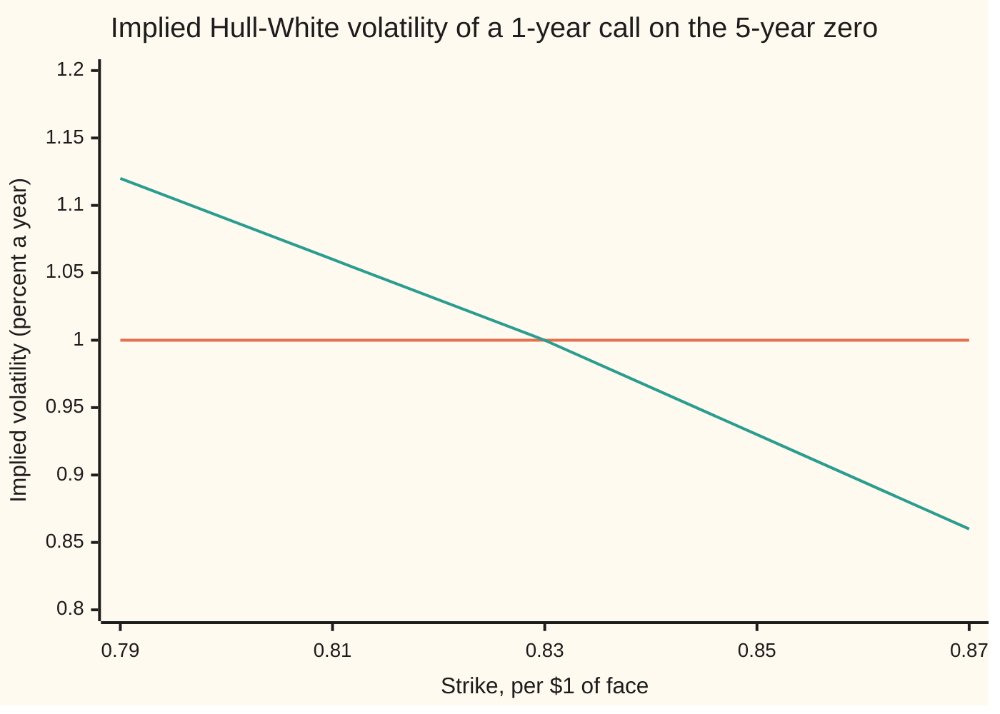

# Cheyette: the whole forward curve driven by two state variables, so a PDE can price Bermudans with a skew

[Syllabus](../../../SYLLABUS.md) → [Financial mathematics](../README.md) → [Forward-Rate Models](../README.md#s31) → Cheyette

---

## General Overview

A rates desk sells a one-year call on a zero-coupon bond: the right, one year from today, to buy a promise of $1 due at year 5 for 83 cents. The desk prices it on the six-quote curve of [Hull-White](../30-Short-Rate%20Models/04-hull-white-model.md), where $1 due at year 5 costs 0.79621728 today. With a pull speed of 0.03 a year and a rate volatility of 1 percent, Hull-White says the call is worth 0.011634 per dollar of face.

In this example the options market disagrees at other strikes. Options that pay off when rates are high trade at a higher implied volatility than options that pay off when rates are low. That tilt is a **skew**. Hull-White has one volatility, so it quotes every strike at exactly 1.00 percent and cannot draw the tilt.

The fix is to let the volatility depend on where rates are: here $`\sigma_r = 1\% + 0.2\,x`$, where $`x`$ is how far the short rate sits above today's forward curve. The general framework for this is [Heath-Jarrow-Morton](01-hjm-framework-and-the-drift-condition.md) (HJM), which models every point of the forward curve at once. In general HJM's state is the whole curve, and where the curve goes next depends on the path it took. In the early 1990s Oren Cheyette showed that one shape of volatility collapses that path into two numbers, $`x`$ and $`y`$. Two numbers fit on a grid, and a grid can price options with early exercise.

On that grid the skewed model prices the 0.87 strike at 0.000800 instead of Hull-White's 0.001442: $6,426.85 less on $10,000,000 of face. Its implied volatilities run from 1.12 percent at strike 0.79 down to 0.86 percent at strike 0.87.

**When every forward rate's volatility is the short rate's volatility times a fixed fading factor, the whole forward curve is a known function of two running totals, a rate gap $`x`$ and an accumulated variance $`y`$; with deterministic volatility $`y`$ is fixed and the model is Hull-White, and with a local-volatility skew $`(x, y)`$ is a two-dimensional state that a PDE grid can step back in time.**

**What kind of fact this is:** a model (an assumption about how rates move, not a law), with a theorem inside it: given the separable volatility, the two-variable representation and the bond formula are exact, proved on this card in Why it works.

### The picture: the smile Hull-White cannot draw



Orange: Cheyette with flat volatility ($`b = 0`$), priced on the grid; every strike reads back 1.00 percent, because this model is Hull-White. Green: Cheyette with the skew $`b = 0.2`$, priced on the same grid. A low strike pays off even when rates are high, where the skewed volatility is large, so its implied volatility is high. A high strike pays only when rates are low, where volatility is small.

---

## The formula

Notation first, in words.

- $`t`$ is the time from today, in years; $`T`$ is a payment date. $`f(t,T)`$ is the **forward rate**: the rate fixed at time $`t`$ for borrowing over one instant at $`T`$. $`f(0,T)`$ is today's curve.
- $`D(T)`$ is today's price of $1 due at $`T`$, read off the market. $`P(t,T)`$ is the model's price at time $`t`$ of the same $1.
- $`r(t) = f(t,t)`$ is the **short rate**, the front of the curve.
- $`\kappa`$ (kappa) is the **pull speed**: how fast a shock to the curve fades with maturity. It is the $`a`$ (reversion speed) of the Hull-White card. Here $`\kappa = 0.03`$ a year.
- $`\sigma_r`$ is the short rate's volatility. Here $`\sigma_r = 0.01 + b\,x`$ with skew slope $`b`$, either 0 or 0.2.
- $`W`$ is the random shock (a Brownian motion); $`dW`$ is its kick over an instant $`dt`$, with mean zero and variance $`dt`$.

The one assumption is a **separable volatility**: the forward for date $`T`$ shakes as hard as the short rate, faded by the distance to $`T`$.

```math
\sigma_f(t,T) = \sigma_r(t)\,e^{-\kappa(T-t)}
```

Then two **state variables** (numbers that, once known, fix everything the model needs) carry the whole curve:

```math
f(t,T) = f(0,T) + e^{-\kappa(T-t)}\bigl(x(t) + G(t,T)\,y(t)\bigr), \qquad G(t,T) = \frac{1 - e^{-\kappa(T-t)}}{\kappa}
```

They start at zero and move by

```math
dx = \bigl(y - \kappa x\bigr)\,dt + \sigma_r\,dW, \qquad dy = \bigl(\sigma_r^2 - 2\kappa y\bigr)\,dt
```

Integrating the forward curve from $`t`$ to $`T`$ gives the **bond reconstitution formula**: every bond price, rebuilt from the two numbers.

```math
\boxed{\;P(t,T) = \frac{D(T)}{D(t)}\,\exp\Bigl(-G(t,T)\,x(t) - \tfrac12\,G(t,T)^2\,y(t)\Bigr)\;}
```

**Read it aloud:** a future bond is today's forward bond price, pushed down by its sensitivity times the rate gap $`x`$, and pushed down a little more by half its sensitivity squared times the variance $`y`$ that has piled up.

| Symbol | Plain meaning | In our example | Push it up and the answer… |
| --- | --- | --- | --- |
| $`f(t,T)`$, $`f(0,t)`$, $`\alpha(t,T)`$ | the forward rate at time $`t`$ for date $`T`$; today's forward curve; the forward's drift | $`f(0,1)`$ = 4.5061 percent | bonds that span $`T`$ fall |
| $`D(T)`$, $`P(t,T)`$ | today's market price of $1 due at $`T`$; the model's price at $`t`$ | $`D(5)`$ = 0.79621728; $`P(1,5)`$ = 0.82908656 at $`x = 0`$ | — |
| $`r(t)`$ | the short rate, $`f(0,t) + x(t)`$ | 4.5061 percent at year 1 if $`x = 0`$ | every bond falls |
| $`\kappa`$ (Hull-White's $`a`$) | pull speed: how fast a shock fades along the curve | 0.03 a year | long bonds move less; the option falls |
| $`\sigma_r`$, $`b`$, $`\sigma_f(t,T)`$ | short-rate volatility; its slope in $`x`$ (the skew); the volatility of the forward for date $`T`$ | 1 percent; $`b`$ = 0 or 0.2 | the option rises; a bigger $`b`$ tilts the smile |
| $`x(t)`$ | the rate gap: short rate minus today's forward for that date | starts at 0; ±2 percent in the bond check at year 1 | every bond falls by $`G`$ per unit |
| $`y(t)`$ | the accumulated variance: volatility squared, piled up and fading at $`2\kappa`$ | 0.0000970591 at year 1 with $`b = 0`$ | bonds fall slightly; it pushes $`x`$ up |
| $`G(t,T)`$ | the bond's sensitivity to $`x`$, in years | $`G(1,5)`$ = 3.769319 | the bond swings more |
| $`W`$, $`dW`$, $`dt`$ | the single random shock; its kick; one instant | — | — |
| $`K`$, ZBC | the option's strike, per $1 of face; the call's price (zero-bond call) | 0.79 to 0.87; ZBC = 0.011634 at 0.83 | the call falls |
| $`\sigma_p`$, $`h`$, $`N`$ | Hull-White's spread of the log bond price at expiry; the strike lead in those spreads; the bell-curve area to the left | $`\sigma_p`$ = 0.037135, $`h`$ = 0.007482 | the call rises with $`\sigma_p`$ |
| $`V(t,x,y)`$ | the option's value on the grid at time $`t`$ and state $`(x, y)`$ | 0.011576 at $`(0, 0, 0)`$, $`K`$ = 0.83, $`b`$ = 0.2 | — |

### When it holds

- **The volatility is separable.** Every forward's shock is the short rate's shock times $`e^{-\kappa(T-t)}`$. A volatility whose shape along the curve changes over time breaks the two-number summary; the past no longer folds into $`x`$ and $`y`$.
- **The volatility depends only on $`t`$, $`x`$ and $`y`$.** That is a **local volatility**. If it also has its own random driver (stochastic volatility), the state needs a third number. With several shocks, $`n`$ factors need $`n`$ gaps plus $`n(n+1)/2`$ variances.
- **Rates can go negative, and a straight-line skew can go below zero.** $`\sigma_r = 0.01 + 0.2x`$ hits zero at $`x = -5`$ percent. The checks floor it at 0.1 percent. A year of 1 percent volatility rarely takes $`x`$ that far, so the floor barely matters here.
- **Prices are taken in the pricing world** (the risk-neutral rule of [Heath-Jarrow-Morton](01-hjm-framework-and-the-drift-condition.md)), with continuous shocks and one curve for discounting.
- **The grid covers the paths.** The grid runs $`x`$ from −6 to +6 percent and $`y`$ from 0 to 0.0003. A path that leaves it is priced by the edge rule, not the model.

---

## Why it works

### Step 0: one fading factor lets the past be summed into two running totals

In HJM, the forward at time $`t`$ for date $`T`$ is today's curve plus every drift and shock since. In general each date $`T`$ remembers its own weighted sum of the past, so the state is a whole curve. With a separable volatility, every date weighs the past the same way, up to one factor $`e^{-\kappa(T-t)}`$ that can be pulled outside. What remains inside is two sums shared by all dates: one of shocks, which becomes $`x`$, and one of squared volatility, which becomes $`y`$.

### Step 1: the drift is forced

HJM's no-arbitrage rule fixes each forward's drift as its volatility times the volatility area out to its date ([Heath-Jarrow-Morton](01-hjm-framework-and-the-drift-condition.md)). The area of $`\sigma_r e^{-\kappa(u-t)}`$ from $`t`$ to $`T`$ is $`\sigma_r G(t,T)`$. So

```math
\alpha(t,T) = \sigma_r(t)^2\,e^{-\kappa(T-t)}\,G(t,T)
```

Here $`\alpha`$ (alpha) is the forward's drift. Nothing in this step needs $`\sigma_r`$ to be fixed in advance. It can depend on the state.

### Step 2: factor out the fading, and two totals remain

Add up the drifts and shocks from 0 to $`t`$. Every term carries $`e^{-\kappa(T-s)}`$, which splits as $`e^{-\kappa(T-t)}e^{-\kappa(t-s)}`$. The sensitivity splits too: $`G(s,T) = G(s,t) + e^{-\kappa(t-s)}G(t,T)`$, because the area from $`s`$ to $`T`$ is the area to $`t`$ plus the faded area beyond. Collecting terms gives the forward-curve formula, with

```math
x(t) = \int_0^t e^{-\kappa(t-s)}\Bigl(\sigma_r(s)^2 G(s,t)\,ds + \sigma_r(s)\,dW(s)\Bigr), \qquad y(t) = \int_0^t e^{-2\kappa(t-s)}\,\sigma_r(s)^2\,ds
```

Set $`T = t`$ and the bracket is $`x(t)`$ alone, since $`G(t,t) = 0`$. So $`x(t) = r(t) - f(0,t)`$: the rate gap.

<details>
<summary>Detailed proof: the forward-curve formula, term by term</summary>

HJM in integral form reads

$`\displaystyle f(t,T) = f(0,T) + \int_0^t \alpha(s,T)\,ds + \int_0^t \sigma_r(s)\,e^{-\kappa(T-s)}\,dW(s)`$

The shock term: $`e^{-\kappa(T-s)} = e^{-\kappa(T-t)}e^{-\kappa(t-s)}`$, so it equals $`e^{-\kappa(T-t)}\int_0^t e^{-\kappa(t-s)}\sigma_r\,dW`$.

The drift term: $`\alpha(s,T) = \sigma_r(s)^2 e^{-\kappa(T-s)}G(s,T)`$. Put in $`G(s,T) = G(s,t) + e^{-\kappa(t-s)}G(t,T)`$. Check it: $`\kappa G(s,t) + \kappa e^{-\kappa(t-s)}G(t,T) = 1 - e^{-\kappa(t-s)} + e^{-\kappa(t-s)} - e^{-\kappa(T-s)} = \kappa G(s,T)`$. Then

$`\displaystyle \int_0^t \alpha(s,T)\,ds = e^{-\kappa(T-t)}\Bigl[\int_0^t e^{-\kappa(t-s)}\sigma_r^2 G(s,t)\,ds + G(t,T)\int_0^t e^{-2\kappa(t-s)}\sigma_r^2\,ds\Bigr]`$

The first integral joins the shock term to make $`x(t)`$; the second is $`y(t)`$. That is the forward-curve formula.

</details>

### Step 3: integrate the curve to get every bond

A bond is the forward curve summed: $`\ln P(t,T) = -\int_t^T f(t,u)\,du`$. Today's curve contributes $`\ln\bigl(D(T)/D(t)\bigr)`$. The $`x`$ term contributes $`-x\int_t^T e^{-\kappa(u-t)}du = -G\,x`$. The $`y`$ term contributes $`-y\int_t^T e^{-\kappa(u-t)}G(t,u)\,du`$, and since $`e^{-\kappa(u-t)}`$ is the slope of $`G(t,u)`$ in $`u`$, that integral is $`G^2/2`$. Together they give the boxed formula.

### Step 4: the two totals move on their own

Differentiate the definitions of Step 2. The fading factor $`e^{-\kappa(t-s)}`$ gives $`-\kappa x`$ and $`-2\kappa y`$. The new instant adds $`\sigma_r\,dW`$ to $`x`$ and $`\sigma_r^2\,dt`$ to $`y`$. In $`x`$ the inner $`G(s,t)`$ also grows, at rate $`e^{-\kappa(t-s)}`$, and that adds exactly $`y\,dt`$. So $`dx = (y - \kappa x)\,dt + \sigma_r\,dW`$ and $`dy = (\sigma_r^2 - 2\kappa y)\,dt`$.

If $`\sigma_r`$ depends only on $`t`$, $`x`$ and $`y`$, the next step of $`(x, y)`$ needs nothing but $`(x, y)`$ now. The pair is **Markov** (its future depends on the past only through its present value), and that is what a grid needs.

### Step 5: deterministic volatility gives back Hull-White

If $`\sigma_r`$ is a fixed number, $`y`$ has no randomness. It solves its own equation in closed form:

```math
y(t) = \frac{\sigma_r^2}{2\kappa}\bigl(1 - e^{-2\kappa t}\bigr)
```

That is exactly the noise term in Hull-White's drift $`\theta(t)`$ (the time-varying target that fits today's curve). Write $`r = f(0,t) + x`$; then $`dr = \bigl(f'(0,t) + \kappa f(0,t) + y(t) - \kappa r\bigr)dt + \sigma_r\,dW`$, which is Hull-White with $`a = \kappa`$. The bond formula matches too: put $`x = r - f(0,t)`$ into the boxed formula and it becomes Hull-White's $`A`$, $`B`$ formula (bond price $`= A\,e^{-B r}`$), with $`B = G`$. The checks compare both formulas at three rates; they agree to eight decimals.

The option price follows. In Hull-White the log of $`P(1,5)`$ is normal with spread $`\sigma_p = G(1,5)\sqrt{y(1)}`$, and the call on a zero is the closed form of [Bond options](../30-Short-Rate%20Models/05-bond-options-and-jamshidians-trick.md):

```math
\mathrm{ZBC} = D(5)\,N(h) - K\,D(1)\,N(h - \sigma_p), \qquad h = \frac{1}{\sigma_p}\ln\frac{D(5)}{K\,D(1)} + \frac{\sigma_p}{2}
```

### Step 6: a skew makes $`y`$ random, and the grid takes two dimensions

With $`\sigma_r = 0.01 + 0.2x`$, $`y`$ depends on the path $`x`$ took. Two paths that both end at $`x = 0`$ can carry different $`y`$, and so different bond prices. One number no longer fixes the curve; two do.

The option value $`V(t,x,y)`$ then obeys the pricing equation of the pair (Feynman-Kac: the option's discounted value is a fair bet, so its expected drift is zero; with a Markov state that drift is the left side below):

```math
\frac{\partial V}{\partial t} + (y - \kappa x)\frac{\partial V}{\partial x} + (\sigma_r^2 - 2\kappa y)\frac{\partial V}{\partial y} + \tfrac12\sigma_r^2\frac{\partial^2 V}{\partial x^2} - \bigl(f(0,t) + x\bigr)V = 0
```

At expiry $`V = \max\bigl(P(1,5) - K, 0\bigr)`$, with $`P(1,5)`$ from the boxed formula. There is no second derivative in $`y`$: $`y`$ has no shock of its own. The grid exploits that in two moves per time step.

1. Carry $`y`$ along its drift: read each grid value from the point $`y + (\sigma_r^2 - 2\kappa y)\,dt`$, by straight-line interpolation.
2. Step $`x`$ with the Crank-Nicolson scheme of [Pricing on a grid](../06-Numerical%20Methods%20for%20Pricing/07-finite-differences-for-the-black-scholes-equation.md): one tridiagonal solve (a linear system in which each unknown is tied only to its two neighbours) per row of $`y`$. Four fully implicit steps come first, to smooth the payoff's kink.

A Bermudan option (exercisable on several dates) adds one line: on each exercise date, replace $`V`$ by the larger of $`V`$ and the exercise value. The checks do this for a put (the right to sell) on the 5-year zero, struck at 0.83 and exercisable at six months or at one year, with the skew. It is worth 0.020652, against 0.011904 for the put that can be exercised only at one year. Exercising at six months usually wins, because the 0.83 arrives half a year sooner. That is the reason desks want a grid: [Bermudan swaptions](06-bermudan-swaptions-by-regression.md) does the same job by regression on simulated paths, which is slower and noisier for one-factor problems.

---

## Worked numbers, by hand

The Hull-White price at strike 0.83, with $`\kappa = 0.03`$ and $`\sigma_r = 1`$ percent.

| Step | Arithmetic | Value |
| --- | --- | --- |
| sensitivity of the 5-year zero at year 1 | $`G(1,5) = (1 - e^{-0.12})/0.03`$ | 3.769319 |
| variance piled up by year 1 | $`y(1) = 0.0001\,(1 - e^{-0.06})/0.06`$ | 0.0000970591 |
| spread of the log bond price | $`\sigma_p = 3.769319 \times \sqrt{0.0000970591}`$ | 0.037135 |
| forward bond price | $`D(5)/D(1) = 0.79621728 / 0.95969290`$ | 0.829658 |
| strike lead | $`h = \ln(0.829658/0.83)/0.037135 + 0.037135/2`$ | 0.007482 |
| bell-curve areas | $`N(h)`$, $`N(h - \sigma_p)`$ | 0.502985, 0.488172 |
| **call on the zero** | $`0.79621728 \times 0.502985 - 0.83 \times 0.95969290 \times 0.488172`$ | **0.011634** |

The flat-volatility grid gets 0.011634 too.

Now the skew. Local volatility at $`x`$ = −2, −1, 0, +1 and +2 percent is 0.60, 0.80, 1.00, 1.20 and 1.40 percent.

| Strike | Hull-White closed form | Grid, $`b = 0`$ | Implied, percent | Grid, $`b = 0.2`$ | Monte Carlo, $`b = 0.2`$ (standard error) | Implied, percent |
| --- | --- | --- | --- | --- | --- | --- |
| 0.79 | 0.039321 | 0.039321 | 1.0001 | 0.039967 | 0.039974 (0.000025) | 1.1217 |
| 0.81 | 0.023437 | 0.023436 | 1.0000 | 0.023999 | 0.023983 (0.000052) | 1.0587 |
| 0.83 | 0.011634 | 0.011634 | 1.0000 | 0.011576 | 0.011512 (0.000075) | 0.9951 |
| 0.85 | 0.004632 | 0.004631 | 0.9999 | 0.003967 | 0.003949 (0.000056) | 0.9300 |
| 0.87 | 0.001442 | 0.001442 | 0.9999 | 0.000800 | 0.000804 (0.000025) | 0.8633 |

"Implied" is the Hull-White volatility that reproduces the price. The flat grid reads back 1.00 percent at every strike: Cheyette with deterministic volatility is Hull-White. The skewed grid reads back a tilt, from 1.12 percent down to 0.86 percent, and a simulation that never touches the grid agrees within its error.

The skew does not cost the curve fit. The 5-year zero, rolled back through the grid from its year-1 price, comes out at 0.79621832 flat and 0.79621827 skewed, against the market's 0.79621728. Under the skew $`y(1)`$ is random; its average across the simulation is 0.0000990694, a little above the flat value, because volatility squared rises more on the way up than it falls on the way down.

### What breaks if you drop a piece

The first two rows are exact closed forms with flat volatility, so no grid error is mixed into them.

| Mistake | Comes out at | What went wrong |
| --- | --- | --- |
| Drop $`y`$ from the drift of $`x`$ | 5-year zero 0.79637591, $1,586.27 too much on $10,000,000 | The forced HJM drift is gone, so the curve stops fitting |
| Drop the $`\tfrac12 G^2 y`$ term from the bond formula | 5-year zero 0.79676646, $5,491.78 too much | Averaging over the spread of rates lifts bond prices; the term pays that back |
| Use the Hull-White card's $`\kappa = 0.3`$ instead of 0.03 | call at 0.83 is 0.006255, $53,793.68 too little | Fast fading shrinks the long bond's sensitivity $`G(1,5)`$, and with it the spread $`\sigma_p`$ |
| Price the skewed market with flat Hull-White at strike 0.87 | 0.001442 against 0.000800, $6,426.85 too much | One volatility cannot be right at every strike |

---

## Code, from first principles, and it actually runs

Both programs build the six-quote curve with the bootstrap ladder, then take four independent roads. Road 1 is Hull-White's closed form, with the bell-curve area by Simpson's rule. Road 2 is the two-dimensional grid: 161 points in $`x`$, 41 in $`y`$, 160 time steps. It also prices the Bermudan put and the one-state shortcut of The usual mistake. Road 3 simulates 10,000 pairs of paths (each with its mirror image) of $`x`$ and $`y`$ by Euler steps (each step adds the drift times the step length plus the volatility times a random kick), 100 a year, with its own random-number generator. It runs with the skew and again without it, on the same random numbers. Without the skew the mirror pairs cancel almost all the noise, so the simulation must hit today's bonds closely: $`D(1)`$ = 0.95969312 (standard error 0.00000022) and $`D(5)`$ = 0.79621484 (0.00001001), against 0.95969290 and 0.79621728. That is a sharp test of how the simulation discounts. Road 4 checks the algebra: the reconstitution formula against Hull-White's bond formula at three rates, and $`y`$'s equation integrated by fourth-order Runge-Kutta (a stepper that averages four slope estimates per step) against its closed form. The implied volatilities come from bisection on road 1, and the first two rows of What breaks are closed forms.

### Python

```python
# Cheyette (quasi-Gaussian) check: x and y carry the whole forward curve.  Standard library only; nothing imported
# knows an answer.  Roads: (1) Hull-White's closed-form bond call; (2) a 2-D (x, y) grid stepped back from expiry;
# (3) Monte Carlo of x and y; (4) the bond formula against Hull-White's, and y's equation by RK4 against its closed form.
from math import exp, log, sqrt, cos, pi

DEPOSITS = ((0.5, 0.0400), (1.0, 0.0420))            # the Hull-White card's six quotes
SWAPS = ((2, 0.0440), (3, 0.0455), (4, 0.0462), (5, 0.0465))
KAP, S0, SKEW = 0.03, 0.01, 0.2       # pull speed, base volatility, slope of vol in x
TE, TM, STRIKES = 1.0, 5.0, (0.79, 0.81, 0.83, 0.85, 0.87)   # option expiry, bond maturity, strikes

D = {0.0: 1.0}                        # the bootstrap ladder
for T, r in DEPOSITS: D[T] = 1.0 / (1.0 + T * r)
for n, S in SWAPS: D[float(n)] = (1.0 - S * sum(D[float(j)] for j in range(1, n))) / (1.0 + S)
PIL = sorted(D); FW = [log(D[PIL[i]] / D[PIL[i + 1]]) / (PIL[i + 1] - PIL[i]) for i in range(6)]
def f0(t): return FW[min(sum(1 for p in PIL[1:] if t >= p), 5)]
def G(t, T, k=KAP): return (1.0 - exp(-k * (T - t))) / k
def ybar(t): return S0 * S0 * (1.0 - exp(-2.0 * KAP * t)) / (2.0 * KAP)   # y when b = 0
def recon(t, T, x, y):                # P(t,T) = D(T)/D(t) exp(-G x - G^2 y / 2)
    g = G(t, T); return D[T] / D[t] * exp(-g * x - 0.5 * g * g * y)
def hw(t, T, r):                      # the Hull-White card's A, B formula with a = kappa
    B = G(t, T)
    return D[T] / D[t] * exp(B * f0(t) - S0 * S0 / (4 * KAP) * (1 - exp(-2 * KAP * t)) * B * B - B * r)
def vol(x, b): return max(S0 + b * x, 0.001)  # local volatility, floored at 0.1 percent

def ncdf(z, n=2000):                  # bell-curve area by Simpson's rule
    a = abs(z); h = a / n; g = lambda u: exp(-u * u / 2) / sqrt(2 * pi)
    s = h / 3 * (g(0.0) + g(a) + sum((4 if k % 2 else 2) * g(k * h) for k in range(1, n)))
    return 0.5 + s if z > 0 else 0.5 - s
def zbc(K, sig, k=KAP):               # road 1: Hull-White call on the zero, expiry TE
    sp = sig * sqrt((1 - exp(-2 * k * TE)) / (2 * k)) * G(TE, TM, k)
    h = log(D[TM] / (D[TE] * K)) / sp + sp / 2
    return D[TM] * ncdf(h) - K * D[TE] * ncdf(h - sp), sp, h
def implied(K, p):                    # Hull-White sigma that reproduces a price, by bisection
    lo, hi = 0.001, 0.05
    for _ in range(50): mid = 0.5 * (lo + hi); lo, hi = (mid, hi) if zbc(K, mid)[0] < p else (lo, mid)
    return 0.5 * (lo + hi)

NX, NY, NT, XM, YM = 161, 41, 160, 0.06, 3e-4       # the grid: x from -6% to 6%, y to 3e-4
XS = [-XM + 2 * XM * i / (NX - 1) for i in range(NX)]; DX = XS[1] - XS[0]
YS = [YM * j / (NY - 1) for j in range(NY)]; DY = YS[1]
def grid(payoffs, b, by=None, ex=None):   # road 2: step V(t, x, y) back from TE to 0; y carried at vol(x, by)
    dt, by = TE / NT, b if by is None else by
    Vs = [[[p(x, y) for y in YS] for x in XS] for p in payoffs]
    for n in range(NT - 1, -1, -1):
        rf = f0(n * dt); th = 1.0 if n >= NT - 4 else 0.5; c = (1 - th) * dt   # 4 implicit steps, then Crank-Nicolson
        for V in Vs:
            W = [[0.0] * NY for _ in range(NX)]          # 1: carry y along dy = (s^2 - 2 k y) dt
            for i, x in enumerate(XS):
                s2 = vol(x, by) * vol(x, by)
                for j, y in enumerate(YS):
                    q = min(y + (s2 - 2 * KAP * y) * dt, YM) / DY; m = min(int(q), NY - 2)
                    W[i][j] = V[i][m] + (q - m) * (V[i][m + 1] - V[i][m])
            for j, y in enumerate(YS):                   # 2: theta-scheme in x, row by row
                L = []
                for i, x in enumerate(XS):
                    mu = y - KAP * x; d = 0.5 * vol(x, b) * vol(x, b) / (DX * DX)
                    if i == 0: L.append((0.0, -(rf + x) - mu / DX, mu / DX))
                    elif i == NX - 1: L.append((-mu / DX, -(rf + x) + mu / DX, 0.0))
                    else: L.append((d - mu / (2 * DX), -2 * d - rf - x, d + mu / (2 * DX)))
                rh = [W[i][j] + c * ((L[i][0] * W[i - 1][j] if i > 0 else 0.0) + L[i][1] * W[i][j]
                      + (L[i][2] * W[i + 1][j] if i < NX - 1 else 0.0)) for i in range(NX)]
                lo, di, up = [-th * dt * l[0] for l in L], [1 - th * dt * l[1] for l in L], [-th * dt * l[2] for l in L]
                for i in range(1, NX):                   # Thomas algorithm
                    w = lo[i] / di[i - 1]; di[i] -= w * up[i - 1]; rh[i] -= w * rh[i - 1]
                V[NX - 1][j] = rh[NX - 1] / di[NX - 1]
                for i in range(NX - 2, -1, -1): V[i][j] = (rh[i] - up[i] * V[i + 1][j]) / di[i]
        if ex and n == NT // 2: Vs[-1] = [[max(v, ex(x, y)) for v, y in zip(r, YS)] for r, x in zip(Vs[-1], XS)]   # Bermudan
    return [V[NX // 2][0] for V in Vs]

state = 20261123                                    # 64-bit LCG, then Box-Muller
def unif():
    global state; state = (state * 6364136223846793005 + 1442695040888963407) % 2**64
    return ((state >> 11) + 0.5) / 2**53
def gauss(): u1 = unif(); u2 = unif(); return sqrt(-2.0 * log(u1)) * cos(2.0 * pi * u2)
def monte_carlo(b, pairs=10000, steps=100):         # road 3: Euler steps of x and y, from the same seed each call
    global state; state = 20261123; dt = TE / steps; acc = [[0.0, 0.0] for _ in range(len(STRIKES) + 3)]
    for _ in range(pairs):
        zs = [gauss() for _ in range(steps)]; vals = []
        for sgn in (1.0, -1.0):
            x = y = ix = 0.0
            for z in zs:
                s = vol(x, b); nx = x + (y - KAP * x) * dt + s * sqrt(dt) * sgn * z
                y += (s * s - 2 * KAP * y) * dt; ix += 0.5 * dt * (x + nx); x = nx
            disc = D[TE] * exp(-ix); p = recon(TE, TM, x, y)
            vals.append([disc * max(p - K, 0.0) for K in STRIKES] + [disc * p, disc, y])
        for k in range(len(acc)):
            v = 0.5 * (vals[0][k] + vals[1][k]); acc[k][0] += v; acc[k][1] += v * v
    return [(s / pairs, sqrt(max(q / pairs - (s / pairs) * (s / pairs), 0.0) / pairs)) for s, q in acc]

y, h, fy = 0.0, 0.001, lambda y: S0 * S0 - 2 * KAP * y   # road 4a: dy/dt = s^2 - 2 k y by RK4
for _ in range(1000):
    k1 = fy(y); k2 = fy(y + h / 2 * k1); k3 = fy(y + h / 2 * k2); y += h / 6 * (k1 + 2 * k2 + 2 * k3 + fy(y + h * k3))
g15 = G(TE, TM); fwd = D[TM] / D[TE]
print(f"curve: D(1) {D[1.0]:.8f}  D(5) {D[5.0]:.8f}  forward bond D(5)/D(1) {fwd:.6f}")
print(f"kappa {KAP}  G(1,5) {g15:.6f}  y(1) closed {ybar(1.0):.10f}  RK4 {y:.10f}")
assert abs(y - ybar(1.0)) < 1e-13
print("t=1 bond to 5 y: x %, short rate %, Cheyette P(1,5), Hull-White P(1,5)")
for x in (-0.02, 0.0, 0.02):                         # road 4b: same prices, two formulas
    pc, ph = recon(TE, TM, x, ybar(TE)), hw(TE, TM, f0(TE) + x)
    print(f"  {100 * x:+.1f}  {100 * (f0(TE) + x):.4f}  {pc:.8f}  {ph:.8f}")
    assert abs(pc - ph) < 1e-12
c83, sp, hh = zbc(0.83, S0)
print(f"by hand, K 0.83: sigma_p {sp:.6f}  h {hh:.6f}  N(h) {ncdf(hh):.6f}  N(h-sp) {ncdf(hh - sp):.6f}  call {c83:.6f}")
print("local vol % at x = -2, -1, 0, 1, 2 %: " + " ".join(f"{100 * vol(x, SKEW):.2f}" for x in (-0.02, -0.01, 0.0, 0.01, 0.02)))
pays = [lambda x, y, K=K: max(recon(TE, TM, x, y) - K, 0.0) for K in STRIKES]
pays += [lambda x, y: recon(TE, TM, x, y)]; put = lambda t: lambda x, y: max(0.83 - recon(t, TM, x, y), 0.0)
g0, g1, o1 = grid(pays, 0.0), grid(pays, SKEW), grid(pays, SKEW, by=0.0)   # o1: one state, y kept on ybar(t)
mc, mc0 = monte_carlo(SKEW), monte_carlo(0.0)
print("strike: HW closed, grid b=0, implied % | grid b=0.2, MC b=0.2 (se), implied %")
iv0, iv1 = [], []
for k, K in enumerate(STRIKES):
    cf = zbc(K, S0)[0]; iv0.append(implied(K, g0[k])); iv1.append(implied(K, g1[k]))
    print(f"  {K:.2f}  {cf:.6f}  {g0[k]:.6f}  {100 * iv0[k]:.4f} | {g1[k]:.6f}  {mc[k][0]:.6f} ({mc[k][1]:.6f})  {100 * iv1[k]:.4f}")
    assert abs(g0[k] - cf) < 3e-6 and abs(iv0[k] - S0) < 2e-5
    assert abs(g1[k] - mc[k][0]) < 4 * mc[k][1]
assert iv1[0] > iv1[2] > iv1[4] and iv1[0] - iv1[4] > 0.002; nb = len(STRIKES)
print(f"5-y zero through the grid: b=0 {g0[nb]:.8f}  b=0.2 {g1[nb]:.8f}  market {D[5.0]:.8f}")
assert abs(g0[nb] - D[5.0]) < 3e-6 and abs(g1[nb] - D[5.0]) < 3e-6
print(f"MC b=0.2: D(1) {mc[nb + 1][0]:.6f} ({mc[nb + 1][1]:.6f})  D(5) {mc[nb][0]:.6f} ({mc[nb][1]:.6f})"
      f"  mean y(1) {mc[nb + 2][0]:.10f}")
print(f"MC b=0, same draws: D(1) {mc0[nb + 1][0]:.8f} ({mc0[nb + 1][1]:.8f})  D(5) {mc0[nb][0]:.8f} ({mc0[nb][1]:.8f})"
      f"  call 0.83 {mc0[2][0]:.6f} ({mc0[2][1]:.6f})")
for m in (mc, mc0): assert abs(m[nb + 1][0] - D[1.0]) < 4 * m[nb + 1][1] and abs(m[nb][0] - D[5.0]) < 4 * m[nb][1]
assert all(abs(mc0[k][0] - zbc(K, S0)[0]) < 4 * mc0[k][1] for k, K in enumerate(STRIKES))
eu, bm = grid([put(TE), put(TE)], SKEW, ex=put(0.5))       # put on the 5-y zero; the second may also be exercised at 0.5 y
print(f"put K 0.83, b=0.2: European {eu:.6f}  (parity {g1[2] - g1[nb] + 0.83 * D[TE]:.6f})  Bermudan, also at 0.5 y {bm:.6f}")
assert abs(eu - (g1[2] - g1[nb] + 0.83 * D[TE])) < 3e-6 and bm > eu + 1e-3
print("one state, y held at ybar(t), minus two states, on 10,000,000 face: 5-y zero " + " ".join(
      f"{1e7 * (o1[k] - g1[k]):.2f}" for k in (nb, 0, 2, 4)) + "  (calls 0.79, 0.83, 0.87)")
assert abs(o1[nb] - g1[nb]) > 2e-6
i5 = sum(G(TE * (k + 0.5) / 1000, TM) ** 2 for k in range(1000)) * TE / 1000     # integral of G(s,5)^2 over [0, TE]
nod, noc = D[TM] * exp(0.5 * S0 * S0 * i5 - 0.5 * g15 * g15 * ybar(TE)), D[TM] * exp(0.5 * g15 * g15 * ybar(TE))
print("what breaks, on 10,000,000 face (b=0, closed form):")
print(f"  drop y from x's drift: 5-y zero {nod:.8f}, error {1e7 * (nod - D[5.0]):.2f}")
print(f"  drop the G^2 y / 2 term: 5-y zero {noc:.8f}, error {1e7 * (noc - D[5.0]):.2f}")
c3 = zbc(0.83, S0, 0.3)[0]; print(f"  kappa 0.3 not 0.03, K 0.83: call {c3:.6f}, error {1e7 * (c3 - c83):.2f}")
print(f"  flat Hull-White on the skewed market, K 0.87: {zbc(0.87, S0)[0]:.6f} vs {g1[4]:.6f}, error {1e7 * (zbc(0.87, S0)[0] - g1[4]):.2f}")
assert abs(nod - D[5.0]) > 1e-4 and abs(c3 - c83) > 1e-3
print("chart, implied %: b=0 " + " ".join(f"{100 * v:.2f}" for v in iv0) + " | b=0.2 " + " ".join(f"{100 * v:.2f}" for v in iv1))
print("ALL CHECKS PASS")
```

**Ran 2026-11-23 on macOS, Python 3.14.10, standard library only. All checks passed. Output, pasted from the run:**

```
curve: D(1) 0.95969290  D(5) 0.79621728  forward bond D(5)/D(1) 0.829658
kappa 0.03  G(1,5) 3.769319  y(1) closed 0.0000970591  RK4 0.0000970591
t=1 bond to 5 y: x %, short rate %, Cheyette P(1,5), Hull-White P(1,5)
  -2.0  2.5061  0.89400462  0.89400462
  +0.0  4.5061  0.82908656  0.82908656
  +2.0  6.5061  0.76888252  0.76888252
by hand, K 0.83: sigma_p 0.037135  h 0.007482  N(h) 0.502985  N(h-sp) 0.488172  call 0.011634
local vol % at x = -2, -1, 0, 1, 2 %: 0.60 0.80 1.00 1.20 1.40
strike: HW closed, grid b=0, implied % | grid b=0.2, MC b=0.2 (se), implied %
  0.79  0.039321  0.039321  1.0001 | 0.039967  0.039974 (0.000025)  1.1217
  0.81  0.023437  0.023436  1.0000 | 0.023999  0.023983 (0.000052)  1.0587
  0.83  0.011634  0.011634  1.0000 | 0.011576  0.011512 (0.000075)  0.9951
  0.85  0.004632  0.004631  0.9999 | 0.003967  0.003949 (0.000056)  0.9300
  0.87  0.001442  0.001442  0.9999 | 0.000800  0.000804 (0.000025)  0.8633
5-y zero through the grid: b=0 0.79621832  b=0.2 0.79621827  market 0.79621728
MC b=0.2: D(1) 0.959694 (0.000005)  D(5) 0.796237 (0.000035)  mean y(1) 0.0000990694
MC b=0, same draws: D(1) 0.95969312 (0.00000022)  D(5) 0.79621484 (0.00001001)  call 0.83 0.011556 (0.000094)
put K 0.83, b=0.2: European 0.011904  (parity 0.011903)  Bermudan, also at 0.5 y 0.020652
one state, y held at ybar(t), minus two states, on 10,000,000 face: 5-y zero 76.22 -196.01 -478.09 -161.91  (calls 0.79, 0.83, 0.87)
what breaks, on 10,000,000 face (b=0, closed form):
  drop y from x's drift: 5-y zero 0.79637591, error 1586.27
  drop the G^2 y / 2 term: 5-y zero 0.79676646, error 5491.78
  kappa 0.3 not 0.03, K 0.83: call 0.006255, error -53793.68
  flat Hull-White on the skewed market, K 0.87: 0.001442 vs 0.000800, error 6426.85
chart, implied %: b=0 1.00 1.00 1.00 1.00 1.00 | b=0.2 1.12 1.06 1.00 0.93 0.86
ALL CHECKS PASS
```

### Rust

```rust
// Cheyette (quasi-Gaussian) check: x and y carry the whole forward curve.  std only, no crates.  Roads:
// (1) Hull-White's closed-form bond call; (2) a 2-D (x, y) grid stepped back from expiry; (3) Monte Carlo of
// x and y; (4) the bond formula against Hull-White's, and y's equation by RK4 against its closed form.
const KAP: f64 = 0.03; const S0: f64 = 0.01; const SKEW: f64 = 0.2; // pull, base vol, slope
const TE: f64 = 1.0; const TM: f64 = 5.0; const STRIKES: [f64; 5] = [0.79, 0.81, 0.83, 0.85, 0.87];   // expiry, bond
const NX: usize = 161; const NY: usize = 41; const NT: usize = 160; const XM: f64 = 0.06; const YM: f64 = 3e-4;
struct Curve { pil: Vec<f64>, d: Vec<f64>, fw: Vec<f64> }
impl Curve {
    fn new() -> Curve {                                // the Hull-White card's six quotes
        let mut d: Vec<f64> = vec![1.0, 1.0 / (1.0 + 0.5 * 0.0400), 1.0 / (1.0 + 1.0 * 0.0420)];
        for (n, s) in [(2usize, 0.0440), (3, 0.0455), (4, 0.0462), (5, 0.0465)] {
            let mut acc = 0.0; for j in 1..n { acc += d[j + 1]; } d.push((1.0 - s * acc) / (1.0 + s));   // D at 1, 2, ... years
        }
        let pil = vec![0.0, 0.5, 1.0, 2.0, 3.0, 4.0, 5.0];
        let fw = (0..6).map(|i| (d[i] / d[i + 1]).ln() / (pil[i + 1] - pil[i])).collect();
        Curve { pil, d, fw }
    }
    fn df(&self, t: f64) -> f64 { self.d[self.pil.iter().position(|&p| p == t).unwrap()] }
    fn f0(&self, t: f64) -> f64 { self.fw[self.pil[1..].iter().filter(|&&p| t >= p).count().min(5)] }
    fn recon(&self, t: f64, tt: f64, x: f64, y: f64) -> f64 { let g = gg(t, tt, KAP); self.df(tt) / self.df(t) * (-g * x - 0.5 * g * g * y).exp() }
    fn hw(&self, t: f64, tt: f64, r: f64) -> f64 {     // Hull-White's A, B formula, a = kappa
        let b = gg(t, tt, KAP);
        self.df(tt) / self.df(t) * (b * self.f0(t) - S0 * S0 / (4.0 * KAP) * (1.0 - (-2.0 * KAP * t).exp()) * b * b - b * r).exp()
    }
    fn zbc(&self, k: f64, sig: f64, kap: f64) -> (f64, f64, f64) {   // road 1
        let sp = sig * ((1.0 - (-2.0 * kap * TE).exp()) / (2.0 * kap)).sqrt() * gg(TE, TM, kap);
        let h = (self.df(TM) / (self.df(TE) * k)).ln() / sp + sp / 2.0;
        (self.df(TM) * ncdf(h) - k * self.df(TE) * ncdf(h - sp), sp, h)
    }
    fn implied(&self, k: f64, p: f64) -> f64 {
        let (mut lo, mut hi) = (0.001, 0.05);
        for _ in 0..50 { let mid = 0.5 * (lo + hi); if self.zbc(k, mid, KAP).0 < p { lo = mid } else { hi = mid } }
        0.5 * (lo + hi)
    }
}
fn gg(t: f64, tt: f64, k: f64) -> f64 { (1.0 - (-k * (tt - t)).exp()) / k }
fn ybar(t: f64) -> f64 { S0 * S0 * (1.0 - (-2.0 * KAP * t).exp()) / (2.0 * KAP) }
fn vol(x: f64, b: f64) -> f64 { (S0 + b * x).max(0.001) }
fn ncdf(z: f64) -> f64 {                               // bell-curve area by Simpson's rule
    let n = 2000; let a = z.abs(); let h = a / n as f64;
    let g = |u: f64| (-u * u / 2.0).exp() / (2.0 * std::f64::consts::PI).sqrt();
    let mut acc = 0.0; for k in 1..n { acc += (if k % 2 == 1 { 4.0 } else { 2.0 }) * g(k as f64 * h); }
    let s = h / 3.0 * (g(0.0) + g(a) + acc); if z > 0.0 { 0.5 + s } else { 0.5 - s }
}
type Pay<'a> = Box<dyn Fn(f64, f64) -> f64 + 'a>;
fn grid(c: &Curve, pays: &[Pay], b: f64, by: f64, ex: Option<&Pay>) -> Vec<f64> {   // y carried at vol(x, by)
    let xs: Vec<f64> = (0..NX).map(|i| -XM + 2.0 * XM * i as f64 / (NX - 1) as f64).collect();
    let ys: Vec<f64> = (0..NY).map(|j| YM * j as f64 / (NY - 1) as f64).collect();
    let (dx, dy, dt) = (xs[1] - xs[0], ys[1], TE / NT as f64);
    let mut vs: Vec<Vec<Vec<f64>>> = pays.iter().map(|p| xs.iter().map(|&x| ys.iter().map(|&y| p(x, y)).collect()).collect()).collect();
    for n in (0..NT).rev() {
        let rf = c.f0(n as f64 * dt); let th = if n >= NT - 4 { 1.0 } else { 0.5 };
        for v in vs.iter_mut() {
            let mut w = vec![vec![0.0; NY]; NX];           // 1: carry y along its drift
            for i in 0..NX {
                let s2 = vol(xs[i], by) * vol(xs[i], by);
                for j in 0..NY {
                    let y = ys[j]; let q = (y + (s2 - 2.0 * KAP * y) * dt).min(YM) / dy;
                    let m = (q as usize).min(NY - 2);
                    w[i][j] = v[i][m] + (q - m as f64) * (v[i][m + 1] - v[i][m]);
                }
            }
            for j in 0..NY {                               // 2: theta-scheme in x
                let y = ys[j]; let mut l = Vec::with_capacity(NX);
                for i in 0..NX {
                    let x = xs[i]; let mu = y - KAP * x;
                    let d = 0.5 * vol(x, b) * vol(x, b) / (dx * dx);
                    if i == 0 { l.push((0.0, -(rf + x) - mu / dx, mu / dx)); }
                    else if i == NX - 1 { l.push((-mu / dx, -(rf + x) + mu / dx, 0.0)); }
                    else { l.push((d - mu / (2.0 * dx), -2.0 * d - rf - x, d + mu / (2.0 * dx))); }
                }
                let cc = (1.0 - th) * dt;
                let mut rh: Vec<f64> = (0..NX).map(|i| w[i][j] + cc * ((if i > 0 { l[i].0 * w[i - 1][j] } else { 0.0 }) + l[i].1 * w[i][j]
                    + (if i < NX - 1 { l[i].2 * w[i + 1][j] } else { 0.0 }))).collect();
                let lo: Vec<f64> = l.iter().map(|e| -th * dt * e.0).collect();
                let mut di: Vec<f64> = l.iter().map(|e| 1.0 - th * dt * e.1).collect();
                let up: Vec<f64> = l.iter().map(|e| -th * dt * e.2).collect();
                for i in 1..NX { let ww = lo[i] / di[i - 1]; di[i] -= ww * up[i - 1]; rh[i] -= ww * rh[i - 1]; }
                v[NX - 1][j] = rh[NX - 1] / di[NX - 1];
                for i in (0..NX - 1).rev() { v[i][j] = (rh[i] - up[i] * v[i + 1][j]) / di[i]; }
            }
        }
        if let (Some(e), true) = (ex, n == NT / 2) { let v = vs.last_mut().unwrap(); for i in 0..NX { for j in 0..NY { v[i][j] = v[i][j].max(e(xs[i], ys[j])); } } }
    }
    vs.iter().map(|v| v[NX / 2][0]).collect()
}
struct Rng(u64);                                       // 64-bit LCG, then Box-Muller
impl Rng {
    fn unif(&mut self) -> f64 {
        self.0 = self.0.wrapping_mul(6364136223846793005).wrapping_add(1442695040888963407);
        ((self.0 >> 11) as f64 + 0.5) / 9007199254740992.0
    }
    fn gauss(&mut self) -> f64 { let u1 = self.unif(); let u2 = self.unif(); (-2.0 * u1.ln()).sqrt() * (2.0 * std::f64::consts::PI * u2).cos() }
}
fn monte_carlo(c: &Curve, b: f64, pairs: usize, steps: usize) -> Vec<(f64, f64)> {   // road 3
    let dt = TE / steps as f64; let mut acc = vec![(0.0, 0.0); STRIKES.len() + 3]; let mut rng = Rng(20261123);
    for _ in 0..pairs {
        let zs: Vec<f64> = (0..steps).map(|_| rng.gauss()).collect(); let mut vals = vec![];
        for sgn in [1.0, -1.0] {
            let (mut x, mut y, mut ix) = (0.0, 0.0, 0.0);
            for &z in &zs {
                let s = vol(x, b); let nx = x + (y - KAP * x) * dt + s * dt.sqrt() * sgn * z;
                y += (s * s - 2.0 * KAP * y) * dt; ix += 0.5 * dt * (x + nx); x = nx;
            }
            let disc = c.df(TE) * (-ix).exp(); let p = c.recon(TE, TM, x, y);
            let mut row: Vec<f64> = STRIKES.iter().map(|&k| disc * (p - k).max(0.0)).collect();
            row.extend([disc * p, disc, y]); vals.push(row);
        }
        for k in 0..acc.len() { let v = 0.5 * (vals[0][k] + vals[1][k]); acc[k].0 += v; acc[k].1 += v * v; }
    }
    let n = pairs as f64; acc.iter().map(|&(s, q)| (s / n, ((q / n - (s / n) * (s / n)).max(0.0) / n).sqrt())).collect()
}
fn main() {
    let c = Curve::new(); let (mut y, h, fy) = (0.0, 0.001, |y: f64| S0 * S0 - 2.0 * KAP * y);   // road 4a: dy/dt by RK4
    for _ in 0..1000 { let k1 = fy(y); let k2 = fy(y + h / 2.0 * k1); let k3 = fy(y + h / 2.0 * k2); y += h / 6.0 * (k1 + 2.0 * k2 + 2.0 * k3 + fy(y + h * k3)); }
    let (g15, fwd) = (gg(TE, TM, KAP), c.df(TM) / c.df(TE));
    println!("curve: D(1) {:.8}  D(5) {:.8}  forward bond D(5)/D(1) {:.6}", c.df(1.0), c.df(5.0), fwd);
    println!("kappa {}  G(1,5) {:.6}  y(1) closed {:.10}  RK4 {:.10}", KAP, g15, ybar(1.0), y);
    assert!((y - ybar(1.0)).abs() < 1e-13);
    println!("t=1 bond to 5 y: x %, short rate %, Cheyette P(1,5), Hull-White P(1,5)");
    for x in [-0.02, 0.0, 0.02] {                         // road 4b
        let (pc, ph) = (c.recon(TE, TM, x, ybar(TE)), c.hw(TE, TM, c.f0(TE) + x));
        println!("  {:+.1}  {:.4}  {:.8}  {:.8}", 100.0 * x, 100.0 * (c.f0(TE) + x), pc, ph);
        assert!((pc - ph).abs() < 1e-12);
    }
    let (c83, sp, hh) = c.zbc(0.83, S0, KAP);
    println!("by hand, K 0.83: sigma_p {:.6}  h {:.6}  N(h) {:.6}  N(h-sp) {:.6}  call {:.6}", sp, hh, ncdf(hh), ncdf(hh - sp), c83);
    let lv: Vec<String> = [-0.02, -0.01, 0.0, 0.01, 0.02].iter().map(|&x| format!("{:.2}", 100.0 * vol(x, SKEW))).collect();
    println!("local vol % at x = -2, -1, 0, 1, 2 %: {}", lv.join(" "));
    let mut pays: Vec<Pay> = vec![];
    for &k in STRIKES.iter() { let cr = &c; pays.push(Box::new(move |x, y| (cr.recon(TE, TM, x, y) - k).max(0.0))); }
    pays.push(Box::new(|x, y| c.recon(TE, TM, x, y))); let cr = &c;
    let put = |t: f64| -> Pay { Box::new(move |x, y| (0.83 - cr.recon(t, TM, x, y)).max(0.0)) };
    let (g0, g1, o1) = (grid(&c, &pays, 0.0, 0.0, None), grid(&c, &pays, SKEW, SKEW, None), grid(&c, &pays, SKEW, 0.0, None));   // o1: one state
    let (mc, mc0) = (monte_carlo(&c, SKEW, 10000, 100), monte_carlo(&c, 0.0, 10000, 100));
    println!("strike: HW closed, grid b=0, implied % | grid b=0.2, MC b=0.2 (se), implied %");
    let (mut iv0, mut iv1) = (vec![], vec![]);
    for (k, &kk) in STRIKES.iter().enumerate() {
        let cf = c.zbc(kk, S0, KAP).0; iv0.push(c.implied(kk, g0[k])); iv1.push(c.implied(kk, g1[k]));
        println!("  {:.2}  {:.6}  {:.6}  {:.4} | {:.6}  {:.6} ({:.6})  {:.4}", kk, cf, g0[k], 100.0 * iv0[k], g1[k], mc[k].0, mc[k].1, 100.0 * iv1[k]);
        assert!((g0[k] - cf).abs() < 3e-6 && (iv0[k] - S0).abs() < 2e-5);
        assert!((g1[k] - mc[k].0).abs() < 4.0 * mc[k].1);
    }
    assert!(iv1[0] > iv1[2] && iv1[2] > iv1[4] && iv1[0] - iv1[4] > 0.002); let nb = STRIKES.len();
    println!("5-y zero through the grid: b=0 {:.8}  b=0.2 {:.8}  market {:.8}", g0[nb], g1[nb], c.df(5.0));
    assert!((g0[nb] - c.df(5.0)).abs() < 3e-6 && (g1[nb] - c.df(5.0)).abs() < 3e-6);
    println!("MC b=0.2: D(1) {:.6} ({:.6})  D(5) {:.6} ({:.6})  mean y(1) {:.10}", mc[nb + 1].0, mc[nb + 1].1, mc[nb].0, mc[nb].1, mc[nb + 2].0);
    println!("MC b=0, same draws: D(1) {:.8} ({:.8})  D(5) {:.8} ({:.8})  call 0.83 {:.6} ({:.6})", mc0[nb + 1].0, mc0[nb + 1].1, mc0[nb].0, mc0[nb].1, mc0[2].0, mc0[2].1);
    for m in [&mc, &mc0] { assert!((m[nb + 1].0 - c.df(1.0)).abs() < 4.0 * m[nb + 1].1 && (m[nb].0 - c.df(5.0)).abs() < 4.0 * m[nb].1); }
    assert!(STRIKES.iter().enumerate().all(|(k, &kk)| (mc0[k].0 - c.zbc(kk, S0, KAP).0).abs() < 4.0 * mc0[k].1));
    let bp = grid(&c, &[put(TE), put(TE)], SKEW, SKEW, Some(&put(0.5)));   // the second put may also be exercised at 0.5 y
    let par = g1[2] - g1[nb] + 0.83 * c.df(TE);
    println!("put K 0.83, b=0.2: European {:.6}  (parity {:.6})  Bermudan, also at 0.5 y {:.6}", bp[0], par, bp[1]);
    assert!((bp[0] - par).abs() < 3e-6 && bp[1] > bp[0] + 1e-3);
    let os: Vec<String> = [nb, 0, 2, 4].iter().map(|&k| format!("{:.2}", 1e7 * (o1[k] - g1[k]))).collect();
    println!("one state, y held at ybar(t), minus two states, on 10,000,000 face: 5-y zero {}  (calls 0.79, 0.83, 0.87)", os.join(" "));
    assert!((o1[nb] - g1[nb]).abs() > 2e-6);
    let i5 = (0..1000).map(|k| gg(TE * (k as f64 + 0.5) / 1000.0, TM, KAP).powi(2)).sum::<f64>() * TE / 1000.0;   // integral of G(s,5)^2
    let (nod, noc) = (c.df(TM) * (0.5 * S0 * S0 * i5 - 0.5 * g15 * g15 * ybar(TE)).exp(), c.df(TM) * (0.5 * g15 * g15 * ybar(TE)).exp());
    println!("what breaks, on 10,000,000 face (b=0, closed form):");
    println!("  drop y from x's drift: 5-y zero {:.8}, error {:.2}", nod, 1e7 * (nod - c.df(5.0)));
    println!("  drop the G^2 y / 2 term: 5-y zero {:.8}, error {:.2}", noc, 1e7 * (noc - c.df(5.0)));
    let c3 = c.zbc(0.83, S0, 0.3).0;
    println!("  kappa 0.3 not 0.03, K 0.83: call {:.6}, error {:.2}", c3, 1e7 * (c3 - c83));
    let f87 = c.zbc(0.87, S0, KAP).0; println!("  flat Hull-White on the skewed market, K 0.87: {:.6} vs {:.6}, error {:.2}", f87, g1[4], 1e7 * (f87 - g1[4]));
    assert!((nod - c.df(5.0)).abs() > 1e-4 && (c3 - c83).abs() > 1e-3);
    let fm = |v: &Vec<f64>| v.iter().map(|x| format!("{:.2}", 100.0 * x)).collect::<Vec<_>>().join(" ");
    println!("chart, implied %: b=0 {} | b=0.2 {}", fm(&iv0), fm(&iv1));
    println!("ALL CHECKS PASS");
}
```

**Ran 2026-11-23 on macOS, rustc 1.98.1, no crates. All checks passed. Output, pasted from the run:**

```
curve: D(1) 0.95969290  D(5) 0.79621728  forward bond D(5)/D(1) 0.829658
kappa 0.03  G(1,5) 3.769319  y(1) closed 0.0000970591  RK4 0.0000970591
t=1 bond to 5 y: x %, short rate %, Cheyette P(1,5), Hull-White P(1,5)
  -2.0  2.5061  0.89400462  0.89400462
  +0.0  4.5061  0.82908656  0.82908656
  +2.0  6.5061  0.76888252  0.76888252
by hand, K 0.83: sigma_p 0.037135  h 0.007482  N(h) 0.502985  N(h-sp) 0.488172  call 0.011634
local vol % at x = -2, -1, 0, 1, 2 %: 0.60 0.80 1.00 1.20 1.40
strike: HW closed, grid b=0, implied % | grid b=0.2, MC b=0.2 (se), implied %
  0.79  0.039321  0.039321  1.0001 | 0.039967  0.039974 (0.000025)  1.1217
  0.81  0.023437  0.023436  1.0000 | 0.023999  0.023983 (0.000052)  1.0587
  0.83  0.011634  0.011634  1.0000 | 0.011576  0.011512 (0.000075)  0.9951
  0.85  0.004632  0.004631  0.9999 | 0.003967  0.003949 (0.000056)  0.9300
  0.87  0.001442  0.001442  0.9999 | 0.000800  0.000804 (0.000025)  0.8633
5-y zero through the grid: b=0 0.79621832  b=0.2 0.79621827  market 0.79621728
MC b=0.2: D(1) 0.959694 (0.000005)  D(5) 0.796237 (0.000035)  mean y(1) 0.0000990694
MC b=0, same draws: D(1) 0.95969312 (0.00000022)  D(5) 0.79621484 (0.00001001)  call 0.83 0.011556 (0.000094)
put K 0.83, b=0.2: European 0.011904  (parity 0.011903)  Bermudan, also at 0.5 y 0.020652
one state, y held at ybar(t), minus two states, on 10,000,000 face: 5-y zero 76.22 -196.01 -478.09 -161.91  (calls 0.79, 0.83, 0.87)
what breaks, on 10,000,000 face (b=0, closed form):
  drop y from x's drift: 5-y zero 0.79637591, error 1586.27
  drop the G^2 y / 2 term: 5-y zero 0.79676646, error 5491.78
  kappa 0.3 not 0.03, K 0.83: call 0.006255, error -53793.68
  flat Hull-White on the skewed market, K 0.87: 0.001442 vs 0.000800, error 6426.85
chart, implied %: b=0 1.00 1.00 1.00 1.00 1.00 | b=0.2 1.12 1.06 1.00 0.93 0.86
ALL CHECKS PASS
```

### Lean

Lean proves the algebra and calculus behind the two-number curve, for any pull speed $`\kappa \ne 0`$ and any dates.

- The sensitivity splits across a date: $`G(s,T) = G(s,t) + e^{-\kappa(t-s)}G(t,T)`$, the identity Step 2 uses.
- The volatility shape $`e^{-\kappa(u-t)}`$, added up from $`t`$ to $`T`$, is $`G(t,T)`$: the area in Step 1's drift.
- The curve's $`x`$ and $`y`$ terms add up from $`t`$ to $`T`$ to $`G\,x + \tfrac12 G^2 y`$. So if today's curve adds up to $`\ln D(t) - \ln D(T)`$, the bond is exactly the boxed reconstitution formula.
- With a fixed volatility, $`y`$'s closed form starts at 0 and solves $`dy/dt = \sigma_r^2 - 2\kappa y`$.
- With that $`y`$ and $`x = r - f(0,t)`$, the reconstitution formula is Hull-White's bond formula, with $`B = G`$.
- The skew's local volatilities at $`x`$ = −2 to +2 percent are 0.6 to 1.4 percent, and the skew reaches zero at $`x`$ = −5 percent.

The Markov property, the pricing equation, the grid, the simulation and every price are left to the Python and Rust checks.

```lean
-- Cheyette: the sensitivity G splits across a date, the curve integrates to the bond reconstitution formula, y's closed form solves its equation, and with that y the bond formula is Hull-White's.
import Mathlib.Analysis.SpecialFunctions.ExpDeriv
import Mathlib.Analysis.SpecialFunctions.Log.Basic
import Mathlib.MeasureTheory.Integral.IntervalIntegral.FundThmCalculus

/-- The bond's sensitivity to the rate gap: `G(t, T) = (1 - e^{-κ(T - t)}) / κ`. -/
noncomputable def chG (κ t T : ℝ) : ℝ := (1 - Real.exp (-κ * (T - t))) / κ

/-- The variance piled up by time `t` when the volatility is a fixed `σ`:
`ȳ(t) = σ² (1 - e^{-2κt}) / (2κ)`. -/
noncomputable def chY (σ κ t : ℝ) : ℝ := σ ^ 2 * (1 - Real.exp (-2 * κ * t)) / (2 * κ)

lemma hasDerivAt_chG (κ t u : ℝ) (hκ : κ ≠ 0) :
    HasDerivAt (fun v => chG κ t v) (Real.exp (-κ * (u - t))) u := by
  have h1 : HasDerivAt (fun v : ℝ => -κ * (v - t)) (-κ) u := by
    simpa using ((hasDerivAt_id u).sub_const t).const_mul (-κ)
  have h2 := (h1.exp.const_sub 1).div_const κ
  unfold chG
  convert h2 using 1
  field_simp

lemma chG_self (κ t : ℝ) : chG κ t t = 0 := by simp [chG]

#print axioms hasDerivAt_chG
#print axioms chG_self

/-- **The sensitivity splits across a date.** For `κ ≠ 0`,
`G(s, T) = G(s, t) + e^{-κ(t - s)} G(t, T)`: the area from `s` to `T` is the area to `t` plus the
faded area beyond. This is what lets Step 2 pull `e^{-κ(T - t)}` out of every term. -/
theorem G_splits (κ s t T : ℝ) (hκ : κ ≠ 0) :
    chG κ s T = chG κ s t + Real.exp (-κ * (t - s)) * chG κ t T := by
  have h : Real.exp (-κ * (t - s)) * Real.exp (-κ * (T - t)) = Real.exp (-κ * (T - s)) := by
    rw [← Real.exp_add]; ring_nf
  unfold chG
  rw [← h]
  field_simp
  ring

/-- **The forced drift's area.** For `κ ≠ 0`, the volatility shape `e^{-κ(u - t)}` adds up, from
`t` to `T`, to `G(t, T)` (Step 1). -/
theorem drift_area (κ t T : ℝ) (hκ : κ ≠ 0) :
    ∫ u in t..T, Real.exp (-κ * (u - t)) = chG κ t T := by
  rw [intervalIntegral.integral_eq_sub_of_hasDerivAt (fun u _ => hasDerivAt_chG κ t u hκ)
      ((by fun_prop : Continuous fun u : ℝ => Real.exp (-κ * (u - t))).intervalIntegrable _ _),
    chG_self, sub_zero]

/-- **The curve integrates to the two-number bond terms.** For `κ ≠ 0`,
`∫_t^T e^{-κ(u - t)} (x + G(t, u) y) du = G(t, T) x + G(t, T)² y / 2`, because `e^{-κ(u - t)}` is
the slope of `G(t, u)` in `u` (Step 3). -/
theorem reconstitution_integral (κ t T x y : ℝ) (hκ : κ ≠ 0) :
    ∫ u in t..T, Real.exp (-κ * (u - t)) * (x + chG κ t u * y)
      = chG κ t T * x + chG κ t T ^ 2 / 2 * y := by
  have hd : ∀ u ∈ Set.uIcc t T, HasDerivAt (fun v => chG κ t v * x + chG κ t v * chG κ t v / 2 * y)
      (Real.exp (-κ * (u - t)) * (x + chG κ t u * y)) u := by
    intro u _
    have hG := hasDerivAt_chG κ t u hκ
    convert (hG.mul_const x).add (((hG.mul hG).div_const 2).mul_const y) using 1
    ring
  have hc : Continuous fun u : ℝ => Real.exp (-κ * (u - t)) * (x + chG κ t u * y) := by
    unfold chG; fun_prop
  rw [intervalIntegral.integral_eq_sub_of_hasDerivAt hd (hc.intervalIntegrable _ _), chG_self]
  ring

/-- **The bond reconstitution formula.** Suppose today's curve `f₀` is integrable on `[t, T]`
and adds up to `ln D(t) - ln D(T)`, with `D(t), D(T) > 0`. If the forward curve at time `t` is
`f(t, u) = f₀(u) + e^{-κ(u - t)} (x + G(t, u) y)`, then the bond
`P(t, T) = exp(-∫_t^T f(t, u) du)` equals `D(T)/D(t) · exp(-G x - ½ G² y)`. -/
theorem bond_reconstitution (κ t T x y Dt DT : ℝ) (f₀ : ℝ → ℝ) (hκ : κ ≠ 0)
    (hDt : 0 < Dt) (hDT : 0 < DT) (hf : IntervalIntegrable f₀ MeasureTheory.volume t T)
    (hcurve : ∫ u in t..T, f₀ u = Real.log Dt - Real.log DT) :
    Real.exp (-∫ u in t..T, (f₀ u + Real.exp (-κ * (u - t)) * (x + chG κ t u * y)))
      = DT / Dt * Real.exp (-chG κ t T * x - 1 / 2 * chG κ t T ^ 2 * y) := by
  have hc : Continuous fun u : ℝ => Real.exp (-κ * (u - t)) * (x + chG κ t u * y) := by
    unfold chG; fun_prop
  rw [intervalIntegral.integral_add hf (hc.intervalIntegrable _ _), hcurve,
    reconstitution_integral κ t T x y hκ]
  have e : -(Real.log Dt - Real.log DT + (chG κ t T * x + chG κ t T ^ 2 / 2 * y))
      = (Real.log DT - Real.log Dt) + (-chG κ t T * x - 1 / 2 * chG κ t T ^ 2 * y) := by ring
  rw [e, Real.exp_add, Real.exp_sub, Real.exp_log hDT, Real.exp_log hDt]

/-- **With a fixed volatility, `y` is known in advance.** For `κ ≠ 0`, `ȳ(0) = 0` and
`ȳ'(t) = σ² - 2κ ȳ(t)`: the closed form solves `y`'s equation (Step 5). -/
theorem y_closed_form_solves (σ κ t : ℝ) (hκ : κ ≠ 0) :
    chY σ κ 0 = 0 ∧ HasDerivAt (fun s => chY σ κ s) (σ ^ 2 - 2 * κ * chY σ κ t) t := by
  refine ⟨by simp [chY], ?_⟩
  have h1 : HasDerivAt (fun s : ℝ => -2 * κ * s) (-2 * κ) t := by
    simpa using (hasDerivAt_id t).const_mul (-2 * κ)
  have h2 := ((h1.exp.const_sub 1).const_mul (σ ^ 2)).div_const (2 * κ)
  unfold chY
  convert h2 using 1
  field_simp
  ring

/-- **Deterministic volatility gives Hull-White's bond.** For `κ ≠ 0`, put `x = r - f` (rate gap
= short rate minus today's forward `f` for date `t`) and `y = ȳ(t)` into the reconstitution
formula: the result is Hull-White's `A e^{-B r}` with `B = G`,
`D(T)/D(t) · exp(B f - σ²/(4κ) (1 - e^{-2κt}) B² - B r)`. -/
theorem cheyette_bond_is_hull_white (σ κ t T r f Dt DT : ℝ) (hκ : κ ≠ 0) :
    DT / Dt * Real.exp (-chG κ t T * (r - f) - 1 / 2 * chG κ t T ^ 2 * chY σ κ t)
      = DT / Dt * Real.exp (chG κ t T * f
          - σ ^ 2 / (4 * κ) * (1 - Real.exp (-2 * κ * t)) * chG κ t T ^ 2 - chG κ t T * r) := by
  congr 2
  unfold chY
  field_simp
  ring

/-- **The skew's local volatilities.** `σ_r = 0.01 + 0.2 x` is 0.6, 0.8, 1.0, 1.2 and 1.4 percent
at `x` = −2, −1, 0, +1 and +2 percent, and reaches zero at `x` = −5 percent. -/
theorem local_vol_values :
    ((1 : ℚ) / 100 + 2 / 10 * (-2 / 100) = 6 / 1000) ∧ ((1 : ℚ) / 100 + 2 / 10 * (-1 / 100) = 8 / 1000)
    ∧ ((1 : ℚ) / 100 + 2 / 10 * 0 = 10 / 1000) ∧ ((1 : ℚ) / 100 + 2 / 10 * (1 / 100) = 12 / 1000)
    ∧ ((1 : ℚ) / 100 + 2 / 10 * (2 / 100) = 14 / 1000) ∧ ((1 : ℚ) / 100 + 2 / 10 * (-5 / 100) = 0) := by
  norm_num

#print axioms G_splits
#print axioms drift_area
#print axioms reconstitution_integral
#print axioms bond_reconstitution
#print axioms y_closed_form_solves
#print axioms cheyette_bond_is_hull_white
#print axioms local_vol_values
```

**Checked 2026-11-23 on macOS, Lean 4.36.0-rc2, Mathlib v4.36.0-rc2. Every proof is complete and uses only Lean's standard axioms. Output, pasted from the run:**

```
'hasDerivAt_chG' depends on axioms: [propext, Classical.choice, Quot.sound]
'chG_self' depends on axioms: [propext, Classical.choice, Quot.sound]
'G_splits' depends on axioms: [propext, Classical.choice, Quot.sound]
'drift_area' depends on axioms: [propext, Classical.choice, Quot.sound]
'reconstitution_integral' depends on axioms: [propext, Classical.choice, Quot.sound]
'bond_reconstitution' depends on axioms: [propext, Classical.choice, Quot.sound]
'y_closed_form_solves' depends on axioms: [propext, Classical.choice, Quot.sound]
'cheyette_bond_is_hull_white' depends on axioms: [propext, Classical.choice, Quot.sound]
'local_vol_values' depends on axioms: [propext, Classical.choice, Quot.sound]
```

> [!TIP]
> **Try changing**
> - Guess first: what does the skewed column become with no skew? Set `SKEW = 0.0`. It becomes the flat column, and every implied volatility reads 1.00 percent. The smile assert then fails, as it should: it demands a tilt of at least 0.2 percentage points.
> - Guess first: does a faster pull raise or lower the option? Set `KAP = 0.3`. The Hull-White call at 0.83 falls to 0.006255: shocks fade before they reach the 5-year bond. The last assert then fails: the "wrong pull speed" line now compares 0.3 with 0.3.
> - Guess first: which way does the smile turn with a negative slope? Set `SKEW = -0.2`. High rates now carry less volatility, so the tilt reverses: 0.86 percent at strike 0.79 up to 1.12 percent at 0.87. The smile-direction assert fails.

---

## The usual mistake

> [!warning]
> **Adding a skew to Hull-White but keeping its fixed $`y`$ and its bond formula.** Making $`\sigma_r`$ depend on the rate looks like a small change. But once the volatility is random, the variance $`y`$ that sets the drift and the bond prices depends on the path, so the bond prices at expiry need $`y`$ as well as $`x`$. Keep $`y`$ on its flat-volatility path and the bonds no longer price off the curve the model drifts on. On the grid, that one-state shortcut puts the 5-year zero $76.22 per $10,000,000 above the two-state model, which fits the curve, and makes the call struck at 0.83 too cheap by $478.09. A one-state short-rate model with a skew can be made consistent, but only by refitting its drift and pricing its bonds on the grid, not with Hull-White's formulas.
>
> Smaller traps:
> - **Forgetting $`y`$ in the drift of $`x`$.** The 5-year zero comes out at 0.79637591, $1,586.27 per $10,000,000 too much.
> - **Forgetting the half-variance term in the bond.** The 5-year zero comes out at 0.79676646, $5,491.78 too much.
> - **Copying the pull speed from another card.** $`\kappa = 0.3`$ in place of 0.03 prices the call at 0.006255 instead of 0.011634.
> - **Reading a skew from one strike.** At 0.83 the skewed model gives 0.011576 and Hull-White 0.011634, close. At 0.87 they give 0.000800 and 0.001442. The near-the-money price hides the tilt.

---

## Where you meet it in real life

- **Callable bonds and Bermudan swaptions.** Desks price products with many exercise dates on a two-dimensional $`(x, y)`$ grid, with one maximum per exercise date. See [Bermudan swaptions](06-bermudan-swaptions-by-regression.md) for the simulation road to the same answer.
- **Calibrating to the swaption smile.** The local-volatility slope $`b`$ is fitted so the model's implied volatilities match quoted ones across strikes, as on [Calibrating a market model](04-calibrating-a-market-model.md).
- **Exposure simulation.** Counterparty-risk engines simulate whole curves thousands of times. Two numbers per path rebuild every bond, so a whole curve costs two state updates.
- **Multi-factor desk models.** Two- and three-factor versions, with a separate stochastic-volatility driver, are a standard choice in rates libraries; [Beyond one factor](../30-Short-Rate%20Models/07-two-factor-and-lognormal-short-rate-models.md) shows why one factor is not enough for curve trades.

> **Say it back**
> Cheyette assumes every forward rate shakes like the short rate, faded by a fixed factor in maturity. That one assumption folds the whole history of the curve into two numbers: the rate gap $`x`$ and the accumulated variance $`y`$. Every bond is rebuilt from them by one formula. With a fixed volatility $`y`$ is known in advance and the model is Hull-White. With a skewed volatility $`y`$ is random, the pair $`(x, y)`$ becomes the state, and a two-dimensional grid prices options, Bermudans included, with the smile Hull-White cannot show.

---

## What this builds on

- [Heath-Jarrow-Morton](01-hjm-framework-and-the-drift-condition.md): the forced drift of every forward rate, which Step 1 specialises to the separable volatility.
- [Hull-White](../30-Short-Rate%20Models/04-hull-white-model.md): the six-quote curve, and the model Cheyette becomes when volatility is deterministic.
- [Pricing on a grid](../06-Numerical%20Methods%20for%20Pricing/07-finite-differences-for-the-black-scholes-equation.md): Crank-Nicolson stepping and the tridiagonal solve used in each row of the grid.
- [Beyond one factor](../30-Short-Rate%20Models/07-two-factor-and-lognormal-short-rate-models.md): why one shock moves every rate together, the limit this one-factor card keeps.

## Where this goes next

This card's skew is a fixed function of the rate, driven by one shock. Two directions stay open: two or three shocks, each with its own $`x`$ and a matrix of $`y`$ variances, and a third state for the volatility level, so the smile can change shape over time. The open question is how to let the smile itself move without losing the small state that makes a grid possible.

---

## Sources

Verified 2026-11-23: every paper link below resolves to the paper's DOI record, and the book's link to its table of contents on the authors' companion site.

- Cheyette, Oren. "Markov Representation of the Heath-Jarrow-Morton Model." Working paper, BARRA, 1994; posted on SSRN, 2001. [doi:10.2139/ssrn.6073](https://doi.org/10.2139/ssrn.6073). The two state variables and the bond reconstitution formula.
- Ritchken, Peter, and L. Sankarasubramanian. "Volatility Structures of Forward Rates and the Dynamics of the Term Structure." *Mathematical Finance* 5, no. 1 (1995): 55–72. [doi:10.1111/j.1467-9965.1995.tb00101.x](https://doi.org/10.1111/j.1467-9965.1995.tb00101.x). The same two-state result, with volatility depending on the rate.
- Andersen, Leif B. G., and Vladimir V. Piterbarg. *Interest Rate Modeling, Volume 2: Term Structure Models*. Atlantic Financial Press, 2010. ISBN 978-0-9844221-1-1. [Table of contents](https://andersen-piterbarg-book.com/media/toc-20100817.pdf). Chapter 13, The Quasi-Gaussian Model: local and stochastic volatility, and finite-difference pricing on the $`(x, y)`$ grid.
- Heath, David, Robert Jarrow, and Andrew Morton. "Bond Pricing and the Term Structure of Interest Rates: A New Methodology for Contingent Claims Valuation." *Econometrica* 60, no. 1 (1992): 77–105. [doi:10.2307/2951677](https://doi.org/10.2307/2951677). The drift condition of Step 1.
- Hull, John, and Alan White. "Pricing Interest-Rate-Derivative Securities." *Review of Financial Studies* 3, no. 4 (1990): 573–592. [doi:10.1093/rfs/3.4.573](https://doi.org/10.1093/rfs/3.4.573). The model recovered in Step 5.
