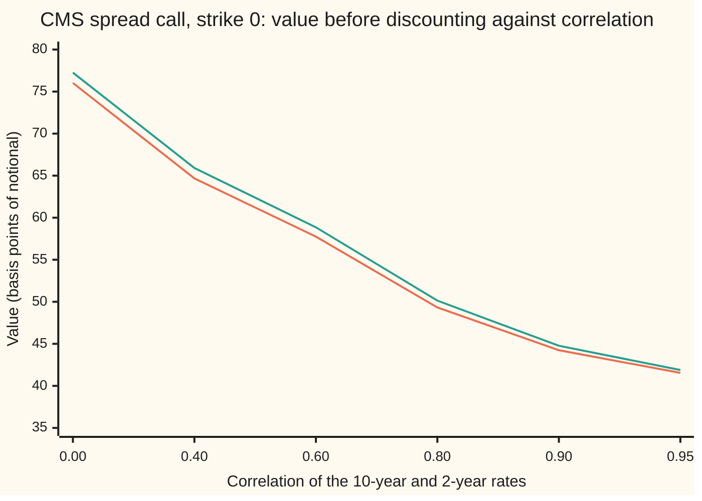

# CMS spread options: paying the slope of the curve, priced as a normal spread with a correlation the desk must choose

[Syllabus](../../../SYLLABUS.md) → [Financial mathematics](../README.md) → [Convexity and Exotics](../README.md#s32) → CMS spread options

---

## General Overview

A bank has sold investors a note whose coupon is the 10-year swap rate minus the 2-year swap rate, never below zero, on 10 million dollars. To pass that coupon on, it buys an option from a dealer. One year from today the option reads the two rates. A year after that it pays the 10-year rate minus the 2-year rate, if that gap is positive, times 10 million. If the gap is zero or negative it pays nothing.

The gap between a long and a short rate is the **slope** of the curve. A rate of fixed length read on a future date and paid as a coupon is a **CMS rate** (constant-maturity swap rate, from [Constant-maturity swaps](02-cms-and-the-convexity-adjustment.md)). So this contract is a **CMS spread call**: a call on the difference of two CMS rates, here with **strike** 0, the level the gap must beat.

The desk has three inputs. Each CMS rate's fair average, after the convexity adjustment of the CMS card: 4.20 percent for the 10-year rate and 3.80 percent for the 2-year. How far each rate wanders in a year, as a **normal volatility** (an absolute size, in basis points; a basis point is a hundredth of a percentage point): 90 bp and 100 bp. And how closely the two rates move together, their **correlation**: 0.8 on a scale from −1 to +1.

The gap is expected to be 40 bp. It wanders by only 60.83 bp, well below either rate's 90 or 100 bp, because the two rates mostly move together. The gap can go negative, so the desk prices it with Bachelier's normal model. The option is worth **49.33 bp** of notional before discounting, 45,610.54 dollars today.

Two of the three inputs come from the market. Swaptions quote each rate's volatility and its whole smile. Nothing liquid quotes the correlation. So the desk either chooses one, or reads it back from a price a broker shows. That reading depends on the model used to do it.

**A CMS spread option is a Bachelier option on the gap between two convexity-adjusted CMS rates; the gap's volatility comes from the two rates' volatilities and one correlation, and that correlation is the desk's choice, best read back from a quoted price with the same model that will use it.**

**What kind of fact this is:** a model. The spread's volatility formula is a theorem about normal variables, proved in Why it works. That the two rates are jointly normal, or joined by a Gaussian copula, is an assumption, not a law.

### The picture: the price falls as the correlation rises



Lower line, orange: Bachelier on the spread. Upper line, teal: a copula that keeps each rate's own volatility smile, defined in The formula. The correlations are not evenly spaced along the axis. Both lines fall steeply: two rates that move together leave the gap little room to move. At 0.8 the two models differ by 0.80 bp, so the same correlation does not mean the same price in both.

---

## The formula

Notation first, in words. Times are in years. $`T`$ is the time to the fixing, 1 year. $`R_{10}`$ and $`R_2`$ are the 10-year and 2-year CMS rates read at the fixing, unknown today. $`F_{10}`$ and $`F_2`$ are their **adjusted forwards**: the swap market's forward rates plus the CMS convexity adjustment, so that each is the fair average of its rate for a payment made on this contract's date. $`\sigma_{10}`$ and $`\sigma_2`$ are their normal volatilities, in rate units per square root of a year. $`\rho`$ is their correlation. $`K`$ is the strike. $`D`$ is today's price of one dollar paid on the payment date, two years out.

The spread's three building blocks:

```math
m = F_{10} - F_2 - K, \qquad s = \sqrt{\left(\sigma_{10}^2 + \sigma_2^2 - 2\rho\,\sigma_{10}\,\sigma_2\right) T}, \qquad d = \frac{m}{s}
```

In words: $`m`$ is the **head start**, how far the expected gap sits above the strike. $`s`$ is one standard deviation of the gap at the fixing. $`d`$ is the head start counted in those standard deviations.

The price, Bachelier's formula from [Bachelier](../05-Black-Scholes%20from%20the%20Ground%20Up/07-bachelier-model.md) applied to the gap:

```math
C = D\,\big[\,m\,N(d) + s\,\varphi(d)\,\big]
```

**Read it aloud:** the head start, weighted by the chance the gap ends above the strike, plus a payment for the gap's wander, all moved to today's money.

$`N(x)`$ is the bell curve's area to the left of $`x`$, a probability. $`\varphi(x)`$ is the bell curve's height at $`x`$.

**The copula price.** Each rate's own law at the fixing, its **margin**, comes from its swaption smile, not from one volatility. A **copula** joins two margins into one joint law ([Copulas](../../09-Probability%20and%20statistics/05-Transformations%20and%20Joint%20Laws/07-copulas-and-sklars-theorem.md)). The Gaussian copula does it by ranks: draw two bell-curve scores $`Z_1`$, $`Z_2`$ with correlation $`\rho`$, then turn each score into the rate with the same percentile rank in its own margin.

```math
C_{\text{cop}} = D\;\mathbb{E}\Big[\big(Q_{10}(N(Z_1)) - Q_2(N(Z_2)) - K\big)^+\Big]
```

In words: $`Q_{10}(u)`$ is the 10-year rate whose rank in its margin is $`u`$, its **quantile**. $`\mathbb{E}`$ is the average over all draws, and $`(x)^+`$ means $`x`$ if positive, else 0.

**The implied correlation.** A broker quotes a price $`C_q`$. Solve Bachelier for the spread's standard deviation $`s_q`$ that gives that price, then undo the variance formula:

```math
\rho_{\text{imp}} = \frac{\sigma_{10}^2 + \sigma_2^2 - s_q^2/T}{2\,\sigma_{10}\,\sigma_2}
```

| Symbol | Plain meaning | In our example | Push it up and the price… |
| --- | --- | --- | --- |
| $`R_{10}`$, $`R_2`$ | the 10-year and 2-year CMS rates read at the fixing | unknown today | rises with $`R_{10}`$, falls with $`R_2`$ |
| $`F_{10}`$, $`F_2`$ | adjusted forwards: each rate's fair average for this payment date | 4.20%, 3.80% | rises with $`F_{10}`$, falls with $`F_2`$ |
| $`\sigma_{10}`$, $`\sigma_2`$, $`a`$, $`b`$ | normal volatilities: each rate's wander in a year, in basis points; $`a = \sigma_{10}\sqrt{T}`$ and $`b = \sigma_2\sqrt{T}`$ are the wander up to the fixing | 90 bp, 100 bp; $`a`$, $`b`$ the same, since $`T = 1`$ | usually rises; with high correlation it can fall, because the two partly cancel |
| $`\rho`$ | correlation of the two rates' moves, from −1 to +1 | 0.8 | falls: −0.4755 bp per 0.01 |
| $`K`$ | the strike the gap must beat | 0 | falls |
| $`T`$ | years to the fixing | 1 | rises |
| $`m`$, $`s`$, $`d`$ | head start, the gap's standard deviation, and their ratio | 40.00 bp, 60.83 bp, 0.6576 | $`m`$ and $`s`$ both raise it |
| $`N(x)`$, $`\varphi(x)`$, $`X`$, $`Y_1`$, $`Y_2`$ | bell-curve area left of $`x`$; bell-curve height at $`x`$; one standard bell-curve draw; two independent ones, used in the proof | 0.7446, 0.3214 at $`d`$ | — |
| $`D`$ | today's price of a dollar paid in two years, at a flat 4% a year | 0.924556 | rises |
| $`C`$, $`C_{\text{cop}}`$, $`C_q`$ | Bachelier price, copula price, a quoted price | 49.33, 50.14 bp before discounting | — |
| $`Z_1`$, $`Z_2`$, $`X_1`$, $`X_2`$, $`Q_{10}`$, $`Q_2`$, $`u`$, $`k`$ | two bell-curve draws with correlation $`\rho`$ (the copula's scores; named $`X_1`$, $`X_2`$ in Step 2); the margins' quantiles; a percentile rank; the smile's width | $`k = 0.3`$ | a wider smile raises $`C_{\text{cop}}`$ |
| $`s_q`$, $`\rho_{\text{imp}}`$, $`\mathbb{E}`$, $`\mathrm{Var}`$ | the spread standard deviation that matches a quote; the correlation it implies; an average; a variance, the average squared distance from the average | 63.31 bp, 0.78288 for the copula quote | — |

### When it holds

- **Each rate is normal around its adjusted forward.** Real swaption smiles are not flat in normal volatility. Here a smile that lifts the wings to 99.43 bp, with the at-the-money volatility kept at 90 bp, moves the price from 49.33 to 50.14 bp.
- **The forwards carry their CMS adjustments.** The swap market's forwards are fair averages for payment in the swap's own annuity, not on this date. Skipping the adjustments (3.23 bp on the 10-year, 0.47 bp on the 2-year) prices the call at 47.30 bp.
- **One correlation describes how the two rates move together.** Real rates move together more in quiet markets than in sharp ones, so the right correlation can depend on the strike. One number for every strike is a model choice.
- **A quote lies inside the model's range.** With these volatilities Bachelier can only produce prices between 40.00 bp (correlation +1) and 97.47 bp (correlation −1). A quote outside that range has no implied correlation; it means the volatilities, the forwards, or the flat-smile model is wrong.
- **One fixing, paid on a fixed date.** A CMS spread note with many coupons is a strip of these options, one per fixing date, each with its own forwards and volatilities.

---

## Why it works

### Step 0: the gap is one level that can go negative

The contract pays a function of one number, the gap $`R_{10} - R_2`$. So it is an option on that gap. The gap is often small and can be below zero: inverted curves, with short rates above long rates, happened in the United States in 2006 and from 2022 to 2024. A model that multiplies a level by percentages cannot handle a level that crosses zero. Bachelier's model moves the level by absolute amounts, so zero is just another value. The work is to find the gap's average and its standard deviation.

### Step 1: each rate averages to its adjusted forward

The option pays on one date. Prices are averages of payoffs under the weights that belong to that date, discounted by $`D`$. Under those weights the CMS card shows that each CMS rate averages to its forward plus a convexity adjustment, the adjusted forward. The average of a difference is the difference of the averages. So the gap averages to $`F_{10} - F_2`$, here 40.00 bp. The adjustments matter because the 10-year rate's adjustment is about seven times the 2-year rate's: 3.23 bp against 0.47 bp, from the CMS card's quick formula with a normal variance $`\sigma^2 T`$.

### Step 2: the gap's spread comes from both volatilities and the correlation

Write each rate at the fixing as its forward plus its own wander: $`R_{10} = F_{10} + \sigma_{10}\sqrt{T}\,X_1`$ and $`R_2 = F_2 + \sigma_2\sqrt{T}\,X_2`$, where $`X_1`$ and $`X_2`$ are standard bell-curve draws with correlation $`\rho`$. The variance of a difference is the sum of the variances, minus twice the covariance:

```math
\mathrm{Var}(R_{10} - R_2) = \left(\sigma_{10}^2 + \sigma_2^2 - 2\rho\,\sigma_{10}\,\sigma_2\right) T
```

With the example: $`0.81 + 1 - 1.44 = 0.37`$ in units of (percent)², so $`s = \sqrt{0.37}\%`$ = 60.83 bp. Correlation is the only input that pulls the gap's spread below either rate's.

A difference of two jointly normal variables is itself normal. So the gap at the fixing is normal with average 40.00 bp and standard deviation 60.83 bp.

<details>
<summary>Detailed proof: the variance of a difference, and why the gap stays normal</summary>

Write $`a = \sigma_{10}\sqrt{T}`$ and $`b = \sigma_2\sqrt{T}`$. The gap minus its average is $`aX_1 - bX_2`$. Its variance is

$`\displaystyle \mathbb{E}\big[(aX_1 - bX_2)^2\big] = a^2\,\mathbb{E}[X_1^2] - 2ab\,\mathbb{E}[X_1X_2] + b^2\,\mathbb{E}[X_2^2] = a^2 - 2\rho\,ab + b^2,`$

because each draw has variance 1 and $`\mathbb{E}[X_1X_2] = \rho`$ is their correlation.

For normality, build the pair from two independent draws $`Y_1`$, $`Y_2`$: $`X_1 = Y_1`$ and $`X_2 = \rho Y_1 + \sqrt{1-\rho^2}\,Y_2`$. Then $`aX_1 - bX_2 = (a - b\rho)\,Y_1 - b\sqrt{1-\rho^2}\,Y_2`$, a weighted sum of independent normal draws. Such a sum is normal, with variance equal to the sum of the squared weights. That gives $`a^2 - 2\rho ab + b^2`$ again.

The variance is a straight line in $`\rho`$ with slope $`-2ab < 0`$. So the spread's standard deviation falls as the correlation rises, and so does the option price, since the price rises with $`s`$.

</details>

### Step 3: Bachelier prices a normal level

With the gap normal, the price is Bachelier's formula with head start $`m`$ and standard deviation $`s`$. The Bachelier card proves it: average the payoff $`(m + sX)^+`$ over a bell-curve draw $`X`$. The part where the gap ends above the strike gives $`m\,N(d)`$. The bell curve's symmetric wander gives $`s\,\varphi(d)`$. Here they are 29.78 and 19.55 bp, so $`C = 49.33`$ bp before discounting.

The price falls with correlation at the rate $`\partial C/\partial\rho = -D\,T\,\varphi(d)\,\sigma_{10}\sigma_2/s`$. Before discounting that is −0.4755 bp for every 0.01 of correlation. The code checks it against a finite difference.

### Step 4: the smile changes each margin, and a copula keeps it

Swaptions quote each rate at many strikes, not just one. The quoted volatility at each strike is the **smile**. A smile says the rate's real law has fatter tails than one bell curve.

Here each rate's margin is a 50/50 blend of two bell curves with the same centre: one with $`1 - k = 0.7`$ times the quoted volatility, one with $`1 + k = 1.3`$ times, where $`k`$ is the smile's width. For the 10-year rate that is 63 and 117 bp; for the 2-year, 70 and 130 bp. An at-the-money option's value is proportional to the volatility, so the blend's at-the-money value is the average of the two, exactly the quoted 90 bp. Away from the money the blend's fatter tails lift the implied volatility to 92.91 bp at 75 bp from the forward and 99.43 bp at 150 bp.

The Gaussian copula keeps those margins exactly and joins them by rank with correlation 0.8. With flat smiles it gives back the joint bell curve of Step 2, and the price 49.3324 bp. With the smiled margins it gives 50.137 bp. Same at-the-money volatilities, same correlation, 0.80 bp more: the fatter tails widen the gap's law.

### Step 5: read the correlation back from a price

The price falls strictly as the correlation rises (Step 2). So each price between the two bounds has exactly one correlation. Two ways to find it:

1. **Bisection on the correlation.** Start with the range from −1 to +1. Price at the midpoint. If the price is above the quote, the correlation is too low; keep the upper half. Repeat 100 times.
2. **Newton on the spread's standard deviation, then algebra.** Solve $`m\,N(m/s) + s\,\varphi(m/s) = C_q`$ for $`s`$, stepping by the price's slope in $`s`$, which is $`\varphi(d)`$. Then apply the $`\rho_{\text{imp}}`$ formula.

Fed the Bachelier price 49.33 bp, both return 0.800000. Fed the copula's 50.14 bp, both return 0.78288. A copula desk that marks correlation 0.8 and a Bachelier desk that marks 0.783 agree on the price. Their correlation numbers differ because each model puts part of the smile into its correlation.

---

## Worked numbers, by hand

| Step | Arithmetic | Value |
| --- | --- | --- |
| head start $`m`$ | $`4.20\% - 3.80\% - 0`$ | 40.00 bp |
| gap's variance, in (percent)² | $`0.9^2 + 1.0^2 - 2 \times 0.8 \times 0.9 \times 1.0 = 0.81 + 1 - 1.44`$ | 0.37 |
| gap's standard deviation $`s`$ | $`\sqrt{0.37}\%`$ | 60.83 bp |
| $`d = m/s`$ | $`40.00 / 60.83`$ | 0.6576 |
| $`N(d)`$, $`\varphi(d)`$ | bell-curve area and height at 0.6576 | 0.7446, 0.3214 |
| head-start term $`m\,N(d)`$ | $`40.00 \times 0.7446`$ | 29.78 bp |
| wander term $`s\,\varphi(d)`$ | $`60.83 \times 0.3214`$ | 19.55 bp |
| value before discounting | $`29.78 + 19.55`$ | **49.33 bp** |
| today, $`D = 1.04^{-2}`$ | $`49.33 \times 0.924556`$ | 45.61 bp |
| on 10 million dollars | $`10{,}000{,}000 \times 45.61`$ bp | **$45,610.54** |
| copula of the smiled margins | 2-D integral, from the code | 50.14 bp |
| correlation implied by 50.14 bp | bisection, or Newton then algebra | **0.78288** |

The bank pays about 45,610 dollars today to cover the coupon it owes when the curve stays upward-sloping. If a broker shows 50.14 bp, the Bachelier correlation behind that quote is 0.783, not 0.8.

### What breaks if you drop a piece

| Mistake | Comes out at | What went wrong |
| --- | --- | --- |
| Ignore the correlation, $`\rho = 0`$ | 76.03 bp (gap's standard deviation 134.54 bp) | Treats the two rates as independent; their common moves cancel in the gap |
| Subtract the two volatilities, 100 − 90 bp | 40.00 bp | That is correlation +1: it assumes the two rates never move apart |
| Use the swap forwards without the CMS adjustment | 47.30 bp | The 10-year rate's 3.23 bp adjustment is bigger than the 2-year's 0.47 bp, so the head start shrinks |
| Use Bachelier at 0.8 when the quote came from a copula at 0.8 | 49.33 bp against 50.14 bp | A correlation number belongs to the model that produced it |

---

## Code, from first principles, and it actually runs

The code prices the option five ways. Road 1 is Bachelier's formula on the gap, with the normal CDF written as a series. Road 2 integrates the payoff over the joint bell curve of the two rates by Simpson's rule in both scores. Road 3 is a Monte Carlo of 200,000 correlated pairs from a hand-written random-number generator. Road 4 is the Gaussian copula of the two smiled margins: each margin's quantiles found by bisection, then the same 2-D integral. Road 5 is a Monte Carlo of the copula. The implied correlation is solved two independent ways, bisection on $`\rho`$ and Newton on $`s`$. The asserts compare the 2-D integral with the formula, each simulation with its integral inside four standard errors, both solvers with the true 0.8 and with each other, the correlation sensitivity with a finite difference, both CMS adjustments with their exact slopes, the smile's at-the-money volatility with 90 bp, the copula's margin with the smile's at-the-money price, and the price's fall as $`\rho`$ rises. The copula integral meets the payoff's kink between grid points, so its figures are printed to at most three decimals. Both programs print identical outputs.

### Python

```python
# CMS spread option -- the check behind the card.  Standard library only.  Call on CMS10 - CMS2,
# strike 0, fixing in 1 year.  Roads: (1) Bachelier, (2) 2-D integral, (3) Monte Carlo; a Gaussian
# copula of two smiled margins (integral, Monte Carlo); implied rho by bisection and by Newton.
from math import exp, sqrt, pi, log, cos, sin

F1, F2, S1, S2, RHO, T, K = 0.0420, 0.0380, 0.0090, 0.0100, 0.8, 1.0, 0.0
MIX, D, NOTIONAL, bp, NZ, ZL = 0.3, 1.04 ** -2, 10_000_000, 1e4, 400, 8.0

def N(x):                                   # normal CDF from its Taylor series
    if abs(x) > 9: return 1.0 if x > 0 else 0.0
    term, total, k = x, x, 0
    while abs(term) > 1e-17 * max(1.0, abs(total)):
        k += 1
        term *= x * x / (2 * k + 1)
        total += term
    return 0.5 + exp(-x * x / 2) / sqrt(2 * pi) * total

def phi(z): return exp(-z * z / 2) / sqrt(2 * pi)
def bach(m, s): return m * N(m / s) + s * phi(m / s)   # call: head start m, spread s
def spread_sd(rho): return sqrt((S1 * S1 + S2 * S2 - 2 * rho * S1 * S2) * T)
def price(rho): return bach(F1 - F2 - K, spread_sd(rho))

def mix_cdf(x, f, s, k):                    # 50/50 blend of two bell curves, same centre
    a, b = s * (1 - k) * sqrt(T), s * (1 + k) * sqrt(T)
    return 0.5 * N((x - f) / a) + 0.5 * N((x - f) / b)
def mix_call(f, s, k, strike):
    return 0.5 * bach(f - strike, s * (1 - k) * sqrt(T)) + 0.5 * bach(f - strike, s * (1 + k) * sqrt(T))

def normal_vol(f, strike, target):          # Newton: Bachelier vol that matches a price
    s = 0.01
    for _ in range(50): s -= (bach(f - strike, s) - target) / phi((f - strike) / s)
    return s / sqrt(T)
Z = [-ZL + 2 * ZL * i / NZ for i in range(NZ + 1)]
W = [(1 if i in (0, NZ) else 4 if i % 2 else 2) * 2 * ZL / NZ / 3 for i in range(NZ + 1)]

def quantile_table(f, s, k):                # x with the same rank as the bell-curve score z
    half = []
    for z in Z[: NZ // 2 + 1]:
        u, lo, hi = N(z), f - 30 * s, f
        for _ in range(80):
            mid = (lo + hi) / 2
            lo, hi = (mid, hi) if mix_cdf(mid, f, s, k) < u else (lo, mid)
        half.append((lo + hi) / 2)
    return half + [2 * f - x for x in reversed(half[:-1])]   # symmetric margin

def copula_price(rho, q1, q2):              # Gaussian copula, Simpson in both scores
    c, tot = 1 / (2 * pi * sqrt(1 - rho * rho)), 0.0
    for i, z1 in enumerate(Z):
        for j, z2 in enumerate(Z):
            pay = q1[i] - q2[j] - K
            if pay > 0:
                tot += W[i] * W[j] * pay * c * exp(-(z1 * z1 - 2 * rho * z1 * z2 + z2 * z2) / (2 * (1 - rho * rho)))
    return tot
def interp(q, z):
    t = (min(max(z, -ZL), ZL - 1e-12) + ZL) / (2 * ZL) * NZ
    i = int(t)
    return q[i] + (t - i) * (q[i + 1] - q[i])

def monte_carlo(q1, q2, paths=200_000, seed=20261123):
    x, M = seed, (1 << 64) - 1
    def unif():
        nonlocal x
        x ^= (x << 13) & M; x ^= x >> 7; x ^= (x << 17) & M
        return ((x >> 11) + 0.5) / 2.0 ** 53
    sn = sn2 = sc = sc2 = 0.0
    for _ in range(paths):
        r, a = sqrt(-2 * log(unif())), 2 * pi * unif()
        z1 = r * cos(a); z2 = RHO * z1 + sqrt(1 - RHO * RHO) * r * sin(a)
        pn = max(F1 + S1 * sqrt(T) * z1 - F2 - S2 * sqrt(T) * z2 - K, 0.0)
        pc = max(interp(q1, z1) - interp(q2, z2) - K, 0.0)
        sn += pn; sn2 += pn * pn; sc += pc; sc2 += pc * pc
    mn, mc = sn / paths, sc / paths
    return mn, sqrt((sn2 / paths - mn * mn) / paths), mc, sqrt((sc2 / paths - mc * mc) / paths)

def implied_by_bisection(quote):
    lo, hi = -1.0, 1.0
    for _ in range(100):
        mid = (lo + hi) / 2
        lo, hi = (mid, hi) if price(mid) > quote else (lo, mid)
    return (lo + hi) / 2
def implied_by_newton(quote):
    s = normal_vol(F1 - F2, K, quote) * sqrt(T)
    return (S1 * S1 + S2 * S2 - s * s / T) / (2 * S1 * S2)
def cms_adjustment(f, s, n):                # quick formula, normal variance s^2 T, paid 1y later
    def w(r): return (1 + r) ** -1 / sum((1 + r) ** -i for i in range(1, n + 1))
    return s * s * T * (w(f + 1e-6) - w(f - 1e-6)) / 2e-6 / w(f)

m, sd, p1 = F1 - F2 - K, spread_sd(RHO), price(RHO)
flat1, flat2 = quantile_table(F1, S1, 0.0), quantile_table(F2, S2, 0.0)
p2 = copula_price(RHO, flat1, flat2)
q1, q2 = quantile_table(F1, S1, MIX), quantile_table(F2, S2, MIX)
pc = copula_price(RHO, q1, q2)
mn, sen, mc, sec = monte_carlo(q1, q2)
rho_b, rho_n = implied_by_bisection(p1), implied_by_newton(p1)
cop_b, cop_n = implied_by_bisection(pc), implied_by_newton(pc)
vega = -T * phi(m / sd) * S1 * S2 / sd
a10, a2 = cms_adjustment(F1, S1, 10), cms_adjustment(F2, S2, 2)
print(f"spread forward, bp                     {m * bp:.2f}")
print(f"spread sd sqrt(81 + 100 - 144) bp      {sd * bp:.2f}")
print(f"d = head start / sd; N(d); phi(d)      {m / sd:.4f}  {N(m / sd):.4f}  {phi(m / sd):.4f}")
print(f"terms: m N(d) + s phi(d), bp           {m * N(m / sd) * bp:.2f}  {sd * phi(m / sd) * bp:.2f}")
print(f"1 Bachelier on the spread, bp          {p1 * bp:.4f}")
print(f"2 joint bell curve, 2-D integral, bp   {p2 * bp:.4f}")
print(f"3 Monte Carlo 200k, bp                 {mn * bp:.4f}  (se {sen * bp:.4f})")
print(f"discount D(2); today's value, bp       {D:.6f}  {p1 * D * bp:.2f}")
print(f"on $10m notional, dollars today        {p1 * D * NOTIONAL:.2f}")
print(f"correlation sensitivity, bp per 0.01   {vega * bp / 100:.4f}  {(price(RHO + 1e-4) - price(RHO - 1e-4)) / 2e-4 * bp / 100:.4f}")
vols = [normal_vol(F1, F1 + dk / bp, mix_call(F1, S1, MIX, F1 + dk / bp)) * bp for dk in (-150, -75, 0, 75, 150)]
print("10y smile, vol bp at F-150 -75 0 +75 +150  " + "  ".join(f"{v:.2f}" for v in vols))
print(f"blend sds for 10y, 2y, bp              {S1 * 0.7 * bp:.0f} {S1 * 1.3 * bp:.0f}  {S2 * 0.7 * bp:.0f} {S2 * 1.3 * bp:.0f}")
print(f"4 copula of smiled margins, bp         {pc * bp:.3f}")
print(f"5 copula Monte Carlo 200k, bp          {mc * bp:.4f}  (se {sec * bp:.4f})")
print(f"copula minus Bachelier, bp             {(pc - p1) * bp:.2f}")
print(f"implied rho from 49.33-model quote     {rho_b:.6f}  {rho_n:.6f}")
print(f"implied rho from the copula quote      {cop_b:.5f}  {cop_n:.5f}")
print(f"spread sd at that rho, bp              {spread_sd(cop_b) * bp:.2f}")
print(f"price bounds rho = +1, -1, bp          {price(1.0) * bp:.2f}  {price(-1.0) * bp:.2f}")
print("price against correlation, bp (Bachelier, copula):")
for r in (0.0, 0.4, 0.6, 0.8, 0.9, 0.95):
    print(f"  rho = {r:.2f}                            {price(r) * bp:.2f}  {copula_price(r, q1, q2) * bp:.2f}")
print(f"CMS adjustments 10y, 2y, bp            {a10 * bp:.2f}  {a2 * bp:.2f}")
print(f"wrong: rho = 0, sd; price, bp          {spread_sd(0) * bp:.2f}  {price(0) * bp:.2f}")
print(f"wrong: vols subtracted (rho = 1), bp   {price(1.0) * bp:.2f}")
print(f"wrong: unadjusted forwards, bp         {bach(m - a10 + a2, sd) * bp:.2f}")
print(f"try: strike 40 bp, bp                  {bach(0.0, sd) * bp:.2f}")
print(f"try: strike 40 bp, copula, bp          {copula_price(RHO, q1, [x + 0.0040 for x in q2]) * bp:.2f}")

assert abs(p2 - p1) < 1e-7                  # 2-D integral against the closed form
assert abs(mn - p1) < 4 * sen               # simulation against the closed form
assert abs(mc - pc) < 4 * sec               # copula simulation against copula integral
assert abs(rho_b - RHO) < 1e-9             # round trip by bisection
assert abs(rho_n - RHO) < 1e-9             # round trip by Newton on the spread sd
assert abs(cop_b - cop_n) < 1e-9            # two solvers agree on the copula quote
assert abs(vols[2] - S1 * bp) < 1e-9       # the smile keeps the quoted ATM vol
assert abs(sum(W[i] * phi(Z[i]) * max(q1[i] - F1, 0) for i in range(NZ + 1)) - mix_call(F1, S1, MIX, F1)) < 1e-8
assert abs(vega - (price(RHO + 1e-4) - price(RHO - 1e-4)) / 2e-4) < 1e-8
for f, s, n, a in ((F1, S1, 10, a10), (F2, S2, 2, a2)):   # both CMS adjustments against the exact slope of log w
    assert abs(a - s * s * T * (sum(i * (1 + f) ** -(i + 1) for i in range(1, n + 1)) / sum((1 + f) ** -i for i in range(1, n + 1)) - 1 / (1 + f))) < 1e-9
assert all(price(r) > price(r + 0.1) for r in (-0.9, 0.0, 0.5, 0.8))   # falls as rho rises
print("ALL CHECKS PASS")
```

**Ran 2026-11-23 on macOS, Python 3.14.10, standard library only. All checks passed. Output, pasted from the run:**

```
spread forward, bp                     40.00
spread sd sqrt(81 + 100 - 144) bp      60.83
d = head start / sd; N(d); phi(d)      0.6576  0.7446  0.3214
terms: m N(d) + s phi(d), bp           29.78  19.55
1 Bachelier on the spread, bp          49.3324
2 joint bell curve, 2-D integral, bp   49.3324
3 Monte Carlo 200k, bp                 49.5442  (se 0.1075)
discount D(2); today's value, bp       0.924556  45.61
on $10m notional, dollars today        45610.54
correlation sensitivity, bp per 0.01   -0.4755  -0.4755
10y smile, vol bp at F-150 -75 0 +75 +150  99.43  92.91  90.00  92.91  99.43
blend sds for 10y, 2y, bp              63 117  70 130
4 copula of smiled margins, bp         50.137
5 copula Monte Carlo 200k, bp          50.3628  (se 0.1115)
copula minus Bachelier, bp             0.80
implied rho from 49.33-model quote     0.800000  0.800000
implied rho from the copula quote      0.78288  0.78288
spread sd at that rho, bp              63.31
price bounds rho = +1, -1, bp          40.00  97.47
price against correlation, bp (Bachelier, copula):
  rho = 0.00                            76.03  77.26
  rho = 0.40                            64.67  65.91
  rho = 0.60                            57.75  58.86
  rho = 0.80                            49.33  50.14
  rho = 0.90                            44.24  44.77
  rho = 0.95                            41.55  41.89
CMS adjustments 10y, 2y, bp            3.23  0.47
wrong: rho = 0, sd; price, bp          134.54  76.03
wrong: vols subtracted (rho = 1), bp   40.00
wrong: unadjusted forwards, bp         47.30
try: strike 40 bp, bp                  24.27
try: strike 40 bp, copula, bp          25.12
ALL CHECKS PASS
```

### Rust

```rust
// CMS spread option -- the check behind the card.  Rust std only.  Call on CMS10 - CMS2,
// strike 0, fixing in 1 year.  Roads: (1) Bachelier, (2) 2-D integral, (3) Monte Carlo; a Gaussian
// copula of two smiled margins (integral, Monte Carlo); implied rho by bisection and by Newton.
use std::f64::consts::PI;

const F1: f64 = 0.0420; const F2: f64 = 0.0380; // CMS forwards, convexity-adjusted
const S1: f64 = 0.0090; const S2: f64 = 0.0100; // normal vols
const RHO: f64 = 0.8; const T: f64 = 1.0; const K: f64 = 0.0;
const MIX: f64 = 0.3; const NOTIONAL: f64 = 10_000_000.0; const BP: f64 = 1e4;
const NZ: usize = 400; const ZL: f64 = 8.0;

fn n_cdf(x: f64) -> f64 { // normal CDF from its Taylor series
    if x.abs() > 9.0 { return if x > 0.0 { 1.0 } else { 0.0 }; }
    let (mut term, mut total, mut k) = (x, x, 0.0);
    while term.abs() > 1e-17 * total.abs().max(1.0) {
        k += 1.0;
        term *= x * x / (2.0 * k + 1.0);
        total += term;
    }
    0.5 + (-x * x / 2.0).exp() / (2.0 * PI).sqrt() * total
}
fn phi(z: f64) -> f64 { (-z * z / 2.0).exp() / (2.0 * PI).sqrt() }
fn bach(m: f64, s: f64) -> f64 { m * n_cdf(m / s) + s * phi(m / s) } // call: head start m, spread s
fn spread_sd(rho: f64) -> f64 { ((S1 * S1 + S2 * S2 - 2.0 * rho * S1 * S2) * T).sqrt() }
fn price(rho: f64) -> f64 { bach(F1 - F2 - K, spread_sd(rho)) }
fn mix_cdf(x: f64, f: f64, s: f64, k: f64) -> f64 { // 50/50 blend of two bell curves, same centre
    let (a, b) = (s * (1.0 - k) * T.sqrt(), s * (1.0 + k) * T.sqrt());
    0.5 * n_cdf((x - f) / a) + 0.5 * n_cdf((x - f) / b)
}
fn mix_call(f: f64, s: f64, k: f64, strike: f64) -> f64 {
    0.5 * bach(f - strike, s * (1.0 - k) * T.sqrt()) + 0.5 * bach(f - strike, s * (1.0 + k) * T.sqrt())
}
fn normal_vol(f: f64, strike: f64, target: f64) -> f64 { // Newton: Bachelier vol matching a price
    let mut s = 0.01;
    for _ in 0..50 { s -= (bach(f - strike, s) - target) / phi((f - strike) / s); }
    s / T.sqrt()
}
fn grid() -> (Vec<f64>, Vec<f64>) {
    let z = (0..=NZ).map(|i| -ZL + 2.0 * ZL * i as f64 / NZ as f64).collect();
    let w = (0..=NZ).map(|i| (if i == 0 || i == NZ { 1.0 } else if i % 2 == 1 { 4.0 } else { 2.0 }) * 2.0 * ZL / NZ as f64 / 3.0).collect();
    (z, w)
}
fn quantile_table(z: &[f64], f: f64, s: f64, k: f64) -> Vec<f64> { // same rank as the score z
    let mut half = Vec::new();
    for &zz in &z[..=NZ / 2] {
        let (u, mut lo, mut hi) = (n_cdf(zz), f - 30.0 * s, f);
        for _ in 0..80 {
            let mid = (lo + hi) / 2.0;
            if mix_cdf(mid, f, s, k) < u { lo = mid; } else { hi = mid; }
        }
        half.push((lo + hi) / 2.0);
    }
    let mut q = half.clone();
    for x in half[..half.len() - 1].iter().rev() { q.push(2.0 * f - x); } // symmetric margin
    q
}
fn copula_price(rho: f64, q1: &[f64], q2: &[f64], z: &[f64], w: &[f64]) -> f64 {
    let (c, mut tot) = (1.0 / (2.0 * PI * (1.0 - rho * rho).sqrt()), 0.0);
    for i in 0..=NZ {
        for j in 0..=NZ {
            let pay = q1[i] - q2[j] - K;
            if pay > 0.0 {
                tot += w[i] * w[j] * pay * c * (-(z[i] * z[i] - 2.0 * rho * z[i] * z[j] + z[j] * z[j]) / (2.0 * (1.0 - rho * rho))).exp();
            }
        }
    }
    tot
}
fn interp(q: &[f64], z: f64) -> f64 {
    let t = (z.max(-ZL).min(ZL - 1e-12) + ZL) / (2.0 * ZL) * NZ as f64;
    let i = t as usize;
    q[i] + (t - i as f64) * (q[i + 1] - q[i])
}
fn monte_carlo(q1: &[f64], q2: &[f64], paths: usize, seed: u64) -> (f64, f64, f64, f64) {
    let mut x = seed;
    let mut unif = || { x ^= x << 13; x ^= x >> 7; x ^= x << 17; ((x >> 11) as f64 + 0.5) / 2f64.powi(53) };
    let (mut sn, mut sn2, mut sc, mut sc2) = (0.0, 0.0, 0.0, 0.0);
    for _ in 0..paths {
        let r = (-2.0 * unif().ln()).sqrt();
        let a = 2.0 * PI * unif();
        let z1 = r * a.cos();
        let z2 = RHO * z1 + (1.0 - RHO * RHO).sqrt() * r * a.sin();
        let pn = (F1 + S1 * T.sqrt() * z1 - F2 - S2 * T.sqrt() * z2 - K).max(0.0);
        let pc = (interp(q1, z1) - interp(q2, z2) - K).max(0.0);
        sn += pn; sn2 += pn * pn; sc += pc; sc2 += pc * pc;
    }
    let p = paths as f64;
    let (mn, mc) = (sn / p, sc / p);
    (mn, ((sn2 / p - mn * mn) / p).sqrt(), mc, ((sc2 / p - mc * mc) / p).sqrt())
}
fn implied_by_bisection(quote: f64) -> f64 {
    let (mut lo, mut hi) = (-1.0, 1.0);
    for _ in 0..100 {
        let mid = (lo + hi) / 2.0;
        if price(mid) > quote { lo = mid; } else { hi = mid; }
    }
    (lo + hi) / 2.0
}
fn implied_by_newton(quote: f64) -> f64 {
    let s = normal_vol(F1 - F2, K, quote) * T.sqrt();
    (S1 * S1 + S2 * S2 - s * s / T) / (2.0 * S1 * S2)
}
fn cms_adjustment(f: f64, s: f64, n: i32) -> f64 { // quick formula, normal variance, paid 1y later
    let w = |r: f64| (1.0 + r).powi(-1) / (1..=n).map(|i| (1.0 + r).powi(-i)).sum::<f64>();
    s * s * T * (w(f + 1e-6) - w(f - 1e-6)) / 2e-6 / w(f)
}

fn main() {
    let d = 1.04f64.powi(-2);
    let (z, w) = grid();
    let (m, sd, p1) = (F1 - F2 - K, spread_sd(RHO), price(RHO));
    let (flat1, flat2) = (quantile_table(&z, F1, S1, 0.0), quantile_table(&z, F2, S2, 0.0));
    let p2 = copula_price(RHO, &flat1, &flat2, &z, &w);
    let (q1, q2) = (quantile_table(&z, F1, S1, MIX), quantile_table(&z, F2, S2, MIX));
    let pc = copula_price(RHO, &q1, &q2, &z, &w);
    let (mn, sen, mc, sec) = monte_carlo(&q1, &q2, 200_000, 20261123);
    let (rho_b, rho_n) = (implied_by_bisection(p1), implied_by_newton(p1));
    let (cop_b, cop_n) = (implied_by_bisection(pc), implied_by_newton(pc));
    let vega = -T * phi(m / sd) * S1 * S2 / sd;
    let fd = (price(RHO + 1e-4) - price(RHO - 1e-4)) / 2e-4;
    let (a10, a2) = (cms_adjustment(F1, S1, 10), cms_adjustment(F2, S2, 2));
    println!("spread forward, bp                     {:.2}", m * BP);
    println!("spread sd sqrt(81 + 100 - 144) bp      {:.2}", sd * BP);
    println!("d = head start / sd; N(d); phi(d)      {:.4}  {:.4}  {:.4}", m / sd, n_cdf(m / sd), phi(m / sd));
    println!("terms: m N(d) + s phi(d), bp           {:.2}  {:.2}", m * n_cdf(m / sd) * BP, sd * phi(m / sd) * BP);
    println!("1 Bachelier on the spread, bp          {:.4}", p1 * BP);
    println!("2 joint bell curve, 2-D integral, bp   {:.4}", p2 * BP);
    println!("3 Monte Carlo 200k, bp                 {:.4}  (se {:.4})", mn * BP, sen * BP);
    println!("discount D(2); today's value, bp       {:.6}  {:.2}", d, p1 * d * BP);
    println!("on $10m notional, dollars today        {:.2}", p1 * d * NOTIONAL);
    println!("correlation sensitivity, bp per 0.01   {:.4}  {:.4}", vega * BP / 100.0, fd * BP / 100.0);
    let vols: Vec<f64> = [-150.0, -75.0, 0.0, 75.0, 150.0].iter()
        .map(|dk| normal_vol(F1, F1 + dk / BP, mix_call(F1, S1, MIX, F1 + dk / BP)) * BP).collect();
    let vs: Vec<String> = vols.iter().map(|v| format!("{:.2}", v)).collect();
    println!("10y smile, vol bp at F-150 -75 0 +75 +150  {}", vs.join("  "));
    println!("blend sds for 10y, 2y, bp              {:.0} {:.0}  {:.0} {:.0}", S1 * 0.7 * BP, S1 * 1.3 * BP, S2 * 0.7 * BP, S2 * 1.3 * BP);
    println!("4 copula of smiled margins, bp         {:.3}", pc * BP);
    println!("5 copula Monte Carlo 200k, bp          {:.4}  (se {:.4})", mc * BP, sec * BP);
    println!("copula minus Bachelier, bp             {:.2}", (pc - p1) * BP);
    println!("implied rho from 49.33-model quote     {:.6}  {:.6}", rho_b, rho_n);
    println!("implied rho from the copula quote      {:.5}  {:.5}", cop_b, cop_n);
    println!("spread sd at that rho, bp              {:.2}", spread_sd(cop_b) * BP);
    println!("price bounds rho = +1, -1, bp          {:.2}  {:.2}", price(1.0) * BP, price(-1.0) * BP);
    println!("price against correlation, bp (Bachelier, copula):");
    for r in [0.0, 0.4, 0.6, 0.8, 0.9, 0.95] {
        println!("  rho = {:.2}                            {:.2}  {:.2}", r, price(r) * BP, copula_price(r, &q1, &q2, &z, &w) * BP);
    }
    println!("CMS adjustments 10y, 2y, bp            {:.2}  {:.2}", a10 * BP, a2 * BP);
    println!("wrong: rho = 0, sd; price, bp          {:.2}  {:.2}", spread_sd(0.0) * BP, price(0.0) * BP);
    println!("wrong: vols subtracted (rho = 1), bp   {:.2}", price(1.0) * BP);
    println!("wrong: unadjusted forwards, bp         {:.2}", bach(m - a10 + a2, sd) * BP);
    println!("try: strike 40 bp, bp                  {:.2}", bach(0.0, sd) * BP);
    let q2s: Vec<f64> = q2.iter().map(|x| x + 0.0040).collect();
    println!("try: strike 40 bp, copula, bp          {:.2}", copula_price(RHO, &q1, &q2s, &z, &w) * BP);

    assert!((p2 - p1).abs() < 1e-7); // 2-D integral against the closed form
    assert!((mn - p1).abs() < 4.0 * sen); // simulation against the closed form
    assert!((mc - pc).abs() < 4.0 * sec); // copula simulation against copula integral
    assert!((rho_b - RHO).abs() < 1e-9); // round trip by bisection
    assert!((rho_n - RHO).abs() < 1e-9); // round trip by Newton on the spread sd
    assert!((cop_b - cop_n).abs() < 1e-9); // two solvers agree on the copula quote
    assert!((vols[2] - S1 * BP).abs() < 1e-9); // the smile keeps the quoted ATM vol
    let atm: f64 = (0..=NZ).map(|i| w[i] * phi(z[i]) * (q1[i] - F1).max(0.0)).sum();
    assert!((atm - mix_call(F1, S1, MIX, F1)).abs() < 1e-8); // copula margin reprices the smile
    assert!((vega - fd).abs() < 1e-8);
    let ann = |f: f64, n: i32, e: i32| (1..=n).map(|i| (i as f64).powi(e) * (1.0 + f).powi(-i - e)).sum::<f64>(); // exact slope of log w
    for (f, s, n, a) in [(F1, S1, 10, a10), (F2, S2, 2, a2)] { assert!((a - s * s * T * (ann(f, n, 1) / ann(f, n, 0) - 1.0 / (1.0 + f))).abs() < 1e-9); }
    assert!([-0.9, 0.0, 0.5, 0.8].iter().all(|&r| price(r) > price(r + 0.1))); // falls as rho rises
    println!("ALL CHECKS PASS");
}
```

**Ran 2026-11-23 on macOS, rustc 1.98.1, no crates. All checks passed. Output, pasted from the run:**

```
spread forward, bp                     40.00
spread sd sqrt(81 + 100 - 144) bp      60.83
d = head start / sd; N(d); phi(d)      0.6576  0.7446  0.3214
terms: m N(d) + s phi(d), bp           29.78  19.55
1 Bachelier on the spread, bp          49.3324
2 joint bell curve, 2-D integral, bp   49.3324
3 Monte Carlo 200k, bp                 49.5442  (se 0.1075)
discount D(2); today's value, bp       0.924556  45.61
on $10m notional, dollars today        45610.54
correlation sensitivity, bp per 0.01   -0.4755  -0.4755
10y smile, vol bp at F-150 -75 0 +75 +150  99.43  92.91  90.00  92.91  99.43
blend sds for 10y, 2y, bp              63 117  70 130
4 copula of smiled margins, bp         50.137
5 copula Monte Carlo 200k, bp          50.3628  (se 0.1115)
copula minus Bachelier, bp             0.80
implied rho from 49.33-model quote     0.800000  0.800000
implied rho from the copula quote      0.78288  0.78288
spread sd at that rho, bp              63.31
price bounds rho = +1, -1, bp          40.00  97.47
price against correlation, bp (Bachelier, copula):
  rho = 0.00                            76.03  77.26
  rho = 0.40                            64.67  65.91
  rho = 0.60                            57.75  58.86
  rho = 0.80                            49.33  50.14
  rho = 0.90                            44.24  44.77
  rho = 0.95                            41.55  41.89
CMS adjustments 10y, 2y, bp            3.23  0.47
wrong: rho = 0, sd; price, bp          134.54  76.03
wrong: vols subtracted (rho = 1), bp   40.00
wrong: unadjusted forwards, bp         47.30
try: strike 40 bp, bp                  24.27
try: strike 40 bp, copula, bp          25.12
ALL CHECKS PASS
```

### Lean

Lean proves Steps 2, 3 and 5 exactly, for every input that meets each step's conditions.

- Suppose $`X_1`$ and $`X_2`$ are jointly normal standard bell-curve draws with correlation $`\rho`$, and $`T \ge 0`$. Then the gap $`R_{10} - R_2`$ is normal, with average $`F_{10} - F_2`$ and the variance of Step 2.
- Suppose the same draws, and a gap variance above zero. Then the call is worth $`D\,[m\,N(d) + s\,\varphi(d)]`$ for every strike and discount factor.
- Suppose $`\sigma_{10}`$, $`\sigma_2`$ and $`T`$ are not zero. Then $`s_q^2`$ equals the Step 2 variance exactly when $`\rho`$ equals $`\rho_{\text{imp}}`$. So each quoted spread variance gives back one correlation.
- The hand arithmetic checks exactly: the 40 bp head start, the variance 0.37 in (percent)², and the correlation 0.8 read back from it.

The copula, the simulations, both solvers, the price's fall with $`\rho`$ and every basis-point figure are left to the Python and Rust checks.

```lean
-- CMS spread options: when the two rates' standard scores are jointly normal with correlation ρ, the gap R₁₀ − R₂ is normal with average F₁₀ − F₂ and variance (σ₁₀² + σ₂² − 2ρσ₁₀σ₂)T, the call on it has Bachelier's price, and a quoted spread variance gives back exactly one correlation.
import Mathlib.Probability.Distributions.Gaussian.HasGaussianLaw.Basic
import Mathlib.Probability.Moments.Covariance
import Mathlib.Probability.CDF
import Mathlib.Analysis.SpecialFunctions.Gaussian.GaussianIntegral

open MeasureTheory ProbabilityTheory Real

section CmsBachelierHelpers
open Filter Topology Set

theorem cms_bach_pdf_eq (z : ℝ) :
    gaussianPDFReal 0 1 z = (Real.sqrt (2 * Real.pi))⁻¹ * Real.exp (-(1/2) * z ^ 2) := by
  simp only [gaussianPDFReal, NNReal.coe_one, mul_one, sub_zero]
  congr 2
  ring

theorem cms_bach_pdf_neg (z : ℝ) : gaussianPDFReal 0 1 (-z) = gaussianPDFReal 0 1 z := by
  rw [cms_bach_pdf_eq, cms_bach_pdf_eq, neg_sq]

theorem cms_bach_cdf_neg (d : ℝ) :
    cdf (gaussianReal 0 1) (-d) = 1 - cdf (gaussianReal 0 1) d := by
  have hmap : (gaussianReal 0 1).map (fun x : ℝ ↦ -x) = gaussianReal 0 1 := by
    rw [gaussianReal_map_neg, neg_zero]
  rw [cdf_eq_real, cdf_eq_real]
  have h1 : (gaussianReal 0 1).real (Iic (-d)) = (gaussianReal 0 1).real (Ici d) := by
    conv_lhs => rw [← hmap]
    rw [map_measureReal_apply (by fun_prop) measurableSet_Iic]
    congr 1
    ext x; simp
  rw [h1]
  have h2 : (gaussianReal 0 1).real (Ici d) = (gaussianReal 0 1).real (Ioi d) := by
    have := nullSingletonClass_gaussianReal (μ := 0) (v := 1) one_ne_zero
    rw [measureReal_def, measureReal_def,
      measure_congr (Ioi_ae_eq_Ici (μ := gaussianReal 0 1) (a := d))]
  rw [h2, ← compl_Iic, measureReal_compl measurableSet_Iic, probReal_univ]

theorem cms_bach_integrableOn_mul_pdf (a : ℝ) :
    IntegrableOn (fun z ↦ z * gaussianPDFReal 0 1 z) (Ioi a) := by
  have h := (integrable_mul_exp_neg_mul_sq (b := 1/2) (by norm_num)).const_mul
    (Real.sqrt (2 * Real.pi))⁻¹
  refine (h.congr (ae_of_all _ fun z ↦ ?_)).integrableOn
  simp only [cms_bach_pdf_eq]
  ring

theorem cms_bach_integral_Ioi_pdf (a : ℝ) :
    ∫ z in Ioi a, gaussianPDFReal 0 1 z = cdf (gaussianReal 0 1) (-a) := by
  have h := gaussianReal_apply_eq_integral 0 (v := 1) one_ne_zero (Ioi a)
  have hnn : 0 ≤ ∫ z in Ioi a, gaussianPDFReal 0 1 z :=
    setIntegral_nonneg measurableSet_Ioi fun z _ ↦ gaussianPDFReal_nonneg _ _ _
  have h2 : (gaussianReal 0 1).real (Ioi a) = ∫ z in Ioi a, gaussianPDFReal 0 1 z := by
    rw [measureReal_def, h, ENNReal.toReal_ofReal hnn]
  rw [← h2, ← compl_Iic, measureReal_compl measurableSet_Iic, probReal_univ, ← cdf_eq_real,
    cms_bach_cdf_neg]

theorem cms_bach_integral_Ioi_mul_pdf (a : ℝ) :
    ∫ z in Ioi a, z * gaussianPDFReal 0 1 z = gaussianPDFReal 0 1 a := by
  have hf : (fun z ↦ -gaussianPDFReal 0 1 z) =
      fun z ↦ -((Real.sqrt (2 * Real.pi))⁻¹ * Real.exp (-(1/2) * z ^ 2)) := by
    funext z; rw [cms_bach_pdf_eq]
  have key := integral_Ioi_of_hasDerivAt_of_tendsto (a := a) (m := 0)
    (f := fun z ↦ -gaussianPDFReal 0 1 z) (f' := fun z ↦ z * gaussianPDFReal 0 1 z)
    ?_ ?_ (cms_bach_integrableOn_mul_pdf a) ?_
  · rw [key]; ring
  · rw [hf]; exact (by fun_prop : Continuous _).continuousWithinAt
  · intro z _
    rw [hf, cms_bach_pdf_eq]
    have h1 := (((hasDerivAt_pow 2 z).const_mul (-(1/2 : ℝ))).exp).const_mul
      (Real.sqrt (2 * Real.pi))⁻¹
    convert h1.neg using 1
    push_cast
    ring
  · rw [hf]
    have h0 : Tendsto (fun z : ℝ ↦ -(1/2) * z ^ 2) atTop atBot := by
      apply Tendsto.const_mul_atTop_of_neg (by norm_num)
      exact tendsto_pow_atTop two_ne_zero
    have h1 := (Real.tendsto_exp_atBot.comp h0).const_mul (Real.sqrt (2 * Real.pi))⁻¹
    have h2 := h1.neg
    simpa using h2

theorem cms_bach_call_core (m s : ℝ) (hs : 0 < s) :
    ∫ z, max (m + s * z) 0 ∂(gaussianReal 0 1) =
      m * cdf (gaussianReal 0 1) (m / s) + s * gaussianPDFReal 0 1 (m / s) := by
  rw [integral_gaussianReal_eq_integral_smul one_ne_zero]
  have hind : (fun z ↦ gaussianPDFReal 0 1 z • max (m + s * z) 0) =
      (Ioi (-(m / s))).indicator
        (fun z ↦ m * gaussianPDFReal 0 1 z + s * (z * gaussianPDFReal 0 1 z)) := by
    funext z
    have hms : m + s * z = s * (m / s + z) := by field_simp
    simp only [smul_eq_mul, indicator, mem_Ioi]
    split_ifs with h
    · rw [max_eq_left]
      · ring
      · rw [hms]; exact mul_nonneg hs.le (by linarith)
    · rw [max_eq_right, mul_zero]
      rw [hms]; exact mul_nonpos_of_nonneg_of_nonpos hs.le (by linarith)
  rw [hind, integral_indicator measurableSet_Ioi, integral_add, integral_const_mul,
    integral_const_mul, cms_bach_integral_Ioi_pdf, cms_bach_integral_Ioi_mul_pdf, neg_neg, cms_bach_pdf_neg]
  · exact ((integrable_gaussianPDFReal 0 1).integrableOn).const_mul m
  · exact (cms_bach_integrableOn_mul_pdf _).const_mul s

#print axioms cms_bach_pdf_eq
#print axioms cms_bach_pdf_neg
#print axioms cms_bach_cdf_neg
#print axioms cms_bach_integrableOn_mul_pdf
#print axioms cms_bach_integral_Ioi_pdf
#print axioms cms_bach_integral_Ioi_mul_pdf
#print axioms cms_bach_call_core

end CmsBachelierHelpers

/-- The gap is normal (Step 2 of the card). Write the two CMS rates at the fixing as
`R₁₀ = F₁₀ + σ₁₀ √T X₁` and `R₂ = F₂ + σ₂ √T X₂`, where `X₁`, `X₂` are standard bell-curve
draws that are jointly normal with correlation `ρ`. Then the gap `R₁₀ − R₂` is normal, with
average `F₁₀ − F₂` and variance `(σ₁₀² + σ₂² − 2ρσ₁₀σ₂) T`. -/
theorem cms_spread_gap_normal_with_spread_variance
    {Ω : Type*} {mΩ : MeasurableSpace Ω} {P : Measure Ω} {X₁ X₂ : Ω → ℝ}
    (hjoint : HasGaussianLaw (fun ω ↦ (X₁ ω, X₂ ω)) P)
    (h₁ : HasLaw X₁ (gaussianReal 0 1) P) (h₂ : HasLaw X₂ (gaussianReal 0 1) P)
    {ρ : ℝ} (hρ : covariance X₁ X₂ P = ρ)
    (F₁₀ F₂ σ₁₀ σ₂ T : ℝ) (hT : 0 ≤ T) :
    HasLaw (fun ω ↦ (F₁₀ + σ₁₀ * √T * X₁ ω) - (F₂ + σ₂ * √T * X₂ ω))
      (gaussianReal (F₁₀ - F₂) ((σ₁₀ ^ 2 + σ₂ ^ 2 - 2 * ρ * σ₁₀ * σ₂) * T).toNNReal) P := by
  have hP : IsProbabilityMeasure P := hjoint.isProbabilityMeasure
  set a := σ₁₀ * √T with ha
  set b := σ₂ * √T with hb
  set Z : Ω → ℝ := fun ω ↦ a * X₁ ω - b * X₂ ω with hZdef
  have hZ : HasGaussianLaw Z P := by
    have := hjoint.map_fun (a • ContinuousLinearMap.fst ℝ ℝ ℝ - b • ContinuousLinearMap.snd ℝ ℝ ℝ)
    simpa [hZdef] using this
  have hm₁ : MemLp X₁ 2 P := hjoint.fst.memLp_two
  have hm₂ : MemLp X₂ 2 P := hjoint.snd.memLp_two
  have hv₁ : Var[X₁; P] = 1 := by rw [h₁.variance_eq, variance_id_gaussianReal]; rfl
  have hv₂ : Var[X₂; P] = 1 := by rw [h₂.variance_eq, variance_id_gaussianReal]; rfl
  have he₁ : P[X₁] = 0 := by rw [h₁.integral_eq, integral_id_gaussianReal]
  have he₂ : P[X₂] = 0 := by rw [h₂.integral_eq, integral_id_gaussianReal]
  have hmean : P[Z] = 0 := by
    simp only [hZdef]
    rw [integral_sub ((hm₁.integrable one_le_two).const_mul a)
      ((hm₂.integrable one_le_two).const_mul b), integral_const_mul, integral_const_mul, he₁, he₂]
    ring
  have hsq : √T ^ 2 = T := sq_sqrt hT
  have hvar : Var[Z; P] = (σ₁₀ ^ 2 + σ₂ ^ 2 - 2 * ρ * σ₁₀ * σ₂) * T := by
    simp only [hZdef]
    rw [variance_fun_sub (hm₁.const_mul a) (hm₂.const_mul b), variance_const_mul,
      variance_const_mul, covariance_const_mul_left, covariance_const_mul_right, hv₁, hv₂, hρ,
      ha, hb]
    linear_combination (σ₁₀ ^ 2 + σ₂ ^ 2 - 2 * ρ * σ₁₀ * σ₂) * hsq
  have hmapZ := hZ.map_eq_gaussianReal
  rw [hmean, hvar] at hmapZ
  have hY : (fun ω ↦ (F₁₀ + σ₁₀ * √T * X₁ ω) - (F₂ + σ₂ * √T * X₂ ω))
      = (fun z ↦ (F₁₀ - F₂) + z) ∘ Z := by
    funext ω; simp only [hZdef, Function.comp, ha, hb]; ring
  rw [hY]
  refine ⟨by fun_prop, ?_⟩
  rw [← AEMeasurable.map_map_of_aemeasurable (by fun_prop) hZ.aemeasurable, hmapZ,
    gaussianReal_map_const_add, zero_add]

/-- The CMS spread call is a Bachelier option on the gap (The formula, Step 3). With the same
two rates, a strike `K` and a discount factor `D`, the call that pays `(R₁₀ − R₂ − K)⁺` is worth
`C = D [m N(d) + s φ(d)]`, where `m = F₁₀ − F₂ − K` is the head start,
`s = √((σ₁₀² + σ₂² − 2ρσ₁₀σ₂) T)` is the gap's standard deviation, `d = m / s`, `N` is the
standard normal CDF and `φ` its density. The gap must actually wander (`s > 0`) for `d = m / s`
to make sense. -/
theorem cms_spread_call_eq_bachelier_on_gap
    {Ω : Type*} {mΩ : MeasurableSpace Ω} {P : Measure Ω} {X₁ X₂ : Ω → ℝ}
    (hjoint : HasGaussianLaw (fun ω ↦ (X₁ ω, X₂ ω)) P)
    (h₁ : HasLaw X₁ (gaussianReal 0 1) P) (h₂ : HasLaw X₂ (gaussianReal 0 1) P)
    {ρ : ℝ} (hρ : covariance X₁ X₂ P = ρ)
    (F₁₀ F₂ σ₁₀ σ₂ T K D : ℝ) (hT : 0 ≤ T)
    (hs : 0 < (σ₁₀ ^ 2 + σ₂ ^ 2 - 2 * ρ * σ₁₀ * σ₂) * T) :
    let m := F₁₀ - F₂ - K
    let s := √((σ₁₀ ^ 2 + σ₂ ^ 2 - 2 * ρ * σ₁₀ * σ₂) * T)
    D * ∫ ω, max ((F₁₀ + σ₁₀ * √T * X₁ ω) - (F₂ + σ₂ * √T * X₂ ω) - K) 0 ∂P
      = D * (m * cdf (gaussianReal 0 1) (m / s) + s * gaussianPDFReal 0 1 (m / s)) := by
  intro m s
  set S := (σ₁₀ ^ 2 + σ₂ ^ 2 - 2 * ρ * σ₁₀ * σ₂) * T with hSdef
  have hspos : 0 < s := Real.sqrt_pos.mpr hs
  have hlaw := cms_spread_gap_normal_with_spread_variance hjoint h₁ h₂ hρ F₁₀ F₂ σ₁₀ σ₂ T hT
  have hgauss : gaussianReal (F₁₀ - F₂) S.toNNReal
      = (gaussianReal 0 1).map (fun z ↦ (F₁₀ - F₂) + s * z) := by
    rw [show (fun z ↦ (F₁₀ - F₂) + s * z) = (fun x ↦ (F₁₀ - F₂) + x) ∘ (fun x ↦ s * x) from rfl,
      ← AEMeasurable.map_map_of_aemeasurable (by fun_prop) (by fun_prop),
      gaussianReal_map_const_mul, gaussianReal_map_const_add]
    congr 1
    · ring
    · ext
      simp only [s, NNReal.coe_mk, mul_one,
        Real.coe_toNNReal _ hs.le]
      rw [Real.sq_sqrt hs.le]
  congr 1
  have hcomp := hlaw.integral_comp (f := fun y ↦ max (y - K) 0) (by fun_prop)
  simp only [Function.comp_def] at hcomp
  rw [hcomp, hgauss, integral_map (by fun_prop) (by fun_prop)]
  rw [← cms_bach_call_core m s hspos]
  congr 1
  funext z
  congr 1
  simp only [m]; ring

/-- The implied correlation (Step 5). For nonzero volatilities and a nonzero time to the fixing,
a spread standard deviation `s_q` comes from correlation `ρ` exactly when
`ρ = (σ₁₀² + σ₂² − s_q² / T) / (2 σ₁₀ σ₂)`; so each quoted spread variance has one correlation. -/
theorem cms_spread_implied_correlation
    (σ₁₀ σ₂ T ρ s_q : ℝ) (h₁₀ : σ₁₀ ≠ 0) (h₂ : σ₂ ≠ 0) (hT : T ≠ 0) :
    s_q ^ 2 = (σ₁₀ ^ 2 + σ₂ ^ 2 - 2 * ρ * σ₁₀ * σ₂) * T ↔
      ρ = (σ₁₀ ^ 2 + σ₂ ^ 2 - s_q ^ 2 / T) / (2 * σ₁₀ * σ₂) := by
  have hd : 2 * σ₁₀ * σ₂ ≠ 0 := by positivity
  rw [eq_div_iff hd]
  constructor
  · intro h
    rw [h]; field_simp; ring
  · intro h
    have : s_q ^ 2 / T = σ₁₀ ^ 2 + σ₂ ^ 2 - ρ * (2 * σ₁₀ * σ₂) := by linarith
    rw [div_eq_iff hT] at this
    rw [this]; ring

/-! The card's worked numbers, in basis points (rates 420 and 380 bp, vols 90 and 100 bp, T = 1). -/

-- head start: 4.20% − 3.80% − 0 = 40 bp
example : (420 : ℤ) - 380 - 0 = 40 := by norm_num

-- gap's variance at ρ = 0.8: 90² + 100² − 2·0.8·90·100 = 3700 bp² (0.37 in (percent)²)
example : (90 : ℚ) ^ 2 + 100 ^ 2 - 2 * (8 / 10) * 90 * 100 = 3700 := by norm_num

-- ρ = 0 (independent rates): 8100 + 10000 = 18100 bp²
example : (90 : ℚ) ^ 2 + 100 ^ 2 - 2 * 0 * 90 * 100 = 18100 := by norm_num

-- ρ = 1 (vols subtracted): the gap's variance is (100 − 90)² = 100 bp²
example : (90 : ℚ) ^ 2 + 100 ^ 2 - 2 * 1 * 90 * 100 = (100 - 90) ^ 2 := by norm_num

-- implied correlation from the Bachelier spread variance 3700 bp² gives back 0.8
example : ((90 : ℚ) ^ 2 + 100 ^ 2 - 3700 / 1) / (2 * 90 * 100) = 8 / 10 := by norm_num

#print axioms cms_spread_gap_normal_with_spread_variance
#print axioms cms_spread_call_eq_bachelier_on_gap
#print axioms cms_spread_implied_correlation
```

**Checked 2026-11-23 on macOS, Lean 4.36.0-rc2, Mathlib v4.36.0-rc2. Every proof is complete and uses only Lean's standard axioms. Output, pasted from the run:**

```
'cms_bach_pdf_eq' depends on axioms: [propext, Classical.choice, Quot.sound]
'cms_bach_pdf_neg' depends on axioms: [propext, Classical.choice, Quot.sound]
'cms_bach_cdf_neg' depends on axioms: [propext, Classical.choice, Quot.sound]
'cms_bach_integrableOn_mul_pdf' depends on axioms: [propext, Classical.choice, Quot.sound]
'cms_bach_integral_Ioi_pdf' depends on axioms: [propext, Classical.choice, Quot.sound]
'cms_bach_integral_Ioi_mul_pdf' depends on axioms: [propext, Classical.choice, Quot.sound]
'cms_bach_call_core' depends on axioms: [propext, Classical.choice, Quot.sound]
'cms_spread_gap_normal_with_spread_variance' depends on axioms: [propext, Classical.choice, Quot.sound]
'cms_spread_call_eq_bachelier_on_gap' depends on axioms: [propext, Classical.choice, Quot.sound]
'cms_spread_implied_correlation' depends on axioms: [propext, Classical.choice, Quot.sound]
```

> [!TIP]
> **Try changing**
> - **The strike to 40 bp, at the money.** Guess first: half of 49.33? Bachelier gives 24.27 bp, which is $`s\,\varphi(0)`$; the copula gives 25.12 bp. In the code, `bach(0.0, sd)`.
> - **The correlation to 0.95.** Guess first. The price drops to 41.55 bp, close to its floor of 40.00, and the two models nearly agree (41.89 bp): little wander is left for the tails to change.
> - **`MIX` to 0.0, a flat smile.** Guess first. The copula price becomes the joint-bell-curve price, 49.3324 bp: road 2 is this experiment.
> - **The random seed.** Both simulations move by about their standard errors, 0.11 bp; the integrals and the formula do not move.

---

## The usual mistake

> [!warning]
> **Treating the correlation as a market fact that carries from one model to another.** No liquid market quotes it. It is a model input, and the same price implies 0.8 in the copula and 0.783 in Bachelier. Taking a copula desk's 0.8 into Bachelier misprices this call by 0.80 bp, and the error grows with the smile.
>
> - **Leaving the correlation out.** Independent rates give a gap with standard deviation 134.54 bp and a price of 76.03 bp, half as much again as 49.33.
> - **Subtracting the volatilities.** 100 − 90 = 10 bp is the gap's spread only at correlation +1; the price is then 40.00 bp, the bare head start.
> - **Forgetting the CMS adjustments.** Swap forwards understate the gap by the difference of the two adjustments, and the price comes out at 47.30 bp.
> - **Solving for a correlation from a quote outside 40.00 to 97.47 bp.** No correlation fits. The solver returns −1 or +1, which looks like an answer and is not one.

---

## Where you meet it in real life

- **Steepener notes.** A structured note pays a coupon of a multiple of the 10-year minus 2-year CMS rate, floored at zero. Each coupon is a CMS spread call like this one; the note's issuer hedges by buying them, as the bank in the example does.
- **CMS spread digitals and range accruals.** Some notes pay a fixed coupon on each day the curve's slope stays above a level. Each day is a digital on the spread, priced as minus the slope of the call price in the strike. [Structured rate notes](06-structured-notes-in-outline.md) splits the one-rate range accrual into digitals the same way.
- **Curve hedges.** Insurers and pension funds buy spread puts and calls to cover a flattening or steepening curve, without trading either rate outright.
- **Correlation marks at a bank.** A rates desk reads correlations back from broker quotes on spread options, exactly as in Step 5, and its risk report shows how much it loses for each 0.01 of correlation.
- **Model validation.** Validators check that a desk's correlation and its smile model belong together, because a correlation taken from one model and used in another moves the price.

> **Say it back**
> A CMS spread call pays the gap between a long and a short CMS rate, if positive. Each rate averages to its convexity-adjusted forward, so the gap averages to their difference. Its standard deviation is the square root of the two variances minus twice the covariance, so a high correlation makes the gap quiet and the option cheap. Bachelier then prices the gap like any normal level: 49.33 bp here. The correlation is not quoted, so desks read it back from prices, and the number they read depends on whether their model keeps the smile.

---

## What this builds on

- [Constant-maturity swaps](02-cms-and-the-convexity-adjustment.md): why a CMS rate's fair average is its forward plus a convexity adjustment, and the quick formula behind the 3.23 and 0.47 bp.
- [Bachelier](../05-Black-Scholes%20from%20the%20Ground%20Up/07-bachelier-model.md): the normal model and its price formula, applied here to the gap.
- [Spread options](../18-Many%20underlyings%20-%20exchange%2C%20spread%2C%20basket%20and%20rainbow/02-spread-options-and-kirk.md): an option on a difference of two prices, where the same correlation term sets the difference's volatility; for share prices with a nonzero strike it needs Kirk's approximation, while normal rates give a closed form at any strike.
- [Copulas](../../09-Probability%20and%20statistics/05-Transformations%20and%20Joint%20Laws/07-copulas-and-sklars-theorem.md): Sklar's theorem, which lets each rate keep its own smile while the Gaussian copula joins them.

## Where this goes next

This is the last card on the shelf. Two directions lead on from it, neither a card yet:

- **Correlation skew.** Quotes at several strikes imply different correlations, as smiles do for volatility; desks fit a correlation that depends on the strike.
- **Models of the whole curve.** A multi-factor rate model makes both CMS rates come out of one curve, so the correlation follows from the model instead of being chosen.

The question this card leaves open: when quotes at different strikes imply different correlations, which joint law of the two rates fits all of them at once?

---

## Sources

Verified 2026-11-23: every link below resolves to the publisher's page.

- Bachelier, Louis. "Théorie de la spéculation." *Annales scientifiques de l'École normale supérieure*, 3rd series, 17 (1900): 21–86. [doi:10.24033/asens.476](https://doi.org/10.24033/asens.476). The normal model the gap is priced in.
- Hagan, Patrick S. "Convexity Conundrums: Pricing CMS Swaps, Caps, and Floors." *Wilmott* 2003, no. 2 (March 2003): 38–45. [doi:10.1002/wilm.42820030211](https://doi.org/10.1002/wilm.42820030211). The convexity adjustment that turns each swap forward into an adjusted forward.
- Berrahoui, Mourad. "Pricing CMS Spread Options and Digital CMS Spread Options with Smile." *Wilmott* 2004, no. 3 (May 2004): 63–69. [doi:10.1002/wilm.42820040315](https://doi.org/10.1002/wilm.42820040315). The copula approach: each CMS rate keeps its swaption smile, joined by a correlation.
- Carmona, René, and Valdo Durrleman. "Pricing and Hedging Spread Options." *SIAM Review* 45, no. 4 (2003): 627–685. [doi:10.1137/S0036144503424798](https://doi.org/10.1137/S0036144503424798). A survey of spread options, the normal model for spreads and implied correlation.
- Brigo, Damiano, and Fabio Mercurio. *Interest Rate Models — Theory and Practice: With Smile, Inflation and Credit*, 2nd ed. Springer, 2006. [Publisher page](https://link.springer.com/book/10.1007/978-3-540-34604-3). Annuity and forward measures and CMS convexity adjustments in textbook form.
