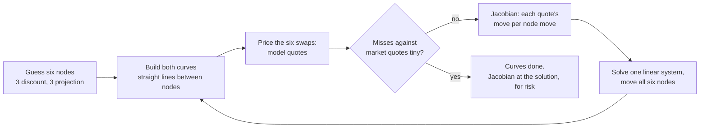

# Solving every curve at once: Newton on OIS and basis quotes together, and the Jacobian that turns zero-rate risk into quote risk

[Syllabus](../../../SYLLABUS.md) → [Financial mathematics](../README.md) → [Curves in Depth](../README.md#s33) → Solving every curve at once

---

## General Overview

A rates desk opens with six quotes on the screen. Three are **overnight index swaps** (OIS): a fixed rate paid once a year against the overnight rate, compounded over the year. Their **par rates**, the fixed rates that make new swaps worth zero, for 1, 2 and 3 years are 4.2000, 4.4000 and 4.5500 percent.

Three are **basis swaps**: the 3-month index, a published rate for 3-month bank loans (Euribor is the live example), against the overnight rate plus a spread, both paid quarterly. Their fair spreads for 1, 2 and 3 years are 9.00, 9.50 and 10.00 basis points (bp), a basis point being a hundredth of a percentage point.

The desk needs two curves from these six numbers. The **discount curve** prices a dollar paid on any date. The **projection curve**, called the forecast curve on [Multi-curve](../28-Swaps/04-basis-swaps-and-the-multi-curve-framework.md), forecasts the 3-month index. Each curve is stored as three **nodes**: its zero rates at 1, 2 and 3 years. A **zero rate** is the one steady, continuously compounded rate from today to a single date. That makes six unknowns for six quotes.

Newton's method solves all six together. Guess the nodes, compute the six quotes they imply, and measure the misses.

Then correct all six nodes at once, using a table of how each quote moves when each node moves. That table is the **Jacobian**. From a start of zero everywhere, three steps take the largest miss from 455 bp to 9.477 bp, then 0.004056 bp, then below a billionth of a basis point. A fourth takes it to 0.000000000002630 bp, under the code's stopping test. Four steps, and the curves reprice every quote.

The Jacobian then does a second job. A 2.5-year swap on 10,000,000 dollars, receiving the 3-month index and paying 4.5 percent, is worth 5,585.98 dollars. Measured against the nodes, it has 8.42 dollars of risk per bp on the discount curve and 2,385.36 on the projection curve. It looks as if the discount curve hardly matters.

Nobody can trade a node, though. The desk hedges in the quoted swaps.

Measured against the quotes, the same swap carries 2,294.41 dollars per bp on the OIS quotes and 2,358.83 on the basis quotes. Half the risk sits on quotes that the node view called harmless. The reason: the basis quotes are spreads over OIS, so raising an OIS quote with the spreads held still lifts the projection curve too.

The inverse Jacobian makes that translation, and rebuilding the curves after a 1 bp bump to each quote gives the same numbers.

**Solve every curve's nodes at once by Newton's method on the gap between model quotes and market quotes; the Jacobian that drives each Newton step, inverted and transposed, then turns a trade's risk to the nodes into its risk to the quotes the desk can actually trade.**

**What kind of fact this is:** a method, with a theorem inside it. The interpolation between nodes and the choice of quotes are modelling choices. Given them, the risk conversion is the chain rule through the implicit function theorem, proved on this card in Why it works.

### The picture: one loop, two curves, six quotes



The loop treats both curves as one list of six numbers. The risk conversion needs the Jacobian at the solved curve; the code builds it once more there, a near copy of the one from the last pass.

---

## The formula

Notation first, in words. The six nodes form one list, $`x = (z^D_1, z^D_2, z^D_3, z^H_1, z^H_2, z^H_3)`$: the discount curve's zero rates at 1, 2 and 3 years, then the projection curve's. Between nodes each zero rate runs in a straight line; before 1 year and after 3 it stays flat.

The **discount factor** $`D(t) = e^{-z^D(t)\,t}`$ is today's price of a dollar paid at year $`t`$. The **projection factor** $`H(t) = e^{-z^H(t)\,t}`$ only stores forecasts: the 3-month index forecast for the quarter from $`t_{i-1}`$ to $`t_i`$ is $`F_i = \bigl(H(t_{i-1})/H(t_i) - 1\bigr)/\alpha`$, with $`\alpha = 0.25`$.

The model quotes, for maturity $`n`$ years:

```math
q^{\mathrm{OIS}}_n(x) = \frac{1 - D(n)}{D(1) + \dots + D(n)}, \qquad q^{\mathrm{basis}}_n(x) = \frac{\sum_i \alpha F_i D(t_i) - \bigl(1 - D(n)\bigr)}{\sum_i \alpha D(t_i)}
```

**Read it aloud:** the OIS par rate is the overnight leg's value, one minus the last discount factor, over the yearly annuity; the basis spread is the index leg minus the overnight leg, over the quarterly annuity.

List the six model quotes as $`q(x)`$ and the market's as $`q^{\mathrm{mkt}}`$. The Jacobian $`J`$ has entry $`J_{ij} = \partial q_i / \partial x_j`$: how far quote $`i`$ moves per unit move of node $`j`$. Newton's step and the risk conversion both use it:

```math
x^{(k+1)} = x^{(k)} - J^{-1}\bigl(q(x^{(k)}) - q^{\mathrm{mkt}}\bigr), \qquad R^q = \bigl(J^{-1}\bigr)^{\mathsf T} R^z
```

**Read it aloud:** move the nodes by the inverse Jacobian times the misses, and repeat; once solved, a trade's risk to each quote is the transposed inverse Jacobian times its risk to each node.

Here $`R^z_j`$ is the **node risk**: dollars gained when node $`j`$ rises 1 bp. $`R^q_i`$ is the **quote risk**: dollars gained when quote $`i`$ rises 1 bp and both curves are rebuilt.

| Symbol | Plain meaning | In our example | Push it up and the answer… |
| --- | --- | --- | --- |
| $`x`$, $`x_j`$, $`j`$ | the six nodes, one list; node number $`j`$ | 4.114194% to 4.558289% | — |
| $`z^D(t)`$, $`z^H(t)`$, $`t`$ | zero rate of each curve at time $`t`$ in years | $`z^D_1`$ = 4.114194%, $`z^H_1`$ = 4.203263% | discount and forecast change |
| $`D(t)`$, $`H(t)`$ | discount factor; projection factor | $`D(1)`$ = 0.95969290 | — |
| $`q^{\mathrm{mkt}}_i`$, $`i`$, $`p`$ | market quote number $`i`$: three OIS rates, three basis spreads; the list is called $`p`$ in the proof | 4.2000%, 4.4000%, 4.5500%; 9.00, 9.50, 10.00 bp | the matching nodes rise |
| $`q_i(x)`$, $`n`$, $`G(x, p)`$ | model quote implied by the nodes, for maturity $`n`$ years; $`G = q(x) - p`$, the misses | equal to the market's once solved | — |
| $`\alpha`$, $`t_i`$ | quarter length; quarterly payment dates | 0.25; 0.25, 0.5, … | — |
| $`F_i`$ | 3-month index forecast for quarter $`i`$ | read off $`H`$ | index leg is worth more |
| $`J`$, $`J_{ij}`$, $`I`$, $`\mathsf T`$ | Jacobian: quote $`i`$'s move per move of node $`j`$; $`I`$ the identity matrix; $`\mathsf T`$ the transpose, rows swapped for columns | $`J_{11}`$ = 1.04200 | a bigger entry means a smaller node move per quote move |
| $`x^{(k)}`$, $`k`$, $`\Delta`$ | the nodes after Newton step $`k`$; $`\Delta`$ the step | solved at $`k`$ = 4 | — |
| $`V`$ | the test swap's value | 5,585.98 dollars | — |
| $`R^z_j`$ | node risk: dollars per 1 bp rise in node $`j`$ | 0.06 to 1,198.24 | — |
| $`R^q_i`$ | quote risk: dollars per 1 bp rise in quote $`i`$, curves rebuilt | −1.87 to 1,182.18 | — |

### When it holds

- **As many independent quotes as nodes.** The Jacobian must be invertible: each quote must move a different mix of nodes. Two quotes on the same instrument give two equal rows, the inverse fails, and neither the Newton step nor the quote risk exists.
- **A start close enough, and smooth curves.** Newton is fast only near the answer. Here a start at zero, or at 20 percent everywhere, still converges in four steps. A quote set with no curve behind it, such as an OIS rate that needs a negative discount factor, has no answer to converge to.
- **Small moves.** Quote risk is a slope. The forward 1 bp rebuild gives 1,142.59 dollars on the 2-year OIS quote against 1,142.65 from the Jacobian; the gap is curvature, called convexity.
- **The same quotes and interpolation for risk as for the build.** Quote risk belongs to this quote set and this rule between nodes. Swap a basis quote for a fixed-against-3-month quote, or straight lines for a spline, and the same trade has different quote risk.
- **One collateral curve.** Every cash flow, the test swap's included, is discounted on the OIS curve, as on [Collateral discounting](../28-Swaps/05-ois-discounting-and-collateral.md).

---

## Why it works

### Step 0: the curves are a function of the quotes, given only by equations

Nobody writes the nodes as a formula in the quotes. They are defined by six equations: model quotes equal market quotes. Two questions follow. How to find the nodes, and how they move when a quote moves. Both answers come from linearising those equations: replacing them near the solution by straight-line approximations. Newton's method uses the linearisation to solve. The implicit function theorem uses the same linearisation to differentiate. Both need one matrix, the Jacobian.

### Step 1: six equations, six unknowns, and their shape

Each OIS quote involves only discount nodes. Each basis quote involves both curves: the index leg forecasts off $`H`$ and every payment discounts off $`D`$. Written with the OIS rows first, the Jacobian has a block of zeros at the top right:

| Quote | $`z^D_1`$ | $`z^D_2`$ | $`z^D_3`$ | $`z^H_1`$ | $`z^H_2`$ | $`z^H_3`$ |
| --- | ---: | ---: | ---: | ---: | ---: | ---: |
| OIS 1y | 1.04200 | 0 | 0 | 0 | 0 | 0 |
| OIS 2y | 0.02250 | 1.02048 | 0 | 0 | 0 | 0 |
| OIS 3y | 0.01587 | 0.03034 | 0.99705 | 0 | 0 | 0 |
| basis 1y | −1.01034 | 0 | 0 | 1.01056 | 0 | 0 |
| basis 2y | −0.02481 | −0.98604 | 0 | 0.02481 | 0.98625 | 0 |
| basis 3y | −0.01689 | −0.03043 | −0.96394 | 0.01691 | 0.03039 | 0.96414 |

Two readings:

- **OIS rows sit near 1 on their own node.** A par rate moves about one for one with the zero rate at its maturity, and a little with the earlier nodes through the coupons.
- **Basis rows read about +1 on the projection node and −1 on the discount node.** A basis spread is close to the gap between the two curves at its maturity. Raise both curves together and it barely moves.

With straight lines between nodes and these quotes, the matrix is **lower triangular**: zero above the diagonal. So a pillar-by-pillar [Bootstrapping](../02-Curves/04-bootstrapping-the-discount-curve.md) also works, and the code runs one as its second road. The bootstrap and Newton agree on every printed digit of all six nodes, and to within $`10^{-8}`$ bp in the code.

Why solve jointly anyway? Two reasons. A spline between nodes, or a quote that depends on later nodes of both curves, destroys the triangle, and then no order of one-unknown solves exists; Newton does not need one. And the joint solve hands over the full Jacobian, cross-curve block included, which Step 4 needs.

### Step 2: one Newton step is one linear solve

Near the current guess $`x`$, a small change $`\Delta`$ moves the quotes by about $`J\Delta`$. Ask for the change that would close every miss: $`J\Delta = -(q(x) - q^{\mathrm{mkt}})`$. That is six linear equations, solved by Gaussian elimination. Take the step and repeat.

The misses fall like this, in basis points: 455, 9.477, 0.004056, 0.0000000007441. Each miss is roughly the square of the previous one, measured as a fraction: the number of correct digits doubles each step. That speed, **quadratic convergence**, is proved in [Newton in several unknowns, and Broyden when a Jacobian is too expensive](../../16-Numerical%20analysis/02-Root%20Finding%20and%20Fixed%20Points/07-newton-for-systems-and-broyden.md). A fourth step reaches 0.000000000002630 bp, the floor set by the computer's rounding, and passes the code's stopping test. The code builds $`J`$ afresh each step by nudging each node up and down by $`10^{-7}`$.

### Step 3: what the trade sees through the nodes

The test swap receives the 3-month index quarterly and pays 4.5 percent twice a year for 2.5 years. Its value is the index leg minus the fixed leg, both discounted on $`D`$. Raise one node by 1 bp, then lower it, reprice, and take half the change: that is the node risk.

The 2.5-year date sits between the 2- and 3-year nodes, so the risk splits between them. That is why the test trade stops inside the 3-year pillars: past 3 years both curves stay flat, and a longer swap would pile its extra risk onto the 3-year nodes. The fixed and floating legs both discount on $`D`$, so their discount risks nearly cancel: 8.42 dollars per bp across the three discount nodes. The index forecasts live on $`H`$, which carries 2,385.36.

### Step 4: the chain rule turns node risk into quote risk

The trade's value depends on the nodes, and the nodes depend on the quotes. By the chain rule, the risk to quote $`i`$ is the sum over nodes of (value change per node move) times (node move per quote move).

The second factor comes from the implicit function theorem ([Inverse and implicit function theorems](../../06-Calculus%20and%20analysis/07-Several%20Variables/07-inverse-and-implicit-function-theorems.md)). The equations are $`q(x) - q^{\mathrm{mkt}} = 0`$. Their rates in the unknowns $`x`$ form $`J`$. Their rates in the free variables $`q^{\mathrm{mkt}}`$ form minus the identity matrix. So the nodes move with the quotes at rates $`J^{-1}`$. Putting the two factors together gives $`R^q = (J^{-1})^{\mathsf T} R^z`$.

<details>
<summary>Detailed proof: the chain rule through the implicit function</summary>

Write $`G(x, p) = q(x) - p`$, where $`p`$ is the list of six market quotes. Here the unknowns are the nodes $`x`$ and the free variables are the quotes $`p`$; the linked card calls the unknowns $`y`$ and the free variables $`x`$. At the solved curve, $`G(x_0, p_0) = 0`$. The block of rates in the unknowns is $`\partial G/\partial x = J`$, invertible by the first condition in When it holds. The block in the free variables is $`\partial G/\partial p = -I`$.

The implicit function theorem gives a smooth $`x(p)`$ near $`p_0`$ with $`G(x(p), p) = 0`$, and

$`\displaystyle \frac{\partial x}{\partial p} = -\Bigl(\frac{\partial G}{\partial x}\Bigr)^{-1}\frac{\partial G}{\partial p} = -J^{-1}(-I) = J^{-1}.`$

The trade's value after a rebuild is $`V(x(p))`$. The chain rule gives

$`\displaystyle \frac{\partial V}{\partial p_i} = \sum_j \frac{\partial V}{\partial x_j}\,\frac{\partial x_j}{\partial p_i} = \sum_j \bigl(J^{-1}\bigr)_{ji}\,\frac{\partial V}{\partial x_j}.`$

The index on $`J^{-1}`$ runs $`ji`$, not $`ij`$: that is the transpose. Multiply both sides by 1 bp and the node derivatives become node risks $`R^z_j`$, the quote derivatives become quote risks $`R^q_i`$. So $`R^q = (J^{-1})^{\mathsf T}R^z`$, which is also the solution of $`J^{\mathsf T}R^q = R^z`$. Since $`J`$ is lower triangular here, $`J^{\mathsf T}`$ is upper triangular, and that system solves from the bottom up.

</details>

Here is what the conversion does to the test swap:

```
node risk: dollars per 1bp rise in each node, one block = 50 dollars
  D 1y                                     0.06
  D 2y                                     2.85
  D 3y                                     5.51
  H 1y      █                             47.34
  H 2y      ████████████████████████   1,198.24
  H 3y      ███████████████████████    1,139.78
```

```
quote risk: dollars per 1bp rise in each quote, curves rebuilt, one block = 50 dollars
  OIS 1y                                   3.32
  OIS 2y    ███████████████████████    1,142.65
  OIS 3y    ███████████████████████    1,148.44
  basis 1y                                -1.87
  basis 2y  ████████████████████████   1,178.52
  basis 3y  ████████████████████████   1,182.18
```

First: risk to the nodes, almost all on the projection curve. Second: risk to the quotes, split nearly evenly. A 1 bp rise in the 2-year OIS quote, with the 2-year basis spread held, lifts the 2-year projection node about 1 bp as well. The swap's index leg feels that lift. Node risk files it under the projection curve; quote risk files it under the OIS quote that caused it.

### Step 5: two independent checks

- **Bump and rebuild.** For each quote, add 1 bp, re-run Newton from the solved curve, and reprice; then subtract 1 bp and do the same. Half the difference matches the Jacobian answer to the cent on every quote, and to better than a thousandth of a dollar in the code.
- **A calibration swap has risk to its own quote only.** A 2-year OIS swap paying fixed at the market rate, on 10,000,000 dollars, gets quote risk 1,877.10 on the 2-year OIS quote and 0.00 on the other five. The reason: every rebuild reprices that swap's quote exactly, so its value is always (rebuilt quote − fixed rate) × annuity, where the **annuity** is the sum of its discount factors. Only its own quote moves that bracket. The 1,877.10 is 10,000,000 × that annuity × 1 bp.

### Step 6: the hedge, one swap per quote

Quote risk tells the desk what to trade. Each calibration swap at par has quote risk only on its own quote, equal to its notional times its annuity times 1 bp. So each hedge notional is the trade's quote risk divided by the annuity times 1 bp:

| Hedge | Notional, millions of dollars |
| --- | ---: |
| 1y OIS, receive fixed | 0.0345 |
| 2y OIS, receive fixed | 6.0873 |
| 3y OIS, receive fixed | 4.1733 |
| 1y basis, pay index | −0.0192 |
| 2y basis, pay index | 6.1765 |
| 3y basis, pay index | 4.2237 |

"Pay index" means pay the 3-month index and receive overnight plus the spread; the negative 1-year notional means the other direction. The hedged book's largest node risk is 0.0000 dollars per bp: the six swaps cancel the trade's risk to every node, as they must if the quote risks were right.

---

## Worked numbers, by hand

Inside the first year both curves are flat, so the 1-year nodes come out in closed form. A flat discount curve makes each quarter's overnight growth $`e^{z^D_1/4}`$; a flat projection curve makes each quarter's index growth $`e^{z^H_1/4}`$. The basis spread is then $`4\,(e^{z^H_1/4} - e^{z^D_1/4})`$, because both legs share the same quarterly annuity.

The quote-risk rows work from the node risks and Jacobian entries as printed, rounded. The code carries every digit, so a row redone by hand can land a cent away from its Value, which is the unrounded result.

| Step | Arithmetic | Value |
| --- | --- | --- |
| 1y discount factor from the 1y OIS quote | $`1/1.042`$ | 0.95969290 |
| 1y discount node | $`\ln 1.042`$ | 4.114194% |
| quarterly overnight growth | $`e^{0.04114194/4}`$ | 1.01033856 |
| add a quarter of the 9.00 bp spread | $`1.01033856 + 0.0009/4`$ | 1.01056356 |
| 1y projection node | $`4 \ln 1.01056356`$ | 4.203263% |
| Jacobian, OIS 1y row | slope of $`e^{z}-1`$ at $`z^D_1`$ is $`e^{z^D_1}`$ | 1.04200 |
| Jacobian, basis 1y row | slopes: $`-e^{z^D_1/4}`$ and $`+e^{z^H_1/4}`$ | −1.01034, 1.01056 |
| quote risk, basis 3y | $`1{,}139.78 / 0.96414`$ | 1,182.18 |
| quote risk, basis 2y | $`(1{,}198.24 - 0.03039 \times 1{,}182.18) / 0.98625 = 1{,}162.32 / 0.98625`$ | 1,178.52 |
| quote risk, basis 1y | $`(47.34 - 0.02481 \times 1{,}178.52 - 0.01691 \times 1{,}182.18) / 1.01056 = -1.89 / 1.01056`$ | −1.87 |
| quote risk, OIS 3y | $`(5.51 + 0.96394 \times 1{,}182.18) / 0.99705 = 1{,}145.06 / 0.99705`$ | 1,148.44 |
| quote risk, OIS 2y | $`(2.85 - 0.03034 \times 1{,}148.44 + 0.98604 \times 1{,}178.52 + 0.03043 \times 1{,}182.18) / 1.02048 = 1{,}166.05 / 1.02048`$ | 1,142.65 |
| quote risk, OIS 1y | the same with column 1 of the Jacobian: $`3.45 / 1.04200`$ | 3.32 |
| **quote risk, OIS total and basis total** | $`3.32 + 1{,}142.65 + 1{,}148.44`$; $`-1.87 + 1{,}178.52 + 1{,}182.18`$ | **2,294.41 and 2,358.83** |

The test swap gains about 2,294 dollars for each basis point the OIS quotes rise and about 2,359 for each basis point the basis spreads rise. The node view had put only 8.42 dollars on the discount side.

### What breaks if you drop a piece

| Mistake | Comes out at | What went wrong |
| --- | --- | --- |
| Bump each OIS quote but rebuild only the discount curve, holding the projection nodes still | OIS quote risk −0.08, 2.63, 5.52 | With the projection nodes frozen, the basis spreads move when OIS moves. The bump is no longer "one quote up, the rest held". |
| Read node risk as quote risk | OIS risk 8.42 in total; 2,285.98 dollars per bp missed | The projection curve rides on the OIS quotes. Node risk files that ride under the wrong instrument. |
| Multiply by $`J^{-1}`$ instead of its transpose | 0.06, 2.79, 5.44, 46.90, 1,216.56, 1,148.54 | The chain rule sums down a column of $`J^{-1}`$, not along a row. The result looks plausible and routes the risk to the wrong quotes. |

---

## Code, from first principles, and it actually runs

The code builds both curves from the six quotes and prices every swap from first principles. It writes its own Gaussian elimination, its own bisection and its own finite-difference Jacobian. It reaches the curves **two independent ways**: Newton on all six nodes at once, and a bisection bootstrap one node at a time, checked against the closed form for the 1-year nodes. It reaches the quote risk **two independent ways**: the transposed inverse Jacobian, and bumping each quote and rebuilding both curves. Two identities close the loop: a par 2-year OIS swap has risk to its own quote only, and the six-swap hedge leaves no node risk.

### Python

```python
# Multi-curve calibration and Jacobian risk -- the check behind the card.  Standard library only.
# Two curves (overnight discount D, 3-month projection H), zero rates at 1, 2, 3 years,
# solved jointly by Newton on six quotes; then node risk -> quote risk by the inverse Jacobian.
from math import exp, log
def tot(xs):                          # plain left-to-right sum, the same in both languages
    s = 0.0
    for v in xs: s += v
    return s
PIL, BP = [1.0, 2.0, 3.0], 1e-4
MKT = [0.0420, 0.0440, 0.0455, 0.0009, 0.00095, 0.0010]   # OIS 1y 2y 3y; basis 1y 2y 3y
NAMES = ["OIS 1y", "OIS 2y", "OIS 3y", "basis 1y", "basis 2y", "basis 3y"]
def zero(t, n):                       # straight line between pillars, flat outside them
    if t <= PIL[0] or t >= PIL[2]: return n[0] if t <= PIL[0] else n[2]
    k = 0 if t <= PIL[1] else 1
    return (1 - (t - PIL[k])) * n[k] + (t - PIL[k]) * n[k + 1]
def df(t, n): return exp(-zero(t, n) * t)
def qgrid(m): return [0.25 * i for i in range(4 * m + 1)]
def index_leg(x, ts):                 # forecast off H, discount off D
    d, h = x[:3], x[3:]
    return tot((df(ts[i - 1], h) / df(ts[i], h) - 1) * df(ts[i], d) for i in range(1, len(ts)))
def ann_y(x, m): return tot(df(k, x[:3]) for k in range(1, m + 1))
def ann_q(x, m): return tot(0.25 * df(t, x[:3]) for t in qgrid(m)[1:])
def quotes(x):                        # the six model quotes the curves imply
    out = [(1 - df(m, x[:3])) / ann_y(x, m) for m in (1, 2, 3)]
    out += [(index_leg(x, qgrid(m)) - (1 - df(m, x[:3]))) / ann_q(x, m) for m in (1, 2, 3)]
    return out
def jac(f, x, rows, cols, h=1e-7):    # central differences, one column per node
    J = [[0.0] * len(cols) for _ in rows]
    for c, j in enumerate(cols):
        u = x[:]; u[j] += h; v = x[:]; v[j] -= h
        fu, fv = f(u), f(v)
        for r, i in enumerate(rows): J[r][c] = (fu[i] - fv[i]) / (2 * h)
    return J
def solve(A, b):                      # Gaussian elimination with partial pivoting
    n = len(b); M = [A[i][:] + [b[i]] for i in range(n)]
    for c in range(n):
        p = max(range(c, n), key=lambda r: abs(M[r][c])); M[c], M[p] = M[p], M[c]
        for r in range(c + 1, n):
            f = M[r][c] / M[c][c]
            for k in range(c, n + 1): M[r][k] -= f * M[c][k]
    x = [0.0] * n
    for r in range(n - 1, -1, -1):
        x[r] = (M[r][n] - tot(M[r][k] * x[k] for k in range(r + 1, n))) / M[r][r]
    return x
def newton(mkt, x0, free=range(6), stale=False, log=None):
    x, free, J = x0[:], list(free), None
    for it in range(0, 60):
        r = [quotes(x)[i] - mkt[i] for i in free]
        if log is not None: log.append(max(abs(v) for v in r) / BP)
        if max(abs(v) for v in r) < 1e-14: return x, it
        if J is None or not stale: J = jac(quotes, x, free, free)
        for i, s in zip(free, solve(J, r)): x[i] -= s
    raise RuntimeError("Newton did not converge")
def bisect(g, lo=-0.5, hi=0.5):       # road 2: one node at a time, no derivatives
    for _ in range(200):
        mid = 0.5 * (lo + hi)
        if (g(lo) > 0) == (g(mid) > 0): lo = mid
        else: hi = mid
    return 0.5 * (lo + hi)
def bootstrap(mkt):
    x = [0.0] * 6
    for i in range(6):
        def g(z, i=i):
            x[i] = z; return quotes(x)[i] - mkt[i]
        x[i] = bisect(g)
    return x
N, K = 10_000_000.0, 0.045            # test swap: receive 3-month index, pay 4.5% twice a year, 2.5 years
def swap(x): return N * (index_leg(x, qgrid(3)[:11]) - tot(0.5 * K * df(0.5 * j, x[:3]) for j in range(1, 6)))
def node_risk(f, x):                  # dollars per 1bp up at each node, central difference
    out = []
    for j in range(6):
        u = x[:]; u[j] += BP; v = x[:]; v[j] -= BP
        out.append((f(u) - f(v)) / 2)
    return out
def show(label, vals, fmt):
    print(f"{label:<30}" + "".join(fmt.format(0.0 if abs(v) < 1e-6 else v) for v in vals))
misses = []
x, iters = newton(MKT, [0.0] * 6, log=misses)
for it, e in enumerate(misses): print(f"Newton step {it}: largest quote miss {e:.3e} bp")
xb = bootstrap(MKT)
show("nodes, Newton (zero %)", [100 * v for v in x], "{:>12.6f}")
show("nodes, bootstrap (zero %)", [100 * v for v in xb], "{:>12.6f}")
g1 = exp(x[0] / 4)                    # by hand: inside one year both curves are flat
print(f"D(1) {df(1, x[:3]):.8f}  e^(zD1/4) {g1:.8f}  + s/4 = {g1 + MKT[3] / 4:.8f}  zH1 {400 * log(g1 + MKT[3] / 4):.6f} %")
gap = max(abs(a - b) for a, b in zip(x, xb)) / BP
J = jac(quotes, x, range(6), range(6))
for i in range(6): show(f"Jacobian row {NAMES[i]}", J[i], "{:>10.5f}")
V0, Rz = swap(x), node_risk(swap, x)
JT = [[J[i][j] for i in range(6)] for j in range(6)]
Rq = solve(JT, Rz)                    # quote risk = J^-T times node risk
fwd, cen = [], []
for i in range(6):
    up = MKT[:]; up[i] += BP; dn = MKT[:]; dn[i] -= BP
    vu, vd = swap(newton(up, x)[0]), swap(newton(dn, x)[0])
    fwd.append(vu - V0); cen.append((vu - vd) / 2)
print(f"test swap value {V0:.2f}")
show("node risk ($ per bp)", Rz, "{:>10.2f}")
for k in range(5, -1, -1):            # J is lower triangular, so J^T y = Rz solves from the bottom up
    num = Rz[k] - tot(J[i][k] * Rq[i] for i in range(k + 1, 6))
    print(f"  back-substitute {NAMES[k]:<9} ({Rz[k]:.2f} -> {num:.2f}) / {J[k][k]:.5f} = {num / J[k][k]:.2f}")
print(f"totals: node D {tot(Rz[:3]):.2f}  node H {tot(Rz[3:]):.2f}  quote OIS {tot(Rq[:3]):.2f}  quote basis {tot(Rq[3:]):.2f}")
show("quote risk, J^-T ($ per bp)", Rq, "{:>10.2f}")
show("quote risk, rebuild +1bp", fwd, "{:>10.2f}")
show("quote risk, rebuild central", cen, "{:>10.2f}")
def ois2(x): return N * ((1 - df(2, x[:3])) - MKT[1] * ann_y(x, 2))   # 2y OIS, pay fixed at par
own = solve(JT, node_risk(ois2, x))
show("2y OIS par swap, J^-T", own, "{:>10.2f}")
annuity_bp = [ann_y(x, m) * BP for m in (1, 2, 3)] + [ann_q(x, m) * BP for m in (1, 2, 3)]
hedge = [r / a for r, a in zip(Rq, annuity_bp)]
show("hedge notionals (millions)", [h / 1e6 for h in hedge], "{:>10.4f}")
def hedged(x):                        # test swap minus the six par instruments, sized by quote risk
    v = swap(x)
    for i, m in enumerate((1, 2, 3)):
        v -= hedge[i] * ((1 - df(m, x[:3])) - MKT[i] * ann_y(x, m))
        v -= hedge[3 + i] * (index_leg(x, qgrid(m)) - (1 - df(m, x[:3])) - MKT[3 + i] * ann_q(x, m))
    return v
hz = max(abs(v) for v in node_risk(hedged, x))
print(f"hedged book, largest node risk {hz:.4f}")
# ---- what breaks ----
frozen = []                           # rebuild only the OIS curve, hold projection nodes still
for i in range(3):
    up = MKT[:]; up[i] += BP; dn = MKT[:]; dn[i] -= BP
    frozen.append((swap(newton(up, x, free=range(3))[0]) - swap(newton(dn, x, free=range(3))[0])) / 2)
show("wrong: projection frozen", frozen, "{:>10.2f}")
show("wrong: J^-1 not J^-T", solve(J, Rz), "{:>10.2f}")
miss = tot(Rq[:3]) - tot(Rz[:3])
print(f"wrong: node risk as quote risk, OIS risk missed {miss:.2f}")
# ---- try changing ----
_, chord = newton(MKT, [0.0] * 6, stale=True)
print(f"try: stale Jacobian, steps {chord}")
_, far = newton(MKT, [0.20] * 6)
print(f"try: start at 20% everywhere, steps {far}")
xz, _ = newton(MKT[:3] + [0.0, 0.0, 0.0], x)
print(f"try: zero basis, largest gap H - D {max(abs(xz[3 + k] - xz[k]) for k in range(3)) / BP:.6f} bp")
assert iters <= 5 and gap < 1e-8 and abs(x[3] - 4 * log(g1 + MKT[3] / 4)) < 1e-12 and abs(df(1, x) - 1 / 1.042) < 1e-12
assert max(abs(a - b) for a, b in zip(Rq, cen)) < 1e-3 # Jacobian risk = bump and rebuild
assert max(abs(a - b) for a, b in zip(Rq, fwd)) < 0.1  # forward bump differs only by convexity
assert abs(own[1] - N * ann_y(x, 2) * BP) < 1e-4 and max(abs(own[j]) for j in (0, 2, 3, 4, 5)) < 1e-4
assert hz < 1e-4 and chord > iters and abs(tot(frozen) - tot(Rq[:3])) > 1000
print("ALL CHECKS PASS")
```

**Ran 2026-11-23 on macOS, Python 3.14.10, standard library only. All checks passed. Output, pasted from the run:**

```
Newton step 0: largest quote miss 4.550e+02 bp
Newton step 1: largest quote miss 9.477e+00 bp
Newton step 2: largest quote miss 4.056e-03 bp
Newton step 3: largest quote miss 7.441e-10 bp
Newton step 4: largest quote miss 2.630e-12 bp
nodes, Newton (zero %)            4.114194    4.310172    4.459084    4.203263    4.404267    4.558289
nodes, bootstrap (zero %)         4.114194    4.310172    4.459084    4.203263    4.404267    4.558289
D(1) 0.95969290  e^(zD1/4) 1.01033856  + s/4 = 1.01056356  zH1 4.203263 %
Jacobian row OIS 1y              1.04200   0.00000   0.00000   0.00000   0.00000   0.00000
Jacobian row OIS 2y              0.02250   1.02048   0.00000   0.00000   0.00000   0.00000
Jacobian row OIS 3y              0.01587   0.03034   0.99705   0.00000   0.00000   0.00000
Jacobian row basis 1y           -1.01034   0.00000   0.00000   1.01056   0.00000   0.00000
Jacobian row basis 2y           -0.02481  -0.98604   0.00000   0.02481   0.98625   0.00000
Jacobian row basis 3y           -0.01689  -0.03043  -0.96394   0.01691   0.03039   0.96414
test swap value 5585.98
node risk ($ per bp)                0.06      2.85      5.51     47.34   1198.24   1139.78
  back-substitute basis 3y  (1139.78 -> 1139.78) / 0.96414 = 1182.18
  back-substitute basis 2y  (1198.24 -> 1162.32) / 0.98625 = 1178.52
  back-substitute basis 1y  (47.34 -> -1.89) / 1.01056 = -1.87
  back-substitute OIS 3y    (5.51 -> 1145.06) / 0.99705 = 1148.44
  back-substitute OIS 2y    (2.85 -> 1166.05) / 1.02048 = 1142.65
  back-substitute OIS 1y    (0.06 -> 3.45) / 1.04200 = 3.32
totals: node D 8.42  node H 2385.36  quote OIS 2294.41  quote basis 2358.83
quote risk, J^-T ($ per bp)         3.32   1142.65   1148.44     -1.87   1178.52   1182.18
quote risk, rebuild +1bp            3.32   1142.59   1148.43     -1.88   1178.51   1182.17
quote risk, rebuild central         3.32   1142.65   1148.44     -1.87   1178.52   1182.18
2y OIS par swap, J^-T               0.00   1877.10      0.00      0.00      0.00      0.00
hedge notionals (millions)        0.0345    6.0873    4.1733   -0.0192    6.1765    4.2237
hedged book, largest node risk 0.0000
wrong: projection frozen           -0.08      2.63      5.52
wrong: J^-1 not J^-T                0.06      2.79      5.44     46.90   1216.56   1148.54
wrong: node risk as quote risk, OIS risk missed 2285.98
try: stale Jacobian, steps 9
try: start at 20% everywhere, steps 4
try: zero basis, largest gap H - D 0.000000 bp
ALL CHECKS PASS
```

### Rust

```rust
// Multi-curve calibration and Jacobian risk -- the check behind the card.  std only.
// Two curves (overnight discount D, 3-month projection H), zero rates at 1, 2, 3 years,
// solved jointly by Newton on six quotes; then node risk -> quote risk by the inverse Jacobian.
const PIL: [f64; 3] = [1.0, 2.0, 3.0]; const BP: f64 = 1e-4;
const MKT: [f64; 6] = [0.0420, 0.0440, 0.0455, 0.0009, 0.00095, 0.0010]; // OIS 1y 2y 3y; basis 1y 2y 3y
const NAMES: [&str; 6] = ["OIS 1y", "OIS 2y", "OIS 3y", "basis 1y", "basis 2y", "basis 3y"];
const N: f64 = 10_000_000.0; const K: f64 = 0.045; // test swap: receive 3-month index, pay 4.5% twice a year, 2.5 years
type V6 = Vec<f64>;
fn zero(t: f64, n: &[f64]) -> f64 { // straight line between pillars, flat outside them
    if t <= PIL[0] || t >= PIL[2] { return if t <= PIL[0] { n[0] } else { n[2] }; }
    let k = if t <= PIL[1] { 0 } else { 1 };
    (1.0 - (t - PIL[k])) * n[k] + (t - PIL[k]) * n[k + 1]
}
fn df(t: f64, n: &[f64]) -> f64 { (-zero(t, n) * t).exp() }
fn qgrid(m: usize) -> V6 { (0..=4 * m).map(|i| 0.25 * i as f64).collect() }
fn index_leg(x: &[f64], ts: &[f64]) -> f64 { // forecast off H, discount off D
    let (d, h, mut s) = (&x[..3], &x[3..], 0.0);
    for i in 1..ts.len() { s += (df(ts[i - 1], h) / df(ts[i], h) - 1.0) * df(ts[i], d); }
    s
}
fn ann_y(x: &[f64], m: usize) -> f64 { let mut s = 0.0; for k in 1..=m { s += df(k as f64, &x[..3]); } s }
fn ann_q(x: &[f64], m: usize) -> f64 { let mut s = 0.0; for t in &qgrid(m)[1..] { s += 0.25 * df(*t, &x[..3]); } s }
fn quotes(x: &[f64]) -> V6 { // the six model quotes the curves imply
    let mut out: V6 = (1..=3).map(|m| (1.0 - df(m as f64, &x[..3])) / ann_y(x, m)).collect();
    for m in 1..=3 { out.push((index_leg(x, &qgrid(m)) - (1.0 - df(m as f64, &x[..3]))) / ann_q(x, m)); }
    out
}
fn jac(x: &[f64], rows: &[usize], cols: &[usize]) -> Vec<V6> { // central differences
    let (h, mut j) = (1e-7, vec![vec![0.0; cols.len()]; rows.len()]);
    for (c, &jj) in cols.iter().enumerate() {
        let (mut u, mut v) = (x.to_vec(), x.to_vec()); u[jj] += h; v[jj] -= h;
        let (fu, fv) = (quotes(&u), quotes(&v));
        for (r, &i) in rows.iter().enumerate() { j[r][c] = (fu[i] - fv[i]) / (2.0 * h); }
    }
    j
}
fn solve(a: &[V6], b: &[f64]) -> V6 { // Gaussian elimination with partial pivoting
    let n = b.len();
    let mut m: Vec<V6> = (0..n).map(|i| { let mut r = a[i].clone(); r.push(b[i]); r }).collect();
    for c in 0..n {
        let mut p = c;
        for r in c..n { if m[r][c].abs() > m[p][c].abs() { p = r; } } m.swap(c, p);
        for r in c + 1..n {
            let f = m[r][c] / m[c][c];
            for k in c..=n { m[r][k] -= f * m[c][k]; }
        }
    }
    let mut x = vec![0.0; n]; for r in (0..n).rev() {
        let mut s = 0.0; for k in r + 1..n { s += m[r][k] * x[k]; }
        x[r] = (m[r][n] - s) / m[r][r];
    } x
}
fn newton(mkt: &[f64], x0: &[f64], free: &[usize], stale: bool, log: &mut V6) -> (V6, usize) {
    let (mut x, mut j): (V6, Option<Vec<V6>>) = (x0.to_vec(), None);
    for it in 0..60 {
        let q = quotes(&x);
        let r: V6 = free.iter().map(|&i| q[i] - mkt[i]).collect();
        let e = r.iter().fold(0.0f64, |a, v| a.max(v.abs())); log.push(e / BP);
        if e < 1e-14 { return (x, it); }
        if j.is_none() || !stale { j = Some(jac(&x, free, free)); }
        let s = solve(j.as_ref().unwrap(), &r);
        for (k, &i) in free.iter().enumerate() { x[i] -= s[k]; }
    }
    panic!("Newton did not converge");
}
fn nt(mkt: &[f64], x0: &[f64]) -> V6 { newton(mkt, x0, &[0, 1, 2, 3, 4, 5], false, &mut vec![]).0 }
fn bisect(g: &mut dyn FnMut(f64) -> f64) -> f64 { // road 2: one node at a time, no derivatives
    let (mut lo, mut hi) = (-0.5, 0.5);
    for _ in 0..200 {
        let mid = 0.5 * (lo + hi);
        if (g(lo) > 0.0) == (g(mid) > 0.0) { lo = mid; } else { hi = mid; }
    }
    0.5 * (lo + hi)
}
fn bootstrap(mkt: &[f64]) -> V6 {
    let mut x = vec![0.0; 6];
    for i in 0..6 {
        let z = bisect(&mut |z| { x[i] = z; quotes(&x)[i] - mkt[i] }); x[i] = z;
    }
    x
}
fn swap(x: &[f64]) -> f64 {
    let mut fx = 0.0; for j in 1..=5 { fx += 0.5 * K * df(0.5 * j as f64, &x[..3]); }
    N * (index_leg(x, &qgrid(3)[..11]) - fx)
}
fn node_risk(f: &dyn Fn(&[f64]) -> f64, x: &[f64]) -> V6 { // dollars per 1bp up at each node
    (0..6).map(|j| { let (mut u, mut v) = (x.to_vec(), x.to_vec()); u[j] += BP; v[j] -= BP; (f(&u) - f(&v)) / 2.0 }).collect()
}
fn show(label: &str, vals: &[f64], w: usize, p: usize) {
    let mut s = format!("{:<30}", label);
    for &v in vals { s += &format!("{:>w$.p$}", if v.abs() < 1e-6 { 0.0 } else { v }, w = w, p = p); }
    println!("{}", s);
}
fn sci(v: f64) -> String { // Python's {:.3e}: two-digit exponent with a sign
    let s = format!("{:.3e}", v); let (m, e) = s.split_once('e').unwrap(); let e: i32 = e.parse().unwrap();
    format!("{}e{}{:02}", m, if e < 0 { '-' } else { '+' }, e.abs())
}
fn tot(v: &[f64]) -> f64 { let mut s = 0.0; for x in v { s += x; } s }
fn main() {
    let (all, mut misses) = ([0usize, 1, 2, 3, 4, 5], vec![]);
    let (x, iters) = newton(&MKT, &[0.0; 6], &all, false, &mut misses);
    for (it, e) in misses.iter().enumerate() { println!("Newton step {}: largest quote miss {} bp", it, sci(*e)); }
    let xb = bootstrap(&MKT);
    show("nodes, Newton (zero %)", &x.iter().map(|v| 100.0 * v).collect::<V6>(), 12, 6);
    show("nodes, bootstrap (zero %)", &xb.iter().map(|v| 100.0 * v).collect::<V6>(), 12, 6);
    let g1 = (x[0] / 4.0).exp(); // by hand: inside one year both curves are flat
    println!("D(1) {:.8}  e^(zD1/4) {:.8}  + s/4 = {:.8}  zH1 {:.6} %", df(1.0, &x[..3]), g1, g1 + MKT[3] / 4.0, 400.0 * (g1 + MKT[3] / 4.0).ln());
    let gap = (0..6).fold(0.0f64, |a, i| a.max((x[i] - xb[i]).abs())) / BP;
    let j = jac(&x, &all, &all);
    for i in 0..6 { show(&format!("Jacobian row {}", NAMES[i]), &j[i], 10, 5); }
    let (v0, rz) = (swap(&x), node_risk(&swap, &x));
    let jt: Vec<V6> = (0..6).map(|c| (0..6).map(|r| j[r][c]).collect()).collect();
    let rq = solve(&jt, &rz); // quote risk = J^-T times node risk
    let (mut fwd, mut cen) = (vec![], vec![]);
    for i in 0..6 {
        let (mut up, mut dn) = (MKT.to_vec(), MKT.to_vec()); up[i] += BP; dn[i] -= BP;
        let (vu, vd) = (swap(&nt(&up, &x)), swap(&nt(&dn, &x)));
        fwd.push(vu - v0); cen.push((vu - vd) / 2.0);
    }
    println!("test swap value {:.2}", v0);
    show("node risk ($ per bp)", &rz, 10, 2);
    for k in (0..6).rev() { // J is lower triangular, so J^T y = Rz solves from the bottom up
        let mut s = 0.0; for i in k + 1..6 { s += j[i][k] * rq[i]; }
        let num = rz[k] - s;
        println!("  back-substitute {:<9} ({:.2} -> {:.2}) / {:.5} = {:.2}", NAMES[k], rz[k], num, j[k][k], num / j[k][k]);
    }
    println!("totals: node D {:.2}  node H {:.2}  quote OIS {:.2}  quote basis {:.2}", tot(&rz[..3]), tot(&rz[3..]), tot(&rq[..3]), tot(&rq[3..]));
    show("quote risk, J^-T ($ per bp)", &rq, 10, 2);
    show("quote risk, rebuild +1bp", &fwd, 10, 2);
    show("quote risk, rebuild central", &cen, 10, 2);
    let ois2 = |x: &[f64]| N * ((1.0 - df(2.0, &x[..3])) - MKT[1] * ann_y(x, 2)); // 2y OIS, pay fixed at par
    let own = solve(&jt, &node_risk(&ois2, &x));
    show("2y OIS par swap, J^-T", &own, 10, 2);
    let mut annuity_bp: V6 = (1..=3).map(|m| ann_y(&x, m) * BP).collect(); for m in 1..=3 { annuity_bp.push(ann_q(&x, m) * BP); }
    let hedge: V6 = (0..6).map(|i| rq[i] / annuity_bp[i]).collect();
    show("hedge notionals (millions)", &hedge.iter().map(|h| h / 1e6).collect::<V6>(), 10, 4);
    let hedged = |x: &[f64]| { // test swap minus the six par instruments, sized by quote risk
        let mut v = swap(x);
        for (i, &m) in [1usize, 2, 3].iter().enumerate() {
            v -= hedge[i] * ((1.0 - df(m as f64, &x[..3])) - MKT[i] * ann_y(x, m));
            v -= hedge[3 + i] * (index_leg(x, &qgrid(m)) - (1.0 - df(m as f64, &x[..3])) - MKT[3 + i] * ann_q(x, m));
        }
        v
    };
    let hz = node_risk(&hedged, &x).iter().fold(0.0f64, |a, v| a.max(v.abs()));
    println!("hedged book, largest node risk {:.4}", hz);
    // ---- what breaks ----
    let mut frozen = vec![]; // rebuild only the OIS curve, hold projection nodes still
    for i in 0..3 {
        let (mut up, mut dn) = (MKT.to_vec(), MKT.to_vec()); up[i] += BP; dn[i] -= BP;
        let xu = newton(&up, &x, &[0, 1, 2], false, &mut vec![]).0;
        let xd = newton(&dn, &x, &[0, 1, 2], false, &mut vec![]).0;
        frozen.push((swap(&xu) - swap(&xd)) / 2.0);
    }
    show("wrong: projection frozen", &frozen, 10, 2);
    show("wrong: J^-1 not J^-T", &solve(&j, &rz), 10, 2);
    println!("wrong: node risk as quote risk, OIS risk missed {:.2}", tot(&rq[..3]) - tot(&rz[..3]));
    // ---- try changing ----
    let chord = newton(&MKT, &[0.0; 6], &all, true, &mut vec![]).1; println!("try: stale Jacobian, steps {}", chord);
    println!("try: start at 20% everywhere, steps {}", newton(&MKT, &[0.20; 6], &all, false, &mut vec![]).1);
    let xz = nt(&[MKT[0], MKT[1], MKT[2], 0.0, 0.0, 0.0], &x);
    println!("try: zero basis, largest gap H - D {:.6} bp", (0..3).fold(0.0f64, |a, k| a.max((xz[3 + k] - xz[k]).abs())) / BP);
    assert!(iters <= 5 && gap < 1e-8 && (x[3] - 4.0 * (g1 + MKT[3] / 4.0).ln()).abs() < 1e-12 && (df(1.0, &x) - 1.0 / 1.042).abs() < 1e-12);
    assert!((0..6).all(|i| (rq[i] - cen[i]).abs() < 1e-3)); // Jacobian risk = bump and rebuild
    assert!((0..6).all(|i| (rq[i] - fwd[i]).abs() < 0.1)); // forward bump differs only by convexity
    assert!((own[1] - N * ann_y(&x, 2) * BP).abs() < 1e-4 && [0, 2, 3, 4, 5].iter().all(|&k| own[k].abs() < 1e-4));
    assert!(hz < 1e-4 && chord > iters && (tot(&frozen) - tot(&rq[..3])).abs() > 1000.0);
    println!("ALL CHECKS PASS");
}
```

**Ran 2026-11-23 on macOS, rustc 1.98.1, no crates. All checks passed. Output, pasted from the run:**

```
Newton step 0: largest quote miss 4.550e+02 bp
Newton step 1: largest quote miss 9.477e+00 bp
Newton step 2: largest quote miss 4.056e-03 bp
Newton step 3: largest quote miss 7.441e-10 bp
Newton step 4: largest quote miss 2.630e-12 bp
nodes, Newton (zero %)            4.114194    4.310172    4.459084    4.203263    4.404267    4.558289
nodes, bootstrap (zero %)         4.114194    4.310172    4.459084    4.203263    4.404267    4.558289
D(1) 0.95969290  e^(zD1/4) 1.01033856  + s/4 = 1.01056356  zH1 4.203263 %
Jacobian row OIS 1y              1.04200   0.00000   0.00000   0.00000   0.00000   0.00000
Jacobian row OIS 2y              0.02250   1.02048   0.00000   0.00000   0.00000   0.00000
Jacobian row OIS 3y              0.01587   0.03034   0.99705   0.00000   0.00000   0.00000
Jacobian row basis 1y           -1.01034   0.00000   0.00000   1.01056   0.00000   0.00000
Jacobian row basis 2y           -0.02481  -0.98604   0.00000   0.02481   0.98625   0.00000
Jacobian row basis 3y           -0.01689  -0.03043  -0.96394   0.01691   0.03039   0.96414
test swap value 5585.98
node risk ($ per bp)                0.06      2.85      5.51     47.34   1198.24   1139.78
  back-substitute basis 3y  (1139.78 -> 1139.78) / 0.96414 = 1182.18
  back-substitute basis 2y  (1198.24 -> 1162.32) / 0.98625 = 1178.52
  back-substitute basis 1y  (47.34 -> -1.89) / 1.01056 = -1.87
  back-substitute OIS 3y    (5.51 -> 1145.06) / 0.99705 = 1148.44
  back-substitute OIS 2y    (2.85 -> 1166.05) / 1.02048 = 1142.65
  back-substitute OIS 1y    (0.06 -> 3.45) / 1.04200 = 3.32
totals: node D 8.42  node H 2385.36  quote OIS 2294.41  quote basis 2358.83
quote risk, J^-T ($ per bp)         3.32   1142.65   1148.44     -1.87   1178.52   1182.18
quote risk, rebuild +1bp            3.32   1142.59   1148.43     -1.88   1178.51   1182.17
quote risk, rebuild central         3.32   1142.65   1148.44     -1.87   1178.52   1182.18
2y OIS par swap, J^-T               0.00   1877.10      0.00      0.00      0.00      0.00
hedge notionals (millions)        0.0345    6.0873    4.1733   -0.0192    6.1765    4.2237
hedged book, largest node risk 0.0000
wrong: projection frozen           -0.08      2.63      5.52
wrong: J^-1 not J^-T                0.06      2.79      5.44     46.90   1216.56   1148.54
wrong: node risk as quote risk, OIS risk missed 2285.98
try: stale Jacobian, steps 9
try: start at 20% everywhere, steps 4
try: zero basis, largest gap H - D 0.000000 bp
ALL CHECKS PASS
```

### Lean

Lean proves the chain rule of Step 4 and the own-quote check of Step 5, for any number of nodes.

- Suppose the model quotes are smooth near the solved nodes, with an invertible Jacobian $`J`$ there. Then a rebuild of the nodes from the quotes exists. It gives back today's nodes at today's quotes and reprices every nearby quote list exactly. It moves the nodes at rates $`J^{-1}`$.
- Suppose also a trade has node risk $`R^z`$ at the solved nodes. Then the rebuilt trade's quote risk is $`(J^{-1})^{\mathsf T} R^z`$.
- Take $`J`$ invertible. Then $`(J^{-1})^{\mathsf T} R^z`$ solves $`J^{\mathsf T} R^q = R^z`$, and nothing else does.
- Suppose a swap's fixed rate is today's quote, and after every rebuild its value is its notional times (quote minus fixed rate) times its annuity. Then its quote risk is its notional times its annuity on its own quote, and zero on every other quote.

Newton's convergence, the bootstrap, the curve formulas, the test swap and every number are left to the Python and Rust checks.

```lean
-- Solving every curve at once: when the model quotes have an invertible Jacobian J at the solved nodes, rebuilding the curves from the quotes moves the nodes at rates J⁻¹, so a trade's quote risk is (J⁻¹)ᵀ times its node risk, the unique solution of Jᵀ Rq = Rz.
import Mathlib.Analysis.Calculus.InverseFunctionTheorem.FDeriv
import Mathlib.Analysis.Calculus.FDeriv.Mul
import Mathlib.LinearAlgebra.Matrix.ToLin
import Mathlib.LinearAlgebra.Matrix.NonsingularInverse
import Mathlib.Topology.Algebra.Module.FiniteDimension

open Matrix Filter Topology

variable {m : ℕ}

/-- A risk vector `R` read as a derivative: the linear map `v ↦ ∑ⱼ R j * v j`.
Node risk is the value's derivative in the nodes in this form, quote risk its derivative in the
quotes (both per unit move; times 1 bp they are dollars per bp). -/
noncomputable def riskMap (R : Fin m → ℝ) : (Fin m → ℝ) →L[ℝ] ℝ :=
  ∑ j, R j • ContinuousLinearMap.proj j

/-- A risk map evaluated on a vector is the dot product of the risk vector with it. -/
theorem riskMap_apply (R v : Fin m → ℝ) : riskMap R v = R ⬝ᵥ v := by
  simp [riskMap, dotProduct, smul_eq_mul]

#print axioms riskMap_apply

/-- The rebuild and the risk conversion (Step 4).
Let `q` send the `m` nodes to the `m` model quotes, smooth near the solved nodes `x₀`, with
Jacobian `J` there, and let `J` be invertible (as many independent quotes as nodes). Let a trade's
value `V` have node risk `Rz` at `x₀`. Then there is a rebuild `x(p)` of the nodes from the quotes:
it gives back `x₀` at today's quotes `q x₀`, it reprices every nearby quote list `p` exactly, and
it moves the nodes at rates `J⁻¹`. The rebuilt value `p ↦ V(x(p))` has quote risk `(J⁻¹)ᵀ Rz`. -/
theorem quote_risk_eq_inverse_transpose (q : (Fin m → ℝ) → (Fin m → ℝ))
    (V : (Fin m → ℝ) → ℝ) (x₀ : Fin m → ℝ) (J : Matrix (Fin m) (Fin m) ℝ)
    (hJ : IsUnit J.det) (Rz : Fin m → ℝ)
    (hq : HasStrictFDerivAt q (LinearMap.toContinuousLinearMap (Matrix.toLin' J)) x₀)
    (hV : HasFDerivAt V (riskMap Rz) x₀) :
    ∃ x : (Fin m → ℝ) → (Fin m → ℝ), x (q x₀) = x₀ ∧ (∀ᶠ p in 𝓝 (q x₀), q (x p) = p) ∧
      HasFDerivAt x (LinearMap.toContinuousLinearMap (Matrix.toLin' J⁻¹)) (q x₀) ∧
      HasFDerivAt (fun p => V (x p)) (riskMap (J⁻¹ᵀ *ᵥ Rz)) (q x₀) := by
  have : Invertible J := J.invertibleOfIsUnitDet hJ
  let e : (Fin m → ℝ) ≃L[ℝ] (Fin m → ℝ) :=
    (Matrix.toLinearEquiv' J ‹Invertible J›).toContinuousLinearEquiv
  have he : (e : (Fin m → ℝ) →L[ℝ] (Fin m → ℝ)) =
      LinearMap.toContinuousLinearMap (Matrix.toLin' J) := by
    ext v i; rfl
  have hq' : HasStrictFDerivAt q (e : (Fin m → ℝ) →L[ℝ] (Fin m → ℝ)) x₀ := by rw [he]; exact hq
  have hsymm : (e.symm : (Fin m → ℝ) →L[ℝ] (Fin m → ℝ)) =
      LinearMap.toContinuousLinearMap (Matrix.toLin' J⁻¹) := by
    ext1 v
    apply e.injective
    show e (e.symm v) = _
    rw [e.apply_symm_apply]
    show v = J *ᵥ (J⁻¹ *ᵥ v)
    rw [Matrix.mulVec_mulVec, Matrix.mul_nonsing_inv _ hJ, Matrix.one_mulVec]
  refine ⟨hq'.localInverse q e x₀, hq'.localInverse_apply_image, hq'.eventually_right_inverse,
    ?_, ?_⟩
  · rw [← hsymm]; exact hq'.to_localInverse.hasFDerivAt
  · have hx := hq'.to_localInverse.hasFDerivAt
    rw [hsymm] at hx
    have hV' : HasFDerivAt V (riskMap Rz) (hq'.localInverse q e x₀ (q x₀)) := by
      rw [hq'.localInverse_apply_image]; exact hV
    refine (hV'.comp (q x₀) hx).congr_fderiv ?_
    ext1 v
    rw [ContinuousLinearMap.comp_apply, riskMap_apply, riskMap_apply,
      LinearMap.coe_toContinuousLinearMap', Matrix.toLin'_apply, Matrix.dotProduct_mulVec,
      Matrix.mulVec_transpose]

/-- Quote risk `(J⁻¹)ᵀ Rz` solves `Jᵀ Rq = Rz`, and it is the only solution, when `J` is
invertible. -/
theorem quote_risk_solves (J : Matrix (Fin m) (Fin m) ℝ) (hJ : IsUnit J.det)
    (Rz : Fin m → ℝ) :
    Jᵀ *ᵥ (J⁻¹ᵀ *ᵥ Rz) = Rz ∧ ∀ R : Fin m → ℝ, Jᵀ *ᵥ R = Rz → R = J⁻¹ᵀ *ᵥ Rz := by
  have hT : IsUnit Jᵀ.det := by rwa [Matrix.det_transpose]
  have h1 : Jᵀ * J⁻¹ᵀ = 1 := by
    rw [Matrix.transpose_nonsing_inv, Matrix.mul_nonsing_inv _ hT]
  have h2 : J⁻¹ᵀ * Jᵀ = 1 := by
    rw [Matrix.transpose_nonsing_inv, Matrix.nonsing_inv_mul _ hT]
  refine ⟨by rw [Matrix.mulVec_mulVec, h1, Matrix.one_mulVec], fun R hR => ?_⟩
  rw [← hR, Matrix.mulVec_mulVec, h2, Matrix.one_mulVec]

/-- A par calibration swap has risk to its own quote only (Step 5). After every rebuild its
value is `N (p k - K) A(p)`, with `A` the annuity on the rebuilt curve and `K = p₀ k` its fixed
rate, today's quote. Its quote risk at today's quotes is `N A(p₀)` on quote `k` and zero on every
other. -/
theorem par_swap_own_quote_only (A : (Fin m → ℝ) → ℝ) (A' : (Fin m → ℝ) →L[ℝ] ℝ)
    (p₀ : Fin m → ℝ) (k : Fin m) (N : ℝ) (hA : HasFDerivAt A A' p₀) :
    HasFDerivAt (fun p => N * ((p k - p₀ k) * A p))
      (riskMap (Pi.single k (N * A p₀))) p₀ := by
  have h1 : HasFDerivAt (fun p : Fin m → ℝ => p k - p₀ k)
      (ContinuousLinearMap.proj k : (Fin m → ℝ) →L[ℝ] ℝ) p₀ :=
    (hasFDerivAt_apply k p₀).sub_const _
  have h2 := (h1.mul hA).const_mul N
  convert h2 using 1
  ext1 v
  simp only [riskMap_apply, sub_self, zero_smul, zero_add, smul_apply,
    ContinuousLinearMap.proj_apply, smul_eq_mul, dotProduct, Pi.single_apply]
  simp [mul_assoc]

#print axioms quote_risk_eq_inverse_transpose
#print axioms quote_risk_solves
#print axioms par_swap_own_quote_only
```

**Checked 2026-11-23 on macOS, Lean 4.36.0-rc2, Mathlib v4.36.0-rc2. Every proof is complete and uses only Lean's standard axioms. Output, pasted from the run:**

```
'riskMap_apply' depends on axioms: [propext, Classical.choice, Quot.sound]
'quote_risk_eq_inverse_transpose' depends on axioms: [propext, Classical.choice, Quot.sound]
'quote_risk_solves' depends on axioms: [propext, Classical.choice, Quot.sound]
'par_swap_own_quote_only' depends on axioms: [propext, Classical.choice, Quot.sound]
```

> [!TIP]
> **Try changing**
> - Guess first: if the Jacobian is built once at the start and never updated, how many steps does Newton need? Set `stale=True` in the first `newton` call. It takes **9** steps instead of 4: still converging, but only a fixed fraction of the error goes each step.
> - Guess first: does a bad start ruin the solve? Start from `[0.20] * 6`, 20 percent on every node. Newton still finishes in **4** steps: these quotes are close to straight lines in the nodes.
> - Guess first: what happens to the projection curve if every basis spread is zero? Set the last three entries of `MKT` to `0.0`. The projection nodes equal the discount nodes: the largest gap is **0.000000** bp, and the setup collapses to one curve.

---

## The usual mistake

> [!warning]
> **Hedging the node picture instead of the quotes.** The test swap shows 8.42 dollars per bp of discount-node risk, so a desk reading node risk sees no reason to trade OIS. But the projection curve is quoted as a spread over OIS. When the OIS quotes rise and the spreads hold, the projection curve rises with them. The swap's true OIS quote risk is 2,294.41 dollars per bp; the node view misses 2,285.98 of it.
>
> Smaller traps:
> - **Freezing the other curve during a bump.** Bump an OIS quote, rebuild only the discount curve, and the 2-year OIS risk comes out at 2.63 dollars, not 1,142.65. Every rebuild must re-solve all six nodes.
> - **Dropping the transpose.** $`J^{-1}R^z`$ gives 1,216.56 on the 2-year basis quote instead of 1,178.52 and almost nothing on OIS. The numbers look sensible, which is what makes the error survive.
> - **Reading a one-sided bump to the cent.** A forward 1 bp rebuild gives 1,142.59 on the 2-year OIS quote; the slope is 1,142.65. Six cents of convexity is noise for hedging but fails a reconciliation that expects exact agreement.
> - **Mixing quote sets.** Quote risk against basis spreads and quote risk against fixed-against-3-month par rates are different numbers for the same trade. The hedge must use the instruments the curve was built from.

---

## Where you meet it in real life

- **Swap desk risk reports.** Desks show risk per quoted instrument, often called par-rate or market-quote risk, because those are the instruments they hedge with. Curve software stores the Jacobian next to the curves, so quote risk costs one linear solve, not one rebuild per quote.
- **Euro rates.** The euro market quotes OIS on the overnight rate and basis swaps for the 1-, 3-, 6- and 12-month indices. Desks build all those curves from one quote list in a single solve, as on this card with more nodes.
- **Daily profit explanation.** Each day's change in a book's value is split into quote moves times quote risks. The remainder, if large, flags a mispriced trade or a broken curve.
- **Cross-currency books.** A third curve, fitted to cross-currency basis quotes, joins the same solve ([Cross-currency swaps](../28-Swaps/06-cross-currency-swaps-and-basis.md)). The Jacobian grows a block, and the method does not change.
- **Hedging on another road.** [Key-rate durations](02-key-rate-durations-and-curve-hedging.md) names par-quote key rates as its other road; this card computes them for two curves at once. A fitted curve with a few dials, as in [Fitting a curve with four or six parameters](03-nelson-siegel-and-svensson-fitting.md), uses the same kind of Jacobian with more quotes than unknowns.

> **Say it back**
> Two curves stored as six zero-rate nodes must reprice six quotes: three OIS rates and three basis spreads. Newton's method guesses the nodes, measures the misses, and corrects all six at once through the Jacobian, the table of each quote's response to each node; four steps solve it. The implicit function theorem says the nodes move with the quotes at rates given by the inverse Jacobian. So a trade's quote risk is the transposed inverse Jacobian times its node risk, and rebuilding the curves after a 1 bp bump to each quote gives the same numbers. For the test swap the node view hides half the risk, because the projection curve rides on the OIS quotes.

---

## What this builds on

- [Bootstrapping](../02-Curves/04-bootstrapping-the-discount-curve.md): one curve from par quotes, solved one unknown at a time. Here it becomes the second road, and Newton generalises it.
- [Multi-curve](../28-Swaps/04-basis-swaps-and-the-multi-curve-framework.md): separate forecast and discount curves, and the basis spread between legs. This card fits both curves to a strip of quotes instead of one.
- [Collateral discounting](../28-Swaps/05-ois-discounting-and-collateral.md): why the discount curve is the OIS curve for collateralised swaps.
- [Key-rate durations](02-key-rate-durations-and-curve-hedging.md): risk split by maturity and hedged with one swap per pillar. This card moves that split from zero rates to quotes.
- [Inverse and implicit function theorems](../../06-Calculus%20and%20analysis/07-Several%20Variables/07-inverse-and-implicit-function-theorems.md): when equations define unknowns as smooth functions of free variables, and the rate formula used in Step 4.

## Where this goes next

- [Newton in several unknowns, and Broyden when a Jacobian is too expensive](../../16-Numerical%20analysis/02-Root%20Finding%20and%20Fixed%20Points/07-newton-for-systems-and-broyden.md): why Newton converges quadratically, and how Broyden's update avoids rebuilding the Jacobian every step, the cost behind the 9-step stale-Jacobian run.

This card fixes straight lines between nodes; the open question is how the choice of interpolation changes both the curve and the hedge for the same quotes.

---

## Sources

Verified 2026-11-23: every link below resolves to the publisher's page.

- Ametrano, Ferdinando M., and Marco Bianchetti. "Everything You Always Wanted to Know About Multiple Interest Rate Curve Bootstrapping but Were Afraid to Ask." SSRN working paper, 2013. [doi:10.2139/ssrn.2219548](https://doi.org/10.2139/ssrn.2219548). Building several curves from OIS and basis quotes, and their interdependence.
- Bianchetti, Marco. "Two Curves, One Price: Pricing & Hedging Interest Rate Derivatives Decoupling Forwarding and Discounting Yield Curves." SSRN working paper, 2009. [doi:10.2139/ssrn.1334356](https://doi.org/10.2139/ssrn.1334356). Why forecasting and discounting split into two curves, and hedging in that setting.
- Henrard, Marc. *Interest Rate Modelling in the Multi-curve Framework*. Palgrave Macmillan, 2014. [doi:10.1057/9781137374660](https://doi.org/10.1057/9781137374660). Calibrating several curves to market quotes, and sensitivities to those quotes.
- Hagan, Patrick S., and Graeme West. "Interpolation Methods for Curve Construction." *Applied Mathematical Finance* 13, no. 2 (2006): 89–129. [doi:10.1080/13504860500396032](https://doi.org/10.1080/13504860500396032). How the rule between nodes shapes the curve and its risk, the open question above.
- Andersen, Leif B. G., and Vladimir V. Piterbarg. *Interest Rate Modeling*, Volume 1. Atlantic Financial Press, 2010. [Companion site](https://andersen-piterbarg-book.com/). Chapter 6: building the yield curve from market quotes by solving all its equations together.
