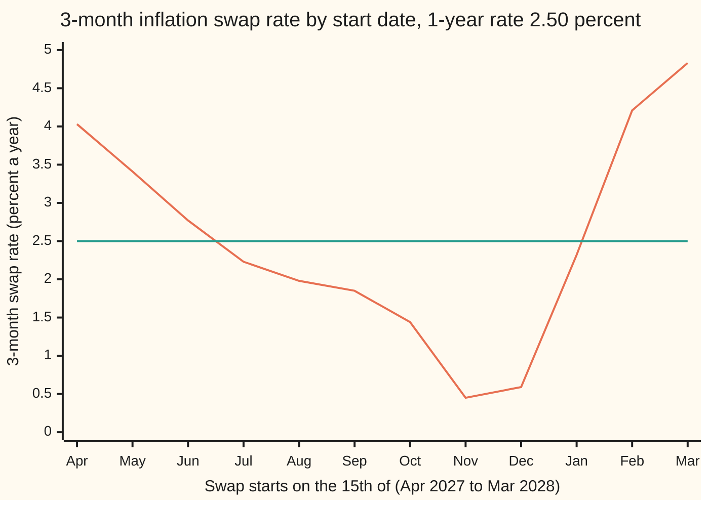

# Index lag and seasonality: the price index a bond actually uses, and the monthly pattern a short inflation curve must carry

[Syllabus](../../../SYLLABUS.md) → [Financial mathematics](../README.md) → [Inflation and Real Rates](../README.md#s34) → Index lag and seasonality

---

## General Overview

On 15 April 2027 a dealer is asked to quote a 3-month inflation swap on 10,000,000 dollars. The fund on the other side receives the rise in the price index from 15 April to 15 July. The 1-year swap trades at 2.50 percent a year. The easy answer is 2.50 percent for three months too.

That answer is 152.9 basis points too low (a basis point, bp, is 0.01 percent). Two facts about the price index make it wrong.

- **The lag.** A contract dated 15 April does not use April's prices. It uses a **reference index**: the consumer price index (CPI) of three months earlier, spread evenly over the days of the month. On 15 April that is January's 300.0 plus 14/30 of the step to February's 301.2, which is **300.56**. So the swap from 15 April to 15 July pays for price changes in the later part of February, all of March and April, and the early part of May.
- **Seasonality.** The index these contracts use is not seasonally adjusted. Prices rise faster in the first months of the year, when many prices are reset, and slower at the end, when shops discount. Those early months are exactly the ones the lag puts inside this swap.

With a realistic monthly pattern, the fair 3-month rate is **4.03 percent**, not 2.50. Quote 2.50 and the dealer expects to give away 37,319.79 dollars on the 15 July payment, before discounting. The 1-year rate stays 2.50 percent, because a full year collects every month's pattern once and the pattern adds to zero.

**A contract pays on the price index of months that lie three months behind its own dates, and a short contract collects only some of those months' seasonal pattern; a curve that adds zero-sum monthly factors to a smooth trend leaves every 1-year point alone and moves short rates by up to hundreds of basis points.**

**What kind of fact this is:** the reference index is a convention, the US Treasury's rule. The seasonal curve is a model: a smooth trend plus a fixed monthly pattern, an assumption that fits well enough, not a law. That zero-sum factors leave every 1-year rate unchanged is a theorem, proved on this card in Why it works.

### The picture: the same 2.50 percent year, quoted three months at a time

Each point is the fair 3-month swap rate for a swap starting on the 15th of that month, on the curve of this card.



The swinging line is the 3-month rate with seasonality. The flat line is 2.50 percent, what a curve without seasonality quotes at every start. The swing runs from 0.45 percent for a swap starting 15 November to 4.83 percent for one starting 15 March. Each 3-month rate is high or low depending on which CPI months the lag puts inside it.

---

## The formula

Notation first, in words. CPI here means CPI-U, not seasonally adjusted: the US consumer price index for all urban consumers, the index that TIPS (Treasury Inflation-Protected Securities) and US inflation swaps use.

The reference index for day $`t`$ of a month with $`D`$ days, the Treasury's rule from [Inflation-linked bonds](02-inflation-linked-bonds.md):

```math
R = M_0 + \frac{t-1}{D}\,(M_1 - M_0)
```

**Read it aloud:** start from the CPI of three months back, and walk an equal step each day towards the CPI of two months back.

The curve: the reference index projected to a date $`T`$ years ahead.

```math
R(T) = R_0\,(1+k_1)^{T}\,e^{S}, \qquad s_{\mathrm{Jan}} + s_{\mathrm{Feb}} + \dots + s_{\mathrm{Dec}} = 0
```

**Read it aloud:** today's reference index, grown by the smooth trend, times a seasonal correction built from monthly factors that add to zero.

The seasonal sum $`S`$ adds the factors of the CPI months the window covers. For the swap from 15 April to 15 July:

```math
S = \tfrac{16}{30}\,s_{\mathrm{Feb}} + s_{\mathrm{Mar}} + s_{\mathrm{Apr}} + \tfrac{14}{31}\,s_{\mathrm{May}}
```

**Read it aloud:** the window collects the part of February's change still ahead of the start date, all of March and April, and the part of May's change behind the end date.

The swap rate for a term of $`T`$ years, compounded once a year as in [Inflation swaps](04-zero-coupon-inflation-swaps.md):

```math
k_T = \left(\frac{R(T)}{R_0}\right)^{1/T} - 1 = (1+k_1)\,e^{S/T} - 1
```

**Read it aloud:** the trend rate, pushed up or down by the seasonal sum, spread over the term; a short term spreads it thinly, so its effect is large.

| Symbol | Plain meaning | In our example | Push it up and the answer… |
| --- | --- | --- | --- |
| $`R`$ | reference index: the lagged, day-interpolated CPI a contract uses on a date | 300.56 on 15 April | — |
| $`R_0`$, $`R(T)`$ | the reference index today; its projected value $`T`$ years ahead | 300.56; 303.5428 on 15 July | — |
| $`M_0`$, $`M_1`$ | CPI of the third and the second month before the date's month | January 300.0, February 301.2 | $`R`$ rises with each |
| $`t`$, $`D`$ | calendar day of the date; days in its month | 15 and 30 | a later day moves $`R`$ towards $`M_1`$ |
| $`s_m`$ | seasonal factor of calendar month $`m`$: how much that month's CPI change runs above or below the trend, as a log change | +0.20 percent for February, −0.30 for December | the window that contains month $`m`$ gets a higher rate |
| $`S`$ | seasonal sum: the factors the window collects, part months weighted by days | 0.370215 percent | $`k_T`$ rises |
| $`e^{S}`$ | seasonal correction: the factor $`S`$ multiplies the index by | 1.003709 | — |
| $`k_1`$ | 1-year swap rate: the trend inflation the market quotes for a full year | 2.50 percent | every rate on the curve rises with it |
| $`k_T`$ | swap rate for a term of $`T`$ years, read off the curve | 4.0292 percent at 3 months | — |
| $`T`$ | term in years, counted in months over 12 | 0.25 and 1 | the seasonal effect shrinks as $`1/T`$ |
| $`N`$ | notional: the amount every payment is computed on | 10,000,000 dollars | dollar amounts scale with it |
| $`\sigma(m)`$, $`w`$, $`h`$ | in the fold only: seasonal level of CPI month $`m`$ (running total of factors); day weight $`(t-1)/D`$; term in months | $`w`$ = 14/30 on 15 April, 14/31 on 15 July; $`h = 3`$ | — |

The twelve factors, in percent, invented but shaped like the US pattern: the first months of the year above trend, the last months below.

| Jan | Feb | Mar | Apr | May | Jun | Jul | Aug | Sep | Oct | Nov | Dec |
| ---: | ---: | ---: | ---: | ---: | ---: | ---: | ---: | ---: | ---: | ---: | ---: |
| +0.30 | +0.20 | +0.15 | +0.10 | +0.03 | +0.02 | −0.08 | −0.05 | −0.02 | −0.10 | −0.25 | −0.30 |

They add to 0.00.

**Conventions verified 2026-11-23** against 31 CFR 356, Appendix B: the reference index for the first day of a month is the non-seasonally adjusted CPI-U of the third preceding month, with straight-line interpolation by day, truncated to six decimals and rounded to five.

### When it holds

- **The contract uses the Treasury's lag and interpolation.** Other markets use other rules, such as a lag with no daily interpolation, where the index steps on the first of each month. Then the part-month weights become 0 or 1 and $`S`$ changes.
- **The seasonal pattern repeats each year.** The factors are estimated from past years. If the pattern shifts, for example because energy prices swing in a new month, the short rates are off while the 1-year rates are still right.
- **The factors add to exactly zero.** Then a full year's window collects zero. If they add to +0.30 percent, the 1-year rate comes out 2.8080 percent instead of the 2.50 percent the market quotes, and the curve no longer matches its own input.
- **The start and end months have the same length.** A 1-year window from 15 February 2028 to 15 February 2029 has weights 14/29 and 14/28, so the leap day leaves −0.53 bp. Every other start month gives 0.0 bp.
- **The trend is smooth between quotes.** One 1-year quote gives a flat trend. A real curve has quotes at 2, 3, 5 years and more, and needs a rule between them ([Inflation swaps](04-zero-coupon-inflation-swaps.md)); the seasonal factors go on top unchanged.

---

## Why it works

### Step 0: a date window is really a window of CPI months

A contract names dates. It is paid on the reference index at those dates, and the reference index is built from CPI months three months earlier. So every window of dates maps to a window of CPI months, shifted back about three months.

Once the months are known, seasonality is bookkeeping: the window's seasonal effect is the sum of those months' factors. The rest of the card works out which months, with which weights, and why a full year always collects zero.

### Step 1: the reference index on 15 April

The CPI for a month is published in the middle of the next month. A payment on 15 April cannot wait for April's CPI, so the rule reads three months back. On 1 April the reference index is January's CPI, 300.0. On 1 May it is February's, 301.2. In between it moves by an equal step each day.

On 15 April, fourteen days have passed since 1 April:

```math
R_0 = 300.0 + \frac{14}{30}\,(301.2 - 300.0) = 300.56
```

The full rule, with truncation and rounding and the index ratio a bond builds from it, is on [Inflation-linked bonds](02-inflation-linked-bonds.md).

### Step 2: which months the swap collects

Give every CPI month a seasonal level: the running total of the factors up to that month. The reference index carries a seasonal level too, interpolated between two months by the same day weight as the CPI itself.

The swap collects the difference between its end level and its start level. On 15 April the level sits 14/30 of the way from January to February. On 15 July it sits 14/31 of the way from April to May. Subtract, and the shared months cancel:

- February counts for the 16/30 of its step still ahead of 15 April.
- March and April count in full.
- May counts for the 14/31 of its step already behind 15 July.

That is the formula for $`S`$: 0.1067 + 0.1500 + 0.1000 + 0.0135 = 0.370215 percent, before rounding the parts. Three of the four months have large positive factors, which is why this swap's rate is high.

<details>
<summary>The algebra: the window's weights for any start date</summary>

Write $`\sigma(m)`$ for the seasonal level of CPI month $`m`$, so $`\sigma(m) - \sigma(m-1) = s_m`$. On day $`t`$ of a date month $`n`$ with $`D_n`$ days, the reference index's level is $`\sigma(n-3) + w_n\,s_{n-2}`$, with $`w_n = (t-1)/D_n`$. A window from day $`t`$ of month $`n`$ to day $`t`$ of month $`n+h`$ collects

$`\displaystyle S = \sigma(n+h-3) + w_{n+h}\,s_{n+h-2} - \sigma(n-3) - w_n\,s_{n-2} = (1-w_n)\,s_{n-2} + \sum_{j=n-1}^{n+h-3} s_j + w_{n+h}\,s_{n+h-2}.`$

For $`n`$ = April, $`h = 3`$, $`t = 15`$: $`w_n = 14/30`$, $`w_{n+h} = 14/31`$, and the sum runs over March and April. That is the displayed formula.

</details>

### Step 3: the curve is a trend times a seasonal correction

The 1-year swap rate fixes the trend: a reference index growing by $`1+k_1`$ a year, smoothly, from 300.56. The seasonal factors are changes in the logarithm of the index, so adding them to the trend's logarithm multiplies the trend by $`e^{S}`$.

On 15 July the trend gives $`300.56 \times 1.025^{0.25} = 300.56 \times 1.006192`$. The seasonal correction is $`e^{0.00370215} = 1.003709`$. Together they give 303.5428.

### Step 4: a full year collects every month once, so it collects zero

Take any window from day $`t`$ of a month to day $`t`$ of the same month a year later. By Step 2's weights, it collects $`(1-w)`$ of one month's factor at the start, the eleven months after it in full, and $`w`$ of that same calendar month's factor at the end.

The start and end months are the same calendar month, with the same number of days, so $`w`$ is the same at both ends. The two part weights add to $`(1-w) + w = 1`$. Every calendar month counts exactly once, and the twelve factors add to zero. So $`S = 0`$, $`e^{S} = 1`$, and every 1-year point equals the trend: $`k_1`$ stays 2.50 percent.

This is why the seasonal pattern can be added to a curve fitted to 1-year quotes without breaking the fit. The only exception is a February window across a leap year, where the two part weights are 14/29 and 14/28.

### Step 5: a short term magnifies the seasonal sum

The rate formula divides $`S`$ by $`T`$. Over three months, $`S/T = 0.370215 / 0.25 \approx 1.48`$ percent a year. That lifts the rate from 2.50 to 4.03 percent:

```math
k_{0.25} = 1.025 \times e^{0.00370215/0.25} - 1 = 4.0292\%
```

Spread over a full year instead, the same 0.37 percent would give 2.88 percent. The longer the term, the thinner the spread, so seasonality matters at the short end of the curve and fades along it. The year-on-year options of [Inflation caps and floors in outline](05-inflation-options-in-outline.md) each cover a whole year, so they can ignore the pattern; an option on part of a year must read its forward off a seasonal curve like this one.

---

## Worked numbers, by hand

The 3-month swap from 15 April to 15 July 2027, on 10,000,000 dollars. CPI levels invented: January 2027 300.0, February 2027 301.2. 1-year swap rate 2.50 percent.

| Step | Arithmetic | Value |
| --- | --- | --- |
| reference index, 15 April | $`300.0 + \frac{14}{30}(1.2)`$ | 300.56000 |
| February's part | $`\frac{16}{30} \times 0.20`$ | 0.1067% |
| March and April, in full | $`0.15`$ and $`0.10`$ | 0.1500% and 0.1000% |
| May's part | $`\frac{14}{31} \times 0.03`$ | 0.0135% |
| seasonal sum $`S`$ | add the parts | 0.370215% |
| trend over 3 months | $`1.025^{0.25}`$ | 1.006192 |
| seasonal correction | $`e^{0.00370215}`$ | 1.003709 |
| reference index, 15 July | $`300.56 \times 1.006192 \times 1.003709`$ | 303.5428 |
| 3-month rate | $`(303.5428 / 300.56)^4 - 1`$ | **4.0292%** |
| inflation leg, 15 July | $`10{,}000{,}000 \times (303.5428/300.56 - 1)`$ | 99,242.25 dollars |
| fixed leg at 2.50% | $`10{,}000{,}000 \times (1.025^{0.25} - 1)`$ | 61,922.46 dollars |
| cost of ignoring seasonality | $`99{,}242.25 - 61{,}922.46`$ | 37,319.79 dollars |

The market's fair price for three months of inflation starting in April is 4.03 percent a year, 152.9 bp above the 1-year rate. That is the price of the lag putting February, March and April inside the swap, not a change in anyone's view of inflation.

### What breaks if you drop a piece

Correct values: reference index 300.56; 3-month rate 4.0292 percent; 1-year rate 2.5000 percent.

| Mistake | Comes out at | What went wrong |
| --- | --- | --- |
| Ignore seasonality | 3-month rate 2.50% | The trend alone; the swap's months run above trend |
| Forget the lag: use the factors of May to August | 3-month rate 2.2274% | The Treasury rule with no lag: 1 April reads April's CPI, so the window collects the May to August changes, not February to May |
| Factors that do not add to zero (December left out) | 1-year rate 2.8080% | A full year now collects +0.30%, so the curve misses its own 1-year quote |
| Skip the daily interpolation | reference index 300.00000 | January alone; fourteen days of February's step missed |
| Count 15 days into April, not 14 | reference index 300.60000 | The rule uses $`t - 1`$: on the 1st no days have passed |

---

## Code, from first principles, and it actually runs

The code builds the reference index twice, by the Treasury formula and by walking one day at a time, with the truncate-then-round rule. It computes the seasonal sum by two independent roads. Road A is the weights formula from Step 2. Road B projects whole CPI months, each the trend times its running seasonal level, reads them through the Treasury interpolation, and divides by the same construction without seasonality. Road B interpolates index levels, not logarithms, so the two agree to within 0.06 bp rather than exactly. A third check confirms Step 4 by brute force: Road B's 1-year rate for all twelve start months, with the 15 February 2028 start checked against its leap-day weights. Nothing imported knows any inflation maths.

### Python

```python
# Index lag and seasonality -- the check behind the card.  Standard library only.
# Reference CPI on 15 Apr 2027 from January 300.0 and February 301.2 (invented levels).
# Curve: 1-year zero-coupon swap rate 2.50%, plus twelve monthly seasonal factors that sum to zero.
from math import exp, log

def days_in(n):                          # month n counts from Jan 2027 = 1
    y, m = 2027 + (n - 1) // 12, (n - 1) % 12 + 1
    if m == 2:
        return 29 if y % 4 == 0 and (y % 100 != 0 or y % 400 == 0) else 28
    return 30 if m in (4, 6, 9, 11) else 31

def ref_cpi(m0, m1, day, days):          # CPI in thousandths -> reference CPI in units of 0.00001
    formula = m0 * days + (day - 1) * (m1 - m0)     # road 1: the Treasury formula
    walk = m0 * days
    for _ in range(day - 1):                         # road 2: one day at a time
        walk += m1 - m0
    assert walk == formula
    return (formula * 1000 // days + 5) // 10        # truncate to six decimals, round to five

SEAS = [0.30, 0.20, 0.15, 0.10, 0.03, 0.02, -0.08, -0.05, -0.02, -0.10, -0.25, -0.30]  # % a month, Jan..Dec
K1, DAY, N = 0.025, 15, 10_000_000
def s(n, table=SEAS):                    # seasonal factor of month n, as a log change
    return table[(n - 1) % 12] / 100

def window_A(n, h, lag=3, table=SEAS):   # road A: the weights formula, 15th of month n to 15th of n+h
    w0, w1 = (DAY - 1) / days_in(n), (DAY - 1) / days_in(n + h)
    inner = sum(s(j, table) for j in range(n - lag + 2, n + h - lag + 1))
    return (1 - w0) * s(n - lag + 1, table) + inner + w1 * s(n + h - lag + 1, table)

def window_B(n, h):                      # road B: whole CPI months, read through the Treasury rule
    q = (1 + K1) ** (1 / 12)
    sig, level = {-24: 0.0}, {}
    for j in range(-23, 40):             # seasonal level: running total of the factors
        sig[j] = sig[j - 1] + s(j)
    def ref(n_, with_season):
        lev = lambda j: q ** j * (exp(sig[j]) if with_season else 1.0)
        w = (DAY - 1) / days_in(n_)
        return lev(n_ - 3) + w * (lev(n_ - 2) - lev(n_ - 3))
    seasonal = ref(n + h, True) / ref(n, True)
    trend = ref(n + h, False) / ref(n, False)
    return log(seasonal / trend)

def rate(S, T):                          # zero-coupon rate for a term of T years
    return (1 + K1) * exp(S / T) - 1

# ---- the reference index on 15 April 2027 ----
R0 = ref_cpi(300000, 301200, 15, 30) / 1e5
R0_flat = ref_cpi(300000, 301200, 1, 30) / 1e5      # no interpolation: January alone
R0_15 = ref_cpi(300000, 301200, 16, 30) / 1e5       # 15 days counted, not 14
assert abs(R0 - (300.0 + 14 / 30 * 1.2)) < 1e-9

# ---- the seasonal factors ----
assert abs(sum(SEAS)) < 1e-12
S_A, S_B = window_A(4, 3), window_B(4, 3)
k3, k3_B = rate(S_A, 0.25), rate(S_B, 0.25)
assert abs(k3 - k3_B) < 1e-5                         # two roads agree within 0.1 bp
parts = [(1 - 14 / 30) * s(2), s(3), s(4), 14 / 31 * s(5)]
assert abs(sum(parts) - S_A) < 1e-12                 # hand weights match the general formula
k1_A = rate(window_A(4, 12), 1.0)
assert abs(k1_A - K1) < 1e-12                        # 1-year point untouched, road A
shifts = [rate(window_B(n, 12), 1.0) - K1 for n in range(4, 16)]
assert all(abs(x) < 1e-12 for i, x in enumerate(shifts) if i != 10)   # every start but Feb 2028
assert abs(shifts[10] - ((1 + K1) * exp(s(12) * (14 / 28 - 14 / 29)) - 1 - K1)) < 1e-8  # leap day: Dec at 14/29, 14/28
R_jul = R0 * (1 + K1) ** 0.25 * exp(S_A)
assert abs((R_jul / R0) ** 4 - 1 - k3) < 1e-12

# ---- money on a 10,000,000 dollar 3-month swap, paid 15 July ----
infl_leg = N * (R_jul / R0 - 1)
fixed_naive = N * ((1 + K1) ** 0.25 - 1)
fixed_fair = N * ((1 + k3) ** 0.25 - 1)
assert abs(infl_leg - fixed_fair) < 1e-6

# ---- what breaks ----
k3_nolag = rate(window_A(4, 3, lag=0), 0.25)
bad = SEAS[:11] + [0.0]                              # December dropped: factors sum to +0.30%
k1_bad = rate(window_A(4, 12, table=bad), 1.0)
assert abs(k1_bad - ((1 + K1) * exp(0.003) - 1)) < 1e-12

def row(label, v, d=4): print(f"{label:<46} {v:.{d}f}")
row("reference CPI 15 Apr 2027", R0, 5)
row("  wrong: January alone, no interpolation", R0_flat, 5)
row("  wrong: 15/30 of the way, not 14/30", R0_15, 5)
print("seasonal factors Jan..Dec (%)", " ".join(f"{x:+.2f}" for x in SEAS))
row("sum of the twelve factors (%)", sum(SEAS) * 100 + 0.0, 2)
row("weight 16/30 x Feb factor (%)", parts[0] * 100)
row("Mar factor (%)", parts[1] * 100); row("Apr factor (%)", parts[2] * 100)
row("weight 14/31 x May factor (%)", parts[3] * 100)
row("S, road A: weights formula (%)", S_A * 100, 6)
row("S, road B: whole CPI months (%)", S_B * 100, 6)
row("trend factor 1.025^0.25", (1 + K1) ** 0.25, 6)
row("seasonal factor exp(S)", exp(S_A), 6)
row("projected reference CPI 15 Jul 2027", R_jul, 4)
row("3-month breakeven, no seasonality (%)", K1 * 100, 2)
row("3-month breakeven, road A (%)", k3 * 100)
row("3-month breakeven, road B (%)", k3_B * 100)
row("  road A minus road B (bp)", (k3 - k3_B) * 1e4, 2)
row("S / T over 3 months (%)", S_A / 0.25 * 100, 2)
row("same S spread over one year, rate (%)", rate(S_A, 1.0) * 100, 2)
row("  gap from seasonality (bp)", (k3 - K1) * 1e4, 1)
row("1-year breakeven with seasonality (%)", k1_A * 100)
row("largest 1-year shift, 11 start months (bp)", max(abs(x) for i, x in enumerate(shifts) if i != 10) * 1e4, 1)
row("1-year shift, 15 Feb 2028 start (bp)", shifts[10] * 1e4, 2)
row("inflation leg, 10m notional ($)", infl_leg, 2)
row("fixed leg struck at 2.50% ($)", fixed_naive, 2)
row("fixed leg struck at the fair rate ($)", fixed_fair, 2)
row("  loss from ignoring seasonality ($)", infl_leg - fixed_naive, 2)
row("wrong: no lag, factors May..Aug (%)", k3_nolag * 100)
row("wrong: December dropped, 1-year rate (%)", k1_bad * 100)
print("chart: 3-month breakeven (%) starting the 15th of Apr 2027 .. Mar 2028")
print(" ".join(f"{rate(window_A(n, 3), 0.25) * 100:.2f}" for n in range(4, 16)))
print("ALL CHECKS PASS")
```

**Ran 2026-11-23 on macOS, Python 3.14.10, standard library only. All checks passed. Output, pasted from the run:**

```
reference CPI 15 Apr 2027                      300.56000
  wrong: January alone, no interpolation       300.00000
  wrong: 15/30 of the way, not 14/30           300.60000
seasonal factors Jan..Dec (%) +0.30 +0.20 +0.15 +0.10 +0.03 +0.02 -0.08 -0.05 -0.02 -0.10 -0.25 -0.30
sum of the twelve factors (%)                  0.00
weight 16/30 x Feb factor (%)                  0.1067
Mar factor (%)                                 0.1500
Apr factor (%)                                 0.1000
weight 14/31 x May factor (%)                  0.0135
S, road A: weights formula (%)                 0.370215
S, road B: whole CPI months (%)                0.370079
trend factor 1.025^0.25                        1.006192
seasonal factor exp(S)                         1.003709
projected reference CPI 15 Jul 2027            303.5428
3-month breakeven, no seasonality (%)          2.50
3-month breakeven, road A (%)                  4.0292
3-month breakeven, road B (%)                  4.0286
  road A minus road B (bp)                     0.06
S / T over 3 months (%)                        1.48
same S spread over one year, rate (%)          2.88
  gap from seasonality (bp)                    152.9
1-year breakeven with seasonality (%)          2.5000
largest 1-year shift, 11 start months (bp)     0.0
1-year shift, 15 Feb 2028 start (bp)           -0.53
inflation leg, 10m notional ($)                99242.25
fixed leg struck at 2.50% ($)                  61922.46
fixed leg struck at the fair rate ($)          99242.25
  loss from ignoring seasonality ($)           37319.79
wrong: no lag, factors May..Aug (%)            2.2274
wrong: December dropped, 1-year rate (%)       2.8080
chart: 3-month breakeven (%) starting the 15th of Apr 2027 .. Mar 2028
4.03 3.41 2.77 2.23 1.98 1.85 1.44 0.45 0.59 2.32 4.21 4.83
ALL CHECKS PASS
```

### Rust

```rust
// Index lag and seasonality -- the check behind the card.  Rust std only, no crates.
// Reference CPI on 15 Apr 2027 from January 300.0 and February 301.2 (invented levels).
// Curve: 1-year zero-coupon swap rate 2.50%, plus twelve monthly seasonal factors that sum to zero.
const SEAS: [f64; 12] = [0.30, 0.20, 0.15, 0.10, 0.03, 0.02, -0.08, -0.05, -0.02, -0.10, -0.25, -0.30];
const K1: f64 = 0.025;
const DAY: i64 = 15;
const N: f64 = 10_000_000.0;

fn days_in(n: i64) -> i64 {
    // month n counts from Jan 2027 = 1
    let (y, m) = (2027 + (n - 1).div_euclid(12), (n - 1).rem_euclid(12) + 1);
    if m == 2 {
        return if y % 4 == 0 && (y % 100 != 0 || y % 400 == 0) { 29 } else { 28 };
    }
    if [4, 6, 9, 11].contains(&m) { 30 } else { 31 }
}

fn ref_cpi(m0: i64, m1: i64, day: i64, days: i64) -> i64 {
    // CPI in thousandths -> reference CPI in units of 0.00001
    let formula = m0 * days + (day - 1) * (m1 - m0); // road 1: the Treasury formula
    let mut walk = m0 * days;
    for _ in 1..day {
        walk += m1 - m0; // road 2: one day at a time
    }
    assert_eq!(walk, formula);
    (formula * 1000 / days + 5) / 10 // truncate to six decimals, round to five
}

fn s(n: i64, table: &[f64; 12]) -> f64 {
    // seasonal factor of month n, as a log change
    table[(n - 1).rem_euclid(12) as usize] / 100.0
}

fn window_a(n: i64, h: i64, lag: i64, table: &[f64; 12]) -> f64 {
    // road A: the weights formula, 15th of month n to 15th of n+h
    let w0 = (DAY - 1) as f64 / days_in(n) as f64;
    let w1 = (DAY - 1) as f64 / days_in(n + h) as f64;
    let inner: f64 = (n - lag + 2..n + h - lag + 1).map(|j| s(j, table)).sum();
    (1.0 - w0) * s(n - lag + 1, table) + inner + w1 * s(n + h - lag + 1, table)
}

fn window_b(n: i64, h: i64) -> f64 {
    // road B: whole CPI months, read through the Treasury rule
    let q = (1.0 + K1).powf(1.0 / 12.0);
    let mut sig = vec![0.0f64; 64]; // sig[j + 24] is the seasonal level of month j
    for j in -23..40i64 {
        sig[(j + 24) as usize] = sig[(j + 23) as usize] + s(j, &SEAS);
    }
    let lev = |j: i64, with_season: bool| {
        q.powf(j as f64) * if with_season { sig[(j + 24) as usize].exp() } else { 1.0 }
    };
    let reference = |n_: i64, with_season: bool| {
        let w = (DAY - 1) as f64 / days_in(n_) as f64;
        lev(n_ - 3, with_season) + w * (lev(n_ - 2, with_season) - lev(n_ - 3, with_season))
    };
    let seasonal = reference(n + h, true) / reference(n, true);
    let trend = reference(n + h, false) / reference(n, false);
    (seasonal / trend).ln()
}

fn rate(s_: f64, t: f64) -> f64 {
    // zero-coupon rate for a term of T years
    (1.0 + K1) * (s_ / t).exp() - 1.0
}

fn row(label: &str, v: f64, d: usize) {
    println!("{:<46} {:.*}", label, d, v);
}

fn main() {
    // ---- the reference index on 15 April 2027 ----
    let r0 = ref_cpi(300000, 301200, 15, 30) as f64 / 1e5;
    let r0_flat = ref_cpi(300000, 301200, 1, 30) as f64 / 1e5; // no interpolation: January alone
    let r0_15 = ref_cpi(300000, 301200, 16, 30) as f64 / 1e5; // 15 days counted, not 14
    assert!((r0 - (300.0 + 14.0 / 30.0 * 1.2)).abs() < 1e-9);

    // ---- the seasonal factors ----
    let total: f64 = SEAS.iter().sum();
    assert!(total.abs() < 1e-12);
    let (s_a, s_b) = (window_a(4, 3, 3, &SEAS), window_b(4, 3));
    let (k3, k3_b) = (rate(s_a, 0.25), rate(s_b, 0.25));
    assert!((k3 - k3_b).abs() < 1e-5); // two roads agree within 0.1 bp
    let parts = [(1.0 - 14.0 / 30.0) * s(2, &SEAS), s(3, &SEAS), s(4, &SEAS), 14.0 / 31.0 * s(5, &SEAS)];
    assert!((parts.iter().sum::<f64>() - s_a).abs() < 1e-12); // hand weights match the general formula
    let k1_a = rate(window_a(4, 12, 3, &SEAS), 1.0);
    assert!((k1_a - K1).abs() < 1e-12); // 1-year point untouched, road A
    let shifts: Vec<f64> = (4..16).map(|n| rate(window_b(n, 12), 1.0) - K1).collect();
    assert!(shifts.iter().enumerate().all(|(i, x)| i == 10 || x.abs() < 1e-12)); // every start but Feb 2028
    let leap = (1.0 + K1) * (s(12, &SEAS) * (14.0 / 28.0 - 14.0 / 29.0)).exp() - 1.0 - K1;
    assert!((shifts[10] - leap).abs() < 1e-8); // leap day: Dec at 14/29, 14/28
    let r_jul = r0 * (1.0 + K1).powf(0.25) * s_a.exp();
    assert!(((r_jul / r0).powf(4.0) - 1.0 - k3).abs() < 1e-12);

    // ---- money on a 10,000,000 dollar 3-month swap, paid 15 July ----
    let infl_leg = N * (r_jul / r0 - 1.0);
    let fixed_naive = N * ((1.0 + K1).powf(0.25) - 1.0);
    let fixed_fair = N * ((1.0 + k3).powf(0.25) - 1.0);
    assert!((infl_leg - fixed_fair).abs() < 1e-6);

    // ---- what breaks ----
    let k3_nolag = rate(window_a(4, 3, 0, &SEAS), 0.25);
    let mut bad = SEAS;
    bad[11] = 0.0; // December dropped: factors sum to +0.30%
    let k1_bad = rate(window_a(4, 12, 3, &bad), 1.0);
    assert!((k1_bad - ((1.0 + K1) * 0.003f64.exp() - 1.0)).abs() < 1e-12);

    row("reference CPI 15 Apr 2027", r0, 5);
    row("  wrong: January alone, no interpolation", r0_flat, 5);
    row("  wrong: 15/30 of the way, not 14/30", r0_15, 5);
    let seas: Vec<String> = SEAS.iter().map(|x| format!("{:+.2}", x)).collect();
    println!("seasonal factors Jan..Dec (%) {}", seas.join(" "));
    row("sum of the twelve factors (%)", total * 100.0 + 0.0, 2);
    row("weight 16/30 x Feb factor (%)", parts[0] * 100.0, 4);
    row("Mar factor (%)", parts[1] * 100.0, 4);
    row("Apr factor (%)", parts[2] * 100.0, 4);
    row("weight 14/31 x May factor (%)", parts[3] * 100.0, 4);
    row("S, road A: weights formula (%)", s_a * 100.0, 6);
    row("S, road B: whole CPI months (%)", s_b * 100.0, 6);
    row("trend factor 1.025^0.25", (1.0 + K1).powf(0.25), 6);
    row("seasonal factor exp(S)", s_a.exp(), 6);
    row("projected reference CPI 15 Jul 2027", r_jul, 4);
    row("3-month breakeven, no seasonality (%)", K1 * 100.0, 2);
    row("3-month breakeven, road A (%)", k3 * 100.0, 4);
    row("3-month breakeven, road B (%)", k3_b * 100.0, 4);
    row("  road A minus road B (bp)", (k3 - k3_b) * 1e4, 2);
    row("S / T over 3 months (%)", s_a / 0.25 * 100.0, 2);
    row("same S spread over one year, rate (%)", rate(s_a, 1.0) * 100.0, 2);
    row("  gap from seasonality (bp)", (k3 - K1) * 1e4, 1);
    row("1-year breakeven with seasonality (%)", k1_a * 100.0, 4);
    let largest = shifts.iter().enumerate().filter(|(i, _)| *i != 10).map(|(_, x)| x.abs()).fold(0.0, f64::max);
    row("largest 1-year shift, 11 start months (bp)", largest * 1e4, 1);
    row("1-year shift, 15 Feb 2028 start (bp)", shifts[10] * 1e4, 2);
    row("inflation leg, 10m notional ($)", infl_leg, 2);
    row("fixed leg struck at 2.50% ($)", fixed_naive, 2);
    row("fixed leg struck at the fair rate ($)", fixed_fair, 2);
    row("  loss from ignoring seasonality ($)", infl_leg - fixed_naive, 2);
    row("wrong: no lag, factors May..Aug (%)", k3_nolag * 100.0, 4);
    row("wrong: December dropped, 1-year rate (%)", k1_bad * 100.0, 4);
    println!("chart: 3-month breakeven (%) starting the 15th of Apr 2027 .. Mar 2028");
    let chart: Vec<String> = (4..16).map(|n| format!("{:.2}", rate(window_a(n, 3, 3, &SEAS), 0.25) * 100.0)).collect();
    println!("{}", chart.join(" "));
    println!("ALL CHECKS PASS");
}
```

**Ran 2026-11-23 on macOS, rustc 1.98.1, no crates. All checks passed. Output, pasted from the run:**

```
reference CPI 15 Apr 2027                      300.56000
  wrong: January alone, no interpolation       300.00000
  wrong: 15/30 of the way, not 14/30           300.60000
seasonal factors Jan..Dec (%) +0.30 +0.20 +0.15 +0.10 +0.03 +0.02 -0.08 -0.05 -0.02 -0.10 -0.25 -0.30
sum of the twelve factors (%)                  0.00
weight 16/30 x Feb factor (%)                  0.1067
Mar factor (%)                                 0.1500
Apr factor (%)                                 0.1000
weight 14/31 x May factor (%)                  0.0135
S, road A: weights formula (%)                 0.370215
S, road B: whole CPI months (%)                0.370079
trend factor 1.025^0.25                        1.006192
seasonal factor exp(S)                         1.003709
projected reference CPI 15 Jul 2027            303.5428
3-month breakeven, no seasonality (%)          2.50
3-month breakeven, road A (%)                  4.0292
3-month breakeven, road B (%)                  4.0286
  road A minus road B (bp)                     0.06
S / T over 3 months (%)                        1.48
same S spread over one year, rate (%)          2.88
  gap from seasonality (bp)                    152.9
1-year breakeven with seasonality (%)          2.5000
largest 1-year shift, 11 start months (bp)     0.0
1-year shift, 15 Feb 2028 start (bp)           -0.53
inflation leg, 10m notional ($)                99242.25
fixed leg struck at 2.50% ($)                  61922.46
fixed leg struck at the fair rate ($)          99242.25
  loss from ignoring seasonality ($)           37319.79
wrong: no lag, factors May..Aug (%)            2.2274
wrong: December dropped, 1-year rate (%)       2.8080
chart: 3-month breakeven (%) starting the 15th of Apr 2027 .. Mar 2028
4.03 3.41 2.77 2.23 1.98 1.85 1.44 0.45 0.59 2.32 4.21 4.83
ALL CHECKS PASS
```

### Lean

Lean proves Step 2's window weights and Step 4's 1-year result for every start month and day, and checks the worked numbers.

- Suppose the factors repeat each year and add to zero, and the start and end months have the same length. Then the 1-year rate read off the curve, $`(1+k_1)\,e^{S} - 1`$, equals $`k_1`$.
- Take seasonal levels $`\sigma(m)`$, day weights $`w_0`$ and $`w_1`$, and a term of $`h \ge 1`$ months. Then end level minus start level weights the first month by $`1-w_0`$, the last by $`w_1`$, the rest by 1.
- Take factors that repeat each year and add to zero, with start and end months of any lengths. Then a 1-year window collects $`w_1 - w_0`$ times that month's factor: the leap-day remainder.
- Exact arithmetic confirms the reference index 300.56, the wrong readings 300.00 and 300.60, and the twelve factors adding to zero.
- It also confirms $`S`$ = 0.370215 percent for April to July, zero for a 1-year window, and the February 2028 remainder.

The 4.03 percent rate, the dollar legs, Road B, the chart and the twelve start months are left to the Python and Rust checks.

```lean
-- Index lag and seasonality: monthly seasonal factors that repeat each year and add to zero leave every 1-year inflation swap rate equal to the trend rate.
import Mathlib.Analysis.SpecialFunctions.Exp
import Mathlib.Algebra.BigOperators.Intervals
import Mathlib.Tactic.NormNum
import Mathlib.Tactic.Ring

open Finset

theorem seasonal_twelve_window_zero
    (s : ℤ → ℝ) (hper : ∀ m, s (m + 12) = s m) (hsum : ∑ i ∈ range 12, s i = 0) (m : ℤ) :
    ∑ i ∈ range 12, s (m + i) = 0 := by
  have step : ∀ k : ℤ, ∑ i ∈ range 12, s (k + 1 + i) = ∑ i ∈ range 12, s (k + i) := by
    intro k
    have h1 := Finset.sum_range_succ (fun i : ℕ => s (k + i)) 12
    have h2 := Finset.sum_range_succ' (fun i : ℕ => s (k + i)) 12
    have e : ∑ i ∈ range 12, s (k + 1 + i) = ∑ i ∈ range 12, s (k + ((i + 1 : ℕ) : ℤ)) := by
      refine Finset.sum_congr rfl fun i _ => ?_
      congr 1; push_cast; ring
    have h12 : s (k + ((12 : ℕ) : ℤ)) = s (k + ((0 : ℕ) : ℤ)) := by
      simpa using hper k
    rw [e]; linarith
  have h0 : ∑ i ∈ range 12, s ((0 : ℤ) + i) = 0 := by simpa using hsum
  induction m using Int.induction_on with
  | zero => exact h0
  | succ k ih => rw [step]; exact ih
  | pred k ih =>
    have := step (-(k : ℤ) - 1)
    have e : (-(k : ℤ) - 1 + 1) = -(k : ℤ) := by ring
    rw [e] at this; rw [← this]; exact ih

theorem seasonal_one_year_sum
    (s : ℤ → ℝ) (hper : ∀ m, s (m + 12) = s m) (hsum : ∑ i ∈ range 12, s i = 0)
    (a b : ℝ) (n : ℤ) :
    (1 - a) * s (n - 2) + ∑ i ∈ range 11, s (n - 1 + i) + b * s (n + 10)
      = (b - a) * s (n - 2) := by
  have hz := seasonal_twelve_window_zero s hper hsum (n - 2)
  rw [Finset.sum_range_succ'] at hz
  have e : ∑ i ∈ range 11, s (n - 2 + ((i + 1 : ℕ) : ℤ)) = ∑ i ∈ range 11, s (n - 1 + i) := by
    refine Finset.sum_congr rfl fun i _ => ?_
    congr 1; push_cast; ring
  have hp : s (n + 10) = s (n - 2) := by
    have := hper (n - 2); rw [← this]; congr 1; ring
  rw [e] at hz
  simp only [Nat.cast_zero, add_zero] at hz
  rw [hp]; linarith

#print axioms seasonal_twelve_window_zero
#print axioms seasonal_one_year_sum

/-- A full year of a lagged, day-interpolated reference index collects no seasonality.
Take seasonal factors `s m` for CPI months `m` that repeat every 12 months and add to zero
over a year. A swap from day `t` of date month `n` to day `t` of month `n + 12` collects the
seasonal sum `S = (1 - w₀) s(n-2) + s(n-1) + ... + s(n+9) + w₁ s(n+10)`, where the three-month
lag and the daily interpolation give the weights `w₀ = (t-1)/D₀` and `w₁ = (t-1)/D₁` from the
lengths `D₀`, `D₁` of the start and end months. When the two months have the same length, the
1-year swap rate `k₁' = (1 + k₁) e^{S/1} - 1` read off the seasonal curve equals the trend rate `k₁`. -/
theorem one_year_swap_rate_unchanged_by_zero_sum_seasonality
    (s : ℤ → ℝ) (hper : ∀ m, s (m + 12) = s m) (hsum : ∑ i ∈ range 12, s i = 0)
    (k₁ t D₀ D₁ : ℝ) (n : ℤ) (hD : D₀ = D₁) :
    (1 + k₁) * Real.exp
        (((1 - (t - 1) / D₀) * s (n - 2) + ∑ i ∈ range 11, s (n - 1 + i)
          + (t - 1) / D₁ * s (n + 10)) / 1) - 1 = k₁ := by
  rw [seasonal_one_year_sum s hper hsum, hD]
  simp

/-- Which CPI months a swap collects. Let `σ` be the seasonal level of CPI months, the running
total of the factors, so `s m = σ m - σ (m - 1)`. On day `t` of date month `n` the reference index
sits at seasonal level `σ(n-3) + w s(n-2)` (three months back, plus the day weight `w` of the next
month's step). A swap from date month `n` to date month `n + h` collects the end level minus the
start level, which is `(1 - w₀) s(n-2) + s(n-1) + ... + s(n+h-3) + w₁ s(n+h-2)`. -/
theorem lagged_window_seasonal_sum
    (σ s : ℤ → ℝ) (hs : ∀ m, s m = σ m - σ (m - 1)) (w₀ w₁ : ℝ) (n : ℤ) (h : ℕ) (hh : 1 ≤ h) :
    (σ (n + h - 3) + w₁ * s (n + h - 2)) - (σ (n - 3) + w₀ * s (n - 2))
      = (1 - w₀) * s (n - 2) + ∑ i ∈ range (h - 1), s (n - 1 + i) + w₁ * s (n + h - 2) := by
  have tel : ∀ k : ℕ, ∑ i ∈ range k, s (n - 1 + i) = σ (n - 2 + k) - σ (n - 2) := by
    intro k
    induction k with
    | zero => simp
    | succ k ih =>
      rw [Finset.sum_range_succ, ih, hs]
      have e1 : n - 1 + (k : ℤ) = n - 2 + ((k + 1 : ℕ) : ℤ) := by push_cast; ring
      have e2 : n - 2 + ((k + 1 : ℕ) : ℤ) - 1 = n - 2 + (k : ℤ) := by push_cast; ring
      rw [e1, e2]; ring
  obtain ⟨k, rfl⟩ : ∃ k, h = k + 1 := ⟨h - 1, by omega⟩
  rw [Nat.add_sub_cancel, tel k, hs (n - 2)]
  have e1 : n + ((k + 1 : ℕ) : ℤ) - 3 = n - 2 + (k : ℤ) := by push_cast; ring
  have e2 : n - 2 - 1 = n - 3 := by ring
  rw [e1, e2]; ring

/-- The leap-day exception. With factors that repeat yearly and add to zero, but start and end
months of different lengths `D₀` and `D₁` (February 2028 against February 2029), a 1-year window
collects `((t-1)/D₁ - (t-1)/D₀) s(n-2)` instead of zero. -/
theorem one_year_seasonal_sum_unequal_months
    (s : ℤ → ℝ) (hper : ∀ m, s (m + 12) = s m) (hsum : ∑ i ∈ range 12, s i = 0)
    (t D₀ D₁ : ℝ) (n : ℤ) :
    (1 - (t - 1) / D₀) * s (n - 2) + ∑ i ∈ range 11, s (n - 1 + i) + (t - 1) / D₁ * s (n + 10)
      = ((t - 1) / D₁ - (t - 1) / D₀) * s (n - 2) := by
  exact seasonal_one_year_sum s hper hsum _ _ n

-- Reference CPI on 15 April from January 300.0 and February 301.2, with CPI in thousandths:
-- Treasury formula, truncated to six decimals and rounded to five, gives 300.56000.
example : ((300000 * 30 + (15 - 1) * (301200 - 300000)) * 1000 / 30 + 5) / 10 = 30056000 := by
  norm_num
-- Wrong: no interpolation (January alone) gives 300.00000.
example : ((300000 * 30 + (1 - 1) * (301200 - 300000)) * 1000 / 30 + 5) / 10 = 30000000 := by
  norm_num
-- Wrong: 15 days counted, not 14, gives 300.60000.
example : ((300000 * 30 + (16 - 1) * (301200 - 300000)) * 1000 / 30 + 5) / 10 = 30060000 := by
  norm_num

-- The card's twelve factors, in hundredths of a percent, add to zero.
example : ([30, 20, 15, 10, 3, 2, -8, -5, -2, -10, -25, -30] : List ℤ).sum = 0 := by decide

-- 15 April to 15 July: S = 16/30 Feb + Mar + Apr + 14/31 May = 0.370215 percent
-- (here in hundredths of a percent).
example : (16 / 30 : ℚ) * 20 + 15 + 10 + 14 / 31 * 3 = 3443 / 93 := by norm_num

-- 15 April to 15 April a year later: 16/30 of February, March to January in full,
-- 14/30 of February; the sum is zero.
example : (16 / 30 : ℚ) * 20 + (15 + 10 + 3 + 2 - 8 - 5 - 2 - 10 - 25 - 30 + 30)
    + 14 / 30 * 20 = 0 := by norm_num

-- 15 February 2028 to 15 February 2029: December at 15/29 and 14/28, January to November in full;
-- the sum is -15/29 hundredths of a percent, not zero.
example : (15 / 29 : ℚ) * (-30) + (30 + 20 + 15 + 10 + 3 + 2 - 8 - 5 - 2 - 10 - 25)
    + 14 / 28 * (-30) = -15 / 29 := by norm_num

#print axioms one_year_swap_rate_unchanged_by_zero_sum_seasonality
#print axioms lagged_window_seasonal_sum
#print axioms one_year_seasonal_sum_unequal_months
```

**Checked 2026-11-23 on macOS, Lean 4.36.0-rc2, Mathlib v4.36.0-rc2. Every proof is complete and uses only Lean's standard axioms. Output, pasted from the run:**

```
'seasonal_twelve_window_zero' depends on axioms: [propext, Classical.choice, Quot.sound]
'seasonal_one_year_sum' depends on axioms: [propext, Classical.choice, Quot.sound]
'one_year_swap_rate_unchanged_by_zero_sum_seasonality' depends on axioms: [propext, Classical.choice, Quot.sound]
'lagged_window_seasonal_sum' depends on axioms: [propext, Classical.choice, Quot.sound]
'one_year_seasonal_sum_unequal_months' depends on axioms: [propext, Classical.choice, Quot.sound]
```

> [!TIP]
> **Try changing**
> - Guess first: a swap starting on **15 November** instead of 15 April. Its window collects September to December, where the factors are negative. The chart line prints it: **0.45 percent**, against the trend's 2.50.
> - Guess first: the **1-year swap** on this curve. Step 4 says the factors cancel. The row `1-year breakeven with seasonality` prints **2.5000 percent**.
> - Guess first: drop December's factor, as the script's list `bad` does, so the twelve add to +0.30. Call `rate(window_A(4, 3, table=bad), 0.25)`: the 15 April 3-month rate stays 4.0292 percent, because December is not in its window. The 1-year rate becomes **2.8080 percent** (row `wrong: December dropped, 1-year rate`). Setting December to 0 in `SEAS` itself stops the script at its zero-sum asserts.
> - Guess first: call `window_A(4, 3, lag=0)`, the Treasury rule with no lag, so 1 April reads April's CPI. The rate drops to **2.2274 percent**, because the window now collects the May to August changes, near or below trend.

---

## The usual mistake

> [!warning]
> **Reading a seasonal swing as a change in inflation expectations.** A 3-month breakeven of 4.03 percent beside a 1-year rate of 2.50 does not mean the market expects a burst of inflation this spring and calm later. It is the same smooth 2.50 percent trend, with the lag placing three above-trend CPI months inside the short window. Compare short rates only after removing the seasonal sum.
>
> Smaller traps:
> - **Forgetting the lag.** Reading April's CPI on 1 April moves the window to the May to August changes: 2.2274 percent instead of 4.0292.
> - **Factors that do not add to zero.** Leave December out and every 1-year point moves: 2.8080 percent instead of the 2.50 quote.
> - **Using the seasonally adjusted index.** The contracts pay on the unadjusted index. Adjusted CPI is also revised each year for five years back, so it cannot settle a payment.
> - **Reading the reference index off one month.** January alone gives 300.00; counting 15 days gives 300.60. The rule gives 300.56.

---

## Where you meet it in real life

- **TIPS near maturity.** A TIPS with three months left is a 3-month inflation contract. Its breakeven against a Treasury bill swings with the season in the same way, so it must be read with the seasonal sum removed.
- **The front of the inflation swap curve.** Dealers build their curves from 1-year and longer quotes plus a set of monthly seasonal factors, and price every odd date from that curve.
- **Central banks reading breakevens.** A study of euro-area linkers (inflation-linked bonds) found that seasonality puts large, misleading distortions into breakeven rates. It builds a seasonal correction into the curve fit and compares the corrected rates with swap rates.
- **Carry on a linker.** A TIPS holder earns the reference index's daily growth, which in each month carries the CPI change of two months earlier. So carry runs well above trend from March to June (the January to April changes) and below trend from September to February, deepest in January and February (the November and December changes). A linker's monthly return has a seasonal shape.
- **Other markets' lags.** UK index-linked gilts issued before 2005 use an eight-month lag with no daily interpolation. Longer lags move the windows further back: the same weights formula applies with a different shift, and with part-month weights of 0 or 1.

> **Say it back**
> A contract on US inflation uses a reference index: the CPI of three months earlier, interpolated by day, 300.56 on 15 April. So a swap from 15 April to 15 July pays for CPI changes from mid-February to mid-May. A curve built as a smooth trend times a seasonal correction collects those months' factors, here 0.37 percent. Because the twelve factors add to zero, every full year collects nothing and the 1-year rate stays 2.50 percent. Over three months the same 0.37 percent lifts the rate to 4.03 percent; ignoring it costs 37,319.79 dollars on 10 million.

---

## What this builds on

- [Inflation-linked bonds](02-inflation-linked-bonds.md): the Treasury's reference index, its three-month lag, daily interpolation and rounding, and the index ratio a bond's payments are scaled by. This card uses that rule to decide which CPI months a window collects.
- [Breakeven inflation](03-breakeven-inflation.md): the breakeven rate as the price of inflation over a term, read from two bonds. This card shows why a short breakeven needs a seasonal correction before it can be read that way.
- [Inflation swaps](04-zero-coupon-inflation-swaps.md): the zero-coupon swap, its annually compounded fixed leg, and the curve of swap rates by maturity. This card adds the monthly seasonal layer to that curve.

## Where this goes next

- [Jarrow-Yildirim](07-jarrow-yildirim-and-zero-coupon-inflation-floors.md): a model in which real rates, nominal rates and the index move together, used to price a zero-coupon inflation floor that fixes on the lagged reference index defined here.

This card fixed the seasonal pattern in advance; the question it leaves open is how uncertain the index is around that pattern, and what an option on it is worth.

---

## Sources

Verified 2026-11-23: every link below resolves to the publisher's page.

- US Code of Federal Regulations, Title 31, Part 356, Appendix B: Formulas and Tables. [govinfo](https://www.govinfo.gov/content/pkg/CFR-2024-title31-vol2/pdf/CFR-2024-title31-vol2-part356-appB.pdf). The reference index: the non-seasonally adjusted CPI-U of the third preceding month, interpolated by day, with the 15 April worked example; source of the conventions line.
- US Bureau of Labor Statistics, [Seasonal adjustment in the CPI](https://www.bls.gov/cpi/seasonal-adjustment/). Why the unadjusted index has a monthly pattern, and that seasonal factors are recalculated each year and revise five years of adjusted data.
- Ejsing, Jacob, Juan Angel García, and Thomas Werner. "The Term Structure of Euro Area Break-Even Inflation Rates: The Impact of Seasonality." ECB Working Paper No. 830, November 2007. [Publisher PDF](https://www.ecb.europa.eu/pub/pdf/scpwps/ecbwp830.pdf); [doi:10.2139/ssrn.1028713](https://doi.org/10.2139/ssrn.1028713). Shows that seasonality puts large, time-varying distortions into breakeven rates, and corrects for it inside the curve fit.
- Deacon, Mark, Andrew Derry, and Dariush Mirfendereski. *Inflation-Indexed Securities: Bonds, Swaps and Other Derivatives*, 2nd ed. Wiley, 2004. [Publisher page](https://www.wiley.com/en-us/Inflation-indexed+Securities:+Bonds,+Swaps+and+Other+Derivatives,+2nd+Edition-p-9780470868980). The standard reference on index-linked bond design and the valuation of inflation swaps.
