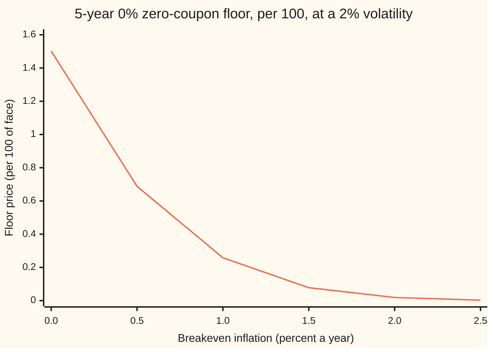
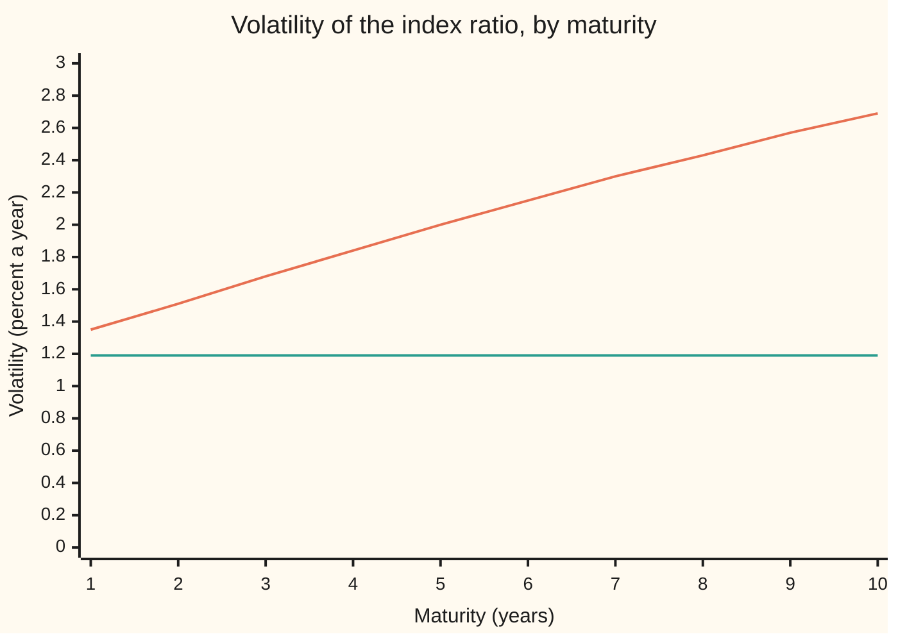

# Jarrow-Yildirim: inflation as an exchange rate between nominal and real money, and the zero-coupon floor that protects a linker's principal

[Syllabus](../../../SYLLABUS.md) → [Financial mathematics](../README.md) → [Inflation and Real Rates](../README.md#s34) → Jarrow-Yildirim

---

## General Overview

A new 5-year US Treasury inflation-linked bond, a **linker**, repays its principal scaled by the **index ratio**: the consumer price index at maturity divided by the index on its dated date ([Inflation-linked bonds](02-inflation-linked-bonds.md)). Prices up 5 percent, and 100 of face repays 105. The Treasury adds one promise: the principal never repays less than 100, even if prices fall.

That promise is an option. It pays 100 times (1 minus the index ratio) whenever the ratio ends below 1.00, and nothing otherwise. It is a **zero-coupon inflation floor**: one put (an option that pays when a quantity ends below a set level, its **strike**) on five years of inflation taken together, struck at a ratio of 1.00.

What is it worth? Suppose the market expects 1.0 percent inflation a year (the **breakeven**, from [Breakeven inflation](03-breakeven-inflation.md)), so the ratio is expected to reach $`1.01^5 = 1.051010`$. Suppose nominal rates are 3.5 percent and the ratio wobbles with a **volatility** of 2 percent a year. Then the floor costs **0.258376 per 100** of face. At the shelf's usual 2.5 percent breakeven the same floor costs 0.003475: the ratio is expected to reach 1.131408, far above the strike.

What makes up that 2 percent, and what should it be at other maturities? The Jarrow-Yildirim model (2003) answers both. It treats a basket of goods as a foreign currency and the price index as its exchange rate in dollars. Then the toolkit of currency options applies to inflation, with the real interest rate playing the foreign rate.

**Jarrow-Yildirim prices inflation as the exchange rate between dollars and baskets of goods: with nominal and real rates each following Hull-White, the forward index ratio is lognormal with a volatility built from the index's own wobble and both bonds' wobbles, so Black's formula prices a zero-coupon floor, and the floor in a linker is that put struck at 1.00.**

**What kind of fact this is:** a model (an assumption about how rates and prices move, not a law). Inside it, the lognormal forward ratio and its volatility are a theorem, proved in Why it works. The model's parameters on this card are invented for teaching.

### The picture: the floor only matters near zero inflation



The line is the floor's price as the market's expected inflation rises. At zero breakeven the strike sits on the forward and the floor costs 1.502. Each half point of expected inflation cuts the price by more than half. By 2.5 percent it rounds to nothing.

---

## The formula

Notation first, in words.

- $`I(t)`$ is the price index at time $`t`$, in years. The **index ratio** at maturity $`T`$ is $`I(T)/I(0)`$.
- $`n(t)`$ is the **nominal** short rate: what dollars earn over one instant. $`r(t)`$ is the **real** short rate: what a basket of goods earns, measured in baskets.
- $`P_n(0,T)`$ is today's price of one dollar paid at $`T`$, the nominal discount factor. $`P_r(0,T)`$ is today's price, in baskets, of one basket paid at $`T`$: a **real bond**.
- $`F = P_r(0,T)/P_n(0,T)`$ is the **forward index ratio**: the ratio the swap market locks in today. On a flat breakeven $`b`$ it is $`(1+b)^T`$ ([Inflation swaps](04-zero-coupon-inflation-swaps.md)).
- $`a_n, \sigma_n`$ and $`a_r, \sigma_r`$ are each rate's pull speed and noise size in [Hull-White](../30-Short-Rate%20Models/04-hull-white-model.md). $`\sigma_I`$ is the index's own volatility.
- $`\rho_{nr}, \rho_{nI}, \rho_{rI}`$ (say "rho") are the **correlations**, numbers from −1 to 1, between the random kicks to nominal rates, real rates and the index.
- $`B_n(t,T) = (1 - e^{-a_n(T-t)})/a_n`$, and $`B_r`$ the same with $`a_r`$: each bond's exposure to its rate, from the Hull-White card.

The model, written under the dollar pricing rule (the risk-neutral measure, where every dollar asset is expected to earn $`n`$):

```math
dn = \bigl(\theta_n(t) - a_n n\bigr)\,dt + \sigma_n\,dW_n, \qquad dr = \bigl(\theta_r(t) - \rho_{rI}\sigma_r\sigma_I - a_r r\bigr)\,dt + \sigma_r\,dW_r, \qquad \frac{dI}{I} = (n - r)\,dt + \sigma_I\,dW_I
```

**Read it aloud:** each rate is Hull-White; the real rate's drift loses correlation times two volatilities because it is seen from dollars; and the index drifts at nominal minus real, the way an exchange rate drifts at the home rate minus the foreign rate.

Here $`dW_n, dW_r, dW_I`$ are the three random kicks, and $`\theta_n, \theta_r`$ are the drift terms that make each model fit its curve.

The volatility $`v`$ of the index ratio to $`T`$:

```math
v^2\,T = \int_0^T \Bigl[\sigma_I^2 + \sigma_n^2 B_n^2 + \sigma_r^2 B_r^2 + 2\rho_{nI}\sigma_n\sigma_I B_n - 2\rho_{rI}\sigma_r\sigma_I B_r - 2\rho_{nr}\sigma_n\sigma_r B_n B_r\Bigr]\,dt
```

**Read it aloud:** the ratio's variance is the index's own variance plus each bond's variance plus the three ways they move together, added over the option's life.

The floor and the cap per 100 of face, with strike ratio $`K`$:

```math
\mathrm{Floor} = 100\,P_n(0,T)\,\bigl[K\,N(-d_2) - F\,N(-d_1)\bigr], \qquad \mathrm{Cap} = 100\,P_n(0,T)\,\bigl[F\,N(d_1) - K\,N(d_2)\bigr], \qquad d_1 = \frac{\ln(F/K) + \tfrac12 v^2 T}{v\sqrt{T}}, \quad d_2 = d_1 - v\sqrt{T}
```

**Read it aloud:** Black's put and call on the forward index ratio, discounted with the nominal bond, because the payment is in dollars.

$`N(x)`$ is the bell-curve area left of $`x`$. The quantity $`v\sqrt{T}`$, written $`w`$, is one wiggle unit over the option's life ([Black-76](../05-Black-Scholes%20from%20the%20Ground%20Up/06-black-76-and-forward-level-pricing.md)).

| Symbol | Plain meaning | In our example | Push it up and the floor… |
| --- | --- | --- | --- |
| $`I(t)`$, $`I(T)/I(0)`$, $`X(t)`$ | price index; index ratio at maturity; forward ratio, which equals the index ratio at $`T`$ | $`X(0) = F`$ | — |
| $`K`$ | strike, as an index ratio | 1.00, a 0% floor | rises |
| $`T`$, $`T_i`$ | time to maturity in years; the end of year $`i`$ | 5 | rises: 0.379259 at 10 years, at the model's 10-year volatility |
| $`P_n(0,T)`$, $`P_r(0,T)`$ | nominal discount factor $`1.035^{-T}`$; real bond, one basket at $`T`$ priced in baskets | 0.841973; 0.884922 | rises in proportion to $`P_n`$ |
| $`F`$, $`b`$ | forward index ratio $`(1+b)^T`$; breakeven | 1.051010; 1.0% | falls: 0.003475 at 2.5% |
| $`v`$, $`w`$ | volatility of the index ratio; $`v\sqrt{T}`$ | 2.000000%; 0.044721 | rises: 0.770272 at 3% |
| $`n, r`$; $`a_n, \sigma_n`$; $`a_r, \sigma_r`$ | nominal and real short rates; each one's Hull-White speed and noise | random; 0.10, 1.0%; 0.05, 0.8% | through $`v`$ |
| $`\sigma_I`$ | the index's own volatility | 1.194941%, solved | through $`v`$ |
| $`\rho_{nr}, \rho_{nI}, \rho_{rI}`$ | correlations of the three kicks | 0.90, 0.20, −0.10 | through $`v`$: zero correlations give 1.023877 |
| $`B_n, B_r`$; $`\theta_n, \theta_r`$; $`dW`$ | bond exposures; Hull-White drift terms; random kicks | — | — |
| $`d_1, d_2, N(x)`$ | the two cut-offs; bell-curve area | 1.134841, 1.090120 | — |
| $`F^{\mathrm{YoY}}_i`$, $`C_i`$ | year $`i`$'s year-on-year forward; its correction (Step 5) | $`C_5`$ = −0.104108 basis points | — |

### When it holds

- **Both rates are Hull-White and the index wobbles at one fixed $`\sigma_I`$.** Then every coefficient in the variance is known today and the ratio is exactly lognormal. A smile in quoted floor prices across strikes says this fails; one $`v`$ then fits one strike.
- **The three correlations are constant.** Set them all to zero and $`v`$ jumps from 2.000000 to 3.419431 percent, and the floor from 0.258376 to 1.023877. The correlations carry most of the answer.
- **Payment in dollars at $`T`$, discounted with the nominal bond.** Discounting with the real bond gives 0.271555.
- **The ratio is read on the lagged index.** Real contracts fix on the index of some months earlier ([Index lag and seasonality](06-inflation-index-lag-and-seasonality.md)). Then $`T`$ is the time to that fixing, and a 5-year floor carries slightly less than 5 years of uncertainty.
- **One volatility per maturity.** A ratio over whole years does not see seasonal patterns inside the year; an option on part of a year does.

---

## Why it works

### Step 0: inflation is an exchange rate

Call one basket of goods a "real dollar". The index $`I(t)`$ is then the price of a real dollar in ordinary dollars, exactly as an exchange rate is the price of a euro in dollars.

| Currency world | Inflation world |
| --- | --- |
| a euro | a basket of goods (a real dollar) |
| the exchange rate, dollars per euro | the price index $`I(t)`$, dollars per basket |
| a euro zero-coupon bond | a real bond, paying one basket's worth at $`T`$ |
| the euro interest rate | the real rate $`r`$ |
| the forward exchange rate | the forward index, $`I(0)\,P_r/P_n`$ |

Every currency result now transfers. [Covered interest parity](../20-FX%20spot%2C%20forwards%20and%20interest%20parity/02-covered-interest-parity.md) gives the forward index ratio $`F = P_r(0,T)/P_n(0,T)`$: $`0.884922 / 0.841973 = 1.051010`$, which is $`1.01^5`$, the inflation swap's number. The index drifts at $`n - r`$, as an exchange rate drifts at the home rate minus the foreign rate in [Garman-Kohlhagen](../21-FX%20vanilla%20options%20-%20Garman-Kohlhagen%20and%20the%20desk%20conventions/01-garman-kohlhagen.md).

### Step 1: each rate is Hull-White, and the real rate needs a quanto drift

Jarrow and Yildirim let each rate follow [Hull-White](../30-Short-Rate%20Models/04-hull-white-model.md), fitted to its own curve: nominal bonds for $`n`$, real bonds for $`r`$. A Hull-White bond's price wobbles by $`-\sigma B(t,T)`$ per unit of kick. That is the only fact about Hull-White this card uses.

The real rate's Hull-White equation holds when prices are counted in baskets. Counted in dollars, the real rate is a foreign quantity watched through a moving exchange rate. [The quanto adjustment](../24-Quantos%20and%20composites/01-quanto-forward-and-adjustment.md) applies: its drift drops by $`\rho_{rI}\sigma_r\sigma_I`$. Without that term, a real bond's dollar price $`I(t)P_r(t,T)`$ would not earn the dollar rate on average, and the model would hand out free money.

### Step 2: the forward ratio has no drift and a known wobble

Look at the forward ratio $`X(t) = I(t)\,P_r(t,T) / \bigl(I(0)\,P_n(t,T)\bigr)`$. At $`T`$ both bonds are worth one, so $`X(T)`$ is the index ratio the floor pays on.

The top is a dollar asset: the real bond, converted to dollars. The bottom is the nominal bond. Priced with the nominal bond as the unit of account (the $`T`$-forward measure of [Changing the unit of account](../05-Black-Scholes%20from%20the%20Ground%20Up/05-change-of-numeraire-in-pricing.md)), a dollar asset divided by that bond has no drift. So the average of $`X(T)`$ is $`X(0) = F`$.

Its wobble has three parts, one per factor:

1. The index: $`+\sigma_I\,dW_I`$.
2. The real bond: $`-\sigma_r B_r\,dW_r`$.
3. The nominal bond in the bottom: $`+\sigma_n B_n\,dW_n`$, with the sign flipped by the division.

All three sizes are known functions of time. A sum of Gaussian kicks with known sizes is Gaussian, so $`\ln X(T)`$ is bell-shaped. Its variance is the square of the three-part sum, added over time: six terms, the variance formula above.

At 5 years, the six terms, each in units of variance times years:

| Term | Value |
| --- | --- |
| index, $`\sigma_I^2 T`$ | 0.00071394 |
| nominal bond | 0.00291216 |
| real bond | 0.00222015 |
| nominal with index | +0.00050919 |
| real with index | +0.00022026 |
| nominal with real | −0.00457570 |

The two bonds alone are large, but they move together ($`\rho_{nr} = 0.9`$): a rise in nominal rates usually comes with a rise in real rates, and the two effects cancel in the ratio. The last row removes most of what the two bond rows add. Rates alone give 1.055092 percent. In practice the rate parameters would come from each curve's own options; the floor quote of 2 percent then fixes the one number left, $`\sigma_I = 1.194941`$ percent, and the six terms add to $`0.02^2 \times 5`$.

<details>
<summary>Detailed proof: the three integrals in closed form</summary>

Write $`u = T - t`$ for the time left, and $`B_c(0,T) = (1 - e^{-cT})/c`$ for any speed $`c`$. Each $`B`$ is $`(1 - e^{-au})/a`$. Expand the products and integrate each exponential over $`u`$ from 0 to $`T`$:

$`\displaystyle \int_0^T B_n\,dt = \frac{T - B_{a_n}(0,T)}{a_n}, \qquad \int_0^T B_n^2\,dt = \frac{T - 2B_{a_n}(0,T) + B_{2a_n}(0,T)}{a_n^2}`$

$`\displaystyle \int_0^T B_n B_r\,dt = \frac{T - B_{a_n}(0,T) - B_{a_r}(0,T) + B_{a_n + a_r}(0,T)}{a_n\,a_r}`$

The last line comes from $`(1 - e^{-a_n u})(1 - e^{-a_r u}) = 1 - e^{-a_n u} - e^{-a_r u} + e^{-(a_n + a_r)u}`$. The real-rate integrals are the same with $`a_r`$. The check computes the six terms this way and again by Simpson's rule on the bracket, with no closed forms; both give 2.000000 percent.

The variance is quadratic in $`\sigma_I`$: $`T\sigma_I^2 + c_1\sigma_I + c_0`$, with $`c_1`$ the two index cross terms per unit of $`\sigma_I`$ and $`c_0`$ the rate terms. Setting it equal to $`v^2 T`$ and taking the positive root gives $`\sigma_I`$.

</details>

The volatility grows with maturity, because a longer bond carries more rate risk:



The rising line (orange) is the model's volatility $`v`$ at each maturity, 2.00 percent at five years and 2.69 at ten. The flat line (green) is the index's own $`\sigma_I`$, 1.19 percent. The gap between them is rate risk, and it widens with maturity.

### Step 3: Black on the ratio, and parity

A lognormal ratio with mean $`F`$ and log-spread $`w = v\sqrt{T}`$ is exactly the setting of [Black-76](../05-Black-Scholes%20from%20the%20Ground%20Up/06-black-76-and-forward-level-pricing.md). Average the put's payment $`\max(K - X(T), 0)`$ over the bell curve, multiply by the nominal bond, and the floor formula follows. The integral is done on the Black-76 card; the check does it again by Simpson's rule without $`d_1`$ or $`d_2`$.

The cap is the call. Owning a cap and owing a floor at one strike pays $`X(T) - K`$, a zero-coupon inflation swap, so:

```math
\mathrm{Cap} - \mathrm{Floor} = 100\,P_n(0,T)\,(F - K)
```

**Read it aloud:** the cap minus the floor is the swap, which needs no volatility.

At $`K = 1`$ both sides come to 4.294909. A cap at 3 percent a year, strike $`1.03^5 = 1.159274`$, costs 0.020758.

### Step 4: the floor inside a linker

At maturity the linker repays $`100\max(X(T), 1)`$. Split it:

```math
100\max\bigl(X(T),\,1\bigr) = 100\,X(T) + 100\max\bigl(1 - X(T),\,0\bigr)
```

**Read it aloud:** the floored principal is the plain indexed principal plus a zero-coupon floor struck at 1.

The first piece is worth $`100\,P_r(0,T) = 88.492226`$, a real yield of 2.475248 percent. Add the floor's 0.258376 and the principal is worth 88.750602, a real yield of 2.415512 percent. The guarantee is worth 5.973593 basis points (hundredths of a percent) of real yield.

The floor is set against the dated date's index, not the buyer's. A linker whose ratio has already risen to 1.10 has a floor struck at $`1/1.10`$ of today's index. Five years out, at the same inputs, it is worth 0.000637 per 100.

### Step 5: year-on-year forwards under Jarrow-Yildirim

[Inflation caps and floors in outline](05-inflation-options-in-outline.md) used each year's swap-implied rate as its year-on-year forward, and sized the error with a toy. The full model gives the correction in closed form. For the year from $`T_{i-1}`$ to $`T_i`$:

```math
1 + F^{\mathrm{YoY}}_i = (1 + b)\,e^{C_i}, \qquad C_i = \sigma_r B_r(T_{i-1},T_i)\Bigl[\rho_{rI}\sigma_I B_r(0,T_{i-1}) + \frac{\rho_{nr}\sigma_n}{a_n}\bigl(B_r(0,T_{i-1}) - B_{a_n+a_r}(0,T_{i-1})\bigr) - \tfrac12\sigma_r B_r(0,T_{i-1})^2\Bigr]
```

**Read it aloud:** the year-on-year forward is the swap-implied rate times a small factor, set by how the real rate at the year's start moves with the index, with nominal rates and with itself.

Here $`F^{\mathrm{YoY}}_i`$ is year $`i`$'s expected rate under the payment-date pricing rule, and $`C_i`$ is the correction. For year 5 it is −0.104108 basis points: nothing. For year 20 it is −6.072672 basis points, and the forward drops from 1 percent to 0.938685 percent. The correction grows quickly with the waiting time, so it matters only on long contracts.

<details>
<summary>Detailed proof: where the correction comes from</summary>

Write $`T_0 = T_{i-1}`$ and $`T_1 = T_i`$. The payment $`I(T_1)/I(T_0)`$ at $`T_1`$ is worth $`P_r(T_0, T_1)`$ at $`T_0`$: a real bond, bought with one dollar of index. So today it is worth $`P_n(0,T_0)\,\mathbb{E}^{T_0}\bigl[P_r(T_0,T_1)\bigr]`$, where $`\mathbb{E}^{T_0}`$ is the average with the nominal $`T_0`$-bond as the unit of account.

In Hull-White, $`P_r(T_0,T_1) = A\,e^{-B_r(T_0,T_1)\,r(T_0)}`$, and $`r(T_0)`$ is Gaussian. Under the real $`T_0`$-forward rule the average of $`P_r(T_0,T_1)`$ is exactly $`P_r(0,T_1)/P_r(0,T_0)`$. Moving to the nominal $`T_0`$-forward rule shifts the drift of $`r`$ by $`\sigma_r^2 B_r - \rho_{rI}\sigma_r\sigma_I - \rho_{nr}\sigma_r\sigma_n B_n`$ at each time $`s`$, with both $`B`$ measured to $`T_0`$. The variance is unchanged. So the mean of $`r(T_0)`$ moves by

$`\displaystyle \Delta = \int_0^{T_0} e^{-a_r(T_0 - s)}\bigl(\sigma_r^2 B_r(s,T_0) - \rho_{rI}\sigma_r\sigma_I - \rho_{nr}\sigma_r\sigma_n B_n(s,T_0)\bigr)\,ds,`$

and the bond's average is multiplied by $`e^{-B_r(T_0,T_1)\Delta}`$. That factor is $`e^{C_i}`$. Doing the three integrals gives the formula above. Divide today's value by $`P_n(0,T_1)`$ to get the expected rate. The check computes $`C_i`$ three ways: this arrangement, the one published by Mercurio (2005), and Simpson's rule on the integral. All three print −0.104108 for year 5.

</details>

---

## Worked numbers, by hand

The 5-year 0% floor, per 100 of face: breakeven 1.0 percent, nominal 3.5 percent, volatility 2 percent.

| Step | Arithmetic | Value |
| --- | --- | --- |
| nominal discount factor $`P_n(0,5)`$ | $`1.035^{-5}`$ | 0.841973 |
| forward ratio $`F`$ | $`1.01^5`$ | 1.051010 |
| wiggle unit $`w`$ | $`0.02 \times \sqrt 5`$ | 0.044721 |
| $`d_1`$ | $`\bigl(\ln 1.051010 + \tfrac12 \times 0.044721^2\bigr) / 0.044721`$ | 1.134841 |
| $`d_2`$ | $`1.134841 - 0.044721`$ | 1.090120 |
| $`N(-d_2)`$ | bell-curve area left of −1.090120 | 0.137830 |
| $`N(-d_1)`$ | bell-curve area left of −1.134841 | 0.128221 |
| **floor** | $`100 \times 0.841973 \times (1 \times 0.137830 - 1.051010 \times 0.128221)`$ | **0.258376** |

Guaranteeing the principal of a new 5-year linker costs about a quarter of a point per 100 when the market expects 1 percent inflation: a chance of about 14 percent ($`N(-d_2)`$) that prices end lower, times a small average shortfall.

### What breaks if you drop a piece

Correct answer: 0.258376.

| Mistake | Comes out at | What went wrong |
| --- | --- | --- |
| Index volatility only, 1.194941%, rates ignored | 0.028124 | The ratio also moves when real and nominal bond prices move; that is most of its variance |
| Rate volatilities kept, correlations set to 0 (volatility 3.419431%) | 1.023877 | Nominal and real rates move together, and their effects on the ratio cancel |
| Discounted with the real bond | 0.271555 | The floor pays dollars, so the nominal bond discounts it |
| Breakeven ignored, $`F = 1`$ | 1.502059 | The ratio is expected to grow; at $`F = 1`$ the floor is at the money |

---

## Code, from first principles, and it actually runs

The scripts reach the floor by **three independent roads**: Black's formula; the payoff averaged over the bell curve by Simpson's rule, with no $`d_1`$ or $`d_2`$; and a Monte Carlo simulation of the three model equations themselves. The simulation takes 40,000 paths (20,000 mirrored pairs) in 100 steps, with correlated kicks built as in [Correlated paths](../06-Numerical%20Methods%20for%20Pricing/04-correlated-paths-and-cholesky.md). It uses the variance formula only to set $`\sigma_I`$, and recovers both bonds, the 2 percent volatility and the floor price on its own. The variance is also computed twice, in closed form and by quadrature, and the year-on-year correction three ways. Python takes the bell-curve area from `math.erf`; Rust, which has no `erf`, adds up thin slices under the curve.

### Python

```python
# Jarrow-Yildirim: a 5-year 0% zero-coupon inflation floor, Black on the model's volatility. Roads: closed-form
# variance vs quadrature; Black vs payoff integral; Monte Carlo of the model vs both; three routes to the YoY term.
from math import erf, exp, log, sqrt, pi, cos, sin

def N(x): return 0.5 * (1.0 + erf(x / sqrt(2.0)))
def phi(x): return exp(-0.5 * x * x) / sqrt(2.0 * pi)
def B(a, t): return (1.0 - exp(-a * t)) / a

T, K, VOL, RN, BE = 5.0, 1.0, 0.02, 0.035, 0.01     # maturity, strike ratio, ZC vol, nominal rate, breakeven
AN, SN, AR, SR = 0.10, 0.010, 0.05, 0.008           # Hull-White speed and vol: nominal, real
RNR, RNI, RRI = 0.90, 0.20, -0.10                   # correlations: nominal-real, nominal-index, real-index
def D(t, rn=RN): return (1.0 + rn) ** (-t)
def fwd(t, be=BE): return (1.0 + be) ** t

def pieces(t, si, sn=SN, sr=SR, rnr=RNR, rni=RNI, rri=RRI):   # the six variance terms, closed form
    i_n, i_r = (t - B(AN, t)) / AN, (t - B(AR, t)) / AR
    i_nn, i_rr = (t - 2 * B(AN, t) + B(2 * AN, t)) / AN ** 2, (t - 2 * B(AR, t) + B(2 * AR, t)) / AR ** 2
    i_nr = (t - B(AN, t) - B(AR, t) + B(AN + AR, t)) / (AN * AR)
    return [si * si * t, sn * sn * i_nn, sr * sr * i_rr,
            2 * rni * sn * si * i_n, -2 * rri * sr * si * i_r, -2 * rnr * sn * sr * i_nr]
def jyvol(t, si, **kw): return sqrt(sum(pieces(t, si, **kw)) / t)

def simpson(fn, lo, hi, n=2000):
    h = (hi - lo) / n
    return (fn(lo) + fn(hi) + sum((4 if i % 2 else 2) * fn(lo + i * h) for i in range(1, n))) * h / 3.0

def jyvol_quad(t, si):           # integrate the forward ratio's instantaneous variance over time
    def inst(s):
        bn, br = B(AN, t - s), B(AR, t - s)
        return (si * si + SN * SN * bn * bn + SR * SR * br * br + 2 * RNI * SN * si * bn
                - 2 * RRI * SR * si * br - 2 * RNR * SN * SR * bn * br)
    return sqrt(simpson(inst, 0.0, t) / t)

rest = sum(pieces(T, 0.0)); c1 = sum(pieces(T, 1.0)) - T - rest       # variance = T si^2 + c1 si + rest
SI = (-c1 + sqrt(c1 * c1 - 4 * T * (rest - VOL * VOL * T))) / (2 * T)  # index vol that gives 2% at 5 years

def black(f, k, w, put):         # Black on the index ratio, undiscounted
    d1 = (log(f / k) + 0.5 * w * w) / w; d2 = d1 - w
    return k * N(-d2) - f * N(-d1) if put else f * N(d1) - k * N(d2)
def zc(k, put=True, be=BE, vol=VOL, t=T, rn=RN): return 100 * D(t, rn) * black(fwd(t, be), k, vol * sqrt(t), put)

def zc_integral(k, put=True):    # average the payoff over the lognormal ratio; kink found by bisection
    w, f = VOL * sqrt(T), fwd(T)
    x = lambda z: f * exp(-0.5 * w * w + w * z)
    pay = lambda z: (max(k - x(z), 0.0) if put else max(x(z) - k, 0.0)) * phi(z)
    lo, hi = -12.0, 12.0
    for _ in range(200):
        mid = 0.5 * (lo + hi); lo, hi = (mid, hi) if x(mid) < k else (lo, mid)
    return 100 * D(T) * (simpson(pay, -12.0, lo) + simpson(pay, lo, 12.0))

def monte_carlo(paths=20000, steps=100, seed=1):   # simulate n, r and the index under nominal pricing
    st, mask = [seed], (1 << 64) - 1
    def u():                     # splitmix64, then a uniform strictly inside (0, 1)
        st[0] = (st[0] + 0x9E3779B97F4A7C15) & mask; z = st[0]
        z = ((z ^ (z >> 30)) * 0xBF58476D1CE4E5B9) & mask; z = ((z ^ (z >> 27)) * 0x94D049BB133111EB) & mask
        return (((z ^ (z >> 31)) >> 11) + 0.5) / 9007199254740992.0
    dt = T / steps; sq = sqrt(dt); fn, fr = log(1 + RN), log((1 + RN) / (1 + BE))
    l22 = sqrt(1 - RNR ** 2); l32 = (RRI - RNI * RNR) / l22; l33 = sqrt(1 - RNI ** 2 - l32 ** 2)
    phn = [fn + SN ** 2 / (2 * AN ** 2) * (1 - exp(-AN * k * dt)) ** 2 for k in range(steps + 1)]
    phr = [fr + SR ** 2 / (2 * AR ** 2) * (1 - exp(-AR * k * dt)) ** 2 for k in range(steps + 1)]
    sd = sf = sfl = sl = sl2 = 0.0; pair = []
    for _ in range(paths):
        zs = []
        for k in range(steps):
            r1, t1, r2, t2 = sqrt(-2 * log(u())), 2 * pi * u(), sqrt(-2 * log(u())), 2 * pi * u()
            zs.append((r1 * cos(t1), r1 * sin(t1), r2 * cos(t2)))
        pv = 0.0
        for sg in (1.0, -1.0):   # each draw and its mirror image
            xn = xr = lni = intn = 0.0
            for k in range(steps):
                z1, z2, z3 = sg * zs[k][0], sg * zs[k][1], sg * zs[k][2]
                w2, w3 = RNR * z1 + l22 * z2, RNI * z1 + l32 * z2 + l33 * z3
                nn, rr = phn[k] + xn, phr[k] + xr
                lni += (nn - rr - 0.5 * SI * SI) * dt + SI * sq * w3
                xn1 = xn - AN * xn * dt + SN * sq * z1
                xr += (-AR * xr - RRI * SR * SI) * dt + SR * sq * w2
                intn += 0.5 * (nn + phn[k + 1] + xn1) * dt; xn = xn1
            d, i = exp(-intn), exp(lni)
            f = d * max(K - i, 0.0)
            sd += d; sf += d * i; sfl += f; sl += d * lni; sl2 += d * lni * lni; pv += 0.5 * f
        pair.append(pv)
    m = 2 * paths; mu = sum(pair) / paths; se = sqrt(sum((p - mu) ** 2 for p in pair) / (paths - 1) / paths)
    return sd / m, sf / m, sqrt((sl2 / sd - (sl / sd) ** 2) / T), 100 * sfl / m, 100 * se

def conv(t0, t1, si):            # year-on-year correction, this card's arrangement
    br = B(AR, t0)
    return SR * B(AR, t1 - t0) * (RRI * si * br + RNR * SN * (br - B(AN + AR, t0)) / AN - 0.5 * SR * br * br)
def conv_pub(t0, t1, si):        # the same, in the arrangement published by Mercurio (2005)
    br, bn, g = B(AR, t0), B(AN, t0), RNR * SN / (AN + AR)
    return SR * B(AR, t1 - t0) * (br * (RRI * si - 0.5 * SR * br + g * (1 + AR * bn)) - g * bn)
def conv_quad(t0, t1, si):       # the integral before it is done in closed form
    g = lambda s: exp(-AR * (t0 - s)) * (RRI * si + RNR * SN * B(AN, t0 - s) - SR * B(AR, t0 - s))
    return SR * B(AR, t1 - t0) * simpson(g, 0.0, t0)

def row(label, v, d=6): print(f"{label:<40}{v:>14.{d}f}")
w = VOL * sqrt(T); F = fwd(T); d1 = (log(F / K) + 0.5 * w * w) / w; d2 = d1 - w
flo, flo_i, cap3, cap3_i = zc(K), zc_integral(K), zc(1.03 ** 5, False), zc_integral(1.03 ** 5, False)
par_l, par_r = zc_integral(K, False) - flo_i, 100 * D(T) * (F - K)
mc_d, mc_f, mc_v, mc_fl, mc_se = monte_carlo()
lk0 = 100 * D(T) * F; lk1 = lk0 + flo; y0, y1 = (100 / lk0) ** 0.2 - 1, (100 / lk1) ** 0.2 - 1
seas, c5, c20 = 110 * D(T) * black(F, 1 / 1.10, w, True), conv(4, 5, SI), conv(19, 20, SI)
print("inputs: T 5y, strike ratio 1.00, ZC vol 2.00 pct, nominal 3.50 pct, breakeven 1.00 pct")
row("D(5), nominal discount factor", D(T)); row("F, forward index ratio (1.01^5)", F)
row("P_r(0,5), real bond = D F", D(T) * F)
for lab, p in zip(("index", "nominal bond", "real bond", "nominal x index", "real x index",
                   "nominal x real"), pieces(T, SI)):
    row(f"variance piece, {lab}", p, 8)
row("sigma_I, index vol solved, pct", 100 * SI); row("rates-only vol (sigma_I = 0), pct", 100 * jyvol(T, 0.0))
row("ZC vol, closed form, pct", 100 * jyvol(T, SI)); row("ZC vol, Simpson in time, pct", 100 * jyvol_quad(T, SI))
row("ZC vol, Monte Carlo, pct", 100 * mc_v)
row("MC: P_n(0,5)", mc_d); row("MC: P_r(0,5)", mc_f); row("w = vol sqrt(T)", w)
row("d1", d1); row("d2", d2); row("N(-d2)", N(-d2)); row("N(-d1)", N(-d1))
row("1 floor 0%, Black, per 100", flo); row("2 floor 0%, payoff integral, per 100", flo_i)
row("3 floor 0%, Monte Carlo, per 100", mc_fl); row("  Monte Carlo standard error", mc_se)
row("cap 3% a year (K 1.159274), Black", cap3); row("cap 3% a year, payoff integral", cap3_i)
row("parity: cap 1.00 minus floor 1.00", par_l); row("parity: D (F - 1) x 100", par_r)
row("house: floor at 2.5% breakeven", zc(K, be=0.025)); row("house: F at 2.5% (1.025^5)", fwd(T, 0.025))
row("linker without floor, per 100", lk0); row("linker with floor, per 100", lk1)
row("real yield without floor, pct", 100 * y0); row("real yield with floor, pct", 100 * y1)
row("floor in real yield, bp", 1e4 * (y0 - y1)); row("seasoned linker (ratio 1.10), floor", seas)
print(f"YoY year 5: C, bp (card, published, Simpson) {1e4 * c5:.6f} {1e4 * conv_pub(4, 5, SI):.6f} "
      f"{1e4 * conv_quad(4, 5, SI):.6f}"); row("YoY year 20: C, bp", 1e4 * c20)
row("YoY year 20 forward, pct", 100 * ((1 + BE) * exp(c20) - 1))
row("wrong: index vol only, rates ignored", zc(K, vol=SI)); row("wrong: discounted with real bond", flo * F)
row("wrong: correlations set to 0, vol pct", 100 * jyvol(T, SI, rnr=0, rni=0, rri=0))
row("wrong: correlations set to 0, floor", zc(K, vol=jyvol(T, SI, rnr=0, rni=0, rri=0)))
row("wrong: breakeven ignored (F = 1)", zc(K, be=0.0))
row("try: ZC vol 3%", zc(K, vol=0.03)); row("try: 10 years, ZC vol pct", 100 * jyvol(10, SI))
row("try: 10 years, floor", zc(K, vol=jyvol(10, SI), t=10)); row("try: breakeven 0.5%", zc(K, be=0.005))
print("chart, breakeven pct  " + "".join(f"{b:>8.1f}" for b in (0, 0.5, 1, 1.5, 2, 2.5)))
print("chart, floor per 100  " + "".join(f"{zc(K, be=b / 100):>8.3f}" for b in (0, 0.5, 1, 1.5, 2, 2.5)))
print("chart, ZC vol pct     " + "".join(f"{100 * jyvol(t, SI):>6.2f}" for t in range(1, 11)))
assert abs(jyvol(T, SI) - jyvol_quad(T, SI)) < 1e-10            # closed-form integrals against quadrature
assert abs(flo - flo_i) < 1e-9 and abs(cap3 - cap3_i) < 1e-9     # Black against the payoff integral
assert abs(par_l - par_r) < 1e-9                                 # parity: cap minus floor is a swap
assert abs(mc_fl - flo) < 4 * mc_se                              # the simulated model prices the same floor
assert abs(mc_v - VOL) < 3e-4 and abs(mc_d - D(T)) < 1e-4 and abs(mc_f - D(T) * F) < 1e-4
assert abs(c5 - conv_pub(4, 5, SI)) < 1e-14 and abs(c5 - conv_quad(4, 5, SI)) < 1e-12
assert round(flo, 3) == 0.258                                    # the spec's quoted price
print("ALL CHECKS PASS")
```

**Ran 2026-11-23 on macOS, Python 3.14.10, standard library only. All checks passed. Output, pasted from the run:**

```
inputs: T 5y, strike ratio 1.00, ZC vol 2.00 pct, nominal 3.50 pct, breakeven 1.00 pct
D(5), nominal discount factor                 0.841973
F, forward index ratio (1.01^5)               1.051010
P_r(0,5), real bond = D F                     0.884922
variance piece, index                       0.00071394
variance piece, nominal bond                0.00291216
variance piece, real bond                   0.00222015
variance piece, nominal x index             0.00050919
variance piece, real x index                0.00022026
variance piece, nominal x real             -0.00457570
sigma_I, index vol solved, pct                1.194941
rates-only vol (sigma_I = 0), pct             1.055092
ZC vol, closed form, pct                      2.000000
ZC vol, Simpson in time, pct                  2.000000
ZC vol, Monte Carlo, pct                      1.992948
MC: P_n(0,5)                                  0.841970
MC: P_r(0,5)                                  0.884926
w = vol sqrt(T)                               0.044721
d1                                            1.134841
d2                                            1.090120
N(-d2)                                        0.137830
N(-d1)                                        0.128221
1 floor 0%, Black, per 100                    0.258376
2 floor 0%, payoff integral, per 100          0.258376
3 floor 0%, Monte Carlo, per 100              0.255012
  Monte Carlo standard error                  0.004250
cap 3% a year (K 1.159274), Black             0.020758
cap 3% a year, payoff integral                0.020758
parity: cap 1.00 minus floor 1.00             4.294909
parity: D (F - 1) x 100                       4.294909
house: floor at 2.5% breakeven                0.003475
house: F at 2.5% (1.025^5)                    1.131408
linker without floor, per 100                88.492226
linker with floor, per 100                   88.750602
real yield without floor, pct                 2.475248
real yield with floor, pct                    2.415512
floor in real yield, bp                       5.973593
seasoned linker (ratio 1.10), floor           0.000637
YoY year 5: C, bp (card, published, Simpson) -0.104108 -0.104108 -0.104108
YoY year 20: C, bp                           -6.072672
YoY year 20 forward, pct                      0.938685
wrong: index vol only, rates ignored          0.028124
wrong: discounted with real bond              0.271555
wrong: correlations set to 0, vol pct         3.419431
wrong: correlations set to 0, floor           1.023877
wrong: breakeven ignored (F = 1)              1.502059
try: ZC vol 3%                                0.770272
try: 10 years, ZC vol pct                     2.692657
try: 10 years, floor                          0.379259
try: breakeven 0.5%                           0.688462
chart, breakeven pct       0.0     0.5     1.0     1.5     2.0     2.5
chart, floor per 100     1.502   0.688   0.258   0.078   0.019   0.003
chart, ZC vol pct       1.35  1.51  1.68  1.84  2.00  2.15  2.30  2.43  2.57  2.69
ALL CHECKS PASS
```

The simulated floor, 0.255012, sits within one standard error (0.004250) of Black's 0.258376.

### Rust

Same inputs, same labels, no crates. The random numbers come from the same generator, so the simulation prints the same digits.

```rust
// Jarrow-Yildirim: a 5-year 0% zero-coupon inflation floor, Black on the model's volatility. Roads: closed-form
// variance vs quadrature; Black vs payoff integral; Monte Carlo of the model vs both; three routes to the YoY term.
// Rust has no erf, so the bell-curve area is added up from thin slices under the curve.
use std::f64::consts::PI;

const T: f64 = 5.0; const K: f64 = 1.0; const VOL: f64 = 0.02; const RN: f64 = 0.035; const BE: f64 = 0.01;
const AN: f64 = 0.10; const SN: f64 = 0.010; const AR: f64 = 0.05; const SR: f64 = 0.008;
const RNR: f64 = 0.90; const RNI: f64 = 0.20; const RRI: f64 = -0.10;

fn phi(x: f64) -> f64 { (-0.5 * x * x).exp() / (2.0 * PI).sqrt() }
fn simpson(f: &dyn Fn(f64) -> f64, lo: f64, hi: f64, n: usize) -> f64 {
    let h = (hi - lo) / n as f64;
    let mut acc = 0.0;
    for i in 1..n { acc += (if i % 2 == 1 { 4.0 } else { 2.0 }) * f(lo + i as f64 * h); }
    (f(lo) + f(hi) + acc) * h / 3.0
}
fn ncdf(x: f64) -> f64 { 0.5 + simpson(&phi, 0.0, x, 4000) }
fn b(a: f64, t: f64) -> f64 { (1.0 - (-a * t).exp()) / a }
fn disc(t: f64, rn: f64) -> f64 { (1.0 + rn).powf(-t) }
fn fwd(t: f64, be: f64) -> f64 { (1.0 + be).powf(t) }

fn pieces(t: f64, si: f64, rnr: f64, rni: f64, rri: f64) -> [f64; 6] {   // the six variance terms
    let (i_n, i_r) = ((t - b(AN, t)) / AN, (t - b(AR, t)) / AR);
    let i_nn = (t - 2.0 * b(AN, t) + b(2.0 * AN, t)) / AN.powi(2);
    let i_rr = (t - 2.0 * b(AR, t) + b(2.0 * AR, t)) / AR.powi(2);
    let i_nr = (t - b(AN, t) - b(AR, t) + b(AN + AR, t)) / (AN * AR);
    [si * si * t, SN * SN * i_nn, SR * SR * i_rr,
     2.0 * rni * SN * si * i_n, -2.0 * rri * SR * si * i_r, -2.0 * rnr * SN * SR * i_nr]
}
fn sum6(p: [f64; 6]) -> f64 { let mut s = 0.0; for x in p { s += x; } s }
fn jyvol_c(t: f64, si: f64, rnr: f64, rni: f64, rri: f64) -> f64 { (sum6(pieces(t, si, rnr, rni, rri)) / t).sqrt() }
fn jyvol(t: f64, si: f64) -> f64 { jyvol_c(t, si, RNR, RNI, RRI) }
fn jyvol_quad(t: f64, si: f64) -> f64 {          // integrate the instantaneous variance over time
    let inst = |s: f64| {
        let (bn, br) = (b(AN, t - s), b(AR, t - s));
        si * si + SN * SN * bn * bn + SR * SR * br * br + 2.0 * RNI * SN * si * bn
            - 2.0 * RRI * SR * si * br - 2.0 * RNR * SN * SR * bn * br
    };
    (simpson(&inst, 0.0, t, 2000) / t).sqrt()
}
fn black(f: f64, k: f64, w: f64, put: bool) -> f64 {
    let d1 = ((f / k).ln() + 0.5 * w * w) / w; let d2 = d1 - w;
    if put { k * ncdf(-d2) - f * ncdf(-d1) } else { f * ncdf(d1) - k * ncdf(d2) }
}
fn zc(k: f64, put: bool, be: f64, vol: f64, t: f64) -> f64 { 100.0 * disc(t, RN) * black(fwd(t, be), k, vol * t.sqrt(), put) }
fn zc_integral(k: f64, put: bool) -> f64 {        // payoff averaged over the lognormal ratio
    let (w, f) = (VOL * T.sqrt(), fwd(T, BE));
    let x = |z: f64| f * (-0.5 * w * w + w * z).exp();
    let pay = |z: f64| (if put { (k - x(z)).max(0.0) } else { (x(z) - k).max(0.0) }) * phi(z);
    let (mut lo, mut hi) = (-12.0, 12.0);
    for _ in 0..200 { let mid = 0.5 * (lo + hi); if x(mid) < k { lo = mid } else { hi = mid } }
    100.0 * disc(T, RN) * (simpson(&pay, -12.0, lo, 2000) + simpson(&pay, lo, 12.0, 2000))
}

fn monte_carlo(paths: usize, steps: usize, si: f64, seed: u64) -> (f64, f64, f64, f64, f64) {
    let mut st = seed;
    let mut u = || {                               // splitmix64, then a uniform strictly inside (0, 1)
        st = st.wrapping_add(0x9E3779B97F4A7C15); let mut z = st;
        z = (z ^ (z >> 30)).wrapping_mul(0xBF58476D1CE4E5B9); z = (z ^ (z >> 27)).wrapping_mul(0x94D049BB133111EB);
        (((z ^ (z >> 31)) >> 11) as f64 + 0.5) / 9007199254740992.0
    };
    let dt = T / steps as f64; let sq = dt.sqrt(); let fnr = (1.0 + RN).ln(); let frr = ((1.0 + RN) / (1.0 + BE)).ln();
    let l22 = (1.0 - RNR.powi(2)).sqrt(); let l32 = (RRI - RNI * RNR) / l22; let l33 = (1.0 - RNI.powi(2) - l32.powi(2)).sqrt();
    let phn: Vec<f64> = (0..=steps).map(|k| fnr + SN.powi(2) / (2.0 * AN.powi(2)) * (1.0 - (-AN * k as f64 * dt).exp()).powi(2)).collect();
    let phr: Vec<f64> = (0..=steps).map(|k| frr + SR.powi(2) / (2.0 * AR.powi(2)) * (1.0 - (-AR * k as f64 * dt).exp()).powi(2)).collect();
    let (mut sd, mut sf, mut sfl, mut sl, mut sl2) = (0.0, 0.0, 0.0, 0.0, 0.0);
    let mut pair: Vec<f64> = Vec::with_capacity(paths);
    let mut zs = vec![(0.0, 0.0, 0.0); steps];
    for _ in 0..paths {
        for k in 0..steps {
            let r1 = (-2.0 * u().ln()).sqrt(); let t1 = 2.0 * PI * u();
            let r2 = (-2.0 * u().ln()).sqrt(); let t2 = 2.0 * PI * u();
            zs[k] = (r1 * t1.cos(), r1 * t1.sin(), r2 * t2.cos());
        }
        let mut pv = 0.0;
        for sg in [1.0, -1.0] {                    // each draw and its mirror image
            let (mut xn, mut xr, mut lni, mut intn) = (0.0f64, 0.0f64, 0.0f64, 0.0f64);
            for k in 0..steps {
                let (z1, z2, z3) = (sg * zs[k].0, sg * zs[k].1, sg * zs[k].2);
                let (w2, w3) = (RNR * z1 + l22 * z2, RNI * z1 + l32 * z2 + l33 * z3);
                let (nn, rr) = (phn[k] + xn, phr[k] + xr);
                lni += (nn - rr - 0.5 * si * si) * dt + si * sq * w3;
                let xn1 = xn - AN * xn * dt + SN * sq * z1;
                xr += (-AR * xr - RRI * SR * si) * dt + SR * sq * w2;
                intn += 0.5 * (nn + phn[k + 1] + xn1) * dt; xn = xn1;
            }
            let (d, i) = ((-intn).exp(), lni.exp());
            let f = d * (K - i).max(0.0);
            sd += d; sf += d * i; sfl += f; sl += d * lni; sl2 += d * lni * lni; pv += 0.5 * f;
        }
        pair.push(pv);
    }
    let m = (2 * paths) as f64; let pn = paths as f64;
    let mut mu = 0.0; for p in &pair { mu += p; } mu /= pn;
    let mut v = 0.0; for p in &pair { v += (p - mu).powi(2); }
    let se = (v / (pn - 1.0) / pn).sqrt();
    (sd / m, sf / m, ((sl2 / sd - (sl / sd).powi(2)) / T).sqrt(), 100.0 * sfl / m, 100.0 * se)
}

fn conv(t0: f64, t1: f64, si: f64) -> f64 {      // year-on-year correction, this card's arrangement
    let br = b(AR, t0);
    SR * b(AR, t1 - t0) * (RRI * si * br + RNR * SN * (br - b(AN + AR, t0)) / AN - 0.5 * SR * br * br)
}
fn conv_pub(t0: f64, t1: f64, si: f64) -> f64 {  // the arrangement published by Mercurio (2005)
    let (br, bn, g) = (b(AR, t0), b(AN, t0), RNR * SN / (AN + AR));
    SR * b(AR, t1 - t0) * (br * (RRI * si - 0.5 * SR * br + g * (1.0 + AR * bn)) - g * bn)
}
fn conv_quad(t0: f64, t1: f64, si: f64) -> f64 { // the integral before it is done in closed form
    let g = |s: f64| (-AR * (t0 - s)).exp() * (RRI * si + RNR * SN * b(AN, t0 - s) - SR * b(AR, t0 - s));
    SR * b(AR, t1 - t0) * simpson(&g, 0.0, t0, 2000)
}
fn row(label: &str, v: f64, d: usize) { println!("{:<40}{:>14.*}", label, d, v); }

fn main() {
    let rest = sum6(pieces(T, 0.0, RNR, RNI, RRI)); let c1 = sum6(pieces(T, 1.0, RNR, RNI, RRI)) - T - rest;
    let si = (-c1 + (c1 * c1 - 4.0 * T * (rest - VOL * VOL * T)).sqrt()) / (2.0 * T);
    let w = VOL * T.sqrt(); let f = fwd(T, BE); let d1 = ((f / K).ln() + 0.5 * w * w) / w; let d2 = d1 - w;
    let (flo, flo_i) = (zc(K, true, BE, VOL, T), zc_integral(K, true));
    let (cap3, cap3_i) = (zc(1.03f64.powf(5.0), false, BE, VOL, T), zc_integral(1.03f64.powf(5.0), false));
    let (par_l, par_r) = (zc_integral(K, false) - flo_i, 100.0 * disc(T, RN) * (f - K));
    let (mc_d, mc_f, mc_v, mc_fl, mc_se) = monte_carlo(20000, 100, si, 1);
    let lk0 = 100.0 * disc(T, RN) * f; let lk1 = lk0 + flo;
    let (y0, y1) = ((100.0 / lk0).powf(0.2) - 1.0, (100.0 / lk1).powf(0.2) - 1.0);
    let seas = 110.0 * disc(T, RN) * black(f, 1.0 / 1.10, w, true);
    let (c5, c20) = (conv(4.0, 5.0, si), conv(19.0, 20.0, si));
    let v0 = jyvol_c(T, si, 0.0, 0.0, 0.0);
    println!("inputs: T 5y, strike ratio 1.00, ZC vol 2.00 pct, nominal 3.50 pct, breakeven 1.00 pct");
    row("D(5), nominal discount factor", disc(T, RN), 6); row("F, forward index ratio (1.01^5)", f, 6);
    row("P_r(0,5), real bond = D F", disc(T, RN) * f, 6);
    let labs = ["index", "nominal bond", "real bond", "nominal x index", "real x index", "nominal x real"];
    for (lab, p) in labs.iter().zip(pieces(T, si, RNR, RNI, RRI)) { row(&format!("variance piece, {}", lab), p, 8); }
    row("sigma_I, index vol solved, pct", 100.0 * si, 6); row("rates-only vol (sigma_I = 0), pct", 100.0 * jyvol(T, 0.0), 6);
    row("ZC vol, closed form, pct", 100.0 * jyvol(T, si), 6); row("ZC vol, Simpson in time, pct", 100.0 * jyvol_quad(T, si), 6);
    row("ZC vol, Monte Carlo, pct", 100.0 * mc_v, 6);
    row("MC: P_n(0,5)", mc_d, 6); row("MC: P_r(0,5)", mc_f, 6); row("w = vol sqrt(T)", w, 6);
    row("d1", d1, 6); row("d2", d2, 6); row("N(-d2)", ncdf(-d2), 6); row("N(-d1)", ncdf(-d1), 6);
    row("1 floor 0%, Black, per 100", flo, 6); row("2 floor 0%, payoff integral, per 100", flo_i, 6);
    row("3 floor 0%, Monte Carlo, per 100", mc_fl, 6); row("  Monte Carlo standard error", mc_se, 6);
    row("cap 3% a year (K 1.159274), Black", cap3, 6); row("cap 3% a year, payoff integral", cap3_i, 6);
    row("parity: cap 1.00 minus floor 1.00", par_l, 6); row("parity: D (F - 1) x 100", par_r, 6);
    row("house: floor at 2.5% breakeven", zc(K, true, 0.025, VOL, T), 6); row("house: F at 2.5% (1.025^5)", fwd(T, 0.025), 6);
    row("linker without floor, per 100", lk0, 6); row("linker with floor, per 100", lk1, 6);
    row("real yield without floor, pct", 100.0 * y0, 6); row("real yield with floor, pct", 100.0 * y1, 6);
    row("floor in real yield, bp", 1e4 * (y0 - y1), 6); row("seasoned linker (ratio 1.10), floor", seas, 6);
    println!("YoY year 5: C, bp (card, published, Simpson) {:.6} {:.6} {:.6}", 1e4 * c5,
             1e4 * conv_pub(4.0, 5.0, si), 1e4 * conv_quad(4.0, 5.0, si));
    row("YoY year 20: C, bp", 1e4 * c20, 6);
    row("YoY year 20 forward, pct", 100.0 * ((1.0 + BE) * c20.exp() - 1.0), 6);
    row("wrong: index vol only, rates ignored", zc(K, true, BE, si, T), 6); row("wrong: discounted with real bond", flo * f, 6);
    row("wrong: correlations set to 0, vol pct", 100.0 * v0, 6);
    row("wrong: correlations set to 0, floor", zc(K, true, BE, v0, T), 6);
    row("wrong: breakeven ignored (F = 1)", zc(K, true, 0.0, VOL, T), 6);
    row("try: ZC vol 3%", zc(K, true, BE, 0.03, T), 6); row("try: 10 years, ZC vol pct", 100.0 * jyvol(10.0, si), 6);
    row("try: 10 years, floor", zc(K, true, BE, jyvol(10.0, si), 10.0), 6); row("try: breakeven 0.5%", zc(K, true, 0.005, VOL, T), 6);
    let bes = [0.0, 0.5, 1.0, 1.5, 2.0, 2.5];
    println!("chart, breakeven pct  {}", bes.iter().map(|x| format!("{:>8.1}", x)).collect::<String>());
    println!("chart, floor per 100  {}", bes.iter().map(|x| format!("{:>8.3}", zc(K, true, x / 100.0, VOL, T))).collect::<String>());
    println!("chart, ZC vol pct     {}", (1..11).map(|t| format!("{:>6.2}", 100.0 * jyvol(t as f64, si))).collect::<String>());
    assert!((jyvol(T, si) - jyvol_quad(T, si)).abs() < 1e-10);          // closed-form integrals against quadrature
    assert!((flo - flo_i).abs() < 1e-9 && (cap3 - cap3_i).abs() < 1e-9); // Black against the payoff integral
    assert!((par_l - par_r).abs() < 1e-9);                             // parity: cap minus floor is a swap
    assert!((mc_fl - flo).abs() < 4.0 * mc_se);                        // the simulated model prices the same floor
    assert!((mc_v - VOL).abs() < 3e-4 && (mc_d - disc(T, RN)).abs() < 1e-4 && (mc_f - disc(T, RN) * f).abs() < 1e-4);
    assert!((c5 - conv_pub(4.0, 5.0, si)).abs() < 1e-14 && (c5 - conv_quad(4.0, 5.0, si)).abs() < 1e-12);
    assert!((flo * 1000.0).round() == 258.0);                          // the spec's quoted price
    println!("ALL CHECKS PASS");
}
```

**Ran 2026-11-23 on macOS, rustc 1.98.1, no crates. All checks passed. Output, pasted from the run:**

```
inputs: T 5y, strike ratio 1.00, ZC vol 2.00 pct, nominal 3.50 pct, breakeven 1.00 pct
D(5), nominal discount factor                 0.841973
F, forward index ratio (1.01^5)               1.051010
P_r(0,5), real bond = D F                     0.884922
variance piece, index                       0.00071394
variance piece, nominal bond                0.00291216
variance piece, real bond                   0.00222015
variance piece, nominal x index             0.00050919
variance piece, real x index                0.00022026
variance piece, nominal x real             -0.00457570
sigma_I, index vol solved, pct                1.194941
rates-only vol (sigma_I = 0), pct             1.055092
ZC vol, closed form, pct                      2.000000
ZC vol, Simpson in time, pct                  2.000000
ZC vol, Monte Carlo, pct                      1.992948
MC: P_n(0,5)                                  0.841970
MC: P_r(0,5)                                  0.884926
w = vol sqrt(T)                               0.044721
d1                                            1.134841
d2                                            1.090120
N(-d2)                                        0.137830
N(-d1)                                        0.128221
1 floor 0%, Black, per 100                    0.258376
2 floor 0%, payoff integral, per 100          0.258376
3 floor 0%, Monte Carlo, per 100              0.255012
  Monte Carlo standard error                  0.004250
cap 3% a year (K 1.159274), Black             0.020758
cap 3% a year, payoff integral                0.020758
parity: cap 1.00 minus floor 1.00             4.294909
parity: D (F - 1) x 100                       4.294909
house: floor at 2.5% breakeven                0.003475
house: F at 2.5% (1.025^5)                    1.131408
linker without floor, per 100                88.492226
linker with floor, per 100                   88.750602
real yield without floor, pct                 2.475248
real yield with floor, pct                    2.415512
floor in real yield, bp                       5.973593
seasoned linker (ratio 1.10), floor           0.000637
YoY year 5: C, bp (card, published, Simpson) -0.104108 -0.104108 -0.104108
YoY year 20: C, bp                           -6.072672
YoY year 20 forward, pct                      0.938685
wrong: index vol only, rates ignored          0.028124
wrong: discounted with real bond              0.271555
wrong: correlations set to 0, vol pct         3.419431
wrong: correlations set to 0, floor           1.023877
wrong: breakeven ignored (F = 1)              1.502059
try: ZC vol 3%                                0.770272
try: 10 years, ZC vol pct                     2.692657
try: 10 years, floor                          0.379259
try: breakeven 0.5%                           0.688462
chart, breakeven pct       0.0     0.5     1.0     1.5     2.0     2.5
chart, floor per 100     1.502   0.688   0.258   0.078   0.019   0.003
chart, ZC vol pct       1.35  1.51  1.68  1.84  2.00  2.15  2.30  2.43  2.57  2.69
ALL CHECKS PASS
```

### Lean

Lean proves the floor formula, the variance in closed form, cap-floor parity and the linker split, for every input that meets their conditions.

- Suppose the index ratio at $`T`$ is lognormal with mean $`F`$ and log-spread $`w`$, and $`F`$, $`K`$, $`w`$ are above zero. Then its averaged floor payment, discounted with the nominal bond, is the floor formula above.
- Take Hull-White speeds $`a_n`$ and $`a_r`$ above zero. Then the variance integral for $`v^2 T`$ equals the closed form in Step 2's detailed proof.
- Take any $`F`$, $`K`$ and $`w`$. Then the cap minus the floor at one strike is $`100\,P_n(0,T)\,(F - K)`$, the swap.
- Take the same lognormal ratio. Then the floored principal is worth the indexed principal $`100\,P_n(0,T)\,F`$ plus the floor struck at 1.

Step 2's lognormal argument, every price and Step 5's year-on-year correction are left to the Python and Rust checks.

```lean
-- Jarrow-Yildirim: when the forward index ratio is lognormal with the Jarrow-Yildirim integrated variance, the zero-coupon floor is Black's put on it discounted with the nominal bond, that variance has a closed form, cap minus floor is the swap, and a floored linker is the indexed principal plus the floor.
import Mathlib.Probability.Distributions.Gaussian.Real
import Mathlib.Probability.CDF
import Mathlib.Analysis.SpecialFunctions.Integrals.Basic
import Mathlib.Analysis.SpecialFunctions.Pow.Real

open MeasureTheory ProbabilityTheory Real

/-- Hull-White bond exposure `B(u) = (1 - e^{-a u}) / a` over time left `u` at speed `a`. -/
noncomputable def jyB (a u : ℝ) : ℝ := (1 - exp (-a * u)) / a

lemma jy_int_exp_mul (t : ℝ) :
    ∫ z, exp (t * z) ∂(gaussianReal 0 1) = exp (t ^ 2 / 2) := by
  have := congrFun (mgf_fun_id_gaussianReal (μ := 0) (v := 1)) t
  unfold mgf at this
  simpa using this

lemma jy_integrable_lognormal (w : ℝ) :
    Integrable (fun z => exp (-w ^ 2 / 2 + w * z)) (gaussianReal 0 1) := by
  have h : (fun z => exp (-w ^ 2 / 2 + w * z)) = fun z => exp (-w ^ 2 / 2) * exp (w * z) := by
    funext z; rw [exp_add]
  rw [h]
  exact (integrable_exp_mul_gaussianReal w).const_mul _

lemma jy_int_lognormal (w : ℝ) :
    ∫ z, exp (-w ^ 2 / 2 + w * z) ∂(gaussianReal 0 1) = 1 := by
  simp_rw [exp_add]
  rw [integral_const_mul, jy_int_exp_mul, ← exp_add]
  ring_nf; simp

lemma jy_set_int_lognormal (w c : ℝ) :
    ∫ z in Set.Iic c, exp (-w ^ 2 / 2 + w * z) ∂(gaussianReal 0 1)
      = cdf (gaussianReal 0 1) (c - w) := by
  rw [← integral_indicator measurableSet_Iic,
    integral_gaussianReal_eq_integral_smul one_ne_zero]
  have hpt : ∀ z, gaussianPDFReal 0 1 z • (Set.Iic c).indicator
      (fun z => exp (-w ^ 2 / 2 + w * z)) z = (Set.Iic c).indicator (gaussianPDFReal w 1) z := by
    intro z
    by_cases hz : z ∈ Set.Iic c
    · rw [Set.indicator_of_mem hz, Set.indicator_of_mem hz, smul_eq_mul]
      simp only [gaussianPDFReal, NNReal.coe_one, mul_one]
      rw [mul_assoc, ← exp_add]
      congr 2
      ring
    · rw [Set.indicator_of_notMem hz, Set.indicator_of_notMem hz, smul_zero]
  simp_rw [hpt]
  rw [integral_indicator measurableSet_Iic]
  have h1 := gaussianReal_apply_eq_integral w (v := 1) one_ne_zero (Set.Iic c)
  have hnn : 0 ≤ ∫ x in Set.Iic c, gaussianPDFReal w 1 x :=
    setIntegral_nonneg measurableSet_Iic (fun x _ => gaussianPDFReal_nonneg _ _ _)
  have h2 : (gaussianReal w 1).real (Set.Iic c) = ∫ x in Set.Iic c, gaussianPDFReal w 1 x := by
    rw [measureReal_def, h1, ENNReal.toReal_ofReal hnn]
  rw [← h2]
  have h3 : (gaussianReal 0 1).map (· + w) = gaussianReal w 1 := by
    simpa using gaussianReal_map_add_const (μ := 0) (v := 1) w
  rw [← h3, map_measureReal_apply (measurable_add_const w) measurableSet_Iic, cdf_eq_real]
  congr 1
  ext y; simp [le_sub_iff_add_le]

lemma jy_put_core (G L w : ℝ) (hG : 0 < G) (hL : 0 < L) (hw : 0 < w) :
    ∫ z, max (L - G * exp (-w ^ 2 / 2 + w * z)) 0 ∂(gaussianReal 0 1)
      = L * cdf (gaussianReal 0 1) ((log (L / G) + w ^ 2 / 2) / w)
        - G * cdf (gaussianReal 0 1) ((log (L / G) + w ^ 2 / 2) / w - w) := by
  set c := (log (L / G) + w ^ 2 / 2) / w with hc
  have hwc : w * c = log (L / G) + w ^ 2 / 2 := by rw [hc]; field_simp
  have hpt : ∀ z, max (L - G * exp (-w ^ 2 / 2 + w * z)) 0
      = (Set.Iic c).indicator (fun z => L - G * exp (-w ^ 2 / 2 + w * z)) z := by
    intro z
    by_cases hz : z ≤ c
    · rw [Set.indicator_of_mem (Set.mem_Iic.mpr hz)]
      apply max_eq_left
      have h1 : -w ^ 2 / 2 + w * z ≤ log (L / G) := by nlinarith
      have h2 : exp (-w ^ 2 / 2 + w * z) ≤ L / G := by
        calc exp (-w ^ 2 / 2 + w * z) ≤ exp (log (L / G)) := exp_le_exp.mpr h1
          _ = L / G := exp_log (div_pos hL hG)
      have h3 : G * exp (-w ^ 2 / 2 + w * z) ≤ L := by
        rw [le_div_iff₀ hG] at h2; linarith
      linarith
    · rw [Set.indicator_of_notMem (by simpa using hz)]
      apply max_eq_right
      push Not at hz
      have h1 : log (L / G) < -w ^ 2 / 2 + w * z := by nlinarith
      have h2 : L / G < exp (-w ^ 2 / 2 + w * z) := by
        calc L / G = exp (log (L / G)) := (exp_log (div_pos hL hG)).symm
          _ < exp (-w ^ 2 / 2 + w * z) := exp_lt_exp.mpr h1
      rw [div_lt_iff₀ hG] at h2; linarith
  simp_rw [hpt]
  rw [integral_indicator measurableSet_Iic, integral_sub, setIntegral_const, integral_const_mul,
    jy_set_int_lognormal, cdf_eq_real, smul_eq_mul, cdf_eq_real]
  · ring
  · exact (integrable_const L).integrableOn
  · exact ((jy_integrable_lognormal w).const_mul G).integrableOn

lemma jy_hd_exp (a T t : ℝ) :
    HasDerivAt (fun t => exp (-a * (T - t))) (a * exp (-a * (T - t))) t := by
  have := (((hasDerivAt_id' t).const_sub T).const_mul (-a)).exp
  convert this using 1
  ring

lemma jy_hd1 (a T t : ℝ) (ha : a ≠ 0) :
    HasDerivAt (fun t => t - exp (-a * (T - t)) / a) (a * jyB a (T - t)) t := by
  have := (hasDerivAt_id' t).sub ((jy_hd_exp a T t).div_const a)
  convert this using 1
  unfold jyB; field_simp

lemma jy_hd2 (a T t : ℝ) (ha : a ≠ 0) :
    HasDerivAt (fun t => t - 2 * exp (-a * (T - t)) / a + exp (-a * (T - t)) ^ 2 / (2 * a))
      (a ^ 2 * jyB a (T - t) ^ 2) t := by
  have h := jy_hd_exp a T t
  have := ((hasDerivAt_id' t).sub ((h.const_mul 2).div_const a)).add ((h.pow 2).div_const (2 * a))
  convert this using 1
  unfold jyB; field_simp; ring

lemma jy_hd3 (a b T t : ℝ) (ha : a ≠ 0) (hb : b ≠ 0) (hab : a + b ≠ 0) :
    HasDerivAt (fun t => t - exp (-a * (T - t)) / a - exp (-b * (T - t)) / b
        + exp (-a * (T - t)) * exp (-b * (T - t)) / (a + b))
      (a * b * jyB a (T - t) * jyB b (T - t)) t := by
  have h1 := jy_hd_exp a T t
  have h2 := jy_hd_exp b T t
  have := (((hasDerivAt_id' t).sub (h1.div_const a)).sub (h2.div_const b)).add
    ((h1.mul h2).div_const (a + b))
  convert this using 1
  unfold jyB; field_simp; ring


lemma jy_parity (G K w : ℝ) :
    ∫ z, max (G * exp (-w ^ 2 / 2 + w * z) - K) 0 ∂(gaussianReal 0 1)
      - ∫ z, max (K - G * exp (-w ^ 2 / 2 + w * z)) 0 ∂(gaussianReal 0 1)
      = G - K := by
  have hi : Integrable (fun z => G * exp (-w ^ 2 / 2 + w * z) - K) (gaussianReal 0 1) :=
    ((jy_integrable_lognormal w).const_mul G).sub (integrable_const K)
  have hi2 : Integrable (fun z => K - G * exp (-w ^ 2 / 2 + w * z)) (gaussianReal 0 1) :=
    (integrable_const K).sub ((jy_integrable_lognormal w).const_mul G)
  rw [← integral_sub hi.pos_part hi2.pos_part]
  have hpt : ∀ z, max (G * exp (-w ^ 2 / 2 + w * z) - K) 0
      - max (K - G * exp (-w ^ 2 / 2 + w * z)) 0
      = G * exp (-w ^ 2 / 2 + w * z) - K := by
    intro z
    rcases le_total (G * exp (-w ^ 2 / 2 + w * z)) K with h | h
    · rw [max_eq_right (by linarith), max_eq_left (by linarith)]; ring
    · rw [max_eq_left (by linarith), max_eq_right (by linarith)]; ring
  simp_rw [hpt]
  rw [integral_sub, integral_const_mul, jy_int_lognormal]
  · simp
  · exact (jy_integrable_lognormal w).const_mul G
  · exact integrable_const K

lemma jy_linker (F w : ℝ) :
    ∫ z, max (F * exp (-w ^ 2 / 2 + w * z)) 1 ∂(gaussianReal 0 1)
      = F + ∫ z, max (1 - F * exp (-w ^ 2 / 2 + w * z)) 0 ∂(gaussianReal 0 1) := by
  have hi : Integrable (fun z => F * exp (-w ^ 2 / 2 + w * z)) (gaussianReal 0 1) :=
    (jy_integrable_lognormal w).const_mul F
  have hi2 : Integrable (fun z => 1 - F * exp (-w ^ 2 / 2 + w * z)) (gaussianReal 0 1) :=
    (integrable_const 1).sub hi
  have hpt : ∀ z, max (F * exp (-w ^ 2 / 2 + w * z)) 1
      = F * exp (-w ^ 2 / 2 + w * z) + max (1 - F * exp (-w ^ 2 / 2 + w * z)) 0 := by
    intro z
    rcases le_total (F * exp (-w ^ 2 / 2 + w * z)) 1 with h | h
    · rw [max_eq_right h, max_eq_left (by linarith)]; ring
    · rw [max_eq_left h, max_eq_right (by linarith)]; ring
  simp_rw [hpt]
  rw [integral_add hi hi2.pos_part, integral_const_mul, jy_int_lognormal, mul_one]

/-- Jarrow-Yildirim zero-coupon floor. Nominal and real rates are Hull-White with speeds
`aN, aR > 0` and noise sizes `σN, σR`; the index wobbles at a fixed `σI`; the three
correlations `ρNR, ρNI, ρRI` are constant. Let `w² = v² T` be the integrated variance of the
forward index ratio,
`∫₀ᵀ [σI² + σN² B_N² + σR² B_R² + 2ρNI σN σI B_N - 2ρRI σR σI B_R - 2ρNR σN σR B_N B_R] dt`
with `B_N = B_N(t,T)`, `B_R = B_R(t,T)`, and `w > 0`. The index ratio at `T` is then
`X(T) = F exp(-w²/2 + w Z)` with `Z` a standard bell-curve draw and `F = P_r(0,T)/P_n(0,T)`.
For strike ratio `K > 0`, the floor paying `100 max(K - X(T), 0)` in dollars at `T`, discounted
with the nominal bond `P_n`, costs `100 P_n [K N(-d₂) - F N(-d₁)]`, where
`d₁ = (ln(F/K) + w²/2) / w` and `d₂ = d₁ - w`. -/
theorem jy_zero_coupon_floor_black
    (aN aR σN σR σI ρNR ρNI ρRI T Pn F K w : ℝ)
    (haN : 0 < aN) (haR : 0 < aR) (hF : 0 < F) (hK : 0 < K) (hw : 0 < w)
    (hvar : w ^ 2 = ∫ t in (0 : ℝ)..T,
      (σI ^ 2 + σN ^ 2 * jyB aN (T - t) ^ 2 + σR ^ 2 * jyB aR (T - t) ^ 2
        + 2 * ρNI * σN * σI * jyB aN (T - t) - 2 * ρRI * σR * σI * jyB aR (T - t)
        - 2 * ρNR * σN * σR * jyB aN (T - t) * jyB aR (T - t))) :
    100 * Pn * ∫ z, max (K - F * exp (-w ^ 2 / 2 + w * z)) 0 ∂(gaussianReal 0 1)
      = 100 * Pn * (K * cdf (gaussianReal 0 1) (-((log (F / K) + w ^ 2 / 2) / w - w))
          - F * cdf (gaussianReal 0 1) (-((log (F / K) + w ^ 2 / 2) / w))) := by
  rw [jy_put_core F K w hF hK hw]
  have hlog : log (K / F) = -log (F / K) := by rw [← log_inv, inv_div]
  rw [hlog]
  generalize log (F / K) = l
  have e1 : (-l + w ^ 2 / 2) / w = -((l + w ^ 2 / 2) / w - w) := by
    field_simp; ring
  have e2 : (-l + w ^ 2 / 2) / w - w = -((l + w ^ 2 / 2) / w) := by
    field_simp; ring
  rw [e2, e1]

/-- The Jarrow-Yildirim variance in closed form: integrating the forward ratio's instantaneous
variance over `t` from `0` to `T`, with `B_N = B_{aN}(T - t)` and `B_R = B_{aR}(T - t)`, gives
`σI² T + σN² (T - 2B_{aN}(T) + B_{2aN}(T))/aN² + σR² (T - 2B_{aR}(T) + B_{2aR}(T))/aR²
 + 2ρNI σN σI (T - B_{aN}(T))/aN - 2ρRI σR σI (T - B_{aR}(T))/aR
 - 2ρNR σN σR (T - B_{aN}(T) - B_{aR}(T) + B_{aN+aR}(T))/(aN aR)`. -/
theorem jy_variance_closed_form
    (aN aR σN σR σI ρNR ρNI ρRI T : ℝ) (haN : 0 < aN) (haR : 0 < aR) :
    ∫ t in (0 : ℝ)..T,
      (σI ^ 2 + σN ^ 2 * jyB aN (T - t) ^ 2 + σR ^ 2 * jyB aR (T - t) ^ 2
        + 2 * ρNI * σN * σI * jyB aN (T - t) - 2 * ρRI * σR * σI * jyB aR (T - t)
        - 2 * ρNR * σN * σR * jyB aN (T - t) * jyB aR (T - t))
      = σI ^ 2 * T
        + σN ^ 2 * (T - 2 * jyB aN T + jyB (2 * aN) T) / aN ^ 2
        + σR ^ 2 * (T - 2 * jyB aR T + jyB (2 * aR) T) / aR ^ 2
        + 2 * ρNI * σN * σI * (T - jyB aN T) / aN
        - 2 * ρRI * σR * σI * (T - jyB aR T) / aR
        - 2 * ρNR * σN * σR * (T - jyB aN T - jyB aR T + jyB (aN + aR) T) / (aN * aR) := by
  have hN : aN ≠ 0 := haN.ne'
  have hR : aR ≠ 0 := haR.ne'
  have hNR : aN + aR ≠ 0 := by positivity
  have hd : ∀ x ∈ Set.uIcc (0 : ℝ) T, HasDerivAt
      (fun t => σI ^ 2 * t
        + σN ^ 2 / aN ^ 2 * (t - 2 * exp (-aN * (T - t)) / aN + exp (-aN * (T - t)) ^ 2 / (2 * aN))
        + σR ^ 2 / aR ^ 2 * (t - 2 * exp (-aR * (T - t)) / aR + exp (-aR * (T - t)) ^ 2 / (2 * aR))
        + 2 * ρNI * σN * σI / aN * (t - exp (-aN * (T - t)) / aN)
        - 2 * ρRI * σR * σI / aR * (t - exp (-aR * (T - t)) / aR)
        - 2 * ρNR * σN * σR / (aN * aR) * (t - exp (-aN * (T - t)) / aN - exp (-aR * (T - t)) / aR
            + exp (-aN * (T - t)) * exp (-aR * (T - t)) / (aN + aR)))
      (σI ^ 2 + σN ^ 2 * jyB aN (T - x) ^ 2 + σR ^ 2 * jyB aR (T - x) ^ 2
        + 2 * ρNI * σN * σI * jyB aN (T - x) - 2 * ρRI * σR * σI * jyB aR (T - x)
        - 2 * ρNR * σN * σR * jyB aN (T - x) * jyB aR (T - x)) x := by
    intro x _
    have := (((((hasDerivAt_id' x).const_mul (σI ^ 2)).add
      ((jy_hd2 aN T x hN).const_mul (σN ^ 2 / aN ^ 2))).add
      ((jy_hd2 aR T x hR).const_mul (σR ^ 2 / aR ^ 2))).add
      ((jy_hd1 aN T x hN).const_mul (2 * ρNI * σN * σI / aN))).sub
      ((jy_hd1 aR T x hR).const_mul (2 * ρRI * σR * σI / aR)) |>.sub
      ((jy_hd3 aN aR T x hN hR hNR).const_mul (2 * ρNR * σN * σR / (aN * aR)))
    convert this using 1
    field_simp
  have hint : IntervalIntegrable (fun x => σI ^ 2 + σN ^ 2 * jyB aN (T - x) ^ 2
        + σR ^ 2 * jyB aR (T - x) ^ 2
        + 2 * ρNI * σN * σI * jyB aN (T - x) - 2 * ρRI * σR * σI * jyB aR (T - x)
        - 2 * ρNR * σN * σR * jyB aN (T - x) * jyB aR (T - x)) MeasureTheory.volume 0 T := by
    apply Continuous.intervalIntegrable
    unfold jyB
    fun_prop
  rw [intervalIntegral.integral_eq_sub_of_hasDerivAt hd hint]
  simp only [sub_self, mul_zero, exp_zero, sub_zero]
  have e1 : exp (-(2 * aN) * T) = exp (-aN * T) ^ 2 := by rw [← exp_nat_mul]; ring_nf
  have e2 : exp (-(2 * aR) * T) = exp (-aR * T) ^ 2 := by rw [← exp_nat_mul]; ring_nf
  have e3 : exp (-(aN + aR) * T) = exp (-aN * T) * exp (-aR * T) := by rw [← exp_add]; ring_nf
  unfold jyB
  rw [e1, e2, e3]
  field_simp
  ring

/-- Cap-floor parity and the linker split. With the index ratio `X(T) = F exp(-w²/2 + w Z)`,
the cap minus the floor at one strike `K` is the zero-coupon swap `100 P_n (F - K)`, which needs
no volatility; and a linker's floored principal `100 max(X(T), 1)` is worth the indexed principal
`100 P_n F = 100 P_r` plus the zero-coupon floor struck at `1`. -/
theorem zc_cap_sub_floor_eq_swap_and_linker_split (Pn F K w : ℝ) :
    (100 * Pn * ∫ z, max (F * exp (-w ^ 2 / 2 + w * z) - K) 0 ∂(gaussianReal 0 1)
        - 100 * Pn * ∫ z, max (K - F * exp (-w ^ 2 / 2 + w * z)) 0 ∂(gaussianReal 0 1)
      = 100 * Pn * (F - K)) ∧
    (100 * Pn * ∫ z, max (F * exp (-w ^ 2 / 2 + w * z)) 1 ∂(gaussianReal 0 1)
      = 100 * Pn * F
        + 100 * Pn * ∫ z, max (1 - F * exp (-w ^ 2 / 2 + w * z)) 0 ∂(gaussianReal 0 1)) := by
  refine ⟨?_, ?_⟩
  · rw [← mul_sub, jy_parity]
  · rw [jy_linker]; ring

-- Forward index ratio at a 1 percent breakeven over 5 years: 1.01^5 = 1.0510100501.
example : (101 / 100 : ℚ) ^ 5 = 10510100501 / 10000000000 := by norm_num
-- At the house 2.5 percent breakeven: 1.025^5 = 115856201/102400000 (1.131408...).
example : (1025 / 1000 : ℚ) ^ 5 = 115856201 / 102400000 := by norm_num
-- The 3 percent cap strike: 1.03^5 = 1.1592740743.
example : (103 / 100 : ℚ) ^ 5 = 11592740743 / 10000000000 := by norm_num
-- Prices up 5 percent: 100 of face repays 105, and the floor pays nothing.
example : (100 : ℚ) * max (105 / 100) 1 = 105 ∧ (100 : ℚ) * max (1 - 105 / 100) 0 = 0 := by
  norm_num
-- Prices down 5 percent: the floor pays 5, so the floored principal is 95 + 5 = 100.
example : (100 : ℚ) * max (1 - 95 / 100) 0 = 5 ∧
    (100 : ℚ) * max (95 / 100) 1 = 100 * (95 / 100) + 100 * max (1 - 95 / 100) 0 := by
  norm_num

#print axioms jy_int_exp_mul
#print axioms jy_integrable_lognormal
#print axioms jy_int_lognormal
#print axioms jy_set_int_lognormal
#print axioms jy_put_core
#print axioms jy_hd_exp
#print axioms jy_hd1
#print axioms jy_hd2
#print axioms jy_hd3
#print axioms jy_parity
#print axioms jy_linker
#print axioms jy_zero_coupon_floor_black
#print axioms jy_variance_closed_form
#print axioms zc_cap_sub_floor_eq_swap_and_linker_split
```

**Checked 2026-11-23 on macOS, Lean 4.36.0-rc2, Mathlib v4.36.0-rc2. Every proof is complete and uses only Lean's standard axioms. Output, pasted from the run:**

```
'jy_int_exp_mul' depends on axioms: [propext, Classical.choice, Quot.sound]
'jy_integrable_lognormal' depends on axioms: [propext, Classical.choice, Quot.sound]
'jy_int_lognormal' depends on axioms: [propext, Classical.choice, Quot.sound]
'jy_set_int_lognormal' depends on axioms: [propext, Classical.choice, Quot.sound]
'jy_put_core' depends on axioms: [propext, Classical.choice, Quot.sound]
'jy_hd_exp' depends on axioms: [propext, Classical.choice, Quot.sound]
'jy_hd1' depends on axioms: [propext, Classical.choice, Quot.sound]
'jy_hd2' depends on axioms: [propext, Classical.choice, Quot.sound]
'jy_hd3' depends on axioms: [propext, Classical.choice, Quot.sound]
'jy_parity' depends on axioms: [propext, Classical.choice, Quot.sound]
'jy_linker' depends on axioms: [propext, Classical.choice, Quot.sound]
'jy_zero_coupon_floor_black' depends on axioms: [propext, Classical.choice, Quot.sound]
'jy_variance_closed_form' depends on axioms: [propext, Classical.choice, Quot.sound]
'zc_cap_sub_floor_eq_swap_and_linker_split' depends on axioms: [propext, Classical.choice, Quot.sound]
```

> [!TIP]
> **Try changing**
> - Guess first: what does the floor cost at a 3 percent volatility instead of 2? Call `zc(K, vol=0.03)` (output line `try: ZC vol 3%`). It costs 0.770272, three times as much: the strike sits about one wiggle unit below the forward, where a wider bell curve matters most.
> - Guess first: halve the breakeven to 0.5 percent. Call `zc(K, be=0.005)`. The floor rises to 0.688462.
> - Guess first: a 10-year floor at the same 1 percent breakeven, with $`\sigma_I`$ kept as solved. Call `jyvol(10, SI)`, then `zc(K, vol=..., t=10)`. The volatility rises to 2.692657 percent and the floor to 0.379259: more time and more rate risk outweigh the higher forward of $`1.01^{10}`$.

---

## The usual mistake

> [!warning]
> **Treating the zero-coupon floor as a year-on-year floor.** The zero-coupon floor pays once, only if the whole five-year ratio ends below 1.00. One year of falling prices inside five good years pays nothing. A year-on-year floor ([Inflation caps and floors in outline](05-inflation-options-in-outline.md)) pays in any single bad year. They are different options with different volatility quotes, and one cannot be priced from the other's quote.
>
> - **Using the index's own volatility as the ratio's volatility.** Rate risk is left out: 0.028124 instead of 0.258376.
> - **Dropping the correlations.** Nominal and real rates no longer cancel: 1.023877.
> - **Discounting with the real bond.** The payment is dollars: 0.271555.
> - **Valuing an old linker's floor as if new.** At a ratio of 1.10 the floor is struck about 9 percent below today's index and is worth 0.000637, not 0.258376.

---

## Where you meet it in real life

- **New-issue linkers.** A newly issued 5-year US Treasury linker carries a floor near the money; an older issue with years of inflation behind it does not. When expected inflation falls near zero, traders compare the two issues net of the floor. In late 2008, with breakevens near or below zero, the floor's value was large.
- **Euro-area and UK linkers.** Some issuers guarantee the principal at par as the US Treasury does, and some, such as UK index-linked gilts, give no floor. The floor is read from each prospectus.
- **Inflation option desks.** Zero-coupon caps and floors on US and euro-area price indexes trade at several strikes and maturities. Desks quote them as Black volatilities of the ratio and fit a model like this one so that the maturities agree with each other.
- **Pension guarantees.** A pension indexed to prices that never pays less than its starting amount carries a zero-coupon floor on each payment, priced as on this card. One that never cuts from one year to the next, such as UK limited price indexation with its 0 percent floor on each year's increase, carries year-on-year floors ([Inflation caps and floors in outline](05-inflation-options-in-outline.md)): a different calculation.

> **Say it back**
> - A price index is the exchange rate between dollars and baskets of goods, so currency pricing applies to inflation, with the real rate as the foreign rate.
> - With Hull-White nominal and real rates, the forward index ratio is lognormal, and its volatility adds the index's wobble, both bonds' wobbles and their correlations.
> - Black's formula on that forward, discounted with the nominal bond, prices zero-coupon caps and floors; the cap minus the floor is a swap.
> - A linker's principal guarantee is a zero-coupon floor struck at 1.00: 0.258376 per 100 at a 1 percent breakeven and almost nothing at 2.5 percent.

---

## What this builds on

- [Index lag and seasonality](06-inflation-index-lag-and-seasonality.md): which index reading the floor fixes on, and so how long its uncertainty runs.
- [Inflation caps and floors in outline](05-inflation-options-in-outline.md): Black on year-on-year rates, and the convexity gap this card closes with the full model.
- [Hull-White](../30-Short-Rate%20Models/04-hull-white-model.md): the model for each rate, and the bond-price wobble $`-\sigma B(t,T)`$ the volatility formula is built from.
- [The quanto adjustment](../24-Quantos%20and%20composites/01-quanto-forward-and-adjustment.md): why the real rate's drift loses $`\rho_{rI}\sigma_r\sigma_I`$ when seen from dollars.

## Where this goes next

- Market models on year-on-year forwards (planned): Mercurio's direct models of each year's rate, which match year-on-year quotes without short rates.
- Inflation smiles (planned): one volatility for each strike, needed once floors at several strikes are quoted.
- Calibrating Jarrow-Yildirim to a full strip of zero-coupon and year-on-year options (planned).

This card leaves open how to fit one model to zero-coupon and year-on-year quotes together, when the correlations that link the years are not quoted anywhere.

---

## Sources

Verified 2026-11-23: every link below resolves to the publisher's page.

- Jarrow, R. and Yildirim, Y. (2003). [Pricing Treasury Inflation Protected Securities and Related Derivatives using an HJM Model](https://doi.org/10.2307/4126754). *Journal of Financial and Quantitative Analysis* 38(2), 337–358. The foreign-currency analogy and the joint model of nominal rates, real rates and the index.
- Mercurio, F. (2005). [Pricing inflation-indexed derivatives](https://doi.org/10.1080/14697680500148851). *Quantitative Finance* 5(3), 289–302. The year-on-year option formula under Jarrow-Yildirim, whose first period is the zero-coupon case used here, and the closed-form year-on-year correction checked in Step 5.
- Hull, J. and White, A. (1990). [Pricing Interest-Rate-Derivative Securities](https://doi.org/10.1093/rfs/3.4.573). *Review of Financial Studies* 3(4), 573–592. The short-rate model used for both curves.
- Black, F. (1976). [The pricing of commodity contracts](https://doi.org/10.1016/0304-405X(76)90024-6). *Journal of Financial Economics* 3, 167–179. The option formula on a forward, used here on the forward index ratio.
- TreasuryDirect. [Treasury Inflation-Protected Securities (TIPS)](https://www.treasurydirect.gov/marketable-securities/tips/). At maturity a holder receives the inflation-adjusted principal or the original principal, whichever is greater.
