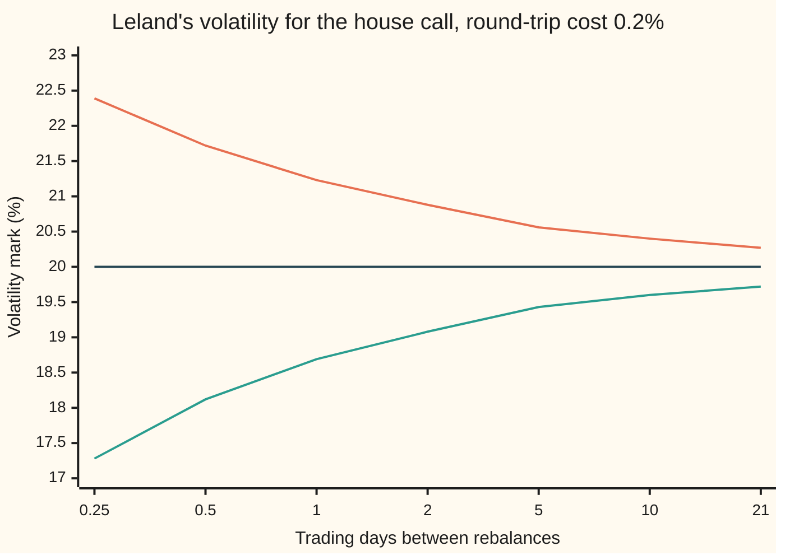

# Leland's volatility: hedging at fixed intervals with costs, and the volatility a dealer marks up or down

[Syllabus](../../../SYLLABUS.md) → [Financial mathematics](../README.md) → [Hedging, Volatility Forecasts and Stress](../README.md#s40) → Leland's volatility

---

## General Overview

A dealer sells one house call: Acme at $100, strike $100, one year, rates 5%, dividends 2%, volatility 20%. At 20% the call is worth $9.2270. That is the **mid price**: the fair value with free trading.

The dealer hedges once a day by buying or selling Acme shares to keep the share count equal to the call's delta. Every trade crosses the bid-offer spread (the gap between the price to buy and the price to sell). Here a **round trip**, a buy and then a sale of the same shares, costs 0.2% of the value traded, so one trade costs 0.1%. Over 10,000 simulated years, a year of daily trades costs $0.4780 on average.

Hayne Leland showed in 1985 how to put that bill into the price without simulating anything. Raise the volatility in the formula, so its squared value goes up by a fixed fraction. For daily hedging at 0.2% that fraction is 0.12666. The dealer who sells marks the call at 21.23% volatility, a price of $9.6929. A dealer who buys marks it at 18.69%, a price of $8.7309. The bid-offer for the option is the gap of $0.9620 around the mid.

**Each rebalance costs an amount that grows with the size of the share's move, while the gamma rent (the part of theta left after carry, which pays the hedger for those moves) grows with its square, so the expected cost is a fixed fraction of the rent; fold that fraction into the variance and the plain Black-Scholes formula prices the costs: up for the seller, down for the buyer.**

**What kind of fact this is:** an approximation inside the Black-Scholes model, derived on this card in Why it works. It holds when the interval between rebalances is short, and the simulation on this card measures how close it lands.

### The picture: the mark against how often the dealer hedges



Orange: the seller's mark. Green: the buyer's mark. Dark: the 20% mid. Hedging more often means more trades, so both marks move further from 20%. Hedging less often brings them back toward 20%, but the hedge then tracks the call less closely.

---

## The formula

```math
\mathrm{Le} = \sqrt{\frac{2}{\pi}}\;\frac{k}{\sigma\sqrt{\delta t}}, \qquad \sigma_{\text{short}}^2 = \sigma^2\,(1 + \mathrm{Le}), \qquad \sigma_{\text{long}}^2 = \sigma^2\,(1 - \mathrm{Le})
```

**Read it aloud:** the Leland number is the round-trip cost divided by the share's typical move over one interval, times the constant root two over pi; the seller raises the variance by that fraction and the buyer lowers it by the same fraction.

The price is then the ordinary Black-Scholes call at the new volatility: $`C(\sigma_{\text{short}})`$ to sell, $`C(\sigma_{\text{long}})`$ to buy.

Solved the other way, a target mark $`\sigma^*`$ fixes the most frequent hedging that stays within it:

```math
\mathrm{Le}^* = \left(\frac{\sigma^*}{\sigma}\right)^2 - 1, \qquad \delta t^* = \left(\sqrt{\frac{2}{\pi}}\;\frac{k}{\sigma\,\mathrm{Le}^*}\right)^2
```

**Read it aloud:** turn the target volatility into a target Leland number, then find the interval whose costs produce exactly that number.

| Symbol | Plain meaning | In our example | Push it up and the answer… |
| --- | --- | --- | --- |
| $`S`$ | Acme's share price today | $100 | the rent and the costs both carry $`\Gamma S^2`$, so they move together; Le does not |
| $`K`$, $`T`$, $`r`$, $`q`$ | strike; years to expiry; bank rate; dividend yield | $100; 1; 5%; 2% | change the price, not Le |
| $`\sigma`$ | volatility: the yearly spread of Acme's log return | 20% | Le falls: a cost is smaller next to a bigger move |
| $`k`$ | round-trip cost, as a fraction of value traded; one trade costs $`k/2`$ | 0.2% | Le rises in proportion |
| $`\delta t`$ | years between rebalances; one trading day is 1/252 | 1/252 | Le falls like $`1/\sqrt{\delta t}`$ |
| $`\mathrm{Le}`$ | the Leland number: expected cost as a fraction of the gamma rent | 0.12666 | both marks move away from 20% |
| $`\sigma_{\text{short}}`$, $`\sigma_{\text{long}}`$ | the volatility to sell at; to buy at | 21.23%; 18.69% | — |
| $`C(v)`$ | the Black-Scholes call price at volatility $`v`$ | $9.2270 at 20% | rises with $`v`$ |
| $`\Delta`$, $`\Gamma`$ | delta: shares held; gamma: change in delta per $1 move in Acme | —; 0.018951 | more shares traded per move |
| $`\delta S`$ | Acme's move over one interval | $1.00524 on average, either way | — |
| $`Z`$, $`E`$ | a standard bell-curve draw; $`E`$ means "average of" | $`E\lvert Z\rvert = 0.797885`$ | — |
| $`\sigma^*`$, $`\mathrm{Le}^*`$, $`\delta t^*`$ | a target mark; the Leland number that gives it; the shortest interval that keeps it | 21%; 0.1025; 1.52698 trading days | a looser target allows faster hedging |

### When it holds

- **A short interval between rebalances.** The derivation takes the shares traded over one interval as gamma times the move, which drops terms that shrink with the interval. Le itself enters exactly, so a large Le does not break the derivation; Le = 1 breaks only the buyer's formula, next. At daily hedging the simulation lands within a few percent.
- **Le below 1 for the buyer.** $`\sigma_{\text{long}}^2 = \sigma^2(1-\mathrm{Le})`$ hits zero at Le = 1. For the house call that happens when rebalancing every 0.016043 trading days, about 6.26 minutes. Faster than that, the buyer's costs exceed all the gamma profit and the formula has no answer.
- **One sign of gamma.** The seller is short gamma everywhere and the buyer long. A book with mixed gamma needs the cost charged on its net gamma, so the adjusted volatility changes from place to place and the price equation stops being linear.
- **A fixed interval.** Leland hedges on a clock. Hedging only when delta drifts outside a band trades less for the same accuracy; that is the next idea, below.
- **Rebalancing trades only.** The opening share purchase, and any sale of shares at expiry, are one-off costs outside the mark.

---

## Why it works

### Step 0: costs scale with the move, rent with its square

Between rebalances the share moves by $`\delta S`$. The hedge must then buy or sell about $`\Gamma\,\delta S`$ shares, and the cost is proportional to the size of that trade: to $`\lvert\delta S\rvert`$.

The seller's gamma bill, from [Theta pays for gamma](../09-The%20Greeks%2C%20one%20each/10-theta-pays-for-gamma-hedged-pnl.md), is $`\tfrac12\Gamma(\delta S)^2`$. The rent, the part of theta left after carry, pays for it at the rate $`\tfrac12\Gamma S^2\sigma^2\delta t`$. Both the cost and the rent carry $`\Gamma`$. So their ratio does not depend on where Acme is or how long is left, and the cost can be folded into the variance as one fixed fraction.

### Step 1: the cost of one rebalance

The shares traded are $`\lvert\delta\Delta\rvert \approx \Gamma\,\lvert\delta S\rvert`$. Each costs $`k/2`$ of its price $`S`$:

```math
\text{cost} \approx \frac{k}{2}\,S\,\Gamma\,\lvert\delta S\rvert
```

### Step 2: the average size of a move

Over one interval, $`\delta S \approx \sigma S\sqrt{\delta t}\,Z`$, where $`Z`$ is a standard bell-curve draw. The average size of $`Z`$, ignoring its sign, is $`E\lvert Z\rvert = \sqrt{2/\pi} = 0.797885`$. So

```math
E\,\lvert\delta S\rvert = \sqrt{\frac{2}{\pi}}\;\sigma S\sqrt{\delta t}
```

<details>
<summary>Why the average size of a bell-curve draw is the square root of two over pi</summary>

By symmetry, the average of $`\lvert Z\rvert`$ is twice the integral of $`z`$ times the bell-curve height over the positive half-line.

$`\displaystyle E\lvert Z\rvert = 2\int_0^\infty z\,\frac{e^{-z^2/2}}{\sqrt{2\pi}}\,dz`$

The integrand is the slope of $`-e^{-z^2/2}`$, so the integral is that function's rise from 0 to infinity, which is 1.

$`\displaystyle E\lvert Z\rvert = \frac{2}{\sqrt{2\pi}}\,\Big[-e^{-z^2/2}\Big]_0^\infty = \frac{2}{\sqrt{2\pi}} = \sqrt{\frac{2}{\pi}}`$

The check reaches 0.797885 a second way, by adding up 20,000 thin slices under the curve (Simpson's rule).

</details>

### Step 3: cost as a fraction of rent

Put Step 2 into Step 1 and factor out the rent:

```math
E[\text{cost}] = \frac{k}{2}\,\Gamma S^2\sigma\sqrt{\delta t}\,\sqrt{\frac{2}{\pi}} = \underbrace{\tfrac12\,\Gamma S^2\sigma^2\delta t}_{\text{gamma rent}} \times \underbrace{\sqrt{\frac{2}{\pi}}\,\frac{k}{\sigma\sqrt{\delta t}}}_{\mathrm{Le}}
```

Le grows as the interval shrinks. A move over a short interval is small, but the cost of the trade shrinks only like $`\sqrt{\delta t}`$ while the rent shrinks like $`\delta t`$.

### Step 4: the seller adds, the buyer subtracts

The seller is short gamma. Each interval the seller loses $`\tfrac12\Gamma(\delta S)^2`$, about $`\tfrac12\Gamma S^2\sigma^2\delta t`$ on average, and also pays the cost $`\tfrac12\Gamma S^2\sigma^2\delta t\,\mathrm{Le}`$. To break even, the rent collected (theta net of carry) must pay both. Pricing at $`\sigma_{\text{short}}`$ makes that rent $`\tfrac12\Gamma S^2\sigma_{\text{short}}^2\delta t`$, so $`\sigma_{\text{short}}^2 = \sigma^2(1+\mathrm{Le})`$.

The buyer is long gamma. The buyer earns $`\tfrac12\Gamma(\delta S)^2`$ and pays the rent, but pays the same kind of cost. Costs always work against the hedger, so the buyer's net gamma income is $`\tfrac12\Gamma S^2\sigma^2\delta t\,(1-\mathrm{Le})`$, and $`\sigma_{\text{long}}^2 = \sigma^2(1-\mathrm{Le})`$.

Each side hedges with the delta at its own marked volatility. Then the gamma in Steps 1 to 3 is the gamma of the price being charged, and the bookkeeping closes. The simulation tests this through the bill. A seller who hedges daily at 21.23% pays $0.4641 a year on average, against the $0.4659 markup; a hedger at 20% pays $0.4780. Sell at $9.6929, hedge at 21.23%, pay every cost, and the average result is zero within its noise.

### Step 5: the dollar markup is vega times the volatility gap

For a small change in volatility the price moves by [Vega](../09-The%20Greeks%2C%20one%20each/03-vega.md) per point. The call's vega is 0.379012 per point, and the mark is 1.2289 points above mid, so the markup is about $0.4657. The exact repricing gives $0.4659. So Leland's markup is a vega charge, and it is largest where vega is largest: near the strike, and at long expiries.

### Step 6: the inverse

Le falls as the interval grows, one-to-one. So a target mark fixes one interval. Square the target over $`\sigma`$ to get $`\mathrm{Le}^*`$, then solve the Leland formula for $`\delta t`$. The check finds the same interval a second way: bisection (repeated halving of a bracket) on the dollar markup.

---

## Worked numbers, by hand

House call, daily hedging, round-trip cost 0.2%.

| Step | Arithmetic | Value |
| --- | --- | --- |
| typical daily move | $`0.20 \times 100 \times \sqrt{1/252}`$ | $1.2599 |
| average size of the move | $`0.797885 \times 1.2599`$ | $1.00524 |
| shares traded | gamma × move: $`0.018951 \times 1.00524`$ | 0.019050 |
| expected cost today | $`0.001 \times 100 \times 0.019050`$ | $0.001905 |
| gamma rent today | $`\tfrac12 \times 0.018951 \times 100^2 \times 0.04 / 252`$ | $0.015040 |
| Leland number | 0.001905 ÷ 0.015040, or $`0.797885 \times 0.002 / (1.2599 / 100)`$ | **0.12666** |
| seller's mark | $`20\% \times \sqrt{1.12666}`$ | **21.23%**, price $9.6929 |
| buyer's mark | $`20\% \times \sqrt{0.87334}`$ | **18.69%**, price $8.7309 |
| markup, markdown | 9.6929 − 9.2270; 9.2270 − 8.7309 | $0.4659; $0.4961 |

**The dealer sells at $9.6929 and buys at $8.7309: a spread of $0.9620 around the $9.2270 mid, all of it the expected cost of hedging daily.**

The markdown is larger because the variance moves the same amount each way, and the volatility, its square root, falls further (1.3095 points) than it rises (1.2289 points). The same $0.4659 appears on [The Black-Scholes assumptions](../08-The%20Black-Scholes%20call%20and%20put/09-black-scholes-assumptions-and-failures.md) as Leland's estimate of the bill at ten basis points a trade.

**The inverse.** The dealer wants the seller's mark no higher than 21%, one point over mid.

| Step | Arithmetic | Value |
| --- | --- | --- |
| target Leland number | $`(0.21/0.20)^2 - 1`$ | 0.1025 |
| interval | $`(0.797885 \times 0.002 / (0.20 \times 0.1025))^2 \times 252`$ | **1.52698 trading days** |
| bisection on the markup $0.3791 | halve the bracket 200 times | 1.52698 trading days |
| every 2 days instead | Le = 0.12666 ÷ √2 | 0.08956, mark 20.88% |

So hedging every 1.53 trading days or less often keeps the mark within one point. A dealer who hedges every 2 days, for example, marks 20.88%.

### What breaks if you drop a piece

| Mistake | Comes out at | What went wrong |
| --- | --- | --- |
| One volatility for both sides: buyer also marks 21.23% | buyer pays $9.6929, $0.9620 too much | costs hurt the long hedger too, so the buyer marks down |
| Multiply the volatility by $`1+\mathrm{Le}`$ | 22.53%, $10.1877 | Le is a fraction of the variance, not of the volatility |
| Count calendar days, $`\delta t = 1/365`$ | 21.47%, $9.7845 | the hedge trades on 252 days a year, not 365 |
| Drop $`\sqrt{2/\pi}`$ | 21.53%, $9.8068 | the average size of a move is 0.8 of its typical size, not all of it |

---

## How the interval trades cost against risk

The puzzle: hedging more often makes the hedge track the call more closely, but every extra trade costs money. Leland's mark measures the cost side. The simulation measures both sides, on 4,000 simulated years per row: the bill of a hedger at 20%, and the spread of the result for a seller who marks at Leland's volatility and hedges at it.

| Days between rebalances | Le | Seller's mark | Markup | Simulated bill | Spread of the seller's result |
| --- | --- | --- | --- | --- | --- |
| 1 | 0.12666 | 21.2289% | $0.4659 | $0.4804 | $0.4324 |
| 2 | 0.08956 | 20.8764% | $0.3323 | $0.3377 | $0.5858 |
| 3 | 0.07313 | 20.7184% | $0.2723 | $0.2737 | $0.7225 |
| 6 | 0.05171 | 20.5106% | $0.1935 | $0.1940 | $1.0137 |
| 12 | 0.03656 | 20.3624% | $0.1374 | $0.1334 | $1.3757 |
| 21 | 0.02764 | 20.2745% | $0.1041 | $0.0994 | $1.7876 |

The "simulated bill" is the cost of hedging at 20%, averaged over the runs; the main run on 10,000 years gives $0.4780 for daily hedging. The "spread" is the standard deviation of the seller's final result. Leland's markup tracks the measured bill closely at every interval.

One force at a time, in dollars, both on the same scale:

```
interval   markup (the cost, charged up front)
 1 day     ██████████                              0.4659
 3 days    ██████                                  0.2723
 21 days   ██                                      0.1041

interval   spread (the risk left over)
 1 day     ██████████                              0.4324
 3 days    ████████████████                        0.7225
 21 days   ████████████████████████████████████████ 1.7876
```

Moving from daily to monthly cuts the markup from $0.4659 to $0.1041 but multiplies the spread by more than four. No interval makes both small. The chart under General Overview shows the cost side for intervals from a quarter day to a month.

---

## Code, from first principles, and it actually runs

The script prices the house call with a written-out Black-Scholes formula and takes three roads to Leland's mark.

- Road 1: the closed form, with the inverse checked by bisection.
- Road 2: the parts. It finds $`E\lvert Z\rvert`$ by Simpson's rule, measures gamma by nudging the share price and checks it against the textbook gamma formula, computes the day's expected cost and the day's rent, and divides. Gamma cancels in that ratio, so this road checks $`E\lvert Z\rvert`$ and the algebra of Step 3. It also checks the markup against vega times the volatility gap.
- Road 3: it hedges 10,000 simulated years day by day, paying every trade, three ways: a hedger at 20% (the bill), a seller at Leland's mark, and a buyer at Leland's mark. The seller's and buyer's average results must be zero within four standard errors. The seller's own bill must land within 1.5% of the markup, a test the bill at 20% would fail.

Shares follow the risk-neutral drift $`r - q`$, and the call settles in shares at expiry. Python uses math.erf for the bell-curve area; Rust sums its own error-function series. Both draw the same random numbers, from a splitmix64 generator and the Box-Muller method (two uniform draws into one bell-curve draw), written out.

### Python

```python
# Leland's volatility -- the check behind the card.  Python standard library only.
# House call: Acme $100, strike $100, 1 year, rates 5%, dividends 2%, volatility 20%.
# A round trip (buy, then sell back) costs K_RT = 0.2% of the value traded; one trade costs half.
# Road 1: Leland's closed form.  Road 2: E|Z| by Simpson's rule, and the day's cost over the
# day's gamma rent.  Road 3: hedge 10,000 simulated years and count the money.
# Inverse: the hedging interval for a target mark, in closed form and by bisection.
# The bell-curve area uses math.erf; the random numbers are splitmix64 and Box-Muller.
from math import erf, exp, log, sqrt, pi, cos

S0, K, T, R, Q, SIG, K_RT, DAY = 100.0, 100.0, 1.0, 0.05, 0.02, 0.20, 0.002, 1.0 / 252

def ncdf(x): return 0.5 * (1.0 + erf(x / sqrt(2.0)))
def call(s, k, t, r, q, v):                       # Black-Scholes price and delta
    if t <= 0.0: return max(s - k, 0.0), (1.0 if s > k else 0.0)
    d1 = (log(s / k) + (r - q + 0.5 * v * v) * t) / (v * sqrt(t))
    d2 = d1 - v * sqrt(t)
    return s * exp(-q * t) * ncdf(d1) - k * exp(-r * t) * ncdf(d2), exp(-q * t) * ncdf(d1)
def price(v): return call(S0, K, T, R, Q, v)[0]
def leland(dt): return sqrt(2.0 / pi) * K_RT / (SIG * sqrt(dt))
def marks(dt): le = leland(dt); return SIG * sqrt(1.0 + le), SIG * sqrt(max(1.0 - le, 0.0))

# ---- road 1: the closed form ----
le = leland(DAY); vs, vl = marks(DAY); mid, cs, cl = price(SIG), price(vs), price(vl)
print(f"Leland number, daily: sqrt(2/pi) x {K_RT} / ({SIG} x sqrt(1/252)) = {le:.5f}")
print(f"short mark: 20% x sqrt(1 + Le) = {100 * vs:.4f}%, price {cs:.4f}")
print(f"long mark:  20% x sqrt(1 - Le) = {100 * vl:.4f}%, price {cl:.4f}")
print(f"mid price at 20%: {mid:.4f}; markup {cs - mid:.4f}, markdown {mid - cl:.4f}, gap {cs - cl:.4f}")
print(f"volatility gap: up {100 * (vs - SIG):.4f} points, down {100 * (SIG - vl):.4f} points")

# ---- road 2: E|Z| by Simpson, and one day's cost against one day's gamma rent ----
n, h = 20000, 10.0 / 20000
ez = 2.0 * sum((1 if i in (0, n) else 4 if i % 2 else 2) * (i * h) * exp(-0.5 * (i * h) ** 2)
               for i in range(n + 1)) * h / 3.0 / sqrt(2.0 * pi)
g = (call(S0 + 0.01, K, T, R, Q, SIG)[1] - call(S0 - 0.01, K, T, R, Q, SIG)[1]) / 0.02
move = ez * SIG * S0 * sqrt(DAY)                   # expected size of a day's move, dollars
cost = 0.5 * K_RT * S0 * g * move                  # one-way cost x shares traded x price
rent = 0.5 * g * S0 * S0 * SIG * SIG * DAY         # the gamma rent theta pays per day
vega = (price(SIG + 0.0001) - price(SIG - 0.0001)) / 0.0002 / 100.0
print(f"E|Z| by Simpson: {ez:.6f}; sqrt(2/pi) = {sqrt(2 / pi):.6f}")
print(f"gamma {g:.6f}; typical daily move ${SIG * S0 * sqrt(DAY):.4f}, average size ${move:.5f}; "
      f"shares traded {g * move:.6f}")
print(f"expected cost per day ${cost:.6f}; gamma rent per day ${rent:.6f}; ratio {cost / rent:.5f}")
print(f"vega per point {vega:.6f}; vega x (21.2289 - 20) = {vega * 100 * (vs - SIG):.4f}")
assert abs(ez - sqrt(2.0 / pi)) < 1e-9, "Simpson against the closed form of E|Z|"
d1 = (log(S0 / K) + (R - Q + 0.5 * SIG * SIG) * T) / (SIG * sqrt(T))
assert abs(g - exp(-Q * T - 0.5 * d1 * d1) / sqrt(2.0 * pi) / (S0 * SIG * sqrt(T))) < 1e-7, "gamma, closed form"
assert abs(cost / rent - le) < 1e-6, "the day's cost over the day's rent is the Leland number"
assert abs(vega * 100 * (vs - SIG) / (cs - mid) - 1.0) < 0.01, "markup is about vega x vol gap"
assert (round(le, 5), round(100 * vs, 2), round(100 * vl, 2)) == (0.12666, 21.23, 18.69)
assert (round(cs, 3), round(cl, 3), round(mid, 3)) == (9.693, 8.731, 9.227)

# ---- road 3: hedge simulated years.  Shares follow the risk-neutral drift r - q. ----
state = 0x2545F4914F6CDD1D
def unif():
    global state
    state = (state + 0x9E3779B97F4A7C15) & 0xFFFFFFFFFFFFFFFF
    z = state
    z = ((z ^ (z >> 30)) * 0xBF58476D1CE4E5B9) & 0xFFFFFFFFFFFFFFFF
    z = ((z ^ (z >> 27)) * 0x94D049BB133111EB) & 0xFFFFFFFFFFFFFFFF
    return ((z ^ (z >> 31)) >> 11) / 9007199254740992.0
def stats(xs):
    m = sum(xs) / len(xs); sd = sqrt(sum((x - m) ** 2 for x in xs) / (len(xs) - 1))
    return m, sd, sd / sqrt(len(xs))
def simulate(days, paths):
    dt = days * DAY; steps = round(T / dt); hs, hl = marks(dt)
    bills, sbills, shorts, longs = [], [], [], []
    for _ in range(paths):
        s, t = S0, T
        a, b, c = call(s, K, t, R, Q, SIG)[1], call(s, K, t, R, Q, hs)[1], call(s, K, t, R, Q, hl)[1]
        bill, sbill, cash_s, cash_l = 0.0, 0.0, price(hs) - b * s, -price(hl) + c * s
        for i in range(1, steps + 1):
            u1, u2 = unif(), unif()
            z = sqrt(-2.0 * log(1.0 - u1)) * cos(2.0 * pi * u2)
            s *= exp((R - Q - 0.5 * SIG * SIG) * dt + SIG * sqrt(dt) * z); t = T - i * dt
            cash_s = cash_s * exp(R * dt) + b * s * (exp(Q * dt) - 1.0)
            cash_l = cash_l * exp(R * dt) - c * s * (exp(Q * dt) - 1.0)
            if i == steps: break                    # expiry: the call settles in shares
            a2, b2, c2 = call(s, K, t, R, Q, SIG)[1], call(s, K, t, R, Q, hs)[1], call(s, K, t, R, Q, hl)[1]
            bill += 0.5 * K_RT * abs(a2 - a) * s * exp(-R * i * dt)
            sbill += 0.5 * K_RT * abs(b2 - b) * s * exp(-R * i * dt)
            cash_s -= (b2 - b) * s + 0.5 * K_RT * abs(b2 - b) * s
            cash_l += (c2 - c) * s - 0.5 * K_RT * abs(c2 - c) * s
            a, b, c = a2, b2, c2
        pay = max(s - K, 0.0)
        bills.append(bill); sbills.append(sbill)
        shorts.append((cash_s + b * s - pay) * exp(-R * T))
        longs.append((cash_l - c * s + pay) * exp(-R * T))
    return stats(bills), stats(shorts), stats(longs), stats(sbills)

bill, short, long_, sbill = simulate(1, 10000)
print("10,000 simulated years, hedged daily (mean, spread, standard error):")
print(f"  bill, hedging at 20%:            {bill[0]:.4f} {bill[1]:.4f} {bill[2]:.4f} vs markup {cs - mid:.4f}")
print(f"  bill, hedging at 21.23%:         {sbill[0]:.4f} {sbill[1]:.4f} {sbill[2]:.4f} vs markup {cs - mid:.4f}")
print(f"  seller at 21.23%, hedging there: {short[0]:.4f} {short[1]:.4f} {short[2]:.4f}")
print(f"  buyer at 18.69%, hedging there:  {long_[0]:.4f} {long_[1]:.4f} {long_[2]:.4f}")
assert abs(bill[0] / (cs - mid) - 1.0) < 0.08, "simulated bill against Leland's markup"
assert abs(short[0]) < 4 * short[2] + 0.01, "the seller's markup pays the bill on average"
assert abs(long_[0]) < 4 * long_[2] + 0.01, "the buyer's markdown pays the bill on average"
assert abs(sbill[0] / (cs - mid) - 1.0) < 0.015, "hedging at 21.23%, the seller's own bill is the markup"

print("interval trade-off (days, Le, short mark %, markup, simulated bill, seller spread):")
for d in (1, 2, 3, 6, 12, 21):
    vsd = marks(d * DAY)[0]; bd, sd_, _, _ = simulate(d, 4000)
    print(f"  {d:2d}  {leland(d * DAY):.5f}  {100 * vsd:.4f}  {price(vsd) - mid:.4f}  {bd[0]:.4f}  {sd_[1]:.4f}")

# ---- the inverse: the most frequent hedging that keeps the short mark within 21% ----
target = 0.21; le_t = (target / SIG) ** 2 - 1.0
dt_closed = (sqrt(2.0 / pi) * K_RT / (SIG * le_t)) ** 2
want, lo, hi = price(target) - mid, 0.01 * DAY, 100.0 * DAY
for _ in range(200):                               # bisection on the price markup
    m = 0.5 * (lo + hi)
    lo, hi = (m, hi) if price(marks(m)[0]) - mid > want else (lo, m)
print(f"target 21%: Le = {le_t:.6f}; interval {dt_closed / DAY:.5f} days by formula, "
      f"{lo / DAY:.5f} by bisection on the markup {want:.4f}")
print(f"every 2 days: Le {leland(2 * DAY):.5f}, mark {100 * marks(2 * DAY)[0]:.4f}%")
dt_zero = (sqrt(2.0 / pi) * K_RT / SIG) ** 2
print(f"long mark hits zero at Le = 1: interval {dt_zero / DAY:.6f} days = {dt_zero / DAY * 390:.2f} minutes")
assert abs(dt_closed - lo) < 1e-9, "closed-form interval against bisection"
assert abs(marks(dt_closed)[0] - target) < 1e-12, "the interval reproduces the target"

# ---- what breaks if you drop a piece ----
def mark(le_): return SIG * sqrt(1.0 + le_)
for label, v in (("calendar days, dt = 1/365", mark(sqrt(2 / pi) * K_RT / (SIG * sqrt(1 / 365)))),
                 ("Le on the vol, not the variance", SIG * (1.0 + le)),
                 ("drop sqrt(2/pi)", mark(K_RT / (SIG * sqrt(DAY))))):
    print(f"wrong: {label}: mark {100 * v:.4f}%, price {price(v):.4f}")
print(f"wrong: long call marked up too: buyer pays {cs:.4f}, overpays {cs - cl:.4f}")

print("chart, interval in days -> short and long mark (%):")
for d in (0.25, 0.5, 1, 2, 5, 10, 21):
    u, w = marks(d * DAY); print(f"  {d:5.2f}  {100 * u:.2f}  {100 * w:.2f}")
print("ALL CHECKS PASS")
```

**Ran 2026-11-23 on macOS, Python 3.14.10, standard library only. All checks passed. Output, pasted from the run:**

```
Leland number, daily: sqrt(2/pi) x 0.002 / (0.2 x sqrt(1/252)) = 0.12666
short mark: 20% x sqrt(1 + Le) = 21.2289%, price 9.6929
long mark:  20% x sqrt(1 - Le) = 18.6905%, price 8.7309
mid price at 20%: 9.2270; markup 0.4659, markdown 0.4961, gap 0.9620
volatility gap: up 1.2289 points, down 1.3095 points
E|Z| by Simpson: 0.797885; sqrt(2/pi) = 0.797885
gamma 0.018951; typical daily move $1.2599, average size $1.00524; shares traded 0.019050
expected cost per day $0.001905; gamma rent per day $0.015040; ratio 0.12666
vega per point 0.379012; vega x (21.2289 - 20) = 0.4657
10,000 simulated years, hedged daily (mean, spread, standard error):
  bill, hedging at 20%:            0.4780 0.1800 0.0018 vs markup 0.4659
  bill, hedging at 21.23%:         0.4641 0.1692 0.0017 vs markup 0.4659
  seller at 21.23%, hedging there: 0.0061 0.4272 0.0043
  buyer at 18.69%, hedging there:  -0.0051 0.4081 0.0041
interval trade-off (days, Le, short mark %, markup, simulated bill, seller spread):
   1  0.12666  21.2289  0.4659  0.4804  0.4324
   2  0.08956  20.8764  0.3323  0.3377  0.5858
   3  0.07313  20.7184  0.2723  0.2737  0.7225
   6  0.05171  20.5106  0.1935  0.1940  1.0137
  12  0.03656  20.3624  0.1374  0.1334  1.3757
  21  0.02764  20.2745  0.1041  0.0994  1.7876
target 21%: Le = 0.102500; interval 1.52698 days by formula, 1.52698 by bisection on the markup 0.3791
every 2 days: Le 0.08956, mark 20.8764%
long mark hits zero at Le = 1: interval 0.016043 days = 6.26 minutes
wrong: calendar days, dt = 1/365: mark 21.4703%, price 9.7845
wrong: Le on the vol, not the variance: mark 22.5332%, price 10.1877
wrong: drop sqrt(2/pi): mark 21.5290%, price 9.8068
wrong: long call marked up too: buyer pays 9.6929, overpays 0.9620
chart, interval in days -> short and long mark (%):
   0.25  22.39  17.28
   0.50  21.72  18.12
   1.00  21.23  18.69
   2.00  20.88  19.08
   5.00  20.56  19.43
  10.00  20.40  19.60
  21.00  20.27  19.72
ALL CHECKS PASS
```

### Rust

```rust
// Leland's volatility -- the same check as leland_transaction_cost_volatility_check.py, in Rust.
// Standard library only, no crates.  The bell-curve area comes from an error-function series
// written out below; the random numbers are splitmix64 and Box-Muller, as in the Python.
use std::f64::consts::PI;

const S0: f64 = 100.0; const K: f64 = 100.0; const T: f64 = 1.0; const R: f64 = 0.05;
const Q: f64 = 0.02; const SIG: f64 = 0.20; const K_RT: f64 = 0.002; const DAY: f64 = 1.0 / 252.0;

fn erf(x: f64) -> f64 {                         // 2/sqrt(pi) e^(-x^2) sum 2^n x^(2n+1)/(2n+1)!!
    let y = x.abs();
    if y > 6.0 { return x.signum(); }
    let (mut term, mut sum, mut n) = (y, y, 0.0);
    while term > 1e-17 * sum { term *= 2.0 * y * y / (2.0 * n + 3.0); sum += term; n += 1.0; }
    x.signum() * 2.0 / PI.sqrt() * (-y * y).exp() * sum
}
fn ncdf(x: f64) -> f64 { 0.5 * (1.0 + erf(x / 2f64.sqrt())) }
fn call(s: f64, k: f64, t: f64, r: f64, q: f64, v: f64) -> (f64, f64) {   // price and delta
    if t <= 0.0 { return ((s - k).max(0.0), if s > k { 1.0 } else { 0.0 }); }
    let d1 = ((s / k).ln() + (r - q + 0.5 * v * v) * t) / (v * t.sqrt());
    let d2 = d1 - v * t.sqrt();
    (s * (-q * t).exp() * ncdf(d1) - k * (-r * t).exp() * ncdf(d2), (-q * t).exp() * ncdf(d1))
}
fn price(v: f64) -> f64 { call(S0, K, T, R, Q, v).0 }
fn leland(dt: f64) -> f64 { (2.0 / PI).sqrt() * K_RT / (SIG * dt.sqrt()) }
fn marks(dt: f64) -> (f64, f64) {
    let le = leland(dt);
    (SIG * (1.0 + le).sqrt(), SIG * (1.0 - le).max(0.0).sqrt())
}
struct Rng(u64);
impl Rng {
    fn unif(&mut self) -> f64 {
        self.0 = self.0.wrapping_add(0x9E3779B97F4A7C15);
        let mut z = self.0;
        z = (z ^ (z >> 30)).wrapping_mul(0xBF58476D1CE4E5B9);
        z = (z ^ (z >> 27)).wrapping_mul(0x94D049BB133111EB);
        ((z ^ (z >> 31)) >> 11) as f64 / 9007199254740992.0
    }
}
fn stats(xs: &[f64]) -> (f64, f64, f64) {
    let n = xs.len() as f64;
    let m = xs.iter().sum::<f64>() / n;
    let sd = (xs.iter().map(|x| (x - m) * (x - m)).sum::<f64>() / (n - 1.0)).sqrt();
    (m, sd, sd / n.sqrt())
}
fn simulate(rng: &mut Rng, days: f64, paths: usize) -> [(f64, f64, f64); 4] {
    let dt = days * DAY; let steps = (T / dt).round() as usize; let (hs, hl) = marks(dt);
    let (mut bills, mut sbills, mut shorts, mut longs) = (vec![], vec![], vec![], vec![]);
    for _ in 0..paths {
        let (mut s, mut t) = (S0, T);
        let (mut a, mut b, mut c) = (call(s, K, t, R, Q, SIG).1, call(s, K, t, R, Q, hs).1, call(s, K, t, R, Q, hl).1);
        let (mut bill, mut sbill, mut cash_s, mut cash_l) = (0.0, 0.0, price(hs) - b * s, -price(hl) + c * s);
        for i in 1..=steps {
            let (u1, u2) = (rng.unif(), rng.unif());
            let z = (-2.0 * (1.0 - u1).ln()).sqrt() * (2.0 * PI * u2).cos();
            s *= ((R - Q - 0.5 * SIG * SIG) * dt + SIG * dt.sqrt() * z).exp(); t = T - i as f64 * dt;
            cash_s = cash_s * (R * dt).exp() + b * s * ((Q * dt).exp() - 1.0);
            cash_l = cash_l * (R * dt).exp() - c * s * ((Q * dt).exp() - 1.0);
            if i == steps { break; }                  // expiry: the call settles in shares
            let (a2, b2, c2) = (call(s, K, t, R, Q, SIG).1, call(s, K, t, R, Q, hs).1, call(s, K, t, R, Q, hl).1);
            bill += 0.5 * K_RT * (a2 - a).abs() * s * (-R * i as f64 * dt).exp();
            sbill += 0.5 * K_RT * (b2 - b).abs() * s * (-R * i as f64 * dt).exp();
            cash_s -= (b2 - b) * s + 0.5 * K_RT * (b2 - b).abs() * s;
            cash_l += (c2 - c) * s - 0.5 * K_RT * (c2 - c).abs() * s;
            a = a2; b = b2; c = c2;
        }
        let pay = (s - K).max(0.0);
        bills.push(bill); sbills.push(sbill);
        shorts.push((cash_s + b * s - pay) * (-R * T).exp());
        longs.push((cash_l - c * s + pay) * (-R * T).exp());
    }
    [stats(&bills), stats(&shorts), stats(&longs), stats(&sbills)]
}

fn main() {
    // ---- road 1: the closed form ----
    let le = leland(DAY); let (vs, vl) = marks(DAY);
    let (mid, cs, cl) = (price(SIG), price(vs), price(vl));
    println!("Leland number, daily: sqrt(2/pi) x {} / ({} x sqrt(1/252)) = {:.5}", K_RT, SIG, le);
    println!("short mark: 20% x sqrt(1 + Le) = {:.4}%, price {:.4}", 100.0 * vs, cs);
    println!("long mark:  20% x sqrt(1 - Le) = {:.4}%, price {:.4}", 100.0 * vl, cl);
    println!("mid price at 20%: {:.4}; markup {:.4}, markdown {:.4}, gap {:.4}", mid, cs - mid, mid - cl, cs - cl);
    println!("volatility gap: up {:.4} points, down {:.4} points", 100.0 * (vs - SIG), 100.0 * (SIG - vl));

    // ---- road 2: E|Z| by Simpson, and one day's cost against one day's gamma rent ----
    let (n, h) = (20000usize, 10.0 / 20000.0);
    let mut acc = 0.0;
    for i in 0..=n {
        let w = if i == 0 || i == n { 1.0 } else if i % 2 == 1 { 4.0 } else { 2.0 };
        let x = i as f64 * h; acc += w * x * (-0.5 * x * x).exp();
    }
    let ez = 2.0 * acc * h / 3.0 / (2.0 * PI).sqrt();
    let g = (call(S0 + 0.01, K, T, R, Q, SIG).1 - call(S0 - 0.01, K, T, R, Q, SIG).1) / 0.02;
    let mv = ez * SIG * S0 * DAY.sqrt();
    let cost = 0.5 * K_RT * S0 * g * mv;
    let rent = 0.5 * g * S0 * S0 * SIG * SIG * DAY;
    let vega = (price(SIG + 0.0001) - price(SIG - 0.0001)) / 0.0002 / 100.0;
    println!("E|Z| by Simpson: {:.6}; sqrt(2/pi) = {:.6}", ez, (2.0 / PI).sqrt());
    println!("gamma {:.6}; typical daily move ${:.4}, average size ${:.5}; shares traded {:.6}",
             g, SIG * S0 * DAY.sqrt(), mv, g * mv);
    println!("expected cost per day ${:.6}; gamma rent per day ${:.6}; ratio {:.5}", cost, rent, cost / rent);
    println!("vega per point {:.6}; vega x (21.2289 - 20) = {:.4}", vega, vega * 100.0 * (vs - SIG));
    assert!((ez - (2.0 / PI).sqrt()).abs() < 1e-9, "Simpson against the closed form of E|Z|");
    let d1 = ((S0 / K).ln() + (R - Q + 0.5 * SIG * SIG) * T) / (SIG * T.sqrt());
    assert!((g - (-Q * T - 0.5 * d1 * d1).exp() / (2.0 * PI).sqrt() / (S0 * SIG * T.sqrt())).abs() < 1e-7, "gamma, closed form");
    assert!((cost / rent - le).abs() < 1e-6, "the day's cost over the day's rent is the Leland number");
    assert!((vega * 100.0 * (vs - SIG) / (cs - mid) - 1.0).abs() < 0.01, "markup is about vega x vol gap");
    assert!(format!("{:.5} {:.2} {:.2}", le, 100.0 * vs, 100.0 * vl) == "0.12666 21.23 18.69");
    assert!(format!("{:.3} {:.3} {:.3}", cs, cl, mid) == "9.693 8.731 9.227");

    // ---- road 3: hedge simulated years.  Shares follow the risk-neutral drift r - q. ----
    let mut rng = Rng(0x2545F4914F6CDD1D);
    let [bill, short, long, sbill] = simulate(&mut rng, 1.0, 10000);
    println!("10,000 simulated years, hedged daily (mean, spread, standard error):");
    println!("  bill, hedging at 20%:            {:.4} {:.4} {:.4} vs markup {:.4}", bill.0, bill.1, bill.2, cs - mid);
    println!("  bill, hedging at 21.23%:         {:.4} {:.4} {:.4} vs markup {:.4}", sbill.0, sbill.1, sbill.2, cs - mid);
    println!("  seller at 21.23%, hedging there: {:.4} {:.4} {:.4}", short.0, short.1, short.2);
    println!("  buyer at 18.69%, hedging there:  {:.4} {:.4} {:.4}", long.0, long.1, long.2);
    assert!((bill.0 / (cs - mid) - 1.0).abs() < 0.08, "simulated bill against Leland's markup");
    assert!(short.0.abs() < 4.0 * short.2 + 0.01, "the seller's markup pays the bill on average");
    assert!(long.0.abs() < 4.0 * long.2 + 0.01, "the buyer's markdown pays the bill on average");
    assert!((sbill.0 / (cs - mid) - 1.0).abs() < 0.015, "hedging at 21.23%, the seller's own bill is the markup");

    println!("interval trade-off (days, Le, short mark %, markup, simulated bill, seller spread):");
    for d in [1.0, 2.0, 3.0, 6.0, 12.0, 21.0] {
        let vsd = marks(d * DAY).0; let r3 = simulate(&mut rng, d, 4000);
        println!("  {:2}  {:.5}  {:.4}  {:.4}  {:.4}  {:.4}", d as i32, leland(d * DAY), 100.0 * vsd,
                 price(vsd) - mid, r3[0].0, r3[1].1);
    }

    // ---- the inverse: the most frequent hedging that keeps the short mark within 21% ----
    let target = 0.21; let le_t = (target / SIG).powi(2) - 1.0;
    let dt_closed = ((2.0 / PI).sqrt() * K_RT / (SIG * le_t)).powi(2);
    let (want, mut lo, mut hi) = (price(target) - mid, 0.01 * DAY, 100.0 * DAY);
    for _ in 0..200 {
        let m = 0.5 * (lo + hi);
        if price(marks(m).0) - mid > want { lo = m; } else { hi = m; }
    }
    println!("target 21%: Le = {:.6}; interval {:.5} days by formula, {:.5} by bisection on the markup {:.4}",
             le_t, dt_closed / DAY, lo / DAY, want);
    println!("every 2 days: Le {:.5}, mark {:.4}%", leland(2.0 * DAY), 100.0 * marks(2.0 * DAY).0);
    let dt_zero = ((2.0 / PI).sqrt() * K_RT / SIG).powi(2);
    println!("long mark hits zero at Le = 1: interval {:.6} days = {:.2} minutes", dt_zero / DAY, dt_zero / DAY * 390.0);
    assert!((dt_closed - lo).abs() < 1e-9, "closed-form interval against bisection");
    assert!((marks(dt_closed).0 - target).abs() < 1e-12, "the interval reproduces the target");

    // ---- what breaks if you drop a piece ----
    let mark = |l: f64| SIG * (1.0 + l).sqrt();
    let wrongs = [("calendar days, dt = 1/365", mark((2.0 / PI).sqrt() * K_RT / (SIG * (1.0f64 / 365.0).sqrt()))),
                  ("Le on the vol, not the variance", SIG * (1.0 + le)),
                  ("drop sqrt(2/pi)", mark(K_RT / (SIG * DAY.sqrt())))];
    for (label, v) in wrongs { println!("wrong: {}: mark {:.4}%, price {:.4}", label, 100.0 * v, price(v)); }
    println!("wrong: long call marked up too: buyer pays {:.4}, overpays {:.4}", cs, cs - cl);

    println!("chart, interval in days -> short and long mark (%):");
    for d in [0.25, 0.5, 1.0, 2.0, 5.0, 10.0, 21.0] {
        let (u, w) = marks(d * DAY); println!("  {:5.2}  {:.2}  {:.2}", d, 100.0 * u, 100.0 * w);
    }
    println!("ALL CHECKS PASS");
}
```

**Ran 2026-11-23 on macOS, rustc 1.98.1, no crates. All checks passed. Output, pasted from the run:**

```
Leland number, daily: sqrt(2/pi) x 0.002 / (0.2 x sqrt(1/252)) = 0.12666
short mark: 20% x sqrt(1 + Le) = 21.2289%, price 9.6929
long mark:  20% x sqrt(1 - Le) = 18.6905%, price 8.7309
mid price at 20%: 9.2270; markup 0.4659, markdown 0.4961, gap 0.9620
volatility gap: up 1.2289 points, down 1.3095 points
E|Z| by Simpson: 0.797885; sqrt(2/pi) = 0.797885
gamma 0.018951; typical daily move $1.2599, average size $1.00524; shares traded 0.019050
expected cost per day $0.001905; gamma rent per day $0.015040; ratio 0.12666
vega per point 0.379012; vega x (21.2289 - 20) = 0.4657
10,000 simulated years, hedged daily (mean, spread, standard error):
  bill, hedging at 20%:            0.4780 0.1800 0.0018 vs markup 0.4659
  bill, hedging at 21.23%:         0.4641 0.1692 0.0017 vs markup 0.4659
  seller at 21.23%, hedging there: 0.0061 0.4272 0.0043
  buyer at 18.69%, hedging there:  -0.0051 0.4081 0.0041
interval trade-off (days, Le, short mark %, markup, simulated bill, seller spread):
   1  0.12666  21.2289  0.4659  0.4804  0.4324
   2  0.08956  20.8764  0.3323  0.3377  0.5858
   3  0.07313  20.7184  0.2723  0.2737  0.7225
   6  0.05171  20.5106  0.1935  0.1940  1.0137
  12  0.03656  20.3624  0.1374  0.1334  1.3757
  21  0.02764  20.2745  0.1041  0.0994  1.7876
target 21%: Le = 0.102500; interval 1.52698 days by formula, 1.52698 by bisection on the markup 0.3791
every 2 days: Le 0.08956, mark 20.8764%
long mark hits zero at Le = 1: interval 0.016043 days = 6.26 minutes
wrong: calendar days, dt = 1/365: mark 21.4703%, price 9.7845
wrong: Le on the vol, not the variance: mark 22.5332%, price 10.1877
wrong: drop sqrt(2/pi): mark 21.5290%, price 9.8068
wrong: long call marked up too: buyer pays 9.6929, overpays 0.9620
chart, interval in days -> short and long mark (%):
   0.25  22.39  17.28
   0.50  21.72  18.12
   1.00  21.23  18.69
   2.00  20.88  19.08
   5.00  20.56  19.43
  10.00  20.40  19.60
  21.00  20.27  19.72
ALL CHECKS PASS
```

The two outputs agree line for line.

### Lean

Lean proves Steps 2, 3 and 6 exactly, for any positive price, volatility and interval, taking Step 1's cost formula as given.

- Take $`Z`$, a standard bell-curve draw. Then $`E\lvert Z\rvert = \sqrt{2/\pi}`$ exactly.
- Suppose $`S`$, $`\sigma`$ and $`\delta t`$ are positive, and $`\delta S = \sigma S\sqrt{\delta t}\,Z`$. Then the expected cost $`\tfrac{k}{2} S\Gamma E\lvert\delta S\rvert`$ equals the gamma rent times Le.
- Suppose $`k`$ and $`\sigma`$ are positive, and the target $`\sigma^*`$ is above $`\sigma`$. Then the seller's mark $`\sigma\sqrt{1+\mathrm{Le}}`$ equals $`\sigma^*`$ at exactly one interval, $`\delta t^*`$.
- Take the 21% target over the 20% mid. Then $`\mathrm{Le}^* = (21/20)^2 - 1 = 41/400`$, which is 0.1025.

The Black-Scholes prices at each mark, the buyer's side, the simulation and the bisection are left to the Python and Rust checks.

```lean
-- Leland's volatility: the expected cost of one rebalance is the Leland number times the gamma rent, the average size of a standard bell-curve draw is the square root of two over pi, and a target mark above mid fixes exactly one hedging interval.
import Mathlib.Probability.Distributions.Gaussian.Real

open MeasureTheory ProbabilityTheory Real

/-- The Leland number for round-trip cost `k`, volatility `σ` and hedging interval `δt`:
`√(2/π) · k / (σ √δt)`. -/
noncomputable def lelandNumber (k σ δt : ℝ) : ℝ := √(2 / π) * k / (σ * √δt)

/-- Helper: `∫₀^∞ x e^{-x²/2} dx = 1`. -/
theorem integral_Ioi_mul_exp_neg_half_sq :
    ∫ x in Set.Ioi (0 : ℝ), x * rexp (-(1 / 2) * x ^ 2) = 1 := by
  have hd : ∀ x ∈ Set.Ici (0 : ℝ),
      HasDerivAt (fun y : ℝ => -rexp (-(1 / 2) * y ^ 2)) (x * rexp (-(1 / 2) * x ^ 2)) x := by
    intro x _
    have := (((hasDerivAt_pow 2 x).const_mul (-(1 / 2 : ℝ))).exp).neg
    convert this using 1
    simp only [Nat.cast_ofNat]
    ring
  have hint : MeasureTheory.IntegrableOn (fun x : ℝ => x * rexp (-(1 / 2) * x ^ 2)) (Set.Ioi 0) :=
    (integrable_mul_exp_neg_mul_sq (by norm_num : (0 : ℝ) < 1 / 2)).integrableOn
  have hlim : Filter.Tendsto (fun y : ℝ => -rexp (-(1 / 2) * y ^ 2)) Filter.atTop (nhds (-0)) := by
    refine Filter.Tendsto.neg ?_
    exact tendsto_exp_atBot.comp
      ((Filter.tendsto_pow_atTop two_ne_zero).const_mul_atTop_of_neg (by norm_num))
  rw [integral_Ioi_of_hasDerivAt_of_tendsto' hd hint hlim]
  simp

#print axioms integral_Ioi_mul_exp_neg_half_sq

/-- Helper: `E|Z| = √(2/π)` (same as `integral_abs_standard_gaussian`, proved first so the main
theorem can use it). -/
theorem integral_abs_std_gaussian_aux :
    ∫ z, |z| ∂(gaussianReal 0 1) = √(2 / π) := by
  rw [integral_gaussianReal_eq_integral_smul (by norm_num)]
  have hfun : (fun x : ℝ => gaussianPDFReal 0 1 x • |x|)
      = fun x => (fun y : ℝ => (√(2 * π))⁻¹ * (y * rexp (-(1 / 2) * y ^ 2))) |x| := by
    funext x
    simp only [gaussianPDFReal, smul_eq_mul, sq_abs, NNReal.coe_one, mul_one, sub_zero]
    have : -x ^ 2 / 2 = -(1 / 2) * x ^ 2 := by ring
    rw [this]; ring
  rw [hfun, integral_comp_abs (f := fun y : ℝ => (√(2 * π))⁻¹ * (y * rexp (-(1 / 2) * y ^ 2))),
    integral_const_mul, integral_Ioi_mul_exp_neg_half_sq]
  have hpi : 0 < π := Real.pi_pos
  rw [Real.sqrt_div (by norm_num : (0 : ℝ) ≤ 2), Real.sqrt_mul (by norm_num : (0 : ℝ) ≤ 2)]
  have h2 : √(2 : ℝ) * √2 = 2 := Real.mul_self_sqrt (by norm_num)
  have hs2 : 0 < √(2 : ℝ) := by positivity
  have hsp : 0 < √π := Real.sqrt_pos.mpr hpi
  field_simp
  linarith [h2]

#print axioms integral_abs_std_gaussian_aux

/-- The card's main step (Step 3): over one interval the share moves by `σ S √δt Z` with `Z` a
standard bell-curve draw, and the hedge trades `Γ |δS|` shares at `k/2` of their price `S`.
The expected cost of that rebalance is exactly the gamma rent `½ Γ S² σ² δt` times the
Leland number `√(2/π) k / (σ √δt)`. -/
theorem expected_rebalance_cost_eq_leland_number_mul_gamma_rent
    (k S Γ σ δt : ℝ) (hS : 0 < S) (hσ : 0 < σ) (hδt : 0 < δt) :
    k / 2 * S * Γ * ∫ z, |σ * S * √δt * z| ∂(gaussianReal 0 1)
      = (1 / 2 * Γ * S ^ 2 * σ ^ 2 * δt) * lelandNumber k σ δt := by
  have hsd : 0 < √δt := Real.sqrt_pos.mpr hδt
  have habs : (fun z : ℝ => |σ * S * √δt * z|) = fun z => (σ * S * √δt) * |z| := by
    funext z
    rw [abs_mul, abs_of_pos (by positivity : 0 < σ * S * √δt)]
  rw [habs, integral_const_mul, integral_abs_std_gaussian_aux]
  unfold lelandNumber
  field_simp
  rw [Real.sq_sqrt hδt.le]

/-- Step 2's fact: the average size of a standard bell-curve draw, ignoring its sign,
is `E|Z| = √(2/π)`. -/
theorem integral_abs_standard_gaussian :
    ∫ z, |z| ∂(gaussianReal 0 1) = √(2 / π) := by
  exact integral_abs_std_gaussian_aux

/-- The inverse (Step 6): for a positive cost and a target mark `σ*` above the mid volatility
`σ`, the seller's mark `σ √(1 + Le)` equals `σ*` at exactly one hedging interval,
`δt* = (√(2/π) k / (σ Le*))²` with `Le* = (σ*/σ)² - 1`. -/
theorem leland_mark_eq_target_iff_interval
    (k σ σstar : ℝ) (hk : 0 < k) (hσ : 0 < σ) (htarget : σ < σstar) (δt : ℝ) (hδt : 0 < δt) :
    σ * √(1 + lelandNumber k σ δt) = σstar ↔
      δt = (√(2 / π) * k / (σ * ((σstar / σ) ^ 2 - 1))) ^ 2 := by
  have hsd : 0 < √δt := Real.sqrt_pos.mpr hδt
  have hc : 0 < √(2 / π) := Real.sqrt_pos.mpr (by positivity)
  have hr : 1 < σstar / σ := (one_lt_div hσ).mpr htarget
  have hL : 0 < (σstar / σ) ^ 2 - 1 := by nlinarith
  have hLe : lelandNumber k σ δt = √(2 / π) * k / (σ * √δt) := rfl
  constructor
  · intro h
    have h1 : √(1 + lelandNumber k σ δt) = σstar / σ := by
      field_simp; linarith
    have hLe0 : 0 < lelandNumber k σ δt := by rw [hLe]; positivity
    have h2 : 1 + lelandNumber k σ δt = (σstar / σ) ^ 2 := by
      rw [← h1, Real.sq_sqrt (by linarith)]
    have h3 : √(2 / π) * k / (σ * √δt) = (σstar / σ) ^ 2 - 1 := by
      rw [← hLe]; linarith
    have h4 : √δt = √(2 / π) * k / (σ * ((σstar / σ) ^ 2 - 1)) := by
      rw [← h3]; field_simp
    rw [← h4, Real.sq_sqrt hδt.le]
  · intro h
    have h4 : √δt = √(2 / π) * k / (σ * ((σstar / σ) ^ 2 - 1)) := by
      rw [h, Real.sqrt_sq (by positivity)]
    have h3 : lelandNumber k σ δt = (σstar / σ) ^ 2 - 1 := by
      rw [hLe, h4]; field_simp
    rw [h3, add_sub_cancel, Real.sqrt_sq (by positivity)]
    field_simp

/-- The card's target: a 21% mark over a 20% mid gives `Le* = (21/20)² - 1 = 0.1025`. -/
example : ((21 : ℚ) / 20) ^ 2 - 1 = 41 / 400 := by norm_num

#print axioms expected_rebalance_cost_eq_leland_number_mul_gamma_rent
#print axioms integral_abs_standard_gaussian
#print axioms leland_mark_eq_target_iff_interval
```

**Checked 2026-11-23 on macOS, Lean 4.36.0-rc2, Mathlib v4.36.0-rc2. Every proof is complete and uses only Lean's standard axioms. Output, pasted from the run:**

```
'integral_Ioi_mul_exp_neg_half_sq' depends on axioms: [propext, Classical.choice, Quot.sound]
'integral_abs_std_gaussian_aux' depends on axioms: [propext, Classical.choice, Quot.sound]
'expected_rebalance_cost_eq_leland_number_mul_gamma_rent' depends on axioms: [propext, Classical.choice, Quot.sound]
'integral_abs_standard_gaussian' depends on axioms: [propext, Classical.choice, Quot.sound]
'leland_mark_eq_target_iff_interval' depends on axioms: [propext, Classical.choice, Quot.sound]
```

> [!TIP]
> **Try changing**
> - **Hedge every 2 days.** Guess first: does the markup halve? Answer: no. Le falls by $`\sqrt{2}`$ to 0.08956, the mark to 20.8764% and the markup to $0.3323. The seller's spread rises from $0.4324 to $0.5858.
> - **Hedge four times a day.** Guess first: how far do the marks move? Answer: the chart row at 0.25 days gives 22.39% to sell and 17.28% to buy. Le doubles, because $`\sqrt{1/4} = 1/2`$.
> - **Keep hedging faster.** Guess first: when does the buyer's mark reach zero? Answer: at Le = 1, a rebalance every 0.016043 trading days, about 6.26 minutes of a 6.5-hour session.
> - **Hedge monthly, every 21 days.** Guess first: is the cost now negligible? Answer: the markup falls to $0.1041, but the spread of the result rises to $1.7876.

---

## The usual mistake

> [!warning]
> **Using one adjusted volatility for both sides.** Costs do not favour the seller. Both hedgers trade and both pay, so the seller marks up and the buyer marks down. A buyer who uses the seller's 21.23% pays $9.6929 for a call worth $8.7309 to them after costs: $0.9620 too much.
>
> - **Multiplying the volatility by $`1 + \mathrm{Le}`$.** Le is a fraction of the variance. $`20\% \times 1.12666`$ gives 22.53% and $10.1877, more than twice the right markup.
> - **Calendar days.** With $`\delta t = 1/365`$ the mark comes out at 21.47% and $9.7845. Hedges trade on 252 days a year.
> - **Forgetting $`\sqrt{2/\pi}`$.** The average size of a move is 0.797885 of its typical size. Without the factor the mark is 21.53% and the price $9.8068.
> - **Hedging faster to be safe.** Faster hedging cuts the tracking error but raises the cost, and at 6.26 minutes the buyer's formula breaks down completely.

---

## Where you meet it in real life

- **Option market makers.** A dealer quotes a bid and an offer volatility around the mid. Part of that gap is Leland's: the expected cost of hedging the option until it expires, at the dealer's usual interval.
- **Hedging policy.** A desk sets how often it rebalances by trading the cost (the markup) against the tracking error (the spread). Leland's inverse turns a target markup into an interval in one line.
- **Less liquid shares.** A stock with a wide bid-offer has a larger $`k`$, so its options carry a wider spread. Doubling $`k`$ doubles Le.
- **Volatility traders.** A trader who buys options to earn gamma profit must clear the buyer's mark, not the mid. For the house call hedged daily, if Acme really moves at 20%, the trade pays only if the call can be bought below its value at 18.69%.
- **Bid-offer reserves.** Banks hold back part of the profit on a sold option as a reserve against hedging costs. Leland's markup is a simple first estimate of that reserve, alongside the stress losses on [Stress tests](05-scenario-grids-and-stress-tests.md).

> **Say it back**
> Every rebalance costs a fraction of the shares traded, and the shares traded grow with the size of the move. The gamma rent grows with the square of the move, so over a fixed interval the expected cost is a fixed fraction of the rent: the Leland number. The seller raises the variance by that fraction, the buyer lowers it, and the plain Black-Scholes formula then prices the costs. For the house call hedged daily at 0.2% a round trip, that is 21.23% and $9.6929 to sell, 18.69% and $8.7309 to buy. Solving backwards, a one-point markup allows hedging no more often than every 1.53 trading days.

---

## What this builds on

- [Theta pays for gamma](../09-The%20Greeks%2C%20one%20each/10-theta-pays-for-gamma-hedged-pnl.md): the rent $`\tfrac12\Gamma S^2\sigma^2\delta t`$ that theta pays, which Leland's cost is measured against.
- [The Black-Scholes assumptions](../08-The%20Black-Scholes%20call%20and%20put/09-black-scholes-assumptions-and-failures.md): free trading as one idealisation, and the simulated trading bill that this card prices in closed form.
- [Hedging three Greeks at once](02-delta-gamma-vega-hedging.md): how a book's gamma is set by its positions, which decides whether its costs mark the volatility up or down.
- [Vega](../09-The%20Greeks%2C%20one%20each/03-vega.md): the price per volatility point that turns Leland's volatility gap into dollars.
- [Tomorrow's volatility](04-volatility-forecasting-ewma-garch-and-realised.md): the forecast of $`\sigma`$ that goes into Leland's formula.
- [Limits](06-risk-limits-and-risk-appetite.md): the vega limit that caps how much volatility exposure, and so hedging cost, a book can build up.

## Where this goes next

- Whalley-Wilmott hedging bands (not yet a card): rebalance only when delta drifts outside a band around the Black-Scholes delta, with the band width set by cost, gamma and the hedger's risk aversion (how much tracking error they will accept to save cost).

Leland hedges on a fixed clock; the open question is how a hedger should choose when to trade, so that the cost and the tracking error are balanced at every moment rather than on average.

---

## Sources

Verified 2026-11-23: every link below resolves to the publisher's page.

- Leland, Hayne E. "Option Pricing and Replication with Transactions Costs." *The Journal of Finance* 40, no. 5 (1985): 1283–1301. [doi:10.1111/j.1540-6261.1985.tb02383.x](https://doi.org/10.1111/j.1540-6261.1985.tb02383.x). The adjusted volatility and the hedge at a fixed interval.
- Whalley, A. Elizabeth, and Paul Wilmott. "An Asymptotic Analysis of an Optimal Hedging Model for Option Pricing with Transaction Costs." *Mathematical Finance* 7, no. 3 (1997): 307–324. [doi:10.1111/1467-9965.00034](https://doi.org/10.1111/1467-9965.00034). The hedging bands named under Where this goes next.
- Boyle, Phelim P., and David Emanuel. "Discretely Adjusted Option Hedges." *Journal of Financial Economics* 8, no. 3 (1980): 259–282. [doi:10.1016/0304-405X(80)90003-3](https://doi.org/10.1016/0304-405X(80)90003-3). The tracking error left by hedging at fixed intervals, the spread in the trade-off table.
- Hull, John C. *Options, Futures, and Other Derivatives*, 11th ed. Pearson. [Publisher page](https://www.pearson.com/en-us/subject-catalog/p/options-futures-and-other-derivatives/P200000005938). Delta hedging in practice and the cost of rebalancing.
- Black, Fischer, and Myron Scholes. "The Pricing of Options and Corporate Liabilities." *Journal of Political Economy* 81, no. 3 (1973): 637–654. [doi:10.1086/260062](https://doi.org/10.1086/260062). The formula Leland's volatility is fed into.
