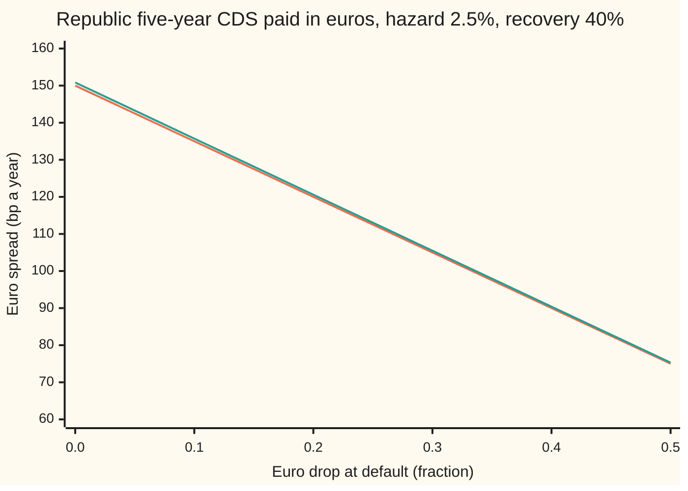

# Quanto CDS: protection on a sovereign paid in euros or in dollars, and the currency drop at default that separates the two spreads

[Syllabus](../../../SYLLABUS.md) → [Financial mathematics](../README.md) → [Credit Default Swaps - Pricing, the Par Spread and the Hazard Behind It](../README.md#s42) → Quanto CDS

---

## General Overview

A euro-area government, called the Republic on this card, has debt that investors want to insure. Two credit default swaps on the Republic trade side by side ([The credit default swap](01-credit-default-swap-contract.md)). They cover the same default, the same bonds and the same recovery. One pays its protection in dollars, the other in euros. The dollar contract costs **150 bp** a year. The euro contract costs **120 bp**. (A basis point, bp, is a hundredth of a percent.)

The two contracts differ only in the currency of the payout. So the 30 bp gap must be about the currency. If the Republic defaults, the euro is likely to fall against the dollar in the same instant. A euro payout then arrives in a currency that has just lost value. Protection that pays in a falling currency is worth less, so it costs less.

Put a number on the fall. The market reads the Republic as defaulting at 2.5% a year and expects lenders to recover 40 cents per euro of debt. By [The credit triangle](03-the-credit-triangle.md), the dollar spread is 0.6 × 2.5% = 150 bp. If the euro drops by 20% at default, every euro paid out is worth 0.8 of what it was a moment before. The euro spread is then 0.8 × 150 = 120 bp. Run the line backwards and the two quotes reveal the drop: 1 − 120/150 = **20%**.

A CDS whose payout currency differs from the currency the risk is usually priced in is a **quanto CDS**, the term used from here on. The pair of quotes shows the drop the market prices: how hard the currency is priced to fall if the government fails.

**The euro spread on a sovereign is the dollar spread times one minus the euro's drop at default, so the ratio of the two quotes reveals the priced drop, free of recovery and hazard.**

**What kind of fact this is:** a theorem inside a model. The model has three parts: default arrives at a known hazard rate, the euro falls by a fixed fraction at that instant, and its ordinary wobble is unrelated to default. Inside that model the relation is exact for premiums paid continuously, and it is proved on this card in Why it works. Quarterly payment dates add a small, computable correction.

### The picture: the euro spread falls in a straight line as the drop grows



Orange: the euro spread by the triangle, 150 bp times one minus the drop. Green: the spread with premiums paid at each quarter end and no accrued premium at default, a little higher. At a 20% drop the two read 120.00 and 120.60 bp. The market's 120 bp quote sits on the orange line at 0.2.

---

## The formula

Notation first, in words.

- $`s_{\$}`$ and $`s_{€}`$ are the par spreads (the fair yearly premium, as a fraction of the amount insured) of the dollar and the euro contract.
- $`\lambda`$ is the hazard rate: the yearly chance of default in the next instant among survivors, as priced in dollars.
- $`R`$ is the recovery, the fraction of face value lenders get back.
- $`\gamma`$ (Greek "gamma") is the **drop**: the fraction of its dollar value the euro loses at the default instant.
- $`X_t`$ is the exchange rate in dollars per euro at date $`t`$; $`X_0`$ is today's rate.

```math
s_{€} = (1-\gamma)\,s_{\$}, \qquad s_{\$} = (1-R)\,\lambda
```

**Read it aloud:** the euro spread is the dollar spread times the share of a euro's value that survives the drop at default.

Turned around, the two quotes give the drop:

```math
\gamma = 1 - \frac{s_{€}}{s_{\$}}
```

**Read it aloud:** the drop is one minus the euro spread over the dollar spread.

For the Republic: $`\gamma = 1 - 120/150 = 0.20`$. Neither $`R`$ nor $`\lambda`$ appears.

A third reading names the euro investor's hazard. Write $`\lambda_{€} = (1-\gamma)\lambda`$. Then $`s_{€} = (1-R)\lambda_{€}`$: the euro quote is an ordinary credit triangle, run at a hazard of 2.0% instead of 2.5%.

| Symbol | Plain meaning | In our example | Push it up and the answer… |
| --- | --- | --- | --- |
| $`s_{\$}`$, $`s_{€}`$ | par spreads of the dollar and euro contracts, per year | 150 bp, 120 bp | — |
| $`\gamma`$ | the drop: fraction of the euro's dollar value lost at default | 0.20 | euro spread falls one for one: 15 bp per 0.10 |
| $`\lambda`$, $`\lambda_{€}`$ | hazard rate priced in dollars ("lambda"); the hazard a euro investor prices, $`(1-\gamma)\lambda`$ | 2.5%, 2.0% a year | both spreads rise in proportion; the drop read from them does not move |
| $`R`$ | recovery, same in both contracts | 40% | both spreads fall; the drop does not move |
| $`X_t`$, $`X_0`$ | exchange rate, dollars per euro, at date t and today | 1.10 today | scales the euro contract's dollar value, not its spread |
| $`r_{\$}`$, $`r_{€}`$ | dollar and euro interest rates, continuously compounded | 4%, 2% | only the quarter-end correction moves |
| $`\sigma_X`$ | yearly volatility (wobble) of the exchange rate before default | 8% | no effect, while it is unrelated to default |
| $`t`$, $`T`$, $`dt`$ | a date; the tenor (the contract's length), in years; a short slice of time | T = 5 | — |
| $`\delta`$; $`n`$, $`j`$ | the slice of a year each premium covers ("delta"); the number of premium dates, and their count | 0.25; n = 20 | the two spreads drift slightly apart |
| $`x_{\$}`$, $`x_{€}`$ | delay terms: (rate + hazard) × δ, one per contract | 0.01625, 0.01000 | the dated spread rises further above the triangle |
| $`a`$ | the euro's drift in dollars between jumps, $`r_{\$} - r_{€} + \gamma\lambda`$ | 2.5% a year | — |
| $`w(t)`$ | the weight: today's dollar value of one euro due at t, counted only if the Republic is alive | $`X_0`$ = 1.10 at t = 0 | — |

### When it holds

- **The drop is a fixed fraction.** If the drop is uncertain, the formula uses its average in the pricing world, because the payout is a straight line in $`1-\gamma`$. The 20% read from quotes is that average, not a promise.
- **The euro's ordinary wobble is unrelated to default.** If the euro also slides as the Republic weakens before default, it is already low on the dates when default is most likely. The ratio then moves away from $`1-\gamma`$, and the quotes no longer isolate the drop. This is a currency form of wrong-way risk, the first card under Where this goes next.
- **Both contracts share one recovery.** Both settle on the same auction of the same bonds, so $`R`$ is one number. Contracts on different debt (local-law against foreign-law bonds) can recover differently, and that gap would be misread as a currency drop.
- **The hazard is known today.** A random hazard that moves with the exchange rate adds the same kind of error as the second bullet; the random-hazard card under Where this goes next takes the first step.
- **Premiums flow continuously.** With quarter-end premiums each contract carries its own small delay factor. The ratio for the Republic becomes 0.7975 instead of 0.8000, or 0.7980 when the accrued premium at default is paid as well, as in standard contracts.

---

## Why it works

### Step 0: price both contracts in one currency

Put both contracts on the same notional (the face amount insured): 10 million euros, or 11 million dollars at today's 1.10. Look at the default instant, with the rate still at 1.10 just before it:

```
payout at default, valued in dollars ($ millions)
dollar contract  0.6 x $11m              ██████████████████████████  6.60
euro contract    0.6 x EUR 10m x 0.88    █████████████████████       5.28
```

Both contracts hand over 60% of the notional. The euro one hands it over in euros worth $0.88 each, not $1.10. Its payout is 20% smaller in dollars. That is the whole idea. The rest of the argument checks that nothing else differs: the premiums, paid in calm times, carry no drop at all.

### Step 1: before default the euro must drift up a little

A euro held in a euro bank account earns $`r_{€}`$. In dollars it is worth $`X_t\,e^{r_{€} t}`$. In the dollar pricing world (the risk-neutral world, where every traded asset is averaged as if it earned the riskless rate), that value must grow at $`r_{\$}`$ on average ([Covered interest parity](../20-FX%20spot%2C%20forwards%20and%20interest%20parity/02-covered-interest-parity.md)).

But the euro now carries a known risk: with chance $`\lambda\,dt`$ in each short slice of time $`dt`$, it loses the fraction $`\gamma`$. That costs it $`\gamma\lambda`$ a year on average. So between jumps the euro must drift up faster, at

```math
a = r_{\$} - r_{€} + \gamma\lambda
```

**Read it aloud:** in calm times the euro gains the interest-rate gap plus a premium that pays for its jump risk.

For the Republic: $`a = 0.04 - 0.02 + 0.20 \times 0.025 = 0.025`$, against an average loss from the jump of 0.005. On average the euro still drifts at the 2% rate gap, as covered interest parity demands.

### Step 2: both legs share one factor, which cancels

Value both legs of the euro contract in dollars, per euro of notional. Each pays only on dates the Republic is still alive, and each pays in euros.

- The **premium leg** pays $`s_{€}\,dt`$ euros in each slice before default. In dollars that is $`s_{€}\,X_t\,dt`$.
- The **protection leg** pays $`1-R`$ euros in the slice where default lands, chance $`\lambda\,dt`$. In dollars that is $`(1-R)(1-\gamma)X_t`$, times that chance: the drop strikes exactly then.

Average over the default date and the exchange rate, and discount at $`r_{\$}`$. Both legs then contain the same weight in every slice:

```math
w(t) = e^{-r_{\$} t} \times \big(\text{average } X_t \text{ if alive at } t\big) \times \big(\text{chance of being alive at } t\big) = X_0\,e^{-(r_{€} + \lambda - \gamma\lambda)\,t}
```

**Read it aloud:** the weight is today's dollar value of one euro due at t, counted only if the Republic is still alive then.

Set the two legs equal:

```math
s_{€} \int_0^T w(t)\,dt = (1-R)(1-\gamma)\,\lambda \int_0^T w(t)\,dt
```

The integral is the same positive number on both sides. Divide it out: $`s_{€} = (1-\gamma)(1-R)\lambda = (1-\gamma)\,s_{\$}`$. The dollar contract is the same calculation with $`\gamma = 0`$ and no exchange rate. The exchange-rate wobble $`\sigma_X`$ never entered, because it averages out of $`X_t`$ when it is unrelated to default.

<details>
<summary>Detailed proof: the euro's drift, the weight, and the euro-world hazard</summary>

Write the exchange rate between jumps as a lognormal wobble with drift $`a`$ and volatility $`\sigma_X`$, and at the default date multiply it by $`1-\gamma`$. Before default, the average of $`X_t`$ is $`X_0 e^{a t}`$, since the wobble has average factor one.

The euro deposit's dollar value, $`X_t e^{r_{€} t}`$, gains $`a + r_{€}`$ a year between jumps and loses the fraction $`\gamma`$ at rate $`\lambda`$. Its average growth rate is $`a + r_{€} - \gamma\lambda`$. No-arbitrage sets this to $`r_{\$}`$, which gives $`a = r_{\$} - r_{€} + \gamma\lambda`$.

Survival to $`t`$ has chance $`e^{-\lambda t}`$, and the wobble is unrelated to default, so

$`\displaystyle w(t) = e^{-r_{\$} t}\,X_0\,e^{a t}\,e^{-\lambda t} = X_0\,e^{-(r_{€} + (1-\gamma)\lambda)\,t}.`$

This is exactly the weight of an ordinary euro CDS, discounted at $`r_{€}`$, on a name whose hazard is $`\lambda_{€} = (1-\gamma)\lambda`$. So a euro investor prices the Republic as if it defaulted at 2.0% a year. Pricing in euros instead of dollars is a change of the unit of account, and a unit that loses value at default makes default look rarer ([Changing the unit of account](../05-Black-Scholes%20from%20the%20Ground%20Up/05-change-of-numeraire-in-pricing.md)). It is the jump version of [The quanto adjustment](../24-Quantos%20and%20composites/01-quanto-forward-and-adjustment.md), where a smooth co-movement shifts a drift by the correlation times the two volatilities; here a jump shifts a hazard by $`\gamma\lambda`$.

Protection, per euro of notional, in dollars:

$`\displaystyle (1-R)(1-\gamma)\lambda \int_0^T w(t)\,dt.`$

Premium leg: $`\displaystyle s_{€}\int_0^T w(t)\,dt`$. Equating gives the result. With dated premiums the premium leg becomes $`\displaystyle s_{€}\,\delta\sum_{j=1}^{n} w(j\delta)`$, and the same geometric-series step as in [Pricing a CDS](02-cds-legs-risky-annuity-and-par-spread.md) gives

$`\displaystyle s_{€} = (1-R)\,\lambda_{€}\,\frac{e^{x_{€}}-1}{x_{€}}, \qquad x_{€} = (r_{€} + \lambda_{€})\,\delta,`$

and the dollar spread is the same with $`r_{\$}`$, $`\lambda`$ and $`x_{\$} = (r_{\$}+\lambda)\delta`$.

The accrued premium of Step 3 adds to the premium leg, per unit of spread, the time since the last premium date, paid at default and weighted like the payout. Integrating it quarter by quarter divides the delay factor by

$`\displaystyle 1 + \frac{\lambda_{€}}{r_{€}+\lambda_{€}}\left(\frac{e^{x_{€}}-1}{x_{€}} - 1\right).`$

To first order that leaves $`1 + r_{€}\delta/2`$: the hazard has dropped out, and only the interest rate is left.

</details>

### Step 3: quarter-end premiums add a small, signed correction

Real contracts pay each quarter's premium at the quarter's end. If nothing more is paid at default, [The credit triangle](03-the-credit-triangle.md) shows this lifts a spread by the delay factor $`(e^x - 1)/x`$, with $`x`$ the discount rate plus the hazard, times a quarter.

The two contracts have different $`x`$. The dollar one uses $`(0.04 + 0.025) \times 0.25`$; the euro one uses $`(0.02 + 0.020) \times 0.25`$. The euro factor is smaller, so the dated ratio dips below $`1-\gamma`$: 120.6020/151.2254 = 0.7975. A 20% drop shows up as a 20.25% shortcut reading.

Standard contracts also pay the **accrued premium** at default: the premium for the part of the quarter already covered ([Pricing a CDS](02-cds-legs-risky-annuity-and-par-spread.md)). In the euro contract it is paid in euros, so it takes the drop too. It pulls each spread back toward its triangle. What is left of the delay comes from the interest rate alone: about one plus half a quarter's interest, 1.0050 for dollars and 1.0025 for euros. With accrual the dated spreads are 150.7517 and 120.3002 bp, a ratio of 0.7980, so a 20% drop shows up as 20.20%. The small gap that remains comes from the two interest rates, not from the hazard.

### Step 4: back from two quotes to the drop

The shortcut $`\gamma = 1 - s_{€}/s_{\$}`$ needs no recovery and no hazard. For precise work, treat 150 and 120 bp as dated quotes. Solve the dollar quote for $`\lambda`$ (2.4798%). Solve the euro quote for $`\lambda_{€}`$ (1.9900%), discounting at the euro rate. Then $`\gamma = 1 - \lambda_{€}/\lambda = 19.75\%`$. With the accrued premium paid, the same two solves give 2.4875% and 1.9950%, and $`\gamma = 19.80\%`$. Each solve has one answer, because each dated spread rises steadily with its hazard ([Implied hazard from one CDS quote](04-implied-hazard-from-a-cds-quote.md)).

---

## Worked numbers, by hand

The Republic: $`\lambda = 2.5\%`$, $`R = 40\%`$, $`\gamma = 20\%`$, $`r_{\$} = 4\%`$, $`r_{€} = 2\%`$, five years, quarterly premiums.

| Step | Arithmetic | Value |
| --- | --- | --- |
| dollar spread, triangle | $`0.6 \times 0.025`$ | 150.00 bp |
| euro-world hazard | $`0.8 \times 0.025`$ | 2.00% |
| euro spread, triangle | $`0.6 \times 0.020 = 0.8 \times 150`$ | 120.00 bp |
| drop from the two quotes | $`1 - 120/150`$ | **0.2000** |
| euro drift between jumps, $`a`$ | $`0.04 - 0.02 + 0.2 \times 0.025`$ | 2.50% a year |
| dollar delay factor | $`(e^{0.01625}-1)/0.01625`$ | 1.008169 |
| euro delay factor | $`(e^{0.01}-1)/0.01`$ | 1.005017 |
| dated dollar spread | $`150 \times 1.008169`$ | 151.2254 bp |
| dated euro spread | $`120 \times 1.005017`$ | 120.6020 bp |
| drop from 150 and 120 read as dated quotes | $`1 - 0.019900/0.024798`$ | 0.1975 |
| the same, with the accrued premium paid | $`1 - 0.019950/0.024875`$ | 0.1980 |

The two quotes say the market prices a 20% fall in the euro if the Republic defaults. Read as dated quotes, they give 19.75% with no accrued premium and 19.80% with it, as standard contracts pay: a fifth to a quarter of a point below the shortcut.

### What breaks if you drop a piece

| Mistake | Comes out at | What went wrong |
| --- | --- | --- |
| Treat a spread as the same in any currency | euro 150.00 bp, drop 0 | A spread is a rate, but it is a rate of payment in one currency; the payout currency falls at default |
| Measure the drop as the dollar's rise, 150/120 − 1 | 0.2500 | Dollars per euro fall 20% exactly when euros per dollar rise 25%; the card's $`\gamma`$ is the first |
| Read the hazard off the euro quote, 120/0.6 | 2.00% a year, five-year default 9.52% | That is the euro-world hazard; the dollar-world 2.50% gives 11.75% |
| Convert the euro spread at today's rate, 120 × 1.10 | 132.00 bp, drop 0.1200 | Spreads are fractions of notional; the exchange rate scales the notional, not the fraction |

---

## Code, from first principles, and it actually runs

The scripts reach the dated spreads by three roads:

1. the closed form, with and without the accrued premium;
2. both legs added up in dollars, with the euro drifting at $`a`$ and dropping at default: Simpson's rule (a numerical integration) for protection and accrual, a quarter at a time, and a sum over premium dates for the annuity;
3. a Monte Carlo simulation (random draws, averaged) of 400,000 default dates, each with its own exchange-rate path, paying premiums at quarter ends without accrual. A hand-written random number generator (splitmix64) supplies the draws, and the Box–Muller formula turns them into normal ones.

The continuous result gets no separate road: with one weight in both legs, the Simpson ratio is $`(1-R)(1-\gamma)\lambda`$ whatever the weight. So the checks test the weight itself, setting each Simpson integral against its closed form. The simulation tests what the legs take on trust, the drift $`a`$ of Step 1. It carries each euro deposit through the drop to five years, and its discounted dollar value averages 0.9998 of $`X_0`$, with a standard error (the typical size of the simulation's random error) of 0.0003. Without the $`\gamma\lambda`$ term that assert fails. The simulated drop, 0.2029 with standard error 0.0005, sits within three standard errors of the model's 0.2025 and well outside three of the shortcut's 0.2000. The simulated spreads, 150.75 and 120.17 bp, sit within four standard errors (0.70 and 0.56 bp) of the dated 151.2254 and 120.6020; at that precision they cannot tell dated premiums from continuous ones. The inverse runs three ways, the shortcut and bisections on dated quotes without and with accrual, and each answer is re-priced through the legs. Seven asserts make nineteen comparisons: sixteen between values reached by different routes, and three that check the simulation rules out the shortcut and that accrual takes the hazard out of the shortcut's error.

### Python

```python
# Quanto CDS -- the check behind the card.  Standard library only.
# One sovereign, protection paid in dollars or in euros; the euro drops by gam
# at the default instant.  Roads to the two spreads: the closed form, both legs
# added up in dollars (Simpson's rule and a premium-date sum), and a Monte Carlo
# of default dates and exchange-rate paths.  Then the inverse: gam from quotes.
from math import exp, log, sqrt, cos, sin, pi

R, lam, gam = 0.40, 0.025, 0.20       # recovery, hazard (dollar world), drop at default
rd, rf, X0, sig = 0.04, 0.02, 1.10, 0.08  # dollar rate, euro rate, $ per EUR, FX volatility
T, dl, n = 5.0, 0.25, 20              # tenor, quarter, premium dates
L, bp = 1.0 - R, 1e4

def F(x):                             # (e^x - 1)/x: the quarter-end delay factor
    return 1.0 if x == 0.0 else (exp(x) - 1.0) / x

def closed(lam, gam, r, dated=True, acc=False):  # road 1: par spread; gam=0, r=rd gives dollars
    le = lam * (1.0 - gam)            # hazard seen by a holder of the payout currency
    x = (r + le) * dl
    g = F(x) / (1.0 + le / (r + le) * (F(x) - 1.0)) if acc else F(x)  # accrued premium pulls it back
    return L * le * (g if dated else 1.0)

def legs(lam, gam, r, m=200):         # road 2: both legs in dollars per $ of notional
    drift = rd - r + gam * lam        # pre-default drift of the payout currency in dollars
    w = lambda t: exp(-rd * t) * exp(drift * t) * exp(-lam * t)  # discount x E[X/X0, alive]
    h, prot, cont, accr = dl / m, 0.0, 0.0, 0.0
    for j in range(n):                # Simpson's rule over the default date, a quarter at a time
        for i in range(m + 1):
            c = (1 if i in (0, m) else (4 if i % 2 else 2)) * h / 3 * w(j * dl + i * h)
            cont += c                                 # premium paid continuously
            prot += c * L * (1.0 - gam) * lam         # payout at default, after the drop
            accr += c * i * h * (1.0 - gam) * lam     # premium accrued in the quarter, paid at default
    ann = sum(dl * w(j * dl) for j in range(1, n + 1))  # premiums at quarter ends
    return prot / ann, prot / (ann + accr), prot, cont

def monte_carlo(paths=400_000, seed=20261123):  # road 3: simulate default and the jump
    s = seed
    def unif():
        nonlocal s
        s = (s + 0x9E3779B97F4A7C15) & 0xFFFFFFFFFFFFFFFF          # splitmix64
        z = ((s ^ (s >> 30)) * 0xBF58476D1CE4E5B9) & 0xFFFFFFFFFFFFFFFF
        z = ((z ^ (z >> 27)) * 0x94D049BB133111EB) & 0xFFFFFFFFFFFFFFFF
        return ((z ^ (z >> 31)) >> 11) / 9007199254740992.0 + 0.5 / 9007199254740992.0
    mu = rd - rf + gam * lam - 0.5 * sig * sig   # log-drift of X before default
    nu = rd - rf - 0.5 * sig * sig               # after default: no jump left to pay for
    PU, AU, PE, AE, D = [], [], [], [], []
    for _ in range(paths):
        tau = -log(unif()) / lam
        lx, oU, oE, bU, bE = 0.0, 0.0, 0.0, 0.0, 0.0
        for j in range(1, n + 1):
            u1, u2 = unif(), unif()                                 # Box-Muller: two normals
            z, z2 = sqrt(-2.0 * log(u1)) * cos(2.0 * pi * u2), sqrt(-2.0 * log(u1)) * sin(2.0 * pi * u2)
            t = j * dl
            if tau > t:
                lx += mu * dl + sig * sqrt(dl) * z
                bU += dl * exp(-rd * t); bE += dl * exp(-rd * t + lx)
            elif tau > t - dl:
                hh = tau - (j - 1) * dl                             # walk X to the default date
                lx += mu * hh + sig * sqrt(hh) * z
                oU = L * exp(-rd * tau)
                oE = L * (1.0 - gam) * exp(-rd * tau + lx)          # the euro drops by gam
                lx += log(1.0 - gam) + nu * (t - tau) + sig * sqrt(t - tau) * z2
            else:
                lx += nu * dl + sig * sqrt(dl) * z
        PU.append(oU); AU.append(bU); PE.append(oE); AE.append(bE)
        D.append(exp(lx + (rf - rd) * T))                           # euro deposit in $, discounted, / X0
    def ratio(P, A):                  # sum P / sum A, and each path's share of its error
        r, ma = sum(P) / sum(A), sum(A) / paths
        return r, [(p - r * a) / ma for p, a in zip(P, A)]
    se = lambda e: sqrt(sum(x * x for x in e)) / paths
    (sU, eU), (sE, eE), dm = ratio(PU, AU), ratio(PE, AE), sum(D) / paths
    eG = [sE / sU * (e / sE - u / sU) for u, e in zip(eU, eE)]      # the drop 1 - sE/sU
    return sU, se(eU), sE, se(eE), se(eG), dm, se([d - dm for d in D])

def solve(f, target, lo=0.0, hi=1.0):  # bisection for an increasing f
    while hi - lo > 1e-15:
        mid = 0.5 * (lo + hi)
        lo, hi = (mid, hi) if f(mid) < target else (lo, mid)
    return 0.5 * (lo + hi)

# ---- the triangle: one name, two currencies ----
sU, sE = closed(lam, 0, rd, False), closed(lam, gam, rf, False)
print(f"dollar spread, triangle (1-R)*lam: {sU*bp:.2f} bp")
print(f"euro spread, triangle (1-gam)*(1-R)*lam: {sE*bp:.2f} bp")
print(f"implied drop from 150 and 120: 1 - 120/150 = {1-120/150:.4f}")
print(f"euro-world hazard (1-gam)*lam: {lam*(1-gam):.4f}")
print(f"payout on $11m: ${L*11:.2f}m; on EUR 10m: EUR {L*10:.2f}m = ${L*10*X0*(1-gam):.2f}m at {X0*(1-gam):.2f}")
print(f"pre-default euro drift rd - rf + gam*lam: {rd-rf+gam*lam:.4f}; jump term -gam*lam: {-gam*lam:.4f}")
for g, r, name in ((0, rd, "dollar"), (gam, rf, "euro")):  # Simpson against the integrals in closed form
    k = r + (1 - g) * lam             # payout-currency rate plus the hazard its holder sees
    _, _, pr, cn = legs(lam, g, r)
    print(f"{name} legs, Simpson vs closed: protection {pr:.8f} vs {L*(1-g)*lam*(1-exp(-k*T))/k:.8f}, "
          f"annuity {cn:.6f} vs {(1-exp(-k*T))/k:.6f}")
    assert abs(pr - L * (1 - g) * lam * (1 - exp(-k * T)) / k) < 1e-9 and abs(cn - (1 - exp(-k * T)) / k) < 1e-9
# ---- quarter-end premiums, without and with the accrued premium at default ----
qU, qE, aU, aE = closed(lam, 0, rd), closed(lam, gam, rf), closed(lam, 0, rd, acc=True), closed(lam, gam, rf, acc=True)
lU, lE = legs(lam, 0, rd), legs(lam, gam, rf)
print(f"dated closed form: dollar {qU*bp:.4f} bp, euro {qE*bp:.4f} bp, ratio {qE/qU:.6f}")
print(f"dated legs: dollar {lU[0]*bp:.4f} bp, euro {lE[0]*bp:.4f} bp")
print(f"delay factors: dollar x {(rd+lam)*dl:.5f} -> {F((rd+lam)*dl):.6f}, euro x {(rf+lam*(1-gam))*dl:.5f} -> {F((rf+lam*(1-gam))*dl):.6f}")
print(f"with accrued premium, closed form: dollar {aU*bp:.4f} bp, euro {aE*bp:.4f} bp, ratio {aE/aU:.6f}")
print(f"with accrued premium, legs: dollar {lU[1]*bp:.4f} bp, euro {lE[1]*bp:.4f} bp")
print(f"delay factors with accrual: dollar {aU/sU:.6f}, euro {aE/sE:.6f}; 1 + r*dl/2: {1+rd*dl/2:.4f}, {1+rf*dl/2:.4f}")
assert max(abs(a - b) for a, b in ((lU[0], qU), (lE[0], qE), (lU[1], aU), (lE[1], aE))) < 1e-9  # legs vs closed
mU, seU, mE, seE, seG, dep, seD = monte_carlo()
print(f"Monte Carlo, 400,000 paths: dollar {mU*bp:.2f} bp (se {seU*bp:.2f}), euro {mE*bp:.2f} bp (se {seE*bp:.2f})")
print(f"Monte Carlo implied drop 1 - sE/sU: {1-mE/mU:.4f} (se {seG:.4f}); dated model: {1-qE/qU:.4f}")
print(f"Monte Carlo euro deposit in dollars at 5 years, discounted, over X0: {dep:.4f} (se {seD:.4f})")
assert abs(mU - qU) < 4 * seU and abs(mE - qE) < 4 * seE  # road 3 against road 1
assert abs((1 - mE / mU) - (1 - qE / qU)) < 3 * seG < abs((1 - mE / mU) - 0.2)  # model, not shortcut
assert abs(dep - 1.0) < 4 * seD                           # the drift a makes the deposit fair
# ---- the inverse: drop from the two quotes ----
lq, le = solve(lambda x: closed(x, 0, rd), 0.0150), solve(lambda x: closed(x, 0, rf), 0.0120)
la, ea = solve(lambda x: closed(x, 0, rd, acc=True), 0.0150), solve(lambda x: closed(x, 0, rf, acc=True), 0.0120)
g0, g1, g2 = 1 - 0.0120 / 0.0150, 1 - le / lq, 1 - ea / la
rU, rE, xU, xE = legs(lq, 0, rd)[0], legs(lq, g1, rf)[0], legs(la, 0, rd)[1], legs(la, g2, rf)[1]
print(f"inverse: shortcut {g0:.4f}; dated quotes: lam {lq:.6f}, euro-world lam {le:.6f}, drop {g1:.4f}")
print(f"re-priced through the legs: {rU*bp:.4f} bp and {rE*bp:.4f} bp")
print(f"inverse with accrued premium: lam {la:.6f}, euro-world lam {ea:.6f}, drop {g2:.4f}; "
      f"re-priced {xU*bp:.4f} bp and {xE*bp:.4f} bp")
assert max(abs(v - q) for v, q in ((rU, 0.0150), (rE, 0.0120), (xU, 0.0150), (xE, 0.0120))) < 1e-9
print(f"Italy, first week of May 2012: 1 - 350/440 = {1-350/440:.4f}")
# ---- what breaks ----
print(f"break: spread same in any currency: euro {sU*bp:.2f} bp, drop 0")
print(f"break: drop measured as the dollar's rise: 150/120 - 1 = {150/120-1:.4f}")
print(f"break: hazard from the euro quote: {0.0120/L:.4f} vs {0.0150/L:.4f}; "
      f"5-year default {1-exp(-5*0.0120/L):.4f} vs {1-exp(-5*0.0150/L):.4f}")
print(f"break: euro spread converted at 1.10: {120*X0:.2f} bp, drop {1-120*X0/150:.4f}")
# ---- try changing ----
print(f"try: gam 0.50 -> euro {closed(lam, 0.5, rf, False)*bp:.2f} bp")
print(f"try: R 0.25 -> dollar {0.75*lam*bp:.2f} bp, euro {0.75*lam*0.8*bp:.2f} bp, drop {1-0.8:.4f}")
r10, a10 = closed(0.10, gam, rf) / closed(0.10, 0, rd), closed(0.10, gam, rf, acc=True) / closed(0.10, 0, rd, acc=True)
print(f"try: lam 0.10 dated -> dollar {closed(0.10,0,rd)*bp:.2f} bp, euro {closed(0.10,gam,rf)*bp:.2f} bp, "
      f"shortcut drop {1-r10:.4f}; with accrual {1-a10:.4f} (at 0.025: {1-aE/aU:.4f})")
assert abs(a10 - aE / aU) < 1e-4 < abs(r10 - qE / qU)     # accrual takes the hazard out of the error
print(f"try: gam -0.10 -> euro {closed(lam, -0.1, rf, False)*bp:.2f} bp")
# ---- chart: euro spread against the drop ----
for g in [0.0, 0.1, 0.2, 0.3, 0.4, 0.5]:
    print(f"chart, drop {g:.1f}: triangle {closed(lam, g, rf, False)*bp:.2f} bp, dated {closed(lam, g, rf)*bp:.2f} bp")
print("ALL CHECKS PASS")
```

**Ran 2026-11-23 on macOS, Python 3.14.10, standard library only. All checks passed. Output, pasted from the run:**

```
dollar spread, triangle (1-R)*lam: 150.00 bp
euro spread, triangle (1-gam)*(1-R)*lam: 120.00 bp
implied drop from 150 and 120: 1 - 120/150 = 0.2000
euro-world hazard (1-gam)*lam: 0.0200
payout on $11m: $6.60m; on EUR 10m: EUR 6.00m = $5.28m at 0.88
pre-default euro drift rd - rf + gam*lam: 0.0250; jump term -gam*lam: -0.0050
dollar legs, Simpson vs closed: protection 0.06403215 vs 0.06403215, annuity 4.268810 vs 4.268810
euro legs, Simpson vs closed: protection 0.05438077 vs 0.05438077, annuity 4.531731 vs 4.531731
dated closed form: dollar 151.2254 bp, euro 120.6020 bp, ratio 0.797498
dated legs: dollar 151.2254 bp, euro 120.6020 bp
delay factors: dollar x 0.01625 -> 1.008169, euro x 0.01000 -> 1.005017
with accrued premium, closed form: dollar 150.7517 bp, euro 120.3002 bp, ratio 0.798003
with accrued premium, legs: dollar 150.7517 bp, euro 120.3002 bp
delay factors with accrual: dollar 1.005011, euro 1.002502; 1 + r*dl/2: 1.0050, 1.0025
Monte Carlo, 400,000 paths: dollar 150.75 bp (se 0.70), euro 120.17 bp (se 0.56)
Monte Carlo implied drop 1 - sE/sU: 0.2029 (se 0.0005); dated model: 0.2025
Monte Carlo euro deposit in dollars at 5 years, discounted, over X0: 0.9998 (se 0.0003)
inverse: shortcut 0.2000; dated quotes: lam 0.024798, euro-world lam 0.019900, drop 0.1975
re-priced through the legs: 150.0000 bp and 120.0000 bp
inverse with accrued premium: lam 0.024875, euro-world lam 0.019950, drop 0.1980; re-priced 150.0000 bp and 120.0000 bp
Italy, first week of May 2012: 1 - 350/440 = 0.2045
break: spread same in any currency: euro 150.00 bp, drop 0
break: drop measured as the dollar's rise: 150/120 - 1 = 0.2500
break: hazard from the euro quote: 0.0200 vs 0.0250; 5-year default 0.0952 vs 0.1175
break: euro spread converted at 1.10: 132.00 bp, drop 0.1200
try: gam 0.50 -> euro 75.00 bp
try: R 0.25 -> dollar 187.50 bp, euro 150.00 bp, drop 0.2000
try: lam 0.10 dated -> dollar 610.62 bp, euro 486.05 bp, shortcut drop 0.2040; with accrual 0.2020 (at 0.025: 0.2020)
try: gam -0.10 -> euro 165.00 bp
chart, drop 0.0: triangle 150.00 bp, dated 150.85 bp
chart, drop 0.1: triangle 135.00 bp, dated 135.72 bp
chart, drop 0.2: triangle 120.00 bp, dated 120.60 bp
chart, drop 0.3: triangle 105.00 bp, dated 105.49 bp
chart, drop 0.4: triangle 90.00 bp, dated 90.39 bp
chart, drop 0.5: triangle 75.00 bp, dated 75.31 bp
ALL CHECKS PASS
```

### Rust

```rust
// Quanto CDS -- the check behind the card.  Standard library only.
// One sovereign, protection paid in dollars or in euros; the euro drops by gam
// at the default instant.  Roads to the two spreads: the closed form, both legs
// added up in dollars (Simpson's rule and a premium-date sum), and a Monte Carlo
// of default dates and exchange-rate paths.  Then the inverse: gam from quotes.
use std::f64::consts::PI;

const R: f64 = 0.40; const LAM: f64 = 0.025; const GAM: f64 = 0.20; // recovery, hazard (dollar world), drop
const RD: f64 = 0.04; const RF: f64 = 0.02; // dollar rate, euro rate
const X0: f64 = 1.10; const SIG: f64 = 0.08; // dollars per euro, FX volatility
const T: f64 = 5.0; const DL: f64 = 0.25; const N: usize = 20; // tenor, quarter, premium dates
const L: f64 = 1.0 - R; const BP: f64 = 1e4;

fn f(x: f64) -> f64 { if x == 0.0 { 1.0 } else { (x.exp() - 1.0) / x } } // the quarter-end delay factor

fn closed(lam: f64, gam: f64, r: f64, dated: bool, acc: bool) -> f64 { // road 1: par spread; gam = 0, r = RD: dollars
    let le = lam * (1.0 - gam); // hazard seen by a holder of the payout currency
    let x = (r + le) * DL;
    let g = if acc { f(x) / (1.0 + le / (r + le) * (f(x) - 1.0)) } else { f(x) }; // accrued premium pulls it back
    L * le * if dated { g } else { 1.0 }
}

fn legs(lam: f64, gam: f64, r: f64) -> (f64, f64, f64, f64) { // road 2: both legs in dollars per $ of notional
    let (m, drift) = (200usize, RD - r + gam * lam); // pre-default drift of the payout currency in dollars
    let w = |t: f64| (-RD * t).exp() * (drift * t).exp() * (-lam * t).exp();
    let (h, mut prot, mut cont, mut accr) = (DL / m as f64, 0.0, 0.0, 0.0);
    for j in 0..N { // Simpson's rule over the default date, a quarter at a time
        for i in 0..=m {
            let k = if i == 0 || i == m { 1.0 } else if i % 2 == 1 { 4.0 } else { 2.0 };
            let c = k * h / 3.0 * w(j as f64 * DL + i as f64 * h);
            cont += c; // premium paid continuously
            prot += c * L * (1.0 - gam) * lam; // payout at default, after the drop
            accr += c * i as f64 * h * (1.0 - gam) * lam; // premium accrued in the quarter, paid at default
        }
    }
    let ann: f64 = (1..=N).map(|j| DL * w(j as f64 * DL)).sum(); // premiums at quarter ends
    (prot / ann, prot / (ann + accr), prot, cont)
}

struct Rng(u64);
impl Rng {
    fn unif(&mut self) -> f64 {
        self.0 = self.0.wrapping_add(0x9E3779B97F4A7C15); // splitmix64
        let mut z = self.0;
        z = (z ^ (z >> 30)).wrapping_mul(0xBF58476D1CE4E5B9);
        z = (z ^ (z >> 27)).wrapping_mul(0x94D049BB133111EB);
        ((z ^ (z >> 31)) >> 11) as f64 / 9007199254740992.0 + 0.5 / 9007199254740992.0
    }
}

fn ratio(p: &[f64], a: &[f64]) -> (f64, Vec<f64>) { // sum P / sum A, and each path's share of its error
    let (r, ma) = (p.iter().sum::<f64>() / a.iter().sum::<f64>(), a.iter().sum::<f64>() / a.len() as f64);
    (r, p.iter().zip(a).map(|(p, a)| (p - r * a) / ma).collect())
}
fn se(e: &[f64]) -> f64 { e.iter().map(|x| x * x).sum::<f64>().sqrt() / e.len() as f64 }

fn monte_carlo(paths: usize, seed: u64) -> [f64; 7] { // road 3: simulate default and the jump
    let mut g = Rng(seed);
    let mu = RD - RF + GAM * LAM - 0.5 * SIG * SIG; // log-drift of X before default
    let nu = RD - RF - 0.5 * SIG * SIG; // after default: no jump left to pay for
    let (mut pu, mut au, mut pe, mut ae, mut d) = (vec![], vec![], vec![], vec![], vec![]);
    for _ in 0..paths {
        let tau = -g.unif().ln() / LAM;
        let (mut lx, mut o_u, mut o_e, mut b_u, mut b_e) = (0.0f64, 0.0, 0.0, 0.0, 0.0);
        for j in 1..=N {
            let (u1, u2) = (g.unif(), g.unif()); // Box-Muller: two normals
            let (z, z2) = ((-2.0 * u1.ln()).sqrt() * (2.0 * PI * u2).cos(), (-2.0 * u1.ln()).sqrt() * (2.0 * PI * u2).sin());
            let t = j as f64 * DL;
            if tau > t {
                lx += mu * DL + SIG * DL.sqrt() * z;
                b_u += DL * (-RD * t).exp(); b_e += DL * (-RD * t + lx).exp();
            } else if tau > t - DL {
                let hh = tau - (j - 1) as f64 * DL; // walk X to the default date
                lx += mu * hh + SIG * hh.sqrt() * z;
                o_u = L * (-RD * tau).exp();
                o_e = L * (1.0 - GAM) * (-RD * tau + lx).exp(); // the euro drops by gam
                lx += (1.0 - GAM).ln() + nu * (t - tau) + SIG * (t - tau).sqrt() * z2;
            } else {
                lx += nu * DL + SIG * DL.sqrt() * z;
            }
        }
        pu.push(o_u); au.push(b_u); pe.push(o_e); ae.push(b_e);
        d.push((lx + (RF - RD) * T).exp()); // euro deposit in $, discounted, / X0
    }
    let ((s_u, e_u), (s_e, e_e)) = (ratio(&pu, &au), ratio(&pe, &ae));
    let dm = d.iter().sum::<f64>() / paths as f64;
    let e_g: Vec<f64> = e_u.iter().zip(&e_e).map(|(u, e)| s_e / s_u * (e / s_e - u / s_u)).collect(); // the drop
    [s_u, se(&e_u), s_e, se(&e_e), se(&e_g), dm, se(&d.iter().map(|x| x - dm).collect::<Vec<f64>>())]
}

fn solve(fun: &dyn Fn(f64) -> f64, target: f64) -> f64 {
    let (mut lo, mut hi) = (0.0f64, 1.0f64); // bisection for an increasing fun
    while hi - lo > 1e-15 {
        let mid = 0.5 * (lo + hi);
        if fun(mid) < target { lo = mid } else { hi = mid }
    }
    0.5 * (lo + hi)
}

fn main() {
    // ---- the triangle: one name, two currencies ----
    let (s_u, s_e) = (closed(LAM, 0.0, RD, false, false), closed(LAM, GAM, RF, false, false));
    println!("dollar spread, triangle (1-R)*lam: {:.2} bp", s_u * BP);
    println!("euro spread, triangle (1-gam)*(1-R)*lam: {:.2} bp", s_e * BP);
    println!("implied drop from 150 and 120: 1 - 120/150 = {:.4}", 1.0 - 120.0 / 150.0);
    println!("euro-world hazard (1-gam)*lam: {:.4}", LAM * (1.0 - GAM));
    println!("payout on $11m: ${:.2}m; on EUR 10m: EUR {:.2}m = ${:.2}m at {:.2}", L * 11.0, L * 10.0, L * 10.0 * X0 * (1.0 - GAM), X0 * (1.0 - GAM));
    println!("pre-default euro drift rd - rf + gam*lam: {:.4}; jump term -gam*lam: {:.4}", RD - RF + GAM * LAM, -GAM * LAM);
    for (g, r, name) in [(0.0, RD, "dollar"), (GAM, RF, "euro")] { // Simpson against the integrals in closed form
        let k = r + (1.0 - g) * LAM; // payout-currency rate plus the hazard its holder sees
        let (_, _, pr, cn) = legs(LAM, g, r);
        let (pc, cc) = (L * (1.0 - g) * LAM * (1.0 - (-k * T).exp()) / k, (1.0 - (-k * T).exp()) / k);
        println!("{} legs, Simpson vs closed: protection {:.8} vs {:.8}, annuity {:.6} vs {:.6}", name, pr, pc, cn, cc);
        assert!((pr - pc).abs() < 1e-9 && (cn - cc).abs() < 1e-9);
    }
    // ---- quarter-end premiums, without and with the accrued premium at default ----
    let (q_u, q_e) = (closed(LAM, 0.0, RD, true, false), closed(LAM, GAM, RF, true, false));
    let (a_u, a_e) = (closed(LAM, 0.0, RD, true, true), closed(LAM, GAM, RF, true, true));
    let (l_u, l_e) = (legs(LAM, 0.0, RD), legs(LAM, GAM, RF));
    println!("dated closed form: dollar {:.4} bp, euro {:.4} bp, ratio {:.6}", q_u * BP, q_e * BP, q_e / q_u);
    println!("dated legs: dollar {:.4} bp, euro {:.4} bp", l_u.0 * BP, l_e.0 * BP);
    let (xu, xe) = ((RD + LAM) * DL, (RF + LAM * (1.0 - GAM)) * DL);
    println!("delay factors: dollar x {:.5} -> {:.6}, euro x {:.5} -> {:.6}", xu, f(xu), xe, f(xe));
    println!("with accrued premium, closed form: dollar {:.4} bp, euro {:.4} bp, ratio {:.6}", a_u * BP, a_e * BP, a_e / a_u);
    println!("with accrued premium, legs: dollar {:.4} bp, euro {:.4} bp", l_u.1 * BP, l_e.1 * BP);
    println!("delay factors with accrual: dollar {:.6}, euro {:.6}; 1 + r*dl/2: {:.4}, {:.4}",
        a_u / s_u, a_e / s_e, 1.0 + RD * DL / 2.0, 1.0 + RF * DL / 2.0);
    assert!([(l_u.0, q_u), (l_e.0, q_e), (l_u.1, a_u), (l_e.1, a_e)].iter().all(|(a, b)| (a - b).abs() < 1e-9));
    let [m_u, se_u, m_e, se_e, se_g, dep, se_d] = monte_carlo(400_000, 20261123);
    println!("Monte Carlo, 400,000 paths: dollar {:.2} bp (se {:.2}), euro {:.2} bp (se {:.2})",
        m_u * BP, se_u * BP, m_e * BP, se_e * BP);
    println!("Monte Carlo implied drop 1 - sE/sU: {:.4} (se {:.4}); dated model: {:.4}", 1.0 - m_e / m_u, se_g, 1.0 - q_e / q_u);
    println!("Monte Carlo euro deposit in dollars at 5 years, discounted, over X0: {:.4} (se {:.4})", dep, se_d);
    assert!((m_u - q_u).abs() < 4.0 * se_u && (m_e - q_e).abs() < 4.0 * se_e);
    assert!((m_e / m_u - q_e / q_u).abs() < 3.0 * se_g && 3.0 * se_g < (1.0 - m_e / m_u - 0.2).abs()); // model, not shortcut
    assert!((dep - 1.0).abs() < 4.0 * se_d); // the drift a makes the deposit fair
    // ---- the inverse: drop from the two quotes ----
    let (lq, le) = (solve(&|x| closed(x, 0.0, RD, true, false), 0.0150), solve(&|x| closed(x, 0.0, RF, true, false), 0.0120));
    let (la, ea) = (solve(&|x| closed(x, 0.0, RD, true, true), 0.0150), solve(&|x| closed(x, 0.0, RF, true, true), 0.0120));
    let (g0, g1, g2) = (1.0 - 0.0120 / 0.0150, 1.0 - le / lq, 1.0 - ea / la);
    let (r_u, r_e, x_u, x_e) = (legs(lq, 0.0, RD).0, legs(lq, g1, RF).0, legs(la, 0.0, RD).1, legs(la, g2, RF).1);
    println!("inverse: shortcut {:.4}; dated quotes: lam {:.6}, euro-world lam {:.6}, drop {:.4}", g0, lq, le, g1);
    println!("re-priced through the legs: {:.4} bp and {:.4} bp", r_u * BP, r_e * BP);
    println!("inverse with accrued premium: lam {:.6}, euro-world lam {:.6}, drop {:.4}; re-priced {:.4} bp and {:.4} bp",
        la, ea, g2, x_u * BP, x_e * BP);
    assert!([(r_u, 0.0150), (r_e, 0.0120), (x_u, 0.0150), (x_e, 0.0120)].iter().all(|(v, q)| (v - q).abs() < 1e-9));
    println!("Italy, first week of May 2012: 1 - 350/440 = {:.4}", 1.0 - 350.0 / 440.0);
    // ---- what breaks ----
    println!("break: spread same in any currency: euro {:.2} bp, drop 0", s_u * BP);
    println!("break: drop measured as the dollar's rise: 150/120 - 1 = {:.4}", 150.0 / 120.0 - 1.0);
    println!("break: hazard from the euro quote: {:.4} vs {:.4}; 5-year default {:.4} vs {:.4}",
        0.0120 / L, 0.0150 / L, 1.0 - (-5.0 * 0.0120 / L).exp(), 1.0 - (-5.0 * 0.0150 / L).exp());
    println!("break: euro spread converted at 1.10: {:.2} bp, drop {:.4}", 120.0 * X0, 1.0 - 120.0 * X0 / 150.0);
    // ---- try changing ----
    println!("try: gam 0.50 -> euro {:.2} bp", closed(LAM, 0.5, RF, false, false) * BP);
    println!("try: R 0.25 -> dollar {:.2} bp, euro {:.2} bp, drop {:.4}", 0.75 * LAM * BP, 0.75 * LAM * 0.8 * BP, 1.0 - 0.8);
    let r10 = closed(0.10, GAM, RF, true, false) / closed(0.10, 0.0, RD, true, false);
    let a10 = closed(0.10, GAM, RF, true, true) / closed(0.10, 0.0, RD, true, true);
    println!("try: lam 0.10 dated -> dollar {:.2} bp, euro {:.2} bp, shortcut drop {:.4}; with accrual {:.4} (at 0.025: {:.4})",
        closed(0.10, 0.0, RD, true, false) * BP, closed(0.10, GAM, RF, true, false) * BP, 1.0 - r10, 1.0 - a10, 1.0 - a_e / a_u);
    assert!((a10 - a_e / a_u).abs() < 1e-4 && 1e-4 < (r10 - q_e / q_u).abs()); // accrual takes the hazard out
    println!("try: gam -0.10 -> euro {:.2} bp", closed(LAM, -0.1, RF, false, false) * BP);
    // ---- chart: euro spread against the drop ----
    for g in [0.0, 0.1, 0.2, 0.3, 0.4, 0.5] {
        println!("chart, drop {:.1}: triangle {:.2} bp, dated {:.2} bp",
            g, closed(LAM, g, RF, false, false) * BP, closed(LAM, g, RF, true, false) * BP);
    }
    println!("ALL CHECKS PASS");
}
```

**Ran 2026-11-23 on macOS, rustc 1.98.1, no crates. All checks passed. Output, pasted from the run:**

```
dollar spread, triangle (1-R)*lam: 150.00 bp
euro spread, triangle (1-gam)*(1-R)*lam: 120.00 bp
implied drop from 150 and 120: 1 - 120/150 = 0.2000
euro-world hazard (1-gam)*lam: 0.0200
payout on $11m: $6.60m; on EUR 10m: EUR 6.00m = $5.28m at 0.88
pre-default euro drift rd - rf + gam*lam: 0.0250; jump term -gam*lam: -0.0050
dollar legs, Simpson vs closed: protection 0.06403215 vs 0.06403215, annuity 4.268810 vs 4.268810
euro legs, Simpson vs closed: protection 0.05438077 vs 0.05438077, annuity 4.531731 vs 4.531731
dated closed form: dollar 151.2254 bp, euro 120.6020 bp, ratio 0.797498
dated legs: dollar 151.2254 bp, euro 120.6020 bp
delay factors: dollar x 0.01625 -> 1.008169, euro x 0.01000 -> 1.005017
with accrued premium, closed form: dollar 150.7517 bp, euro 120.3002 bp, ratio 0.798003
with accrued premium, legs: dollar 150.7517 bp, euro 120.3002 bp
delay factors with accrual: dollar 1.005011, euro 1.002502; 1 + r*dl/2: 1.0050, 1.0025
Monte Carlo, 400,000 paths: dollar 150.75 bp (se 0.70), euro 120.17 bp (se 0.56)
Monte Carlo implied drop 1 - sE/sU: 0.2029 (se 0.0005); dated model: 0.2025
Monte Carlo euro deposit in dollars at 5 years, discounted, over X0: 0.9998 (se 0.0003)
inverse: shortcut 0.2000; dated quotes: lam 0.024798, euro-world lam 0.019900, drop 0.1975
re-priced through the legs: 150.0000 bp and 120.0000 bp
inverse with accrued premium: lam 0.024875, euro-world lam 0.019950, drop 0.1980; re-priced 150.0000 bp and 120.0000 bp
Italy, first week of May 2012: 1 - 350/440 = 0.2045
break: spread same in any currency: euro 150.00 bp, drop 0
break: drop measured as the dollar's rise: 150/120 - 1 = 0.2500
break: hazard from the euro quote: 0.0200 vs 0.0250; 5-year default 0.0952 vs 0.1175
break: euro spread converted at 1.10: 132.00 bp, drop 0.1200
try: gam 0.50 -> euro 75.00 bp
try: R 0.25 -> dollar 187.50 bp, euro 150.00 bp, drop 0.2000
try: lam 0.10 dated -> dollar 610.62 bp, euro 486.05 bp, shortcut drop 0.2040; with accrual 0.2020 (at 0.025: 0.2020)
try: gam -0.10 -> euro 165.00 bp
chart, drop 0.0: triangle 150.00 bp, dated 150.85 bp
chart, drop 0.1: triangle 135.00 bp, dated 135.72 bp
chart, drop 0.2: triangle 120.00 bp, dated 120.60 bp
chart, drop 0.3: triangle 105.00 bp, dated 105.49 bp
chart, drop 0.4: triangle 90.00 bp, dated 90.39 bp
chart, drop 0.5: triangle 75.00 bp, dated 75.31 bp
ALL CHECKS PASS
```

### Lean

Lean proves the spread relation and its inverse in general, and checks the worked numbers exactly.

- The drift of Step 1 keeps a euro deposit fair. The euro drifts at $`a = r_{\$} - r_{€} + \gamma\lambda`$ between jumps, drops by $`\gamma`$ at default and drifts at $`r_{\$} - r_{€}`$ after it. Then the deposit's discounted dollar value averages exactly $`X_0`$ at every date.
- Both legs share one weight. Discount, average exchange rate and survival multiply to $`w(t) = X_0\,e^{-(r_{€} + (1-\gamma)\lambda)\,t}`$, the weight of an ordinary euro CDS at the euro-world hazard.
- The legs balance exactly when $`s_{€} = (1-R)(1-\gamma)\lambda`$. Take any tenor $`T > 0`$, any $`X_0 > 0`$, premiums paid continuously and a payout of $`1-R`$ euros after the drop. With $`\gamma = 0`$ and no exchange rate the same theorem gives $`s_{\$} = (1-R)\lambda`$.
- The inverse holds. When $`s_{\$} \ne 0`$, $`s_{€} = (1-\gamma)\,s_{\$}`$ exactly when $`\gamma = 1 - s_{€}/s_{\$}`$.
- The worked numbers hold exactly, as fractions: the two triangles, the euro-world hazard, the drop, the two payouts, the drift, the what-breaks values, the try-changing spreads and the Italy reading.

The dated spreads, the accrued premium, the inverse on dated quotes and the Monte Carlo are left to the Python and Rust checks.

```lean
-- Quanto CDS: with the euro dropping by gam at the default instant, the drift a = rd - rf + gam * lam keeps a euro deposit fair in dollars, both legs of the euro contract carry one shared weight, the euro spread is (1 - gam) times the dollar spread, and the drop is one minus the ratio of the two quotes.
import Mathlib

open Real

/-- The drift that keeps a euro deposit fair. Between jumps the euro drifts at
`a = rd - rf + gam * lam` in dollars; at a default, which arrives at hazard `lam`, it drops by
the fraction `gam`; after default it drifts at `rd - rf`. Averaged over the default date, the
deposit's dollar value, discounted at `rd` and divided by today's rate, is 1 at every date `t`:
the survivors' value plus the defaulted paths' value, integrated over the default date `s`. -/
theorem euro_deposit_stays_fair (rd rf lam gam t : ℝ) :
    exp ((rd - rf + gam * lam + rf - rd) * t) * exp (-lam * t) +
      (∫ s in (0)..t, lam * exp (-lam * s) * ((1 - gam) * exp ((rd - rf + gam * lam + rf - rd) * s))) = 1 := by
  have hpt : ∀ s : ℝ, lam * exp (-lam * s) * ((1 - gam) * exp ((rd - rf + gam * lam + rf - rd) * s)) =
      (1 - gam) * lam * exp (-((1 - gam) * lam) * s) := by
    intro s
    have : exp (-lam * s) * exp ((rd - rf + gam * lam + rf - rd) * s) = exp (-((1 - gam) * lam) * s) := by
      rw [← exp_add]; congr 1; ring
    linear_combination (1 - gam) * lam * this
  simp only [hpt]
  have hderiv : ∀ s ∈ Set.uIcc 0 t, HasDerivAt (fun s => -exp (-((1 - gam) * lam) * s))
      ((1 - gam) * lam * exp (-((1 - gam) * lam) * s)) s := by
    intro s _
    have := (((hasDerivAt_id' s).const_mul (-((1 - gam) * lam))).exp).neg
    convert this using 1
    ring
  rw [intervalIntegral.integral_eq_sub_of_hasDerivAt hderiv
    ((by fun_prop : Continuous fun s => (1 - gam) * lam * exp (-((1 - gam) * lam) * s)).intervalIntegrable _ _)]
  have h1 : exp ((rd - rf + gam * lam + rf - rd) * t) * exp (-lam * t) = exp (-((1 - gam) * lam) * t) := by
    rw [← exp_add]; congr 1; ring
  rw [h1]
  simp

/-- The shared weight. Today's dollar value of one euro due at `t`, counted only if the name is
alive: discount `e^(-rd t)`, average rate `X0 e^(a t)` with `a = rd - rf + gam * lam`, survival
`e^(-lam t)`. It equals `X0 e^(-(rf + (1 - gam) lam) t)`: a euro deposit discounted at `rf` on
a name whose hazard is `(1 - gam) lam`, the euro-world hazard. -/
theorem shared_weight (rd rf lam gam X0 t : ℝ) :
    exp (-rd * t) * (X0 * exp ((rd - rf + gam * lam) * t)) * exp (-lam * t) =
      X0 * exp (-(rf + (1 - gam) * lam) * t) := by
  have : exp (-rd * t) * exp ((rd - rf + gam * lam) * t) * exp (-lam * t) =
      exp (-(rf + (1 - gam) * lam) * t) := by
    rw [← exp_add, ← exp_add]; congr 1; ring
  linear_combination X0 * this

/-- The euro spread from the two legs. Premiums paid continuously at spread `s`, and a payout of
`1 - R` euros after the drop `gam`, both weighted by the shared weight, balance over a tenor
`T > 0` (with `X0 > 0`) exactly when `s = (1 - R) * ((1 - gam) * lam)`: the credit triangle run
at the euro-world hazard, which is `1 - gam` times the dollar triangle `(1 - R) * lam`. With
`gam = 0`, `rf = rd` and `X0 = 1` the same statement is the dollar contract. -/
theorem euro_spread_from_legs (T rd rf lam gam R s X0 : ℝ) (hT : 0 < T) (hX : 0 < X0) :
    s * (∫ t in (0)..T, exp (-rd * t) * (X0 * exp ((rd - rf + gam * lam) * t)) * exp (-lam * t)) =
        ∫ t in (0)..T, (1 - R) * (1 - gam) * (exp (-rd * t) * (X0 * exp ((rd - rf + gam * lam) * t))) *
          (lam * exp (-lam * t)) ↔
      s = (1 - R) * ((1 - gam) * lam) := by
  have hw : ∀ t : ℝ, (1 - R) * (1 - gam) * (exp (-rd * t) * (X0 * exp ((rd - rf + gam * lam) * t))) *
      (lam * exp (-lam * t)) =
      (1 - R) * ((1 - gam) * lam) * (exp (-rd * t) * (X0 * exp ((rd - rf + gam * lam) * t)) * exp (-lam * t)) := by
    intro t; ring
  simp only [hw]
  rw [intervalIntegral.integral_const_mul]
  have hI : 0 < ∫ t in (0)..T, exp (-rd * t) * (X0 * exp ((rd - rf + gam * lam) * t)) * exp (-lam * t) := by
    apply intervalIntegral.intervalIntegral_pos_of_pos_on
    · exact (by fun_prop : Continuous fun t =>
        exp (-rd * t) * (X0 * exp ((rd - rf + gam * lam) * t)) * exp (-lam * t)).intervalIntegrable _ _
    · intro t _; positivity
    · exact hT
  constructor
  · intro h
    exact mul_right_cancel₀ hI.ne' h
  · intro h; rw [h]

/-- The inverse. When the dollar spread is not zero, the euro spread is `1 - gam` times the dollar
spread exactly when the drop is one minus the ratio of the two spreads. -/
theorem drop_from_two_quotes (sU sE gam : ℝ) (hU : sU ≠ 0) :
    sE = (1 - gam) * sU ↔ gam = 1 - sE / sU := by
  constructor
  · intro h; rw [h]; field_simp; ring
  · intro h; rw [h]; field_simp; ring

-- The Republic: 0.6 × 2.5% = 150 bp; euro-world hazard 0.8 × 2.5% = 2%; 0.6 × 2% = 0.8 × 150 bp = 120 bp.
example : (3 / 5 : ℚ) * (1 / 40) = 150 / 10000 ∧ (4 / 5 : ℚ) * (1 / 40) = 2 / 100 ∧
    (3 / 5 : ℚ) * (2 / 100) = 120 / 10000 ∧ (4 / 5 : ℚ) * (150 / 10000) = 120 / 10000 := by norm_num
-- The drop from the two quotes: 1 - 120/150 = 0.2.
example : 1 - (120 / 150 : ℚ) = 1 / 5 := by norm_num
-- Step 0: $6.60m against EUR 6.00m at $0.88 = $5.28m.
example : (3 / 5 : ℚ) * 11 = 33 / 5 ∧ (11 / 10 : ℚ) * (4 / 5) = 22 / 25 ∧
    (3 / 5 : ℚ) * 10 * (22 / 25) = 132 / 25 := by norm_num
-- Step 1: a = 0.04 - 0.02 + 0.2 × 0.025 = 2.5%, against a jump term of 0.5%.
example : (4 / 100 - 2 / 100 + (1 / 5) * (1 / 40) : ℚ) = 25 / 1000 ∧ (1 / 5 : ℚ) * (1 / 40) = 5 / 1000 := by
  norm_num
-- What breaks: 150/120 - 1 = 25%; 120 × 1.10 = 132 bp, drop 12%; 120 bp / 0.6 = 2%.
example : (150 / 120 : ℚ) - 1 = 1 / 4 ∧ (120 : ℚ) * (11 / 10) = 132 ∧ 1 - (132 / 150 : ℚ) = 3 / 25 ∧
    (120 / 10000 : ℚ) / (3 / 5) = 2 / 100 := by norm_num
-- Try changing: drop 0.5 gives 75 bp; recovery 25% gives 187.5 and 150 bp; drop -0.1 gives 165 bp.
example : (3 / 5 : ℚ) * (1 / 40) * (1 / 2) = 75 / 10000 ∧ (3 / 4 : ℚ) * (1 / 40) = 1875 / 100000 ∧
    (3 / 4 : ℚ) * (1 / 40) * (4 / 5) = 150 / 10000 ∧ (3 / 5 : ℚ) * (1 / 40) * (11 / 10) = 165 / 10000 := by
  norm_num
-- Italy, first week of May 2012: 1 - 350/440 = 9/44, about 20.45%.
example : 1 - (350 / 440 : ℚ) = 9 / 44 := by norm_num

#print axioms euro_deposit_stays_fair
#print axioms shared_weight
#print axioms euro_spread_from_legs
#print axioms drop_from_two_quotes
```

**Checked 2026-11-23 on macOS, Lean 4.36.0-rc2, Mathlib v4.36.0-rc2. Every proof is complete and uses only Lean's standard axioms. Output, pasted from the run:**

```
'euro_deposit_stays_fair' depends on axioms: [propext, Classical.choice, Quot.sound]
'shared_weight' depends on axioms: [propext, Classical.choice, Quot.sound]
'euro_spread_from_legs' depends on axioms: [propext, Classical.choice, Quot.sound]
'drop_from_two_quotes' depends on axioms: [propext, Classical.choice, Quot.sound]
```

> [!TIP]
> **Try changing**
> - Guess first: if the market fears a 50% fall in the euro at default, what does euro protection cost? Set `gam = 0.50`. It costs **75.00 bp**, half the dollar spread.
> - Guess first: does a lower recovery change the drop the quotes reveal? Set `R = 0.25`. Both spreads rise, to **187.50** and **150.00 bp**, and the drop stays at **0.2000**. Recovery cancels from the ratio.
> - Guess first: at a 10% hazard, does the shortcut still read 20%? Set `lam = 0.10` with dated premiums. The spreads are **610.62** and **486.05 bp**, and the shortcut reads **0.2040**: with nothing paid at default, the delay factors grow with the hazard. Add the accrued premium, as standard contracts do, and it reads **0.2020**, the same as at a 2.5% hazard.
> - Guess first: what if the payout currency *rises* at default? Set `gam = -0.10`. Euro protection costs **165.00 bp**, more than the dollar contract. This is the case of protection on the United States paid in euros.

---

## The usual mistake

> [!warning]
> **Treating a spread as a pure percentage that is the same in every currency.** It is a fraction of notional paid in one currency. The protection payout arrives at the one moment that currency may collapse. Price both contracts at 150 bp and the euro protection is overpriced by 30 bp a year.
>
> Smaller traps:
> - **Measuring the drop the other way round.** 150/120 − 1 = 25% is the dollar's rise against the euro. The euro's fall is 20%. Say which currency is the unit before quoting a drop.
> - **Reading a default chance off the euro quote.** 120/0.6 = 2.00% is the euro investor's hazard, and it gives a five-year default chance of 9.52%. The dollar quote gives 2.50% and 11.75%. Both are pricing-world numbers; [Two default probabilities](09-market-implied-versus-historical-default-probability.md) explains why neither is a forecast of real defaults.
> - **Converting the spread at the exchange rate.** 120 × 1.10 = 132 bp is meaningless; it would imply a drop of 12%. The exchange rate converts amounts, never rates.
> - **Using the shortcut on dated quotes for precise work.** It reads 20.00% where the dated legs give 19.75%, or 19.80% with the accrued premium that standard contracts pay. Without accrual the error grows with the hazard: at a 10% hazard the shortcut reads 0.2040 for a true 0.20. With accrual it stays at 0.2020, set by the gap between the two interest rates.

---

## Where you meet it in real life

- **Euro-area government CDS.** Protection on Italy and other euro-area governments trades in both dollars and euros. The euro contract trades below the dollar one, and the gap is read as the expected fall of the euro at a default. Desks call the gap the quanto spread. In the first week of May 2012 a dollar quote of 440 bp on Italy went with a euro quote of 350 bp, so the shortcut read 1 − 350/440 = 20.45%, close to the Republic's 20%.
- **Emerging-market governments.** Protection is bought mainly in dollars. A default and a collapse of the local currency tend to come together, so protection paid in the local currency would be worth much less.
- **Protection on the United States.** It trades in euros. A dollar payout on a United States default would arrive in the currency most likely to fall; here the euro is the stronger payout currency, so $`\gamma`$ is negative.
- **Research on sovereign risk.** The term structure of quanto spreads across euro-area countries is used to measure how markets link default and devaluation, and the risk premium on that link.
- **Choosing the payout currency of a hedge.** A bank hedging its exposure to a government should buy protection in the currency of its loss. A euro loss hedged with dollar protection is over-hedged by the drop.

> **Say it back**
> One government can be insured in two currencies, and the two spreads differ only through the currency of the payout. If the euro falls by a fraction γ at the default instant, euro protection pays out in a currency worth 1 − γ of its former value. The premiums carry no drop. Both legs share the same weight, which cancels, so the euro spread is exactly 1 − γ times the dollar spread for continuous premiums. Run backwards, the ratio of the two quotes gives the drop the market prices, with no need for recovery or the default rate. For the Republic, 150 and 120 bp mean a 20% fall in the euro.

---

## What this builds on

- [Pricing a CDS](02-cds-legs-risky-annuity-and-par-spread.md): the premium leg, the protection leg and their ratio, which this card writes twice, once per currency.
- [The credit triangle](03-the-credit-triangle.md): spread is about hazard times loss, and the delay factor for quarter-end premiums; this card multiplies the triangle by $`1-\gamma`$.
- [The quanto adjustment](../24-Quantos%20and%20composites/01-quanto-forward-and-adjustment.md): paying a foreign quantity in another currency shifts a drift by a co-movement term; here the co-movement is a jump at default.
- [Simulating a default time](../41-Default%2C%20Survival%20and%20the%20Hazard%20Rate/05-simulating-a-default-time.md): one uniform draw gives one default date, the engine of the Monte Carlo road.

## Where this goes next

- [Wrong-way risk](../46-Counterparty%20Risk%20and%20CVA/05-wrong-way-risk.md): exposure that grows as a counterparty weakens; a currency that falls with its government is one source of it.
- [A random hazard](../44-Reduced-Form%20Models%20-%20Risky%20Bonds%2C%20Spreads%20and%20Random%20Hazards/03-stochastic-hazard-cox-process.md): lets the hazard move over time, the first step toward letting it move with the exchange rate.

The question this card leaves open: if the euro also weakens gradually as the hazard rises, how much of the quanto spread is the jump and how much the slide?

---

## Sources

Verified 2026-11-23: every link below resolves to the publisher's page.

- Brigo, Damiano, Nicola Pede, and Andrea Petrelli. "Multi-Currency Credit Default Swaps." *International Journal of Theoretical and Applied Finance* 22, no. 4 (2019): 1950018. [doi:10.1142/S0219024919500183](https://doi.org/10.1142/S0219024919500183). A default hazard with a currency devaluation at the default instant, applied to Italian government CDS quoted in euros and dollars, with the May 2012 pair of quotes on Italy: the model on this card.
- Augustin, Patrick, Mikhail Chernov, and Dongho Song. "Sovereign Credit Risk and Exchange Rates: Evidence from CDS Quanto Spreads." *Journal of Financial Economics* 137, no. 1 (2020): 129–151. [doi:10.1016/j.jfineco.2019.12.005](https://doi.org/10.1016/j.jfineco.2019.12.005). Quanto spreads across euro-area governments, read as the market's view of default and devaluation together.
- Jarrow, Robert A., and Stuart M. Turnbull. "Pricing Derivatives on Financial Securities Subject to Credit Risk." *Journal of Finance* 50, no. 1 (1995): 53–85. [doi:10.1111/j.1540-6261.1995.tb05167.x](https://doi.org/10.1111/j.1540-6261.1995.tb05167.x). Prices risky debt like a foreign currency whose rate jumps at default: the idea behind the euro-world hazard in the detailed proof.
- O'Kane, Dominic. *Modelling Single-name and Multi-name Credit Derivatives*. Wiley, 2008. [Publisher page](https://www.wiley.com/en-us/Modelling+Single-name+and+Multi-name+Credit+Derivatives-p-9780470519288). The standard CDS leg valuation, quarter-end premiums and the accrued premium paid at default, as used by both checks.
