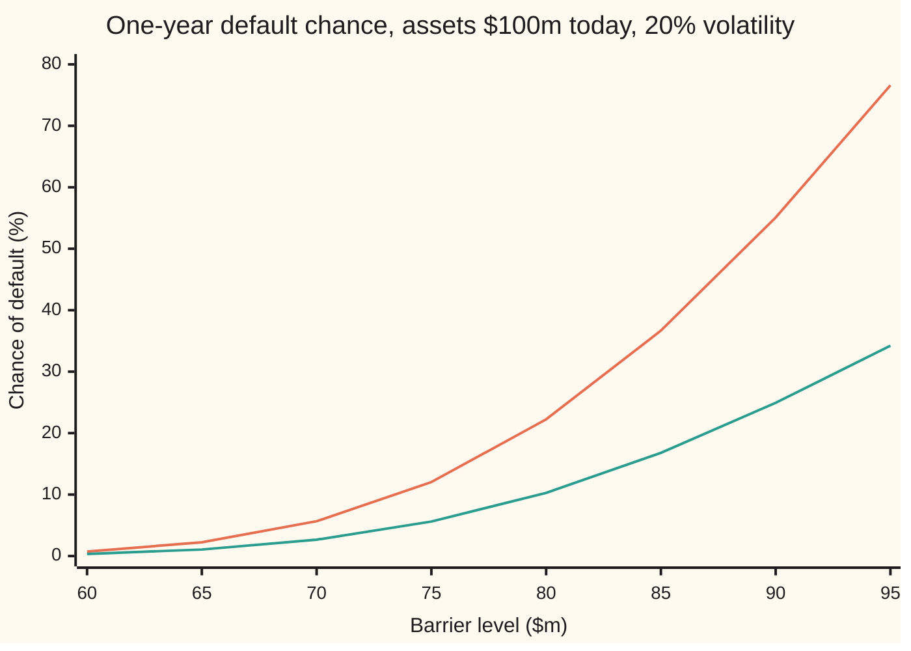
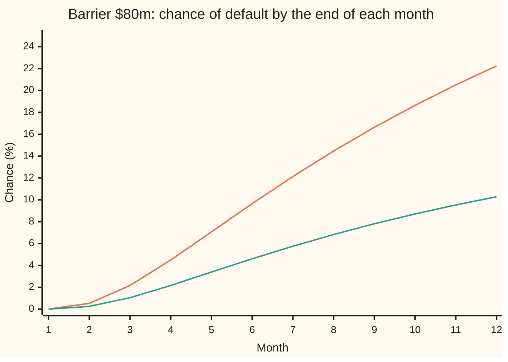

# Black-Cox: default the first moment assets touch a barrier, and the reflection term Merton misses

[Syllabus](../../../SYLLABUS.md) → [Financial mathematics](../README.md) → [Structural Models - Default from the Balance Sheet](../README.md#s43) → Black-Cox

---

## General Overview

A firm owns assets worth $100m today. It owes one debt of $80m, due in one year. Its assets swing by about 20% a year, and cash in the bank earns 5%.

Merton's model checks the firm once, on the due date. If the assets are below $80m then, the firm defaults. In the **pricing world** (the risk-neutral world, where every asset is taken to grow at the riskless rate) the chance is **10.28%** ([Merton's model](01-merton-model-equity-as-a-call.md)).

Real bond contracts are often less patient. A **safety covenant**, a clause in the loan agreement, can hand the firm to its lenders the moment the assets fall to a set level. Put that level at $80m. Now a firm that sinks to $78m in May and recovers to $95m by December has defaulted in May. Merton's year-end check would have called it healthy.

Fischer Black and John Cox priced this in 1976. Default happens at the **first passage**: the first moment the asset value touches the barrier. With the barrier at $80m the chance of default within the year is **22.24%**, more than twice Merton's figure. The extra 0.119562 of chance is paths that dipped below $80m and climbed back. They are counted by a mirror trick, the **reflection term**.

The level matters as much as the watching. A barrier at $70m gives 5.66%. A barrier at $60m gives 0.72%, below Merton's 10.28%, because the assets must fall 40% to touch it.

**Default at the first touch of a barrier is the chance of ending below the barrier plus the chance of touching it and recovering, and the second chance is the first one read off a mirror image, scaled by one weight for drift.**

**What kind of fact this is:** a model, an assumption about how a firm's assets move and when lenders act; inside it the two-term formula is a theorem, proved on this card in Why it works.

### The picture: the barrier level against the chance of default



Upper line (orange): Black-Cox, default at the first touch of the barrier at any time in the year. Lower line (green): the same level checked once, at year end. At every level the first-touch chance is a little more than twice the year-end chance; the gap is the reflection term. Reading across levels is a different comparison: Black-Cox at $60m sits far below the year-end check at $80m.

---

## The formula

Notation first, in words. The asset value at time $t$ years is $V_t$; today's value is $V_0$. The **first-passage time** $\tau$ is the first moment $V_t$ touches the barrier $H$. Default within the year is the event that $\tau$ comes at or before $T$. Work on a log scale: $b$ is the barrier in log units, $b = \ln(H/V_0)$, negative because the barrier sits below today's value. $N(x)$ is the bell-curve area to the left of $x$.

$$P(\tau \le T) \;=\; N\!\left(\frac{b - \nu T}{\sigma\sqrt T}\right) \;+\; \left(\frac{H}{V_0}\right)^{2\nu/\sigma^2} N\!\left(\frac{b + \nu T}{\sigma\sqrt T}\right)$$

**Read it aloud:** the chance of finishing the year below the barrier, plus the chance that a path started at the mirror image of today's value (log level $2b$) finishes above the barrier, the second scaled by a weight that accounts for drift.

The first term is Merton's check moved to the level $H$. The second is the reflection term, the paths that touched and recovered.

| Symbol | Plain meaning | In our example | Push it up and the default chance… |
| --- | --- | --- | --- |
| $t$, $V_t$, $V_0$ | a time in years; the firm's asset value then, and today | $100m today | $V_0$ up: falls, further to fall |
| $D$ | the face value of the debt, due at $T$ | $80m | no effect on the touch alone; it sets Merton's trigger |
| $H$ | the barrier: the asset level at which lenders take over | $80m, then $70m and $60m | rises steeply: 0.72% at $60m, 22.24% at $80m |
| $T$ | the horizon in years | 1 | rises: more time to touch |
| $r$ | the riskless rate, continuously compounded | 5% | falls: a faster upward drift in the pricing world |
| $\sigma$ | asset volatility: the yearly spread of log asset moves | 20% | rises: bigger swings reach the barrier more often |
| $\nu$ | the drift of log assets in the pricing world, $r - \tfrac12\sigma^2$ | 0.03 | falls |
| $b$ | the barrier in log units, $\ln(H/V_0)$ | $\ln 0.8 = -0.223144$ | rises toward 0 as the barrier nears today's value |
| $N$ | bell-curve area to the left of a point: a probability | $N(-1.265718) = 0.102807$ | — |
| $\tau$ | the first-passage time, when default happens | unknown today | — |
| $X_t$, $X_T$, $W_t$, $p_0$ | in the proof: log assets $\ln(V_t/V_0)$, their value at $T$, their random part (a standard Brownian motion), and the bell-curve density centred at 0 | $X_T$ centred at 0.03, spread 0.20 | — |
| $x$, $y$, $\Delta$ | log asset levels at the start and end of one simulated step, and the step's length in years | step length 1/12 | — |

Two helper numbers have names of their own:

- The **reflection weight** $(H/V_0)^{2\nu/\sigma^2}$, which is $0.8^{1.5} = 0.715542$ here. With no drift it would be 1.
- The **bridge chance** $\exp\!\big(-2(x - b)(y - b)/(\sigma^2\Delta)\big)$: the chance that a step starting at $x$ and ending at $y$, both above the barrier, touched it somewhere in between. The proof in Step 2 derives it; the simulation uses it.

### When it holds

- **Continuous paths.** The assets move without jumps, so a default lands exactly on the barrier. A sudden loss that jumps the assets from $85m to $70m overnight is outside the model; [Where structural models break](06-where-structural-models-fail.md) shows what that costs.
- **Watched every instant.** A covenant tested monthly misses touches between tests. Here monthly tests give 16.74% in the simulation, not 22.24%.
- **A flat barrier, constant rate and volatility, no payouts.** Black and Cox allowed a barrier that rises over time and a firm that pays out cash; both change the formula. With constant inputs it is the one above.
- **Barrier below today's value.** With $H \ge V_0$ the firm is already in default. With $H$ near zero the chance goes to zero.
- **Pricing world, not a forecast.** With $\nu = r - \tfrac12\sigma^2$ the answer is the chance used for pricing. The real-world chance uses the asset's expected growth instead: 0.184582 with an 8% expected return.

---

## Why it works

### Step 0: default is about the lowest point, not the last point

A path defaults when its lowest value during the year reaches the barrier. Merton looks only at the last value. So every path splits in two: it ends below the barrier, or it ends above but touched on the way.

Paths ending below the barrier must have touched it. They started at $100m, above, and move without jumps. So the first group is simply "ends below $80m", Merton's event at the level $H$:

$$N\!\left(\frac{b - \nu T}{\sigma\sqrt T}\right) = N(-1.265718) = 0.102807.$$

The whole difficulty is the second group: touched and recovered.

### Step 1: without drift, a mirror counts the recovered paths

Take a path that touches the barrier and ends above it. After the first touch, flip the rest of the path upside down about the barrier. A path that ended $y$ above the barrier in log units now ends $y$ below it.

The flip pairs every touched-and-recovered path with exactly one path that ends below the barrier. With no drift, up and down moves are equally likely, so the flip keeps probabilities ([Reflection principle](../../11-Stochastic%20processes%20and%20calculus/05-Brownian%20Motion/04-reflection-principle-and-running-maximum.md)). The recovered group is as likely as the "ends below" group. So without drift the default chance is exactly twice Merton's term at the same level.

The check confirms it. Set the rate to 2%, so $\nu = 0.02 - \tfrac12(0.20)^2 = 0$. Adding up the first-touch times gives 0.264543, and twice the finish-below term gives 0.264543.

### Step 2: drift tilts the mirror by one weight

With an upward drift the flip no longer keeps probabilities. The original path climbs back after the touch, going with the drift. Its mirror keeps falling, against it. The mirror is rarer.

How much rarer depends only on where the path ends, not on its shape in between. That makes the correction a single number, the reflection weight $(H/V_0)^{2\nu/\sigma^2}$. Here $2\nu/\sigma^2 = 0.06/0.04 = 1.5$ and the weight is $0.8^{1.5} = 0.715542$.

Reflect today's value in the barrier: on the log scale it lands at $2b$. The mirror count is the chance that a path started there finishes above the barrier. That is the bell-curve area $N\big((b + \nu T)/(\sigma\sqrt T)\big) = N(-0.965718) = 0.167093$. Times the weight: $0.715542 \times 0.167093 = 0.119562$.

<details>
<summary>Detailed proof: the drifted reflection, and the bridge chance</summary>

Write $X_t = \ln(V_t/V_0) = \nu t + \sigma W_t$, with $W_t$ a standard Brownian motion, and $b < 0$. Let $p_\nu(y)$ be the bell-curve density of $X_T$: centre $\nu T$, spread $s = \sigma\sqrt T$. Let $p_0$ be the same with centre 0.

**Finish below.** $P(X_T \le b) = N\big((b - \nu T)/s\big)$. Every such path has touched $b$, since paths are continuous and start at 0.

**Driftless reflection.** For $y > b$, the density of paths that touch $b$ and end at $y$ is $p_0(2b - y)$. That is the reflection principle.

**Adding drift.** Relative to the driftless path, the drifted path has the likelihood ratio $\exp\big(\nu y/\sigma^2 - \nu^2 T/(2\sigma^2)\big)$, which depends only on the end point $y$ (Girsanov's theorem in its simplest form; completing the square in $p_\nu(y)/p_0(y)$ checks it). So the drifted density of touched paths ending at $y$ is $p_0(2b - y)\exp\big(\nu y/\sigma^2 - \nu^2T/(2\sigma^2)\big)$. The bell curve $p_0$ is symmetric, so $p_0(2b - y) = p_0(y - 2b)$, and the same ratio at $y - 2b$ turns this into
$$e^{2\nu b/\sigma^2}\, p_\nu(y - 2b).$$

**Integrate.** Over $y > b$, $\int p_\nu(y - 2b)\,dy$ is the chance that $X_T > -b$, which is $N\big((b + \nu T)/s\big)$. And $e^{2\nu b/\sigma^2} = (H/V_0)^{2\nu/\sigma^2}$ because $e^b = H/V_0$. The two groups do not overlap, so their chances add to the formula.

**The bridge chance.** Divide the touched density by the density of all paths ending at $y$: $e^{2\nu b/\sigma^2} p_\nu(y - 2b)/p_\nu(y)$. Expanding both squares, the $\nu$ terms cancel and the ratio is $\exp\big(2b(y - b)/(\sigma^2 T)\big)$. The drift has vanished: once the end point is fixed, the path in between (a **Brownian bridge**) does not feel the drift. For a step that starts at $x$ instead of 0 and lasts $\Delta$ years, shift and rescale: $\exp\big(-2(x - b)(y - b)/(\sigma^2\Delta)\big)$.

**The same count by time.** Differentiating the formula in $T$ gives the density of the first-touch time, $f(t) = \dfrac{-b}{\sigma\sqrt{2\pi t^3}}\exp\!\Big(-\dfrac{(b - \nu t)^2}{2\sigma^2 t}\Big)$, the inverse Gaussian law. It can also be found without reflection, from the exponential martingale of $X_t$ stopped at $\tau$. Adding it up from 0 to $T$ must return the formula.

</details>

### Step 3: add the two groups

$$P(\tau \le T) = 0.102807 + 0.119562 = 0.222369.$$

The reflection term is slightly bigger than the finish-below term: more than half of the paths that touch $80m during the year are back above it by December.

### Step 4: read the same count as a chance for one step

The proof also gives the chance that a path touched the barrier *between* two known points. For a step from log level $x$ to $y$, both above $b$, lasting $\Delta$ years, it is $\exp\big(-2(x - b)(y - b)/(\sigma^2\Delta)\big)$. It is near 1 when either end is close to the barrier, and tiny when both are far away. The drift is absent, because fixing both ends removes it.

This is what makes simulation honest. A simulation that samples the path monthly sees only twelve points. Between them the path can dip and recover unseen. Drawing one random number per step against the bridge chance counts those unseen touches.

### Other roads

The first-touch time has a density of its own, the inverse Gaussian law in the proof callout. Adding it up from 0 to $T$ is a second route to 0.222369, and the check does it. A third route is the simulation, with no formula inside it at all. The same mirror prices barrier options: [Knock-out and knock-in options](../16-Barriers%2C%20touches%20and%20lookbacks/01-knock-out-and-knock-in-options.md) uses it to value a call that dies at a barrier.

---

## Worked numbers, by hand

The firm: $V_0 = 100$, barrier $H = 80$, $T = 1$, $r = 5\%$, $\sigma = 20\%$, money in $m.

| Step | Arithmetic | Value |
| --- | --- | --- |
| drift of log assets, $\nu$ | $0.05 - \tfrac12(0.20)^2$ | 0.030000 |
| barrier in log units, $b$ | $\ln(80/100)$ | −0.223144 |
| finish-below point | $(−0.223144 − 0.03)/0.20$ | −1.265718 |
| finish below $80m | $N(−1.265718)$ | 0.102807 |
| weight exponent | $2 \times 0.03 / 0.04$ | 1.500000 |
| reflection weight | $0.8^{1.5}$ | 0.715542 |
| mirror point | $(−0.223144 + 0.03)/0.20$ | −0.965718 |
| mirrored paths below it | $N(−0.965718)$ | 0.167093 |
| reflection term | $0.715542 \times 0.167093$ | 0.119562 |
| **default within the year** | $0.102807 + 0.119562$ | **0.222369** |

Lower barriers, same steps:

| Barrier | Finish below | Reflection term | Black-Cox |
| --- | --- | --- | --- |
| $80m | 0.102807 | 0.119562 | **0.222369** |
| $70m | 0.026595 | 0.029983 | **0.056578** |
| $60m | 0.003424 | 0.003767 | **0.007191** |

A covenant at $80m more than doubles the pricing-world default chance of this firm compared with a year-end check at the same $80m. The finish-below column at $80m is Merton's 10.28% exactly, the shelf's house figure.

### What breaks if you drop a piece

| Mistake | Comes out at | What went wrong |
| --- | --- | --- |
| Drop the reflection term | 0.102807 | Merton's year-end check: every dip-and-recover path is missed |
| Mirror without the weight | 0.269900 | Treats the drift as zero; the mirrored paths fight the drift and are rarer |
| Weight with its sign flipped, $(V_0/H)^{2\nu/\sigma^2}$ | 0.336326 | Makes the mirrored paths more likely than the originals |
| Simulate monthly, no bridge chance | about 0.1674 | Counts only touches that land on a month end |

The code prints every row.

---

## How the chance builds through the year

Default does not arrive evenly. In January almost nothing happens: the assets start $20m above the barrier, and a month of swings is rarely that large. The first month contributes 0.01%. By the end of month three the total is 2.17%. After that the chance piles up at a nearly steady rate.



Upper line (orange): Black-Cox, the chance the assets have touched $80m by the end of that month, from the formula with $T$ set to that many twelfths. Lower line (green): the chance the assets sit below $80m at that month end. The simulation's month-by-month count tracks the upper line: 2.23% by month three, 9.91% by month six, 22.18% by month twelve.

### One force at a time: how often the lender looks

Hold the barrier at $80m and change only the watching. Each bar is a chance in percent.

```
how often the $80m level is checked     chance of default within the year, %
  once, at year end (formula)           ██████████████                    10.28
  quarterly (simulated)                 ███████████████████               13.94
  monthly (simulated)                   ███████████████████████           16.74
  monthly (shifted-barrier rule)        ██████████████████████            16.32
  continuously (formula)                ██████████████████████████████    22.24
```

Looking more often finds more defaults, because more of the dips are seen. The shifted-barrier rule treats monthly checks as continuous watching of a slightly lower barrier, $80 \times e^{-0.5826 \times 0.20 \times \sqrt{1/12}} = 77.3538$; it lands within half a point of the monthly simulation ([Daily monitoring](../16-Barriers%2C%20touches%20and%20lookbacks/03-discrete-monitoring-correction.md)).

### The other force: where the barrier sits

Hold the watching continuous and move the level. From $80m to $70m the chance falls from 22.24% to 5.66%; to $60m, 0.72%. Moving the barrier $10m changes the answer more than moving from year-end checks to continuous watching does. That is this card's second lesson: a Black-Cox number is only comparable with a Merton number at the same level.

---

## Code, from first principles, and it actually runs

Nothing is imported that knows the answer. The bell-curve area is a power series in Python and a sum of thin slices (Simpson's rule) in Rust. The answer is reached three ways: the reflection formula; adding up the density of the first-touch time from 0 to $T$; and a simulation of 40,000 monthly paths with the bridge chance drawn inside each month. A fourth calculation integrates the bridge chance against the end-point bell curve to recover the reflection term on its own. Both programs use the same xorshift random-number stream, so their simulated counts agree exactly.

### Python

```python
# Black-Cox first-passage default -- the check behind the card.  Standard library
# only, and nothing imported knows the answer: the bell-curve area is a power
# series written out below, the integrals are Simpson's rule, and the random
# numbers come from a 64-bit xorshift generator defined here.
from math import log, exp, sqrt, cos, pi

V0, D, T, r, sigma = 100.0, 80.0, 1.0, 0.05, 0.20    # $m of assets, $m of debt, years, rates
nu = r - 0.5 * sigma * sigma                         # pricing-world drift of log assets

def N(x):                                            # bell-curve area left of x, by series
    if abs(x) > 7.0: return 0.0 if x < 0 else 1.0
    term, total, k = x, x, 0                         # integral of exp(-t^2/2) from 0 to x
    while abs(term) > 1e-18:
        k += 1
        term *= -x * x / (2.0 * k)
        total += term / (2 * k + 1)
    return 0.5 + total / sqrt(2.0 * pi)

def simpson(f, lo, hi, n):
    h = (hi - lo) / n
    s = f(lo) + f(hi) + sum((4 if i % 2 else 2) * f(lo + i * h) for i in range(1, n))
    return s * h / 3.0

def black_cox(H, nu=nu, sigma=sigma, T=T):          # road 1: the reflection formula
    b, s = log(H / V0), sigma * sqrt(T)
    finish = N((b - nu * T) / s)                     # below H at the end
    mirror = exp(2 * nu * b / sigma ** 2) * N((b + nu * T) / s)   # touched, ended above
    return finish, mirror, finish + mirror

def by_density(H, nu=nu, sigma=sigma, T=T):          # road 2: add up the first-touch times
    b = log(H / V0)
    f = lambda t: 0.0 if t == 0 else -b / (sigma * sqrt(2 * pi * t ** 3)) * exp(-(b - nu * t) ** 2 / (2 * sigma ** 2 * t))
    return simpson(f, 0.0, T, 4000)

def mirror_by_bridge(H):                             # the mirror term as an integral of bridge chances
    b, s = log(H / V0), sigma * sqrt(T)
    g = lambda y: exp(-(y - nu * T) ** 2 / (2 * s * s)) / (s * sqrt(2 * pi))
    return simpson(lambda y: g(y) * exp(2 * b * (y - b) / (s * s)), b, b + 12 * s, 6000)

def whole_contract(H):                               # touch H at any time, or end below D
    b, d, s = log(H / V0), log(D / V0), sigma * sqrt(T)
    return N((d - nu * T) / s) + exp(2 * nu * b / sigma ** 2) * N((2 * b - d + nu * T) / s)

state = 0x2026092843050001                           # xorshift64*, same stream in the Rust twin
def uniform():
    global state
    state ^= state >> 12; state ^= (state << 25) & 0xFFFFFFFFFFFFFFFF; state ^= state >> 27
    return (((state * 0x2545F4914F6CDD1D) & 0xFFFFFFFFFFFFFFFF) >> 11) / 2.0 ** 53 + 2.0 ** -54

PATHS, STEPS, BARS = 40000, 12, (80.0, 70.0, 60.0)   # road 3: simulate monthly, bridge in between
dt, lb, ld = T / STEPS, [log(h / V0) for h in BARS], log(D / V0)
bridge, grid, qtr, end, whole, month_hit = [0] * 3, [0] * 3, 0, 0, [0] * 3, [0] * STEPS
for _ in range(PATHS):
    x, hit, seen, first = 0.0, [False] * 3, [False] * 3, STEPS
    q = False
    for k in range(STEPS):
        z = sqrt(-2.0 * log(uniform())) * cos(2.0 * pi * uniform())
        y, u = x + nu * dt + sigma * sqrt(dt) * z, uniform()
        for j in range(3):
            if y <= lb[j]: hit[j] = seen[j] = True
            elif not hit[j] and u < exp(-2.0 * (x - lb[j]) * (y - lb[j]) / (sigma * sigma * dt)): hit[j] = True
        q = q or (k % 3 == 2 and y <= lb[0])
        if hit[0] and first == STEPS: first = k
        x = y
    for j in range(3):
        bridge[j] += hit[j]; grid[j] += seen[j]; whole[j] += hit[j] or x <= ld
    qtr += q; end += x <= lb[0]
    if first < STEPS: month_hit[first] += 1
mc = lambda c: c / PATHS
se = lambda p: sqrt(p * (1 - p) / PATHS)

merton = N((log(D / V0) - nu * T) / (sigma * sqrt(T)))
print(f"inputs: V0 {V0:.0f}, D {D:.0f}, T {T:.0f}, r {r:.2f}, sigma {sigma:.2f}, nu {nu:.6f}, weight exponent {2 * nu / sigma ** 2:.6f}")
print(f"Merton, below 80 at year end        {merton:.6f}")
print("barrier   finish    mirror    Black-Cox  by density  bridge MC  monthly MC  whole contract  its MC")
rows = []
for j, H in enumerate(BARS):
    fin, mir, bc = black_cox(H); dens = by_density(H); rows.append((fin, mir, bc, dens))
    print(f"{H:7.0f}  {fin:.6f}  {mir:.6f}  {bc:.6f}   {dens:.6f}    {mc(bridge[j]):.4f}     {mc(grid[j]):.4f}      {whole_contract(H):.6f}    {mc(whole[j]):.4f}")
wt = exp(2 * nu * lb[0] / sigma ** 2)
print(f"H 80: b = ln(H/V0) {lb[0]:.6f}, alpha {(lb[0] - nu * T) / sigma:.6f}, beta {(lb[0] + nu * T) / sigma:.6f}")
print(f"weight (H/V0)^(2nu/sigma^2), H 80   {wt:.6f}")
print(f"N((b + nu T)/sigma sqrt T), H 80    {N((lb[0] + nu * T) / sigma):.6f}")
print(f"mirror term by bridge integral, 80  {mirror_by_bridge(80.0):.6f}")
print(f"MC {PATHS} paths, {STEPS} monthly steps; standard error at 0.2224  {se(rows[0][2]):.4f}")
shift = 80.0 * exp(-0.5826 * sigma * sqrt(dt))       # monthly covenant: shifted-barrier rule
print("monitoring at H 80, %: year end formula, year end MC, quarterly MC, monthly MC, monthly by shifted barrier, continuous formula, bridge MC")
print(f"  {100 * merton:.2f}  {100 * mc(end):.2f}  {100 * mc(qtr):.2f}  {100 * mc(grid[0]):.2f}  {100 * black_cox(shift)[2]:.2f}  {100 * rows[0][2]:.2f}  {100 * mc(bridge[0]):.2f}")
print(f"  shifted barrier 80 exp(-0.5826 sigma sqrt(1/12))  {shift:.4f}")
print(f"wrong: drop the mirror term         {rows[0][0]:.6f}")
print(f"wrong: mirror without the weight    {rows[0][0] + N((lb[0] + nu * T) / sigma):.6f}")
print(f"wrong: weight with flipped sign     {rows[0][0] + N((lb[0] + nu * T) / sigma) / wt:.6f}")
print("chart, barrier $m      " + " ".join(f"{h:6.0f}" for h in range(60, 100, 5)))
print("chart, Black-Cox %     " + " ".join(f"{100 * black_cox(float(h))[2]:6.2f}" for h in range(60, 100, 5)))
print("chart, year-end at H % " + " ".join(f"{100 * black_cox(float(h))[0]:6.2f}" for h in range(60, 100, 5)))
print("chart, month           " + " ".join(f"{m:5d}" for m in range(1, 13)))
print("chart, touched by m %  " + " ".join(f"{100 * black_cox(80.0, T=m / 12)[2]:5.2f}" for m in range(1, 13)))
cum = [sum(month_hit[:m]) / PATHS for m in range(1, 13)]
print("chart, MC touched by m " + " ".join(f"{100 * c:5.2f}" for c in cum))
print("chart, below 80 at m % " + " ".join(f"{100 * black_cox(80.0, T=m / 12)[0]:5.2f}" for m in range(1, 13)))
z0 = black_cox(80.0, nu=0.0)
print(f"try: r 0.02 so nu 0: first-touch density {by_density(80.0, nu=0.0):.6f}, twice finish-below {2 * z0[0]:.6f}")
print(f"try: sigma 0.30: Black-Cox {black_cox(80.0, nu=0.005, sigma=0.30)[2]:.6f}, year end {black_cox(80.0, nu=0.005, sigma=0.30)[0]:.6f}")
print(f"try: T 5 years: Black-Cox {black_cox(80.0, T=5.0)[2]:.6f}, year-5 end {black_cox(80.0, T=5.0)[0]:.6f}")
print(f"try: real-world drift 8%: Black-Cox {black_cox(80.0, nu=0.06)[2]:.6f}, year end {black_cox(80.0, nu=0.06)[0]:.6f}")

assert abs(merton - 0.1028) < 5e-5, "the shelf's Merton default chance, 10.28%"
for fin, mir, bc, dens in rows:
    assert abs(bc - dens) < 1e-8, "reflection formula vs adding up first-touch times"
for j in range(3):
    assert abs(mc(bridge[j]) - rows[j][2]) < 4 * se(rows[j][2]) + 1e-3, "bridge-corrected simulation vs formula"
assert abs(mirror_by_bridge(80.0) - rows[0][1]) < 1e-8, "mirror term vs integral of bridge chances"
assert abs(mc(end) - merton) < 4 * se(merton), "simulated year-end check vs Merton"
assert mc(end) < mc(qtr) < mc(grid[0]) < mc(bridge[0]), "more watching finds more defaults"
assert abs(2 * z0[0] - by_density(80.0, nu=0.0)) < 1e-8, "no drift: twice the finish-below chance, by first-touch times"
print("ALL CHECKS PASS")
```

**Ran 2026-09-28 on macOS, Python 3.14.6, standard library only. All checks passed. Output, pasted from the run:**

```
inputs: V0 100, D 80, T 1, r 0.05, sigma 0.20, nu 0.030000, weight exponent 1.500000
Merton, below 80 at year end        0.102807
barrier   finish    mirror    Black-Cox  by density  bridge MC  monthly MC  whole contract  its MC
     80  0.102807  0.119562  0.222369   0.222369    0.2218     0.1674      0.222369    0.2218
     70  0.026595  0.029983  0.056578   0.056578    0.0563     0.0394      0.109071    0.1080
     60  0.003424  0.003767  0.007191   0.007191    0.0081     0.0054      0.102835    0.1020
H 80: b = ln(H/V0) -0.223144, alpha -1.265718, beta -0.965718
weight (H/V0)^(2nu/sigma^2), H 80   0.715542
N((b + nu T)/sigma sqrt T), H 80    0.167093
mirror term by bridge integral, 80  0.119562
MC 40000 paths, 12 monthly steps; standard error at 0.2224  0.0021
monitoring at H 80, %: year end formula, year end MC, quarterly MC, monthly MC, monthly by shifted barrier, continuous formula, bridge MC
  10.28  10.20  13.94  16.74  16.32  22.24  22.18
  shifted barrier 80 exp(-0.5826 sigma sqrt(1/12))  77.3538
wrong: drop the mirror term         0.102807
wrong: mirror without the weight    0.269900
wrong: weight with flipped sign     0.336326
chart, barrier $m          60     65     70     75     80     85     90     95
chart, Black-Cox %       0.72   2.24   5.66  12.03  22.24  36.68  55.08  76.59
chart, year-end at H %   0.34   1.06   2.66   5.61  10.28  16.79  24.93  34.22
chart, month               1     2     3     4     5     6     7     8     9    10    11    12
chart, touched by m %   0.01  0.53  2.17  4.50  7.07  9.66 12.13 14.46 16.63 18.64 20.51 22.24
chart, MC touched by m  0.01  0.55  2.23  4.68  7.38  9.91 12.35 14.65 16.60 18.64 20.38 22.18
chart, below 80 at m %  0.00  0.26  1.05  2.17  3.40  4.61  5.76  6.83  7.81  8.71  9.53 10.28
try: r 0.02 so nu 0: first-touch density 0.264543, twice finish-below 0.264543
try: sigma 0.30: Black-Cox 0.451333, year end 0.223484
try: T 5 years: Black-Cox 0.513325, year-5 end 0.202035
try: real-world drift 8%: Black-Cox 0.184582, year end 0.078429
ALL CHECKS PASS
```

The formula and the first-touch density agree to six decimals at all three barriers. The bridge integral returns the reflection term, 0.119562. The simulation lands at 0.2218 against 0.2224, less than one standard error (0.0021) away. The same simulation sampled only at month ends gives 0.1674, which is the bridge chance's whole job made visible.

### Rust

```rust
// Black-Cox first-passage default -- the same check as the Python, in Rust.
// Standard library only, no crates.  Rust has no erf, so the bell-curve area is
// built by adding up thin slices under the curve (Simpson's rule), a different
// route from the Python power series.  The random numbers are the same
// xorshift64* stream, so the simulated counts match the Python run.
use std::f64::consts::PI;

const V0: f64 = 100.0; const D: f64 = 80.0; const T: f64 = 1.0; const R: f64 = 0.05; const SIG: f64 = 0.20;
const NU: f64 = R - 0.5 * SIG * SIG;

fn simpson<F: Fn(f64) -> f64>(f: F, lo: f64, hi: f64, n: usize) -> f64 {
    let h = (hi - lo) / n as f64;
    let mut s = f(lo) + f(hi);
    for i in 1..n { s += if i % 2 == 1 { 4.0 } else { 2.0 } * f(lo + i as f64 * h); }
    s * h / 3.0
}
fn phi(x: f64) -> f64 { (-0.5 * x * x).exp() / (2.0 * PI).sqrt() }
fn n_cdf(x: f64) -> f64 {                                   // area left of x
    if x.abs() > 7.0 { return if x < 0.0 { 0.0 } else { 1.0 }; }
    0.5 + simpson(phi, 0.0, x, 4000)
}
fn black_cox(h: f64, nu: f64, sig: f64, t: f64) -> (f64, f64, f64) {   // road 1
    let (b, s) = ((h / V0).ln(), sig * t.sqrt());
    let finish = n_cdf((b - nu * t) / s);
    let mirror = (2.0 * nu * b / (sig * sig)).exp() * n_cdf((b + nu * t) / s);
    (finish, mirror, finish + mirror)
}
fn bc(h: f64) -> (f64, f64, f64) { black_cox(h, NU, SIG, T) }
fn by_density(h: f64, nu: f64) -> f64 {                     // road 2: first-touch times
    let b = (h / V0).ln();
    let f = |t: f64| if t == 0.0 { 0.0 } else {
        -b / (SIG * (2.0 * PI * t.powi(3)).sqrt()) * (-(b - nu * t).powi(2) / (2.0 * SIG * SIG * t)).exp() };
    simpson(f, 0.0, T, 4000)
}
fn mirror_by_bridge(h: f64) -> f64 {
    let (b, s) = ((h / V0).ln(), SIG * T.sqrt());
    let g = |y: f64| (-(y - NU * T).powi(2) / (2.0 * s * s)).exp() / (s * (2.0 * PI).sqrt());
    simpson(|y| g(y) * (2.0 * b * (y - b) / (s * s)).exp(), b, b + 12.0 * s, 6000)
}
fn whole_contract(h: f64) -> f64 {                          // touch H, or end below D
    let (b, d, s) = ((h / V0).ln(), (D / V0).ln(), SIG * T.sqrt());
    n_cdf((d - NU * T) / s) + (2.0 * NU * b / (SIG * SIG)).exp() * n_cdf((2.0 * b - d + NU * T) / s)
}
struct Rng(u64);
impl Rng {
    fn uniform(&mut self) -> f64 {
        self.0 ^= self.0 >> 12; self.0 ^= self.0 << 25; self.0 ^= self.0 >> 27;
        (self.0.wrapping_mul(0x2545F4914F6CDD1D) >> 11) as f64 / 2f64.powi(53) + 2f64.powi(-54)
    }
}

fn main() {
    const PATHS: usize = 40000; const STEPS: usize = 12;
    let bars = [80.0_f64, 70.0, 60.0];
    let dt = T / STEPS as f64;
    let lb: Vec<f64> = bars.iter().map(|h| (h / V0).ln()).collect();
    let ld = (D / V0).ln();
    let mut rng = Rng(0x2026092843050001);
    let (mut bridge, mut grid, mut whole) = ([0usize; 3], [0usize; 3], [0usize; 3]);
    let (mut qtr, mut end, mut month_hit) = (0usize, 0usize, [0usize; STEPS]);
    for _ in 0..PATHS {
        let (mut x, mut hit, mut seen, mut first, mut q) = (0.0_f64, [false; 3], [false; 3], STEPS, false);
        for k in 0..STEPS {
            let z = (-2.0 * rng.uniform().ln()).sqrt() * (2.0 * PI * rng.uniform()).cos();
            let y = x + NU * dt + SIG * dt.sqrt() * z;
            let u = rng.uniform();
            for j in 0..3 {
                if y <= lb[j] { hit[j] = true; seen[j] = true; }
                else if !hit[j] && u < (-2.0 * (x - lb[j]) * (y - lb[j]) / (SIG * SIG * dt)).exp() { hit[j] = true; }
            }
            q = q || (k % 3 == 2 && y <= lb[0]);
            if hit[0] && first == STEPS { first = k; }
            x = y;
        }
        for j in 0..3 {
            bridge[j] += hit[j] as usize; grid[j] += seen[j] as usize; whole[j] += (hit[j] || x <= ld) as usize;
        }
        qtr += q as usize; end += (x <= lb[0]) as usize;
        if first < STEPS { month_hit[first] += 1; }
    }
    let mc = |c: usize| c as f64 / PATHS as f64;
    let se = |p: f64| (p * (1.0 - p) / PATHS as f64).sqrt();

    let merton = n_cdf(((D / V0).ln() - NU * T) / (SIG * T.sqrt()));
    println!("inputs: V0 {:.0}, D {:.0}, T {:.0}, r {:.2}, sigma {:.2}, nu {:.6}, weight exponent {:.6}", V0, D, T, R, SIG, NU, 2.0 * NU / (SIG * SIG));
    println!("Merton, below 80 at year end        {:.6}", merton);
    println!("barrier   finish    mirror    Black-Cox  by density  bridge MC  monthly MC  whole contract  its MC");
    let mut rows = Vec::new();
    for j in 0..3 {
        let (fin, mir, b) = bc(bars[j]); let dens = by_density(bars[j], NU); rows.push((fin, mir, b, dens));
        println!("{:7.0}  {:.6}  {:.6}  {:.6}   {:.6}    {:.4}     {:.4}      {:.6}    {:.4}",
                 bars[j], fin, mir, b, dens, mc(bridge[j]), mc(grid[j]), whole_contract(bars[j]), mc(whole[j]));
    }
    let wt = (2.0 * NU * lb[0] / (SIG * SIG)).exp();
    let n_beta = n_cdf((lb[0] + NU * T) / SIG);
    println!("H 80: b = ln(H/V0) {:.6}, alpha {:.6}, beta {:.6}", lb[0], (lb[0] - NU * T) / SIG, (lb[0] + NU * T) / SIG);
    println!("weight (H/V0)^(2nu/sigma^2), H 80   {:.6}", wt);
    println!("N((b + nu T)/sigma sqrt T), H 80    {:.6}", n_beta);
    println!("mirror term by bridge integral, 80  {:.6}", mirror_by_bridge(80.0));
    println!("MC {} paths, {} monthly steps; standard error at 0.2224  {:.4}", PATHS, STEPS, se(rows[0].2));
    let shift = 80.0 * (-0.5826 * SIG * dt.sqrt()).exp();
    println!("monitoring at H 80, %: year end formula, year end MC, quarterly MC, monthly MC, monthly by shifted barrier, continuous formula, bridge MC");
    println!("  {:.2}  {:.2}  {:.2}  {:.2}  {:.2}  {:.2}  {:.2}", 100.0 * merton, 100.0 * mc(end), 100.0 * mc(qtr), 100.0 * mc(grid[0]),
             100.0 * bc(shift).2, 100.0 * rows[0].2, 100.0 * mc(bridge[0]));
    println!("  shifted barrier 80 exp(-0.5826 sigma sqrt(1/12))  {:.4}", shift);
    println!("wrong: drop the mirror term         {:.6}", rows[0].0);
    println!("wrong: mirror without the weight    {:.6}", rows[0].0 + n_beta);
    println!("wrong: weight with flipped sign     {:.6}", rows[0].0 + n_beta / wt);
    let hs: Vec<f64> = (0..8).map(|i| 60.0 + 5.0 * i as f64).collect();
    let line = |v: Vec<String>| v.join(" ");
    println!("chart, barrier $m      {}", line(hs.iter().map(|h| format!("{:6.0}", h)).collect()));
    println!("chart, Black-Cox %     {}", line(hs.iter().map(|h| format!("{:6.2}", 100.0 * bc(*h).2)).collect()));
    println!("chart, year-end at H % {}", line(hs.iter().map(|h| format!("{:6.2}", 100.0 * bc(*h).0)).collect()));
    println!("chart, month           {}", line((1..13).map(|m| format!("{:5}", m)).collect()));
    println!("chart, touched by m %  {}", line((1..13).map(|m| format!("{:5.2}", 100.0 * black_cox(80.0, NU, SIG, m as f64 / 12.0).2)).collect()));
    println!("chart, MC touched by m {}", line((1..13).map(|m| format!("{:5.2}", 100.0 * mc(month_hit[..m].iter().sum()))).collect()));
    println!("chart, below 80 at m % {}", line((1..13).map(|m| format!("{:5.2}", 100.0 * black_cox(80.0, NU, SIG, m as f64 / 12.0).0)).collect()));
    let z0 = black_cox(80.0, 0.0, SIG, T);
    println!("try: r 0.02 so nu 0: first-touch density {:.6}, twice finish-below {:.6}", by_density(80.0, 0.0), 2.0 * z0.0);
    println!("try: sigma 0.30: Black-Cox {:.6}, year end {:.6}", black_cox(80.0, 0.005, 0.30, T).2, black_cox(80.0, 0.005, 0.30, T).0);
    println!("try: T 5 years: Black-Cox {:.6}, year-5 end {:.6}", black_cox(80.0, NU, SIG, 5.0).2, black_cox(80.0, NU, SIG, 5.0).0);
    println!("try: real-world drift 8%: Black-Cox {:.6}, year end {:.6}", black_cox(80.0, 0.06, SIG, T).2, black_cox(80.0, 0.06, SIG, T).0);

    assert!((merton - 0.1028).abs() < 5e-5, "the shelf's Merton default chance, 10.28%");
    for row in &rows { assert!((row.2 - row.3).abs() < 1e-8, "reflection formula vs adding up first-touch times"); }
    for j in 0..3 { assert!((mc(bridge[j]) - rows[j].2).abs() < 4.0 * se(rows[j].2) + 1e-3, "bridge-corrected simulation vs formula"); }
    assert!((mirror_by_bridge(80.0) - rows[0].1).abs() < 1e-8, "mirror term vs integral of bridge chances");
    assert!((mc(end) - merton).abs() < 4.0 * se(merton), "simulated year-end check vs Merton");
    assert!(mc(end) < mc(qtr) && mc(qtr) < mc(grid[0]) && mc(grid[0]) < mc(bridge[0]), "more watching finds more defaults");
    assert!((2.0 * z0.0 - by_density(80.0, 0.0)).abs() < 1e-8, "no drift: twice the finish-below chance, by first-touch times");
    println!("ALL CHECKS PASS");
}
```

**Ran 2026-09-28 on macOS, rustc 1.98.1, no crates. All checks passed. Output, pasted from the run:**

```
inputs: V0 100, D 80, T 1, r 0.05, sigma 0.20, nu 0.030000, weight exponent 1.500000
Merton, below 80 at year end        0.102807
barrier   finish    mirror    Black-Cox  by density  bridge MC  monthly MC  whole contract  its MC
     80  0.102807  0.119562  0.222369   0.222369    0.2218     0.1674      0.222369    0.2218
     70  0.026595  0.029983  0.056578   0.056578    0.0563     0.0394      0.109071    0.1080
     60  0.003424  0.003767  0.007191   0.007191    0.0081     0.0054      0.102835    0.1020
H 80: b = ln(H/V0) -0.223144, alpha -1.265718, beta -0.965718
weight (H/V0)^(2nu/sigma^2), H 80   0.715542
N((b + nu T)/sigma sqrt T), H 80    0.167093
mirror term by bridge integral, 80  0.119562
MC 40000 paths, 12 monthly steps; standard error at 0.2224  0.0021
monitoring at H 80, %: year end formula, year end MC, quarterly MC, monthly MC, monthly by shifted barrier, continuous formula, bridge MC
  10.28  10.20  13.94  16.74  16.32  22.24  22.18
  shifted barrier 80 exp(-0.5826 sigma sqrt(1/12))  77.3538
wrong: drop the mirror term         0.102807
wrong: mirror without the weight    0.269900
wrong: weight with flipped sign     0.336326
chart, barrier $m          60     65     70     75     80     85     90     95
chart, Black-Cox %       0.72   2.24   5.66  12.03  22.24  36.68  55.08  76.59
chart, year-end at H %   0.34   1.06   2.66   5.61  10.28  16.79  24.93  34.22
chart, month               1     2     3     4     5     6     7     8     9    10    11    12
chart, touched by m %   0.01  0.53  2.17  4.50  7.07  9.66 12.13 14.46 16.63 18.64 20.51 22.24
chart, MC touched by m  0.01  0.55  2.23  4.68  7.38  9.91 12.35 14.65 16.60 18.64 20.38 22.18
chart, below 80 at m %  0.00  0.26  1.05  2.17  3.40  4.61  5.76  6.83  7.81  8.71  9.53 10.28
try: r 0.02 so nu 0: first-touch density 0.264543, twice finish-below 0.264543
try: sigma 0.30: Black-Cox 0.451333, year end 0.223484
try: T 5 years: Black-Cox 0.513325, year-5 end 0.202035
try: real-world drift 8%: Black-Cox 0.184582, year end 0.078429
ALL CHECKS PASS
```

The two outputs are identical line for line: different bell-curve routes agree to the printed digits, and the shared random stream gives the same simulated counts.

### Lean

Lean proves the main formula for every flat barrier below today's value, and two steps of the detailed proof.

- Suppose $W_t$ is a standard Brownian motion, $\nu = r - \tfrac12\sigma^2$, $\sigma > 0$, $T > 0$ and $0 < H < V_0$. Then $V_t = V_0 e^{\nu t + \sigma W_t}$ touches $H$ by time $T$ with the chance in the formula above.
- Take any end point $y$. Then $p_0(2b - y)$ times the drift's likelihood ratio equals $e^{2\nu b/\sigma^2}\, p_\nu(y - 2b)$.
- Take any end point $y$. Then the touched density over $p_\nu(y)$ is $\exp\big(2b(y - b)/(\sigma^2 T)\big)$, free of $\nu$.
- Take $r = 5\%$ and $\sigma = 20\%$. Then $\nu = 0.03$, the weight exponent is 1.5, and $0.8^{1.5}$ rounds to 0.715542.
- Take the Try changing inputs. Then $\nu$ is 0 at a 2% rate, 0.005 at 30% volatility, and 0.06 for 8% growth.
- Take $H = 80$. Then the two terms add up exactly: 0.102807 + 0.119562 = 0.222369.

The bell-curve values such as 0.102807, the first-touch density and every simulation are left to the Python and Rust checks.

```lean
-- Black-Cox: for assets V_t = V₀ exp(νt + σW_t) driven by a Brownian motion, the chance of touching a flat barrier H below V₀ by time T is the finish-below term N((b - νT)/(σ√T)) plus the reflection term (H/V₀)^(2ν/σ²) N((b + νT)/(σ√T)), with the drifted mirror density and the bridge chance behind it.
import Mathlib.Probability.BrownianMotion.Basic
import Mathlib.Probability.Distributions.Gaussian.Real
import Mathlib.Probability.CDF
import Mathlib.Analysis.SpecialFunctions.Pow.Real
import Mathlib.Tactic.NormNum


open MeasureTheory ProbabilityTheory Real
open scoped NNReal

/-! Setting. Mathlib's `IsBrownianReal W P` says that `W : ℝ≥0 → Ω → ℝ` is a standard Brownian
motion under `P`: it starts at 0, has independent normal steps with variance equal to the elapsed
time, and has continuous paths almost surely (so the assets move without jumps).

The firm's assets are `V_t = V₀ exp(ν t + σ W_t)` with the pricing-world drift of log assets
`ν = r - σ²/2`, a constant riskless rate `r` and a constant volatility `σ > 0`. The barrier `H` is
flat, positive and below today's value `V₀`; the lenders watch every instant `t ∈ [0, T]`, so the
firm defaults within `T` years exactly when `V_t ≤ H` at some such `t`. `b = ln(H/V₀)` is the
barrier in log units and `N = cdf (gaussianReal 0 1)` is the bell-curve area to the left. -/

section BlackCoxHelpers

open Filter Topology
open scoped ENNReal

lemma bc_pdf_shift (ν σ : ℝ) (u : ℝ≥0) (hσ : σ ≠ 0) (hu : u ≠ 0) (d : ℝ) :
    gaussianPDFReal 0 u (-2 * ν * u / σ - d) * exp (2 * ν * (ν * u + σ * d) / σ ^ 2)
      = gaussianPDFReal 0 u d := by
  have hu' : (u : ℝ) ≠ 0 := by exact_mod_cast hu
  simp only [gaussianPDFReal]
  rw [mul_assoc, ← Real.exp_add]
  congr 2
  field_simp
  ring

lemma bc_reflect_gauss (ν σ a : ℝ) (u : ℝ≥0) (hσ : σ ≠ 0) (ha : 0 ≤ a) :
    ∫⁻ d, {d : ℝ | a < ν * u + σ * d}.indicator (fun _ => (1 : ℝ≥0∞)) d ∂(gaussianReal 0 u) =
    ∫⁻ d, {d : ℝ | ν * u + σ * d < -a}.indicator
      (fun d => ENNReal.ofReal (exp (-2 * ν * (ν * u + σ * d) / σ ^ 2))) d ∂(gaussianReal 0 u) := by
  by_cases hu : u = 0
  · subst hu
    simp only [gaussianReal_zero_var]
    rw [lintegral_dirac, lintegral_dirac]
    have h1 : ¬ a < ν * ((0 : ℝ≥0) : ℝ) + σ * 0 := by simp; linarith
    have h2 : ¬ ν * ((0 : ℝ≥0) : ℝ) + σ * 0 < -a := by simp; linarith
    rw [Set.indicator_of_notMem (by simpa using h1), Set.indicator_of_notMem (by simpa using h2)]
  rw [gaussianReal_of_var_ne_zero _ hu]
  have m1 : Measurable ({d : ℝ | a < ν * u + σ * d}.indicator (fun _ => (1 : ℝ≥0∞))) :=
    measurable_const.indicator (measurableSet_lt measurable_const (by fun_prop))
  have m2 : Measurable ({d : ℝ | ν * u + σ * d < -a}.indicator
      (fun d => ENNReal.ofReal (exp (-2 * ν * (ν * u + σ * d) / σ ^ 2)))) :=
    (by fun_prop : Measurable fun d : ℝ => ENNReal.ofReal (exp (-2 * ν * (ν * u + σ * d) / σ ^ 2))).indicator
      (measurableSet_lt (by fun_prop) measurable_const)
  rw [lintegral_withDensity_eq_lintegral_mul _ (measurable_gaussianPDF _ _) m1,
    lintegral_withDensity_eq_lintegral_mul _ (measurable_gaussianPDF _ _) m2]
  rw [← lintegral_sub_left_eq_self _ (-2 * ν * u / σ)]
  apply lintegral_congr
  intro d
  simp only [Pi.mul_apply, Set.indicator_apply, Set.mem_setOf_eq]
  have key : ν * u + σ * (-2 * ν * u / σ - d) = -(ν * u + σ * d) := by field_simp; ring
  rw [key]
  by_cases hc : ν * u + σ * d < -a
  · rw [if_pos (by linarith), if_pos hc]
    rw [gaussianPDF, gaussianPDF, ← ENNReal.ofReal_mul (gaussianPDFReal_nonneg _ _ _), mul_one]
    congr 1
    rw [← bc_pdf_shift ν σ u hσ hu d, mul_assoc (gaussianPDFReal _ _ _), ← Real.exp_add]
    have : 2 * ν * (ν * u + σ * d) / σ ^ 2 + -2 * ν * (ν * u + σ * d) / σ ^ 2 = 0 := by ring
    rw [this, Real.exp_zero, mul_one]
  · rw [if_neg (by linarith), if_neg hc, mul_zero, mul_zero]
lemma bc_lintegral_indep {Ω α : Type*} [MeasurableSpace Ω] [MeasurableSpace α] {P : Measure Ω}
    [IsProbabilityMeasure P] {Z : Ω → α} {D : Ω → ℝ} {μ : Measure ℝ} [IsProbabilityMeasure μ]
    (hind : IndepFun Z D P) (hZ : AEMeasurable Z P) (hD : HasLaw D μ P)
    {F : α → ℝ → ℝ≥0∞} (hF : Measurable (Function.uncurry F)) :
    ∫⁻ ω, F (Z ω) (D ω) ∂P = ∫⁻ ω, ∫⁻ d, F (Z ω) d ∂μ ∂P := by
  have hmap := (indepFun_iff_map_prod_eq_prod_map_map hZ hD.aemeasurable).1 hind
  rw [hD.map_eq] at hmap
  have h1 : ∫⁻ ω, F (Z ω) (D ω) ∂P = ∫⁻ p, Function.uncurry F p ∂(P.map (fun ω => (Z ω, D ω))) := by
    rw [lintegral_map' hF.aemeasurable (hZ.prodMk hD.aemeasurable)]
    rfl
  rw [h1, hmap, lintegral_prod _ hF.aemeasurable]
  have hm : Measurable fun z => ∫⁻ d, F z d ∂μ := hF.lintegral_prod_right'
  exact lintegral_map' hm.aemeasurable hZ

lemma bc_step {Ω : Type*} [MeasurableSpace Ω] {P : Measure Ω} {W : ℝ≥0 → Ω → ℝ}
    (hW : IsPreBrownianReal W P) (ν σ b : ℝ) (hσ : σ ≠ 0) (T s : ℝ≥0) (hsT : s ≤ T)
    (g : ℕ → ℝ≥0) (hg : ∀ j, g j ≤ s) (S : Set (ℝ × (ℕ → ℝ))) (hS : MeasurableSet S)
    (hSb : ∀ p ∈ S, ν * s + σ * p.1 ≤ b) :
    ∫⁻ ω, {ω | (W s ω, fun j => W (g j) ω) ∈ S}.indicator 1 ω
        * {ω | b < ν * T + σ * W T ω}.indicator 1 ω ∂P =
    ∫⁻ ω, {ω | (W s ω, fun j => W (g j) ω) ∈ S}.indicator 1 ω
        * {ω | ν * T + σ * W T ω < 2 * (ν * s + σ * W s ω) - b}.indicator
          (fun ω => ENNReal.ofReal (exp (-2 * ν * ((ν * T + σ * W T ω) - (ν * s + σ * W s ω)) / σ ^ 2))) ω ∂P := by
  have hP : IsProbabilityMeasure P := hW.isGaussianProcess.isProbabilityMeasure
  set Z : Ω → ℝ × (ℕ → ℝ) := fun ω => (W s ω, fun j => W (g j) ω) with hZdef
  set D : Ω → ℝ := fun ω => W (s + (T - s)) ω - W s ω with hDdef
  have hTs : s + (T - s) = T := add_tsub_cancel_of_le hsT
  have hWT : ∀ ω, W T ω = W s ω + D ω := by intro ω; simp only [hDdef, hTs]; ring
  have hψ : Measurable (fun f : Set.Iic s → ℝ => (f ⟨s, Set.mem_Iic.mpr le_rfl⟩, fun j => f ⟨g j, Set.mem_Iic.mpr (hg j)⟩)) :=
    (measurable_pi_apply (⟨s, Set.mem_Iic.mpr le_rfl⟩ : Set.Iic s)).prodMk
      (Measurable.of_eval fun j => measurable_pi_apply (⟨g j, Set.mem_Iic.mpr (hg j)⟩ : Set.Iic s))
  have hφ : Measurable (fun f : ℝ≥0 → ℝ => f (T - s)) := measurable_pi_apply (T - s)
  have hind : IndepFun Z D P := by
    have h := (hW.indepFun_shift s).comp hφ hψ
    exact h.symm
  have hZ1 : ∀ ω, (Z ω).1 = W s ω := fun _ => rfl
  have hZ : AEMeasurable Z P :=
    (hW.aemeasurable s).prodMk (AEMeasurable.of_eval fun j => hW.aemeasurable (g j))
  have hD : HasLaw D (gaussianReal 0 (T - s)) P := (hW.shift s).hasLaw_eval (T - s)
  have hu : ((T - s : ℝ≥0) : ℝ) = T - s := NNReal.coe_sub hsT
  let F1 : ℝ × (ℕ → ℝ) → ℝ → ℝ≥0∞ := fun p d =>
    (S ×ˢ Set.univ).indicator 1 (p, d) *
      {q : (ℝ × (ℕ → ℝ)) × ℝ | b < ν * T + σ * (q.1.1 + q.2)}.indicator 1 (p, d)
  let F2 : ℝ × (ℕ → ℝ) → ℝ → ℝ≥0∞ := fun p d =>
    (S ×ˢ Set.univ).indicator 1 (p, d) *
      {q : (ℝ × (ℕ → ℝ)) × ℝ | ν * T + σ * (q.1.1 + q.2) < 2 * (ν * s + σ * q.1.1) - b}.indicator
        (fun q => ENNReal.ofReal (exp (-2 * ν * ((ν * T + σ * (q.1.1 + q.2)) - (ν * s + σ * q.1.1)) / σ ^ 2))) (p, d)
  have hF1 : Measurable (Function.uncurry F1) :=
    (measurable_const.indicator (hS.prod MeasurableSet.univ)).mul
      (measurable_const.indicator (measurableSet_lt measurable_const (by fun_prop)))
  have hF2 : Measurable (Function.uncurry F2) :=
    (measurable_const.indicator (hS.prod MeasurableSet.univ)).mul
      ((by fun_prop : Measurable fun q : (ℝ × (ℕ → ℝ)) × ℝ =>
        ENNReal.ofReal (exp (-2 * ν * ((ν * T + σ * (q.1.1 + q.2)) - (ν * s + σ * q.1.1)) / σ ^ 2))).indicator
        (measurableSet_lt (by fun_prop) (by fun_prop)))
  have e1 : ∫⁻ ω, {ω | Z ω ∈ S}.indicator 1 ω * {ω | b < ν * T + σ * W T ω}.indicator 1 ω ∂P
      = ∫⁻ ω, F1 (Z ω) (D ω) ∂P := by
    apply lintegral_congr; intro ω
    by_cases h : Z ω ∈ S <;> simp [F1, Set.indicator_apply, h, hWT, hZ1]
  have e2 : ∫⁻ ω, {ω | Z ω ∈ S}.indicator 1 ω
        * {ω | ν * T + σ * W T ω < 2 * (ν * s + σ * W s ω) - b}.indicator
          (fun ω => ENNReal.ofReal (exp (-2 * ν * ((ν * T + σ * W T ω) - (ν * s + σ * W s ω)) / σ ^ 2))) ω ∂P
      = ∫⁻ ω, F2 (Z ω) (D ω) ∂P := by
    apply lintegral_congr; intro ω
    by_cases h : Z ω ∈ S <;> simp [F2, Set.indicator_apply, h, hWT, hZ1]
  rw [e1, e2, bc_lintegral_indep hind hZ hD hF1, bc_lintegral_indep hind hZ hD hF2]
  apply lintegral_congr; intro ω
  by_cases hmem : Z ω ∈ S
  · have hx := hSb _ hmem
    set w := (Z ω).1
    have := bc_reflect_gauss ν σ (b - (ν * s + σ * w)) (T - s) hσ (by linarith)
    convert this using 1
    · apply lintegral_congr; intro d
      simp only [F1, Set.indicator, Set.mem_prod, Set.mem_univ, and_true, hmem, ite_true,
        Set.mem_ofPred_eq, Pi.one_apply, one_mul, hu, w]
      split_ifs <;> first | rfl | (exfalso; linarith)
    · apply lintegral_congr; intro d
      simp only [F2, Set.indicator, Set.mem_prod, Set.mem_univ, and_true, hmem, ite_true,
        Set.mem_ofPred_eq, Pi.one_apply, one_mul, hu, w]
      split_ifs <;> first | rfl | (exfalso; linarith) | (congr 3; ring)
  · simp [F1, F2, Set.indicator, hmem]

lemma bc_first_exists (p : ℕ → Prop) (m : ℕ) (h : ∃ k ≤ m, p k) :
    ∃ k ≤ m, p k ∧ ∀ j < k, ¬ p j := by
  classical
  have h' : ∃ k, p k := let ⟨k, _, hk⟩ := h; ⟨k, hk⟩
  refine ⟨Nat.find h', ?_, Nat.find_spec h', fun j hj => Nat.find_min h' hj⟩
  obtain ⟨k, hkm, hk⟩ := h
  exact (Nat.find_min' h' hk).trans hkm

lemma bc_sum_first {q : ℕ → Prop} {dq : DecidablePred q} (hq : ∀ j k, q j → q k → j = k)
    (a : ℕ → ℝ≥0∞) (m k0 : ℕ) (hk0 : k0 ≤ m) (h : q k0) :
    ∑ k ∈ Finset.range (m + 1), (if q k then a k else 0) = a k0 := by
  rw [Finset.sum_eq_single_of_mem k0 (Finset.mem_range.2 (Nat.lt_succ_of_le hk0))]
  · simp [h]
  · intro k _ hk
    rw [if_neg]
    intro hqk
    exact hk (hq _ _ hqk h)

lemma bc_sum_none {q : ℕ → Prop} {dq : DecidablePred q} (a : ℕ → ℝ≥0∞) (m : ℕ)
    (h : ∀ k ≤ m, ¬ q k) :
    ∑ k ∈ Finset.range (m + 1), (if q k then a k else 0) = 0 := by
  apply Finset.sum_eq_zero
  intro k hk
  rw [if_neg (h k (Nat.lt_succ_iff.1 (Finset.mem_range.1 hk)))]

lemma bc_det (g : ℝ → ℝ) (hg : Continuous g) (T b : ℝ) (hT : 0 < T) (h0 : b < g 0)
    (φ : ℝ → ℝ≥0∞) (hφ : ContinuousAt φ b) (hφ0 : b < g T → φ b = 0) :
    Tendsto (fun n : ℕ => ∑ k ∈ Finset.range (n + 2),
      if g (k * T / (n + 1)) ≤ b ∧ ∀ j < k, b < g (j * T / (n + 1))
      then φ (g (k * T / (n + 1))) else 0) atTop (𝓝 (φ b)) := by
  rw [Filter.tendsto_def]
  intro U hU
  have hU' : φ ⁻¹' U ∈ 𝓝 b := hφ hU
  obtain ⟨ε, hε, hball⟩ := Metric.mem_nhds_iff.1 hU'
  have huc : UniformContinuousOn g (Set.Icc 0 T) :=
    isCompact_Icc.uniformContinuousOn_of_continuous hg.continuousOn
  obtain ⟨δ, hδ, hδ'⟩ := Metric.uniformContinuousOn_iff.1 huc ε hε
  obtain ⟨N, hN⟩ := exists_nat_gt (T / δ)
  rw [Filter.mem_atTop_sets]
  refine ⟨N, fun n hn => ?_⟩
  simp only [Set.mem_preimage]
  have hn1 : (0 : ℝ) < n + 1 := by positivity
  have hstep : T / (n + 1) < δ := by
    have h1 : (N : ℝ) ≤ n := by exact_mod_cast hn
    have h2 : T / δ < n + 1 := by linarith
    rw [div_lt_iff₀ hδ] at h2
    rw [div_lt_iff₀ hn1]
    linarith
  have hsT : ∀ k : ℕ, k ≤ n + 1 → (k : ℝ) * T / (n + 1) ∈ Set.Icc 0 T := by
    intro k hk
    have hk' : (k : ℝ) ≤ n + 1 := by exact_mod_cast hk
    refine ⟨by positivity, ?_⟩
    rw [div_le_iff₀ hn1]
    nlinarith
  have hlast : ((n + 1 : ℕ) : ℝ) * T / (n + 1) = T := by
    push_cast
    field_simp
  have huniq : ∀ j k : ℕ, (g (j * T / (n + 1)) ≤ b ∧ ∀ i < j, b < g (i * T / (n + 1))) →
      (g (k * T / (n + 1)) ≤ b ∧ ∀ i < k, b < g (i * T / (n + 1))) → j = k := by
    intro j k hj hk
    rcases lt_trichotomy j k with h | h | h
    · exact absurd (hk.2 j h) (not_lt.2 hj.1)
    · exact h
    · exact absurd (hj.2 k h) (not_lt.2 hk.1)
  by_cases hex : ∃ k ≤ n + 1, g (k * T / (n + 1)) ≤ b
  · obtain ⟨k0, hk0, hA1, hA2⟩ := bc_first_exists (fun k : ℕ => g (k * T / (n + 1)) ≤ b) (n + 1) hex
    rw [bc_sum_first huniq _ (n + 1) k0 hk0 ⟨hA1, fun j hj => not_le.1 (hA2 j hj)⟩]
    apply hball
    obtain ⟨m, rfl⟩ : ∃ m, k0 = m + 1 := by
      rcases k0 with _ | m
      · exfalso
        have : g ((0 : ℕ) * T / (n + 1)) = g 0 := by simp
        rw [this] at hA1
        linarith
      · exact ⟨m, rfl⟩
    have hprev : b < g (m * T / (n + 1)) := not_le.1 (hA2 m (Nat.lt_succ_self m))
    have hd : dist ((m : ℝ) * T / (n + 1)) (((m + 1 : ℕ) : ℝ) * T / (n + 1)) < δ := by
      rw [Real.dist_eq]
      have : (m : ℝ) * T / (n + 1) - ((m + 1 : ℕ) : ℝ) * T / (n + 1) = -(T / (n + 1)) := by
        push_cast; ring
      rw [this, abs_neg, abs_of_pos (by positivity)]
      exact hstep
    have hc := hδ' _ (hsT m (by omega)) _ (hsT (m + 1) hk0) hd
    rw [Real.dist_eq] at hc
    rw [Metric.mem_ball, Real.dist_eq, abs_lt]
    have := (abs_lt.1 hc)
    constructor <;> linarith
  · rw [bc_sum_none]
    · have hgT : b < g T := by
        by_contra hcon
        apply hex
        exact ⟨n + 1, le_rfl, by rw [hlast]; exact not_lt.1 hcon⟩
      rw [hφ0 hgT] at hU
      exact mem_of_mem_nhds hU
    · intro k hk hA
      exact hex ⟨k, hk, hA.1⟩

lemma bc_gauss_eq (T : ℝ≥0) :
    gaussianReal 0 T = (gaussianReal 0 1).map (fun e => √(T : ℝ) * e) := by
  rw [gaussianReal_map_const_mul]
  congr 1
  · simp
  · ext
    simp [Real.sq_sqrt T.2]

lemma bc_gauss_Iic (T : ℝ≥0) (hT : 0 < T) (c : ℝ) :
    gaussianReal 0 T (Set.Iic c) = ENNReal.ofReal (cdf (gaussianReal 0 1) (c / √(T : ℝ))) := by
  have hs : 0 < √(T : ℝ) := Real.sqrt_pos.2 (by exact_mod_cast hT)
  rw [ofReal_cdf, bc_gauss_eq T, Measure.map_apply (by fun_prop) measurableSet_Iic]
  congr 1
  ext e
  simp only [Set.mem_preimage, Set.mem_Iic]
  rw [le_div_iff₀ hs, mul_comm]

lemma bc_gauss_Ioi (T : ℝ≥0) (hT : 0 < T) (c : ℝ) :
    gaussianReal 0 T (Set.Ioi c) = ENNReal.ofReal (cdf (gaussianReal 0 1) (-c / √(T : ℝ))) := by
  have hT0 : T ≠ 0 := ne_of_gt hT
  haveI := nullSingletonClass_gaussianReal (μ := 0) hT0
  have h1 : gaussianReal 0 T (Set.Ioi c) = gaussianReal 0 T (Set.Iio (-c)) := by
    conv_lhs => rw [← neg_zero, ← gaussianReal_map_neg]
    rw [Measure.map_apply measurable_neg measurableSet_Ioi]
    congr 1
    ext x
    simp [lt_neg]
  rw [h1, measure_congr Iio_ae_eq_Iic, bc_gauss_Iic T hT]

/-- Log assets at time `s`. -/
noncomputable def bcX {Ω : Type*} (W : ℝ≥0 → Ω → ℝ) (ν σ : ℝ) (s : ℝ≥0) (ω : Ω) : ℝ :=
  ν * s + σ * W s ω

/-- The `k`-th point of the grid with `n + 1` equal steps on `[0, T]`. -/
noncomputable def bcT (T : ℝ≥0) (n k : ℕ) : ℝ≥0 := (k : ℝ≥0) * T / ((n : ℝ≥0) + 1)

/-- The grid point `k` is the first one at or below the barrier. -/
def bcA {Ω : Type*} (W : ℝ≥0 → Ω → ℝ) (ν σ b : ℝ) (T : ℝ≥0) (n k : ℕ) : Set Ω :=
  {ω | bcX W ν σ (bcT T n k) ω ≤ b ∧ ∀ j < k, b < bcX W ν σ (bcT T n j) ω}

/-- Some grid point is at or below the barrier. -/
def bcE {Ω : Type*} (W : ℝ≥0 → Ω → ℝ) (ν σ b : ℝ) (T : ℝ≥0) (n : ℕ) : Set Ω :=
  {ω | ∃ k ≤ n + 1, bcX W ν σ (bcT T n k) ω ≤ b}

/-- The reflected, reweighted end point seen from grid point `k`. -/
noncomputable def bcC {Ω : Type*} (W : ℝ≥0 → Ω → ℝ) (ν σ b : ℝ) (T : ℝ≥0) (n k : ℕ) (ω : Ω) : ℝ≥0∞ :=
  {ω | ν * T + σ * W T ω < 2 * (ν * (bcT T n k : ℝ) + σ * W (bcT T n k) ω) - b}.indicator
    (fun ω => ENNReal.ofReal (exp (-2 * ν * ((ν * T + σ * W T ω)
      - (ν * (bcT T n k : ℝ) + σ * W (bcT T n k) ω)) / σ ^ 2))) ω

noncomputable def bcR {Ω : Type*} (W : ℝ≥0 → Ω → ℝ) (ν σ b : ℝ) (T : ℝ≥0) (n : ℕ) (ω : Ω) : ℝ≥0∞ :=
  ∑ k ∈ Finset.range (n + 2), (bcA W ν σ b T n k).indicator 1 ω * bcC W ν σ b T n k ω

noncomputable def bcL {Ω : Type*} (W : ℝ≥0 → Ω → ℝ) (ν σ b : ℝ) (T : ℝ≥0) (ω : Ω) : ℝ≥0∞ :=
  {ω | bcX W ν σ T ω < b}.indicator
    (fun ω => ENNReal.ofReal (exp (-2 * ν * (bcX W ν σ T ω - b) / σ ^ 2))) ω

lemma bcT_coe (T : ℝ≥0) (n k : ℕ) : ((bcT T n k : ℝ≥0) : ℝ) = (k : ℝ) * T / ((n : ℝ) + 1) := by
  simp [bcT]

lemma bcT_last (T : ℝ≥0) (n : ℕ) : bcT T n (n + 1) = T := by
  apply NNReal.eq
  rw [bcT_coe]
  push_cast
  field_simp

lemma bcT_le (T : ℝ≥0) (n k : ℕ) (hk : k ≤ n + 1) : bcT T n k ≤ T := by
  rw [← NNReal.coe_le_coe, bcT_coe]
  have hk' : (k : ℝ) ≤ n + 1 := by exact_mod_cast hk
  rw [div_le_iff₀ (by positivity)]
  nlinarith [NNReal.coe_nonneg T]

lemma bcT_mono (T : ℝ≥0) (n j k : ℕ) (h : j ≤ k) : bcT T n j ≤ bcT T n k := by
  rw [← NNReal.coe_le_coe, bcT_coe, bcT_coe]
  have h' : (j : ℝ) ≤ k := by exact_mod_cast h
  apply div_le_div_of_nonneg_right _ (by positivity)
  nlinarith [NNReal.coe_nonneg T]

lemma bc_split {Ω : Type*} [MeasurableSpace Ω] {P : Measure Ω} {W : ℝ≥0 → Ω → ℝ}
    (hW : IsPreBrownianReal W P) (hm : ∀ t, Measurable (W t)) (ν σ b : ℝ) (T : ℝ≥0)
    (hσ : 0 < σ) (n : ℕ) :
    P (bcE W ν σ b T n) = P {ω | bcX W ν σ T ω ≤ b} + ∫⁻ ω, bcR W ν σ b T n ω ∂P := by
  have hX : ∀ s, Measurable (bcX W ν σ s) := fun s =>
    measurable_const.add (measurable_const.mul (hm s))
  have hEeq : bcE W ν σ b T n = ⋃ k ∈ Finset.range (n + 2), {ω | bcX W ν σ (bcT T n k) ω ≤ b} := by
    ext ω
    simp [bcE, Nat.lt_succ_iff]
  have hEm : MeasurableSet (bcE W ν σ b T n) := by
    rw [hEeq]
    exact Finset.measurableSet_biUnion _ fun k _ => measurableSet_le (hX _) measurable_const
  have hAm : ∀ k, MeasurableSet (bcA W ν σ b T n k) := by
    intro k
    have : bcA W ν σ b T n k = {ω | bcX W ν σ (bcT T n k) ω ≤ b} ∩
        ⋂ j ∈ Finset.range k, {ω | b < bcX W ν σ (bcT T n j) ω} := by
      ext ω
      simp [bcA]
    rw [this]
    exact (measurableSet_le (hX _) measurable_const).inter
      (Finset.measurableSet_biInter _ fun j _ => measurableSet_lt measurable_const (hX _))
  have huniq : ∀ (ω : Ω) (j k : ℕ), ω ∈ bcA W ν σ b T n j → ω ∈ bcA W ν σ b T n k → j = k := by
    intro ω j k hj hk
    rcases lt_trichotomy j k with h | h | h
    · exact absurd (hk.2 j h) (not_lt.2 hj.1)
    · exact h
    · exact absurd (hj.2 k h) (not_lt.2 hk.1)
  have hpt : ∀ ω, (bcE W ν σ b T n).indicator 1 ω =
      {ω | bcX W ν σ T ω ≤ b}.indicator 1 ω +
        ∑ k ∈ Finset.range (n + 2), (bcA W ν σ b T n k).indicator 1 ω
          * {ω | b < bcX W ν σ T ω}.indicator (1 : Ω → ℝ≥0∞) ω := by
    intro ω
    classical
    have hrw : ∀ k, (bcA W ν σ b T n k).indicator 1 ω
        * {ω | b < bcX W ν σ T ω}.indicator (1 : Ω → ℝ≥0∞) ω =
        if ω ∈ bcA W ν σ b T n k then {ω | b < bcX W ν σ T ω}.indicator (1 : Ω → ℝ≥0∞) ω else 0 := by
      intro k
      by_cases h : ω ∈ bcA W ν σ b T n k <;> simp [h]
    simp_rw [hrw]
    by_cases hE : ω ∈ bcE W ν σ b T n
    · obtain ⟨k0, hk0, hA1, hA2⟩ :=
        bc_first_exists (fun k => bcX W ν σ (bcT T n k) ω ≤ b) (n + 1) hE
      rw [bc_sum_first (huniq ω) _ (n + 1) k0 hk0 ⟨hA1, fun j hj => not_le.1 (hA2 j hj)⟩,
        Set.indicator_of_mem hE]
      by_cases h : bcX W ν σ T ω ≤ b
      · rw [Set.indicator_of_mem (show ω ∈ {ω | bcX W ν σ T ω ≤ b} from h),
          Set.indicator_of_notMem (show ω ∉ {ω | b < bcX W ν σ T ω} from not_lt.2 h)]
        simp
      · rw [Set.indicator_of_notMem (show ω ∉ {ω | bcX W ν σ T ω ≤ b} from h),
          Set.indicator_of_mem (show ω ∈ {ω | b < bcX W ν σ T ω} from not_le.1 h)]
        simp
    · rw [bc_sum_none _ (n + 1) (fun k hk hA => hE ⟨k, hk, hA.1⟩), Set.indicator_of_notMem hE]
      have h : ¬ bcX W ν σ T ω ≤ b := by
        intro h
        apply hE
        exact ⟨n + 1, le_rfl, by rw [bcT_last]; exact h⟩
      rw [Set.indicator_of_notMem (show ω ∉ {ω | bcX W ν σ T ω ≤ b} from h)]
      simp
  have hm1 : ∀ k ∈ Finset.range (n + 2), Measurable (fun ω => (bcA W ν σ b T n k).indicator
      (1 : Ω → ℝ≥0∞) ω * {ω | b < bcX W ν σ T ω}.indicator (1 : Ω → ℝ≥0∞) ω) := fun k _ =>
    (measurable_one.indicator (hAm k)).mul
      (measurable_one.indicator (measurableSet_lt measurable_const (hX _)))
  have hm2 : ∀ k ∈ Finset.range (n + 2), Measurable (fun ω => (bcA W ν σ b T n k).indicator
      (1 : Ω → ℝ≥0∞) ω * bcC W ν σ b T n k ω) := by
    intro k _
    apply (measurable_one.indicator (hAm k)).mul
    apply Measurable.indicator _ (measurableSet_lt (by fun_prop) (by fun_prop))
    fun_prop
  rw [← lintegral_indicator_one hEm, lintegral_congr hpt,
    lintegral_add_left (measurable_one.indicator (measurableSet_le (hX _) measurable_const)),
    lintegral_indicator_one (measurableSet_le (hX _) measurable_const),
    lintegral_finsetSum _ hm1]
  congr 1
  unfold bcR
  rw [lintegral_finsetSum _ hm2]
  apply Finset.sum_congr rfl
  intro k hk
  have hk' : k ≤ n + 1 := Nat.lt_succ_iff.1 (Finset.mem_range.1 hk)
  let S : Set (ℝ × (ℕ → ℝ)) := {p | ν * (bcT T n k : ℝ) + σ * p.1 ≤ b} ∩
    ⋂ j ∈ Finset.range k, {p | b < ν * (bcT T n j : ℝ) + σ * p.2 j}
  have hS : MeasurableSet S :=
    (measurableSet_le (by fun_prop) measurable_const).inter
      (Finset.measurableSet_biInter _ fun j _ => measurableSet_lt measurable_const (by fun_prop))
  have hAeq : bcA W ν σ b T n k =
      {ω | (W (bcT T n k) ω, fun j => W (bcT T n (min j k)) ω) ∈ S} := by
    ext ω
    simp only [bcA, bcX, S, Set.mem_ofPred_eq, Set.mem_inter_iff, Set.mem_iInter, Finset.mem_range]
    constructor
    · rintro ⟨h1, h2⟩
      exact ⟨h1, fun j hj => by rw [min_eq_left hj.le]; exact h2 j hj⟩
    · rintro ⟨h1, h2⟩
      exact ⟨h1, fun j hj => by have := h2 j hj; rwa [min_eq_left hj.le] at this⟩
  have := bc_step hW ν σ b hσ.ne' T (bcT T n k) (bcT_le T n k hk')
    (fun j => bcT T n (min j k)) (fun j => bcT_mono T n _ _ (min_le_right j k)) S hS
    (fun p hp => hp.1)
  rw [hAeq]
  exact this

lemma bc_XT_le {Ω : Type*} [MeasurableSpace Ω] {P : Measure Ω} {W : ℝ≥0 → Ω → ℝ}
    (hW : IsPreBrownianReal W P) (hm : ∀ t, Measurable (W t)) (ν σ b : ℝ) (T : ℝ≥0)
    (hσ : 0 < σ) (hT : 0 < T) :
    P {ω | bcX W ν σ T ω ≤ b} =
      ENNReal.ofReal (cdf (gaussianReal 0 1) ((b - ν * T) / (σ * √(T : ℝ)))) := by
  have hL := hW.hasLaw_eval T
  have hset : {ω | bcX W ν σ T ω ≤ b} = W T ⁻¹' Set.Iic ((b - ν * T) / σ) := by
    ext ω
    simp only [bcX, Set.mem_ofPred_eq, Set.mem_preimage, Set.mem_Iic]
    rw [le_div_iff₀ hσ]
    constructor <;> intro h <;> linarith
  rw [hset, ← Measure.map_apply (hm T) measurableSet_Iic, hL.map_eq, bc_gauss_Iic T hT, div_div]

lemma bc_L_int {Ω : Type*} [MeasurableSpace Ω] {P : Measure Ω} {W : ℝ≥0 → Ω → ℝ}
    (hW : IsPreBrownianReal W P) (hm : ∀ t, Measurable (W t)) (ν σ b : ℝ) (T : ℝ≥0)
    (hσ : 0 < σ) (hT : 0 < T) (hb : b ≤ 0) :
    ∫⁻ ω, bcL W ν σ b T ω ∂P =
      ENNReal.ofReal (exp (2 * ν * b / σ ^ 2)
        * cdf (gaussianReal 0 1) ((b + ν * T) / (σ * √(T : ℝ)))) := by
  have hL := hW.hasLaw_eval T
  let G : ℝ → ℝ≥0∞ := fun d => {d : ℝ | ν * T + σ * d < -(-b)}.indicator
    (fun d => ENNReal.ofReal (exp (-2 * ν * (ν * T + σ * d) / σ ^ 2))) d
  have hG : Measurable G :=
    Measurable.indicator (by fun_prop) (measurableSet_lt (by fun_prop) measurable_const)
  have h1 : ∀ ω, bcL W ν σ b T ω = ENNReal.ofReal (exp (2 * ν * b / σ ^ 2)) * G (W T ω) := by
    intro ω
    by_cases h : ν * T + σ * W T ω < b
    · simp only [bcL, G, bcX, Set.indicator, Set.mem_ofPred_eq, neg_neg, h, ↓reduceIte]
      rw [← ENNReal.ofReal_mul (exp_pos _).le, ← exp_add]
      congr 2
      ring
    · simp only [bcL, G, bcX, Set.indicator, Set.mem_ofPred_eq, neg_neg, h, ↓reduceIte, mul_zero]
  rw [lintegral_congr h1, lintegral_const_mul _ (f := fun ω => G (W T ω)) (hG.comp (hm T))]
  have h2 : (∫⁻ ω, G (W T ω) ∂P) = ∫⁻ d, G d ∂(gaussianReal 0 T) := by
    rw [← hL.map_eq, lintegral_map hG (hm T)]
  rw [h2]
  simp only [G]
  rw [← bc_reflect_gauss ν σ (-b) T hσ.ne' (by linarith),
    lintegral_indicator_const (measurableSet_lt measurable_const (by fun_prop)), one_mul]
  have hset : {d : ℝ | -b < ν * T + σ * d} = Set.Ioi ((-b - ν * T) / σ) := by
    ext d
    simp only [Set.mem_ofPred_eq, Set.mem_Ioi]
    rw [div_lt_iff₀ hσ]
    constructor <;> intro h <;> linarith
  have harg : -((-b - ν * T) / σ) / √(T : ℝ) = (b + ν * T) / (σ * √(T : ℝ)) := by
    rw [← neg_div, div_div]
    congr 1
    ring
  rw [hset, bc_gauss_Ioi T hT, harg, ← ENNReal.ofReal_mul (exp_pos _).le]

lemma bc_A_unique {Ω : Type*} (W : ℝ≥0 → Ω → ℝ) (ν σ b : ℝ) (T : ℝ≥0) (n : ℕ) (ω : Ω) :
    ∀ j k : ℕ, ω ∈ bcA W ν σ b T n j → ω ∈ bcA W ν σ b T n k → j = k := by
  intro j k hj hk
  rcases lt_trichotomy j k with h | h | h
  · exact absurd (hk.2 j h) (not_lt.2 hj.1)
  · exact h
  · exact absurd (hj.2 k h) (not_lt.2 hk.1)

lemma bc_R_le {Ω : Type*} (W : ℝ≥0 → Ω → ℝ) (ν σ b : ℝ) (T : ℝ≥0) (n : ℕ) (ω : Ω)
    (hσ : 0 < σ) : bcR W ν σ b T n ω ≤ 1 + bcL W ν σ b T ω := by
  classical
  unfold bcR
  have hrw : ∀ k, (bcA W ν σ b T n k).indicator 1 ω * bcC W ν σ b T n k ω =
      if ω ∈ bcA W ν σ b T n k then bcC W ν σ b T n k ω else 0 := by
    intro k
    by_cases h : ω ∈ bcA W ν σ b T n k <;> simp [h]
  simp_rw [hrw]
  by_cases hex : ∃ k ≤ n + 1, ω ∈ bcA W ν σ b T n k
  · obtain ⟨k0, hk0, hA⟩ := hex
    rw [bc_sum_first (bc_A_unique W ν σ b T n ω) _ (n + 1) k0 hk0 hA]
    have hx : ν * (bcT T n k0 : ℝ) + σ * W (bcT T n k0) ω ≤ b := hA.1
    unfold bcC bcL
    by_cases h1 : ν * T + σ * W T ω < 2 * (ν * (bcT T n k0 : ℝ) + σ * W (bcT T n k0) ω) - b
    · have h2 : ν * T + σ * W T ω < b := by linarith
      rw [Set.indicator_of_mem (show ω ∈ {ω | ν * T + σ * W T ω <
          2 * (ν * (bcT T n k0 : ℝ) + σ * W (bcT T n k0) ω) - b} from h1),
        Set.indicator_of_mem (show ω ∈ {ω | bcX W ν σ T ω < b} from h2)]
      simp only [bcX]
      rw [← ENNReal.ofReal_one, ← ENNReal.ofReal_add zero_le_one (exp_pos _).le]
      apply ENNReal.ofReal_le_ofReal
      rcases le_or_gt 0 ν with hν | hν
      · have : -2 * ν * (ν * T + σ * W T ω - (ν * (bcT T n k0 : ℝ) + σ * W (bcT T n k0) ω)) / σ ^ 2
            ≤ -2 * ν * (ν * T + σ * W T ω - b) / σ ^ 2 := by
          apply div_le_div_of_nonneg_right _ (by positivity)
          nlinarith
        linarith [exp_le_exp.2 this, exp_pos (-2 * ν * (ν * T + σ * W T ω - b) / σ ^ 2)]
      · have : -2 * ν * (ν * T + σ * W T ω - (ν * (bcT T n k0 : ℝ) + σ * W (bcT T n k0) ω)) / σ ^ 2
            ≤ 0 := by
          apply div_nonpos_of_nonpos_of_nonneg _ (by positivity)
          nlinarith
        linarith [exp_le_one_iff.2 this, exp_pos (-2 * ν * (ν * T + σ * W T ω - b) / σ ^ 2)]
    · rw [Set.indicator_of_notMem (show ω ∉ {ω | ν * T + σ * W T ω <
          2 * (ν * (bcT T n k0 : ℝ) + σ * W (bcT T n k0) ω) - b} from h1)]
      positivity
  · push_neg at hex
    rw [bc_sum_none _ (n + 1) hex]
    positivity

lemma bc_R_tendsto_pt {Ω : Type*} (W : ℝ≥0 → Ω → ℝ) (ν σ b : ℝ) (T : ℝ≥0)
    (hσ : 0 < σ) (hT : 0 < T) (hb : b < 0) (ω : Ω) (f : ℝ≥0 → ℝ) (hf : Continuous f)
    (hf0 : f 0 = 0) (hfW : ∀ n k : ℕ, W (bcT T n k) ω = f (bcT T n k))
    (hne : bcX W ν σ T ω ≠ b) :
    Tendsto (fun n => bcR W ν σ b T n ω) atTop (𝓝 (bcL W ν σ b T ω)) := by
  classical
  let g : ℝ → ℝ := fun s => ν * s + σ * f s.toNNReal
  have hg : Continuous g :=
    (continuous_const.mul continuous_id).add (continuous_const.mul (hf.comp continuous_real_toNNReal))
  have hWT : W T ω = f T := by
    have h := hfW 0 1
    have hT1 : bcT T 0 1 = T := by simpa using bcT_last T 0
    rwa [hT1] at h
  have hgT : ν * (T : ℝ) + σ * W T ω = g T := by simp [g, hWT]
  have hgk : ∀ n k : ℕ, ν * (bcT T n k : ℝ) + σ * W (bcT T n k) ω = g (k * T / (n + 1)) := by
    intro n k
    rw [← bcT_coe]
    simp [g, hfW]
  let φ : ℝ → ℝ≥0∞ := fun y => {y : ℝ | g T < 2 * y - b}.indicator
    (fun y => ENNReal.ofReal (exp (-2 * ν * (g T - y) / σ ^ 2))) y
  have hne' : g T ≠ b := by rw [← hgT]; exact hne
  have hφ : ContinuousAt φ b := by
    rcases lt_or_gt_of_ne hne' with hlt | hgt
    · have hopen : IsOpen {y : ℝ | g T < 2 * y - b} := isOpen_lt continuous_const (by fun_prop)
      have hmem : b ∈ {y : ℝ | g T < 2 * y - b} := by
        simp only [Set.mem_ofPred_eq]; linarith
      have hcont : ContinuousAt (fun y => ENNReal.ofReal (exp (-2 * ν * (g T - y) / σ ^ 2))) b :=
        (ENNReal.continuous_ofReal.comp (Real.continuous_exp.comp
          (by fun_prop : Continuous fun y : ℝ => -2 * ν * (g T - y) / σ ^ 2))).continuousAt
      apply hcont.congr
      filter_upwards [hopen.mem_nhds hmem] with y hy
      simp only [φ]
      rw [Set.indicator_of_mem hy]
    · have hopen : IsOpen {y : ℝ | 2 * y - b < g T} := isOpen_lt (by fun_prop) continuous_const
      have hmem : b ∈ {y : ℝ | 2 * y - b < g T} := by
        simp only [Set.mem_ofPred_eq]; linarith
      apply (continuousAt_const (y := (0 : ℝ≥0∞))).congr
      filter_upwards [hopen.mem_nhds hmem] with y hy
      simp only [φ]
      rw [Set.indicator_of_notMem]
      simp only [Set.mem_ofPred_eq, not_lt]
      exact le_of_lt hy
  have hφ0 : b < g T → φ b = 0 := by
    intro h
    simp only [φ]
    rw [Set.indicator_of_notMem]
    simp only [Set.mem_ofPred_eq, not_lt]
    linarith
  have h0 : b < g 0 := by simp [g, hf0]; linarith
  have key := bc_det g hg T b (by exact_mod_cast hT) h0 φ hφ hφ0
  have hL : bcL W ν σ b T ω = φ b := by
    simp only [bcL, φ, Set.indicator, Set.mem_ofPred_eq, bcX, hgT]
    have : 2 * b - b = b := by ring
    rw [this]
  have hR : ∀ n : ℕ, bcR W ν σ b T n ω = ∑ k ∈ Finset.range (n + 2),
      if g (k * T / (n + 1)) ≤ b ∧ ∀ j < k, b < g (j * T / (n + 1))
      then φ (g (k * T / (n + 1))) else 0 := by
    intro n
    unfold bcR
    apply Finset.sum_congr rfl
    intro k _
    unfold bcA bcC
    simp only [Set.indicator, Set.mem_ofPred_eq, Pi.one_apply, bcX, hgk, hgT, φ]
    split_ifs <;> simp
  rw [hL]
  exact key.congr (fun n => (hR n).symm)

lemma bc_E_meas {Ω : Type*} [MeasurableSpace Ω] {W : ℝ≥0 → Ω → ℝ}
    (hm : ∀ t, Measurable (W t)) (ν σ b : ℝ) (T : ℝ≥0) (n : ℕ) :
    MeasurableSet (bcE W ν σ b T n) := by
  have hX : ∀ s, Measurable (bcX W ν σ s) := fun s =>
    measurable_const.add (measurable_const.mul (hm s))
  have hEeq : bcE W ν σ b T n = ⋃ k ∈ Finset.range (n + 2), {ω | bcX W ν σ (bcT T n k) ω ≤ b} := by
    ext ω
    simp [bcE, Nat.lt_succ_iff]
  rw [hEeq]
  exact Finset.measurableSet_biUnion _ fun k _ => measurableSet_le (hX _) measurable_const

lemma bc_R_meas {Ω : Type*} [MeasurableSpace Ω] {W : ℝ≥0 → Ω → ℝ}
    (hm : ∀ t, Measurable (W t)) (ν σ b : ℝ) (T : ℝ≥0) (n : ℕ) :
    Measurable (bcR W ν σ b T n) := by
  have hX : ∀ s, Measurable (bcX W ν σ s) := fun s =>
    measurable_const.add (measurable_const.mul (hm s))
  have hAm : ∀ k, MeasurableSet (bcA W ν σ b T n k) := by
    intro k
    have : bcA W ν σ b T n k = {ω | bcX W ν σ (bcT T n k) ω ≤ b} ∩
        ⋂ j ∈ Finset.range k, {ω | b < bcX W ν σ (bcT T n j) ω} := by
      ext ω
      simp [bcA]
    rw [this]
    exact (measurableSet_le (hX _) measurable_const).inter
      (Finset.measurableSet_biInter _ fun j _ => measurableSet_lt measurable_const (hX _))
  unfold bcR
  apply Finset.measurable_sum
  intro k _
  apply (measurable_one.indicator (hAm k)).mul
  apply Measurable.indicator _ (measurableSet_lt (by fun_prop) (by fun_prop))
  fun_prop

lemma bc_limit {Ω : Type*} [MeasurableSpace Ω] {P : Measure Ω} {W : ℝ≥0 → Ω → ℝ}
    (hW : IsPreBrownianReal W P) (hm : ∀ t, Measurable (W t)) (ν σ b : ℝ) (T : ℝ≥0)
    (hσ : 0 < σ) (hT : 0 < T) (hb : b < 0)
    (hgood : ∀ᵐ ω ∂P, ∃ f : ℝ≥0 → ℝ, Continuous f ∧ f 0 = 0 ∧
      ∀ n k : ℕ, W (bcT T n k) ω = f (bcT T n k)) :
    Tendsto (fun n => P (bcE W ν σ b T n)) atTop
      (𝓝 (ENNReal.ofReal (cdf (gaussianReal 0 1) ((b - ν * T) / (σ * √(T : ℝ)))
        + exp (2 * ν * b / σ ^ 2) * cdf (gaussianReal 0 1) ((b + ν * T) / (σ * √(T : ℝ)))))) := by
  have hP : IsProbabilityMeasure P := hW.isGaussianProcess.isProbabilityMeasure
  have hne : ∀ᵐ ω ∂P, bcX W ν σ T ω ≠ b := by
    have hL := hW.hasLaw_eval T
    have := nullSingletonClass_gaussianReal (μ := 0) (ne_of_gt hT)
    rw [ae_iff]
    have hset : {ω | ¬ bcX W ν σ T ω ≠ b} = W T ⁻¹' {(b - ν * T) / σ} := by
      ext ω
      simp only [bcX, ne_eq, not_not, Set.mem_ofPred_eq, Set.mem_preimage, Set.mem_singleton_iff]
      rw [eq_div_iff hσ.ne']
      constructor <;> intro h <;> linarith
    rw [hset, ← Measure.map_apply (hm T) (measurableSet_singleton _), hL.map_eq, measure_singleton]
  have hlim : Tendsto (fun n => ∫⁻ ω, bcR W ν σ b T n ω ∂P) atTop
      (𝓝 (∫⁻ ω, bcL W ν σ b T ω ∂P)) := by
    apply tendsto_lintegral_of_dominated_convergence' (fun ω => 1 + bcL W ν σ b T ω)
    · intro n
      exact (bc_R_meas hm ν σ b T n).aemeasurable
    · intro n
      exact Filter.Eventually.of_forall (fun ω => bc_R_le W ν σ b T n ω hσ)
    · rw [lintegral_add_left measurable_const, lintegral_const, measure_univ, mul_one,
        bc_L_int hW hm ν σ b T hσ hT hb.le]
      exact ENNReal.add_ne_top.2 ⟨ENNReal.one_ne_top, ENNReal.ofReal_ne_top⟩
    · filter_upwards [hgood, hne] with ω ⟨f, hf, hf0, hfW⟩ hω
      exact bc_R_tendsto_pt W ν σ b T hσ hT hb ω f hf hf0 hfW hω
  have h := hlim.const_add (P {ω | bcX W ν σ T ω ≤ b})
  rw [bc_L_int hW hm ν σ b T hσ hT hb.le, bc_XT_le hW hm ν σ b T hσ hT,
    ← ENNReal.ofReal_add (cdf_nonneg _ _) (mul_nonneg (exp_pos _).le (cdf_nonneg _ _))] at h
  refine h.congr (fun n => ?_)
  rw [bc_split hW hm ν σ b T hσ n, bc_XT_le hW hm ν σ b T hσ hT]

lemma bc_core {Ω : Type*} [MeasurableSpace Ω] {P : Measure Ω} {W : ℝ≥0 → Ω → ℝ}
    (hW : IsBrownianReal W P) (ν σ b : ℝ) (T : ℝ≥0) (hσ : 0 < σ) (hT : 0 < T) (hb : b < 0) :
    P.real {ω | ∃ t ≤ T, ν * (t : ℝ) + σ * W t ω ≤ b} =
      cdf (gaussianReal 0 1) ((b - ν * T) / (σ * √(T : ℝ)))
        + exp (2 * ν * b / σ ^ 2) * cdf (gaussianReal 0 1) ((b + ν * T) / (σ * √(T : ℝ))) := by
  have hP : IsProbabilityMeasure P := hW.isGaussianProcess.isProbabilityMeasure
  let W' : ℝ≥0 → Ω → ℝ := fun t => (hW.aemeasurable t).mk (W t)
  have hW'm : ∀ t, Measurable (W' t) := fun t => (hW.aemeasurable t).measurable_mk
  have hWW' : ∀ t, W t =ᵐ[P] W' t := fun t => (hW.aemeasurable t).ae_eq_mk
  have hW' : IsPreBrownianReal W' P := hW.toIsPreBrownianReal.congr hWW'
  have hgrid : ∀ᵐ ω ∂P, ∀ n k : ℕ, W (bcT T n k) ω = W' (bcT T n k) ω := by
    rw [ae_all_iff]
    intro n
    rw [ae_all_iff]
    intro k
    exact hWW' _
  have hgood : ∀ᵐ ω ∂P, ∃ f : ℝ≥0 → ℝ, Continuous f ∧ f 0 = 0 ∧
      ∀ n k : ℕ, W' (bcT T n k) ω = f (bcT T n k) := by
    filter_upwards [hW.cont, hW.eval_zero_ae_eq_zero, hgrid] with ω h1 h2 h3
    exact ⟨fun t => W t ω, h1, h2, fun n k => (h3 n k).symm⟩
  let G : ℝ → ℝ := fun c => cdf (gaussianReal 0 1) ((c - ν * T) / (σ * √(T : ℝ)))
    + exp (2 * ν * c / σ ^ 2) * cdf (gaussianReal 0 1) ((c + ν * T) / (σ * √(T : ℝ)))
  have hlim : ∀ c < 0, Tendsto (fun n => P (bcE W' ν σ c T n)) atTop (𝓝 (ENNReal.ofReal (G c))) :=
    fun c hc => bc_limit hW' hW'm ν σ c T hσ hT hc hgood
  have hG0 : 0 ≤ G b := add_nonneg (cdf_nonneg _ _) (mul_nonneg (exp_pos _).le (cdf_nonneg _ _))
  let Ev : Set Ω := {ω | ∃ t ≤ T, ν * (t : ℝ) + σ * W t ω ≤ b}
  have hlow : ENNReal.ofReal (G b) ≤ P Ev := by
    apply le_of_tendsto' (hlim b hb)
    intro n
    apply measure_mono_ae
    filter_upwards [hgrid] with ω hω hE
    obtain ⟨k, hk, hX⟩ := hE
    refine ⟨bcT T n k, bcT_le T n k hk, ?_⟩
    simpa [bcX, hω] using hX
  have hsT : 0 < √(T : ℝ) := Real.sqrt_pos.2 (by exact_mod_cast hT)
  have hup : ∀ c, b < c → c < 0 → P Ev ≤ ENNReal.ofReal (G c) := by
    intro c hbc hc0
    let fn : ℕ → Ω → ℝ≥0∞ := fun n => (bcE W' ν σ c T n).indicator 1
    have hfn : ∀ n, Measurable (fn n) := fun n =>
      measurable_one.indicator (bc_E_meas hW'm ν σ c T n)
    have hev2 : ∀ᵐ ω ∂P, ω ∈ Ev → ω ∈ {ω | 1 ≤ liminf (fun n => fn n ω) atTop} := by
      filter_upwards [hW.cont, hgrid] with ω hcont hω hEv
      obtain ⟨t, htT, hXt⟩ := hEv
      have hcontX : Continuous (fun s : ℝ≥0 => ν * (s : ℝ) + σ * W s ω) := by fun_prop
      obtain ⟨δ, hδ, hδ'⟩ := Metric.continuous_iff.1 hcontX t (c - (ν * (t : ℝ) + σ * W t ω))
        (by linarith)
      have hev3 : ∀ᶠ n in atTop, fn n ω = 1 := by
        obtain ⟨N, hN⟩ := exists_nat_gt (T / δ)
        filter_upwards [eventually_ge_atTop N] with n hn
        have hn1 : (0 : ℝ) < n + 1 := by positivity
        have hT' : (0 : ℝ) < T := by exact_mod_cast hT
        have htT' : (t : ℝ) ≤ T := by exact_mod_cast htT
        have hstep : (T : ℝ) / (n + 1) < δ := by
          have h1 : (N : ℝ) ≤ n := by exact_mod_cast hn
          have h2 : T / δ < n + 1 := by linarith
          rw [div_lt_iff₀ hδ] at h2
          rw [div_lt_iff₀ hn1]
          linarith
        apply Set.indicator_of_mem
        set k := ⌈(t : ℝ) * (n + 1) / T⌉₊ with hkdef
        have hk1 : (t : ℝ) * (n + 1) / T ≤ k := Nat.le_ceil _
        have hk2 : (k : ℝ) < (t : ℝ) * (n + 1) / T + 1 := Nat.ceil_lt_add_one (by positivity)
        refine ⟨k, ?_, ?_⟩
        · have : (t : ℝ) * (n + 1) / T ≤ ((n + 1 : ℕ) : ℝ) := by
            rw [div_le_iff₀ hT']
            push_cast
            nlinarith
          exact Nat.ceil_le.2 this
        · have hd : dist (bcT T n k) t < δ := by
            rw [NNReal.dist_eq, bcT_coe, abs_lt]
            have e1 : (t : ℝ) ≤ k * T / (n + 1) := by
              rw [le_div_iff₀ hn1]
              rw [div_le_iff₀ hT'] at hk1
              linarith
            have e2 : (k : ℝ) * T / (n + 1) < t + T / (n + 1) := by
              have h3 : (k : ℝ) * T < t * (n + 1) + T := by
                have := hk2
                rw [div_add_one hT'.ne', lt_div_iff₀ hT'] at this
                linarith
              rw [div_lt_iff₀ hn1, add_mul, div_mul_cancel₀ _ hn1.ne']
              linarith
            constructor <;> linarith
          have := hδ' _ hd
          rw [Real.dist_eq, abs_lt] at this
          show bcX W' ν σ (bcT T n k) ω ≤ c
          simp only [bcX, ← hω]
          linarith [this.2]
      have ht1 : Tendsto (fun n => fn n ω) atTop (𝓝 1) :=
        tendsto_const_nhds.congr' (hev3.mono fun n h => h.symm)
      show 1 ≤ liminf (fun n => fn n ω) atTop
      rw [ht1.liminf_eq]
    calc P Ev ≤ P {ω | 1 ≤ liminf (fun n => fn n ω) atTop} := measure_mono_ae hev2
      _ ≤ ∫⁻ ω, liminf (fun n => fn n ω) atTop ∂P := by
          have := mul_meas_ge_le_lintegral₀ (μ := P)
            (f := fun ω => liminf (fun n => fn n ω) atTop) (Measurable.liminf hfn).aemeasurable 1
          simpa using this
      _ ≤ liminf (fun n => ∫⁻ ω, fn n ω ∂P) atTop := lintegral_liminf_le hfn
      _ = ENNReal.ofReal (G c) := by
          simp only [fn, lintegral_indicator_one (bc_E_meas hW'm ν σ c T _)]
          exact (hlim c hc0).liminf_eq
  have hGc : Tendsto (fun c => ENNReal.ofReal (G c)) (𝓝[>] b) (𝓝 (ENNReal.ofReal (G b))) := by
    have hpos : 0 < σ * √(T : ℝ) := mul_pos hσ hsT
    have hc1 : ContinuousWithinAt (fun c => cdf (gaussianReal 0 1) ((c - ν * T) / (σ * √(T : ℝ))))
        (Set.Ioi b) b := by
      apply ContinuousWithinAt.comp ((cdf (gaussianReal 0 1)).right_continuous _)
        (by fun_prop : Continuous fun c : ℝ => (c - ν * T) / (σ * √(T : ℝ))).continuousWithinAt
      intro c hc
      simp only [Set.mem_Ici]
      apply div_le_div_of_nonneg_right _ hpos.le
      have : b < c := hc
      linarith
    have hc2 : ContinuousWithinAt (fun c => cdf (gaussianReal 0 1) ((c + ν * T) / (σ * √(T : ℝ))))
        (Set.Ioi b) b := by
      apply ContinuousWithinAt.comp ((cdf (gaussianReal 0 1)).right_continuous _)
        (by fun_prop : Continuous fun c : ℝ => (c + ν * T) / (σ * √(T : ℝ))).continuousWithinAt
      intro c hc
      simp only [Set.mem_Ici]
      apply div_le_div_of_nonneg_right _ hpos.le
      have : b < c := hc
      linarith
    have hc3 : ContinuousWithinAt (fun c : ℝ => exp (2 * ν * c / σ ^ 2)) (Set.Ioi b) b :=
      (by fun_prop : Continuous fun c : ℝ => exp (2 * ν * c / σ ^ 2)).continuousWithinAt
    have hG : ContinuousWithinAt G (Set.Ioi b) b := hc1.add (hc3.mul hc2)
    exact (ENNReal.continuous_ofReal.continuousAt.comp_continuousWithinAt hG)
  have hEq : P Ev = ENNReal.ofReal (G b) := by
    apply le_antisymm _ hlow
    apply ge_of_tendsto hGc
    filter_upwards [Ioo_mem_nhdsGT hb] with c hc
    exact hup c hc.1 hc.2
  rw [measureReal_def, hEq, ENNReal.toReal_ofReal hG0]

end BlackCoxHelpers

#print axioms bc_pdf_shift
#print axioms bc_reflect_gauss
#print axioms bc_lintegral_indep
#print axioms bc_step
#print axioms bc_first_exists
#print axioms bc_sum_first
#print axioms bc_sum_none
#print axioms bc_det
#print axioms bc_gauss_eq
#print axioms bc_gauss_Iic
#print axioms bc_gauss_Ioi
#print axioms bcT_coe
#print axioms bcT_last
#print axioms bcT_le
#print axioms bcT_mono
#print axioms bc_split
#print axioms bc_XT_le
#print axioms bc_L_int
#print axioms bc_A_unique
#print axioms bc_R_le
#print axioms bc_R_tendsto_pt
#print axioms bc_E_meas
#print axioms bc_R_meas
#print axioms bc_limit
#print axioms bc_core

/-- **Black-Cox first-passage default** (the card's main claim). Let the assets follow
`V_t = V₀ e^{νt + σW_t}` with `W` a Brownian motion, `ν = r - σ²/2`, `σ > 0`, and let the barrier
`H` be flat with `0 < H < V₀`. Then the chance that the assets touch the barrier at some instant
of `[0, T]` (`T > 0`) is the chance of finishing below it plus the reflection term:
`P(τ ≤ T) = N((b - νT)/(σ√T)) + (H/V₀)^{2ν/σ²} N((b + νT)/(σ√T))`, where `b = ln(H/V₀)`. -/
theorem black_cox_first_passage_default_probability
    {Ω : Type*} [MeasurableSpace Ω] {P : Measure Ω} {W : ℝ≥0 → Ω → ℝ}
    (hW : IsBrownianReal W P) (V₀ H r σ : ℝ) (T : ℝ≥0)
    (hH : 0 < H) (hHV : H < V₀) (hσ : 0 < σ) (hT : 0 < T) :
    let ν : ℝ := r - σ ^ 2 / 2
    let b : ℝ := log (H / V₀)
    let V : ℝ≥0 → Ω → ℝ := fun t ω => V₀ * exp (ν * t + σ * W t ω)
    P.real {ω | ∃ t ≤ T, V t ω ≤ H} =
      cdf (gaussianReal 0 1) ((b - ν * T) / (σ * √(T : ℝ)))
        + (H / V₀) ^ (2 * ν / σ ^ 2) * cdf (gaussianReal 0 1) ((b + ν * T) / (σ * √(T : ℝ))) := by
  intro ν b V
  have hV₀ : 0 < V₀ := hH.trans hHV
  have hHV0 : 0 < H / V₀ := div_pos hH hV₀
  have hb : b < 0 := Real.log_neg hHV0 ((div_lt_one hV₀).2 hHV)
  have hev : {ω | ∃ t ≤ T, V t ω ≤ H} = {ω | ∃ t ≤ T, ν * (t : ℝ) + σ * W t ω ≤ b} := by
    ext ω
    simp only [Set.mem_ofPred_eq]
    apply exists_congr
    intro t
    apply and_congr_right
    intro _
    show V₀ * exp (ν * t + σ * W t ω) ≤ H ↔ ν * t + σ * W t ω ≤ log (H / V₀)
    rw [Real.le_log_iff_exp_le hHV0, le_div_iff₀ hV₀, mul_comm]
  have hw : (H / V₀) ^ (2 * ν / σ ^ 2) = exp (2 * ν * b / σ ^ 2) := by
    rw [Real.rpow_def_of_pos hHV0]
    congr 1
    show log (H / V₀) * (2 * ν / σ ^ 2) = 2 * ν * log (H / V₀) / σ ^ 2
    ring
  rw [hev, hw]
  exact bc_core hW ν σ b T hσ hT hb

/-- **Drift tilts the mirror by one weight** (Why it works, Step 2, "Adding drift"). Let `p₀` be
the bell-curve density with centre 0 and variance `σ²T`, and `p_ν` the one with centre `νT` and
the same variance. For the barrier `b` in log units and any end point `y`, the driftless density
of touched paths ending at `y`, `p₀(2b - y)`, times the drift's likelihood ratio
`exp(νy/σ² - ν²T/(2σ²))`, equals the weight `e^{2νb/σ²}` times the drifted density at the
shifted point `y - 2b`. -/
theorem drifted_reflection_density (ν σ T b y : ℝ) (hσ : 0 < σ) (hT : 0 < T) :
    gaussianPDFReal 0 (σ ^ 2 * T).toNNReal (2 * b - y)
        * exp (ν * y / σ ^ 2 - ν ^ 2 * T / (2 * σ ^ 2))
      = exp (2 * ν * b / σ ^ 2) * gaussianPDFReal (ν * T) (σ ^ 2 * T).toNNReal (y - 2 * b) := by
  have hv : 0 ≤ σ ^ 2 * T := by positivity
  simp only [gaussianPDFReal, Real.coe_toNNReal _ hv]
  have hσ2 : σ ^ 2 ≠ 0 := by positivity
  have hT' : T ≠ 0 := hT.ne'
  rw [mul_assoc, ← Real.exp_add, mul_left_comm (rexp _), ← Real.exp_add]
  congr 2
  field_simp
  ring

/-- **The bridge chance has no drift** (Why it works, "The bridge chance", and Step 4). Dividing
the density of touched paths ending at `y`, `e^{2νb/σ²} p_ν(y - 2b)`, by the density of all paths
ending at `y`, `p_ν(y)`, gives `exp(2b(y - b)/(σ²T))`, the chance that a path from log level 0 to
`y` touched `b` on the way: the drift `ν` has cancelled. -/
theorem bridge_touch_chance_eq (ν σ T b y : ℝ) (hσ : 0 < σ) (hT : 0 < T) :
    exp (2 * ν * b / σ ^ 2) * gaussianPDFReal (ν * T) (σ ^ 2 * T).toNNReal (y - 2 * b)
        / gaussianPDFReal (ν * T) (σ ^ 2 * T).toNNReal y
      = exp (2 * b * (y - b) / (σ ^ 2 * T)) := by
  have hv : 0 ≤ σ ^ 2 * T := by positivity
  have hpos : 0 < gaussianPDFReal (ν * T) (σ ^ 2 * T).toNNReal y :=
    gaussianPDFReal_pos _ _ _ (by simp; positivity)
  rw [div_eq_iff hpos.ne']
  simp only [gaussianPDFReal, Real.coe_toNNReal _ hv]
  have hσ2 : σ ^ 2 ≠ 0 := by positivity
  have hT' : T ≠ 0 := hT.ne'
  rw [mul_left_comm, ← Real.exp_add, mul_left_comm (exp _), ← Real.exp_add]
  congr 2
  field_simp
  ring

/-! The card's exact worked numbers, as fractions: V₀ = 100, H = 80, 70, 60, r = 5%, σ = 20%. -/

-- Drift of log assets: ν = 0.05 - ½(0.20)² = 0.03.
example : ((5 : ℚ) / 100 - (20 / 100) ^ 2 / 2) = 3 / 100 := by norm_num
-- Weight exponent: 2ν/σ² = 0.06/0.04 = 1.5.
example : 2 * ((3 : ℚ) / 100) / (20 / 100) ^ 2 = 3 / 2 := by norm_num
-- The barriers as fractions of today's value: 80/100 = 0.8, 70/100 = 0.7, 60/100 = 0.6.
example : (80 : ℚ) / 100 = 4 / 5 ∧ (70 : ℚ) / 100 = 7 / 10 ∧ (60 : ℚ) / 100 = 3 / 5 := by norm_num
-- The reflection weight 0.8^1.5 = 0.715542 to six places: its square 0.8³ = 0.512 lies between
-- 0.7155415² and 0.7155425².
example : ((4 : ℚ) / 5) ^ 3 = 64 / 125 ∧
    ((7155415 : ℚ) / 10 ^ 7) ^ 2 ≤ 64 / 125 ∧ (64 : ℚ) / 125 < ((7155425 : ℚ) / 10 ^ 7) ^ 2 := by
  norm_num
-- No drift: r = 2% gives ν = 0.02 - ½(0.20)² = 0, so the weight is 1.
example : ((2 : ℚ) / 100 - (20 / 100) ^ 2 / 2) = 0 := by norm_num
-- More volatile assets: σ = 30% gives ν = 0.05 - ½(0.30)² = 0.005.
example : ((5 : ℚ) / 100 - (30 / 100) ^ 2 / 2) = 5 / 1000 := by norm_num
-- Real-world drift: 8% expected growth gives 0.08 - 0.02 = 0.06.
example : ((8 : ℚ) / 100 - (20 / 100) ^ 2 / 2) = 6 / 100 := by norm_num
-- Total default chance at $80m: 0.102807 + 0.119562 = 0.222369.
example : (102807 : ℕ) + 119562 = 222369 := by norm_num


#print axioms black_cox_first_passage_default_probability
#print axioms drifted_reflection_density
#print axioms bridge_touch_chance_eq
```

**Checked 2026-11-14 on macOS, Lean 4.36.0-rc2, Mathlib v4.36.0-rc2. Every proof is complete and uses only Lean's standard axioms. Output, pasted from the run:**

```
'bc_pdf_shift' depends on axioms: [propext, Classical.choice, Quot.sound]
'bc_reflect_gauss' depends on axioms: [propext, Classical.choice, Quot.sound]
'bc_lintegral_indep' depends on axioms: [propext, Classical.choice, Quot.sound]
'bc_step' depends on axioms: [propext, Classical.choice, Quot.sound]
'bc_first_exists' depends on axioms: [propext, Classical.choice, Quot.sound]
'bc_sum_first' depends on axioms: [propext, Classical.choice, Quot.sound]
'bc_sum_none' depends on axioms: [propext, Classical.choice, Quot.sound]
'bc_det' depends on axioms: [propext, Classical.choice, Quot.sound]
'bc_gauss_eq' depends on axioms: [propext, Classical.choice, Quot.sound]
'bc_gauss_Iic' depends on axioms: [propext, Classical.choice, Quot.sound]
'bc_gauss_Ioi' depends on axioms: [propext, Classical.choice, Quot.sound]
'bcT_coe' depends on axioms: [propext, Classical.choice, Quot.sound]
'bcT_last' depends on axioms: [propext, Classical.choice, Quot.sound]
'bcT_le' depends on axioms: [propext, Classical.choice, Quot.sound]
'bcT_mono' depends on axioms: [propext, Classical.choice, Quot.sound]
'bc_split' depends on axioms: [propext, Classical.choice, Quot.sound]
'bc_XT_le' depends on axioms: [propext, Classical.choice, Quot.sound]
'bc_L_int' depends on axioms: [propext, Classical.choice, Quot.sound]
'bc_A_unique' depends on axioms: [propext, Classical.choice, Quot.sound]
'bc_R_le' depends on axioms: [propext, Classical.choice, Quot.sound]
'bc_R_tendsto_pt' depends on axioms: [propext, Classical.choice, Quot.sound]
'bc_E_meas' depends on axioms: [propext, Classical.choice, Quot.sound]
'bc_R_meas' depends on axioms: [propext, Classical.choice, Quot.sound]
'bc_limit' depends on axioms: [propext, Classical.choice, Quot.sound]
'bc_core' depends on axioms: [propext, Classical.choice, Quot.sound]
'black_cox_first_passage_default_probability' depends on axioms: [propext, Classical.choice, Quot.sound]
'drifted_reflection_density' depends on axioms: [propext, Classical.choice, Quot.sound]
'bridge_touch_chance_eq' depends on axioms: [propext, Classical.choice, Quot.sound]
```

> [!TIP]
> **Try changing**
> Guess the direction first. Then run it.
> - **Remove the drift.** Set `r = 0.02`, so $\nu = 0$. The default chance becomes 0.264543, exactly twice the finish-below term. Drift was pulling the assets away from the barrier; without it the mirror is exact.
> - **More volatile assets.** Set `sigma = 0.30` (and so $\nu = 0.005$). Black-Cox rises to 0.451333; the year-end check to 0.223484. The ratio stays about two.
> - **Five years.** Set `T = 5.0`. Black-Cox gives 0.513325 against 0.202035 at the year-five check. Over long horizons the touch-and-recover paths dominate.
> - **The real world.** Replace $\nu$ by $0.08 - 0.02 = 0.06$, the house example's 8% expected asset growth. The chance falls to 0.184582 against 0.078429 at year end. Real-world default chances are lower than pricing-world ones, because investors are paid for bearing the risk.

---

## The usual mistake

> [!warning]
> **Reading a low barrier's 0.72% as "the covenant made the firm safer".** At $60m the number is the chance of touching $60m, nothing more. The firm still owes $80m at year end. Count that too, and the whole contract defaults with chance 0.102835 at a $60m barrier and 0.109071 at $70m: never below Merton's 0.102807, because the whole event contains Merton's event. That whole-contract chance is Merton's term at $80m plus a mirrored term; `whole_contract` in the code computes it, and the simulation confirms it. Black-Cox and Merton compare cleanly only when the barrier equals the debt, where the whole-contract chance is 0.222369.
>
> Smaller traps:
> - **Dropping the reflection term.** It gives 0.102807, less than half the answer. Checking the last point is not checking the path.
> - **Forgetting the drift weight, or flipping it.** The answer becomes 0.269900 or 0.336326. The weight is below 1 when the drift points away from the barrier.
> - **Simulating on a grid and calling it continuous.** Monthly sampling gives 0.1674, quarterly 0.1394. Without the bridge chance a simulation measures the covenant it samples, not the one in the formula.
> - **Quoting a pricing-world chance as a forecast.** 0.222369 prices credit. The real-world chance with 8% expected asset growth is 0.184582.

---

## Where you meet it in real life

- **Bond covenants.** Loan agreements set asset or net-worth floors that let lenders act before maturity. Black and Cox wrote their paper to value exactly those clauses.
- **Equity as a knock-out call.** If lenders take the whole firm at the barrier, the shares pay nothing after a touch. The shares are then a down-and-out call on the assets, priced with the same mirror as [Knock-out and knock-in options](../16-Barriers%2C%20touches%20and%20lookbacks/01-knock-out-and-knock-in-options.md).
- **Credit models in banks.** First-passage models with an uncertain barrier are used to turn share prices into credit spreads (the extra yield a risky bond pays over a riskless one). They start from asset values backed out of the share price, as on [Backing out the unobservable](04-asset-value-and-volatility-from-the-share-price.md).
- **Distance to default.** The real-world year-end chance here, 0.078429, is the default frequency on [Distance to default](03-distance-to-default-and-expected-default-frequency.md); the first-touch version, 0.184582, is its path-watching counterpart.
- **Sensitivities.** How each claim moves when assets or volatility move is on [How the balance-sheet claims move](02-structural-model-sensitivities.md); a barrier adds a steep slope near the barrier.

> **Say it back**
> Black-Cox defaults a firm the first moment its assets touch a barrier, not only if they are low on the due date. The chance splits into paths that end below the barrier and paths that touched and recovered. A mirror flips each recovered path into one that ends below the barrier's mirror point, and a single weight corrects for drift. For assets of $100m and a barrier at $80m that gives 22.24% against Merton's 10.28%; a lower barrier can give far less. Simulations must count touches between their sample dates, which the bridge chance does.

---

## What this builds on

- [Merton's model](01-merton-model-equity-as-a-call.md): the firm as assets against debt, and the year-end default chance of 10.28% that this card's first term reproduces.
- [Reflection principle](../../11-Stochastic%20processes%20and%20calculus/05-Brownian%20Motion/04-reflection-principle-and-running-maximum.md): the mirror argument without drift, which Step 1 uses as given.
- [Knock-out and knock-in options](../16-Barriers%2C%20touches%20and%20lookbacks/01-knock-out-and-knock-in-options.md): the same drifted mirror and its weight, used there to price options.
- [Monte Carlo pricing](../06-Numerical%20Methods%20for%20Pricing/01-monte-carlo-pricing.md): simulated paths and their standard error, the third road here.

## Where this goes next

- [Where structural models break](06-where-structural-models-fail.md): what continuous asset paths leave out, above all sudden jumps.

A barrier makes default happen earlier. But in this model a firm far from its barrier still has almost no chance of default in the next month, as the 0.01% for January shows. Do real short-dated credit spreads agree? [Where structural models break](06-where-structural-models-fail.md) answers that question.

---

## Sources

Verified 2026-09-28: every link below resolves to the publisher's page, and each DOI's title was confirmed against Crossref.

- Black, Fischer, and John C. Cox. "Valuing Corporate Securities: Some Effects of Bond Indenture Provisions." *Journal of Finance* 31, no. 2 (1976): 351–367. [doi:10.1111/j.1540-6261.1976.tb01891.x](https://doi.org/10.1111/j.1540-6261.1976.tb01891.x). The safety covenant as a barrier, and default at first passage.
- Merton, Robert C. "On the Pricing of Corporate Debt: The Risk Structure of Interest Rates." *Journal of Finance* 29, no. 2 (1974): 449–470. [doi:10.1111/j.1540-6261.1974.tb03058.x](https://doi.org/10.1111/j.1540-6261.1974.tb03058.x). The year-end model this card extends.
- Broadie, Mark, Paul Glasserman, and Steven Kou. "A Continuity Correction for Discrete Barrier Options." *Mathematical Finance* 7, no. 4 (1997): 325–349. [doi:10.1111/1467-9965.00035](https://doi.org/10.1111/1467-9965.00035). The shifted-barrier rule, with its constant 0.5826, used for monthly checks.
