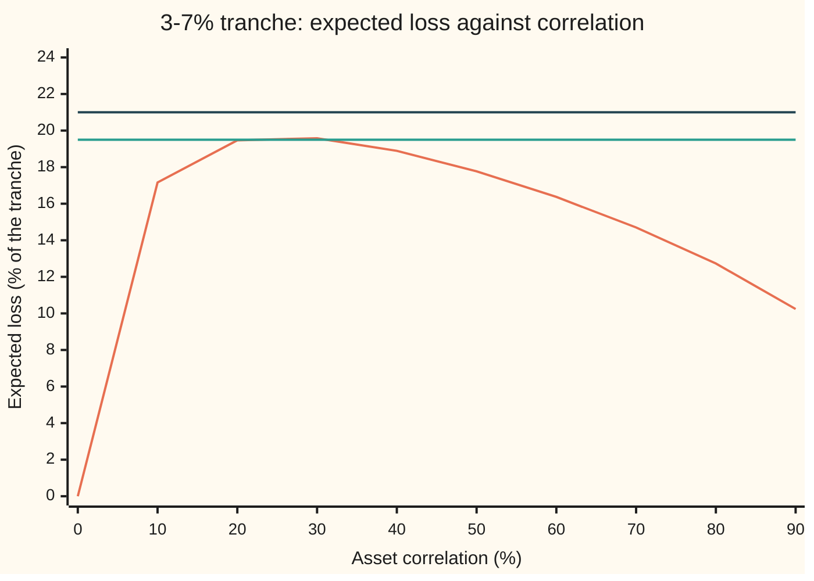
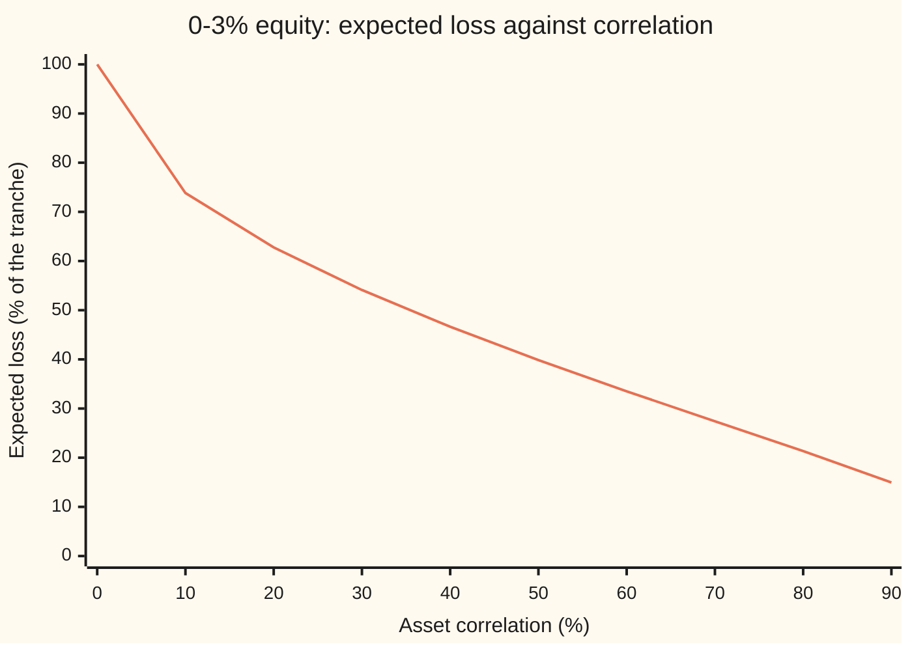

# Implied correlation: the correlation that reprices a tranche, why a mezzanine quote can have two answers or none, and base correlation's fix

[Syllabus](../../../SYLLABUS.md) → [Financial mathematics](../README.md) → [Portfolio Credit - Correlation, Copulas, Indices and Tranches](../README.md#s45) → Implied correlation

---

## General Overview

A $1 billion pool holds 100 loans of $10 million each. Each loan has a 5 percent chance of defaulting over the pool's five-year life. A defaulted loan returns 40 percent of what it owed, so it loses 60 percent. On average the pool loses 3 percent of its size.

The pool's losses are cut into slices called **tranches** ([Tranches](05-cdo-tranches-in-outline.md)). The 0–3% tranche, the **equity**, takes the first 3 percent of pool losses. The 3–7% tranche, the **mezzanine**, takes the next 4 percent: it loses nothing until the pool has lost 3 percent, and is wiped out once the pool has lost 7 percent.

Each slice has a market price. On this card a price is quoted as the slice's **expected loss**: the average share of its own size it will lose over the five years.

The pricing model here is the one-factor Gaussian copula ([The one-factor Gaussian copula](02-one-factor-gaussian-copula.md)). It turns one unknown into a price. That unknown is the **asset correlation**: how strongly the loans share one fate.

Run the model backwards, from a quoted price to the correlation that reproduces it, and the answer is the tranche's **implied correlation**, the credit twin of implied volatility (the volatility that reproduces an option's price). The options version lives on [Correlation Greeks and implied correlation](../18-Many%20underlyings%20-%20exchange%2C%20spread%2C%20basket%20and%20rainbow/05-correlation-greeks-and-implied-correlation.md); this card is about tranches.

For the equity the inverse behaves. A quote of 62.8 percent has exactly one answer: 19.97 percent correlation. The mezzanine does not behave. Its expected loss rises with correlation, peaks at 19.68 percent when correlation is 25.65 percent, then falls. A quote of 19.5 percent has two answers, 20.41 and 31.84 percent. A quote of 21 percent has none.

Base correlation repairs this. It inverts the 0–7% piece, equity and mezzanine together, whose expected loss always falls with correlation. Every quote then has one answer, and the answers price slices nobody quotes.

**A tranche's implied correlation is the one model input that reproduces its quote; it is unique for a slice starting at zero, because correlation only ever lowers a first-loss slice's expected loss, but a middle slice's expected loss rises and then falls, so its quote can have two answers or none; base correlation inverts the first-loss slices instead and prices any other slice as the difference of two of them.**

**What kind of fact this is:** a method (running a model backwards), resting on two theorems proved on this card in Why it works: a first-loss slice's expected loss falls strictly with correlation, and the mezzanine's has exactly one peak. Base correlation, and interpolating it, is a market convention, not a model.

### The picture: one quote, two correlations



The hump is the mezzanine's expected loss. The lower flat line, a quote of 19.5 percent, cuts it twice, near 20 and near 32 percent. The upper flat line, 21 percent, clears the hump's top at 19.68, so no correlation reproduces it.

---

## The formula

Notation first, in words. All amounts are fractions of the pool.

- $p$ is one loan's default chance, 5 percent.
- $g$ is the share of a loan lost at default, 60 percent.
- $\rho$ (say "rho") is the asset correlation.
- The **market factor** $M$ is one bell-curve draw shared by every loan: low means a bad five years.
- $N$ is the bell-curve area to the left of a point and $N^{-1}$ its inverse, as on [The one-factor Gaussian copula](02-one-factor-gaussian-copula.md).
- $\mathbb{E}$ is an average over all values of $M$.

In a pool of very many loans, the loss once the market factor is known is one number, not a random amount ([Vasicek's large-pool loss curve](03-vasicek-loss-distribution-and-basel-capital.md)):

$$L = g\,N\!\left(\frac{c-\sqrt{\rho}\,M}{\sqrt{1-\rho}}\right), \qquad c = N^{-1}(p).$$

A slice from 0 to $K$ loses $\min(L, K)$: all of the pool's loss up to its size, then no more. Its expected loss is

$$H_\rho(K) = \mathbb{E}\big[\min(L, K)\big].$$

A slice from $A$ to $B$ is the 0-to-$B$ slice minus the 0-to-$A$ slice. Its expected loss, as a share of its own width, is

$$\mathrm{EL}_{A,B}(\rho) = \frac{H_\rho(B) - H_\rho(A)}{B - A}.$$

**Read it aloud:** a tranche's expected loss is the difference between two first-loss slices' expected losses, divided by its width.

**Implied correlation**, also called **compound correlation**, is any $\rho$ that solves $\mathrm{EL}_{A,B}(\rho) = Q$ for the tranche's quote $Q$.

**Base correlation** turns the quotes into first-loss amounts and inverts those. Stack the tranches upward from zero with boundaries $K_1 < K_2 < \dots$; the quoted loss of the 0-to-$K_i$ slice is

$$C(K_i) = C(K_{i-1}) + (K_i - K_{i-1})\,Q_i, \qquad C(0) = 0,$$

and the base correlation $\rho_b(K_i)$ solves $H_{\rho_b(K_i)}(K_i) = C(K_i)$. A slice from $A$ to $B$ that nobody quotes is then priced with a different correlation at each end:

$$\widehat{\mathrm{EL}}_{A,B} = \frac{H_{\rho_b(B)}(B) - H_{\rho_b(A)}(A)}{B - A}.$$

| Symbol | Plain meaning | In our example | Push it up and the answer… |
| --- | --- | --- | --- |
| $L$ | the pool's loss once the market factor is known, a fraction of the pool | 3% on average | — |
| $p$ | one loan's chance of default over the five years | 5% | every slice loses more |
| $g$ | **loss given default**: the share of a loan lost when it defaults, 1 minus recovery | 60% | every slice loses more |
| $\rho$, $\rho^*$ | asset correlation (say "rho"); $\rho^*$ is where the mezzanine's expected loss peaks | 20%; 25.65% | the equity loses less; the mezzanine gains, then loses |
| $M$ | the market factor, one bell-curve draw shared by all loans | −2 in a bad five years | pool loss falls |
| $A$, $B$ | a tranche's **attachment** and **detachment**: where it starts and stops taking loss | 3% and 7% | the slice sits higher and loses less |
| $K$, $K_i$, $\rho_b(K)$ | the top of a first-loss slice 0-to-$K$; $K_i$ the quoted tranche boundaries; its base correlation | 7%; 25% | — |
| $c$ | the default threshold $N^{-1}(p)$ | −1.6449 | more defaults |
| $b_K$, $z_K$ | $b_K = N^{-1}(K/g)$; $z_K$ is the market factor value at which pool loss is exactly $K$ | $b_A$ = −1.6449, $b_B$ = −1.1918 | — |
| $N$, $N_2$, $\varphi$ | bell-curve area to the left; the same for a correlated pair; the bell curve's height | $N(c)$ = 5% | — |
| $H_\rho(K)$, $C(K)$ | first-loss expected loss from the model, and from the quotes | 0.018831 at $K$ = 3%, $\rho$ = 20% | $H$ falls as $\rho$ rises |
| $\mathrm{EL}_{A,B}(\rho)$, $Q$ | a tranche's expected loss as a share of its width; $Q$ its quote | 19.47% for 3–7% at 20% | — |

The market factor value that makes pool loss equal $K$ comes from setting $L = K$ and solving:

$$z_K = \frac{c - \sqrt{1-\rho}\;b_K}{\sqrt{\rho}}.$$

Pool loss exceeds $K$ exactly when $M < z_K$: a worse economy than that.

### When it holds

- **A very large pool of identical loans.** The formula for $L$ is the limit of many loans. With 100 real loans the losses come in steps of 0.6 percent, and the equity's expected loss at 20 percent correlation is 59.60, not 62.77. The inverse then returns a different correlation for the same quote.
- **One bell-curve factor.** The Gaussian copula thins out joint disasters too fast; a tail-heavier copula moves every number here ([Tail dependence](07-tail-dependence-and-the-t-copula.md)).
- **Quotes as expected losses.** Markets quote spreads or upfront payments; turning those into expected losses needs default timing, discounting and the premium schedule from [Tranches](05-cdo-tranches-in-outline.md). This card starts after that step.
- **One pool, one date, one recovery.** Base correlation bootstraps across tranches, so every quote must describe the same pool, maturity and 40 percent recovery. Change the recovery and every base correlation moves.
- **Interpolation is a convention.** Two different correlations in one price do not describe any single loss distribution, so nothing guarantees an interpolated slice a loss between zero and its width. Conventions verified 28 Sep 2026 against McGinty and Ahluwalia (2004): the bootstrap adds each tranche's expected loss onto the one below, in the large-pool Gaussian model.

---

## Why it works

### Step 0: correlation moves loss between scenarios, not in total

Correlation never changes the pool's average loss: $g\,p$ = 3 percent at every correlation. It changes how that 3 percent is spread across scenarios.

At zero correlation every scenario loses exactly 3 percent: defaults are independent, and a huge pool averages them out. At full correlation the loans default together or not at all: 95 percent of scenarios lose nothing and 5 percent lose 60 percent. In between, low values of $M$ bring heavy loss and high values bring light loss.

A tranche is a window on the loss. How much of the fixed 3 percent average lands in the window depends on the spread. That is why a tranche's price carries information about correlation.

### Step 1: every tranche is two first-loss slices

For any loss $L$, the 3–7% tranche loses $\min(L, 7\%) - \min(L, 3\%)$ of the pool. Check three cases. Pool loss 2 percent: 2 − 2 = 0. Pool loss 5 percent: 5 − 3 = 2 percentage points of the pool, half the tranche. Pool loss 9 percent: 7 − 3 = 4, the whole tranche.

Averaging over scenarios keeps the difference, which gives the formula for $\mathrm{EL}_{A,B}$. So the behaviour of any tranche follows from the behaviour of $H_\rho(K)$, one first-loss slice at a time.

### Step 2: a first-loss slice's expected loss falls strictly with correlation

The 0-to-$K$ slice keeps the pool's loss up to $K$ and ignores the rest. Spread the loss out and two things happen. Heavy scenarios lose more, but the slice cannot lose more than $K$ in them. Light scenarios lose less, and the slice feels every bit of that. The cap blocks the extra loss in bad scenarios but not the relief in good ones, so the average falls.

The exact statement is a slope. Differentiating $H_\rho(K)$ in $\rho$ gives

$$\frac{\partial H_\rho(K)}{\partial \rho} = -\,\frac{g\,\varphi(b_K)\,\varphi(z_K)}{2\sqrt{\rho(1-\rho)}},$$

which is negative for every $\rho$ strictly between 0 and 1. At $K$ = 7% and $\rho$ = 30% it is −0.025452, and bumping $\rho$ up and down by 0.00001 in the code gives the same number.

<details>
<summary>Detailed proof: the closed form, and its slope</summary>

Write $\min(L,K) = K$ when $M < z_K$, and $L$ otherwise. So
$H_\rho(K) = K\,N(z_K) + \mathbb{E}\big[L\,;\,M \ge z_K\big]$.
The second term is $g$ times the chance that a loan defaults while the economy is at or above $z_K$. A loan's hidden score, $\sqrt{\rho}\,M$ plus $\sqrt{1-\rho}$ times its own bell-curve noise, is a bell-curve draw with correlation $\sqrt{\rho}$ to $M$, so that chance is $p - N_2(c, z_K; \sqrt{\rho})$:
$$H_\rho(K) = K\,N(z_K) + g\,\big[\,p - N_2(c, z_K; \sqrt{\rho})\,\big].$$
Differentiate in $\rho$. The pair function obeys two rules: its slope in the second point is $\varphi(z)\,N\big((c - \sqrt{\rho}\,z)/\sqrt{1-\rho}\big)$, and its slope in the correlation is the pair's bell-curve height (Plackett's identity). At $z = z_K$ the first rule gives $\varphi(z_K)\,K/g$, by the definition of $z_K$, so the two terms that move $z_K$ cancel exactly. What remains is the correlation slope times $d\sqrt{\rho}/d\rho = 1/(2\sqrt{\rho})$. The pair's height at $(c, z_K)$ factors as $\varphi(z_K)\,\varphi(b_K)/\sqrt{1-\rho}$, because $(c - \sqrt{\rho}\,z_K)/\sqrt{1-\rho} = b_K$. Multiplying gives the slope in the body. Every factor is positive, and the minus sign makes the slope negative.

</details>

The ends are known exactly. At zero correlation, $H_0(K) = \min(g\,p, K)$. At full correlation, $H_1(K) = p\,\min(g, K)$. For the 0–3% equity, as a share of its width, that is 100 percent and 5 percent.

A continuous, strictly falling curve from 100 down to 5 meets every level between once (the intermediate value theorem). So **a quote strictly between 5 and 100 percent has exactly one equity implied correlation; a quote at or outside those ends has none inside (0, 1).** The quote 62.8 percent gives 19.97 percent.



The single line is the equity's expected loss. It falls at every step, so any horizontal quote line crosses it once.

### Step 3: the mezzanine is the difference of two falling curves

The 3–7% tranche is $H_\rho(7\%)$ minus $H_\rho(3\%)$, over 4 percent. Both fall with correlation. Their difference rises when the 3% slice falls faster, and falls when the 7% slice does. So the mezzanine can go either way.

The ends pin it down. At zero correlation every scenario loses exactly 3 percent, which stops at the tranche's floor: expected loss 0. At full correlation 5 percent of scenarios lose 60 percent of the pool, which wipes the tranche out: expected loss 5 percent.

In between it climbs to 19.68 percent, because moderate spreading pushes many scenarios into the 3–7% window, then heavy spreading sends scenarios either below the window or straight through it.

Subtracting the two slopes from Step 2, the mezzanine rises exactly when $\varphi(b_A)\,\varphi(z_A) > \varphi(b_B)\,\varphi(z_B)$. Taking logs and cancelling reduces this to a sign test on $(b_A + b_B) - 2c\sqrt{1-\rho}$. As $\rho$ rises, $\sqrt{1-\rho}$ falls steadily, so the sign changes at most once. When $2c < b_A + b_B < 0$ it changes exactly once, at

$$\rho^* = 1 - \left(\frac{b_A + b_B}{2c}\right)^2.$$

For the 3–7% tranche that is 25.65 percent, and a numerical search for the maximum, which knows nothing of this formula, lands on the same value.

<details>
<summary>Detailed proof: exactly one peak</summary>

From Step 2, the mezzanine's slope is $\dfrac{g}{2\sqrt{\rho(1-\rho)}\,(B-A)}\big[\varphi(b_A)\varphi(z_A) - \varphi(b_B)\varphi(z_B)\big]$, so its sign is the sign of $\log\big(\varphi(b_A)\varphi(z_A)\big) - \log\big(\varphi(b_B)\varphi(z_B)\big)$. Since $\log\varphi(x) = -x^2/2$ plus a constant, that difference is $\tfrac12\big(b_B^2 - b_A^2\big) + \tfrac12\big(z_B^2 - z_A^2\big)$. Put in $z_K = (c - \sqrt{1-\rho}\,b_K)/\sqrt{\rho}$ and expand:
$$\tfrac12\big(z_B^2 - z_A^2\big) = \frac{(b_B - b_A)\big[\,(1-\rho)(b_A + b_B) - 2c\sqrt{1-\rho}\,\big]}{2\rho}.$$
Write $\tfrac12(b_B^2 - b_A^2)$ as $\rho\,(b_B - b_A)(b_A + b_B)/(2\rho)$ and add. The $(1-\rho)$ and the $\rho$ combine:
$$\frac{(b_B - b_A)\big[\,(b_A + b_B) - 2c\sqrt{1-\rho}\,\big]}{2\rho}.$$
Since $A < B$, $b_B - b_A > 0$, so the sign is that of $(b_A + b_B) - 2c\sqrt{1-\rho}$. With $c < 0$, this moves steadily from $(b_A+b_B) - 2c$ at $\rho = 0$, positive when $b_A + b_B > 2c$, down to $b_A + b_B$ at $\rho = 1$, negative when $b_A + b_B < 0$. So it crosses zero once, where $\sqrt{1-\rho} = (b_A + b_B)/(2c)$. Squaring gives $\rho^*$. Other tranches, or other $p$ and $g$, may fail the inequality: the 0–3% equity has $b_A$ at minus infinity and never rises.

</details>

The root count follows from the shape. The curve rises from 0 to 19.68 percent, then falls to 5 percent.

| Quote $Q$ for 3–7% | Correlations that reproduce it |
| --- | --- |
| above the peak, 19.675% | none |
| exactly the peak | one, 25.65% |
| above 5%, below the peak | two, one on each side of 25.65% |
| above 0, up to 5% | one, below 25.65% |
| 0 or below | none |

The quote 19.5 percent sits in the third row: 20.41 and 31.84 percent.

### Step 4: solve each branch separately

Inverting means finding where $\mathrm{EL}_{A,B}(\rho) - Q$ crosses zero ([Solving backwards](../07-Greeks%20by%20Numbers%20and%20Calibration/05-root-finding-for-inverses.md)). Bisection needs a bracket whose two ends give opposite signs. Over the whole range 0 to 1 the 19.5 percent quote fails that test: the curve is below 19.5 at both ends. Plain bisection run anyway walks to 100 percent correlation, where the mezzanine loses 5.00 percent, nowhere near the quote.

The fix is to split at $\rho^*$. On $(0, \rho^*)$ the curve only rises; on $(\rho^*, 1)$ it only falls. Each piece has a proper bracket or none, and each yields at most one root. The code finds each root twice: by bisection, and by Newton's method using the slope formula from Step 2. The two agree to eight decimals.

### Step 5: base correlation inverts the first-loss slices

Step 2 already contains the fix. Every 0-to-$K$ slice falls strictly with correlation, so every first-loss quote inside its range has exactly one correlation. Base correlation builds those first-loss quotes out of the tranche quotes, by adding each tranche's expected loss, in pool units, onto the stack below it.

The card's test market quotes four tranches: 0–3, 3–7, 7–10 and 10–15 percent. The quotes are generated from a known **skew**, a set of base correlations that rises with the detachment point: 20, 25, 30 and 40 percent. So the inversion can be checked against the truth. Real quotes arrive without that label.

The quotes come out at 62.7703, 16.2777, 4.5278 and 1.2499 percent of each tranche. Bootstrapped by bisection and by Newton, they return 20, 25, 30 and 40 percent exactly.

Invert the same four quotes one tranche at a time and the picture breaks:

```
correlation read from the same four quotes, % (one block = 2 points)
0-3%    base      ██████████                        20.00
        compound  ██████████                        20.00
3-7%    base      █████████████                     25.00
        compound  ████                               8.37   and
                  ██████████████████████████████    60.57
7-10%   base      ███████████████                   30.00
        compound  ███████                           14.40
10-15%  base      ████████████████████              40.00
        compound  ████████                          15.34
```

Base correlation rises smoothly with the detachment point. Compound correlation jumps: the mezzanine gives two answers, 8.37 and 60.57 percent, neither near its neighbours. The 7–10% and 10–15% quotes sit below 5 percent, so each has one compound correlation, on the rising branch. McGinty and Ahluwalia saw this pattern on real quotes in 2004 and called the compound shape an artefact of the method.

### Step 6: pricing a slice nobody quotes

A client wants the 5–10% tranche. Nobody quotes it. Base correlation is known at 3, 7, 10 and 15 percent. Interpolate a straight line between 3 and 7 percent to get 22.5 percent at 5. At 10 percent it is quoted: 30 percent.

Price the 0–10% slice at 30 percent and the 0–5% slice at 22.5 percent, and subtract. The 5–10% tranche loses 7.04 percent of its width in expectation.

Two cautions. The price mixes two correlations, so no single loss distribution stands behind it. And a bent interpolation can make $H_{\rho_b(B)}(B) - H_{\rho_b(A)}(A)$ negative or larger than $B - A$: a tranche that gains from defaults, or loses more than its size. The code checks the quoted stack, $0 \le C(K_i) - C(K_{i-1}) \le K_i - K_{i-1}$, for both.

### The other door

Base correlation fixes the inverse, not the model. The rising skew says one Gaussian correlation cannot fit all tranches at once. The other road is to change the model so one set of parameters fits every tranche: a copula with heavier joint tails, random recovery, or random correlation. The first of these is [Tail dependence](07-tail-dependence-and-the-t-copula.md).

---

## Worked numbers, by hand

The pool: $p$ = 5%, $g$ = 60%. The mezzanine: $A$ = 3%, $B$ = 7%.

| Step | Arithmetic | Value |
| --- | --- | --- |
| default threshold $c$ | $N^{-1}(0.05)$ | −1.644854 |
| $b_A$ | $N^{-1}(0.03 / 0.60) = N^{-1}(0.05)$ | −1.644854 |
| $b_B$ | $N^{-1}(0.07 / 0.60)$ | −1.191816 |
| one peak? | is $2c = -3.29 < b_A + b_B = -2.84 < 0$? | yes |
| peak correlation $\rho^*$ | $1 - \big((-1.644854 - 1.191816)/(2 \times -1.644854)\big)^2$ | 0.256462 |
| peak expected loss | $\mathrm{EL}_{3,7}(\rho^*)$, by integral | 19.68% |
| quote 19.5%: two roots | below 19.68 and above 5 | 20.41% and 31.84% |
| quote 21%: none | above the peak | — |
| equity quote 62.8% | between 5 and 100, one root | 19.97% |
| base stack at 3% | $0.03 \times 0.627703$ | 0.018831 → 20% |
| base stack at 7% | $0.018831 + 0.04 \times 0.162777$ | 0.025342 → 25% |
| base stack at 10% | $0.025342 + 0.03 \times 0.045278$ | 0.026701 → 30% |
| base correlation at 5% | $20\% + \tfrac{5 - 3}{7 - 3}(25\% - 20\%)$ | 22.5% |
| 0–5% slice at 22.5% | $H_{0.225}(0.05)$, by integral | 0.023180 |
| **5–10% tranche** | $(0.026701 - 0.023180) / 0.05$ | **7.04%** |

Under the base-correlation convention, a 5–10% tranche on this pool is expected to lose about 7 percent of its size over five years.

### What breaks if you drop a piece

| Mistake | Comes out at | What went wrong |
| --- | --- | --- |
| One bisection bracket, 0 to 100%, for the 19.5% quote | 100% correlation, where the tranche loses 5.00% | Both ends sit below the quote, so the bracket traps nothing |
| Price 5–10% at the equity's 20% | 9.28% (right: 7.04%) | A flat correlation ignores the skew and overstates a higher slice's loss |
| Price 5–10% at one base correlation, 30%, at both ends | 11.25% | Each end of the slice needs its own base correlation |
| Take the 3–7% market quote's compound correlation as "the" correlation | 8.37% or 60.57% | Two answers, and neither is the 25% base |
| Treat 100 loans as infinitely many, equity at 20% | 62.77% (100 loans: 59.60%) | Lumpy losses spread the loss further, and the equity's cap then bites more |

Every number in this table is printed by the code below.

---

## Code, from first principles, and it actually runs

The code builds its own bell curve, inverse, integrator and root finders. It computes each expected loss two independent ways: averaging over the market factor, and the closed form with the pair bell curve integrated through Plackett's identity. It finds the peak twice (formula and golden-section search), every root twice (bisection and Newton), the slope twice (formula and bump), and sets the large pool beside an exact 100-loan pool.

### Python

```python
# Implied (compound) and base correlation in the large-pool Gaussian copula.
# Pool: default chance P over the life, loss given default G = 1 - 40% recovery.
from math import exp, sqrt, pi
P, G = 0.05, 0.60

def npdf(x): return exp(-0.5 * x * x) / sqrt(2 * pi)
def ncdf(x):                                   # own normal CDF: series, then continued fraction
    u = abs(x)
    if u < 3.0:
        term = s = u; k = 1
        while term > 1e-17 * s: term *= u * u / (2 * k + 1); s += term; k += 1
        tail = 0.5 - npdf(u) * s
    else:
        cf = u
        for k in range(120, 0, -1): cf = u + k / cf
        tail = npdf(u) / cf
    return tail if x < 0 else 1.0 - tail
def ninv(p):                                   # inverse CDF by bisection
    lo, hi = -10.0, 10.0
    for _ in range(100):
        m = 0.5 * (lo + hi)
        if ncdf(m) < p: lo = m
        else: hi = m
    return 0.5 * (lo + hi)
def simpson(f, lo, hi, n):
    h = (hi - lo) / n
    return h / 3 * (f(lo) + f(hi) + sum((4 if j % 2 else 2) * f(lo + j * h) for j in range(1, n)))

C0 = ninv(P)                                   # default threshold c
def zcut(K, rho): return (C0 - sqrt(1 - rho) * ninv(K / G)) / sqrt(rho)
def F(K, rho):                                 # road 1: E[min(L, K)] averaged over the market factor
    if K <= 0.0: return 0.0
    if rho <= 0.0: return min(G * P, K)
    if rho >= 1.0: return P * min(G, K)
    z = min(max(zcut(K, rho), -9.0), 9.0)      # cut the factor range at 9 standard deviations
    loss = lambda x: G * ncdf((C0 - sqrt(rho) * x) / sqrt(1 - rho)) * npdf(x)
    return K * ncdf(z) + simpson(loss, z, 9.0, 2000)
def F2(K, rho):                                # road 2: bivariate normal CDF by Plackett's identity
    z, r = zcut(K, rho), sqrt(rho)
    dens = lambda s: exp(-(C0 * C0 - 2 * s * C0 * z + z * z) / (2 * (1 - s * s))) / (2 * pi * sqrt(1 - s * s))
    return K * ncdf(z) + G * (P - ncdf(C0) * ncdf(z) - simpson(dens, 0.0, r, 2000))
def M(A, B, rho): return (F(B, rho) - F(A, rho)) / (B - A)
def dF(K, rho): return -G * npdf(ninv(K / G)) * npdf(zcut(K, rho)) / (2 * sqrt(rho * (1 - rho)))
def dM(A, B, rho): return (dF(B, rho) - (dF(A, rho) if A > 0 else 0.0)) / (B - A)
def peak_rho(A, B):                            # closed form; None when the tranche has no hump
    bs = (ninv(A / G) if A > 0 else -1e9) + ninv(B / G)
    return 1 - (bs / (2 * C0)) ** 2 if 2 * C0 < bs < 0 else None

def bisect(f, lo, hi, n=60):                   # road 1 for every inverse: halve a sign-changing bracket
    flo = f(lo)
    for _ in range(n):
        m = 0.5 * (lo + hi)
        if (f(m) > 0) == (flo > 0): lo = m
        else: hi = m
    return 0.5 * (lo + hi)
def newton(f, df, lo, hi):                     # road 2: Newton with the analytic slope, kept in the branch
    x = 0.5 * (lo + hi)
    for _ in range(40):
        y = x - f(x) / df(x)
        x = y if lo < y < hi else 0.5 * (x + (lo if y <= lo else hi))
    return x
def compound(A, B, Q):                         # every correlation in (0,1) repricing the quote Q
    top = peak_rho(A, B) or 0.999999
    ends, out = [(1e-9, top)] + ([(top, 1.0)] if top < 0.999999 else []), []
    for lo, hi in ends:
        f = lambda r: M(A, B, r) - Q
        if f(lo) * f(hi) < 0:
            out.append((bisect(f, lo, hi), newton(f, lambda r: dM(A, B, r), lo, hi)))
    return out
def golden_max(f, lo, hi):                     # peak found numerically, no formula
    g = (sqrt(5) - 1) / 2
    for _ in range(80):
        a, b = hi - g * (hi - lo), lo + g * (hi - lo)
        if f(a) < f(b): lo = a
        else: hi = b
    return 0.5 * (lo + hi)
def pool100(K, rho):                           # 100 loans, conditional binomial, same copula
    def f(x):
        q = ncdf((C0 - sqrt(rho) * x) / sqrt(1 - rho)); pr = (1 - q) ** 100; tot = 0.0
        for n in range(101):
            tot += pr * min(n * G / 100, K); pr *= (100 - n) / (n + 1) * q / (1 - q)
        return tot * npdf(x)
    return simpson(f, -9.0, 9.0, 800)

out = lambda label, v: print(f"{label:<40} {v:>12.6f}")
print(f"threshold c = N^-1(p)                    {C0:>12.6f}")
out("road 1 factor integral, 3-7% at 20%", M(0.03, 0.07, 0.2))
out("road 2 Plackett, 3-7% at 20%", (F2(0.07, 0.2) - F2(0.03, 0.2)) / 0.04)
out("road 1 equity 0-3% at 20%", F(0.03, 0.2) / 0.03); out("road 2 equity 0-3% at 20%", F2(0.03, 0.2) / 0.03)
out("b_A = N^-1(3% / g)", ninv(0.03 / G)); out("b_B = N^-1(7% / g)", ninv(0.07 / G))
out("100 loans, equity 0-3% at 20%", pool100(0.03, 0.2) / 0.03)
out("100 loans, 3-7% at 20%", (pool100(0.07, 0.2) - pool100(0.03, 0.2)) / 0.04)
h = 1e-5; fd = (F(0.07, 0.3 + h) - F(0.07, 0.3 - h)) / (2 * h)
out("slope dF/drho at 7%, 30%, formula", dF(0.07, 0.3)); out("slope dF/drho at 7%, 30%, bumped", fd)
rs, rg = peak_rho(0.03, 0.07), golden_max(lambda r: M(0.03, 0.07, r), 0.01, 0.99)
out("peak rho*, closed form", rs); out("peak rho*, golden section", rg); out("peak 3-7% loss", M(0.03, 0.07, rs))
grid = [i / 10 for i in range(10)]
print("chart, correlation %  " + " ".join(f"{100 * r:6.0f}" for r in grid))
print("chart, 3-7% loss %    " + " ".join(f"{100 * M(0.03, 0.07, r):6.2f}" for r in grid))
print("chart, 0-3% loss %    " + " ".join(f"{100 * F(0.03, r) / 0.03:6.2f}" for r in grid))
print("chart, quote lines %  " + " ".join(f"{v:6.2f}" for v in (19.5, 21.0)))
roots = {}
for label, A, B, Q in (("0-3% quote 62.80%", 0, 0.03, 0.628), ("3-7% quote = model at 20%", 0.03, 0.07, M(0.03, 0.07, 0.2)),
                       ("3-7% quote 19.50%", 0.03, 0.07, 0.195), ("3-7% quote 19.60%", 0.03, 0.07, 0.196),
                       ("3-7% quote 21.00%", 0.03, 0.07, 0.21)):
    roots[label] = compound(A, B, Q)
    print(f"{label:<27} roots: " + (", ".join(f"{b:.6f}/{n:.6f}" for b, n in roots[label]) or "none"))
naive = bisect(lambda r: M(0.03, 0.07, r) - 0.195, 0.0, 1.0)
out("wrong: one bracket 0..1 for 19.50%", naive); out("  its 3-7% loss", M(0.03, 0.07, naive))
Ks, seeds = [0.0, 0.03, 0.07, 0.10, 0.15], [None, 0.20, 0.25, 0.30, 0.40]
Cum = [0.0] + [F(Ks[i], seeds[i]) for i in range(1, 5)]
for i in range(1, 5):
    A, B = Ks[i - 1], Ks[i]; Q = (Cum[i] - Cum[i - 1]) / (B - A)
    fb = lambda r: F(B, r) - Cum[i]
    bb, bn = bisect(fb, 1e-9, 1.0 - 1e-9), newton(fb, lambda r: dF(B, r), 1e-6, 1.0 - 1e-6)
    cr = compound(A, B, Q)
    print(f"{f'{100 * A:.0f}-{100 * B:.0f}%':<7} quote {100 * Q:7.4f}%  cum {Cum[i]:.6f}  base {bb:.6f}/{bn:.6f}  compound "
          + ", ".join(f"{b:.4f}" for b, n in cr))
    assert abs(bb - seeds[i]) < 1e-8, "bisection bootstrap must return the correlation behind each quote"
    assert abs(bn - seeds[i]) < 1e-8, "Newton bootstrap must return the correlation behind each quote"
    assert 0 <= Cum[i] - Cum[i - 1] <= B - A, "cumulative losses must rise, and by no more than the width"
b5 = 0.20 + (0.05 - 0.03) / (0.07 - 0.03) * (0.25 - 0.20)
out("base correlation at 5%, interpolated", b5); out("first loss 0-5% at that correlation", F(0.05, b5))
out("5-10% by base correlation", (F(0.10, 0.30) - F(0.05, b5)) / 0.05)
out("wrong: 5-10% at flat 20%", M(0.05, 0.10, 0.20))
out("wrong: 5-10% at flat 30%", M(0.05, 0.10, 0.30))
out("5-7% by base correlation", (F(0.07, 0.25) - F(0.05, b5)) / 0.02)
for rho in (0.1, 0.2, 0.5, 0.9):
    assert abs(F(0.07, rho) - F2(0.07, rho)) < 1e-9, "factor integral vs Plackett bivariate normal"
assert abs(fd - dF(0.07, 0.3)) < 1e-6, "analytic slope vs bumped slope"
assert abs(rs - rg) < 1e-5, "closed-form peak vs numerical maximum"
for label, rr in roots.items():
    for b, n in rr: assert abs(b - n) < 1e-8, "bisection vs Newton on each branch: " + label
assert len(roots["3-7% quote 21.00%"]) == 0, "no correlation reprices 21%"
assert M(0.03, 0.07, rg) < 0.21, "21% lies above the numerically found hump"
assert abs(roots["3-7% quote = model at 20%"][0][0] - 0.2) < 1e-8, "the left root recovers the 20% that made the quote"
assert pool100(0.03, 0.2) < F(0.03, 0.2), "lumpy losses: 100 loans give the equity less loss (Jensen)"
assert abs(pool100(G, 0.2) - G * P) < 1e-9, "100 loans keep the pool's mean loss g p"
print("ALL CHECKS PASS")
```

**Ran 2026-09-28 on macOS, Python 3.14.6, standard library only. All checks passed. Output, pasted from the run:**

```
threshold c = N^-1(p)                       -1.644854
road 1 factor integral, 3-7% at 20%          0.194685
road 2 Plackett, 3-7% at 20%                 0.194685
road 1 equity 0-3% at 20%                    0.627703
road 2 equity 0-3% at 20%                    0.627703
b_A = N^-1(3% / g)                          -1.644854
b_B = N^-1(7% / g)                          -1.191816
100 loans, equity 0-3% at 20%                0.596004
100 loans, 3-7% at 20%                       0.204613
slope dF/drho at 7%, 30%, formula           -0.025452
slope dF/drho at 7%, 30%, bumped            -0.025452
peak rho*, closed form                       0.256462
peak rho*, golden section                    0.256462
peak 3-7% loss                               0.196752
chart, correlation %       0     10     20     30     40     50     60     70     80     90
chart, 3-7% loss %      0.00  17.16  19.47  19.58  18.89  17.77  16.37  14.70  12.73  10.24
chart, 0-3% loss %    100.00  73.83  62.77  54.11  46.63  39.85  33.51  27.40  21.34  14.96
chart, quote lines %   19.50  21.00
0-3% quote 62.80%           roots: 0.199689/0.199689
3-7% quote = model at 20%   roots: 0.200000/0.200000, 0.324275/0.324275
3-7% quote 19.50%           roots: 0.204099/0.204099, 0.318449/0.318449
3-7% quote 19.60%           roots: 0.221132/0.221132, 0.295928/0.295928
3-7% quote 21.00%           roots: none
wrong: one bracket 0..1 for 19.50%           1.000000
  its 3-7% loss                              0.050000
0-3%    quote 62.7703%  cum 0.018831  base 0.200000/0.200000  compound 0.2000
3-7%    quote 16.2777%  cum 0.025342  base 0.250000/0.250000  compound 0.0837, 0.6057
7-10%   quote  4.5278%  cum 0.026701  base 0.300000/0.300000  compound 0.1440
10-15%  quote  1.2499%  cum 0.027325  base 0.400000/0.400000  compound 0.1534
base correlation at 5%, interpolated         0.225000
first loss 0-5% at that correlation          0.023180
5-10% by base correlation                    0.070413
wrong: 5-10% at flat 20%                     0.092811
wrong: 5-10% at flat 30%                     0.112475
5-7% by base correlation                     0.108116
ALL CHECKS PASS
```

### Rust

```rust
// Implied (compound) and base correlation in the large-pool Gaussian copula.
// Pool: default chance P over the life, loss given default G = 1 - 40% recovery.
use std::f64::consts::PI;
const P: f64 = 0.05;
const G: f64 = 0.60;

fn npdf(x: f64) -> f64 { (-0.5 * x * x).exp() / (2.0 * PI).sqrt() }
fn ncdf(x: f64) -> f64 { // own normal CDF: series, then continued fraction
    let u = x.abs();
    let tail = if u < 3.0 {
        let (mut term, mut s, mut k) = (u, u, 1.0);
        while term > 1e-17 * s { term *= u * u / (2.0 * k + 1.0); s += term; k += 1.0; }
        0.5 - npdf(u) * s
    } else {
        let mut cf = u;
        for k in (1..=120).rev() { cf = u + k as f64 / cf; }
        npdf(u) / cf
    };
    if x < 0.0 { tail } else { 1.0 - tail }
}
fn ninv(p: f64) -> f64 { // inverse CDF by bisection
    let (mut lo, mut hi) = (-10.0, 10.0);
    for _ in 0..100 { let m = 0.5 * (lo + hi); if ncdf(m) < p { lo = m } else { hi = m } }
    0.5 * (lo + hi)
}
fn simpson(f: &dyn Fn(f64) -> f64, lo: f64, hi: f64, n: usize) -> f64 {
    let h = (hi - lo) / n as f64;
    let mut s = 0.0;
    for j in 1..n { s += if j % 2 == 1 { 4.0 } else { 2.0 } * f(lo + j as f64 * h); }
    h / 3.0 * (f(lo) + f(hi) + s)
}
fn c0() -> f64 { ninv(P) } // default threshold c
fn zcut(k: f64, rho: f64) -> f64 { (c0() - (1.0 - rho).sqrt() * ninv(k / G)) / rho.sqrt() }
fn f1(k: f64, rho: f64) -> f64 { // road 1: E[min(L, K)] averaged over the market factor
    if k <= 0.0 { return 0.0; }
    if rho <= 0.0 { return (G * P).min(k); }
    if rho >= 1.0 { return P * G.min(k); }
    let z = zcut(k, rho).max(-9.0).min(9.0);
    let c = c0();
    let loss = |x: f64| G * ncdf((c - rho.sqrt() * x) / (1.0 - rho).sqrt()) * npdf(x);
    k * ncdf(z) + simpson(&loss, z, 9.0, 2000)
}
fn f2(k: f64, rho: f64) -> f64 { // road 2: bivariate normal CDF by Plackett's identity
    let (z, r, c) = (zcut(k, rho), rho.sqrt(), c0());
    let dens = |s: f64| (-(c * c - 2.0 * s * c * z + z * z) / (2.0 * (1.0 - s * s))).exp() / (2.0 * PI * (1.0 - s * s).sqrt());
    k * ncdf(z) + G * (P - ncdf(c) * ncdf(z) - simpson(&dens, 0.0, r, 2000))
}
fn m(a: f64, b: f64, rho: f64) -> f64 { (f1(b, rho) - f1(a, rho)) / (b - a) }
fn df(k: f64, rho: f64) -> f64 { -G * npdf(ninv(k / G)) * npdf(zcut(k, rho)) / (2.0 * (rho * (1.0 - rho)).sqrt()) }
fn dm(a: f64, b: f64, rho: f64) -> f64 { (df(b, rho) - if a > 0.0 { df(a, rho) } else { 0.0 }) / (b - a) }
fn peak_rho(a: f64, b: f64) -> Option<f64> { // closed form; None when the tranche has no hump
    let bs = (if a > 0.0 { ninv(a / G) } else { -1e9 }) + ninv(b / G);
    let c = c0();
    if 2.0 * c < bs && bs < 0.0 { Some(1.0 - (bs / (2.0 * c)).powi(2)) } else { None }
}
fn bisect(f: &dyn Fn(f64) -> f64, mut lo: f64, mut hi: f64) -> f64 { // road 1 for every inverse
    let flo = f(lo);
    for _ in 0..60 { let x = 0.5 * (lo + hi); if (f(x) > 0.0) == (flo > 0.0) { lo = x } else { hi = x } }
    0.5 * (lo + hi)
}
fn newton(f: &dyn Fn(f64) -> f64, d: &dyn Fn(f64) -> f64, lo: f64, hi: f64) -> f64 { // road 2, kept in the branch
    let mut x = 0.5 * (lo + hi);
    for _ in 0..40 {
        let y = x - f(x) / d(x);
        x = if lo < y && y < hi { y } else { 0.5 * (x + if y <= lo { lo } else { hi }) };
    }
    x
}
fn compound(a: f64, b: f64, q: f64) -> Vec<(f64, f64)> { // every correlation in (0,1) repricing the quote q
    let top = peak_rho(a, b).unwrap_or(0.999999);
    let mut ends = vec![(1e-9, top)];
    if top < 0.999999 { ends.push((top, 1.0)); }
    let mut out = Vec::new();
    for (lo, hi) in ends {
        let f = |r: f64| m(a, b, r) - q;
        if f(lo) * f(hi) < 0.0 { out.push((bisect(&f, lo, hi), newton(&f, &|r| dm(a, b, r), lo, hi))); }
    }
    out
}
fn golden_max(f: &dyn Fn(f64) -> f64, mut lo: f64, mut hi: f64) -> f64 { // peak found numerically
    let g = (5f64.sqrt() - 1.0) / 2.0;
    for _ in 0..80 {
        let (a, b) = (hi - g * (hi - lo), lo + g * (hi - lo));
        if f(a) < f(b) { lo = a } else { hi = b }
    }
    0.5 * (lo + hi)
}
fn pool100(k: f64, rho: f64) -> f64 { // 100 loans, conditional binomial, same copula
    let c = c0();
    let f = |x: f64| {
        let q = ncdf((c - rho.sqrt() * x) / (1.0 - rho).sqrt());
        let (mut pr, mut tot) = ((1.0 - q).powi(100), 0.0);
        for n in 0..=100 { tot += pr * (n as f64 * G / 100.0).min(k); pr *= (100 - n) as f64 / (n + 1) as f64 * q / (1.0 - q); }
        tot * npdf(x)
    };
    simpson(&f, -9.0, 9.0, 800)
}
fn out(label: &str, v: f64) { println!("{:<40} {:>12.6}", label, v); }
fn row(label: &str, v: &[f64], dec: usize) {
    let s: Vec<String> = v.iter().map(|x| format!("{:6.*}", dec, x)).collect();
    println!("{}{}", label, s.join(" "));
}

fn main() {
    println!("threshold c = N^-1(p)                    {:>12.6}", c0());
    out("road 1 factor integral, 3-7% at 20%", m(0.03, 0.07, 0.2));
    out("road 2 Plackett, 3-7% at 20%", (f2(0.07, 0.2) - f2(0.03, 0.2)) / 0.04);
    out("road 1 equity 0-3% at 20%", f1(0.03, 0.2) / 0.03); out("road 2 equity 0-3% at 20%", f2(0.03, 0.2) / 0.03);
    out("b_A = N^-1(3% / g)", ninv(0.03 / G)); out("b_B = N^-1(7% / g)", ninv(0.07 / G));
    out("100 loans, equity 0-3% at 20%", pool100(0.03, 0.2) / 0.03);
    out("100 loans, 3-7% at 20%", (pool100(0.07, 0.2) - pool100(0.03, 0.2)) / 0.04);
    let fd = (f1(0.07, 0.3 + 1e-5) - f1(0.07, 0.3 - 1e-5)) / 2e-5;
    out("slope dF/drho at 7%, 30%, formula", df(0.07, 0.3)); out("slope dF/drho at 7%, 30%, bumped", fd);
    let rs = peak_rho(0.03, 0.07).unwrap();
    let rg = golden_max(&|r| m(0.03, 0.07, r), 0.01, 0.99);
    out("peak rho*, closed form", rs); out("peak rho*, golden section", rg); out("peak 3-7% loss", m(0.03, 0.07, rs));
    let grid: Vec<f64> = (0..10).map(|i| i as f64 / 10.0).collect();
    row("chart, correlation %  ", &grid.iter().map(|r| 100.0 * r).collect::<Vec<_>>(), 0);
    row("chart, 3-7% loss %    ", &grid.iter().map(|&r| 100.0 * m(0.03, 0.07, r)).collect::<Vec<_>>(), 2);
    row("chart, 0-3% loss %    ", &grid.iter().map(|&r| 100.0 * f1(0.03, r) / 0.03).collect::<Vec<_>>(), 2);
    row("chart, quote lines %  ", &[19.5, 21.0], 2);
    let cases = [("0-3% quote 62.80%", 0.0, 0.03, 0.628), ("3-7% quote = model at 20%", 0.03, 0.07, m(0.03, 0.07, 0.2)),
        ("3-7% quote 19.50%", 0.03, 0.07, 0.195), ("3-7% quote 19.60%", 0.03, 0.07, 0.196), ("3-7% quote 21.00%", 0.03, 0.07, 0.21)];
    let mut roots = Vec::new();
    for (label, a, b, q) in cases {
        let r = compound(a, b, q);
        let s: Vec<String> = r.iter().map(|(x, y)| format!("{:.6}/{:.6}", x, y)).collect();
        println!("{:<27} roots: {}", label, if s.is_empty() { "none".to_string() } else { s.join(", ") });
        roots.push((label, r));
    }
    let naive = bisect(&|r| m(0.03, 0.07, r) - 0.195, 0.0, 1.0);
    out("wrong: one bracket 0..1 for 19.50%", naive); out("  its 3-7% loss", m(0.03, 0.07, naive));
    let ks = [0.0, 0.03, 0.07, 0.10, 0.15];
    let seeds = [0.0, 0.20, 0.25, 0.30, 0.40];
    let mut cum = [0.0; 5];
    for i in 1..5 { cum[i] = f1(ks[i], seeds[i]); }
    for i in 1..5 {
        let (a, b) = (ks[i - 1], ks[i]);
        let q = (cum[i] - cum[i - 1]) / (b - a);
        let fb = |r: f64| f1(b, r) - cum[i];
        let (bb, bn) = (bisect(&fb, 1e-9, 1.0 - 1e-9), newton(&fb, &|r| df(b, r), 1e-6, 1.0 - 1e-6));
        let cr: Vec<String> = compound(a, b, q).iter().map(|(x, _)| format!("{:.4}", x)).collect();
        println!("{:<7} quote {:7.4}%  cum {:.6}  base {:.6}/{:.6}  compound {}",
            format!("{:.0}-{:.0}%", 100.0 * a, 100.0 * b), 100.0 * q, cum[i], bb, bn, cr.join(", "));
        assert!((bb - seeds[i]).abs() < 1e-8, "bisection bootstrap must return the correlation behind each quote");
        assert!((bn - seeds[i]).abs() < 1e-8, "Newton bootstrap must return the correlation behind each quote");
        assert!(0.0 <= cum[i] - cum[i - 1] && cum[i] - cum[i - 1] <= b - a, "cumulative losses must rise, by no more than the width");
    }
    let b5 = 0.20 + (0.05 - 0.03) / (0.07 - 0.03) * (0.25 - 0.20);
    out("base correlation at 5%, interpolated", b5); out("first loss 0-5% at that correlation", f1(0.05, b5));
    out("5-10% by base correlation", (f1(0.10, 0.30) - f1(0.05, b5)) / 0.05);
    out("wrong: 5-10% at flat 20%", m(0.05, 0.10, 0.20));
    out("wrong: 5-10% at flat 30%", m(0.05, 0.10, 0.30));
    out("5-7% by base correlation", (f1(0.07, 0.25) - f1(0.05, b5)) / 0.02);
    for rho in [0.1, 0.2, 0.5, 0.9] {
        assert!((f1(0.07, rho) - f2(0.07, rho)).abs() < 1e-9, "factor integral vs Plackett bivariate normal");
    }
    assert!((fd - df(0.07, 0.3)).abs() < 1e-6, "analytic slope vs bumped slope");
    assert!((rs - rg).abs() < 1e-5, "closed-form peak vs numerical maximum");
    for (label, r) in &roots {
        for (x, y) in r { assert!((x - y).abs() < 1e-8, "bisection vs Newton on each branch: {}", label); }
    }
    assert!(roots[4].1.is_empty(), "no correlation reprices 21%");
    assert!(m(0.03, 0.07, rg) < 0.21, "21% lies above the numerically found hump");
    assert!((roots[1].1[0].0 - 0.2).abs() < 1e-8, "the left root recovers the 20% that made the quote");
    assert!(pool100(0.03, 0.2) < f1(0.03, 0.2), "lumpy losses: 100 loans give the equity less loss (Jensen)");
    assert!((pool100(G, 0.2) - G * P).abs() < 1e-9, "100 loans keep the pool's mean loss g p");
    println!("ALL CHECKS PASS");
}
```

**Ran 2026-09-28 on macOS, rustc 1.98.1, no crates. All checks passed. Output, pasted from the run:**

```
threshold c = N^-1(p)                       -1.644854
road 1 factor integral, 3-7% at 20%          0.194685
road 2 Plackett, 3-7% at 20%                 0.194685
road 1 equity 0-3% at 20%                    0.627703
road 2 equity 0-3% at 20%                    0.627703
b_A = N^-1(3% / g)                          -1.644854
b_B = N^-1(7% / g)                          -1.191816
100 loans, equity 0-3% at 20%                0.596004
100 loans, 3-7% at 20%                       0.204613
slope dF/drho at 7%, 30%, formula           -0.025452
slope dF/drho at 7%, 30%, bumped            -0.025452
peak rho*, closed form                       0.256462
peak rho*, golden section                    0.256462
peak 3-7% loss                               0.196752
chart, correlation %       0     10     20     30     40     50     60     70     80     90
chart, 3-7% loss %      0.00  17.16  19.47  19.58  18.89  17.77  16.37  14.70  12.73  10.24
chart, 0-3% loss %    100.00  73.83  62.77  54.11  46.63  39.85  33.51  27.40  21.34  14.96
chart, quote lines %   19.50  21.00
0-3% quote 62.80%           roots: 0.199689/0.199689
3-7% quote = model at 20%   roots: 0.200000/0.200000, 0.324275/0.324275
3-7% quote 19.50%           roots: 0.204099/0.204099, 0.318449/0.318449
3-7% quote 19.60%           roots: 0.221132/0.221132, 0.295928/0.295928
3-7% quote 21.00%           roots: none
wrong: one bracket 0..1 for 19.50%           1.000000
  its 3-7% loss                              0.050000
0-3%    quote 62.7703%  cum 0.018831  base 0.200000/0.200000  compound 0.2000
3-7%    quote 16.2777%  cum 0.025342  base 0.250000/0.250000  compound 0.0837, 0.6057
7-10%   quote  4.5278%  cum 0.026701  base 0.300000/0.300000  compound 0.1440
10-15%  quote  1.2499%  cum 0.027325  base 0.400000/0.400000  compound 0.1534
base correlation at 5%, interpolated         0.225000
first loss 0-5% at that correlation          0.023180
5-10% by base correlation                    0.070413
wrong: 5-10% at flat 20%                     0.092811
wrong: 5-10% at flat 30%                     0.112475
5-7% by base correlation                     0.108116
ALL CHECKS PASS
```

The two outputs agree line for line.

### Lean

Lean proves both theorems in Why it works, and the sign test behind the peak, for any $p$ and any $g > 0$.

- Take a first-loss slice from 0 to $K$, with $0 < K < g$. Then its expected loss falls strictly as correlation rises from 0 to 1.
- Take the same slice. Then a quote has one implied correlation, and only one, exactly when it lies strictly between $p K$ and $\min(g p, K)$.
- Take $0 < \rho < 1$ and $b_A < b_B$. Then $\varphi(b_A) \varphi(z_A) > \varphi(b_B) \varphi(z_B)$ holds exactly when $b_A + b_B > 2c\sqrt{1-\rho}$.
- Take a tranche from $A$ to $B$, with $b_A < b_B$ and $2c < b_A + b_B < 0$. Then its expected loss rises strictly up to $\rho^*$ and falls strictly after it, and $\rho^*$ lies strictly between 0 and 1.
- Take the same tranche. Then no correlation reproduces a quote above the peak.
- Take the same tranche, and a quote below the peak but above its expected loss at zero correlation and at full correlation. Then exactly two correlations reproduce the quote, one on each side of $\rho^*$.
- Lean also redoes the exact sums in Steps 1, 2, 3 and 6. These are the three loss cases, the four end values and the 22.5 percent interpolation.

Every computed number, the 100-loan pool and the base-correlation bootstrap are left to the Python and Rust checks.

```lean
-- Implied correlation: in the large-pool one-factor Gaussian copula a first-loss slice's expected loss falls strictly with correlation, so its quote has exactly one implied correlation when it lies strictly inside the end values, while a mezzanine slice's expected loss rises to a single peak at ρ* = 1 - ((b_A + b_B)/(2c))² and then falls, so a quote under the peak and above both ends has exactly two.
import Mathlib.Probability.Distributions.Gaussian.Real
import Mathlib.Probability.CDF
import Mathlib.Analysis.SpecialFunctions.Sqrt
import Mathlib.Tactic.NormNum
import Mathlib

namespace ImpliedAndBaseCorrelation

open Real ProbabilityTheory MeasureTheory Set

/-- `N(x)`: the bell-curve area to the left of `x`, the standard normal's cumulative chance. -/
noncomputable def stdNormalCDF (x : ℝ) : ℝ := cdf (gaussianReal 0 1) x

/-- `φ(x)`: the bell curve's height at `x`, the standard normal density. -/
noncomputable def stdNormalPDF (x : ℝ) : ℝ := gaussianPDFReal 0 1 x

/-- Vasicek's large-pool loss once the market factor is `x`, as a fraction of the pool:
`L = g N((c - √ρ x)/√(1 - ρ))`, with loss given default `g`, default threshold `c = N⁻¹(p)`
and asset correlation `ρ`. -/
noncomputable def poolLoss (g c ρ x : ℝ) : ℝ :=
  g * stdNormalCDF ((c - √ρ * x) / √(1 - ρ))

/-- `H_ρ(K) = E[min(L, K)]`: the expected loss of the first-loss slice from 0 to `K`, in pool
units, averaged over a standard-normal market factor. -/
noncomputable def firstLossEL (g c K ρ : ℝ) : ℝ :=
  ∫ x, min (poolLoss g c ρ x) K ∂(gaussianReal 0 1)

/-- `EL_{A,B}(ρ) = (H_ρ(B) - H_ρ(A))/(B - A)`: the expected loss of the tranche from `A` to `B`,
as a share of its own width. -/
noncomputable def trancheEL (g c A B ρ : ℝ) : ℝ :=
  (firstLossEL g c B ρ - firstLossEL g c A ρ) / (B - A)

/-- `z_K = (c - √(1 - ρ) b_K)/√ρ`: the market factor value at which pool loss equals `K`,
where `b_K = N⁻¹(K/g)`. -/
noncomputable def marketCut (c b ρ : ℝ) : ℝ :=
  (c - √(1 - ρ) * b) / √ρ

/-- `ρ* = 1 - ((b_A + b_B)/(2c))²`: the correlation at which the mezzanine's expected loss peaks. -/
noncomputable def peakCorrelation (c bA bB : ℝ) : ℝ :=
  1 - ((bA + bB) / (2 * c)) ^ 2

section Helpers
open Filter Topology

lemma stdNormalPDF_eq (x : ℝ) : stdNormalPDF x = (√(2 * π))⁻¹ * exp (-x ^ 2 / 2) := by
  simp [stdNormalPDF, gaussianPDFReal]

lemma stdNormalPDF_fun : stdNormalPDF = fun x => (√(2 * π))⁻¹ * exp (-x ^ 2 / 2) :=
  funext stdNormalPDF_eq

lemma stdNormalPDF_pos (x : ℝ) : 0 < stdNormalPDF x :=
  gaussianPDFReal_pos _ _ _ one_ne_zero

lemma stdNormalPDF_le_one (x : ℝ) : stdNormalPDF x ≤ 1 := by
  rw [stdNormalPDF_eq]
  have h1 : (√(2 * π))⁻¹ ≤ 1 := by
    apply inv_le_one_of_one_le₀
    rw [Real.one_le_sqrt]; linarith [pi_gt_three]
  have h2 : exp (-x ^ 2 / 2) ≤ 1 := exp_le_one_iff.mpr (by nlinarith [sq_nonneg x])
  calc _ ≤ 1 * 1 := mul_le_mul h1 h2 (exp_pos _).le zero_le_one
    _ = 1 := by ring

lemma continuous_stdNormalPDF : Continuous stdNormalPDF := by
  rw [stdNormalPDF_fun]; fun_prop

lemma hasDerivAt_stdNormalPDF (x : ℝ) : HasDerivAt stdNormalPDF (-x * stdNormalPDF x) x := by
  rw [stdNormalPDF_fun]
  have h1 : HasDerivAt (fun y : ℝ => -y ^ 2 / 2) (-x) x := by
    have := (hasDerivAt_pow 2 x).const_mul (-1 / 2 : ℝ)
    convert this using 1
    · funext y; ring
    · simp; ring
  have h := h1.exp.const_mul (√(2 * π))⁻¹
  convert h using 1; ring

lemma integrable_stdNormalPDF : Integrable stdNormalPDF :=
  integrable_gaussianPDFReal 0 1

lemma stdNormalCDF_eq_integral (x : ℝ) : stdNormalCDF x = ∫ t in Iic x, stdNormalPDF t := by
  rw [stdNormalCDF, cdf_eq_real, measureReal_def, gaussianReal_apply_eq_integral _ one_ne_zero,
    ENNReal.toReal_ofReal (setIntegral_nonneg measurableSet_Iic
      (fun t _ => gaussianPDFReal_nonneg _ _ _))]
  rfl

lemma stdNormalCDF_eq_add (x : ℝ) :
    stdNormalCDF x = stdNormalCDF 0 + ∫ t in (0 : ℝ)..x, stdNormalPDF t := by
  rw [stdNormalCDF_eq_integral, stdNormalCDF_eq_integral,
    ← intervalIntegral.integral_Iic_sub_Iic integrable_stdNormalPDF.integrableOn
      integrable_stdNormalPDF.integrableOn]
  ring

lemma hasDerivAt_stdNormalCDF (x : ℝ) : HasDerivAt stdNormalCDF (stdNormalPDF x) x := by
  have h := ((continuous_stdNormalPDF.integral_hasStrictDerivAt 0 x).hasDerivAt).const_add
    (stdNormalCDF 0)
  have e : stdNormalCDF = fun x => stdNormalCDF 0 + ∫ t in (0 : ℝ)..x, stdNormalPDF t :=
    funext stdNormalCDF_eq_add
  rw [e]; exact h

lemma continuous_stdNormalCDF : Continuous stdNormalCDF :=
  continuous_iff_continuousAt.mpr fun x => (hasDerivAt_stdNormalCDF x).continuousAt

lemma strictMono_stdNormalCDF : StrictMono stdNormalCDF :=
  strictMono_of_hasDerivAt_pos hasDerivAt_stdNormalCDF stdNormalPDF_pos

lemma stdNormalCDF_nonneg (x : ℝ) : 0 ≤ stdNormalCDF x := cdf_nonneg _ _

lemma stdNormalCDF_le_one (x : ℝ) : stdNormalCDF x ≤ 1 := cdf_le_one _ _

lemma tendsto_stdNormalCDF_atTop : Tendsto stdNormalCDF atTop (𝓝 1) := tendsto_cdf_atTop _

lemma tendsto_stdNormalCDF_atBot : Tendsto stdNormalCDF atBot (𝓝 0) := tendsto_cdf_atBot _

lemma exists_stdNormalCDF_eq {y : ℝ} (h0 : 0 < y) (h1 : y < 1) : ∃ b, stdNormalCDF b = y := by
  have hlo : ∃ a, stdNormalCDF a ≤ y :=
    (tendsto_stdNormalCDF_atBot.eventually (gt_mem_nhds h0)).exists.imp fun _ h => h.le
  have hhi : ∃ a, y ≤ stdNormalCDF a :=
    (tendsto_stdNormalCDF_atTop.eventually (lt_mem_nhds h1)).exists.imp fun _ h => h.le
  exact mem_range_of_exists_le_of_exists_ge continuous_stdNormalCDF hlo hhi

lemma pdf_mul_pdf_marketCut (c b ρ : ℝ) (h0 : 0 < ρ) (h1 : ρ < 1) :
    stdNormalPDF b * stdNormalPDF (marketCut c b ρ) =
      (2 * π)⁻¹ * exp (-(b ^ 2 - 2 * c * √(1 - ρ) * b + c ^ 2) / (2 * ρ)) := by
  have hr : 0 < √ρ := Real.sqrt_pos.mpr h0
  have hr2 : √ρ ^ 2 = ρ := Real.sq_sqrt h0.le
  have hs2 : √(1 - ρ) ^ 2 = 1 - ρ := Real.sq_sqrt (by linarith)
  rw [stdNormalPDF_eq, stdNormalPDF_eq, marketCut]
  have e1 : (√(2 * π))⁻¹ * (√(2 * π))⁻¹ = (2 * π)⁻¹ := by
    rw [← mul_inv, Real.mul_self_sqrt (by positivity)]
  have e2 : -b ^ 2 / 2 + -((c - √(1 - ρ) * b) / √ρ) ^ 2 / 2 =
      -(b ^ 2 - 2 * c * √(1 - ρ) * b + c ^ 2) / (2 * ρ) := by
    rw [div_pow, hr2]
    field_simp
    linear_combination (-b ^ 2) * hs2
  calc _ = ((√(2 * π))⁻¹ * (√(2 * π))⁻¹) *
        exp (-b ^ 2 / 2 + -((c - √(1 - ρ) * b) / √ρ) ^ 2 / 2) := by rw [exp_add]; ring
    _ = _ := by rw [e1, e2]

lemma pdf_prod_lt_iff (c x y ρ : ℝ) (h0 : 0 < ρ) (h1 : ρ < 1) :
    stdNormalPDF x * stdNormalPDF (marketCut c x ρ) <
        stdNormalPDF y * stdNormalPDF (marketCut c y ρ) ↔
      y ^ 2 - 2 * c * √(1 - ρ) * y < x ^ 2 - 2 * c * √(1 - ρ) * x := by
  rw [pdf_mul_pdf_marketCut c x ρ h0 h1, pdf_mul_pdf_marketCut c y ρ h0 h1,
    mul_lt_mul_iff_right₀ (by positivity), exp_lt_exp,
    div_lt_div_iff_of_pos_right (by positivity), neg_lt_neg_iff]
  constructor <;> intro h <;> linarith

lemma hasDerivAt_arg (c x ρ : ℝ) (h0 : 0 < ρ) (h1 : ρ < 1) :
    HasDerivAt (fun ρ => (c - √ρ * x) / √(1 - ρ))
      ((√ρ * c - x) / (2 * √ρ * √(1 - ρ) ^ 3)) ρ := by
  have hr : 0 < √ρ := Real.sqrt_pos.mpr h0
  have hs : 0 < √(1 - ρ) := Real.sqrt_pos.mpr (by linarith)
  have hr2 : √ρ ^ 2 = ρ := Real.sq_sqrt h0.le
  have hs2 : √(1 - ρ) ^ 2 = 1 - ρ := Real.sq_sqrt (by linarith)
  have d1 : HasDerivAt (fun ρ => √ρ) (1 / (2 * √ρ)) ρ := Real.hasDerivAt_sqrt h0.ne'
  have d2 : HasDerivAt (fun ρ => √(1 - ρ)) (-1 / (2 * √(1 - ρ))) ρ := by
    have := ((hasDerivAt_id ρ).const_sub 1).sqrt (by simp; linarith)
    simpa using this
  have d := ((d1.mul_const x).const_sub c).div d2 hs.ne'
  convert d using 1
  field_simp
  linear_combination x * hr2 + x * hs2

lemma hasDerivAt_poolLoss (g c x ρ : ℝ) (h0 : 0 < ρ) (h1 : ρ < 1) :
    HasDerivAt (fun ρ => poolLoss g c ρ x)
      (g * (stdNormalPDF ((c - √ρ * x) / √(1 - ρ)) *
        ((√ρ * c - x) / (2 * √ρ * √(1 - ρ) ^ 3)))) ρ :=
  ((hasDerivAt_stdNormalCDF _).comp ρ (hasDerivAt_arg c x ρ h0 h1)).const_mul g

lemma arg_lt_iff (c b ρ x : ℝ) (h0 : 0 < ρ) (h1 : ρ < 1) :
    (c - √ρ * x) / √(1 - ρ) < b ↔ marketCut c b ρ < x := by
  have hr : 0 < √ρ := Real.sqrt_pos.mpr h0
  have hs : 0 < √(1 - ρ) := Real.sqrt_pos.mpr (by linarith)
  rw [marketCut, div_lt_iff₀ hs, div_lt_iff₀ hr]
  constructor <;> intro h <;> linarith

lemma lt_arg_iff (c b ρ x : ℝ) (h0 : 0 < ρ) (h1 : ρ < 1) :
    b < (c - √ρ * x) / √(1 - ρ) ↔ x < marketCut c b ρ := by
  have hr : 0 < √ρ := Real.sqrt_pos.mpr h0
  have hs : 0 < √(1 - ρ) := Real.sqrt_pos.mpr (by linarith)
  rw [marketCut, lt_div_iff₀ hs, lt_div_iff₀ hr]
  constructor <;> intro h <;> linarith

lemma arg_marketCut (c b ρ : ℝ) (h0 : 0 < ρ) (h1 : ρ < 1) :
    (c - √ρ * marketCut c b ρ) / √(1 - ρ) = b := by
  have hr : 0 < √ρ := Real.sqrt_pos.mpr h0
  have hs : 0 < √(1 - ρ) := Real.sqrt_pos.mpr (by linarith)
  rw [marketCut]; field_simp; ring

lemma tendsto_stdNormalPDF_atTop : Tendsto stdNormalPDF atTop (𝓝 0) := by
  rw [stdNormalPDF_fun]
  have h : Tendsto (fun x : ℝ => -x ^ 2 / 2) atTop atBot :=
    (tendsto_neg_atTop_atBot.comp (tendsto_pow_atTop two_ne_zero)).atBot_div_const two_pos
  simpa using (Real.tendsto_exp_atBot.comp h).const_mul (√(2 * π))⁻¹

lemma integrable_abs_mul_stdNormalPDF : Integrable (fun x => |x| * stdNormalPDF x) := by
  have := ((integrable_mul_exp_neg_mul_sq (by norm_num : (0 : ℝ) < 1 / 2)).norm).const_mul
    (√(2 * π))⁻¹
  refine this.congr (ae_of_all _ fun x => ?_)
  simp only [stdNormalPDF_eq, norm_mul, Real.norm_eq_abs, abs_of_pos (exp_pos _)]
  ring_nf

lemma integrable_abs_id_gaussian : Integrable (fun x : ℝ => |x|) (gaussianReal 0 1) :=
  ((memLp_id_gaussianReal 1).integrable le_rfl).abs

lemma hasDerivAt_firstLossEL (g c b ρ₀ : ℝ) (hg : 0 < g) (h0 : 0 < ρ₀) (h1 : ρ₀ < 1) :
    HasDerivAt (firstLossEL g c (g * stdNormalCDF b))
      (-(g / (2 * √ρ₀ * √(1 - ρ₀))) *
        (stdNormalPDF b * stdNormalPDF (marketCut c b ρ₀))) ρ₀ := by
  have : NullSingletonClass (gaussianReal 0 1) := nullSingletonClass_gaussianReal one_ne_zero
  set K := g * stdNormalCDF b with hK
  have hK0 : 0 ≤ K := mul_nonneg hg.le (stdNormalCDF_nonneg b)
  set z := marketCut c b ρ₀ with hz
  have harg : (c - √ρ₀ * z) / √(1 - ρ₀) = b := arg_marketCut c b ρ₀ h0 h1
  have hr : 0 < √ρ₀ := Real.sqrt_pos.mpr h0
  have hs : 0 < √(1 - ρ₀) := Real.sqrt_pos.mpr (by linarith)
  have hr2 : √ρ₀ ^ 2 = ρ₀ := Real.sq_sqrt h0.le
  have hs2 : √(1 - ρ₀) ^ 2 = 1 - ρ₀ := Real.sq_sqrt (by linarith)
  set h : ℝ → ℝ := fun x => g * (stdNormalPDF ((c - √ρ₀ * x) / √(1 - ρ₀)) *
        ((√ρ₀ * c - x) / (2 * √ρ₀ * √(1 - ρ₀) ^ 3))) with hh
  have hcont_h : Continuous h := by
    rw [hh]; have := continuous_stdNormalPDF; fun_prop
  set F' : ℝ → ℝ := (Ioi z).indicator h with hF'
  set ε := min ρ₀ (1 - ρ₀) / 2 with hε
  have hεpos : 0 < ε := by
    have : 0 < min ρ₀ (1 - ρ₀) := lt_min h0 (by linarith)
    positivity
  have hball : ∀ ρ ∈ Metric.ball ρ₀ ε, ρ₀ / 2 < ρ ∧ (1 - ρ₀) / 2 < 1 - ρ := by
    intro ρ hρ
    rw [Metric.mem_ball, Real.dist_eq, abs_lt] at hρ
    have := min_le_left ρ₀ (1 - ρ₀); have := min_le_right ρ₀ (1 - ρ₀)
    constructor <;> linarith
  set D := 2 * (ρ₀ / 2) * ((1 - ρ₀) / 2) ^ 2 with hD
  have hDpos : 0 < D := by
    have : 0 < 1 - ρ₀ := by linarith
    positivity
  set bound : ℝ → ℝ := fun x => g * (|c| + |x|) / D with hbound
  have hderiv_bound : ∀ x, ∀ ρ ∈ Metric.ball ρ₀ ε,
      |g * (stdNormalPDF ((c - √ρ * x) / √(1 - ρ)) *
        ((√ρ * c - x) / (2 * √ρ * √(1 - ρ) ^ 3)))| ≤ bound x := by
    intro x ρ hρ
    obtain ⟨hlo, hhi⟩ := hball ρ hρ
    have hρ0 : 0 < ρ := by linarith
    have hρ1 : ρ < 1 := by linarith
    have hrr : 0 < √ρ := Real.sqrt_pos.mpr hρ0
    have hss : 0 < √(1 - ρ) := Real.sqrt_pos.mpr (by linarith)
    have hrr2 : √ρ ^ 2 = ρ := Real.sq_sqrt hρ0.le
    have hss2 : √(1 - ρ) ^ 2 = 1 - ρ := Real.sq_sqrt (by linarith)
    have hr1 : √ρ ≤ 1 := Real.sqrt_le_one.mpr hρ1.le
    have hs1 : √(1 - ρ) ≤ 1 := Real.sqrt_le_one.mpr (by linarith)
    have hsr : ρ ≤ √ρ := by nlinarith
    have hs3 : (1 - ρ) ^ 2 ≤ √(1 - ρ) ^ 3 := by
      calc (1 - ρ) ^ 2 = (√(1 - ρ) ^ 2) ^ 2 := by rw [hss2]
        _ = √(1 - ρ) ^ 3 * √(1 - ρ) := by ring
        _ ≤ √(1 - ρ) ^ 3 * 1 := by gcongr
        _ = √(1 - ρ) ^ 3 := by ring
    have hden : D ≤ 2 * √ρ * √(1 - ρ) ^ 3 := by
      rw [hD]
      have e1 : ρ₀ / 2 ≤ √ρ := by linarith
      have e2 : ((1 - ρ₀) / 2) ^ 2 ≤ √(1 - ρ) ^ 3 := by
        have : 0 ≤ (1 - ρ₀) / 2 := by linarith
        nlinarith
      have : 0 ≤ ((1 - ρ₀) / 2) ^ 2 := by positivity
      nlinarith
    have hnum : |√ρ * c - x| ≤ |c| + |x| := by
      calc |√ρ * c - x| ≤ |√ρ * c| + |x| := abs_sub _ _
        _ ≤ |c| + |x| := by
          rw [abs_mul, abs_of_pos hrr]
          have := abs_nonneg c
          nlinarith
    have hden0 : 0 < 2 * √ρ * √(1 - ρ) ^ 3 := by positivity
    rw [abs_mul, abs_mul, abs_div, abs_of_pos hg, abs_of_pos (stdNormalPDF_pos _),
      abs_of_pos hden0, hbound]
    have hφ := stdNormalPDF_le_one ((c - √ρ * x) / √(1 - ρ))
    have hq : |√ρ * c - x| / (2 * √ρ * √(1 - ρ) ^ 3) ≤ (|c| + |x|) / D :=
      div_le_div₀ (by positivity) hnum hDpos hden
    calc g * (stdNormalPDF ((c - √ρ * x) / √(1 - ρ)) *
          (|√ρ * c - x| / (2 * √ρ * √(1 - ρ) ^ 3)))
        ≤ g * (1 * ((|c| + |x|) / D)) := by
          gcongr
      _ = g * (|c| + |x|) / D := by ring
  have hlip : ∀ x, LipschitzOnWith (Real.nnabs (bound x))
      (fun ρ => min (poolLoss g c ρ x) K) (Metric.ball ρ₀ ε) := by
    intro x
    have hG : LipschitzOnWith (Real.nnabs (bound x)) (fun ρ => poolLoss g c ρ x)
        (Metric.ball ρ₀ ε) := by
      refine (convex_ball ρ₀ ε).lipschitzOnWith_of_nnnorm_hasDerivWithin_le
        (f' := fun ρ => g * (stdNormalPDF ((c - √ρ * x) / √(1 - ρ)) *
          ((√ρ * c - x) / (2 * √ρ * √(1 - ρ) ^ 3))))
        (fun ρ hρ => ?_) (fun ρ hρ => ?_)
      · obtain ⟨hlo, hhi⟩ := hball ρ hρ
        exact (hasDerivAt_poolLoss g c x ρ (by linarith) (by linarith)).hasDerivWithinAt
      · rw [← NNReal.coe_le_coe, coe_nnnorm, Real.coe_nnabs, Real.norm_eq_abs]
        exact (hderiv_bound x ρ hρ).trans (le_abs_self _)
    have := (LipschitzWith.id.min_const K).comp_lipschitzOnWith hG
    simpa [Function.comp_def] using this
  have hdiff : ∀ᵐ x ∂(gaussianReal 0 1),
      HasDerivAt (fun ρ => min (poolLoss g c ρ x) K) (F' x) ρ₀ := by
    filter_upwards [Measure.ae_ne (gaussianReal 0 1) z] with x hx
    have hd := hasDerivAt_poolLoss g c x ρ₀ h0 h1
    have hc := hd.continuousAt
    rcases lt_or_gt_of_ne hx with hlt | hgt
    · have hgtK : K < poolLoss g c ρ₀ x :=
        mul_lt_mul_of_pos_left (strictMono_stdNormalCDF ((lt_arg_iff c b ρ₀ x h0 h1).mpr hlt)) hg
      have hev : ∀ᶠ ρ in 𝓝 ρ₀, K < poolLoss g c ρ x := hc.eventually (lt_mem_nhds hgtK)
      have : F' x = 0 := Set.indicator_of_notMem (by simp; linarith) h
      rw [this]
      exact (hasDerivAt_const ρ₀ K).congr_of_eventuallyEq
        (hev.mono fun ρ hρ => min_eq_right hρ.le)
    · have hltK : poolLoss g c ρ₀ x < K :=
        mul_lt_mul_of_pos_left (strictMono_stdNormalCDF ((arg_lt_iff c b ρ₀ x h0 h1).mpr hgt)) hg
      have hev : ∀ᶠ ρ in 𝓝 ρ₀, poolLoss g c ρ x < K := hc.eventually (gt_mem_nhds hltK)
      have : F' x = h x := Set.indicator_of_mem hgt h
      rw [this]
      exact hd.congr_of_eventuallyEq (hev.mono fun ρ hρ => min_eq_left hρ.le)
  have hcontF : ∀ ρ, Continuous (fun x => min (poolLoss g c ρ x) K) := by
    intro ρ; unfold poolLoss; have := continuous_stdNormalCDF; fun_prop
  have hint : Integrable (fun x => min (poolLoss g c ρ₀ x) K) (gaussianReal 0 1) :=
    Integrable.of_bound (hcontF ρ₀).aestronglyMeasurable K (ae_of_all _ fun x => by
      have hnn : 0 ≤ min (poolLoss g c ρ₀ x) K :=
        le_min (mul_nonneg hg.le (stdNormalCDF_nonneg _)) hK0
      rw [Real.norm_eq_abs, abs_of_nonneg hnn]
      exact min_le_right _ _)
  have hbint : Integrable bound (gaussianReal 0 1) :=
    (((integrable_const |c|).add integrable_abs_id_gaussian).const_mul g).div_const D
  have main := hasDerivAt_integral_of_dominated_loc_of_lip (μ := gaussianReal 0 1)
    (F := fun ρ x => min (poolLoss g c ρ x) K) (F' := F') (x₀ := ρ₀) (bound := bound)
    (Metric.ball_mem_nhds ρ₀ hεpos) (Eventually.of_forall fun ρ => (hcontF ρ).aestronglyMeasurable)
    hint ((hcont_h.measurable.indicator measurableSet_Ioi).aestronglyMeasurable)
    (ae_of_all _ hlip) hbint hdiff
  have hval : ∫ x, F' x ∂(gaussianReal 0 1) =
      -(g / (2 * √ρ₀ * √(1 - ρ₀))) * (stdNormalPDF b * stdNormalPDF z) := by
    rw [integral_gaussianReal_eq_integral_smul one_ne_zero]
    have e : ∀ x, gaussianPDFReal 0 1 x • F' x =
        (Ioi z).indicator (fun x => stdNormalPDF x * h x) x := by
      intro x; rw [smul_eq_mul, hF']
      by_cases hx : x ∈ Ioi z
      · rw [Set.indicator_of_mem hx, Set.indicator_of_mem hx]; rfl
      · rw [Set.indicator_of_notMem hx, Set.indicator_of_notMem hx, mul_zero]
    simp_rw [e]
    rw [integral_indicator measurableSet_Ioi]
    set Ψ : ℝ → ℝ := fun x => g / (2 * √ρ₀ * √(1 - ρ₀)) *
      (stdNormalPDF x * stdNormalPDF ((c - √ρ₀ * x) / √(1 - ρ₀))) with hΨdef
    have hΨ : ∀ x, HasDerivAt Ψ (stdNormalPDF x * h x) x := by
      intro x
      have ha : HasDerivAt (fun x => (c - √ρ₀ * x) / √(1 - ρ₀)) (-(√ρ₀ * 1) / √(1 - ρ₀)) x :=
        (((hasDerivAt_id x).const_mul √ρ₀).const_sub c).div_const _
      have hp := (hasDerivAt_stdNormalPDF x).mul ((hasDerivAt_stdNormalPDF _).comp x ha)
      have := hp.const_mul (g / (2 * √ρ₀ * √(1 - ρ₀)))
      convert this using 1
      all_goals try rfl
      simp only [hh, Function.comp_apply]
      field_simp
      linear_combination
        (stdNormalPDF x * stdNormalPDF ((c - √ρ₀ * x) / √(1 - ρ₀)) * x) * hr2 +
        (stdNormalPDF x * stdNormalPDF ((c - √ρ₀ * x) / √(1 - ρ₀)) * x) * hs2
    have hΨint : IntegrableOn (fun x => stdNormalPDF x * h x) (Ioi z) := by
      refine Integrable.integrableOn ?_
      set C := g / (2 * √ρ₀ * √(1 - ρ₀) ^ 3) with hC
      have hb : Integrable (fun x => C * (|√ρ₀ * c| * stdNormalPDF x + |x| * stdNormalPDF x)) :=
        ((integrable_stdNormalPDF.const_mul _).add integrable_abs_mul_stdNormalPDF).const_mul C
      refine hb.mono' ((continuous_stdNormalPDF.mul hcont_h).aestronglyMeasurable)
        (ae_of_all _ fun x => ?_)
      have hden0 : 0 < 2 * √ρ₀ * √(1 - ρ₀) ^ 3 := by positivity
      rw [Real.norm_eq_abs, hh]
      simp only
      rw [abs_mul, abs_mul, abs_mul, abs_div, abs_of_pos (stdNormalPDF_pos x), abs_of_pos hg,
        abs_of_pos (stdNormalPDF_pos _), abs_of_pos hden0]
      have h1' := stdNormalPDF_le_one ((c - √ρ₀ * x) / √(1 - ρ₀))
      have h2' : |√ρ₀ * c - x| ≤ |√ρ₀ * c| + |x| := abs_sub _ _
      have hφx := (stdNormalPDF_pos x).le
      calc stdNormalPDF x * (g * (stdNormalPDF ((c - √ρ₀ * x) / √(1 - ρ₀)) *
            (|√ρ₀ * c - x| / (2 * √ρ₀ * √(1 - ρ₀) ^ 3))))
          ≤ stdNormalPDF x * (g * (1 * ((|√ρ₀ * c| + |x|) / (2 * √ρ₀ * √(1 - ρ₀) ^ 3)))) := by
            gcongr
        _ = C * (|√ρ₀ * c| * stdNormalPDF x + |x| * stdNormalPDF x) := by
            rw [hC]; field_simp
    have hΨlim : Tendsto Ψ atTop (𝓝 0) := by
      have h1 : Tendsto (fun x => stdNormalPDF x *
          stdNormalPDF ((c - √ρ₀ * x) / √(1 - ρ₀))) atTop (𝓝 0) :=
        tendsto_of_tendsto_of_tendsto_of_le_of_le tendsto_const_nhds tendsto_stdNormalPDF_atTop
          (fun x => (mul_pos (stdNormalPDF_pos _) (stdNormalPDF_pos _)).le)
          (fun x => mul_le_of_le_one_right (stdNormalPDF_pos _).le (stdNormalPDF_le_one _))
      simpa using h1.const_mul (g / (2 * √ρ₀ * √(1 - ρ₀)))
    rw [integral_Ioi_of_hasDerivAt_of_tendsto' (fun x _ => hΨ x) hΨint hΨlim]
    simp only [hΨdef, harg]
    ring
  rw [← hval]
  exact main.2

lemma continuous_poolLoss_min (g c K ρ : ℝ) : Continuous (fun x => min (poolLoss g c ρ x) K) := by
  unfold poolLoss; have := continuous_stdNormalCDF; fun_prop

lemma poolLoss_min_abs_le (g c K ρ x : ℝ) (hg : 0 ≤ g) (hK : 0 ≤ K) :
    ‖min (poolLoss g c ρ x) K‖ ≤ K := by
  have hnn : 0 ≤ min (poolLoss g c ρ x) K :=
    le_min (mul_nonneg hg (stdNormalCDF_nonneg _)) hK
  rw [Real.norm_eq_abs, abs_of_nonneg hnn]
  exact min_le_right _ _

lemma tendsto_firstLossEL_zero (g c K : ℝ) (hg : 0 ≤ g) (hK : 0 ≤ K) :
    Tendsto (firstLossEL g c K) (𝓝[>] 0) (𝓝 (min (g * stdNormalCDF c) K)) := by
  have h := tendsto_integral_filter_of_dominated_convergence (μ := gaussianReal 0 1)
    (l := 𝓝[>] (0 : ℝ)) (F := fun ρ x => min (poolLoss g c ρ x) K)
    (f := fun _ => min (g * stdNormalCDF c) K) (fun _ => K)
    (Eventually.of_forall fun ρ => (continuous_poolLoss_min g c K ρ).aestronglyMeasurable)
    (Eventually.of_forall fun ρ => ae_of_all _ fun x => poolLoss_min_abs_le g c K ρ x hg hK)
    (integrable_const K) (ae_of_all _ fun x => ?_)
  · unfold firstLossEL; simpa using h
  · have harg : ContinuousAt (fun ρ : ℝ => (c - √ρ * x) / √(1 - ρ)) 0 := by
      fun_prop (disch := norm_num)
    have := ((((continuous_stdNormalCDF.tendsto _).comp harg.tendsto).const_mul g).min (tendsto_const_nhds (x := K)))
    simpa [poolLoss, Function.comp_def] using this.mono_left nhdsWithin_le_nhds

lemma tendsto_sqrt_one_sub : Tendsto (fun ρ : ℝ => √(1 - ρ)) (𝓝[<] 1) (𝓝[>] 0) := by
  refine tendsto_nhdsWithin_iff.mpr ⟨?_, ?_⟩
  · have hc : Continuous (fun ρ : ℝ => √(1 - ρ)) := by fun_prop
    have := hc.tendsto 1
    simpa using this.mono_left nhdsWithin_le_nhds
  · filter_upwards [self_mem_nhdsWithin] with ρ hρ
    exact Real.sqrt_pos.mpr (by simp at hρ; linarith)

lemma tendsto_num_one (c x : ℝ) : Tendsto (fun ρ : ℝ => c - √ρ * x) (𝓝[<] 1) (𝓝 (c - x)) := by
  have hc : Continuous (fun ρ : ℝ => c - √ρ * x) := by fun_prop
  have := hc.tendsto 1
  simpa using this.mono_left nhdsWithin_le_nhds

lemma tendsto_arg_atTop (c x : ℝ) (hx : x < c) :
    Tendsto (fun ρ : ℝ => (c - √ρ * x) / √(1 - ρ)) (𝓝[<] 1) atTop := by
  simp_rw [div_eq_mul_inv]
  exact (tendsto_num_one c x).pos_mul_atTop (by linarith)
    (tendsto_inv_nhdsGT_zero.comp tendsto_sqrt_one_sub)

lemma tendsto_arg_atBot (c x : ℝ) (hx : c < x) :
    Tendsto (fun ρ : ℝ => (c - √ρ * x) / √(1 - ρ)) (𝓝[<] 1) atBot := by
  simp_rw [div_eq_mul_inv]
  exact (tendsto_num_one c x).neg_mul_atTop (by linarith)
    (tendsto_inv_nhdsGT_zero.comp tendsto_sqrt_one_sub)

lemma tendsto_firstLossEL_one (g c K : ℝ) (hK : 0 ≤ K) (hKg : K ≤ g) :
    Tendsto (firstLossEL g c K) (𝓝[<] 1) (𝓝 (stdNormalCDF c * K)) := by
  have : NullSingletonClass (gaussianReal 0 1) := nullSingletonClass_gaussianReal one_ne_zero
  have hg : 0 ≤ g := hK.trans hKg
  have h := tendsto_integral_filter_of_dominated_convergence (μ := gaussianReal 0 1)
    (l := 𝓝[<] (1 : ℝ)) (F := fun ρ x => min (poolLoss g c ρ x) K)
    (f := (Iic c).indicator fun _ => K) (fun _ => K)
    (Eventually.of_forall fun ρ => (continuous_poolLoss_min g c K ρ).aestronglyMeasurable)
    (Eventually.of_forall fun ρ => ae_of_all _ fun x => poolLoss_min_abs_le g c K ρ x hg hK)
    (integrable_const K) ?_
  · have e : ∫ x, (Iic c).indicator (fun _ => K) x ∂(gaussianReal 0 1) = stdNormalCDF c * K := by
      rw [integral_indicator_const _ measurableSet_Iic, smul_eq_mul, stdNormalCDF, cdf_eq_real]
    rw [e] at h
    unfold firstLossEL; exact h
  · filter_upwards [Measure.ae_ne (gaussianReal 0 1) c] with x hx
    rcases lt_or_gt_of_ne hx with hlt | hgt
    · rw [Set.indicator_of_mem (show x ∈ Iic c from hlt.le)]
      have := (((tendsto_stdNormalCDF_atTop.comp (tendsto_arg_atTop c x hlt)).const_mul g).min (tendsto_const_nhds (x := K)))
      simpa [poolLoss, Function.comp_def, min_eq_right hKg] using this
    · rw [Set.indicator_of_notMem (show x ∉ Iic c by simp; linarith)]
      have := (((tendsto_stdNormalCDF_atBot.comp (tendsto_arg_atBot c x hgt)).const_mul g).min (tendsto_const_nhds (x := K)))
      simpa [poolLoss, Function.comp_def, min_eq_left hK] using this

lemma unique_iff_of_strictAntiOn {H : ℝ → ℝ} {L0 L1 : ℝ}
    (hanti : StrictAntiOn H (Ioo 0 1)) (hcont : ContinuousOn H (Ioo 0 1))
    (h0 : Tendsto H (𝓝[>] 0) (𝓝 L0)) (h1 : Tendsto H (𝓝[<] 1) (𝓝 L1)) (Q : ℝ) :
    (∃! ρ, ρ ∈ Ioo (0 : ℝ) 1 ∧ H ρ = Q) ↔ L1 < Q ∧ Q < L0 := by
  constructor
  · rintro ⟨ρ, ⟨⟨hρ0, hρ1⟩, hQ⟩, -⟩
    subst hQ
    constructor
    · have hm : (ρ + 1) / 2 ∈ Ioo (0 : ℝ) 1 := ⟨by linarith, by linarith⟩
      have hle : L1 ≤ H ((ρ + 1) / 2) := by
        apply le_of_tendsto h1
        filter_upwards [Ioo_mem_nhdsLT (show (ρ + 1) / 2 < 1 by linarith)] with t ht
        exact hanti.antitoneOn hm ⟨by linarith [ht.1], ht.2⟩ ht.1.le
      have hlt : H ((ρ + 1) / 2) < H ρ := hanti ⟨hρ0, hρ1⟩ hm (by linarith)
      linarith
    · have hm : ρ / 2 ∈ Ioo (0 : ℝ) 1 := ⟨by linarith, by linarith⟩
      have hle : H (ρ / 2) ≤ L0 := by
        apply ge_of_tendsto h0
        filter_upwards [Ioo_mem_nhdsGT (show (0 : ℝ) < ρ / 2 by linarith)] with t ht
        exact hanti.antitoneOn ⟨ht.1, by linarith [ht.2]⟩ hm ht.2.le
      have hlt : H ρ < H (ρ / 2) := hanti hm ⟨hρ0, hρ1⟩ (by linarith)
      linarith
  · rintro ⟨hL1, hL0⟩
    obtain ⟨a, haQ, ha⟩ := ((h0.eventually (lt_mem_nhds hL0)).and
      (Ioo_mem_nhdsGT (show (0 : ℝ) < 1 / 2 by norm_num))).exists
    obtain ⟨b, hbQ, hb⟩ := ((h1.eventually (gt_mem_nhds hL1)).and
      (Ioo_mem_nhdsLT (show (1 / 2 : ℝ) < 1 by norm_num))).exists
    have hab : a ≤ b := by linarith [ha.2, hb.1]
    have hsub : Icc a b ⊆ Ioo 0 1 := fun t ht => ⟨by linarith [ha.1, ht.1], by linarith [hb.2, ht.2]⟩
    obtain ⟨ρ, hρ, hρQ⟩ := intermediate_value_Icc' hab (hcont.mono hsub) ⟨hbQ.le, haQ.le⟩
    exact ⟨ρ, ⟨hsub hρ, hρQ⟩, fun ρ' ⟨hm', hQ'⟩ => hanti.injOn hm' (hsub hρ) (hQ'.trans hρQ.symm)⟩

lemma hasDerivAt_firstLossEL' (g c b K ρ : ℝ) (hg : 0 < g) (hK : K = g * stdNormalCDF b)
    (hρ : ρ ∈ Ioo (0 : ℝ) 1) :
    HasDerivAt (firstLossEL g c K)
      (-(g / (2 * √ρ * √(1 - ρ))) * (stdNormalPDF b * stdNormalPDF (marketCut c b ρ))) ρ := by
  rw [hK]; exact hasDerivAt_firstLossEL g c b ρ hg hρ.1 hρ.2

lemma deriv_coef_pos (g ρ : ℝ) (hg : 0 < g) (hρ : ρ ∈ Ioo (0 : ℝ) 1) :
    0 < g / (2 * √ρ * √(1 - ρ)) := by
  have h1 : 0 < √ρ := Real.sqrt_pos.mpr hρ.1
  have h2 : 0 < √(1 - ρ) := Real.sqrt_pos.mpr (by linarith [hρ.2])
  positivity

lemma tendsto_trancheEL_zero (g c A B : ℝ) (hg : 0 ≤ g) (hA0 : 0 ≤ A) (hB0 : 0 ≤ B) :
    Tendsto (trancheEL g c A B) (𝓝[>] 0)
      (𝓝 ((min (g * stdNormalCDF c) B - min (g * stdNormalCDF c) A) / (B - A))) :=
  ((tendsto_firstLossEL_zero g c B hg hB0).sub
    (tendsto_firstLossEL_zero g c A hg hA0)).div_const (B - A)

lemma tendsto_trancheEL_one (g c A B : ℝ) (hA0 : 0 ≤ A) (hAg : A ≤ g) (hB0 : 0 ≤ B)
    (hBg : B ≤ g) (hAB : A < B) :
    Tendsto (trancheEL g c A B) (𝓝[<] 1) (𝓝 (stdNormalCDF c)) := by
  have := ((tendsto_firstLossEL_one g c B hB0 hBg).sub
    (tendsto_firstLossEL_one g c A hA0 hAg)).div_const (B - A)
  have e : (stdNormalCDF c * B - stdNormalCDF c * A) / (B - A) = stdNormalCDF c := by
    have : B - A ≠ 0 := by linarith
    field_simp
  rw [e] at this; exact this

end Helpers

#print axioms stdNormalPDF_eq
#print axioms stdNormalPDF_fun
#print axioms stdNormalPDF_pos
#print axioms stdNormalPDF_le_one
#print axioms continuous_stdNormalPDF
#print axioms hasDerivAt_stdNormalPDF
#print axioms integrable_stdNormalPDF
#print axioms stdNormalCDF_eq_integral
#print axioms stdNormalCDF_eq_add
#print axioms hasDerivAt_stdNormalCDF
#print axioms continuous_stdNormalCDF
#print axioms strictMono_stdNormalCDF
#print axioms stdNormalCDF_nonneg
#print axioms stdNormalCDF_le_one
#print axioms tendsto_stdNormalCDF_atTop
#print axioms tendsto_stdNormalCDF_atBot
#print axioms exists_stdNormalCDF_eq
#print axioms pdf_mul_pdf_marketCut
#print axioms pdf_prod_lt_iff
#print axioms hasDerivAt_arg
#print axioms hasDerivAt_poolLoss
#print axioms arg_lt_iff
#print axioms lt_arg_iff
#print axioms arg_marketCut
#print axioms tendsto_stdNormalPDF_atTop
#print axioms integrable_abs_mul_stdNormalPDF
#print axioms integrable_abs_id_gaussian
#print axioms hasDerivAt_firstLossEL
#print axioms continuous_poolLoss_min
#print axioms poolLoss_min_abs_le
#print axioms tendsto_firstLossEL_zero
#print axioms tendsto_sqrt_one_sub
#print axioms tendsto_num_one
#print axioms tendsto_arg_atTop
#print axioms tendsto_arg_atBot
#print axioms tendsto_firstLossEL_one
#print axioms unique_iff_of_strictAntiOn
#print axioms hasDerivAt_firstLossEL'
#print axioms deriv_coef_pos
#print axioms tendsto_trancheEL_zero
#print axioms tendsto_trancheEL_one


/-- **A first-loss slice's implied correlation is unique.** In the large-pool one-factor
Gaussian copula, take loss given default `g > 0`, any default threshold `c` (so the default
chance is `p = N(c)`), and a first-loss slice from 0 to `K` with `0 < K < g`. Then its expected
loss `H_ρ(K)` falls strictly as the correlation `ρ` rises through `(0, 1)`, and a quote `Q` has
exactly one implied correlation in `(0, 1)` precisely when it lies strictly between the
full-correlation value `p K` and the zero-correlation value `min(g p, K)`; a quote at or outside
those ends has none. -/
theorem first_loss_implied_correlation_unique
    (g c K : ℝ) (hg : 0 < g) (hK : 0 < K) (hKg : K < g) :
    StrictAntiOn (firstLossEL g c K) (Ioo 0 1) ∧
    ∀ Q : ℝ, (∃! ρ, ρ ∈ Ioo (0 : ℝ) 1 ∧ firstLossEL g c K ρ = Q) ↔
      stdNormalCDF c * K < Q ∧ Q < min (g * stdNormalCDF c) K := by
  obtain ⟨b, hb⟩ := exists_stdNormalCDF_eq (div_pos hK hg) ((div_lt_one hg).mpr hKg)
  have hKb : K = g * stdNormalCDF b := by rw [hb]; field_simp
  have hderiv := fun ρ (hρ : ρ ∈ Ioo (0 : ℝ) 1) => hasDerivAt_firstLossEL' g c b K ρ hg hKb hρ
  have hcont : ContinuousOn (firstLossEL g c K) (Ioo 0 1) :=
    fun ρ hρ => (hderiv ρ hρ).continuousAt.continuousWithinAt
  have hanti : StrictAntiOn (firstLossEL g c K) (Ioo 0 1) := by
    refine strictAntiOn_of_deriv_neg (convex_Ioo 0 1) hcont fun ρ hρ => ?_
    rw [interior_Ioo] at hρ
    rw [(hderiv ρ hρ).deriv, neg_mul]
    exact neg_neg_of_pos (mul_pos (deriv_coef_pos g ρ hg hρ)
      (mul_pos (stdNormalPDF_pos _) (stdNormalPDF_pos _)))
  exact ⟨hanti, fun Q => unique_iff_of_strictAntiOn hanti hcont
    (tendsto_firstLossEL_zero g c K hg.le hK.le) (tendsto_firstLossEL_one g c K hK.le hKg.le) Q⟩

/-- **The mezzanine has exactly one peak, so its quote can have two answers or none.** Take a
tranche from `A` to `B` with `A = g N(b_A)` and `B = g N(b_B)`, `b_A < b_B` (so `0 < A < B < g`),
and suppose `2c < b_A + b_B < 0`. Then the tranche's expected loss rises strictly on `(0, ρ*]`
and falls strictly on `[ρ*, 1)`, where `ρ* = 1 - ((b_A + b_B)/(2c))²` lies in `(0, 1)`. So no
correlation reproduces a quote above the peak, and a quote below the peak but above both end
values (the full-correlation value `p = N(c)` and the zero-correlation value
`(min(g p, B) - min(g p, A))/(B - A)`) is reproduced by exactly two correlations, one on each
side of `ρ*`. -/
theorem mezzanine_single_peak_two_or_no_implied_correlations
    (g c bA bB A B : ℝ) (hg : 0 < g) (hb : bA < bB)
    (hA : A = g * stdNormalCDF bA) (hB : B = g * stdNormalCDF bB)
    (hlow : 2 * c < bA + bB) (hhigh : bA + bB < 0) :
    peakCorrelation c bA bB ∈ Ioo (0 : ℝ) 1 ∧
    StrictMonoOn (trancheEL g c A B) (Ioc 0 (peakCorrelation c bA bB)) ∧
    StrictAntiOn (trancheEL g c A B) (Ico (peakCorrelation c bA bB) 1) ∧
    (∀ Q : ℝ, trancheEL g c A B (peakCorrelation c bA bB) < Q →
      ∀ ρ ∈ Ioo (0 : ℝ) 1, trancheEL g c A B ρ ≠ Q) ∧
    (∀ Q : ℝ, Q < trancheEL g c A B (peakCorrelation c bA bB) →
      stdNormalCDF c < Q →
      (min (g * stdNormalCDF c) B - min (g * stdNormalCDF c) A) / (B - A) < Q →
      ∃ ρ₁ ρ₂, 0 < ρ₁ ∧ ρ₁ < peakCorrelation c bA bB ∧ peakCorrelation c bA bB < ρ₂ ∧ ρ₂ < 1 ∧
        trancheEL g c A B ρ₁ = Q ∧ trancheEL g c A B ρ₂ = Q ∧
        ∀ ρ ∈ Ioo (0 : ℝ) 1, trancheEL g c A B ρ = Q → ρ = ρ₁ ∨ ρ = ρ₂) := by
  have hNab : stdNormalCDF bA < stdNormalCDF bB := strictMono_stdNormalCDF hb
  have hAB : A < B := by rw [hA, hB]; exact mul_lt_mul_of_pos_left hNab hg
  have hBA : 0 < B - A := by linarith
  have hA0 : 0 ≤ A := by rw [hA]; exact mul_nonneg hg.le (stdNormalCDF_nonneg _)
  have hB0 : 0 ≤ B := by rw [hB]; exact mul_nonneg hg.le (stdNormalCDF_nonneg _)
  have hAg : A ≤ g := by rw [hA]; nlinarith [stdNormalCDF_le_one bA]
  have hBg : B ≤ g := by rw [hB]; nlinarith [stdNormalCDF_le_one bB]
  have hc : c < 0 := by linarith
  set q := (bA + bB) / (2 * c) with hq
  have hq0 : 0 < q := div_pos_of_neg_of_neg hhigh (by linarith)
  have hq1 : q < 1 := (div_lt_one_of_neg (by linarith)).mpr hlow
  have h2cq : 2 * c * q = bA + bB := by rw [hq]; field_simp [show c ≠ 0 from hc.ne]
  have hpk : peakCorrelation c bA bB = 1 - q ^ 2 := rfl
  set ρs := peakCorrelation c bA bB with hρs
  have hρs0 : 0 < ρs := by rw [hpk]; nlinarith
  have hρs1 : ρs < 1 := by rw [hpk]; nlinarith
  set T := trancheEL g c A B with hT
  have hderiv : ∀ ρ ∈ Ioo (0 : ℝ) 1, HasDerivAt T
      ((-(g / (2 * √ρ * √(1 - ρ))) * (stdNormalPDF bB * stdNormalPDF (marketCut c bB ρ)) -
        -(g / (2 * √ρ * √(1 - ρ))) * (stdNormalPDF bA * stdNormalPDF (marketCut c bA ρ))) /
          (B - A)) ρ := by
    intro ρ hρ
    exact ((hasDerivAt_firstLossEL' g c bB B ρ hg hB hρ).sub
      (hasDerivAt_firstLossEL' g c bA A ρ hg hA hρ)).div_const (B - A)
  have hcontT : ContinuousOn T (Ioo 0 1) :=
    fun ρ hρ => (hderiv ρ hρ).continuousAt.continuousWithinAt
  have hdpos : ∀ ρ ∈ Ioo (0 : ℝ) 1,
      stdNormalPDF bB * stdNormalPDF (marketCut c bB ρ) <
        stdNormalPDF bA * stdNormalPDF (marketCut c bA ρ) → 0 < deriv T ρ := by
    intro ρ hρ h
    rw [(hderiv ρ hρ).deriv]
    have := deriv_coef_pos g ρ hg hρ
    exact div_pos (by nlinarith) hBA
  have hdneg : ∀ ρ ∈ Ioo (0 : ℝ) 1,
      stdNormalPDF bA * stdNormalPDF (marketCut c bA ρ) <
        stdNormalPDF bB * stdNormalPDF (marketCut c bB ρ) → deriv T ρ < 0 := by
    intro ρ hρ h
    rw [(hderiv ρ hρ).deriv]
    have := deriv_coef_pos g ρ hg hρ
    exact div_neg_of_neg_of_pos (by nlinarith) hBA
  have hmono : StrictMonoOn T (Ioc 0 ρs) := by
    refine strictMonoOn_of_deriv_pos (convex_Ioc 0 ρs)
      (hcontT.mono fun t ht => ⟨ht.1, ht.2.trans_lt hρs1⟩) fun ρ hρ => ?_
    rw [interior_Ioc] at hρ
    have hρ' : ρ ∈ Ioo (0 : ℝ) 1 := ⟨hρ.1, hρ.2.trans hρs1⟩
    apply hdpos ρ hρ'
    rw [pdf_prod_lt_iff c bB bA ρ hρ'.1 hρ'.2]
    have hs : q < √(1 - ρ) := (Real.lt_sqrt hq0.le).mpr (by linarith [hρ.2, hpk])
    have := mul_lt_mul_of_neg_left hs (show 2 * c < 0 by linarith)
    nlinarith [mul_pos (sub_pos.mpr hb)
      (by linarith : 0 < bA + bB - 2 * c * √(1 - ρ))]
  have hanti : StrictAntiOn T (Ico ρs 1) := by
    refine strictAntiOn_of_deriv_neg (convex_Ico ρs 1)
      (hcontT.mono fun t ht => ⟨hρs0.trans_le ht.1, ht.2⟩) fun ρ hρ => ?_
    rw [interior_Ico] at hρ
    have hρ' : ρ ∈ Ioo (0 : ℝ) 1 := ⟨hρs0.trans hρ.1, hρ.2⟩
    apply hdneg ρ hρ'
    rw [pdf_prod_lt_iff c bA bB ρ hρ'.1 hρ'.2]
    have hs : √(1 - ρ) < q := (Real.sqrt_lt' hq0).mpr (by linarith [hρ.1, hpk])
    have := mul_lt_mul_of_neg_left hs (show 2 * c < 0 by linarith)
    nlinarith [mul_pos_of_neg_of_neg (sub_neg.mpr hb)
      (by linarith : bA + bB - 2 * c * √(1 - ρ) < 0)]
  have hT0 := tendsto_trancheEL_zero g c A B hg.le hA0 hB0
  have hT1 := tendsto_trancheEL_one g c A B hA0 hAg hB0 hBg hAB
  have hmax : ∀ ρ ∈ Ioo (0 : ℝ) 1, T ρ ≤ T ρs := by
    intro ρ hρ
    rcases le_or_gt ρ ρs with h | h
    · exact hmono.monotoneOn ⟨hρ.1, h⟩ ⟨hρs0, le_rfl⟩ h
    · exact hanti.antitoneOn ⟨le_rfl, hρs1⟩ ⟨h.le, hρ.2⟩ h.le
  refine ⟨⟨hρs0, hρs1⟩, hmono, hanti, fun Q hQ ρ hρ => ((hmax ρ hρ).trans_lt hQ).ne, ?_⟩
  intro Q hQpk hQ1 hQ0
  obtain ⟨a, haQ, ha⟩ := ((hT0.eventually (gt_mem_nhds hQ0)).and (Ioo_mem_nhdsGT hρs0)).exists
  obtain ⟨b, hbQ, hb'⟩ := ((hT1.eventually (gt_mem_nhds hQ1)).and (Ioo_mem_nhdsLT hρs1)).exists
  have hsubA : Icc a ρs ⊆ Ioo 0 1 := fun t ht => ⟨ha.1.trans_le ht.1, ht.2.trans_lt hρs1⟩
  have hsubB : Icc ρs b ⊆ Ioo 0 1 := fun t ht => ⟨hρs0.trans_le ht.1, ht.2.trans_lt hb'.2⟩
  obtain ⟨ρ₁, hρ₁, hρ₁Q⟩ := intermediate_value_Icc ha.2.le (hcontT.mono hsubA) ⟨haQ.le, hQpk.le⟩
  obtain ⟨ρ₂, hρ₂, hρ₂Q⟩ := intermediate_value_Icc' hb'.1.le (hcontT.mono hsubB) ⟨hbQ.le, hQpk.le⟩
  have hρ₁lt : ρ₁ < ρs := lt_of_le_of_ne hρ₁.2 (fun h => by rw [h] at hρ₁Q; linarith)
  have hρ₂gt : ρs < ρ₂ := lt_of_le_of_ne hρ₂.1 (fun h => by rw [← h] at hρ₂Q; linarith)
  refine ⟨ρ₁, ρ₂, ha.1.trans_le hρ₁.1, hρ₁lt, hρ₂gt, hρ₂.2.trans_lt hb'.2, hρ₁Q, hρ₂Q, ?_⟩
  intro ρ hρ hρQ
  rcases le_or_gt ρ ρs with h | h
  · left
    exact hmono.injOn ⟨hρ.1, h⟩ ⟨ha.1.trans_le hρ₁.1, hρ₁.2⟩ (hρQ.trans hρ₁Q.symm)
  · right
    exact hanti.injOn ⟨h.le, hρ.2⟩ ⟨hρ₂.1, hρ₂.2.trans_lt hb'.2⟩ (hρQ.trans hρ₂Q.symm)

/-- **The sign test behind the single peak.** For a correlation `0 < ρ < 1` and `b_A < b_B`, the
mezzanine rises (its slope is a positive multiple of `φ(b_A)φ(z_A) - φ(b_B)φ(z_B)`) exactly when
`φ(b_A)φ(z_A) > φ(b_B)φ(z_B)`, and that holds exactly when `b_A + b_B > 2c√(1 - ρ)`. -/
theorem mezzanine_rises_iff_sign_test (c bA bB ρ : ℝ) (hb : bA < bB) (hρ0 : 0 < ρ) (hρ1 : ρ < 1) :
    stdNormalPDF bB * stdNormalPDF (marketCut c bB ρ) <
        stdNormalPDF bA * stdNormalPDF (marketCut c bA ρ) ↔
      2 * c * √(1 - ρ) < bA + bB := by
  rw [pdf_prod_lt_iff c bB bA ρ hρ0 hρ1]
  constructor
  · intro h; nlinarith
  · intro h; nlinarith

-- Step 1: the 3-7% tranche loses min(L, 7) - min(L, 3) points of the pool.
-- Pool losses of 2, 5 and 9 percent give 0, 2 and 4 points.
example : min (2 : ℤ) 7 - min 2 3 = 0 := by decide
example : min (5 : ℤ) 7 - min 5 3 = 2 := by decide
example : min (9 : ℤ) 7 - min 9 3 = 4 := by decide

-- The ends of the 0-3% equity, as a share of its width, with p = 1/20 and g = 3/5:
-- zero correlation min(g p, K)/K = 100 percent, full correlation p min(g, K)/K = 5 percent.
example : min ((3 : ℚ) / 5 * (1 / 20)) (3 / 100) / (3 / 100) = 1 := by norm_num
example : (1 / 20 : ℚ) * min (3 / 5) (3 / 100) / (3 / 100) = 1 / 20 := by norm_num

-- The ends of the 3-7% mezzanine: 0 at zero correlation, 5 percent at full correlation.
example : (min ((3 : ℚ) / 5 * (1 / 20)) (7 / 100) - min ((3 : ℚ) / 5 * (1 / 20)) (3 / 100))
    / (7 / 100 - 3 / 100) = 0 := by norm_num
example : ((1 / 20 : ℚ) * min (3 / 5) (7 / 100) - (1 / 20) * min (3 / 5) (3 / 100))
    / (7 / 100 - 3 / 100) = 1 / 20 := by norm_num

-- Step 6: base correlation at 5% by a straight line between 20% at 3% and 25% at 7% is 22.5%.
example : (20 : ℚ) + (5 - 3) / (7 - 3) * (25 - 20) = 45 / 2 := by norm_num

#print axioms first_loss_implied_correlation_unique
#print axioms mezzanine_single_peak_two_or_no_implied_correlations
#print axioms mezzanine_rises_iff_sign_test

end ImpliedAndBaseCorrelation
```

**Checked 2026-11-14 on macOS, Lean 4.36.0-rc2, Mathlib v4.36.0-rc2. Every proof is complete and uses only Lean's standard axioms. Output, pasted from the run:**

```
'ImpliedAndBaseCorrelation.stdNormalPDF_eq' depends on axioms: [propext, Classical.choice, Quot.sound]
'ImpliedAndBaseCorrelation.stdNormalPDF_fun' depends on axioms: [propext, Classical.choice, Quot.sound]
'ImpliedAndBaseCorrelation.stdNormalPDF_pos' depends on axioms: [propext, Classical.choice, Quot.sound]
'ImpliedAndBaseCorrelation.stdNormalPDF_le_one' depends on axioms: [propext, Classical.choice, Quot.sound]
'ImpliedAndBaseCorrelation.continuous_stdNormalPDF' depends on axioms: [propext, Classical.choice, Quot.sound]
'ImpliedAndBaseCorrelation.hasDerivAt_stdNormalPDF' depends on axioms: [propext, Classical.choice, Quot.sound]
'ImpliedAndBaseCorrelation.integrable_stdNormalPDF' depends on axioms: [propext, Classical.choice, Quot.sound]
'ImpliedAndBaseCorrelation.stdNormalCDF_eq_integral' depends on axioms: [propext, Classical.choice, Quot.sound]
'ImpliedAndBaseCorrelation.stdNormalCDF_eq_add' depends on axioms: [propext, Classical.choice, Quot.sound]
'ImpliedAndBaseCorrelation.hasDerivAt_stdNormalCDF' depends on axioms: [propext, Classical.choice, Quot.sound]
'ImpliedAndBaseCorrelation.continuous_stdNormalCDF' depends on axioms: [propext, Classical.choice, Quot.sound]
'ImpliedAndBaseCorrelation.strictMono_stdNormalCDF' depends on axioms: [propext, Classical.choice, Quot.sound]
'ImpliedAndBaseCorrelation.stdNormalCDF_nonneg' depends on axioms: [propext, Classical.choice, Quot.sound]
'ImpliedAndBaseCorrelation.stdNormalCDF_le_one' depends on axioms: [propext, Classical.choice, Quot.sound]
'ImpliedAndBaseCorrelation.tendsto_stdNormalCDF_atTop' depends on axioms: [propext, Classical.choice, Quot.sound]
'ImpliedAndBaseCorrelation.tendsto_stdNormalCDF_atBot' depends on axioms: [propext, Classical.choice, Quot.sound]
'ImpliedAndBaseCorrelation.exists_stdNormalCDF_eq' depends on axioms: [propext, Classical.choice, Quot.sound]
'ImpliedAndBaseCorrelation.pdf_mul_pdf_marketCut' depends on axioms: [propext, Classical.choice, Quot.sound]
'ImpliedAndBaseCorrelation.pdf_prod_lt_iff' depends on axioms: [propext, Classical.choice, Quot.sound]
'ImpliedAndBaseCorrelation.hasDerivAt_arg' depends on axioms: [propext, Classical.choice, Quot.sound]
'ImpliedAndBaseCorrelation.hasDerivAt_poolLoss' depends on axioms: [propext, Classical.choice, Quot.sound]
'ImpliedAndBaseCorrelation.arg_lt_iff' depends on axioms: [propext, Classical.choice, Quot.sound]
'ImpliedAndBaseCorrelation.lt_arg_iff' depends on axioms: [propext, Classical.choice, Quot.sound]
'ImpliedAndBaseCorrelation.arg_marketCut' depends on axioms: [propext, Classical.choice, Quot.sound]
'ImpliedAndBaseCorrelation.tendsto_stdNormalPDF_atTop' depends on axioms: [propext, Classical.choice, Quot.sound]
'ImpliedAndBaseCorrelation.integrable_abs_mul_stdNormalPDF' depends on axioms: [propext, Classical.choice, Quot.sound]
'ImpliedAndBaseCorrelation.integrable_abs_id_gaussian' depends on axioms: [propext, Classical.choice, Quot.sound]
'ImpliedAndBaseCorrelation.hasDerivAt_firstLossEL' depends on axioms: [propext, Classical.choice, Quot.sound]
'ImpliedAndBaseCorrelation.continuous_poolLoss_min' depends on axioms: [propext, Classical.choice, Quot.sound]
'ImpliedAndBaseCorrelation.poolLoss_min_abs_le' depends on axioms: [propext, Classical.choice, Quot.sound]
'ImpliedAndBaseCorrelation.tendsto_firstLossEL_zero' depends on axioms: [propext, Classical.choice, Quot.sound]
'ImpliedAndBaseCorrelation.tendsto_sqrt_one_sub' depends on axioms: [propext, Classical.choice, Quot.sound]
'ImpliedAndBaseCorrelation.tendsto_num_one' depends on axioms: [propext, Classical.choice, Quot.sound]
'ImpliedAndBaseCorrelation.tendsto_arg_atTop' depends on axioms: [propext, Classical.choice, Quot.sound]
'ImpliedAndBaseCorrelation.tendsto_arg_atBot' depends on axioms: [propext, Classical.choice, Quot.sound]
'ImpliedAndBaseCorrelation.tendsto_firstLossEL_one' depends on axioms: [propext, Classical.choice, Quot.sound]
'ImpliedAndBaseCorrelation.unique_iff_of_strictAntiOn' depends on axioms: [propext, Classical.choice, Quot.sound]
'ImpliedAndBaseCorrelation.hasDerivAt_firstLossEL'' depends on axioms: [propext, Classical.choice, Quot.sound]
'ImpliedAndBaseCorrelation.deriv_coef_pos' depends on axioms: [propext, Classical.choice, Quot.sound]
'ImpliedAndBaseCorrelation.tendsto_trancheEL_zero' depends on axioms: [propext, Classical.choice, Quot.sound]
'ImpliedAndBaseCorrelation.tendsto_trancheEL_one' depends on axioms: [propext, Classical.choice, Quot.sound]
'ImpliedAndBaseCorrelation.first_loss_implied_correlation_unique' depends on axioms: [propext, Classical.choice, Quot.sound]
'ImpliedAndBaseCorrelation.mezzanine_single_peak_two_or_no_implied_correlations' depends on axioms: [propext, Classical.choice, Quot.sound]
'ImpliedAndBaseCorrelation.mezzanine_rises_iff_sign_test' depends on axioms: [propext, Classical.choice, Quot.sound]
```

> [!TIP]
> **Try changing**
> - **Nudge the mezzanine quote from 19.5 to 19.6 percent.** Guess first: do the roots move a little or a lot? A lot. They close in to 22.11 and 29.59 percent. A tenth of a point in price moves each root by about two points of correlation, because the curve is nearly flat near its peak.
> - **Quote the mezzanine at exactly the model's value at 20 percent, 19.47.** Guess first: one answer? Two: 20.00 and 32.43 percent. The twin exists for every quote between 5 and 19.68 percent.
> - **Price with 100 real loans instead of infinitely many.** Guess first: which way does the mezzanine move? Up, from 19.47 to 20.46 percent, while the equity falls from 62.77 to 59.60. Lumpy losses push probability out of the first window and into the next.
> - **Hunt for the 21 percent quote at high correlation, say 90 percent.** Guess first: does the mezzanine loss keep growing? It falls to 10.24 percent. No correlation reaches 21.

---

## The usual mistake

> [!warning]
> **Treating implied correlation as a property of the pool.** It is a property of one tranche's price inside one model. The same four quotes give compound correlations of 20.00, 8.37 or 60.57, 14.40 and 15.34 percent: not one number, and one of them is not even one number. Base correlation gives 20, 25, 30 and 40, a smooth skew, but that is still the model being bent to fit, not a measurement of how the loans move together.
>
> Three smaller traps:
> - **Reading a base correlation as the tranche's correlation.** The 25 percent at 7% belongs to the 0–7% slice. Pricing the 3–7% tranche at 25 percent alone gives the wrong answer; it needs 20 at the bottom and 25 at the top.
> - **Confusing asset correlation with default correlation.** $\rho$ is the correlation of the hidden scores. The correlation of the default events themselves is far smaller ([Default correlation](01-default-correlation-and-joint-default.md)).
> - **Trusting an interpolated slice without checking it.** A bent base-correlation curve can make a thin slice's expected loss negative or bigger than its width. Check that its expected loss lies between 0 and its width every time.

---

## Where you meet it in real life

- **Index tranche quotes.** Tranches on the credit indices ([Credit indices (CDX and iTraxx in outline)](04-credit-indices.md)) were quoted by implied correlation as well as by price. In 2004 JPMorgan's strategists showed that the 3–6% tranche of the TRAC-X Europe index, at its traded spread of 227 basis points (2.27 percent a year), had two compound correlations, around 10 and around 80 percent, and that no correlation reached a spread above 335 basis points.
- **Base correlation as the quoting standard.** The same note proposed base correlations from the large-pool Gaussian model as the fix, and base correlation became the market's usual way to quote the correlation skew.
- **Off-the-run tranches.** A tranche with non-standard boundaries on a quoted index, like this card's 5–10%, is priced by interpolating base correlations, as in Step 6.
- **The skew as a model test.** A base correlation that rises with detachment is the market saying that one Gaussian correlation cannot fit the whole capital structure, every tranche from the equity up. That observation drives the tail-heavier copulas on [Tail dependence](07-tail-dependence-and-the-t-copula.md).

> **Say it back**
> A tranche's implied correlation is the model input that reproduces its quote. Correlation only lowers the expected loss of a slice starting at zero, so the equity's inverse is unique. The mezzanine is the difference of two such slices; its expected loss rises from zero to a single peak and falls to the default chance, so a quote below the peak but above that floor has two correlations and a quote above the peak has none. Base correlation stacks the tranche quotes into first-loss quotes, inverts each one uniquely, and prices any other slice as the difference of two first-loss slices at their own correlations. It is a convention that fixes the inverse, not the model.

---

## What this builds on

- [The one-factor Gaussian copula](02-one-factor-gaussian-copula.md): the pricing model, its market factor, default threshold and asset correlation; this card runs it backwards.
- [Vasicek's large-pool loss curve](03-vasicek-loss-distribution-and-basel-capital.md): the pool loss $L$ once the market factor is known, which every expected loss here averages.
- [Tranches](05-cdo-tranches-in-outline.md): the tranche itself, its attachment and detachment, and how a spread quote becomes an expected loss.
- [Solving backwards](../07-Greeks%20by%20Numbers%20and%20Calibration/05-root-finding-for-inverses.md): bisection, Newton, and why a bracket must change sign; Step 4 applies them branch by branch.
- [Correlation Greeks and implied correlation](../18-Many%20underlyings%20-%20exchange%2C%20spread%2C%20basket%20and%20rainbow/05-correlation-greeks-and-implied-correlation.md): implied correlation for an index option, where the inverse is unique; this card is the tranche version, where it need not be.

## Where this goes next

- [Tail dependence](07-tail-dependence-and-the-t-copula.md): follows this card on the shelf. It replaces the bell-curve copula with one whose joint disasters are fatter, the model-side answer to the skew.

The base-correlation skew fits every quote only by giving each slice its own correlation; the open question is whether a different copula can price every tranche with one set of parameters.

---

## Sources

Verified 28 Sep 2026: every link below resolves to the publisher's page.

- Li, David X. "On Default Correlation: A Copula Function Approach." *The Journal of Fixed Income* 9, no. 4 (2000): 43–54. [doi:10.3905/jfi.2000.319253](https://doi.org/10.3905/jfi.2000.319253). The Gaussian copula for default times, the model these correlations are read through.
- McGinty, Lee, and Rishad Ahluwalia. "Introducing Base Correlations." *GlobalCapital*, Learning Curve, 2004. [Article](https://www.globalcapital.com/article/28mssnrew086objkxdcd9/derivatives/introducing-base-correlations). The two-correlation problem on a real mezzanine quote, the bootstrap of first-loss expected losses, and interpolation for off-the-run tranches.
- Hull, John, and Alan White. "Valuation of a CDO and an n-th to Default CDS Without Monte Carlo Simulation." *The Journal of Derivatives* 12, no. 2 (2004): 8–23. [doi:10.3905/jod.2004.450964](https://doi.org/10.3905/jod.2004.450964). Tranche pricing in the one-factor copula by integrating over the market factor, the method of road 1.
- Plackett, R. L. "A Reduction Formula for Normal Multivariate Integrals." *Biometrika* 41, no. 3–4 (1954): 351–360. [doi:10.1093/biomet/41.3-4.351](https://doi.org/10.1093/biomet/41.3-4.351). The pair bell curve's slope in its correlation, used in the proof and in road 2.
- O'Kane, Dominic. *Modelling Single-name and Multi-name Credit Derivatives*. Wiley, 2008. [Publisher page](https://www.wiley.com/en-us/Modelling+Single+name+and+Multi+name+Credit+Derivatives-p-9780470519288). A textbook treatment of the large-pool model, compound and base correlation, and the skew.
