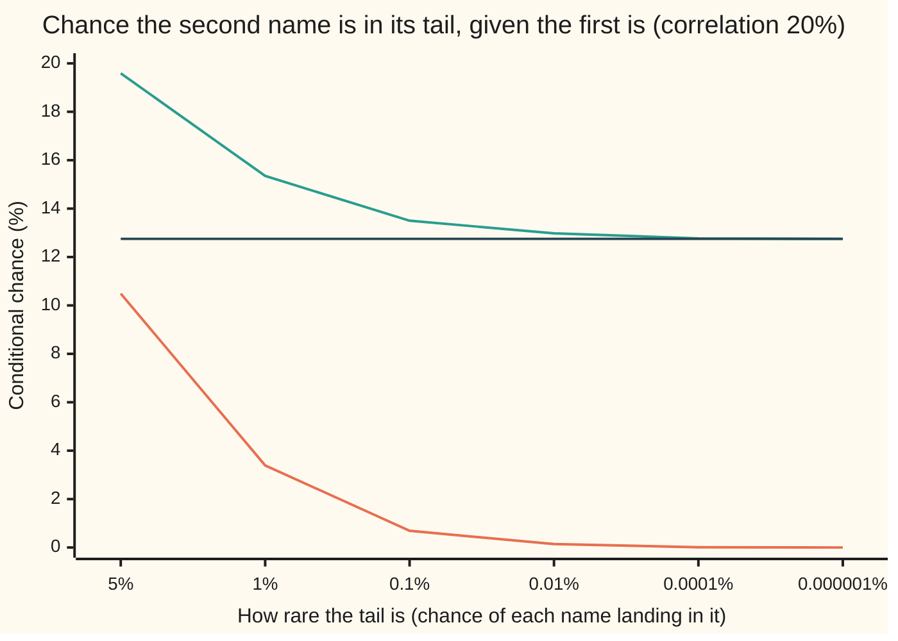

# Tail dependence: the Gaussian copula's calm at the extremes, and the Student-t copula that fails together

[Syllabus](../../../SYLLABUS.md) → [Financial mathematics](../README.md) → [Portfolio Credit - Correlation, Copulas, Indices and Tranches](../README.md#s45) → Tail dependence

---

## General Overview

Two companies borrow from the same bank: a haulage firm and a builders' merchant. Each has a 5% chance of defaulting over the next five years. Both depend on the same economy, and the bank's risk model links their credit scores with a correlation of 20%.

Ask the model one question: the haulage firm has just defaulted, so how likely is it that the merchant defaults too? The standard model, the Gaussian copula, says 10.5%. A second model, the Student-t copula with four degrees of freedom, keeps each firm's 5% and the same 20% correlation number, and says 19.6%.

Now make the question more extreme. Replace "default" with "falls into its worst one-in-a-million outcome". The Gaussian answer sinks towards zero: disasters there almost never arrive together. The t answer stops sinking and settles near 12.7%. That limiting number is the **tail dependence** of the model: the chance one name is in its worst tail, given the other is, as the tail is pushed all the way out. Credit markets call each borrower a "name".

This is the difference that mattered in 2008. The safest slices of a pooled loan portfolio lose money only when many loans fail at once. A model that is calm at the extremes calls those slices safer than they are.

**Tail dependence is the limiting chance that one name is in its extreme tail given the other is; it is exactly zero for a Gaussian copula at any correlation below one, and positive for a t copula, so the t model makes joint disasters far more common at the same correlation number.**

**What kind of fact this is:** a definition, with two theorems about it proved on this card in Why it works (zero for the Gaussian copula, a closed formula for the t copula); the copulas themselves are models, assumptions about how defaults cluster, not laws.

### The picture: the conditional chance as the tail gets deeper



Orange: the Gaussian copula, falling to zero. Green: the t copula with four degrees of freedom, levelling off. Dark flat line: the t copula's tail dependence, 12.75%, the level the green line approaches. Both models agree on each name's own chance at every point; they disagree only about the two together.

---

## The formula

Notation first, in words. A **copula** is the part of a model that says how two uncertain quantities move together, stripped of how each one behaves alone ([The one-factor Gaussian copula](02-one-factor-gaussian-copula.md)).

Each firm gets a hidden credit score; it defaults when its score falls below a cutoff set so that the default chance is $p$. The joint chance that both default is written $J$. The arrow under "lim" means "let the default chance shrink towards zero and see where the ratio settles".

$$\lambda \;=\; \lim_{p \to 0}\; P(\text{name 2 in its worst } p \mid \text{name 1 in its worst } p) \;=\; \lim_{p\to 0} \frac{J(p)}{p}$$

**Read it aloud:** tail dependence is what the chance of "both, given one" settles to as the tail becomes vanishingly rare.

The two models give:

$$\lambda_{\text{Gauss}} = 0 \quad\text{for every } \rho < 1, \qquad \lambda_{t} \;=\; 2\,t_{\nu+1}\!\left(-\sqrt{\frac{(\nu+1)(1-\rho)}{1+\rho}}\right)$$

**Read it aloud:** the Gaussian copula's tail dependence is zero unless the two scores move in lockstep; the t copula's is twice a t-curve area, taken at a point set by the correlation and the degrees of freedom.

| Symbol | Plain meaning | In our example | Push it up and the answer… |
| --- | --- | --- | --- |
| $p$ | each name's own default chance: the size of the tail | 5% | joint chance rises |
| $\rho$ | the correlation parameter linking the two hidden scores. Say "rho". | 20% | tail dependence rises, reaching 1 at $\rho = 1$ |
| $\nu$ | degrees of freedom of the t copula. Say "nu". Small means heavy tails. | 4 | tail dependence falls; the t copula turns Gaussian as $\nu$ grows |
| $G_1$, $G_2$ | the two names' scores in the Gaussian model: bell-curve draws with correlation $\rho$ | | |
| $V$ | one shared chi-square draw with $\nu$ degrees of freedom (a sum of $\nu$ squared bell-curve draws, so never negative); $\sqrt{V/\nu}$ is a common "mood" that stretches or shrinks both scores at once | averages 4 | |
| $Y_1$, $Y_2$ | the scores in the t model: $G_1$ and $G_2$, each divided by the same $\sqrt{V/\nu}$ | | |
| $\Phi$, $t_\nu$ | the bell-curve area to the left of a point, and the t-curve area with $\nu$ degrees of freedom | | |
| $a$, $q$ | the default cutoffs, set so each name's chance is $p$: $a$ on the bell curve, $q$ on the t curve | −1.645 and −2.132 | |
| $M$ | the shared economy factor inside the Gaussian model | | |
| $J$, $J_G$, $J_t$ | the chance that both names default; subscript G for the Gaussian copula, t for the t copula | 0.525% and 0.98% | |
| $\lambda$, $\lambda_t$ | tail dependence (lower tail); $\lambda_t$ for the t copula: the limit of $J/p$. Say "lambda". | 0 and 0.127 | |

The two models built side by side, in one line each:

$$\text{Gaussian: default when } G_i < a = \Phi^{-1}(p), \qquad \text{t: } Y_i = \frac{G_i}{\sqrt{V/\nu}}, \text{ default when } Y_i < q = t_\nu^{-1}(p)$$

$\Phi^{-1}(p)$ is the point with area $p$ to its left; $t_\nu^{-1}(p)$ is the same on the t curve. The cutoffs differ because the t curve has fatter tails; each is chosen so that each firm's own default chance is exactly 5% in both models. Only the "together" changes.

### When it holds

- **A limit, not a finite chance.** $\lambda$ describes vanishingly rare tails. At a real 5% default chance both models give joint defaults; the Gaussian simply gives fewer. Reading 0.127 as "the chance both default" gets 12.7% where the model says 19.6%.
- **One shared mood for both names.** The t copula needs the same $V$ in both denominators. Give each name its own $V$ and the tail dependence is a different number: that is a different model.
- **The correlation is below one.** At $\rho = 1$ the two scores are the same score, and both models give $\lambda = 1$.
- **Continuous scores.** The cutoffs are set on smooth curves, so "the worst $p$" is always a clean tail. With lumpy data, estimating $\lambda$ from the few joint extremes ever observed is unreliable.

---

## Why it works

### Step 0: correlation measures the middle, not the edges

A correlation number is an average over all outcomes, and most outcomes are ordinary. Two models can agree on that average and disagree about the rare corner where both scores are disastrous. Tail dependence looks only at that corner. The whole card is a comparison of how two models fill it.

### Step 1: the Gaussian corner empties

Put both Gaussian scores below a deep cutoff $a$. Then their average is below $a$ too. The average of two bell-curve scores is itself bell-shaped, but with a narrower spread than either score whenever $\rho < 1$: averaging cancels part of each name's own luck. Measured in its own spread units, the average must therefore sit further out than $a$: a factor $\sqrt{2/(1+\rho)}$ further, which exceeds one.

Bell-curve tails fall like $e^{-x^2/2}$. Pushing a cutoff out by a fixed factor above one shrinks the tail chance by a factor that itself goes to zero as $a$ goes deeper. So the joint chance, divided by $p$, goes to zero. The curve in the picture is that squeeze, printed.

<details>
<summary>Detailed proof: the Gaussian limit is zero</summary>

Fix $-1 < \rho < 1$ and a cutoff $a < 0$ with $\Phi(a) = p$. Let $H = (G_1 + G_2)/\sqrt{2(1+\rho)}$. A sum of jointly normal scores is normal; its variance is $2 + 2\rho$, so the sum rescaled is a standard bell-curve draw. If both $G_i \le a$ then $H \le c\,a$ with $c = \sqrt{2/(1+\rho)} > 1$. Hence
$$0 \le \frac{J_G}{p} \le \frac{\Phi(c\,a)}{\Phi(a)}.$$
Write $x = -a$. Integrating the bell curve's tail by parts gives the Mills bounds $\frac{x}{1+x^2}\varphi(x) \le \Phi(-x) \le \frac{\varphi(x)}{x}$ for $x > 0$, where $\varphi(x)$ is the bell curve's height at $x$. So
$$\frac{\Phi(-c\,x)}{\Phi(-x)} \le \frac{1+x^2}{c\,x^2}\, e^{-(c^2-1)x^2/2} \longrightarrow 0 \text{ as } x \to \infty.$$
The ratio is squeezed to zero. At $\rho = -1$ the scores are opposite and never both negative, so the limit is again zero; at $\rho = 1$ they are equal and $J_G = p$, giving one.

</details>

### Step 2: a shared mood keeps the t corner full

The t model divides both scores by the same $\sqrt{V/\nu}$. Most of the time that number is near one and changes little. Occasionally $V$ comes out small, and both scores are stretched outward together. In those draws, a modest bell-curve pair turns into two extreme t scores at once.

The deep corner is fed by these shared bad moods, and their frequency does not fade relative to $p$ as the cutoff deepens: both the single tail and the joint tail are fed by the same small-$V$ draws, so they shrink at the same rate. Their ratio settles at a positive number.

That number comes from one fact about the t pair. Given that name 1's score is some value $Y_1 = y$, name 2's score is again t-shaped, now with $\nu + 1$ degrees of freedom, centred at $\rho y$ and with a spread that grows with $|y|$. Deep in the tail the centre and the spread grow at the same rate, so the chance that name 2 is also below the cutoff stops shrinking. That chance, doubled because either name can be the one found first, is the formula.

<details>
<summary>Detailed proof: the t copula's tail dependence</summary>

The t pair has density proportional to $\left[1 + \frac{y_1^2 - 2\rho y_1 y_2 + y_2^2}{\nu(1-\rho^2)}\right]^{-(\nu+2)/2}$. Completing the square, $y_1^2 - 2\rho y_1 y_2 + y_2^2 = (y_2 - \rho y_1)^2 + (1-\rho^2) y_1^2$, and dividing by name 1's own t density shows that, given $Y_1 = y$,
$$\frac{Y_2 - \rho y}{\sqrt{(\nu + y^2)(1-\rho^2)/(\nu+1)}} \ \text{ has the } t_{\nu+1} \text{ law}.$$
Let $B(q) = P(Y_1 \le q,\, Y_2 \le q)$. Differentiating in the shared cutoff and using the symmetry between the names,
$$B'(q) = 2 f_\nu(q)\; t_{\nu+1}\!\left(\frac{(1-\rho)\,q}{\sqrt{(\nu+q^2)(1-\rho^2)/(\nu+1)}}\right),$$
where $f_\nu(q)$ is the t density at $q$. Both $B(q)$ and $t_\nu(q)$ go to zero as $q \to -\infty$, so by l'Hôpital's rule $\lambda = \lim B(q)/t_\nu(q) = \lim B'(q)/f_\nu(q)$. As $q \to -\infty$, $q/\sqrt{\nu+q^2} \to -1$, and the argument tends to $-\sqrt{(\nu+1)(1-\rho)/(1+\rho)}$. The $t_{\nu+1}$ area there is positive for every finite $\nu$ and every $\rho > -1$, which proves $\lambda_t > 0$. As $\nu$ grows, that argument runs off to minus infinity and $\lambda_t$ falls to zero: the t copula turns into the Gaussian one.

</details>

### Step 3: finite joint chances, computed exactly

The limit is a summary. A bank needs the joint chance at its own $p$. Both models give it as a one-dimensional integral.

Write the correlated pair in polar form: a random direction, spread evenly round the circle, times a random length. For two bell-curve scores the length's tail is $e^{-r^2/2}$; for the t pair, after dividing by the shared mood, it is $(1 + r^2/\nu)^{-\nu/2}$, a much heavier tail. Both names are below the cutoff when the direction points into the bad quarter and the length is long enough. Averaging over directions gives $J_G$ and $J_t$ exactly; that is road one in the code.

<details>
<summary>The angle integral in full</summary>

With $\alpha = \arccos\rho$ and $m(\theta) = \min(-\cos\theta,\, -\cos(\theta-\alpha))$, the scores are $G_1 = R\cos\Theta$ and $G_2 = R\cos(\Theta - \alpha)$ for a uniform angle and a length with $P(R > r) = e^{-r^2/2}$. Both lie below a negative cutoff exactly when $\pi/2 + \alpha < \theta < 3\pi/2$ and $R \ge |{\rm cutoff}|/m(\theta)$. So
$$J_G = \frac{1}{2\pi}\int_{\pi/2+\alpha}^{3\pi/2} e^{-a^2/(2m(\theta)^2)}\,d\theta, \qquad J_t = \frac{1}{2\pi}\int_{\pi/2+\alpha}^{3\pi/2} \left(1 + \frac{q^2}{\nu\, m(\theta)^2}\right)^{-\nu/2} d\theta.$$
The t length is $R\sqrt{\nu/V}$; averaging $e^{-s^2 V/(2\nu)}$ over the chi-square law of $V$ gives $(1 + s^2/\nu)^{-\nu/2}$.

</details>

Road two conditions on the economy instead, as the one-factor card does: given the shared factor $M$, the two names default independently, so $J_G$ is the average over $M$ of the conditional default chance squared. For the t model the same average is taken again over the shared mood $V$. Road three simulates 400,000 pairs with home-made random numbers and counts.

### Step 4: from a pair to a pool

A senior tranche of a loan pool loses money only when a large share of the pool defaults ([Tranches](05-cdo-tranches-in-outline.md)). In a large pool, once the economy and the mood are known, the fraction that defaults is just the conditional default chance. In the Gaussian model that gives Vasicek's curve ([Vasicek's large-pool loss curve](03-vasicek-loss-distribution-and-basel-capital.md)):

$$P(\text{default fraction} > x) = \Phi\!\left(\frac{a - \sqrt{1-\rho}\,\Phi^{-1}(x)}{\sqrt{\rho}}\right).$$

In the t model every name shares the mood, so the cutoff $a$ becomes $q\sqrt{V/\nu}$ and the right side is averaged over $V$. The pair's tail dependence becomes the pool's fat tail: a bad mood pushes the whole pool towards its cutoffs at once.

The double-t copula used on some trading desks is a different construction: it gives the economy factor and each name's own shock separate t tails. It shares the point of this card, heavier joint tails at a given correlation, but not its formula.

---

## Worked numbers, by hand

Two names, each with a 5% five-year default chance, score correlation 20%, t copula with four degrees of freedom.

| Step | Arithmetic | Value |
| --- | --- | --- |
| inside the root | $(4+1)(1-0.20)/(1+0.20) = 5 \times 0.8 / 1.2$ | 3.3333 |
| the t point | $-\sqrt{3.3333}$ | −1.8257 |
| t area, 5 degrees of freedom | $t_5(-1.8257)$ from a t table | 0.06373 |
| **tail dependence, t** | $2 \times 0.06373$ | **0.1275** |
| tail dependence, Gaussian | $\rho < 1$ | **0** |
| Gaussian cutoff | $\Phi^{-1}(0.05)$ | −1.645 |
| t cutoff | $t_4^{-1}(0.05)$ | −2.132 |
| joint default if independent | $0.05 \times 0.05$ | 0.25% |
| joint default, Gaussian | angle integral | 0.525% |
| joint default, t | angle integral | 0.98% |
| both given one | $J/p$: $0.525/5$ and $0.98/5$ | 10.5% and 19.6% |
| default correlation | $(J - p^2)/(p(1-p))$ | 0.058 and 0.154 |

The Gaussian row reproduces the shelf's house pool: joint default 0.525% and default correlation 0.058 at a 5% default chance and 20% asset correlation ([Default correlation](01-default-correlation-and-joint-default.md)). The t copula nearly doubles the joint default at the same correlation number, and nearly triples the default correlation.

```
joint default chance, two names at 5% each, correlation 20% (per cent)
independent      ████████████                              0.25
Gaussian copula  █████████████████████████                 0.52
t copula (ν = 4) ███████████████████████████████████████   0.98
```

Pushed deeper, the gap widens without limit. At a one-in-a-thousand tail the t model's conditional chance is 19.6 times the Gaussian one; at one in a million it is 2,061 times. The Gaussian ratio falls towards zero while the t ratio settles at 0.1275.

**In a large pool** with the same inputs, take a senior layer that loses once a quarter of the loans default: a 15% pool loss at 40% recovery. The Gaussian copula puts that event at 0.99%. The t copula puts it at 4.17%, 4.2 times as likely, with every loan's own default chance still 5%.

### What breaks if you drop a piece

| Mistake | Comes out at | What went wrong |
| --- | --- | --- |
| Using the bell-curve cutoff −1.645 inside the t model | each name's default chance 8.77%, joint 2.00% | The t curve has fatter tails; each name needs the t cutoff −2.132 to keep its 5% |
| Reading the 20% asset correlation as default correlation | 0.20 | Default correlation is 0.058 (Gaussian) or 0.154 (t) |
| Reading $\lambda$ as the chance at 5% | 12.7% | The t model's "both given one" at 5% is 19.6%; $\lambda$ is a limit |
| Assuming any t copula has heavy joint tails | 30 degrees of freedom: $\lambda$ = 0.00008 | Tail dependence fades fast as degrees of freedom grow |

The code prints every entry.

---

## Code, from first principles, and it actually runs

Nothing imported knows the answer. The bell-curve area is a series near the middle and a continued fraction in the tails; the t curves are closed forms plus a Simpson area (Simpson's rule: an area added up from many thin strips under the curve); cutoffs come from bisection (halving an interval until it traps the cutoff); random numbers from a written-out splitmix64 generator.

- **Tail dependence** is reached by three roads: the closed formula, a Simpson area of the t curve, and the finite ratio $J/p$ pushed to a one-in-a-hundred-million tail.
- **The joint chances** are reached by three roads: the angle integral, conditioning on the economy (and the mood), and simulation.
- **The pool's senior tail** is integrated in two orders, over the mood first and over the economy first.
- **One published number** anchors the t integral from outside: Demarta and McNeil's table puts the t joint chance at 2.79 times the Gaussian one at 50% correlation and a 0.5% tail.

### Python

```python
# Tail dependence and the t copula -- the check behind the card.  Standard library
# only, and nothing imported knows the answer: the normal and t curves, the root
# finder, the integrals and the random numbers are all written out below.
from math import sqrt, exp, log, pi, cos, sin, atan, acos
def Phi(x):                                  # normal CDF: series near 0, continued fraction in the tail
    if abs(x) < 3.0:
        term, total, n = x, x, 0
        while abs(term) > 1e-17 * abs(total) + 1e-300:
            n += 1
            term *= x * x / (2 * n + 1)
            total += term
        return 0.5 + total * exp(-0.5 * x * x) / sqrt(2 * pi)
    z = abs(x); f = z                        # Mills ratio by backward continued fraction
    for k in range(200, 0, -1):
        f = z + k / f
    tail = exp(-0.5 * z * z) / sqrt(2 * pi) / f
    return tail if x < 0 else 1.0 - tail
def bisect(F, p, lo, hi):                    # root finder: F increasing, F(root) = p
    for _ in range(200):
        mid = 0.5 * (lo + hi)
        lo, hi = (mid, hi) if F(mid) < p else (lo, mid)
    return 0.5 * (lo + hi)
def t4_cdf(x):                               # Student t, 4 degrees of freedom, closed form
    r = sqrt(4.0 + x * x)
    one_plus_u = 4.0 / (r * (r - x)) if x < 0 else 1.0 + x / r
    return one_plus_u ** 2 * (2.0 - (one_plus_u - 1.0)) / 4.0
def t5_cdf(x):                               # Student t, 5 degrees of freedom, closed form
    th = atan(x / sqrt(5.0))
    return 0.5 + (th + sin(th) * cos(th) * (1.0 + 2.0 / 3.0 * cos(th) ** 2)) / pi
def simpson(f, a, b, n):
    h = (b - a) / n
    s = f(a) + f(b) + sum((4 if i % 2 else 2) * f(a + i * h) for i in range(1, n))
    return s * h / 3.0
def t_cdf_by_area(n, x):                     # any t curve as an area, substituting v = y / sqrt(n + y^2)
    f = lambda v: (1.0 - v * v) ** ((n - 2) / 2)
    return simpson(f, -1.0, x / sqrt(n + x * x), 4000) / simpson(f, -1.0, 1.0, 4000)
def joint_by_angle(cut, rho, student, n=20000):   # road 1: both scores below cut, as a 1-D angle integral
    al = acos(rho)
    def k(th):
        m = min(-cos(th), -cos(th - al))
        if m <= 0.0: return 0.0
        s = cut * cut / (m * m)
        return (1.0 + s / 4.0) ** -2.0 if student else exp(-0.5 * s)
    return simpson(k, pi / 2 + al, 1.5 * pi, n) / (2 * pi)
def phi(m): return exp(-0.5 * m * m) / sqrt(2 * pi)
def joint_by_factor(cut, rho, n=400):        # road 2: condition on the shared economy M
    b = sqrt(1.0 - rho)
    return simpson(lambda m: Phi((cut - sqrt(rho) * m) / b) ** 2 * phi(m), -9.0, 9.0, n)
def joint_t_by_factor(q, rho):               # road 2 for t: also average over the shared scale V = w^2
    return simpson(lambda w: w ** 3 * exp(-w * w / 2) / 2 * joint_by_factor(q * w / 2, rho, 200), 0.0, 12.0, 400)
state = [0x9E3779B97F4A7C15]
def uniform():                               # road 3: splitmix64 random numbers, written out
    state[0] = (state[0] + 0x9E3779B97F4A7C15) & 0xFFFFFFFFFFFFFFFF
    z = state[0]
    z = ((z ^ (z >> 30)) * 0xBF58476D1CE4E5B9) & 0xFFFFFFFFFFFFFFFF
    z = ((z ^ (z >> 27)) * 0x94D049BB133111EB) & 0xFFFFFFFFFFFFFFFF
    return ((z ^ (z >> 31)) >> 11) / 9007199254740992.0 + 1e-18
rho, p = 0.20, 0.05
lam_closed = 2.0 * t5_cdf(-sqrt(5.0 * (1.0 - rho) / (1.0 + rho)))
lam = lambda nu, r=rho: 2.0 * t_cdf_by_area(nu + 1, -sqrt((nu + 1) * (1.0 - r) / (1.0 + r)))
lam_area = lam(4)
a, q = bisect(Phi, p, -40.0, 0.0), bisect(t4_cdf, p, -1e6, 0.0)
jg1, jt1 = joint_by_angle(a, rho, False), joint_by_angle(q, rho, True)
jg2, jt2 = joint_by_factor(a, rho), joint_t_by_factor(q, rho)
draws, hit_g, hit_t = 400000, 0, 0
for _ in range(draws):                       # simulate the pair: two normals, one shared chi-square(4)
    r, th = sqrt(-2.0 * log(uniform())), 2.0 * pi * uniform()
    g1, g2 = r * cos(th), rho * r * cos(th) + sqrt(1 - rho * rho) * r * sin(th)
    s = sqrt(-2.0 * log(uniform() * uniform()) / 4.0)
    hit_g += (g1 < a and g2 < a); hit_t += (g1 / s < q and g2 / s < q)
mc_g, mc_t = hit_g / draws, hit_t / draws
dc = lambda j: (j - p * p) / (p * (1 - p))   # default correlation from a joint chance

print(f"rho {rho:.2f}, degrees of freedom 4, default chance each p = {p:.2f}")
print(f"lambda, Gaussian: 0 for every rho below 1")
print(f"lambda, t4, closed form        {lam_closed:.6f}")
print(f"lambda, t4, by area            {lam_area:.6f}")
arg = sqrt(5.0 * (1.0 - rho) / (1.0 + rho))
print(f"lambda pieces: 5(1-rho)/(1+rho), root, t5 area  {arg * arg:.6f} {arg:.6f} {t5_cdf(-arg):.6f}")
print(f"cutoff, normal  a = Phi^-1(p)  {a:.6f}")
print(f"cutoff, t4      q = t4^-1(p)   {q:.6f}")
print(f"joint, Gaussian, by angle      {jg1:.6f}")
print(f"joint, Gaussian, by factor     {jg2:.6f}")
print(f"joint, Gaussian, simulated     {mc_g:.6f}   ({hit_g} of {draws})")
print(f"joint, t4, by angle            {jt1:.6f}")
print(f"joint, t4, by factor and scale {jt2:.6f}")
print(f"joint, t4, simulated           {mc_t:.6f}   ({hit_t} of {draws})")
print(f"joint if independent, p*p      {p * p:.6f}")
print(f"default correlation, Gaussian  {dc(jg1):.6f}")
print(f"default correlation, t4        {dc(jt1):.6f}")
print(f"both | one, Gaussian, J/p      {jg1 / p:.6f}")
print(f"both | one, t4, J/p            {jt1 / p:.6f}")
print()
print("threshold p    Gaussian J/p   t4 J/p     t4/Gaussian")
cond = {}
for pp in (0.05, 0.01, 1e-3, 1e-4, 1e-6, 1e-8):
    aa, qq = bisect(Phi, pp, -40.0, 0.0), bisect(t4_cdf, pp, -1e6, 0.0)
    g, t = joint_by_angle(aa, rho, False) / pp, joint_by_angle(qq, rho, True) / pp
    cond[pp] = (g, t)
    print(f"{pp:<12.0e}   {g:.6f}       {t:.6f}   {t / g:10.2f}")
print("chart, Gaussian %  " + " ".join(f"{100 * cond[x][0]:.2f}" for x in cond))
print("chart, t4 %        " + " ".join(f"{100 * cond[x][1]:.2f}" for x in cond))
print("chart, t4 limit %  " + " ".join(f"{100 * lam_closed:.2f}" for x in cond))
print()
x_sen = 0.25                                 # senior layer: hit when a quarter of a large pool defaults
c = sqrt(1 - rho) * bisect(Phi, x_sen, -40.0, 40.0)
sen_g = Phi((a - c) / sqrt(rho))                  # Vasicek's curve
sen_t1 = simpson(lambda v: v * exp(-v / 2) / 4 * Phi((q * sqrt(v / 4) - c) / sqrt(rho)), 0.0, 70.0, 2000)
def v_below(m):                              # chance the scale V is small enough, for economy M = m
    z = c + sqrt(rho) * m
    if z >= 0: return 0.0
    w = 4.0 * (z / q) ** 2
    return 1.0 - exp(-w / 2) * (1 + w / 2)
sen_t2 = simpson(lambda m: phi(m) * v_below(m), -9.0, 9.0, 4000)
print(f"senior trigger: default fraction, loss at 40% recovery  {x_sen:.6f} {x_sen * 0.6:.6f}")
print(f"large pool, P(quarter default), Gaussian       {sen_g:.6f}")
print(f"large pool, P(quarter default), t4, over V     {sen_t1:.6f}")
print(f"large pool, P(quarter default), t4, over M     {sen_t2:.6f}")
print(f"large pool, t4 / Gaussian                      {sen_t1 / sen_g:.2f}")
print()
wrong_q = joint_by_angle(a, rho, True)       # t model fed the normal cutoff
print(f"wrong: normal cutoff in the t model, marginal  {t4_cdf(a):.6f}")
print(f"wrong: normal cutoff in the t model, joint     {wrong_q:.6f}")
print(f"wrong: rho read as default correlation         {rho:.6f}")
print(f"wrong: lambda read as the p = 5% chance        {jt1 / p:.6f}")
print(f"wrong: 30 degrees of freedom, lambda           {lam(30):.6f}")
print(f"try: lambda, t4, rho 0 / rho 0.5 / nu 10       {lam(4, 0.0):.6f} {lam(4, 0.5):.6f} {lam(10):.6f}")

assert abs(lam_closed - lam_area) < 1e-9,                    "two roads to lambda"
assert abs(cond[1e-8][1] - lam_closed) < 2e-3,               "deep finite threshold lands on the limit"
assert cond[1e-8][0] < 0.01 < cond[0.05][0],                 "Gaussian conditional chance drains away"
assert abs(jg1 - 0.00525) < 1e-5,                            "the shelf's house number, 0.525%"
assert abs(jg1 - jg2) < 1e-7,                                "Gaussian joint, angle vs factor"
assert abs(jt1 - jt2) < 1e-6,                                "t joint, angle vs factor-and-scale"
assert abs(mc_g - jg1) < 4 * sqrt(jg1 / draws),              "Gaussian simulation within 4 errors"
assert abs(mc_t - jt1) < 4 * sqrt(jt1 / draws),              "t simulation within 4 errors"
assert abs(sen_t1 - sen_t2) < 1e-6,                          "senior tail, two orders of integration"
assert abs(joint_by_angle(bisect(t4_cdf, 0.005, -1e6, 0.0), 0.5, True) / joint_by_angle(bisect(Phi, 0.005, -40.0, 0.0), 0.5, False) - 2.79) < 0.01, "Demarta-McNeil table: 2.79"
print("ALL CHECKS PASS")
```

**Ran 2026-09-28 on macOS, Python 3.14.6, standard library only. All checks passed. Output, pasted from the run:**

```
rho 0.20, degrees of freedom 4, default chance each p = 0.05
lambda, Gaussian: 0 for every rho below 1
lambda, t4, closed form        0.127464
lambda, t4, by area            0.127464
lambda pieces: 5(1-rho)/(1+rho), root, t5 area  3.333333 1.825742 0.063732
cutoff, normal  a = Phi^-1(p)  -1.644854
cutoff, t4      q = t4^-1(p)   -2.131847
joint, Gaussian, by angle      0.005245
joint, Gaussian, by factor     0.005245
joint, Gaussian, simulated     0.005220   (2088 of 400000)
joint, t4, by angle            0.009796
joint, t4, by factor and scale 0.009796
joint, t4, simulated           0.009997   (3999 of 400000)
joint if independent, p*p      0.002500
default correlation, Gaussian  0.057799
default correlation, t4        0.153592
both | one, Gaussian, J/p      0.104909
both | one, t4, J/p            0.195912

threshold p    Gaussian J/p   t4 J/p     t4/Gaussian
5e-02          0.104909       0.195912         1.87
1e-02          0.033892       0.153507         4.53
1e-03          0.006890       0.135033        19.60
1e-04          0.001422       0.129796        91.30
1e-06          0.000062       0.127695      2061.20
1e-08          0.000003       0.127487     46417.46
chart, Gaussian %  10.49 3.39 0.69 0.14 0.01 0.00
chart, t4 %        19.59 15.35 13.50 12.98 12.77 12.75
chart, t4 limit %  12.75 12.75 12.75 12.75 12.75 12.75

senior trigger: default fraction, loss at 40% recovery  0.250000 0.150000
large pool, P(quarter default), Gaussian       0.009929
large pool, P(quarter default), t4, over V     0.041697
large pool, P(quarter default), t4, over M     0.041698
large pool, t4 / Gaussian                      4.20

wrong: normal cutoff in the t model, marginal  0.087673
wrong: normal cutoff in the t model, joint     0.019957
wrong: rho read as default correlation         0.200000
wrong: lambda read as the p = 5% chance        0.195912
wrong: 30 degrees of freedom, lambda           0.000079
try: lambda, t4, rho 0 / rho 0.5 / nu 10       0.075587 0.253170 0.020363
ALL CHECKS PASS
```

### Rust

Same numbers, same labels, built with `rustc --edition 2021 -O`.

```rust
// Tail dependence and the t copula -- the same check as the Python, in Rust.  No
// crates: the normal and t curves, the root finder, the integrals and the random
// numbers are all written out below.
use std::f64::consts::PI;
fn big_phi(x: f64) -> f64 {                      // normal CDF: series near 0, continued fraction in the tail
    if x.abs() < 3.0 {
        let (mut term, mut total, mut n) = (x, x, 0.0);
        while term.abs() > 1e-17 * total.abs() + 1e-300 {
            n += 1.0;
            term *= x * x / (2.0 * n + 1.0);
            total += term;
        }
        return 0.5 + total * (-0.5 * x * x).exp() / (2.0 * PI).sqrt();
    }
    let z = x.abs();
    let mut f = z;                               // Mills ratio by backward continued fraction
    for k in (1..=200).rev() { f = z + k as f64 / f; }
    let tail = (-0.5 * z * z).exp() / (2.0 * PI).sqrt() / f;
    if x < 0.0 { tail } else { 1.0 - tail }
}
fn bisect(f: &dyn Fn(f64) -> f64, p: f64, mut lo: f64, mut hi: f64) -> f64 {
    for _ in 0..200 {                            // root finder: f increasing, f(root) = p
        let mid = 0.5 * (lo + hi);
        if f(mid) < p { lo = mid } else { hi = mid }
    }
    0.5 * (lo + hi)
}
fn t4_cdf(x: f64) -> f64 {                       // Student t, 4 degrees of freedom, closed form
    let r = (4.0 + x * x).sqrt();
    let opu = if x < 0.0 { 4.0 / (r * (r - x)) } else { 1.0 + x / r };
    opu.powi(2) * (2.0 - (opu - 1.0)) / 4.0
}
fn t5_cdf(x: f64) -> f64 {                       // Student t, 5 degrees of freedom, closed form
    let th = (x / 5f64.sqrt()).atan();
    0.5 + (th + th.sin() * th.cos() * (1.0 + 2.0 / 3.0 * th.cos().powi(2))) / PI
}
fn simpson(f: &dyn Fn(f64) -> f64, a: f64, b: f64, n: usize) -> f64 {
    let h = (b - a) / n as f64;
    let mut s = 0.0;
    for i in 1..n { s += (if i % 2 == 1 { 4.0 } else { 2.0 }) * f(a + i as f64 * h); }
    (f(a) + f(b) + s) * h / 3.0
}
fn t_cdf_by_area(n: f64, x: f64) -> f64 {        // any t curve as an area, substituting v = y / sqrt(n + y^2)
    let f = |v: f64| (1.0 - v * v).powf((n - 2.0) / 2.0);
    simpson(&f, -1.0, x / (n + x * x).sqrt(), 4000) / simpson(&f, -1.0, 1.0, 4000)
}
fn joint_by_angle(cut: f64, rho: f64, student: bool) -> f64 {   // road 1: a 1-D angle integral
    let al = rho.acos();
    let k = |th: f64| {
        let m = (-th.cos()).min(-(th - al).cos());
        if m <= 0.0 { return 0.0; }
        let s = cut * cut / (m * m);
        if student { (1.0 + s / 4.0).powf(-2.0) } else { (-0.5 * s).exp() }
    };
    simpson(&k, PI / 2.0 + al, 1.5 * PI, 20000) / (2.0 * PI)
}
fn phi(m: f64) -> f64 { (-0.5 * m * m).exp() / (2.0 * PI).sqrt() }
fn joint_by_factor(cut: f64, rho: f64, n: usize) -> f64 {       // road 2: condition on the economy M
    let b = (1.0 - rho).sqrt();
    simpson(&|m: f64| big_phi((cut - rho.sqrt() * m) / b).powi(2) * phi(m), -9.0, 9.0, n)
}
fn joint_t_by_factor(q: f64, rho: f64) -> f64 {  // road 2 for t: also average over the scale V = w^2
    simpson(&|w: f64| w.powi(3) * (-w * w / 2.0).exp() / 2.0 * joint_by_factor(q * w / 2.0, rho, 200), 0.0, 12.0, 400)
}
struct Rng(u64);
impl Rng {                                       // road 3: splitmix64 random numbers, written out
    fn uniform(&mut self) -> f64 {
        self.0 = self.0.wrapping_add(0x9E3779B97F4A7C15);
        let mut z = self.0;
        z = (z ^ (z >> 30)).wrapping_mul(0xBF58476D1CE4E5B9);
        z = (z ^ (z >> 27)).wrapping_mul(0x94D049BB133111EB);
        ((z ^ (z >> 31)) >> 11) as f64 / 9007199254740992.0 + 1e-18
    }
}
fn main() {
    let (rho, p) = (0.20_f64, 0.05_f64);
    let lam_closed = 2.0 * t5_cdf(-(5.0 * (1.0 - rho) / (1.0 + rho)).sqrt());
    let lam = |nu: f64, r: f64| 2.0 * t_cdf_by_area(nu + 1.0, -((nu + 1.0) * (1.0 - r) / (1.0 + r)).sqrt());
    let lam_area = lam(4.0, rho);
    let (a, q) = (bisect(&big_phi, p, -40.0, 0.0), bisect(&t4_cdf, p, -1e6, 0.0));
    let (jg1, jt1) = (joint_by_angle(a, rho, false), joint_by_angle(q, rho, true));
    let (jg2, jt2) = (joint_by_factor(a, rho, 400), joint_t_by_factor(q, rho));
    let (draws, mut hit_g, mut hit_t) = (400000usize, 0usize, 0usize);
    let mut rng = Rng(0x9E3779B97F4A7C15);
    for _ in 0..draws {                          // simulate the pair: two normals, one shared chi-square(4)
        let r = (-2.0 * rng.uniform().ln()).sqrt();
        let th = 2.0 * PI * rng.uniform();
        let (g1, g2) = (r * th.cos(), rho * r * th.cos() + (1.0 - rho * rho).sqrt() * r * th.sin());
        let s = (-2.0 * (rng.uniform() * rng.uniform()).ln() / 4.0).sqrt();
        if g1 < a && g2 < a { hit_g += 1 }
        if g1 / s < q && g2 / s < q { hit_t += 1 }
    }
    let (mc_g, mc_t) = (hit_g as f64 / draws as f64, hit_t as f64 / draws as f64);
    let dc = |j: f64| (j - p * p) / (p * (1.0 - p));   // default correlation from a joint chance
    println!("rho {:.2}, degrees of freedom 4, default chance each p = {:.2}", rho, p);
    println!("lambda, Gaussian: 0 for every rho below 1");
    println!("lambda, t4, closed form        {:.6}", lam_closed);
    println!("lambda, t4, by area            {:.6}", lam_area);
    let arg = (5.0 * (1.0 - rho) / (1.0 + rho)).sqrt();
    println!("lambda pieces: 5(1-rho)/(1+rho), root, t5 area  {:.6} {:.6} {:.6}", arg * arg, arg, t5_cdf(-arg));
    println!("cutoff, normal  a = Phi^-1(p)  {:.6}", a);
    println!("cutoff, t4      q = t4^-1(p)   {:.6}", q);
    println!("joint, Gaussian, by angle      {:.6}", jg1);
    println!("joint, Gaussian, by factor     {:.6}", jg2);
    println!("joint, Gaussian, simulated     {:.6}   ({} of {})", mc_g, hit_g, draws);
    println!("joint, t4, by angle            {:.6}", jt1);
    println!("joint, t4, by factor and scale {:.6}", jt2);
    println!("joint, t4, simulated           {:.6}   ({} of {})", mc_t, hit_t, draws);
    println!("joint if independent, p*p      {:.6}", p * p);
    println!("default correlation, Gaussian  {:.6}", dc(jg1));
    println!("default correlation, t4        {:.6}", dc(jt1));
    println!("both | one, Gaussian, J/p      {:.6}", jg1 / p);
    println!("both | one, t4, J/p            {:.6}", jt1 / p);
    println!();
    println!("threshold p    Gaussian J/p   t4 J/p     t4/Gaussian");
    let (labels, pps) = (["5e-02", "1e-02", "1e-03", "1e-04", "1e-06", "1e-08"], [0.05, 0.01, 1e-3, 1e-4, 1e-6, 1e-8]);
    let mut cond: Vec<(f64, f64)> = Vec::new();
    for (lab, &pp) in labels.iter().zip(pps.iter()) {
        let (aa, qq) = (bisect(&big_phi, pp, -40.0, 0.0), bisect(&t4_cdf, pp, -1e6, 0.0));
        let (g, t) = (joint_by_angle(aa, rho, false) / pp, joint_by_angle(qq, rho, true) / pp);
        cond.push((g, t));
        println!("{:<12}   {:.6}       {:.6}   {:10.2}", lab, g, t, t / g);
    }
    let row = |k: usize| cond.iter().map(|c| format!("{:.2}", 100.0 * if k == 0 { c.0 } else { c.1 })).collect::<Vec<_>>().join(" ");
    println!("chart, Gaussian %  {}", row(0));
    println!("chart, t4 %        {}", row(1));
    println!("chart, t4 limit %  {}", cond.iter().map(|_| format!("{:.2}", 100.0 * lam_closed)).collect::<Vec<_>>().join(" "));
    println!();
    let c = (1.0 - rho).sqrt() * bisect(&big_phi, 0.25, -40.0, 40.0);   // a quarter of a large pool defaults
    let sen_g = big_phi((a - c) / rho.sqrt());                           // Vasicek's curve
    let sen_t1 = simpson(&|v: f64| v * (-v / 2.0).exp() / 4.0 * big_phi((q * (v / 4.0).sqrt() - c) / rho.sqrt()), 0.0, 70.0, 2000);
    let v_below = |m: f64| {                     // chance the scale V is small enough, for economy M = m
        let z = c + rho.sqrt() * m;
        if z >= 0.0 { return 0.0; }
        let w = 4.0 * (z / q).powi(2);
        1.0 - (-w / 2.0).exp() * (1.0 + w / 2.0)
    };
    let sen_t2 = simpson(&|m: f64| phi(m) * v_below(m), -9.0, 9.0, 4000);
    println!("senior trigger: default fraction, loss at 40% recovery  {:.6} {:.6}", 0.25, 0.25 * 0.6);
    println!("large pool, P(quarter default), Gaussian       {:.6}", sen_g);
    println!("large pool, P(quarter default), t4, over V     {:.6}", sen_t1);
    println!("large pool, P(quarter default), t4, over M     {:.6}", sen_t2);
    println!("large pool, t4 / Gaussian                      {:.2}", sen_t1 / sen_g);
    println!();
    let wrong_q = joint_by_angle(a, rho, true);  // t model fed the normal cutoff
    println!("wrong: normal cutoff in the t model, marginal  {:.6}", t4_cdf(a));
    println!("wrong: normal cutoff in the t model, joint     {:.6}", wrong_q);
    println!("wrong: rho read as default correlation         {:.6}", rho);
    println!("wrong: lambda read as the p = 5% chance        {:.6}", jt1 / p);
    println!("wrong: 30 degrees of freedom, lambda           {:.6}", lam(30.0, rho));
    println!("try: lambda, t4, rho 0 / rho 0.5 / nu 10       {:.6} {:.6} {:.6}", lam(4.0, 0.0), lam(4.0, 0.5), lam(10.0, rho));
    assert!((lam_closed - lam_area).abs() < 1e-9, "two roads to lambda");
    assert!((cond[5].1 - lam_closed).abs() < 2e-3, "deep finite threshold lands on the limit");
    assert!(cond[5].0 < 0.01 && 0.01 < cond[0].0, "Gaussian conditional chance drains away");
    assert!((jg1 - 0.00525).abs() < 1e-5, "the shelf's house number, 0.525%");
    assert!((jg1 - jg2).abs() < 1e-7, "Gaussian joint, angle vs factor");
    assert!((jt1 - jt2).abs() < 1e-6, "t joint, angle vs factor-and-scale");
    assert!((mc_g - jg1).abs() < 4.0 * (jg1 / draws as f64).sqrt(), "Gaussian simulation within 4 errors");
    assert!((mc_t - jt1).abs() < 4.0 * (jt1 / draws as f64).sqrt(), "t simulation within 4 errors");
    assert!((sen_t1 - sen_t2).abs() < 1e-6, "senior tail, two orders of integration");
    assert!((joint_by_angle(bisect(&t4_cdf, 0.005, -1e6, 0.0), 0.5, true) / joint_by_angle(bisect(&big_phi, 0.005, -40.0, 0.0), 0.5, false) - 2.79).abs() < 0.01, "Demarta-McNeil table: 2.79");
    println!("ALL CHECKS PASS");
}
```

**Ran 2026-09-28 on macOS, rustc 1.98.1, no crates. All checks passed. Output, pasted from the run:**

```
rho 0.20, degrees of freedom 4, default chance each p = 0.05
lambda, Gaussian: 0 for every rho below 1
lambda, t4, closed form        0.127464
lambda, t4, by area            0.127464
lambda pieces: 5(1-rho)/(1+rho), root, t5 area  3.333333 1.825742 0.063732
cutoff, normal  a = Phi^-1(p)  -1.644854
cutoff, t4      q = t4^-1(p)   -2.131847
joint, Gaussian, by angle      0.005245
joint, Gaussian, by factor     0.005245
joint, Gaussian, simulated     0.005220   (2088 of 400000)
joint, t4, by angle            0.009796
joint, t4, by factor and scale 0.009796
joint, t4, simulated           0.009997   (3999 of 400000)
joint if independent, p*p      0.002500
default correlation, Gaussian  0.057799
default correlation, t4        0.153592
both | one, Gaussian, J/p      0.104909
both | one, t4, J/p            0.195912

threshold p    Gaussian J/p   t4 J/p     t4/Gaussian
5e-02          0.104909       0.195912         1.87
1e-02          0.033892       0.153507         4.53
1e-03          0.006890       0.135033        19.60
1e-04          0.001422       0.129796        91.30
1e-06          0.000062       0.127695      2061.20
1e-08          0.000003       0.127487     46417.46
chart, Gaussian %  10.49 3.39 0.69 0.14 0.01 0.00
chart, t4 %        19.59 15.35 13.50 12.98 12.77 12.75
chart, t4 limit %  12.75 12.75 12.75 12.75 12.75 12.75

senior trigger: default fraction, loss at 40% recovery  0.250000 0.150000
large pool, P(quarter default), Gaussian       0.009929
large pool, P(quarter default), t4, over V     0.041697
large pool, P(quarter default), t4, over M     0.041698
large pool, t4 / Gaussian                      4.20

wrong: normal cutoff in the t model, marginal  0.087673
wrong: normal cutoff in the t model, joint     0.019957
wrong: rho read as default correlation         0.200000
wrong: lambda read as the p = 5% chance        0.195912
wrong: 30 degrees of freedom, lambda           0.000079
try: lambda, t4, rho 0 / rho 0.5 / nu 10       0.075587 0.253170 0.020363
ALL CHECKS PASS
```

The two outputs match line for line, including the simulation counts, since both languages run the same generator.

### Lean

Lean proves the Gaussian and t tail-dependence limits, and the fade of $\lambda_t$ as $\nu$ grows, for every allowed $\rho$ and $\nu$.

- Suppose the correlation $\rho$ is at least $-1$ and below one. Then the Gaussian chance of "both, given one" tends to zero as the cutoff $a$ goes to minus infinity.
- Suppose $-1 < \rho < 1$, $\nu$ is at least one, and both scores share one mood $V$. Then the t chance of "both, given one" tends to $\lambda_t$ as the cutoff $q$ goes to minus infinity. That limit is positive.
- Take $-1 < \rho < 1$. Then $\lambda_t$ falls to zero as $\nu$ grows.
- The number inside the root is exactly $10/3$ at four degrees of freedom and 20% correlation.
- The joint default if independent is exactly $0.05 \times 0.05 = 0.0025$, the card's 0.25%.
- The completed square in the t pair's density, from the detailed proof of Step 2, holds for every pair of scores.

The cutoffs, the finite joint chances, the pool's senior tail and every simulated number are left to the Python and Rust checks.

```lean
-- Tail dependence: the Gaussian copula's chance of "both in the tail, given one" falls to zero as the tail deepens for every correlation below one, while the Student-t copula's settles at the positive number 2 t_{ν+1}(-√((ν+1)(1-ρ)/(1+ρ))), which itself falls to zero as the degrees of freedom grow.
import Mathlib.Probability.Distributions.Gaussian.Real
import Mathlib.Probability.Distributions.Gamma
import Mathlib.Probability.HasLaw
import Mathlib.Probability.Independence.Basic
import Mathlib.Analysis.SpecialFunctions.Gamma.Basic
import Mathlib.Analysis.SpecialFunctions.Pow.Real
import Mathlib.Analysis.SpecialFunctions.Sqrt
import Mathlib.Tactic.NormNum
import Mathlib.MeasureTheory.Integral.Gamma
import Mathlib.Analysis.SpecialFunctions.ImproperIntegrals
import Mathlib.Analysis.SpecialFunctions.Gamma.BohrMollerup
import Mathlib.Probability.Moments.Basic
import Mathlib.Probability.Moments.Covariance
import Mathlib.Probability.Distributions.Gaussian.HasGaussianLaw.Independence

open Real MeasureTheory ProbabilityTheory Set Filter Topology

/-- The Student-t density with `n` degrees of freedom:
`f_n(x) = Γ((n+1)/2) / (√(nπ) Γ(n/2)) · (1 + x²/n)^(-(n+1)/2)`. -/
noncomputable def studentTDensity (n : ℕ) (x : ℝ) : ℝ :=
  Real.Gamma (((n : ℝ) + 1) / 2) / (√((n : ℝ) * π) * Real.Gamma ((n : ℝ) / 2)) *
    (1 + x ^ 2 / n) ^ (-(((n : ℝ) + 1) / 2))

/-- The card's `t_n(x)`: the t-curve area to the left of `x`, with `n` degrees of freedom. -/
noncomputable def studentTCDF (n : ℕ) (x : ℝ) : ℝ :=
  ∫ y in Iic x, studentTDensity n y

/-- The card's closed form for the t copula's tail dependence:
`λ_t = 2 t_{ν+1}(-√((ν+1)(1-ρ)/(1+ρ)))`. -/
noncomputable def tTailDependence (ν : ℕ) (ρ : ℝ) : ℝ :=
  2 * studentTCDF (ν + 1) (-√(((ν : ℝ) + 1) * (1 - ρ) / (1 + ρ)))

lemma tdc_const_le (n : ℕ) (hn : 1 ≤ n) :
    Real.Gamma (((n : ℝ) + 1) / 2) / (√((n : ℝ) * π) * Real.Gamma ((n : ℝ) / 2)) ≤
      1 / √(2 * π) := by
  have hn' : (1 : ℝ) ≤ n := by exact_mod_cast hn
  have hs : (0 : ℝ) < n / 2 := by positivity
  have hG := Real.Gamma_pos_of_pos hs
  have hlc := Real.Gamma_mul_add_mul_le_rpow_Gamma_mul_rpow_Gamma hs (by linarith : (0:ℝ) < n / 2 + 1)
    (by norm_num : (0:ℝ) < 1/2) (by norm_num : (0:ℝ) < 1/2) (by norm_num)
  rw [Real.Gamma_add_one hs.ne', Real.mul_rpow hs.le hG.le, mul_comm ((n/2 : ℝ) ^ (1/2 : ℝ)),
    ← mul_assoc, ← Real.rpow_add hG, show (1/2 : ℝ) + 1/2 = 1 by norm_num, Real.rpow_one] at hlc
  have e1 : (1/2 : ℝ) * (n/2) + 1/2 * (n/2 + 1) = ((n:ℝ) + 1) / 2 := by ring
  rw [e1] at hlc
  have hsq : (n/2 : ℝ) ^ (1/2 : ℝ) = √(n/2) := by rw [Real.sqrt_eq_rpow]
  rw [hsq] at hlc
  have hpos : 0 < √((n : ℝ) * π) * Real.Gamma ((n : ℝ) / 2) := by positivity
  rw [div_le_iff₀ hpos]
  calc Real.Gamma (((n : ℝ) + 1) / 2) ≤ Real.Gamma (n/2) * √(n/2) := by linarith
    _ = 1 / √(2 * π) * (√((n : ℝ) * π) * Real.Gamma ((n : ℝ) / 2)) := by
      have h2 : √((n:ℝ) * π) = √(n/2) * √(2 * π) := by
        rw [← Real.sqrt_mul (by positivity)]; congr 1; ring
      rw [h2]
      have : 0 < √(2 * π) := by positivity
      field_simp

#print axioms tdc_const_le

lemma tdc_pow_le (n : ℕ) (hn : 1 ≤ n) (y : ℝ) :
    (1 + y ^ 2 / n) ^ (-(((n : ℝ) + 1) / 2)) ≤ 2 * (1 + y ^ 2)⁻¹ := by
  have hn' : (1 : ℝ) ≤ n := by exact_mod_cast hn
  have hb := one_add_mul_self_le_rpow_one_add (s := y ^ 2 / n) (by
    have : 0 ≤ y ^ 2 / n := by positivity
    linarith) (p := ((n : ℝ) + 1) / 2) (by linarith)
  have h1 : (1 + y ^ 2) / 2 ≤ 1 + ((n : ℝ) + 1) / 2 * (y ^ 2 / n) := by
    have : ((n : ℝ) + 1) / 2 * (y ^ 2 / n) = y ^ 2 / 2 + y ^ 2 / (2 * n) := by
      field_simp
    rw [this]
    have : 0 ≤ y ^ 2 / (2 * n) := by positivity
    nlinarith [sq_nonneg y]
  rw [Real.rpow_neg (by positivity)]
  have hpos : 0 < (1 + y ^ 2) / 2 := by positivity
  calc ((1 + y ^ 2 / ↑n) ^ (((n : ℝ) + 1) / 2))⁻¹ ≤ ((1 + y ^ 2) / 2)⁻¹ :=
        inv_anti₀ hpos (h1.trans hb)
    _ = 2 * (1 + y ^ 2)⁻¹ := by field_simp

#print axioms tdc_pow_le

lemma tdc_density_nonneg (n : ℕ) (y : ℝ) : 0 ≤ studentTDensity n y := by
  unfold studentTDensity
  have : 0 ≤ 1 + y ^ 2 / n := by positivity
  apply mul_nonneg
  · apply div_nonneg
    · exact Real.Gamma_nonneg_of_nonneg (by positivity)
    · exact mul_nonneg (Real.sqrt_nonneg _) (Real.Gamma_nonneg_of_nonneg (by positivity))
  · exact Real.rpow_nonneg this _

#print axioms tdc_density_nonneg

lemma tdc_density_pos (n : ℕ) (hn : 1 ≤ n) (y : ℝ) : 0 < studentTDensity n y := by
  have hn' : (1 : ℝ) ≤ n := by exact_mod_cast hn
  unfold studentTDensity
  have : 0 < 1 + y ^ 2 / n := by positivity
  apply mul_pos
  · apply div_pos
    · exact Real.Gamma_pos_of_pos (by positivity)
    · exact mul_pos (Real.sqrt_pos.2 (by positivity)) (Real.Gamma_pos_of_pos (by positivity))
  · exact Real.rpow_pos_of_pos this _

#print axioms tdc_density_pos

lemma tdc_density_le (n : ℕ) (hn : 1 ≤ n) (y : ℝ) : studentTDensity n y ≤ (1 + y ^ 2)⁻¹ := by
  unfold studentTDensity
  have h1 := tdc_const_le n hn
  have h2 := tdc_pow_le n hn y
  have h0 : 0 ≤ (1 + y ^ 2 / n) ^ (-(((n : ℝ) + 1) / 2)) := Real.rpow_nonneg (by positivity) _
  have h3 : 1 / √(2 * π) * 2 ≤ 1 := by
    have hs : 2 ≤ √(2 * π) := by
      rw [Real.le_sqrt (by norm_num) (by positivity)]; nlinarith [Real.two_le_pi]
    have : 0 < √(2 * π) := by positivity
    rw [div_mul_eq_mul_div, one_mul, div_le_one this]; exact hs
  have hi : 0 < (1 + y ^ 2)⁻¹ := by positivity
  calc _ ≤ 1 / √(2 * π) * (2 * (1 + y ^ 2)⁻¹) := by
        apply mul_le_mul h1 h2 h0 (by positivity)
    _ = (1 / √(2 * π) * 2) * (1 + y ^ 2)⁻¹ := by ring
    _ ≤ 1 * (1 + y ^ 2)⁻¹ := by gcongr
    _ = _ := one_mul _

#print axioms tdc_density_le

lemma tdc_continuous (n : ℕ) (hn : 1 ≤ n) : Continuous (studentTDensity n) := by
  have hn' : (1 : ℝ) ≤ n := by exact_mod_cast hn
  unfold studentTDensity
  apply Continuous.mul continuous_const
  apply Continuous.rpow_const (by fun_prop)
  intro x; left; positivity

#print axioms tdc_continuous

lemma tdc_integrable (n : ℕ) (hn : 1 ≤ n) : Integrable (studentTDensity n) := by
  refine integrable_inv_one_add_sq.mono' (tdc_continuous n hn).aestronglyMeasurable ?_
  refine Filter.Eventually.of_forall fun y => ?_
  rw [Real.norm_of_nonneg (tdc_density_nonneg n y)]
  exact tdc_density_le n hn y

#print axioms tdc_integrable

lemma tdc_cdf_le (n : ℕ) (hn : 1 ≤ n) (x : ℝ) : studentTCDF n x ≤ arctan x + π / 2 := by
  unfold studentTCDF
  rw [← integral_Iic_inv_one_add_sq]
  apply setIntegral_mono (tdc_integrable n hn).integrableOn integrable_inv_one_add_sq.integrableOn
  exact tdc_density_le n hn

#print axioms tdc_cdf_le

lemma tdc_cdf_nonneg (n : ℕ) (x : ℝ) : 0 ≤ studentTCDF n x :=
  setIntegral_nonneg measurableSet_Iic fun y _ => tdc_density_nonneg n y

#print axioms tdc_cdf_nonneg

lemma tdc_cdf_pos (n : ℕ) (hn : 1 ≤ n) (x : ℝ) : 0 < studentTCDF n x := by
  unfold studentTCDF
  rw [setIntegral_pos_iff_support_of_nonneg_ae
    (Filter.Eventually.of_forall fun y => tdc_density_nonneg n y) (tdc_integrable n hn).integrableOn]
  have : Function.support (studentTDensity n) = univ := by
    ext y; simp [(tdc_density_pos n hn y).ne']
  rw [this, univ_inter, Real.volume_Iic]; exact ENNReal.zero_lt_top

#print axioms tdc_cdf_pos

lemma tdc_Phi_le_exp (x : ℝ) (hx : x ≤ 0) :
    (gaussianReal 0 1).real (Iic x) ≤ exp (-(x ^ 2 / 2)) := by
  have h := measure_le_le_exp_mul_mgf (μ := gaussianReal 0 1) (X := id) (t := x) x hx
    (integrable_exp_mul_gaussianReal x)
  rw [mgf_id_gaussianReal] at h
  simp only [id] at h
  rw [show {ω : ℝ | ω ≤ x} = Iic x from rfl, ← Real.exp_add] at h
  convert h using 2
  push_cast; ring

#print axioms tdc_Phi_le_exp

lemma tdc_Phi_ge (a : ℝ) (ha : a ≤ 0) :
    (√(2 * π))⁻¹ * exp (-((a - 1) ^ 2 / 2)) ≤ (gaussianReal 0 1).real (Iic a) := by
  have h1 : (gaussianReal 0 1).real (Icc (a - 1) a) ≤ (gaussianReal 0 1).real (Iic a) :=
    measureReal_mono Icc_subset_Iic_self
  refine le_trans ?_ h1
  rw [measureReal_def, gaussianReal_apply_eq_integral _ one_ne_zero,
    ENNReal.toReal_ofReal (setIntegral_nonneg measurableSet_Icc
      (fun x _ => gaussianPDFReal_nonneg _ _ x))]
  have hc : ∫ x in Icc (a - 1) a, (√(2 * π))⁻¹ * exp (-((a - 1) ^ 2 / 2)) =
      (√(2 * π))⁻¹ * exp (-((a - 1) ^ 2 / 2)) := by
    rw [setIntegral_const]; simp
  rw [← hc]
  apply setIntegral_mono_on (continuous_const.integrableOn_Icc) (integrable_gaussianPDFReal _ _).integrableOn measurableSet_Icc
  intro x hx
  rw [gaussianPDFReal_def]
  simp only [NNReal.coe_one, mul_one, sub_zero]
  gcongr
  nlinarith [hx.1, hx.2]

#print axioms tdc_Phi_ge

lemma tdc_Phi_pos (a : ℝ) (ha : a ≤ 0) : 0 < (gaussianReal 0 1).real (Iic a) :=
  lt_of_lt_of_le (by positivity) (tdc_Phi_ge a ha)

#print axioms tdc_Phi_pos

lemma tdc_Phi_tendsto : Tendsto (fun a => (gaussianReal 0 1).real (Iic a)) atBot (𝓝 0) := by
  have := tendsto_cdf_atBot (μ := gaussianReal 0 1)
  refine this.congr fun a => ?_
  rw [cdf_eq_real]

#print axioms tdc_Phi_tendsto

lemma tdc_Phi_ratio (c : ℝ) (hc : 1 < c) :
    Tendsto (fun a => (gaussianReal 0 1).real (Iic (c * a)) / (gaussianReal 0 1).real (Iic a))
      atBot (𝓝 0) := by
  -- upper bound by √(2π) exp(-(c²-1)a²/2 - a + 1/2)
  have key : Tendsto (fun a : ℝ => √(2 * π) * exp (-(c ^ 2 * a ^ 2 / 2) + (a - 1) ^ 2 / 2))
      atBot (𝓝 0) := by
    have he : Tendsto (fun a : ℝ => -(c ^ 2 * a ^ 2 / 2) + (a - 1) ^ 2 / 2) atBot atBot := by
      have h1 : Tendsto (fun a : ℝ => -a) atBot atTop := tendsto_neg_atBot_atTop
      have h2 : Tendsto (fun a : ℝ => (c ^ 2 - 1) / 2 * (-a) + -1) atBot atTop := by
        apply tendsto_atTop_add_const_right
        exact Tendsto.const_mul_atTop (by nlinarith) h1
      have h3 := h1.atTop_mul_atTop₀ h2
      have h4 := (tendsto_neg_atTop_atBot.comp h3)
      refine (tendsto_atBot_add_const_right _ (1/2) h4).congr fun a => ?_
      simp only [Function.comp]; ring
    have := (Real.tendsto_exp_atBot.comp he).const_mul (√(2 * π))
    simpa using this
  apply tendsto_of_tendsto_of_tendsto_of_le_of_le' tendsto_const_nhds key
  · filter_upwards with a
    exact div_nonneg measureReal_nonneg measureReal_nonneg
  · filter_upwards [eventually_le_atBot (0 : ℝ)] with a ha
    have hca : c * a ≤ 0 := mul_nonpos_of_nonneg_of_nonpos (by linarith) ha
    have hP := tdc_Phi_pos a ha
    rw [div_le_iff₀ hP]
    calc (gaussianReal 0 1).real (Iic (c * a)) ≤ exp (-((c * a) ^ 2 / 2)) := tdc_Phi_le_exp _ hca
      _ = √(2 * π) * exp (-(c ^ 2 * a ^ 2 / 2) + (a - 1) ^ 2 / 2) *
            ((√(2 * π))⁻¹ * exp (-((a - 1) ^ 2 / 2))) := by
          have : 0 < √(2 * π) := by positivity
          rw [show √(2 * π) * exp (-(c ^ 2 * a ^ 2 / 2) + (a - 1) ^ 2 / 2) *
            ((√(2 * π))⁻¹ * exp (-((a - 1) ^ 2 / 2))) =
            (√(2 * π) * (√(2 * π))⁻¹) * (exp (-(c ^ 2 * a ^ 2 / 2) + (a - 1) ^ 2 / 2) *
              exp (-((a - 1) ^ 2 / 2))) by ring, ← Real.exp_add, mul_inv_cancel₀ this.ne']
          ring_nf
      _ ≤ _ := by gcongr; exact tdc_Phi_ge a ha

#print axioms tdc_Phi_ratio

lemma tdc_pair_law {Ω : Type*} [MeasurableSpace Ω] {P : Measure Ω} {X Y : Ω → ℝ}
    (hX : HasLaw X (gaussianReal 0 1) P) (hY : HasLaw Y (gaussianReal 0 1) P)
    (hind : IndepFun X Y P) :
    HasLaw (fun ω => (X ω, Y ω)) ((gaussianReal 0 1).prod (gaussianReal 0 1)) P := by
  have := hX.isProbabilityMeasure
  refine ⟨hX.aemeasurable.prodMk hY.aemeasurable, ?_⟩
  rw [(indepFun_iff_map_prod_eq_prod_map_map hX.aemeasurable hY.aemeasurable).1 hind,
    hX.map_eq, hY.map_eq]

#print axioms tdc_pair_law

lemma tdc_lin_law {Ω : Type*} [MeasurableSpace Ω] {P : Measure Ω} {X Y : Ω → ℝ}
    (hX : HasLaw X (gaussianReal 0 1) P) (hY : HasLaw Y (gaussianReal 0 1) P)
    (hind : IndepFun X Y P) (α β : ℝ) (hαβ : α ^ 2 + β ^ 2 = 1) :
    HasLaw (fun ω => α * X ω + β * Y ω) (gaussianReal 0 1) P := by
  have hα := gaussianReal_const_mul hX α
  have hβ := gaussianReal_const_mul hY β
  have hi : IndepFun (fun ω => α * X ω) (fun ω => β * Y ω) P :=
    hind.comp (measurable_const_mul α) (measurable_const_mul β)
  have h := gaussianReal_add_gaussianReal_of_indepFun hi hα hβ
  refine ⟨by fun_prop, ?_⟩
  have e : (fun ω => α * X ω + β * Y ω) = (fun ω => α * X ω) + (fun ω => β * Y ω) := rfl
  rw [e, h]
  congr 1
  · simp
  · ext; simp [hαβ]

#print axioms tdc_lin_law

lemma tdc_rot_law {Ω : Type*} [MeasurableSpace Ω] {P : Measure Ω} {X Y : Ω → ℝ}
    (hX : HasLaw X (gaussianReal 0 1) P) (hY : HasLaw Y (gaussianReal 0 1) P)
    (hind : IndepFun X Y P) (ρ s : ℝ) (hρs : ρ ^ 2 + s ^ 2 = 1) :
    HasLaw (fun ω => (ρ * X ω + s * Y ω, s * X ω + -ρ * Y ω))
      ((gaussianReal 0 1).prod (gaussianReal 0 1)) P := by
  have := hX.isProbabilityMeasure
  have hA := tdc_lin_law hX hY hind ρ s hρs
  have hB := tdc_lin_law hX hY hind s (-ρ) (by nlinarith)
  have hXg : HasGaussianLaw X P := hX.hasGaussianLaw
  have hYg : HasGaussianLaw Y P := hY.hasGaussianLaw
  have hXY : HasGaussianLaw (fun ω => (X ω, Y ω)) P := IndepFun.hasGaussianLaw hXg hYg hind
  let L : ℝ × ℝ →L[ℝ] ℝ × ℝ :=
    (ρ • ContinuousLinearMap.fst ℝ ℝ ℝ + s • ContinuousLinearMap.snd ℝ ℝ ℝ).prod
      (s • ContinuousLinearMap.fst ℝ ℝ ℝ + (-ρ) • ContinuousLinearMap.snd ℝ ℝ ℝ)
  have hAB : HasGaussianLaw (fun ω => (ρ * X ω + s * Y ω, s * X ω + -ρ * Y ω)) P := by
    have := hXY.map_fun L
    convert this using 1
    ext ω <;> simp [L]
  have hX2 : MemLp X 2 P := hXg.memLp_two
  have hY2 : MemLp Y 2 P := hYg.memLp_two
  have hvX : Var[X; P] = 1 := by rw [hX.variance_eq, variance_id_gaussianReal]; rfl
  have hvY : Var[Y; P] = 1 := by rw [hY.variance_eq, variance_id_gaussianReal]; rfl
  have hcXY : cov[X, Y; P] = 0 := hind.covariance_eq_zero hX2 hY2
  have hcov : cov[fun ω => ρ * X ω + s * Y ω, fun ω => s * X ω + -ρ * Y ω; P] = 0 := by
    have e1 : (fun ω => ρ * X ω + s * Y ω) = (fun ω => ρ * X ω) + (fun ω => s * Y ω) := rfl
    have e2 : (fun ω => s * X ω + -ρ * Y ω) = (fun ω => s * X ω) + (fun ω => -ρ * Y ω) := rfl
    rw [e1, e2, covariance_add_left (hX2.const_mul _) (hY2.const_mul _)
      ((hX2.const_mul _).add (hY2.const_mul _)),
      covariance_add_right (hX2.const_mul _) (hX2.const_mul _) (hY2.const_mul _),
      covariance_add_right (hY2.const_mul _) (hX2.const_mul _) (hY2.const_mul _)]
    simp only [covariance_const_mul_left, covariance_const_mul_right]
    rw [covariance_self hX.aemeasurable, covariance_self hY.aemeasurable, hvX, hvY, hcXY,
      covariance_comm, hcXY]
    ring
  have hind' := hAB.indepFun_of_covariance_eq_zero hcov
  refine ⟨hA.aemeasurable.prodMk hB.aemeasurable, ?_⟩
  rw [(indepFun_iff_map_prod_eq_prod_map_map hA.aemeasurable hB.aemeasurable).1 hind',
    hA.map_eq, hB.map_eq]

#print axioms tdc_rot_law

lemma tdc_rpow_Ioc (a t : ℝ) (ha : 0 < a) (ht : 0 ≤ t) :
    ∫ x in Ioc 0 t, x ^ (a - 1) = t ^ a / a := by
  rw [← intervalIntegral.integral_of_le ht, integral_rpow (Or.inl (by linarith))]
  simp [Real.zero_rpow ha.ne']

#print axioms tdc_rpow_Ioc

lemma tdc_rpow_integrableOn (a t : ℝ) (ha : 0 < a) (ht : 0 ≤ t) :
    IntegrableOn (fun x : ℝ => x ^ (a - 1)) (Ioc 0 t) :=
  (intervalIntegrable_iff_integrableOn_Ioc_of_le ht).1 (intervalIntegral.intervalIntegrable_rpow' (by linarith))

#print axioms tdc_rpow_integrableOn

lemma tdc_gamma_bounds (a r t : ℝ) (ha : 0 < a) (hr : 0 < r) (ht : 0 ≤ t) :
    r ^ a / Gamma a * exp (-(r * t)) * (t ^ a / a) ≤ (gammaMeasure a r).real (Ioc 0 t) ∧
    (gammaMeasure a r).real (Ioc 0 t) ≤ r ^ a / Gamma a * (t ^ a / a) := by
  have hC : 0 < r ^ a / Gamma a := div_pos (Real.rpow_pos_of_pos hr a) (Real.Gamma_pos_of_pos ha)
  set C := r ^ a / Gamma a
  have hmeas : (gammaMeasure a r) (Ioc 0 t) = ∫⁻ x in Ioc 0 t, gammaPDF a r x := by
    rw [gammaMeasure, withDensity_apply _ measurableSet_Ioc]
  have hpdf : ∀ x ∈ Ioc 0 t, gammaPDF a r x = ENNReal.ofReal (C * x ^ (a - 1) * exp (-(r * x))) :=
    fun x hx => gammaPDF_of_nonneg hx.1.le
  have hint := tdc_rpow_integrableOn a t ha ht
  have hup : (gammaMeasure a r) (Ioc 0 t) ≤ ENNReal.ofReal (C * (t ^ a / a)) := by
    rw [hmeas, ← tdc_rpow_Ioc a t ha ht, ← integral_const_mul,
      ofReal_integral_eq_lintegral_ofReal (hint.const_mul C)]
    · apply setLIntegral_mono' measurableSet_Ioc
      intro x hx
      rw [hpdf x hx]
      apply ENNReal.ofReal_le_ofReal
      have : exp (-(r * x)) ≤ 1 := by
        rw [Real.exp_le_one_iff]; nlinarith [hx.1]
      have : 0 ≤ C * x ^ (a - 1) := mul_nonneg hC.le (Real.rpow_nonneg hx.1.le _)
      nlinarith
    · refine (ae_restrict_iff' measurableSet_Ioc).2 (Eventually.of_forall fun x hx => ?_)
      exact mul_nonneg hC.le (Real.rpow_nonneg hx.1.le _)
  have hlow : ENNReal.ofReal (C * exp (-(r * t)) * (t ^ a / a)) ≤ (gammaMeasure a r) (Ioc 0 t) := by
    rw [hmeas, ← tdc_rpow_Ioc a t ha ht, ← integral_const_mul,
      ofReal_integral_eq_lintegral_ofReal (hint.const_mul _)]
    · apply setLIntegral_mono' measurableSet_Ioc
      intro x hx
      rw [hpdf x hx]
      apply ENNReal.ofReal_le_ofReal
      have : exp (-(r * t)) ≤ exp (-(r * x)) := by
        rw [Real.exp_le_exp]; nlinarith [hx.2]
      have : 0 ≤ C * x ^ (a - 1) := mul_nonneg hC.le (Real.rpow_nonneg hx.1.le _)
      nlinarith
    · refine (ae_restrict_iff' measurableSet_Ioc).2 (Eventually.of_forall fun x hx => ?_)
      exact mul_nonneg (mul_nonneg hC.le (Real.exp_pos _).le) (Real.rpow_nonneg hx.1.le _)
  have hfin : (gammaMeasure a r) (Ioc 0 t) ≠ ⊤ := ne_top_of_le_ne_top ENNReal.ofReal_ne_top hup
  constructor
  · rw [measureReal_def]
    rw [← ENNReal.ofReal_le_iff_le_toReal hfin]; exact hlow
  · rw [measureReal_def]
    exact ENNReal.toReal_le_of_le_ofReal (by positivity) hup

#print axioms tdc_gamma_bounds

lemma tdc_sq_rpow (x b : ℝ) : (x ^ 2) ^ (b / 2) = |x| ^ b := by
  rw [← sq_abs, ← Real.rpow_natCast, ← Real.rpow_mul (abs_nonneg x)]
  congr 1; push_cast; ring

#print axioms tdc_sq_rpow

lemma tdc_moment_integrable (ν : ℕ) :
    Integrable (fun x : ℝ => (x ^ 2) ^ ((ν : ℝ) / 2)) (gaussianReal 0 1) := by
  rcases Nat.eq_zero_or_pos ν with h | h
  · subst h; simp
  have hm := (memLp_id_gaussianReal (μ := 0) (v := 1) (ν : NNReal)).integrable_norm_rpow
    (by simp; omega) (by simp)
  refine hm.congr (Eventually.of_forall fun x => ?_)
  simp [tdc_sq_rpow]

#print axioms tdc_moment_integrable

lemma tdc_scaled_limit (ν : ℕ) (hν : 1 ≤ ν) (g : ℝ → ℝ) (hg : Measurable g)
    (hg0 : ∀ x, 0 ≤ g x) (hg1 : ∀ x, g x ≤ 1) :
    Tendsto (fun q : ℝ => ∫ x, (q ^ 2) ^ ((ν : ℝ) / 2) * (Iic 0).indicator
        (fun x => g x * (gammaMeasure ((ν : ℝ) / 2) (1 / 2)).real (Ioc 0 (ν * x ^ 2 / q ^ 2))) x
        ∂(gaussianReal 0 1))
      atBot (𝓝 (∫ x, (Iic 0).indicator (fun x => (1 / 2 : ℝ) ^ ((ν : ℝ) / 2) /
        Gamma ((ν : ℝ) / 2) / ((ν : ℝ) / 2) * (ν : ℝ) ^ ((ν : ℝ) / 2) *
          (g x * (x ^ 2) ^ ((ν : ℝ) / 2))) x ∂(gaussianReal 0 1))) := by
  set a : ℝ := (ν : ℝ) / 2 with ha_def
  have hνr : (1 : ℝ) ≤ ν := by exact_mod_cast hν
  have ha : 0 < a := by rw [ha_def]; positivity
  set μV := gammaMeasure a (1 / 2)
  have : IsProbabilityMeasure μV := isProbabilityMeasure_gammaMeasure ha (by norm_num)
  set C : ℝ := (1 / 2 : ℝ) ^ a / Gamma a with hC_def
  have hC : 0 < C := div_pos (Real.rpow_pos_of_pos (by norm_num) a) (Real.Gamma_pos_of_pos ha)
  set K : ℝ := C / a * (ν : ℝ) ^ a with hK_def
  have hK : 0 < K := by positivity
  have hHmono : Monotone (fun t : ℝ => μV.real (Ioc 0 t)) := fun t t' h =>
    measureReal_mono (Ioc_subset_Ioc_right h)
  have hHm : Measurable (fun t : ℝ => μV.real (Ioc 0 t)) := hHmono.measurable
  -- key identity: (q²)^a * t^a = ν^a (x²)^a
  have hscale : ∀ q x : ℝ, q ≠ 0 → (q ^ 2) ^ a * (ν * x ^ 2 / q ^ 2) ^ a = (ν : ℝ) ^ a * (x ^ 2) ^ a := by
    intro q x hq
    have hq2 : 0 < q ^ 2 := by positivity
    rw [← Real.mul_rpow hq2.le (by positivity), ← Real.mul_rpow (by positivity) (by positivity)]
    congr 1; field_simp
  -- bounds on (q²)^a * H(t)
  have hbounds : ∀ q x : ℝ, q ≠ 0 →
      K * (x ^ 2) ^ a * exp (-(1 / 2 * (ν * x ^ 2 / q ^ 2))) ≤
        (q ^ 2) ^ a * μV.real (Ioc 0 (ν * x ^ 2 / q ^ 2)) ∧
      (q ^ 2) ^ a * μV.real (Ioc 0 (ν * x ^ 2 / q ^ 2)) ≤ K * (x ^ 2) ^ a := by
    intro q x hq
    have ht : 0 ≤ (ν : ℝ) * x ^ 2 / q ^ 2 := by positivity
    obtain ⟨h1, h2⟩ := tdc_gamma_bounds a (1 / 2) _ ha (by norm_num) ht
    have hq2a : 0 < (q ^ 2) ^ a := Real.rpow_pos_of_pos (by positivity) a
    have hs := hscale q x hq
    constructor
    · have := mul_le_mul_of_nonneg_left h1 hq2a.le
      calc K * (x ^ 2) ^ a * exp (-(1 / 2 * (ν * x ^ 2 / q ^ 2)))
          = C * exp (-(1 / 2 * (ν * x ^ 2 / q ^ 2))) / a *
              ((q ^ 2) ^ a * (ν * x ^ 2 / q ^ 2) ^ a) := by
            rw [hs, hK_def]; ring
        _ = (q ^ 2) ^ a * (C * exp (-(1 / 2 * (ν * x ^ 2 / q ^ 2))) *
              ((ν * x ^ 2 / q ^ 2) ^ a / a)) := by ring
        _ ≤ _ := this
    · have := mul_le_mul_of_nonneg_left h2 hq2a.le
      calc (q ^ 2) ^ a * μV.real (Ioc 0 (ν * x ^ 2 / q ^ 2)) ≤ _ := this
        _ = C / a * ((q ^ 2) ^ a * (ν * x ^ 2 / q ^ 2) ^ a) := by ring
        _ = K * (x ^ 2) ^ a := by rw [hs, hK_def]; ring
  have hmom := tdc_moment_integrable ν
  apply tendsto_integral_filter_of_dominated_convergence (fun x => K * (x ^ 2) ^ a)
  · refine Eventually.of_forall fun q => ?_
    apply Measurable.aestronglyMeasurable
    apply Measurable.const_mul
    apply Measurable.indicator _ measurableSet_Iic
    apply hg.mul
    exact hHm.comp (by fun_prop)
  · filter_upwards [eventually_lt_atBot (0 : ℝ)] with q hq
    refine Eventually.of_forall fun x => ?_
    have hq0 : q ≠ 0 := hq.ne
    have hq2a : 0 < (q ^ 2) ^ a := Real.rpow_pos_of_pos (by positivity) a
    by_cases hx : x ≤ 0
    · rw [indicator_of_mem (show x ∈ Iic 0 from hx)]
      have hH0 : 0 ≤ μV.real (Ioc 0 (ν * x ^ 2 / q ^ 2)) := measureReal_nonneg
      rw [Real.norm_of_nonneg (mul_nonneg hq2a.le (mul_nonneg (hg0 x) hH0))]
      have := (hbounds q x hq0).2
      calc (q ^ 2) ^ a * (g x * μV.real (Ioc 0 (ν * x ^ 2 / q ^ 2)))
          = g x * ((q ^ 2) ^ a * μV.real (Ioc 0 (ν * x ^ 2 / q ^ 2))) := by ring
        _ ≤ 1 * ((q ^ 2) ^ a * μV.real (Ioc 0 (ν * x ^ 2 / q ^ 2))) := by
          apply mul_le_mul_of_nonneg_right (hg1 x) (mul_nonneg hq2a.le hH0)
        _ ≤ K * (x ^ 2) ^ a := by rw [one_mul]; exact this
    · rw [indicator_of_notMem (show x ∉ Iic 0 from hx), mul_zero, norm_zero]
      positivity
  · exact hmom.const_mul K
  · refine Eventually.of_forall fun x => ?_
    by_cases hx : x ≤ 0
    · simp only [indicator_of_mem (show x ∈ Iic 0 from hx)]
      -- squeeze
      have hlimexp : Tendsto (fun q : ℝ => K * (x ^ 2) ^ a * exp (-(1 / 2 * (ν * x ^ 2 / q ^ 2))))
          atBot (𝓝 (K * (x ^ 2) ^ a)) := by
        have h0 : Tendsto (fun q : ℝ => (ν : ℝ) * x ^ 2 / q ^ 2) atBot (𝓝 0) := by
          have := (tendsto_inv_atBot_zero (𝕜 := ℝ)).pow 2
          have h2 := this.const_mul ((ν : ℝ) * x ^ 2)
          simp only [zero_pow two_ne_zero, mul_zero] at h2
          refine h2.congr fun q => ?_
          rw [inv_pow, div_eq_mul_inv]
        have h1 := ((h0.const_mul (1 / 2)).neg).rexp.const_mul (K * (x ^ 2) ^ a)
        simpa using h1
      have hlim : Tendsto (fun q : ℝ => (q ^ 2) ^ a * μV.real (Ioc 0 (ν * x ^ 2 / q ^ 2)))
          atBot (𝓝 (K * (x ^ 2) ^ a)) := by
        apply tendsto_of_tendsto_of_tendsto_of_le_of_le' hlimexp tendsto_const_nhds
        · filter_upwards [eventually_lt_atBot (0 : ℝ)] with q hq
          exact (hbounds q x hq.ne).1
        · filter_upwards [eventually_lt_atBot (0 : ℝ)] with q hq
          exact (hbounds q x hq.ne).2
      have := hlim.const_mul (g x)
      refine this.congr' (Eventually.of_forall fun q => ?_) |>.trans ?_
      · ring
      · rw [show g x * (K * (x ^ 2) ^ a) = K * (g x * (x ^ 2) ^ a) by ring]
    · simp only [indicator_of_notMem (show x ∉ Iic 0 from hx), mul_zero]
      exact tendsto_const_nhds

#print axioms tdc_scaled_limit

lemma tdc_event_iff (ν q z v : ℝ) (hν : 0 < ν) (hq : q < 0) :
    z / √(v / ν) ≤ q ↔ (z ≤ 0 ∧ 0 < v ∧ v ≤ ν * z ^ 2 / q ^ 2) := by
  have hq2 : 0 < q ^ 2 := by nlinarith
  constructor
  · intro h
    have hv : 0 < v := by
      by_contra hv; push Not at hv
      have : √(v / ν) = 0 := Real.sqrt_eq_zero'.2 (div_nonpos_of_nonpos_of_nonneg hv hν.le)
      rw [this, div_zero] at h; linarith
    have hw : 0 < √(v / ν) := Real.sqrt_pos.2 (div_pos hv hν)
    have hw2 : √(v / ν) ^ 2 = v / ν := Real.sq_sqrt (div_pos hv hν).le
    rw [div_le_iff₀ hw] at h
    have hz : z < 0 := by nlinarith
    refine ⟨hz.le, hv, ?_⟩
    rw [le_div_iff₀ hq2]
    have hqw : q * √(v / ν) < 0 := mul_neg_of_neg_of_pos hq hw
    have h1 : (q * √(v / ν)) ^ 2 ≤ z ^ 2 := by
      have := mul_self_le_mul_self (neg_nonneg.2 hqw.le) (neg_le_neg h)
      nlinarith
    rw [mul_pow, hw2] at h1
    have : q ^ 2 * (v / ν) * ν = v * q ^ 2 := by field_simp
    nlinarith
  · rintro ⟨hz, hv, hvz⟩
    have hw : 0 < √(v / ν) := Real.sqrt_pos.2 (div_pos hv hν)
    have hw2 : √(v / ν) ^ 2 = v / ν := Real.sq_sqrt (div_pos hv hν).le
    rw [div_le_iff₀ hw]
    rw [le_div_iff₀ hq2] at hvz
    have h1 : q ^ 2 * √(v / ν) ^ 2 ≤ z ^ 2 := by
      rw [hw2]
      have : q ^ 2 * (v / ν) * ν = v * q ^ 2 := by field_simp
      have h3 : q ^ 2 * (v / ν) * ν ≤ z ^ 2 * ν := by nlinarith
      exact le_of_mul_le_mul_right h3 hν
    nlinarith [mul_neg_of_neg_of_pos hq hw]

#print axioms tdc_event_iff

lemma tdc_prod_meas (μV : Measure ℝ) [IsProbabilityMeasure μV] (T : ℝ → Set ℝ)
    (hT : MeasurableSet {p : ℝ × ℝ | p.2 ∈ T p.1}) (g : ℝ → ℝ) (hg : Measurable g) :
    (((gaussianReal 0 1).prod (gaussianReal 0 1)).prod μV).real
        {p | p.1.1 ≤ 0 ∧ p.1.2 ∈ T p.1.1 ∧ 0 < p.2 ∧ p.2 ≤ g p.1.1} =
      ∫ x, (Iic 0).indicator
        (fun x => (gaussianReal 0 1).real (T x) * μV.real (Ioc 0 (g x))) x ∂(gaussianReal 0 1) := by
  set μG := gaussianReal 0 1
  have hA : MeasurableSet {p : ℝ × ℝ | p.1 ≤ 0 ∧ p.2 ∈ T p.1} :=
    (measurableSet_le measurable_fst measurable_const).inter hT
  have hS : MeasurableSet {p : (ℝ × ℝ) × ℝ | p.1.1 ≤ 0 ∧ p.1.2 ∈ T p.1.1 ∧ 0 < p.2 ∧
      p.2 ≤ g p.1.1} := by
    have e : {p : (ℝ × ℝ) × ℝ | p.1.1 ≤ 0 ∧ p.1.2 ∈ T p.1.1 ∧ 0 < p.2 ∧ p.2 ≤ g p.1.1} =
        (Prod.fst ⁻¹' {p : ℝ × ℝ | p.1 ≤ 0 ∧ p.2 ∈ T p.1}) ∩
          ({p | 0 < p.2} ∩ {p | p.2 ≤ g p.1.1}) := by
      ext p; simp [and_assoc]
    rw [e]
    exact (hA.preimage measurable_fst).inter ((measurableSet_lt measurable_const measurable_snd).inter
      (measurableSet_le measurable_snd (hg.comp (measurable_fst.comp measurable_fst))))
  have hmono : Monotone (fun t : ℝ => μV (Ioc 0 t)) := fun t t' h =>
    measure_mono (Ioc_subset_Ioc_right h)
  have hHm : Measurable (fun x : ℝ => μV (Ioc 0 (g x))) := hmono.measurable.comp hg
  have hTm : Measurable (fun x : ℝ => μG (T x)) := measurable_measure_prodMk_left hT
  have h1 : (((μG.prod μG).prod μV)) {p | p.1.1 ≤ 0 ∧ p.1.2 ∈ T p.1.1 ∧ 0 < p.2 ∧
      p.2 ≤ g p.1.1} = ∫⁻ x, (Iic 0).indicator (fun x => μG (T x) * μV (Ioc 0 (g x))) x ∂μG := by
    rw [Measure.prod_apply hS]
    have e2 : ∀ p : ℝ × ℝ, μV (Prod.mk p ⁻¹' {p : (ℝ × ℝ) × ℝ | p.1.1 ≤ 0 ∧ p.1.2 ∈ T p.1.1 ∧
        0 < p.2 ∧ p.2 ≤ g p.1.1}) = {p : ℝ × ℝ | p.1 ≤ 0 ∧ p.2 ∈ T p.1}.indicator
          (fun p => μV (Ioc 0 (g p.1))) p := by
      intro p
      by_cases hp : p.1 ≤ 0 ∧ p.2 ∈ T p.1
      · rw [indicator_of_mem (by exact hp)]
        congr 1; ext v; simp [hp.1, hp.2, Ioc]
      · rw [indicator_of_notMem (by exact hp)]
        have : Prod.mk p ⁻¹' {p : (ℝ × ℝ) × ℝ | p.1.1 ≤ 0 ∧ p.1.2 ∈ T p.1.1 ∧
            0 < p.2 ∧ p.2 ≤ g p.1.1} = ∅ := by
          ext v; simp only [mem_preimage, mem_ofPred_eq, mem_empty_iff_false, iff_false]
          intro h; exact hp ⟨h.1, h.2.1⟩
        rw [this, measure_empty]
    simp_rw [e2]
    rw [lintegral_prod (fun p : ℝ × ℝ => {p : ℝ × ℝ | p.1 ≤ 0 ∧ p.2 ∈ T p.1}.indicator
      (fun p => μV (Ioc 0 (g p.1))) p)
      (by exact ((hHm.comp measurable_fst).indicator hA).aemeasurable)]
    apply lintegral_congr; intro x
    by_cases hx : x ≤ 0
    · rw [indicator_of_mem (by exact hx)]
      have : ∀ y, {p : ℝ × ℝ | p.1 ≤ 0 ∧ p.2 ∈ T p.1}.indicator (fun p => μV (Ioc 0 (g p.1)))
          (x, y) = (T x).indicator (fun _ => μV (Ioc 0 (g x))) y := by
        intro y
        by_cases hy : y ∈ T x
        · rw [indicator_of_mem (by exact ⟨hx, hy⟩), indicator_of_mem hy]
        · rw [indicator_of_notMem (by exact fun h => hy h.2), indicator_of_notMem hy]
      simp_rw [this]
      have hTx : MeasurableSet (T x) := measurable_prodMk_left hT
      rw [lintegral_indicator_const hTx, mul_comm]
    · rw [indicator_of_notMem (by exact hx)]
      have : ∀ y, {p : ℝ × ℝ | p.1 ≤ 0 ∧ p.2 ∈ T p.1}.indicator (fun p => μV (Ioc 0 (g p.1)))
          (x, y) = 0 := fun y => indicator_of_notMem (by exact fun h => hx h.1) _
      simp_rw [this, lintegral_zero]
  rw [measureReal_def, h1, ← integral_toReal]
  · apply integral_congr_ae; refine Eventually.of_forall fun x => ?_
    by_cases hx : x ≤ 0
    · simp only [indicator_of_mem (show x ∈ Iic 0 from hx), ENNReal.toReal_mul, measureReal_def]
    · simp only [indicator_of_notMem (show x ∉ Iic 0 from hx), ENNReal.toReal_zero]
  · exact ((hTm.mul hHm).indicator measurableSet_Iic).aemeasurable
  · refine Eventually.of_forall fun x => ?_
    by_cases hx : x ≤ 0
    · rw [indicator_of_mem (show x ∈ Iic 0 from hx)]
      exact ENNReal.mul_lt_top (measure_lt_top _ _) (measure_lt_top _ _)
    · rw [indicator_of_notMem (show x ∉ Iic 0 from hx)]; exact ENNReal.zero_lt_top

#print axioms tdc_prod_meas

lemma tdc_phi_eq (x : ℝ) : gaussianPDFReal 0 1 x = (√(2 * π))⁻¹ * exp (-(x ^ 2 / 2)) := by
  simp [gaussianPDFReal_def, neg_div]

#print axioms tdc_phi_eq

lemma tdc_half (f : ℝ → ℝ) :
    ∫ x, (Iic 0).indicator f x ∂(gaussianReal 0 1) =
      ∫ x in Ioi 0, gaussianPDFReal 0 1 x * f (-x) := by
  rw [integral_gaussianReal_eq_integral_smul one_ne_zero]
  have e : (fun x => gaussianPDFReal 0 1 x • (Iic 0).indicator f x) =
      (Iic 0).indicator (fun x => gaussianPDFReal 0 1 x * f x) := by
    ext x; by_cases hx : x ∈ Iic (0 : ℝ) <;> simp [hx]
  rw [e, integral_indicator measurableSet_Iic]
  have := integral_comp_neg_Iic (0 : ℝ) (fun x => gaussianPDFReal 0 1 (-x) * f (-x))
  simp only [neg_neg, neg_zero] at this
  rw [this]
  apply setIntegral_congr_fun measurableSet_Ioi
  intro x _
  simp only [tdc_phi_eq, neg_sq]

#print axioms tdc_half

lemma tdc_Phi_integral (t : ℝ) :
    (gaussianReal 0 1).real (Iic t) = ∫ w in Iic t, gaussianPDFReal 0 1 w := by
  rw [measureReal_def, gaussianReal_apply_eq_integral _ one_ne_zero,
    ENNReal.toReal_ofReal (setIntegral_nonneg measurableSet_Iic
      (fun x _ => gaussianPDFReal_nonneg _ _ x))]

#print axioms tdc_Phi_integral

lemma tdc_Iic_scale (f : ℝ → ℝ) (m C : ℝ) (hm : 0 < m) :
    ∫ y in Iic C, f (m * y) = m⁻¹ * ∫ w in Iic (m * C), f w := by
  have h1 := integral_comp_neg_Iic C (fun z => f (-(m * z)))
  simp only [mul_neg, neg_neg] at h1
  rw [h1]
  have h2 := integral_comp_mul_left_Ioi (fun u => f (-u)) (-C) hm
  rw [h2, smul_eq_mul]
  have h3 := integral_comp_neg_Ioi (m * -C) f
  rw [h3]; congr 2; ring_nf

#print axioms tdc_Iic_scale

lemma tdc_I1_formula (ν : ℕ) :
    ∫ x, (Iic 0).indicator (fun x => (x ^ 2) ^ ((ν : ℝ) / 2)) x ∂(gaussianReal 0 1) =
      (√(2 * π))⁻¹ * ((1 / 2 : ℝ) ^ (-((ν : ℝ) + 1) / 2) * (1 / 2) * Gamma (((ν : ℝ) + 1) / 2)) := by
  rw [tdc_half]
  have e : ∫ x in Ioi 0, gaussianPDFReal 0 1 x * ((-x) ^ 2) ^ ((ν : ℝ) / 2) =
      ∫ x in Ioi 0, (√(2 * π))⁻¹ * (x ^ (ν : ℝ) * exp (-(1 / 2) * x ^ (2 : ℝ))) := by
    apply setIntegral_congr_fun measurableSet_Ioi
    intro x hx
    simp only [tdc_phi_eq, neg_sq, tdc_sq_rpow, abs_of_pos (show 0 < x from hx), Real.rpow_two]
    ring_nf
  rw [e, integral_const_mul, integral_rpow_mul_exp_neg_mul_rpow (by norm_num)
    (by have : (0 : ℝ) ≤ ν := Nat.cast_nonneg ν; linarith) (by norm_num)]

#print axioms tdc_I1_formula

lemma tdc_I1_pos (ν : ℕ) :
    0 < ∫ x, (Iic 0).indicator (fun x => (x ^ 2) ^ ((ν : ℝ) / 2)) x ∂(gaussianReal 0 1) := by
  rw [tdc_I1_formula]
  have : 0 < Gamma (((ν : ℝ) + 1) / 2) := Real.Gamma_pos_of_pos (by positivity)
  positivity


#print axioms tdc_I1_pos

lemma tdc_algebra (ν : ℕ) (y : ℝ) :
    (2 * π)⁻¹ * (√((ν : ℝ) + 1))⁻¹ *
      (((1 + y ^ 2 / ((ν : ℝ) + 1)) / 2) ^ (-(((ν : ℝ) + 1) + 1) / 2) * (1 / 2) *
        Gamma ((((ν : ℝ) + 1) + 1) / 2)) =
    (√(2 * π))⁻¹ * ((1 / 2 : ℝ) ^ (-((ν : ℝ) + 1) / 2) * (1 / 2) * Gamma (((ν : ℝ) + 1) / 2)) *
      studentTDensity (ν + 1) y := by
  unfold studentTDensity
  push_cast
  set n : ℝ := (ν : ℝ) + 1 with hn
  have hn0 : 0 < n := by positivity
  set u : ℝ := 1 + y ^ 2 / n with hu
  have hu0 : 0 < u := by positivity
  have hG : 0 < Gamma (n / 2) := Real.Gamma_pos_of_pos (by positivity)
  set e : ℝ := -((n + 1) / 2)
  have h1 : (u / 2) ^ (-(n + 1) / 2) = u ^ e * (2 ^ (n / 2) * √2) := by
    rw [Real.div_rpow hu0.le (by norm_num), show -(n + 1) / 2 = e by ring, div_eq_mul_inv,
      ← Real.rpow_neg (by norm_num), show -e = n / 2 + 1 / 2 by ring,
      Real.rpow_add (by norm_num), Real.sqrt_eq_rpow]
  have h2 : (1 / 2 : ℝ) ^ (-n / 2) = 2 ^ (n / 2) := by
    rw [one_div, Real.inv_rpow (by norm_num), ← Real.rpow_neg (by norm_num)]; congr 1; ring
  rw [h1, h2]
  have hs2 : √2 * √2 = 2 := Real.mul_self_sqrt (by norm_num)
  have hsp : √π * √π = π := Real.mul_self_sqrt Real.pi_pos.le
  rw [Real.sqrt_mul (by norm_num), Real.sqrt_mul hn0.le]
  have : 0 < √2 := by positivity
  have : 0 < √π := Real.sqrt_pos.2 Real.pi_pos
  have : 0 < √n := Real.sqrt_pos.2 hn0
  have : 0 < Real.pi := Real.pi_pos
  field_simp
  rw [show (2 : ℝ) * π = √2 * √2 * (√π * √π) by rw [hs2, hsp]]
  ring

#print axioms tdc_algebra

lemma tdc_inner_eq (ν : ℕ) (x y : ℝ) (hx : 0 < x) :
    gaussianPDFReal 0 1 x * (x ^ 2) ^ ((ν : ℝ) / 2) *
        (x / √((ν : ℝ) + 1) * gaussianPDFReal 0 1 (x / √((ν : ℝ) + 1) * y)) =
      (2 * π)⁻¹ * (√((ν : ℝ) + 1))⁻¹ *
        (x ^ ((ν : ℝ) + 1) * exp (-((1 + y ^ 2 / ((ν : ℝ) + 1)) / 2) * x ^ (2 : ℝ))) := by
  have hn0 : 0 < (ν : ℝ) + 1 := by positivity
  have hsn : √((ν : ℝ) + 1) ^ 2 = (ν : ℝ) + 1 := Real.sq_sqrt hn0.le
  have hsn0 : 0 < √((ν : ℝ) + 1) := Real.sqrt_pos.2 hn0
  rw [tdc_phi_eq, tdc_phi_eq, tdc_sq_rpow, abs_of_pos hx, Real.rpow_add_one hx.ne', Real.rpow_two]
  have h2 : (√(2 * π))⁻¹ * (√(2 * π))⁻¹ = (2 * π)⁻¹ := by
    rw [← mul_inv, Real.mul_self_sqrt (by positivity)]
  have he : exp (-(x ^ 2 / 2)) * exp (-((x / √((ν : ℝ) + 1) * y) ^ 2 / 2)) =
      exp (-((1 + y ^ 2 / ((ν : ℝ) + 1)) / 2) * x ^ 2) := by
    rw [← Real.exp_add]; congr 1
    rw [mul_pow, div_pow, hsn]; field_simp; ring
  calc _ = ((√(2 * π))⁻¹ * (√(2 * π))⁻¹) * (√((ν : ℝ) + 1))⁻¹ * (x ^ (ν : ℝ) * x *
        (exp (-(x ^ 2 / 2)) * exp (-((x / √((ν : ℝ) + 1) * y) ^ 2 / 2)))) := by
          field_simp
    _ = _ := by rw [h2, he]

#print axioms tdc_inner_eq

lemma tdc_inner_integral (ν : ℕ) (y : ℝ) :
    ∫ x in Ioi 0, gaussianPDFReal 0 1 x * (x ^ 2) ^ ((ν : ℝ) / 2) *
        (x / √((ν : ℝ) + 1) * gaussianPDFReal 0 1 (x / √((ν : ℝ) + 1) * y)) =
      (∫ x, (Iic 0).indicator (fun x => (x ^ 2) ^ ((ν : ℝ) / 2)) x ∂(gaussianReal 0 1)) *
        studentTDensity (ν + 1) y := by
  have hn0 : 0 < (ν : ℝ) + 1 := by positivity
  rw [setIntegral_congr_fun measurableSet_Ioi (fun x hx => tdc_inner_eq ν x y hx),
    integral_const_mul, integral_rpow_mul_exp_neg_mul_rpow (by norm_num) (by linarith)
      (by positivity), tdc_I1_formula, tdc_algebra]

#print axioms tdc_inner_integral

lemma tdc_inner_integrable (ν : ℕ) (y : ℝ) :
    IntegrableOn (fun x => gaussianPDFReal 0 1 x * (x ^ 2) ^ ((ν : ℝ) / 2) *
        (x / √((ν : ℝ) + 1) * gaussianPDFReal 0 1 (x / √((ν : ℝ) + 1) * y))) (Ioi 0) := by
  have hn0 : 0 < (ν : ℝ) + 1 := by positivity
  have h := (integrableOn_rpow_mul_exp_neg_mul_rpow (s := (ν : ℝ) + 1) (p := 2)
    (b := (1 + y ^ 2 / ((ν : ℝ) + 1)) / 2) (by linarith) (by norm_num) (by positivity)).const_mul
    ((2 * π)⁻¹ * (√((ν : ℝ) + 1))⁻¹)
  exact IntegrableOn.congr_fun h (fun x hx => (tdc_inner_eq ν x y hx).symm) measurableSet_Ioi

#print axioms tdc_inner_integrable

lemma tdc_student_identity (ν : ℕ) (hν : 1 ≤ ν) (k : ℝ) (hk : 0 < k) :
    ∫ x, (Iic 0).indicator (fun x => (gaussianReal 0 1).real (Iic (k * x)) *
        (x ^ 2) ^ ((ν : ℝ) / 2)) x ∂(gaussianReal 0 1) =
      (∫ x, (Iic 0).indicator (fun x => (x ^ 2) ^ ((ν : ℝ) / 2)) x ∂(gaussianReal 0 1)) *
        studentTCDF (ν + 1) (-(k * √((ν : ℝ) + 1))) := by
  have hn0 : 0 < (ν : ℝ) + 1 := by positivity
  set sn := √((ν : ℝ) + 1) with hsn_def
  have hsn0 : 0 < sn := Real.sqrt_pos.2 hn0
  set c := -(k * sn) with hc_def
  set I1 := ∫ x, (Iic 0).indicator (fun x => (x ^ 2) ^ ((ν : ℝ) / 2)) x ∂(gaussianReal 0 1)
  set F : ℝ → ℝ → ℝ := fun x y => gaussianPDFReal 0 1 x * (x ^ 2) ^ ((ν : ℝ) / 2) *
        (x / sn * gaussianPDFReal 0 1 (x / sn * y)) with hF_def
  rw [tdc_half]
  -- Step 1: rewrite the integrand as an integral over y
  have step1 : ∀ x ∈ Ioi (0 : ℝ), gaussianPDFReal 0 1 x * ((gaussianReal 0 1).real (Iic (k * -x)) *
      ((-x) ^ 2) ^ ((ν : ℝ) / 2)) = ∫ y in Iic c, F x y := by
    intro x hx
    have hx0 : 0 < x := hx
    have hm : 0 < x / sn := div_pos hx0 hsn0
    have hsc := tdc_Iic_scale (gaussianPDFReal 0 1) (x / sn) c hm
    have hmc : x / sn * c = k * -x := by rw [hc_def]; field_simp
    rw [hmc, ← tdc_Phi_integral] at hsc
    have hΦ : (gaussianReal 0 1).real (Iic (k * -x)) =
        x / sn * ∫ y in Iic c, gaussianPDFReal 0 1 (x / sn * y) := by
      rw [hsc, ← mul_assoc, mul_inv_cancel₀ hm.ne', one_mul]
    simp only [hF_def]
    rw [hΦ, neg_sq]
    have e : (fun y => gaussianPDFReal 0 1 x * (x ^ 2) ^ ((ν : ℝ) / 2) *
        (x / sn * gaussianPDFReal 0 1 (x / sn * y))) = fun y =>
        (gaussianPDFReal 0 1 x * (x ^ 2) ^ ((ν : ℝ) / 2) * (x / sn)) *
          gaussianPDFReal 0 1 (x / sn * y) := by
      ext y; ring
    rw [e, integral_const_mul]; ring
  rw [setIntegral_congr_fun measurableSet_Ioi step1]
  -- Step 2: swap
  have hFm : Measurable (Function.uncurry F) := by
    simp only [hF_def]
    fun_prop
  have hint : Integrable (Function.uncurry F)
      ((volume.restrict (Ioi (0 : ℝ))).prod (volume.restrict (Iic c))) := by
    rw [integrable_prod_iff' hFm.aestronglyMeasurable]
    constructor
    · exact Eventually.of_forall fun y => tdc_inner_integrable ν y
    · have : (fun y => ∫ x in Ioi 0, ‖Function.uncurry F (x, y)‖) =
          fun y => I1 * studentTDensity (ν + 1) y := by
        ext y
        rw [← tdc_inner_integral ν y]
        apply setIntegral_congr_fun measurableSet_Ioi
        intro x hx
        simp only [Function.uncurry_apply_pair, hF_def]
        apply Real.norm_of_nonneg
        have hx0 : 0 < x := hx
        have := gaussianPDFReal_nonneg 0 1 x
        have := gaussianPDFReal_nonneg 0 1 (x / sn * y)
        have : 0 ≤ (x ^ 2) ^ ((ν : ℝ) / 2) := Real.rpow_nonneg (sq_nonneg x) _
        have : 0 ≤ x / sn := (div_pos hx0 hsn0).le
        positivity
      rw [this]
      exact ((tdc_integrable (ν + 1) (by omega)).integrableOn).const_mul I1
  rw [integral_integral_swap hint]
  -- Step 3: inner integrals
  have step3 : ∀ y, ∫ x in Ioi 0, F x y = I1 * studentTDensity (ν + 1) y := fun y =>
    tdc_inner_integral ν y
  simp_rw [step3]
  rw [integral_const_mul]
  rfl

#print axioms tdc_student_identity

lemma tdc_prod_law {Ω α β : Type*} [MeasurableSpace Ω] [MeasurableSpace α] [MeasurableSpace β]
    {P : Measure Ω} [IsFiniteMeasure P] {X : Ω → α} {Y : Ω → β} {μ : Measure α} {ν : Measure β}
    (hX : HasLaw X μ P) (hY : HasLaw Y ν P) (hind : IndepFun X Y P) :
    HasLaw (fun ω => (X ω, Y ω)) (μ.prod ν) P := by
  refine ⟨hX.aemeasurable.prodMk hY.aemeasurable, ?_⟩
  rw [(indepFun_iff_map_prod_eq_prod_map_map hX.aemeasurable hY.aemeasurable).1 hind,
    hX.map_eq, hY.map_eq]

#print axioms tdc_prod_law

lemma tdc_region {Ω : Type*} [MeasurableSpace Ω] {P : Measure Ω} {X Y V : Ω → ℝ}
    (μV : Measure ℝ) [IsProbabilityMeasure μV]
    (h3 : HasLaw (fun ω => ((X ω, Y ω), V ω)) (((gaussianReal 0 1).prod (gaussianReal 0 1)).prod μV) P)
    (ρ s : ℝ) (hs : 0 < s) (g : ℝ → ℝ) (hg : Measurable g) :
    P.real {ω | X ω ≤ 0 ∧ ρ * X ω + s * Y ω ≤ X ω ∧ 0 < V ω ∧ V ω ≤ g (X ω)} =
      ∫ x, (Iic 0).indicator (fun x => (gaussianReal 0 1).real (Iic ((1 - ρ) / s * x)) *
        μV.real (Ioc 0 (g x))) x ∂(gaussianReal 0 1) ∧
    P.real {ω | X ω ≤ 0 ∧ ρ * X ω + s * Y ω < X ω ∧ 0 < V ω ∧ V ω ≤ g (X ω)} =
      ∫ x, (Iic 0).indicator (fun x => (gaussianReal 0 1).real (Iic ((1 - ρ) / s * x)) *
        μV.real (Ioc 0 (g x))) x ∂(gaussianReal 0 1) := by
  have := nullSingletonClass_gaussianReal (μ := 0) (v := 1) one_ne_zero
  have hmeasS : ∀ T : ℝ → Set ℝ, MeasurableSet {p : ℝ × ℝ | p.2 ∈ T p.1} →
      MeasurableSet {p : (ℝ × ℝ) × ℝ | p.1.1 ≤ 0 ∧ p.1.2 ∈ T p.1.1 ∧ 0 < p.2 ∧ p.2 ≤ g p.1.1} := by
    intro T hT
    have hA : MeasurableSet {p : ℝ × ℝ | p.1 ≤ 0 ∧ p.2 ∈ T p.1} :=
      (measurableSet_le measurable_fst measurable_const).inter hT
    have e : {p : (ℝ × ℝ) × ℝ | p.1.1 ≤ 0 ∧ p.1.2 ∈ T p.1.1 ∧ 0 < p.2 ∧ p.2 ≤ g p.1.1} =
        (Prod.fst ⁻¹' {p : ℝ × ℝ | p.1 ≤ 0 ∧ p.2 ∈ T p.1}) ∩
          ({p | 0 < p.2} ∩ {p | p.2 ≤ g p.1.1}) := by
      ext p; simp [and_assoc]
    rw [e]
    exact (hA.preimage measurable_fst).inter ((measurableSet_lt measurable_const measurable_snd).inter
      (measurableSet_le measurable_snd (hg.comp (measurable_fst.comp measurable_fst))))
  have hTle : ∀ x, {y : ℝ | ρ * x + s * y ≤ x} = Iic ((1 - ρ) / s * x) := by
    intro x; ext y; simp only [mem_ofPred_eq, mem_Iic]
    rw [div_mul_eq_mul_div, le_div_iff₀ hs]; constructor <;> intro h <;> linarith
  have hTlt : ∀ x, {y : ℝ | ρ * x + s * y < x} = Iio ((1 - ρ) / s * x) := by
    intro x; ext y; simp only [mem_ofPred_eq, mem_Iio]
    rw [div_mul_eq_mul_div, lt_div_iff₀ hs]; constructor <;> intro h <;> linarith
  constructor
  · have hT : MeasurableSet {p : ℝ × ℝ | p.2 ∈ {y : ℝ | ρ * p.1 + s * y ≤ p.1}} :=
      measurableSet_le (f := fun p : ℝ × ℝ => ρ * p.1 + s * p.2) (g := fun p : ℝ × ℝ => p.1)
        (by fun_prop) (by fun_prop)
    have := h3.measureReal_eq (hmeasS (fun x => {y : ℝ | ρ * x + s * y ≤ x}) hT)
    have h2 := tdc_prod_meas μV (fun x => {y : ℝ | ρ * x + s * y ≤ x}) hT g hg
    simp only [mem_ofPred_eq] at this h2
    rw [this, h2]
    simp_rw [hTle]
  · have hT : MeasurableSet {p : ℝ × ℝ | p.2 ∈ {y : ℝ | ρ * p.1 + s * y < p.1}} :=
      measurableSet_lt (f := fun p : ℝ × ℝ => ρ * p.1 + s * p.2) (g := fun p : ℝ × ℝ => p.1)
        (by fun_prop) (by fun_prop)
    have := h3.measureReal_eq (hmeasS (fun x => {y : ℝ | ρ * x + s * y < x}) hT)
    have h2 := tdc_prod_meas μV (fun x => {y : ℝ | ρ * x + s * y < x}) hT g hg
    simp only [mem_ofPred_eq] at this h2
    rw [this, h2]
    simp_rw [hTlt, measureReal_congr (Iio_ae_eq_Iic (μ := gaussianReal 0 1))]

#print axioms tdc_region

lemma tdc_univ_region {Ω : Type*} [MeasurableSpace Ω] {P : Measure Ω} {X Y V : Ω → ℝ}
    (μV : Measure ℝ) [IsProbabilityMeasure μV]
    (h3 : HasLaw (fun ω => ((X ω, Y ω), V ω)) (((gaussianReal 0 1).prod (gaussianReal 0 1)).prod μV) P)
    (g : ℝ → ℝ) (hg : Measurable g) :
    P.real {ω | X ω ≤ 0 ∧ 0 < V ω ∧ V ω ≤ g (X ω)} =
      ∫ x, (Iic 0).indicator (fun x => 1 * μV.real (Ioc 0 (g x))) x ∂(gaussianReal 0 1) := by
  have hT : MeasurableSet {p : ℝ × ℝ | p.2 ∈ (fun _ : ℝ => (univ : Set ℝ)) p.1} := by simp
  have hS : MeasurableSet {p : (ℝ × ℝ) × ℝ | p.1.1 ≤ 0 ∧ p.1.2 ∈ (fun _ : ℝ => (univ : Set ℝ)) p.1.1 ∧
      0 < p.2 ∧ p.2 ≤ g p.1.1} := by
    simp only [mem_univ, true_and]
    exact (measurableSet_le (f := fun p : (ℝ × ℝ) × ℝ => p.1.1) (by fun_prop) measurable_const).inter
      ((measurableSet_lt measurable_const measurable_snd).inter
      (measurableSet_le measurable_snd (hg.comp (measurable_fst.comp measurable_fst))))
  have := h3.measureReal_eq hS
  simp only [mem_univ, true_and] at this
  rw [this]
  have h2 := tdc_prod_meas μV (fun _ => univ) hT g hg
  simp only [mem_univ, true_and, probReal_univ] at h2
  exact h2

#print axioms tdc_univ_region

lemma tdc_sq_div_mono (ν q z w : ℝ) (hν : 0 ≤ ν) (h : z ^ 2 ≤ w ^ 2) :
    ν * z ^ 2 / q ^ 2 ≤ ν * w ^ 2 / q ^ 2 :=
  div_le_div_of_nonneg_right (mul_le_mul_of_nonneg_left h hν) (sq_nonneg q)

#print axioms tdc_sq_div_mono

lemma tdc_indicator_const_mul (K : ℝ) (f : ℝ → ℝ) (μ : Measure ℝ) :
    ∫ x, (Iic 0).indicator (fun x => K * f x) x ∂μ = K * ∫ x, (Iic 0).indicator f x ∂μ := by
  rw [← integral_const_mul]
  congr 1; ext x
  by_cases hx : x ∈ Iic (0 : ℝ) <;> simp [hx]

#print axioms tdc_indicator_const_mul

/-- **The Gaussian copula has zero tail dependence** (The formula; Why it works, Step 1). Let the
two names' scores be bell-curve draws with correlation `ρ`: `G₁ = Z₁` and
`G₂ = ρ Z₁ + √(1 - ρ²) Z₂` for two independent standard bell-curve draws `Z₁`, `Z₂`. For every
correlation `-1 ≤ ρ < 1`, the chance that both scores are below a cutoff `a`, divided by the chance
that the first one is (that is, the chance name 2 is in its tail given name 1 is), tends to zero
as the cutoff is pushed out to minus infinity. -/
theorem gaussian_copula_tail_dependence_eq_zero
    {Ω : Type*} [MeasurableSpace Ω] {P : Measure Ω} {Z₁ Z₂ : Ω → ℝ}
    (hZ₁ : HasLaw Z₁ (gaussianReal 0 1) P) (hZ₂ : HasLaw Z₂ (gaussianReal 0 1) P)
    (hind : IndepFun Z₁ Z₂ P) (ρ : ℝ) (hρ₁ : -1 ≤ ρ) (hρ₂ : ρ < 1) :
    Tendsto
      (fun a : ℝ =>
        P.real {ω | Z₁ ω ≤ a ∧ ρ * Z₁ ω + √(1 - ρ ^ 2) * Z₂ ω ≤ a} / P.real {ω | Z₁ ω ≤ a})
      atBot (𝓝 0) := by
  have := hZ₁.isProbabilityMeasure
  have hL := tdc_pair_law hZ₁ hZ₂ hind
  set s := √(1 - ρ ^ 2) with hs_def
  have hs0 : 0 ≤ s := Real.sqrt_nonneg _
  have hs1 : s ≤ 1 := by
    rw [hs_def, Real.sqrt_le_one]; nlinarith [sq_nonneg ρ]
  -- choose c > 1, d > 0 with the inclusion
  obtain ⟨c, d, hc, hd, hincl⟩ : ∃ c d : ℝ, 1 < c ∧ 0 < d ∧ ∀ a : ℝ, a < 0 → ∀ x y : ℝ,
      x ≤ a → ρ * x + s * y ≤ a → x ≤ c * a ∨ (x ≤ a ∧ y ≤ d * a) := by
    rcases le_or_gt ρ 0 with hρ | hρ
    · refine ⟨2, 1, by norm_num, by norm_num, fun a ha x y hx hy => Or.inr ⟨hx, ?_⟩⟩
      have h1 : 0 ≤ ρ * x := mul_nonneg_of_nonpos_of_nonpos hρ (by linarith)
      have h2 : s * y ≤ a := by linarith
      have hy0 : y ≤ 0 := by
        by_contra h; push Not at h; nlinarith
      have : y ≤ s * y := by nlinarith
      linarith
    · refine ⟨2 / (1 + ρ), 1 - ρ * (2 / (1 + ρ)), ?_, ?_, fun a ha x y hx hy => ?_⟩
      · rw [lt_div_iff₀ (by linarith)]; linarith
      · have : ρ * (2 / (1 + ρ)) < 1 := by
          rw [mul_div_assoc', div_lt_one (by linarith)]; linarith
        linarith
      · by_cases hxc : x ≤ 2 / (1 + ρ) * a
        · exact Or.inl hxc
        · right; refine ⟨hx, ?_⟩
          push Not at hxc
          have hd' : 0 < 1 - ρ * (2 / (1 + ρ)) := by
            have : ρ * (2 / (1 + ρ)) < 1 := by
              rw [mul_div_assoc', div_lt_one (by linarith)]; linarith
            linarith
          have h1 : ρ * (2 / (1 + ρ) * a) < ρ * x := mul_lt_mul_of_pos_left hxc hρ
          have h2 : s * y < (1 - ρ * (2 / (1 + ρ))) * a := by nlinarith
          have hda : (1 - ρ * (2 / (1 + ρ))) * a < 0 := mul_neg_of_pos_of_neg hd' ha
          have hy0 : y ≤ 0 := by
            by_contra h; push Not at h; nlinarith
          have : y ≤ s * y := by nlinarith
          linarith
  have hcd := (tdc_Phi_ratio c hc).add ((tdc_Phi_tendsto).comp
    (Tendsto.const_mul_atBot hd tendsto_id))
  rw [add_zero] at hcd
  apply tendsto_of_tendsto_of_tendsto_of_le_of_le' tendsto_const_nhds hcd
  · filter_upwards with a
    exact div_nonneg measureReal_nonneg measureReal_nonneg
  · filter_upwards [eventually_lt_atBot (0 : ℝ)] with a ha
    have hden : P.real {ω | Z₁ ω ≤ a} = (gaussianReal 0 1).real (Iic a) :=
      hZ₁.measureReal_eq (p := fun x => x ≤ a) measurableSet_Iic
    have hP := tdc_Phi_pos a ha.le
    rw [hden, div_le_iff₀ hP]
    have hsub : {ω | Z₁ ω ≤ a ∧ ρ * Z₁ ω + s * Z₂ ω ≤ a} ⊆
        {ω | Z₁ ω ≤ c * a} ∪ {ω | (Z₁ ω, Z₂ ω) ∈ Iic a ×ˢ Iic (d * a)} := by
      intro ω ⟨h1, h2⟩
      rcases hincl a ha _ _ h1 h2 with h | h
      · exact Or.inl h
      · exact Or.inr h
    have e1 : P.real {ω | Z₁ ω ≤ c * a} = (gaussianReal 0 1).real (Iic (c * a)) :=
      hZ₁.measureReal_eq (p := fun x => x ≤ c * a) measurableSet_Iic
    have e2 : P.real {ω | (Z₁ ω, Z₂ ω) ∈ Iic a ×ˢ Iic (d * a)} =
        (gaussianReal 0 1).real (Iic a) * (gaussianReal 0 1).real (Iic (d * a)) := by
      rw [hL.measureReal_eq (p := fun z => z ∈ Iic a ×ˢ Iic (d * a))
        (measurableSet_Iic.prod measurableSet_Iic)]
      simp only [Set.ofPred_mem_eq]
      rw [measureReal_prod_prod]
    calc P.real {ω | Z₁ ω ≤ a ∧ ρ * Z₁ ω + s * Z₂ ω ≤ a}
        ≤ P.real ({ω | Z₁ ω ≤ c * a} ∪ {ω | (Z₁ ω, Z₂ ω) ∈ Iic a ×ˢ Iic (d * a)}) :=
          measureReal_mono hsub
      _ ≤ P.real {ω | Z₁ ω ≤ c * a} + P.real {ω | (Z₁ ω, Z₂ ω) ∈ Iic a ×ˢ Iic (d * a)} :=
          measureReal_union_le _ _
      _ = _ := by
          rw [e1, e2]
          simp only [Function.comp, id]
          rw [add_mul, div_mul_cancel₀ _ hP.ne']
          ring

/-- **The t copula's tail dependence is positive, with the card's closed form** (The formula;
Why it works, Step 2). Build the Gaussian pair `G₁ = Z₁`, `G₂ = ρ Z₁ + √(1 - ρ²) Z₂` as above,
and one shared chi-square draw `V` with `ν ≥ 1` degrees of freedom (the gamma law with shape `ν/2`
and rate `1/2`), with `Z₁`, `Z₂`, `V` independent. Divide both scores by the same mood `√(V/ν)`:
`Yᵢ = Gᵢ / √(V/ν)`. For every correlation `-1 < ρ < 1`, the chance that both `Yᵢ` are below a
cutoff `q`, divided by the chance that `Y₁` is, tends as `q → -∞` to
`λ_t = 2 t_{ν+1}(-√((ν+1)(1-ρ)/(1+ρ)))`, and this limit is strictly positive. -/
theorem t_copula_tail_dependence_eq_and_pos
    {Ω : Type*} [MeasurableSpace Ω] {P : Measure Ω} {Z₁ Z₂ V : Ω → ℝ}
    (hZ₁ : HasLaw Z₁ (gaussianReal 0 1) P) (hZ₂ : HasLaw Z₂ (gaussianReal 0 1) P)
    (ν : ℕ) (hν : 1 ≤ ν) (hV : HasLaw V (gammaMeasure ((ν : ℝ) / 2) (1 / 2)) P)
    (hind : iIndepFun ![Z₁, Z₂, V] P) (ρ : ℝ) (hρ₁ : -1 < ρ) (hρ₂ : ρ < 1) :
    Tendsto
      (fun q : ℝ =>
        P.real {ω | Z₁ ω / √(V ω / ν) ≤ q ∧
            (ρ * Z₁ ω + √(1 - ρ ^ 2) * Z₂ ω) / √(V ω / ν) ≤ q} /
          P.real {ω | Z₁ ω / √(V ω / ν) ≤ q})
      atBot (𝓝 (tTailDependence ν ρ)) ∧
    0 < tTailDependence ν ρ := by
  refine ⟨?_, ?_⟩
  swap
  · unfold tTailDependence
    have := tdc_cdf_pos (ν + 1) (by omega) (-√(((ν : ℝ) + 1) * (1 - ρ) / (1 + ρ)))
    linarith
  have hPprob := hZ₁.isProbabilityMeasure
  have hνr : (0 : ℝ) < ν := by exact_mod_cast hν
  have ha : (0 : ℝ) < (ν : ℝ) / 2 := by positivity
  set μV := gammaMeasure ((ν : ℝ) / 2) (1 / 2) with hμV
  have : IsProbabilityMeasure μV := isProbabilityMeasure_gammaMeasure ha (by norm_num)
  set s := √(1 - ρ ^ 2) with hs_def
  have hs2 : s ^ 2 = 1 - ρ ^ 2 := Real.sq_sqrt (by nlinarith)
  have hs : 0 < s := Real.sqrt_pos.2 (by nlinarith)
  have hρs : ρ ^ 2 + s ^ 2 = 1 := by rw [hs2]; ring
  set k := (1 - ρ) / s with hk_def
  have hk : 0 < k := div_pos (by linarith) hs
  -- independence and laws
  have hmeas : ∀ i, AEMeasurable (![Z₁, Z₂, V] i) P := by
    intro i; fin_cases i
    · exact hZ₁.aemeasurable
    · exact hZ₂.aemeasurable
    · exact hV.aemeasurable
  have h01 : IndepFun Z₁ Z₂ P := by
    have := hind.indepFun (show (0 : Fin 3) ≠ 1 by decide); simpa using this
  have h12V : IndepFun (fun ω => (Z₁ ω, Z₂ ω)) V P := by
    have := hind.indepFun_prodMk₀ hmeas 0 1 2 (by decide) (by decide); simpa using this
  have hL12 := tdc_prod_law hZ₁ hZ₂ h01
  have h3 := tdc_prod_law hL12 hV h12V
  set A : Ω → ℝ := fun ω => ρ * Z₁ ω + s * Z₂ ω with hA_def
  set B : Ω → ℝ := fun ω => s * Z₁ ω + -ρ * Z₂ ω with hB_def
  have hLAB : HasLaw (fun ω => (A ω, B ω)) ((gaussianReal 0 1).prod (gaussianReal 0 1)) P :=
    tdc_rot_law hZ₁ hZ₂ h01 ρ s hρs
  have hABV : IndepFun (fun ω => (A ω, B ω)) V P :=
    h12V.comp (φ := fun p : ℝ × ℝ => (ρ * p.1 + s * p.2, s * p.1 + -ρ * p.2)) (ψ := id)
      (by fun_prop) measurable_id
  have h3' := tdc_prod_law hLAB hV hABV
  have hZ1 : ∀ ω, ρ * A ω + s * B ω = Z₁ ω := by
    intro ω; simp only [hA_def, hB_def]; linear_combination Z₁ ω * hρs
  -- the integrals
  set H : ℝ → ℝ := fun t => μV.real (Ioc 0 t) with hH_def
  set Jf : ℝ → ℝ := fun q => ∫ x, (Iic 0).indicator (fun x => (gaussianReal 0 1).real
    (Iic (k * x)) * H (ν * x ^ 2 / q ^ 2)) x ∂(gaussianReal 0 1) with hJf_def
  set J1 : ℝ → ℝ := fun q => ∫ x, (Iic 0).indicator (fun x => 1 * H (ν * x ^ 2 / q ^ 2)) x
    ∂(gaussianReal 0 1) with hJ1_def
  have hN : ∀ q : ℝ, q < 0 → P.real {ω | Z₁ ω / √(V ω / ν) ≤ q ∧
      (ρ * Z₁ ω + s * Z₂ ω) / √(V ω / ν) ≤ q} = 2 * Jf q := by
    intro q hq
    have hgm : Measurable (fun x : ℝ => (ν : ℝ) * x ^ 2 / q ^ 2) := by fun_prop
    have r1 := (tdc_region μV h3 ρ s hs _ hgm).1
    have r2 := (tdc_region μV h3' ρ s hs _ hgm).2
    have hset : {ω | Z₁ ω / √(V ω / ν) ≤ q ∧ (ρ * Z₁ ω + s * Z₂ ω) / √(V ω / ν) ≤ q} =
        {ω | Z₁ ω ≤ 0 ∧ ρ * Z₁ ω + s * Z₂ ω ≤ Z₁ ω ∧ 0 < V ω ∧ V ω ≤ ν * Z₁ ω ^ 2 / q ^ 2} ∪
        {ω | A ω ≤ 0 ∧ ρ * A ω + s * B ω < A ω ∧ 0 < V ω ∧ V ω ≤ ν * A ω ^ 2 / q ^ 2} := by
      ext ω
      simp only [mem_ofPred_eq, mem_union, hZ1]
      rw [tdc_event_iff _ _ _ _ hνr hq, tdc_event_iff _ _ _ _ hνr hq]
      simp only [hA_def]
      constructor
      · rintro ⟨⟨h1, h2, h3⟩, ⟨h4, h5, h6⟩⟩
        rcases le_or_gt (ρ * Z₁ ω + s * Z₂ ω) (Z₁ ω) with h | h
        · exact Or.inl ⟨h1, h, h2, h3⟩
        · exact Or.inr ⟨h4, h, h5, h6⟩
      · rintro (⟨h1, h2, h3, h4⟩ | ⟨h1, h2, h3, h4⟩)
        · refine ⟨⟨h1, h3, h4⟩, ⟨by linarith, h3, le_trans h4 (tdc_sq_div_mono _ _ _ _
            hνr.le (by nlinarith))⟩⟩
        · refine ⟨⟨by linarith, h3, le_trans h4 (tdc_sq_div_mono _ _ _ _
            hνr.le (by nlinarith))⟩, ⟨h1, h3, h4⟩⟩
    have hdisj : Disjoint
        {ω | Z₁ ω ≤ 0 ∧ ρ * Z₁ ω + s * Z₂ ω ≤ Z₁ ω ∧ 0 < V ω ∧ V ω ≤ ν * Z₁ ω ^ 2 / q ^ 2}
        {ω | A ω ≤ 0 ∧ ρ * A ω + s * B ω < A ω ∧ 0 < V ω ∧ V ω ≤ ν * A ω ^ 2 / q ^ 2} := by
      rw [Set.disjoint_left]
      intro ω h1 h2
      simp only [mem_ofPred_eq, hZ1] at h1 h2
      simp only [hA_def] at h2
      linarith [h1.2.1, h2.2.1]
    have hnm : NullMeasurableSet
        {ω | A ω ≤ 0 ∧ ρ * A ω + s * B ω < A ω ∧ 0 < V ω ∧ V ω ≤ ν * A ω ^ 2 / q ^ 2} P := by
      have hm : MeasurableSet {p : (ℝ × ℝ) × ℝ | p.1.1 ≤ 0 ∧ ρ * p.1.1 + s * p.1.2 < p.1.1 ∧
          0 < p.2 ∧ p.2 ≤ ν * p.1.1 ^ 2 / q ^ 2} := by
        refine (measurableSet_le (f := fun p : (ℝ × ℝ) × ℝ => p.1.1) (by fun_prop)
          measurable_const).inter
          ((measurableSet_lt (f := fun p : (ℝ × ℝ) × ℝ => ρ * p.1.1 + s * p.1.2)
            (g := fun p : (ℝ × ℝ) × ℝ => p.1.1) (by fun_prop) (by fun_prop)).inter
          ((measurableSet_lt (f := fun _ : (ℝ × ℝ) × ℝ => (0 : ℝ)) (g := fun p : (ℝ × ℝ) × ℝ => p.2)
            measurable_const (by fun_prop)).inter
          (measurableSet_le (f := fun p : (ℝ × ℝ) × ℝ => p.2)
            (g := fun p : (ℝ × ℝ) × ℝ => (ν : ℝ) * p.1.1 ^ 2 / q ^ 2) (by fun_prop) (by fun_prop))))
      exact h3'.aemeasurable.nullMeasurable hm
    rw [hset, measureReal_union₀ hnm hdisj.aedisjoint, r1, r2]
    simp only [hJf_def, hH_def]
    ring
  have hD : ∀ q : ℝ, q < 0 → P.real {ω | Z₁ ω / √(V ω / ν) ≤ q} = J1 q := by
    intro q hq
    have hgm : Measurable (fun x : ℝ => (ν : ℝ) * x ^ 2 / q ^ 2) := by fun_prop
    have := tdc_univ_region (Y := Z₂) μV h3 _ hgm
    rw [show J1 q = ∫ x, (Iic 0).indicator (fun x => 1 * μV.real (Ioc 0 (ν * x ^ 2 / q ^ 2))) x
      ∂(gaussianReal 0 1) from rfl, ← this]
    congr 1; ext ω
    simp only [mem_ofPred_eq]
    rw [tdc_event_iff _ _ _ _ hνr hq]
  -- limits
  set K : ℝ := (1 / 2 : ℝ) ^ ((ν : ℝ) / 2) / Gamma ((ν : ℝ) / 2) / ((ν : ℝ) / 2) *
    (ν : ℝ) ^ ((ν : ℝ) / 2) with hK_def
  have hK : 0 < K := by
    have := Real.Gamma_pos_of_pos ha
    positivity
  have hΦm : Measurable (fun x : ℝ => (gaussianReal 0 1).real (Iic (k * x))) := by
    have : Monotone (fun t : ℝ => (gaussianReal 0 1).real (Iic t)) := fun t t' h =>
      measureReal_mono (Iic_subset_Iic.2 h)
    exact this.measurable.comp (measurable_const_mul k)
  have limf := tdc_scaled_limit ν hν (fun x => (gaussianReal 0 1).real (Iic (k * x))) hΦm
    (fun x => measureReal_nonneg) (fun x => by simp)
  have lim1 := tdc_scaled_limit ν hν (fun _ => 1) measurable_const (fun _ => zero_le_one)
    (fun _ => le_refl 1)
  rw [← hK_def] at limf lim1
  set I1 := ∫ x, (Iic 0).indicator (fun x => (x ^ 2) ^ ((ν : ℝ) / 2)) x ∂(gaussianReal 0 1)
  have hI1 : 0 < I1 := tdc_I1_pos ν
  have hlimf : ∫ x, (Iic 0).indicator (fun x => K * ((gaussianReal 0 1).real (Iic (k * x)) *
      (x ^ 2) ^ ((ν : ℝ) / 2))) x ∂(gaussianReal 0 1) =
      K * (I1 * studentTCDF (ν + 1) (-(k * √((ν : ℝ) + 1)))) := by
    rw [tdc_indicator_const_mul, tdc_student_identity ν hν k hk]
  have hlim1 : ∫ x, (Iic 0).indicator (fun x => K * (1 * (x ^ 2) ^ ((ν : ℝ) / 2))) x
      ∂(gaussianReal 0 1) = K * I1 := by
    rw [tdc_indicator_const_mul]; simp only [one_mul]; rfl
  rw [hlimf] at limf
  rw [hlim1] at lim1
  have hratio := (limf.const_mul 2).div lim1 (mul_pos hK hI1).ne'
  have htarget : 2 * (K * (I1 * studentTCDF (ν + 1) (-(k * √((ν : ℝ) + 1))))) / (K * I1) =
      tTailDependence ν ρ := by
    unfold tTailDependence
    have hk2 : k * √((ν : ℝ) + 1) = √(((ν : ℝ) + 1) * (1 - ρ) / (1 + ρ)) := by
      have h1 : k = √((1 - ρ) / (1 + ρ)) := by
        rw [hk_def, hs_def]
        have e : (1 - ρ) / (1 + ρ) = (1 - ρ) ^ 2 / (1 - ρ ^ 2) := by
          have : (1 : ℝ) + ρ ≠ 0 := by linarith
          have : (1 : ℝ) - ρ ^ 2 ≠ 0 := by nlinarith
          field_simp; ring
        rw [e, Real.sqrt_div' _ (by nlinarith : (0:ℝ) ≤ 1 - ρ ^ 2), Real.sqrt_sq (by linarith)]
      rw [h1, ← Real.sqrt_mul (div_pos (by linarith) (by linarith)).le]
      congr 1; ring
    rw [hk2]
    field_simp
  rw [← htarget]
  refine hratio.congr' ?_
  filter_upwards [eventually_lt_atBot (0 : ℝ)] with q hq
  rw [hN q hq, hD q hq]
  have hM : 0 < (q ^ 2) ^ ((ν : ℝ) / 2) := Real.rpow_pos_of_pos (by nlinarith) _
  simp only [Pi.div_apply, hJf_def, hJ1_def, hH_def, hμV]
  rw [integral_const_mul, integral_const_mul, mul_left_comm, mul_div_mul_left _ _ hM.ne']

/-- **The t copula turns Gaussian as the degrees of freedom grow** (Why it works, Step 2): for a
fixed correlation `-1 < ρ < 1`, the t copula's tail dependence
`2 t_{ν+1}(-√((ν+1)(1-ρ)/(1+ρ)))` tends to zero as `ν → ∞`. -/
theorem t_tail_dependence_tendsto_zero (ρ : ℝ) (hρ₁ : -1 < ρ) (hρ₂ : ρ < 1) :
    Tendsto (fun ν : ℕ => tTailDependence ν ρ) atTop (𝓝 0) := by
  have hc : 0 < (1 - ρ) / (1 + ρ) := div_pos (by linarith) (by linarith)
  have hx : Tendsto (fun ν : ℕ => -√(((ν : ℝ) + 1) * (1 - ρ) / (1 + ρ))) atTop atBot := by
    apply tendsto_neg_atTop_atBot.comp
    apply tendsto_sqrt_atTop.comp
    have : (fun ν : ℕ => ((ν : ℝ) + 1) * (1 - ρ) / (1 + ρ)) =
        fun ν : ℕ => ((ν : ℝ) + 1) * ((1 - ρ) / (1 + ρ)) := by ext; ring
    rw [this]
    apply Tendsto.atTop_mul_const hc
    exact tendsto_atTop_add_const_right _ _ tendsto_natCast_atTop_atTop
  have ha : Tendsto (fun ν : ℕ => 2 * (arctan (-√(((ν : ℝ) + 1) * (1 - ρ) / (1 + ρ))) + π / 2))
      atTop (𝓝 0) := by
    have := (tendsto_nhds_of_tendsto_nhdsWithin tendsto_arctan_atBot).comp hx
    have h2 := (this.add_const (π / 2)).const_mul 2
    simpa using h2
  apply tendsto_of_tendsto_of_tendsto_of_le_of_le tendsto_const_nhds ha
  · intro ν; unfold tTailDependence; have := tdc_cdf_nonneg (ν + 1)
      (-√(((ν : ℝ) + 1) * (1 - ρ) / (1 + ρ))); simp only; linarith
  · intro ν; unfold tTailDependence
    have := tdc_cdf_le (ν + 1) (by omega) (-√(((ν : ℝ) + 1) * (1 - ρ) / (1 + ρ)))
    simp only; linarith

-- Worked numbers, by hand: the number inside the root, (4+1)(1-0.20)/(1+0.20) = 10/3 = 3.3333.
example : ((4 : ℚ) + 1) * (1 - 1 / 5) / (1 + 1 / 5) = 10 / 3 := by norm_num

-- Joint default if independent: 0.05 × 0.05 = 0.0025, the card's 0.25%.
example : (1 / 20 : ℚ) * (1 / 20) = 1 / 400 := by norm_num

-- Completing the square in the t pair's density (Detailed proof, Step 2).
example (ρ y₁ y₂ : ℝ) :
    y₁ ^ 2 - 2 * ρ * y₁ * y₂ + y₂ ^ 2 = (y₂ - ρ * y₁) ^ 2 + (1 - ρ ^ 2) * y₁ ^ 2 := by ring

#print axioms gaussian_copula_tail_dependence_eq_zero
#print axioms t_copula_tail_dependence_eq_and_pos
#print axioms t_tail_dependence_tendsto_zero
```

**Checked 2026-11-14 on macOS, Lean 4.36.0-rc2, Mathlib v4.36.0-rc2. Every proof is complete and uses only Lean's standard axioms. Output, pasted from the run:**

```
'tdc_const_le' depends on axioms: [propext, Classical.choice, Quot.sound]
'tdc_pow_le' depends on axioms: [propext, Classical.choice, Quot.sound]
'tdc_density_nonneg' depends on axioms: [propext, Classical.choice, Quot.sound]
'tdc_density_pos' depends on axioms: [propext, Classical.choice, Quot.sound]
'tdc_density_le' depends on axioms: [propext, Classical.choice, Quot.sound]
'tdc_continuous' depends on axioms: [propext, Classical.choice, Quot.sound]
'tdc_integrable' depends on axioms: [propext, Classical.choice, Quot.sound]
'tdc_cdf_le' depends on axioms: [propext, Classical.choice, Quot.sound]
'tdc_cdf_nonneg' depends on axioms: [propext, Classical.choice, Quot.sound]
'tdc_cdf_pos' depends on axioms: [propext, Classical.choice, Quot.sound]
'tdc_Phi_le_exp' depends on axioms: [propext, Classical.choice, Quot.sound]
'tdc_Phi_ge' depends on axioms: [propext, Classical.choice, Quot.sound]
'tdc_Phi_pos' depends on axioms: [propext, Classical.choice, Quot.sound]
'tdc_Phi_tendsto' depends on axioms: [propext, Classical.choice, Quot.sound]
'tdc_Phi_ratio' depends on axioms: [propext, Classical.choice, Quot.sound]
'tdc_pair_law' depends on axioms: [propext, Classical.choice, Quot.sound]
'tdc_lin_law' depends on axioms: [propext, Classical.choice, Quot.sound]
'tdc_rot_law' depends on axioms: [propext, Classical.choice, Quot.sound]
'tdc_rpow_Ioc' depends on axioms: [propext, Classical.choice, Quot.sound]
'tdc_rpow_integrableOn' depends on axioms: [propext, Classical.choice, Quot.sound]
'tdc_gamma_bounds' depends on axioms: [propext, Classical.choice, Quot.sound]
'tdc_sq_rpow' depends on axioms: [propext, Classical.choice, Quot.sound]
'tdc_moment_integrable' depends on axioms: [propext, Classical.choice, Quot.sound]
'tdc_scaled_limit' depends on axioms: [propext, Classical.choice, Quot.sound]
'tdc_event_iff' depends on axioms: [propext, Classical.choice, Quot.sound]
'tdc_prod_meas' depends on axioms: [propext, Classical.choice, Quot.sound]
'tdc_phi_eq' depends on axioms: [propext, Classical.choice, Quot.sound]
'tdc_half' depends on axioms: [propext, Classical.choice, Quot.sound]
'tdc_Phi_integral' depends on axioms: [propext, Classical.choice, Quot.sound]
'tdc_Iic_scale' depends on axioms: [propext, Classical.choice, Quot.sound]
'tdc_I1_formula' depends on axioms: [propext, Classical.choice, Quot.sound]
'tdc_I1_pos' depends on axioms: [propext, Classical.choice, Quot.sound]
'tdc_algebra' depends on axioms: [propext, Classical.choice, Quot.sound]
'tdc_inner_eq' depends on axioms: [propext, Classical.choice, Quot.sound]
'tdc_inner_integral' depends on axioms: [propext, Classical.choice, Quot.sound]
'tdc_inner_integrable' depends on axioms: [propext, Classical.choice, Quot.sound]
'tdc_student_identity' depends on axioms: [propext, Classical.choice, Quot.sound]
'tdc_prod_law' depends on axioms: [propext, Classical.choice, Quot.sound]
'tdc_region' depends on axioms: [propext, Classical.choice, Quot.sound]
'tdc_univ_region' depends on axioms: [propext, Classical.choice, Quot.sound]
'tdc_sq_div_mono' depends on axioms: [propext, Classical.choice, Quot.sound]
'tdc_indicator_const_mul' depends on axioms: [propext, Classical.choice, Quot.sound]
'gaussian_copula_tail_dependence_eq_zero' depends on axioms: [propext, Classical.choice, Quot.sound]
't_copula_tail_dependence_eq_and_pos' depends on axioms: [propext, Classical.choice, Quot.sound]
't_tail_dependence_tendsto_zero' depends on axioms: [propext, Classical.choice, Quot.sound]
```

> [!TIP]
> **Try changing**
> Guess first, then read the last printed line or edit the call.
> - **No correlation at all.** Guess the t copula's tail dependence at $\rho = 0$. It is 0.0756, not zero: the shared mood alone makes disasters arrive together.
> - **Correlation 50%.** Guess first. $\lambda$ rises to 0.2532.
> - **Ten degrees of freedom.** Lighter tails: $\lambda$ falls to 0.0204, a sixth of the four-degree value.
> - **Independent moods.** In the simulation, draw a fresh `s` for each name. The t joint count drops and the t simulation assert stops the run: the shared mood was the whole effect.

---

## The usual mistake

> [!warning]
> **Believing the correlation number sets how often names fail together in a crisis.** Two models with the same 20% correlation and the same 5% default chances disagree about the joint extreme by a factor of 1.87 at 5%, 19.6 at one in a thousand and 2,061 at one in a million. Correlation summarises the middle; the copula decides the corner.
>
> - **"Zero tail dependence means no joint defaults."** The Gaussian copula still gives joint defaults of 0.525% at a 5% default chance. Zero is the limit of the ratio, not the chance.
> - **Mixing cutoffs.** Feeding the bell-curve cutoff into the t model raises each name's default chance to 8.77% and the joint chance to 2.00%: the "fat tails" were bought by changing the single names.
> - **Asset correlation read as default correlation.** 0.20 in, 0.058 out under the Gaussian copula.
> - **Any t copula is a fat-tailed one.** At 30 degrees of freedom the tail dependence is 0.00008, close to Gaussian.

---

## Where you meet it in real life

- **Senior CDO tranches in 2008.** A CDO (collateralized debt obligation) is a pool of loans sold in slices called tranches. A senior tranche is hit only when many loans default together. The Financial Crisis Inquiry Commission found that rating agencies had little data to estimate default correlation among mortgage securities, made choices that lowered it, and that the securities turned out far more correlated than estimated. A copula with no tail dependence understates exactly that event.
- **Tranche pricing and the correlation smile.** A single Gaussian correlation cannot fit every tranche's market price; the implied numbers vary by tranche ([Implied correlation](06-implied-and-base-correlation.md)). Fatter-tailed copulas were one response.
- **Bank capital.** The Basel formula uses the Gaussian one-factor model at a 99.9% level ([Vasicek's large-pool loss curve](03-vasicek-loss-distribution-and-basel-capital.md)); that model has no tail dependence, so joint disasters enter the capital number only through the correlation and the 99.9% level the regulator chose.
- **Market risk and insurance.** Stock returns and insurance claims show the same pattern: crashes arrive together more often than a Gaussian model allows. The t copula is a standard tool in risk management for this.

> **Say it back**
> Tail dependence is the chance that one name is in its worst tail given the other is, as the tail becomes vanishingly rare. For the Gaussian copula it is zero at any correlation below one, because a deep joint loss needs an average score even deeper than either alone. The t copula divides both scores by one shared mood, so bad moods push both into the tail together, and the limit stays positive: 0.127 at 20% correlation and four degrees of freedom. At a real 5% default chance that nearly doubles the joint default, and in a large pool it makes a quarter-of-the-pool default 4.2 times as likely.

---

## What this builds on

- [Default correlation](01-default-correlation-and-joint-default.md): joint default, default correlation and the shelf's house pool (5% each, 20% correlation) that the worked numbers reuse.
- [The one-factor Gaussian copula](02-one-factor-gaussian-copula.md): the hidden-score model, the cutoffs and the economy factor that road two conditions on.
- [Tranches](05-cdo-tranches-in-outline.md): why a senior slice cares only about many defaults at once.
- [The reference distributions](../../09-Probability%20and%20statistics/07-Sampling%20and%20Estimation/03-chi-square-t-and-f-distributions.md): the t law as a bell-curve draw divided by the root of a chi-square over its degrees of freedom.

## Where this goes next

- [Implied correlation](06-implied-and-base-correlation.md): how the market quotes tranches in Gaussian correlation, and why the quotes vary by tranche.
- [Vasicek's large-pool loss curve](03-vasicek-loss-distribution-and-basel-capital.md): the Gaussian large-pool curve that Step 4 fattens.

Tail dependence names what a correlation number cannot see; which copula, and which degrees of freedom, a real loan book has is an estimation question that pooled default data answers only weakly, which is why tranche markets quote the Gaussian correlation that fits each price instead.

---

## Sources

Verified 2026-09-28: every link below resolves to the publisher's page.

- Demarta, Stefano, and Alexander J. McNeil. "The t Copula and Related Copulas." *International Statistical Review* 73(1), 2005, 111–129. [doi:10.1111/j.1751-5823.2005.tb00254.x](https://doi.org/10.1111/j.1751-5823.2005.tb00254.x). The shared-mood construction, the tail-dependence formula for the t copula, and the 2.79 ratio the checks assert.
- McNeil, Alexander J., Rüdiger Frey and Paul Embrechts. *Quantitative Risk Management*, revised edition. Princeton University Press, 2015. [Publisher page](https://press.princeton.edu/books/hardcover/9780691166278/quantitative-risk-management). Copulas, tail dependence, and the Gaussian limit proof.
- Li, David X. "On Default Correlation: A Copula Function Approach." *The Journal of Fixed Income* 9(4), 2000, 43–54. [doi:10.3905/jfi.2000.319253](https://doi.org/10.3905/jfi.2000.319253). The paper that brought the Gaussian copula into credit pricing.
- Financial Crisis Inquiry Commission. *The Financial Crisis Inquiry Report*, 2011. [Official report](https://www.govinfo.gov/content/pkg/GPO-FCIC/pdf/GPO-FCIC.pdf). Chapter 8, "The CDO Machine": how rating agencies estimated default correlation for mortgage CDOs, and how it failed.
