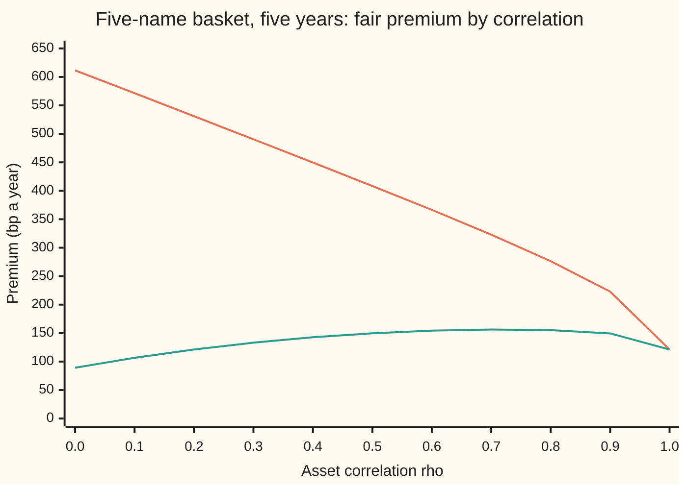

# First-to-default and nth-to-default baskets: protection on the first name to fail, and how correlation moves it

[Syllabus](../../../SYLLABUS.md) → [Financial mathematics](../README.md) → [Portfolio Credit - Correlation, Copulas, Indices and Tranches](../README.md#s45) → First-to-default and nth-to-default baskets

---

## General Overview

A fund holds bonds of five shipping companies. Each one looks like Northwind Lines on [Pricing a CDS](../42-Credit%20Default%20Swaps%20-%20Pricing%2C%20the%20Par%20Spread%20and%20the%20Hazard%20Behind%20It/02-cds-legs-risky-annuity-and-par-spread.md): it fails at 2% a year, a default recovers 40 cents on the dollar, and five years of protection on it costs 121.06 bp a year. A basis point (bp) is a hundredth of a percent.

The fund does not want five separate contracts. It buys one contract on $10 million that pays out on **the first of the five to default**. At that moment the seller pays $6 million, the loss on $10 million of that company's bonds, and the contract ends. Until then the fund pays a premium every quarter. This contract is a **first-to-default basket**. The version that pays on the second default is a **second-to-default basket**, and in general the one that pays on the k-th default is an **nth-to-default basket**.

What should the first-to-default premium be? It depends on how the five fates are tied together:

- **Unconnected.** The fund has five separate chances to be paid, so the basket fails at 5 × 2% = 10% a year. The fair premium is **611.39 bp**.
- **Tied completely.** All five fail on the same day or not at all. The basket is one name in disguise: **121.06 bp**, the single-name price.
- **In between.** With the shared-economy model of [The one-factor Gaussian copula](02-one-factor-gaussian-copula.md) at correlation 0.3, the premium is **490.42 bp**.

The second-to-default basket moves the other way. Unconnected names rarely fail in pairs, so it costs only 89.22 bp. At correlation 0.3 failures bunch together, and it costs 133.22 bp.

**An nth-to-default basket is a credit default swap on the k-th default time of a group of names, so it is priced with the ordinary CDS legs once that time's survival curve is known; correlation lowers the chance of at least one default and raises the chance of several, so the first-to-default premium falls and the second-to-default premium rises.**

**What kind of fact this is:** a model. The contract terms are definitions. The prices rest on a flat hazard for each name and on the one-factor Gaussian copula for how they move together, which are assumptions, not laws. Inside that model the formulas and the two limits are proved on this card in Why it works.

### The picture: the two premiums as correlation rises



Orange: first-to-default, falling at every step from 611.39 bp to 121.06 bp. Green: second-to-default, rising from 89.22 bp to a peak of 156.37 bp near correlation 0.7, then falling back to 121.06 bp. At correlation 1 the two lines meet at the single-name premium.

---

## The formula

Notation first, in words.

- The basket has $`n`$ names (5 here). The contract pays on default number $`k`$: $`k = 1`$ is first-to-default, $`k = 2`$ second-to-default.
- Name $`i`$ defaults at the random date $`\tau_i`$ (Greek "tau"). Sort the five dates; the k-th earliest is $`\tau_{(k)}`$, the **k-th default time**.
- $`C_t`$ is the count of names that have defaulted by date $`t`$.
- $`Q_k(t)`$ is the chance the k-th default has not happened by $`t`$, which is the chance that fewer than $`k`$ names have defaulted.
- The other letters are the CDS card's: $`D(t) = e^{-rt}`$ the discount factor at rate $`r`$, $`t_j`$ the quarterly premium dates, $`\delta = 0.25`$ the slice of a year each premium covers, $`T`$ the end date, $`R`$ the recovery.

The basket is a CDS whose "name" is the k-th default time:

```math
A_k = \sum_{j=1}^{20} \delta\, D(t_j)\, Q_k(t_j), \qquad P_k = (1-R)\int_0^T D(t)\, d\big(1 - Q_k(t)\big), \qquad s_k = \frac{P_k}{A_k}
```

**Read it aloud:** the basket's risky annuity weights each quarterly payment by the chance the k-th default has not yet come; its protection leg adds up the loss at each date, weighted by the chance the k-th default lands there; the fair premium is protection divided by annuity.

In the protection leg, $`d\big(1 - Q_k(t)\big)`$ is the small chance that the k-th default lands in the short stretch of time at $`t`$.

The whole difficulty is $`Q_k(t)`$. In the one-factor Gaussian copula, each name has a hidden score $`X_i = \sqrt{\rho}\,M + \sqrt{1-\rho}\,\varepsilon_i`$: a shared economy score $`M`$ plus private noise $`\varepsilon_i`$, both bell-curve draws. Name $`i`$ has defaulted by $`t`$ when its score is below the cutoff $`c_t = N^{-1}(p(t))`$, where $`p(t) = 1 - e^{-\lambda t}`$ is its default chance by $`t`$. Given the economy, the names are independent coins, so

```math
Q_k(t) = \int_{-\infty}^{\infty} \varphi(m) \sum_{j=0}^{k-1} \binom{n}{j}\, q_t(m)^j \big(1 - q_t(m)\big)^{n-j}\, dm, \qquad q_t(m) = N\!\left(\frac{c_t - \sqrt{\rho}\,m}{\sqrt{1-\rho}}\right)
```

**Read it aloud:** fix the economy at $`m`$; each name has then defaulted with chance $`q_t(m)`$, independently; add the binomial chances of fewer than $`k`$ defaults; average over every economy, weighted by how often it occurs.

Two limits come out in closed form:

```math
\rho = 0:\; Q_1(t) = e^{-n\lambda t}, \qquad \rho = 1:\; Q_k(t) = e^{-\lambda t} \text{ for every } k
```

**Read it aloud:** unconnected names give a first default at the summed hazard; completely tied names default together, so every k-th default time is the single name's default time.

| Symbol | Plain meaning | In our example | Push it up and the first-to-default premium… |
| --- | --- | --- | --- |
| $`n`$, $`k`$, $`i`$, $`j`$ | names in the basket; which default triggers payment; a name's number; a premium date's number, or a count of defaults in the binomial sum | 5; 1 or 2 | $`n`$ up: rises (828.91 bp at 10 names) |
| $`\lambda`$, $`p(t)`$ | each name's hazard ("lambda"), the yearly default rate among survivors; default chance by $`t`$, $`1 - e^{-\lambda t}`$ | 2%; $`p(5) = 9.52\%`$ | rises; 256.51 bp if halved to 1% |
| $`R`$ | recovery: fraction of notional recovered on default | 40% | falls; 653.90 bp if cut to 20% |
| $`T`$, $`t`$, $`t_j`$, $`\delta`$ | contract length; a date; the premium dates; the slice of a year per premium | 5 years; 0.25, …, 5; 0.25 | — |
| $`r`$, $`D(t)`$, $`x`$ | riskless rate, continuously compounded; discount factor $`e^{-rt}`$; one quarter's combined shrink factor for survival and discounting | 5%; $`x = 0.963194`$ unconnected | almost unchanged |
| $`\tau_i`$, $`\tau_{(k)}`$ | name $`i`$'s default date; the k-th earliest of the five | random | — |
| $`C_t`$, $`I_i(t)`$, $`\Pr`$, $`E`$ | count of names defaulted by $`t`$; 1 if name $`i`$ has defaulted by $`t`$, else 0; the chance that; the average | 0 to 5; $`E[C_5] = 5 \times 9.52\%`$ | — |
| $`Q_k(t)`$ | chance the k-th default has not happened by $`t`$ | $`Q_1(5) = 67.24\%`$ at $`\rho = 0.3`$ | — |
| $`A_k`$, $`P_k`$, $`s_k`$ | the basket's risky annuity, protection leg and fair premium | 3.593179, 0.176218, 490.42 bp | — |
| $`\rho`$ | asset correlation: share of each score's variance from the shared economy | 0.3 | falls |
| $`M`$, $`m`$, $`\varepsilon_i`$, $`X_i`$ | economy score and one value of it; name $`i`$'s private noise; its hidden score | $`m = -2`$ for a bad economy | — |
| $`c_t`$, $`q_t(m)`$, $`N`$, $`N^{-1}`$, $`\varphi`$ | default cutoff by $`t`$; a name's default chance by $`t`$ given the economy; bell-curve area, its inverse, bell-curve height | $`c_5 = -1.3096`$; $`q_5(-2) = 39.90\%`$ | — |

The premium is quoted per year on the basket's notional, $10 million here, which is also the notional of each name's protection.

### When it holds

- **Each name's hazard is known and flat.** The basket inherits every single-name curve. If the curves are wrong, so is the basket, before correlation enters.
- **One shared factor with bell-curve shape.** All togetherness comes from $`M`$. Real crises bunch defaults harder than the Gaussian copula does; [Tail dependence](07-tail-dependence-and-the-t-copula.md) shows the gap.
- **One correlation number for every pair.** Five shipping companies may share an economy more than five firms in different industries. Different pair correlations need a different copula matrix; the one-number model is a summary.
- **Fixed recovery, and the seller pays.** Recovery that falls in bad economies makes clustered losses bigger. A seller who can itself default is a counterparty risk, priced on [DVA](../46-Counterparty%20Risk%20and%20CVA/04-dva-and-bilateral-cva.md).
- **Equal names.** Every name here has the same hazard and notional. Unequal names change nothing in the method, only the binomial sum, which becomes a name-by-name count.

---

## Why it works

### Step 0: a basket is a CDS on a made-up name

The basket pays once, at one date: $`\tau_{(k)}`$. Its premiums run until that same date. That is exactly a CDS whose reference name defaults at $`\tau_{(k)}`$. So the CDS card's pricing applies unchanged once the survival curve $`Q_k(t)`$ of that made-up name is known. Every step below is a way of finding $`Q_k(t)`$.

The event "the k-th default has not happened by $`t`$" is the event "fewer than $`k`$ names have defaulted by $`t`$". So $`Q_k(t) = \Pr(C_t < k)`$, where $`\Pr`$ means "the chance that": a question about how many defaults, never about which names.

### Step 1: unconnected names, the first default at 10%

With independent names, no default by $`t`$ means each of the five survived, and independent chances multiply:

```math
Q_1(t) = \big(e^{-\lambda t}\big)^5 = e^{-5\lambda t}
```

That is a flat hazard of $`5\lambda = 10\%`$. At five years, $`0.904837^5 = 0.606531`$. The CDS card's closed form at a 10% hazard gives 611.39 bp.

For the second default, fewer than two defaults is "none" or "exactly one", a binomial count: $`Q_2(t) = (1-p)^5 + 5p(1-p)^4`$, with $`p = p(t)`$. At five years that leaves 7.45% for two or more defaults, and the premium is 89.22 bp.

### Step 2: completely tied names, the single-name premium

At $`\rho = 1`$ every score equals the economy score $`M`$. All five cross the cutoff at the same moment, so the first, second and fifth default times are the same date. Each has the single name's survival curve $`e^{-\lambda t}`$, and every basket costs 121.06 bp.

Under any kind of dependence, the chance of at least one default by $`t`$ is at least the riskiest name's own chance, because that name's default alone counts. It is at most the sum of the five chances, 47.58% by year 5, because adding counts a joint default more than once. Fully tied names sit on the lower bound: 9.52% by year 5. Unconnected names, at 39.35%, sit inside the range. Only names that tend to avoid failing together could push it higher than the unconnected 39.35%, and a copula with $`\rho \ge 0`$ never does that.

### Step 3: the copula, one economy at a time

In between, use the copula card's device. Fix the economy at $`m`$. The five names are then independent, each defaulted by $`t`$ with chance $`q_t(m)`$, so the count $`C_t`$ is binomial. Add the chances of $`0, 1, \dots, k-1`$ defaults, then average over $`m`$. That is the formula for $`Q_k(t)`$.

At five years and $`\rho = 0.3`$ the cutoff is $`c_5 = N^{-1}(0.0952) = -1.3096`$. The economy decides almost everything:

| Economy score $`m`$ | Each name defaulted by year 5 | At least one default | At least two defaults |
| --- | --- | --- | --- |
| −2 (bad) | 39.90% | 92.16% | 66.13% |
| 0 (ordinary) | 5.88% | 26.12% | 3.06% |
| +2 (good) | 0.20% | 1.01% | 0.00% |

Averaged over economies, at least one default by year 5 has chance 32.76% (39.35% unconnected). At least two has chance 10.71% (7.45% unconnected).

### Step 4: why one premium falls and the other rises

**The first-to-default falls.** It pays when at least one name defaults: one minus the chance of none. Given the economy, "none" has chance $`(1 - q)^5`$. That curve bends upward in $`q`$ (it is convex), so spreading $`q`$ out, good economies and bad ones, raises its average (Jensen's inequality: the average of a convex function is at least the function of the average). Correlation spreads $`q`$ out. So "no default" becomes more likely, from 60.65% to 67.24% at five years, and the protection is worth less. Defaults that come together are paid only once. Jensen's inequality shows that any correlation above 0 lowers the premium; that it falls at every step is what the grid shows, because a larger $`\rho`$ spreads $`q`$ further.

**The total is fixed.** Every default triggers exactly one of the five baskets, the first, second, third, fourth or fifth. So the five protection legs always add up to five single-name protection legs, 0.253124 at every correlation. If the first-to-default loses value, the later baskets gain it together. The identity does not say how they share it.

**The second-to-default rises.** Given the economy, "at least two defaults" has chance $`1 - (1-q)^5 - 5q(1-q)^4`$. Its bend (second derivative) is $`20(1-q)^2(1-4q)`$: upward (convex) while $`q`$ is below 25%, downward above. Spreading $`q`$ out raises the average where the curve bends upward and lowers it where it bends downward. At low correlation the spreading stays mostly below 25%: at $`\rho = 0.3`$, 91.32% of economies give $`q`$ below 25% by year 5. So at least two defaults becomes more likely, from 7.45% to 10.71%.

**The second-to-default turns back.** As $`\rho`$ nears 1, bad economies push $`q`$ toward 1, deep in the downward bend, and that side wins. At $`\rho = 1`$ the defaults that matter are all five together. The second default then has the same chance as the first, 9.52%. The premium peaks on the grid at $`\rho = 0.7`$, 156.37 bp, and falls to 121.06 bp. So "the second-to-default rises with correlation" holds over the range that matters in practice, 0 to about 0.7, not all the way. One argument, the bend of one curve, covers both the rise and the turn-back.

| Correlation | First-to-default (bp) | Second-to-default (bp) |
| --- | --- | --- |
| 0.0 | 611.39 | 89.22 |
| 0.3 | 490.42 | 133.22 |
| 0.5 | 408.43 | 149.70 |
| 0.7 | 322.98 | 156.37 |
| 0.9 | 222.91 | 149.48 |
| 1.0 | 121.06 | 121.06 |

The full ladder at $`\rho = 0.3`$, first to fifth default: 490.42, 133.22, 37.93, 9.08 and 1.36 bp.

<details>
<summary>Detailed proof: the five protection legs add up to five single names</summary>

Let $`I_{i}(t)`$ be 1 if name $`i`$ has defaulted by $`t`$ and 0 otherwise. The count of defaults is $`C_t = \sum_i I_i(t)`$. For any count, the number of $`k`$ from 1 to 5 with $`C_t \ge k`$ is $`C_t`$ itself. Taking averages, with $`E`$ meaning the average:

$`\displaystyle \sum_{k=1}^{5} \big(1 - Q_k(t)\big) = \sum_{k=1}^{5} \Pr(C_t \ge k) = E[C_t] = 5\,p(t).`$

The average count does not depend on correlation: each name's default chance is fixed by its cutoff. The protection leg is linear in $`1 - Q_k`$, so summing over $`k`$:

$`\displaystyle \sum_{k=1}^{5} P_k = (1-R)\int_0^T D(t)\, d\big(5\,p(t)\big) = 5 \times (1-R)\int_0^T D(t)\, dp(t),`$

five times one name's protection leg.

The code finds 0.253124 on each side at correlations 0, 0.3 and 1, to six decimals.

</details>

### Step 5: the simulation road

The same prices come from playing the basket out, with no survival curve at all. For each of 200,000 imagined five-year periods: draw one economy score and five private noises; form the five scores; turn each score below the five-year cutoff into a default date with [Simulating a default time](../41-Default%2C%20Survival%20and%20the%20Hazard%20Rate/05-simulating-a-default-time.md), $`\tau_i = -\ln N(-X_i)/\lambda`$; sort the dates; pay premiums until the k-th date and the loss at it. Here $`N(-X_i)`$ is a uniform draw, that card's ticket, and the date falls before $`t`$ exactly when $`X_i`$ is below the cutoff $`c_t`$. The averages give 490.02 bp for the first-to-default at $`\rho = 0.3`$, against 490.42 bp from the integral, inside the run's error of 1.95 bp. That error counts both legs as random: a basket that pays out early also pays fewer premiums.

---

## Worked numbers, by hand

The unconnected first-to-default, with the CDS card's closed form at hazard 10%:

| Step | Arithmetic | Value |
| --- | --- | --- |
| first-default hazard | $`5 \times 2\%`$ | 10% |
| five-year survival | $`0.904837^5 = e^{-0.5}`$ | 0.606531 |
| quarter shrink factor $`x`$ | $`e^{-(0.05 + 0.10) \times 0.25}`$ | 0.963194 |
| risky annuity $`A_1`$ | $`0.25\, x (1 - x^{20})/(1 - x)`$ | 3.452014 |
| protection $`P_1`$ | $`0.6 \times 0.10 \times (1 - e^{-0.75})/0.15`$ | 0.211053 |
| **premium, unconnected** | $`0.211053 / 3.452014`$ | **611.39 bp** |
| fully tied | the single-name CDS | 121.06 bp |
| copula at 0.3 | $`0.176218 / 3.593179`$ | **490.42 bp** |
| second-to-default at 0.3 | $`0.055847 / 4.192203`$ | 133.22 bp |

On $10 million the fund pays $152,848 a quarter if the names are unconnected and $122,606 at correlation 0.3. A single Northwind CDS costs $30,264. The 611.39 bp sits slightly above five times 121.06 bp for the reason on [Pricing a CDS](../42-Credit%20Default%20Swaps%20-%20Pricing%2C%20the%20Par%20Spread%20and%20the%20Hazard%20Behind%20It/02-cds-legs-risky-annuity-and-par-spread.md), premium timing: a premium is paid only at the end of a quarter the basket survives, and at a 10% hazard more quarters end in a default.

### What breaks if you drop a piece

The right answer is the first-to-default at correlation 0.3, 490.42 bp.

| Mistake | Comes out at | What went wrong |
| --- | --- | --- |
| Add the five single-name premiums | 605.28 bp | Ignores that clustered defaults are paid only once |
| Treat the names as unconnected | 611.39 bp | The 10% hazard holds only at correlation 0 |
| Charge premiums for all five years | 400.83 bp | Premiums stop at the first default; the annuity is shorter |
| Blend scores as $`\sqrt{\rho}\,M + \varepsilon_i`$ | 713.74 bp | Score variance becomes 1.3, so each name defaults too often |

---

## Code, from first principles, and it actually runs

The code builds its own bell-curve area from a series, its inverse by bisection, Simpson's rule for every integral, and a hand-written random-number generator (splitmix64). It reaches the basket premiums by **three independent roads**: the CDS closed form at the summed hazard (unconnected names only), the survival curve $`Q_k(t)`$ from the binomial and the copula integral, and a simulation of 200,000 baskets that draws, sorts and settles default dates. It also checks the identity that the five protection legs add up to five single names, and prints every number on the card, including the chart points and the what-breaks rows.

### Python

```python
# Nth-to-default baskets -- the check behind the card.  Standard library only.
# Five names, hazard 2% each, recovery 40%, five years, riskless rate 5%, quarterly premiums.
# Nothing imported knows the answer: the normal curve is a series written here, its inverse
# is bisection, integrals are Simpson's rule, random numbers come from a hand-written splitmix64.
from math import sqrt, exp, log, cos, sin, pi
LAM, R, T, RATE, DT, NAMES = 0.02, 0.40, 5.0, 0.05, 0.25, 5
DATES = [DT * j for j in range(1, 21)]

def N(x):                         # bell-curve area left of x: erf from its all-positive series
    z = abs(x) / sqrt(2.0)
    if z > 6.0: return 0.0 if x < 0 else 1.0
    term, s, n = z, z, 0
    while term > 1e-17 * s:
        n += 1; term *= 2.0 * z * z / (2 * n + 1); s += term
    erf = 2.0 / sqrt(pi) * exp(-z * z) * s
    return 0.5 * (1.0 - erf) if x < 0 else 0.5 * (1.0 + erf)

def Ninv(p):                      # the point with area p to its left, by bisection
    lo, hi = -10.0, 10.0
    for _ in range(100):
        mid = 0.5 * (lo + hi)
        lo, hi = (mid, hi) if N(mid) < p else (lo, mid)
    return 0.5 * (lo + hi)

def simpson(f, a, b, m):
    h = (b - a) / m
    return h / 3.0 * sum((1 if i in (0, m) else 4 if i % 2 else 2) * f(a + i * h) for i in range(m + 1))

def count_law(q, nn):             # chance of 0..nn defaults when each name fails with chance q, independently
    law = [1.0] + [0.0] * nn
    for _ in range(nn):
        law = [law[j] * (1 - q) + (law[j - 1] * q if j else 0.0) for j in range(nn + 1)]
    return law

def survival(t, rho, lam=LAM, nn=NAMES, fix=True):
    # Q_k(t) = chance that fewer than k names have defaulted by t, for k = 1..nn
    if t == 0.0: return [1.0] * nn
    p = 1.0 - exp(-lam * t)
    if rho == 0.0: law = count_law(p, nn)
    elif rho == 1.0: law = [1.0 - p] + [0.0] * (nn - 1) + [p]        # all default at the same moment
    else:
        c, w = Ninv(p), (sqrt(1.0 - rho) if fix else 1.0)          # fix=False drops the sqrt(1-rho) weight
        law = [0.0] * (nn + 1)
        for i in range(401):                                        # Simpson over the economy score m
            m = -8.0 + i * 0.04
            wt = (1 if i in (0, 400) else 4 if i % 2 else 2) * 0.04 / 3.0 * exp(-m * m / 2) / sqrt(2 * pi)
            for j, v in enumerate(count_law(N((c - sqrt(rho) * m) / w), nn)): law[j] += wt * v
    out, acc = [], 0.0
    for j in range(nn): acc += law[j]; out.append(acc)
    return out

def legs(rho, lam=LAM, nn=NAMES, rec=R, fix=True):
    # Road 2: each kth default time is a synthetic name; price it with the CDS legs of its survival curve
    A = [sum(DT * exp(-RATE * t) * survival(t, rho, lam, nn, fix)[k] for t in DATES) for k in range(nn)]
    grid = {i: survival(T * i / 100, rho, lam, nn, fix) for i in range(101)}
    P = [(1 - rec) * (exp(-RATE * T) * (1 - grid[100][k])          # protection, integrated by parts
          + RATE * simpson(lambda t: exp(-RATE * t) * (1 - grid[round(t * 20)][k]), 0.0, T, 100)) for k in range(nn)]
    return A, P, [1e4 * P[k] / A[k] for k in range(nn)]

def flat_cds(lam):                # Road 1: the closed-form legs for one flat hazard
    c = RATE + lam; x = exp(-c * DT)
    A = DT * x * (1 - x ** 20) / (1 - x); P = (1 - R) * lam * (1 - exp(-c * T)) / c
    return A, P, 1e4 * P / A

STATE = [20261123]
def uniform():                    # splitmix64, then 53 random bits
    STATE[0] = (STATE[0] + 0x9E3779B97F4A7C15) & 0xFFFFFFFFFFFFFFFF
    z = STATE[0]
    z = ((z ^ (z >> 30)) * 0xBF58476D1CE4E5B9) & 0xFFFFFFFFFFFFFFFF
    z = ((z ^ (z >> 27)) * 0x94D049BB133111EB) & 0xFFFFFFFFFFFFFFFF
    return ((z ^ (z >> 31)) >> 11) / 9007199254740992.0

def simulate(rho, paths=200000):  # Road 3: draw five default dates per basket, sort, settle
    cT = Ninv(1 - exp(-LAM * T)); S = [[0.0] * 5, [0.0] * 5]   # sums of a, v, a*a, a*v, v*v
    for _ in range(paths):
        g = []
        for _ in range(3):
            u1, u2 = 1.0 - uniform(), uniform(); rr = sqrt(-2 * log(u1))
            g += [rr * cos(2 * pi * u2), rr * sin(2 * pi * u2)]
        X = [sqrt(rho) * g[0] + sqrt(1 - rho) * e for e in g[1:]]
        taus = sorted(-log(N(-x)) / LAM for x in X if x < cT)   # dates inside five years only
        for k in range(2):
            tk = taus[k] if len(taus) > k else 99.0
            a = sum(DT * exp(-RATE * t) for t in DATES if t < tk)   # premium leg a, protection v
            v = (1 - R) * exp(-RATE * tk) if tk <= T else 0.0
            for j, z in enumerate((a, v, a * a, a * v, v * v)): S[k][j] += z
    out = []
    for k in range(2):   # the premium is a ratio of two averages: its error uses v - s*a, both legs random
        A, P, aa, av, vv = (z / paths for z in S[k]); s = P / A
        out.append((1e4 * s, 1e4 * sqrt((vv - 2 * s * av + s * s * aa) / paths) / A))
    return out

A1, P1, s1 = flat_cds(LAM)
print(f"single name: annuity {A1:.6f}  protection {P1:.6f}  spread {s1:.2f} bp")
assert abs(s1 - 121.06) < 0.005
Af, Pf, sf = flat_cds(NAMES * LAM)
print(f"independent first-to-default hazard {NAMES * LAM:.2%}: five-year survival {exp(-NAMES * LAM * T):.6f} = {exp(-LAM * T):.6f}^5")
print(f"independent FTD legs: x {exp(-(RATE + NAMES * LAM) * DT):.6f}  annuity {Af:.6f}  protection {Pf:.6f}")
L0, L3, L1 = legs(0.0), legs(0.3), legs(1.0)
print(f"rho 0.3 legs: FTD annuity {L3[0][0]:.6f} protection {L3[1][0]:.6f}  2TD annuity {L3[0][1]:.6f} protection {L3[1][1]:.6f}")
p5 = 1 - exp(-LAM * T); c5 = Ninv(p5)
print(f"rho 0.3 year 5: cutoff {c5:.4f}  weights {sqrt(0.3):.4f} {sqrt(0.7):.4f}  economies with q below 25% {1 - N((c5 - sqrt(0.7) * Ninv(0.25)) / sqrt(0.3)):.2%}")
for m in (-2, 0, 2):
    q = N((c5 - sqrt(0.3) * m) / sqrt(0.7)); law = count_law(q, NAMES)
    print(f"  economy {m:+d}: each name {q:.2%}  at least one {1 - law[0]:.2%}  at least two {1 - law[0] - law[1]:.2%}")
sim0, sim3 = simulate(0.0), simulate(0.3)
print(f"rho 0.0  FTD  closed form {sf:.2f}  curve road {L0[2][0]:.2f}  simulation {sim0[0][0]:.2f} +- {sim0[0][1]:.2f} bp")
print(f"rho 0.0  2TD  binomial curve {L0[2][1]:.2f}  simulation {sim0[1][0]:.2f} +- {sim0[1][1]:.2f} bp")
print(f"rho 0.3  FTD  copula integral {L3[2][0]:.2f}  simulation {sim3[0][0]:.2f} +- {sim3[0][1]:.2f} bp")
print(f"rho 0.3  2TD  copula integral {L3[2][1]:.2f}  simulation {sim3[1][0]:.2f} +- {sim3[1][1]:.2f} bp")
print(f"rho 1.0  FTD {L1[2][0]:.2f}  2TD {L1[2][1]:.2f} bp  (single name {s1:.2f})")
assert abs(L0[2][0] - sf) < 0.02 and abs(L1[2][0] - s1) < 0.02 and abs(L1[2][1] - s1) < 0.02
for (s, e), ref in zip(sim0 + sim3, [L0[2][0], L0[2][1], L3[2][0], L3[2][1]]):
    assert abs(s - ref) < 4 * e, (s, ref, e)
for rho in (0.0, 0.3, 1.0):
    S = survival(T, rho); assert p5 - 1e-12 < 1 - S[0] < NAMES * p5   # riskiest name <= any default <= sum
    print(f"rho {rho:.1f}  by year 5: no default {S[0]:.2%}  at least one {1 - S[0]:.2%}  at least two {1 - S[1]:.2%}")
print(f"at least one default by year 5, any dependence: from {p5:.2%} to {NAMES * p5:.2%}")
print(f"ladder at rho 0.3, k = 1..5: " + "  ".join(f"{s:.2f}" for s in L3[2]) + " bp")
for rho, L in ((0.0, L0), (0.3, L3), (1.0, L1)):
    print(f"sum of the five protection legs at rho {rho:.1f}: {sum(L[1]):.6f}  five single names {NAMES * P1:.6f}")
    assert abs(sum(L[1]) - NAMES * P1) < 1e-5
print("sweep: rho, FTD bp, 2TD bp")
sweep = {}
for i in range(11):
    rho = i / 10; sweep[rho] = legs(rho)[2][:2]
    print(f"  {rho:.1f}  {sweep[rho][0]:7.2f}  {sweep[rho][1]:7.2f}")
ftd = [sweep[i / 10][0] for i in range(11)]
assert all(a > b for a, b in zip(ftd, ftd[1:])), "FTD falls at every step"
peak = max(range(11), key=lambda i: sweep[i / 10][1])
print(f"2TD peaks on the grid at rho {peak / 10:.1f}: {sweep[peak / 10][1]:.2f} bp, then falls back to {s1:.2f}")
assert 0.0 < peak / 10 < 1.0 and sweep[0.3][1] > sweep[0.0][1]
print(f"dollars on $10m, per quarter: FTD rho 0 {sf * 250:,.0f}  rho 0.3 {L3[2][0] * 250:,.0f}  single {s1 * 250:,.0f}")
print(f"break: add the five single spreads {NAMES * s1:.2f}  treat as independent {sf:.2f}  vs {L3[2][0]:.2f}")
print(f"break: premiums for all five years {1e4 * L3[1][0] / sum(DT * exp(-RATE * t) for t in DATES):.2f}  drop sqrt(1-rho) {legs(0.3, fix=False)[2][0]:.2f}")
j2 = 1 - survival(T, 0.3, nn=2)[1]; dc = (j2 - p5 * p5) / (p5 * (1 - p5))   # both of two names default by year 5
print(f"trap: default correlation by year 5 at rho 0.3 {dc:.4f}; used as rho it gives FTD {legs(dc)[2][0]:.2f}")
print(f"try: recovery 20% {legs(0.3, rec=0.2)[2][0]:.2f}  ten names {legs(0.3, nn=10)[2][0]:.2f}"
      f"  hazard 1% {legs(0.3, lam=0.01)[2][0]:.2f}  rho 0.6 FTD {legs(0.6)[2][0]:.2f} 2TD {legs(0.6)[2][1]:.2f}")
print("ALL CHECKS PASS")
```

**Ran 2026-11-23 on macOS, Python 3.14.10, standard library only. All checks passed. Output, pasted from the run:**

```
single name: annuity 4.181935  protection 0.050625  spread 121.06 bp
independent first-to-default hazard 10.00%: five-year survival 0.606531 = 0.904837^5
independent FTD legs: x 0.963194  annuity 3.452014  protection 0.211053
rho 0.3 legs: FTD annuity 3.593179 protection 0.176218  2TD annuity 4.192203 protection 0.055847
rho 0.3 year 5: cutoff -1.3096  weights 0.5477 0.8367  economies with q below 25% 91.32%
  economy -2: each name 39.90%  at least one 92.16%  at least two 66.13%
  economy +0: each name 5.88%  at least one 26.12%  at least two 3.06%
  economy +2: each name 0.20%  at least one 1.01%  at least two 0.00%
rho 0.0  FTD  closed form 611.39  curve road 611.39  simulation 612.29 +- 2.22 bp
rho 0.0  2TD  binomial curve 89.22  simulation 89.55 +- 0.73 bp
rho 0.3  FTD  copula integral 490.42  simulation 490.02 +- 1.95 bp
rho 0.3  2TD  copula integral 133.22  simulation 133.16 +- 0.91 bp
rho 1.0  FTD 121.06  2TD 121.06 bp  (single name 121.06)
rho 0.0  by year 5: no default 60.65%  at least one 39.35%  at least two 7.45%
rho 0.3  by year 5: no default 67.24%  at least one 32.76%  at least two 10.71%
rho 1.0  by year 5: no default 90.48%  at least one 9.52%  at least two 9.52%
at least one default by year 5, any dependence: from 9.52% to 47.58%
ladder at rho 0.3, k = 1..5: 490.42  133.22  37.93  9.08  1.36 bp
sum of the five protection legs at rho 0.0: 0.253124  five single names 0.253124
sum of the five protection legs at rho 0.3: 0.253124  five single names 0.253124
sum of the five protection legs at rho 1.0: 0.253124  five single names 0.253124
sweep: rho, FTD bp, 2TD bp
  0.0   611.39    89.22
  0.1   571.50   106.59
  0.2   531.07   121.24
  0.3   490.42   133.22
  0.4   449.61   142.67
  0.5   408.43   149.70
  0.6   366.48   154.33
  0.7   322.98   156.37
  0.8   276.43   155.30
  0.9   222.91   149.48
  1.0   121.06   121.06
2TD peaks on the grid at rho 0.7: 156.37 bp, then falls back to 121.06
dollars on $10m, per quarter: FTD rho 0 152,848  rho 0.3 122,606  single 30,264
break: add the five single spreads 605.28  treat as independent 611.39  vs 490.42
break: premiums for all five years 400.83  drop sqrt(1-rho) 713.74
trap: default correlation by year 5 at rho 0.3 0.1267; used as rho it gives FTD 560.75
try: recovery 20% 653.90  ten names 828.91  hazard 1% 256.51  rho 0.6 FTD 366.48 2TD 154.33
ALL CHECKS PASS
```

### Rust

```rust
// Nth-to-default baskets -- the check behind the card.  std only, no crates.
// Five names, hazard 2% each, recovery 40%, five years, riskless rate 5%, quarterly premiums.
// Nothing imported knows the answer: the normal curve is a series written here, its inverse
// is bisection, integrals are Simpson's rule, random numbers come from a hand-written splitmix64.
const LAM: f64 = 0.02; const R: f64 = 0.40; const T: f64 = 5.0; const RATE: f64 = 0.05;
const DT: f64 = 0.25; const NAMES: usize = 5;
use std::f64::consts::PI;

fn dates() -> Vec<f64> { (1..=20).map(|j| DT * j as f64).collect() }

fn n(x: f64) -> f64 { // bell-curve area left of x: erf from its all-positive series
    let z = x.abs() / 2f64.sqrt();
    if z > 6.0 { return if x < 0.0 { 0.0 } else { 1.0 }; }
    let (mut term, mut s, mut k) = (z, z, 0.0);
    while term > 1e-17 * s { k += 1.0; term *= 2.0 * z * z / (2.0 * k + 1.0); s += term; }
    let erf = 2.0 / PI.sqrt() * (-z * z).exp() * s;
    if x < 0.0 { 0.5 * (1.0 - erf) } else { 0.5 * (1.0 + erf) }
}

fn ninv(p: f64) -> f64 { // the point with area p to its left, by bisection
    let (mut lo, mut hi) = (-10.0, 10.0);
    for _ in 0..100 { let mid = 0.5 * (lo + hi); if n(mid) < p { lo = mid } else { hi = mid } }
    0.5 * (lo + hi)
}

fn simpson(f: &dyn Fn(f64) -> f64, a: f64, b: f64, m: usize) -> f64 {
    let h = (b - a) / m as f64;
    let s: f64 = (0..=m).map(|i| (if i == 0 || i == m { 1.0 } else if i % 2 == 1 { 4.0 } else { 2.0 }) * f(a + i as f64 * h)).sum();
    h / 3.0 * s
}

fn count_law(q: f64, nn: usize) -> Vec<f64> { // chance of 0..nn defaults, each name failing with chance q
    let mut law = vec![0.0; nn + 1]; law[0] = 1.0;
    for _ in 0..nn {
        law = (0..=nn).map(|j| law[j] * (1.0 - q) + if j > 0 { law[j - 1] * q } else { 0.0 }).collect();
    }
    law
}

// Q_k(t) = chance that fewer than k names have defaulted by t, for k = 1..nn
fn survival(t: f64, rho: f64, lam: f64, nn: usize, fix: bool) -> Vec<f64> {
    if t == 0.0 { return vec![1.0; nn]; }
    let p = 1.0 - (-lam * t).exp();
    let law = if rho == 0.0 { count_law(p, nn) }
    else if rho == 1.0 { let mut l = vec![0.0; nn + 1]; l[0] = 1.0 - p; l[nn] = p; l } // all default at once
    else {
        let (c, w) = (ninv(p), if fix { (1.0 - rho).sqrt() } else { 1.0 });
        let mut law = vec![0.0; nn + 1];
        for i in 0..=400 { // Simpson over the economy score m
            let m = -8.0 + i as f64 * 0.04;
            let wt = (if i == 0 || i == 400 { 1.0 } else if i % 2 == 1 { 4.0 } else { 2.0 }) * 0.04 / 3.0
                * (-m * m / 2.0).exp() / (2.0 * PI).sqrt();
            for (j, v) in count_law(n((c - rho.sqrt() * m) / w), nn).iter().enumerate() { law[j] += wt * v; }
        }
        law
    };
    let mut acc = 0.0;
    (0..nn).map(|j| { acc += law[j]; acc }).collect()
}

// Road 2: each kth default time is a synthetic name; price it with the CDS legs of its survival curve
fn legs(rho: f64, lam: f64, nn: usize, rec: f64, fix: bool) -> (Vec<f64>, Vec<f64>, Vec<f64>) {
    let a: Vec<f64> = (0..nn).map(|k| dates().iter().map(|&t| DT * (-RATE * t).exp() * survival(t, rho, lam, nn, fix)[k]).sum()).collect();
    let grid: Vec<Vec<f64>> = (0..=100).map(|i| survival(T * i as f64 / 100.0, rho, lam, nn, fix)).collect();
    let p: Vec<f64> = (0..nn).map(|k| (1.0 - rec) * ((-RATE * T).exp() * (1.0 - grid[100][k])
        + RATE * simpson(&|t: f64| (-RATE * t).exp() * (1.0 - grid[(t * 20.0).round() as usize][k]), 0.0, T, 100))).collect();
    let s = (0..nn).map(|k| 1e4 * p[k] / a[k]).collect();
    (a, p, s)
}
fn legs0(rho: f64) -> (Vec<f64>, Vec<f64>, Vec<f64>) { legs(rho, LAM, NAMES, R, true) }

fn flat_cds(lam: f64) -> (f64, f64, f64) { // Road 1: the closed-form legs for one flat hazard
    let c = RATE + lam; let x = (-c * DT).exp();
    let a = DT * x * (1.0 - x.powi(20)) / (1.0 - x); let p = (1.0 - R) * lam * (1.0 - (-c * T).exp()) / c;
    (a, p, 1e4 * p / a)
}

struct Rng(u64);
impl Rng { fn uniform(&mut self) -> f64 { // splitmix64, then 53 random bits
    self.0 = self.0.wrapping_add(0x9E3779B97F4A7C15); let mut z = self.0;
    z = (z ^ (z >> 30)).wrapping_mul(0xBF58476D1CE4E5B9);
    z = (z ^ (z >> 27)).wrapping_mul(0x94D049BB133111EB);
    ((z ^ (z >> 31)) >> 11) as f64 / 9007199254740992.0
} }

fn simulate(rho: f64, rng: &mut Rng, paths: usize) -> Vec<(f64, f64)> { // Road 3: draw, sort, settle
    let ct = ninv(1.0 - (-LAM * T).exp());
    let mut sums = [[0.0f64; 5]; 2]; // sums of a, v, a*a, a*v, v*v
    for _ in 0..paths {
        let mut g = Vec::with_capacity(6);
        for _ in 0..3 {
            let (u1, u2) = (1.0 - rng.uniform(), rng.uniform()); let rr = (-2.0 * u1.ln()).sqrt();
            g.push(rr * (2.0 * PI * u2).cos()); g.push(rr * (2.0 * PI * u2).sin());
        }
        let mut taus: Vec<f64> = g[1..].iter().map(|e| rho.sqrt() * g[0] + (1.0 - rho).sqrt() * e)
            .filter(|&x| x < ct).map(|x| -n(-x).ln() / LAM).collect(); // dates inside five years only
        taus.sort_by(|a, b| a.partial_cmp(b).unwrap());
        for k in 0..2 {
            let tk = if taus.len() > k { taus[k] } else { 99.0 };
            let a = dates().iter().filter(|&&t| t < tk).map(|&t| DT * (-RATE * t).exp()).sum::<f64>(); // premium leg a, protection v
            let v = if tk <= T { (1.0 - R) * (-RATE * tk).exp() } else { 0.0 };
            for (j, z) in [a, v, a * a, a * v, v * v].iter().enumerate() { sums[k][j] += z; }
        }
    }
    let pf = paths as f64; // the premium is a ratio of two averages: its error uses v - s*a, both legs random
    (0..2).map(|k| { let m: Vec<f64> = sums[k].iter().map(|z| z / pf).collect(); let s = m[1] / m[0];
        (1e4 * s, 1e4 * ((m[4] - 2.0 * s * m[3] + s * s * m[2]) / pf).sqrt() / m[0]) }).collect()
}

fn commas(x: f64) -> String { // whole dollars with thousands separators
    let s = format!("{:.0}", x); let b = s.as_bytes(); let mut out = String::new();
    for (i, ch) in b.iter().enumerate() { if i > 0 && (b.len() - i) % 3 == 0 { out.push(','); } out.push(*ch as char); }
    out
}
fn pct(x: f64) -> String { format!("{:.2}%", x * 100.0) }

fn main() {
    let (a1, p1, s1) = flat_cds(LAM);
    println!("single name: annuity {:.6}  protection {:.6}  spread {:.2} bp", a1, p1, s1);
    assert!((s1 - 121.06).abs() < 0.005);
    println!("independent first-to-default hazard {}: five-year survival {:.6} = {:.6}^5",
        pct(NAMES as f64 * LAM), (-(NAMES as f64) * LAM * T).exp(), (-LAM * T).exp());
    let (af, pf, sf) = flat_cds(NAMES as f64 * LAM);
    println!("independent FTD legs: x {:.6}  annuity {:.6}  protection {:.6}", (-(RATE + NAMES as f64 * LAM) * DT).exp(), af, pf);
    let (l0, l3, l1) = (legs0(0.0), legs0(0.3), legs0(1.0));
    println!("rho 0.3 legs: FTD annuity {:.6} protection {:.6}  2TD annuity {:.6} protection {:.6}", l3.0[0], l3.1[0], l3.0[1], l3.1[1]);
    let p5 = 1.0 - (-LAM * T).exp(); let c5 = ninv(p5);
    println!("rho 0.3 year 5: cutoff {:.4}  weights {:.4} {:.4}  economies with q below 25% {}", c5, 0.3f64.sqrt(), 0.7f64.sqrt(), pct(1.0 - n((c5 - 0.7f64.sqrt() * ninv(0.25)) / 0.3f64.sqrt())));
    for m in [-2i32, 0, 2] {
        let q = n((c5 - 0.3f64.sqrt() * m as f64) / 0.7f64.sqrt()); let law = count_law(q, NAMES);
        println!("  economy {:+}: each name {}  at least one {}  at least two {}", m, pct(q), pct(1.0 - law[0]), pct(1.0 - law[0] - law[1]));
    }
    let mut rng = Rng(20261123);
    let sim0 = simulate(0.0, &mut rng, 200000); let sim3 = simulate(0.3, &mut rng, 200000);
    println!("rho 0.0  FTD  closed form {:.2}  curve road {:.2}  simulation {:.2} +- {:.2} bp", sf, l0.2[0], sim0[0].0, sim0[0].1);
    println!("rho 0.0  2TD  binomial curve {:.2}  simulation {:.2} +- {:.2} bp", l0.2[1], sim0[1].0, sim0[1].1);
    println!("rho 0.3  FTD  copula integral {:.2}  simulation {:.2} +- {:.2} bp", l3.2[0], sim3[0].0, sim3[0].1);
    println!("rho 0.3  2TD  copula integral {:.2}  simulation {:.2} +- {:.2} bp", l3.2[1], sim3[1].0, sim3[1].1);
    println!("rho 1.0  FTD {:.2}  2TD {:.2} bp  (single name {:.2})", l1.2[0], l1.2[1], s1);
    assert!((l0.2[0] - sf).abs() < 0.02 && (l1.2[0] - s1).abs() < 0.02 && (l1.2[1] - s1).abs() < 0.02);
    let refs = [l0.2[0], l0.2[1], l3.2[0], l3.2[1]];
    for (i, (s, e)) in sim0.iter().chain(sim3.iter()).enumerate() { assert!((s - refs[i]).abs() < 4.0 * e); }
    for rho in [0.0, 0.3, 1.0] {
        let s = survival(T, rho, LAM, NAMES, true); assert!(p5 - 1e-12 < 1.0 - s[0] && 1.0 - s[0] < NAMES as f64 * p5); // riskiest name <= any default <= sum
        println!("rho {:.1}  by year 5: no default {}  at least one {}  at least two {}", rho, pct(s[0]), pct(1.0 - s[0]), pct(1.0 - s[1]));
    }
    println!("at least one default by year 5, any dependence: from {} to {}", pct(p5), pct(NAMES as f64 * p5));
    println!("ladder at rho 0.3, k = 1..5: {} bp", l3.2.iter().map(|s| format!("{:.2}", s)).collect::<Vec<_>>().join("  "));
    for (rho, l) in [(0.0, &l0), (0.3, &l3), (1.0, &l1)] {
        let tot: f64 = l.1.iter().sum();
        println!("sum of the five protection legs at rho {:.1}: {:.6}  five single names {:.6}", rho, tot, NAMES as f64 * p1);
        assert!((tot - NAMES as f64 * p1).abs() < 1e-5);
    }
    println!("sweep: rho, FTD bp, 2TD bp");
    let sweep: Vec<Vec<f64>> = (0..=10).map(|i| legs0(i as f64 / 10.0).2).collect();
    for i in 0..=10 { println!("  {:.1}  {:7.2}  {:7.2}", i as f64 / 10.0, sweep[i][0], sweep[i][1]); }
    assert!((0..10).all(|i| sweep[i][0] > sweep[i + 1][0]), "FTD falls at every step");
    let mut peak = 0; for i in 0..=10 { if sweep[i][1] > sweep[peak][1] { peak = i; } }
    println!("2TD peaks on the grid at rho {:.1}: {:.2} bp, then falls back to {:.2}", peak as f64 / 10.0, sweep[peak][1], s1);
    assert!(peak > 0 && peak < 10 && sweep[3][1] > sweep[0][1]);
    println!("dollars on $10m, per quarter: FTD rho 0 {}  rho 0.3 {}  single {}", commas(sf * 250.0), commas(l3.2[0] * 250.0), commas(s1 * 250.0));
    let riskless: f64 = dates().iter().map(|&t| DT * (-RATE * t).exp()).sum();
    println!("break: add the five single spreads {:.2}  treat as independent {:.2}  vs {:.2}", NAMES as f64 * s1, sf, l3.2[0]);
    println!("break: premiums for all five years {:.2}  drop sqrt(1-rho) {:.2}", 1e4 * l3.1[0] / riskless, legs(0.3, LAM, NAMES, R, false).2[0]);
    let j2 = 1.0 - survival(T, 0.3, LAM, 2, true)[1]; let dc = (j2 - p5 * p5) / (p5 * (1.0 - p5)); // both of two names default by year 5
    println!("trap: default correlation by year 5 at rho 0.3 {:.4}; used as rho it gives FTD {:.2}", dc, legs0(dc).2[0]);
    println!("try: recovery 20% {:.2}  ten names {:.2}  hazard 1% {:.2}  rho 0.6 FTD {:.2} 2TD {:.2}",
        legs(0.3, LAM, NAMES, 0.2, true).2[0], legs(0.3, LAM, 10, R, true).2[0], legs(0.3, 0.01, NAMES, R, true).2[0], legs0(0.6).2[0], legs0(0.6).2[1]);
    println!("ALL CHECKS PASS");
}
```

**Ran 2026-11-23 on macOS, rustc 1.98.1, no crates. All checks passed. Output, pasted from the run:**

```
single name: annuity 4.181935  protection 0.050625  spread 121.06 bp
independent first-to-default hazard 10.00%: five-year survival 0.606531 = 0.904837^5
independent FTD legs: x 0.963194  annuity 3.452014  protection 0.211053
rho 0.3 legs: FTD annuity 3.593179 protection 0.176218  2TD annuity 4.192203 protection 0.055847
rho 0.3 year 5: cutoff -1.3096  weights 0.5477 0.8367  economies with q below 25% 91.32%
  economy -2: each name 39.90%  at least one 92.16%  at least two 66.13%
  economy +0: each name 5.88%  at least one 26.12%  at least two 3.06%
  economy +2: each name 0.20%  at least one 1.01%  at least two 0.00%
rho 0.0  FTD  closed form 611.39  curve road 611.39  simulation 612.29 +- 2.22 bp
rho 0.0  2TD  binomial curve 89.22  simulation 89.55 +- 0.73 bp
rho 0.3  FTD  copula integral 490.42  simulation 490.02 +- 1.95 bp
rho 0.3  2TD  copula integral 133.22  simulation 133.16 +- 0.91 bp
rho 1.0  FTD 121.06  2TD 121.06 bp  (single name 121.06)
rho 0.0  by year 5: no default 60.65%  at least one 39.35%  at least two 7.45%
rho 0.3  by year 5: no default 67.24%  at least one 32.76%  at least two 10.71%
rho 1.0  by year 5: no default 90.48%  at least one 9.52%  at least two 9.52%
at least one default by year 5, any dependence: from 9.52% to 47.58%
ladder at rho 0.3, k = 1..5: 490.42  133.22  37.93  9.08  1.36 bp
sum of the five protection legs at rho 0.0: 0.253124  five single names 0.253124
sum of the five protection legs at rho 0.3: 0.253124  five single names 0.253124
sum of the five protection legs at rho 1.0: 0.253124  five single names 0.253124
sweep: rho, FTD bp, 2TD bp
  0.0   611.39    89.22
  0.1   571.50   106.59
  0.2   531.07   121.24
  0.3   490.42   133.22
  0.4   449.61   142.67
  0.5   408.43   149.70
  0.6   366.48   154.33
  0.7   322.98   156.37
  0.8   276.43   155.30
  0.9   222.91   149.48
  1.0   121.06   121.06
2TD peaks on the grid at rho 0.7: 156.37 bp, then falls back to 121.06
dollars on $10m, per quarter: FTD rho 0 152,848  rho 0.3 122,606  single 30,264
break: add the five single spreads 605.28  treat as independent 611.39  vs 490.42
break: premiums for all five years 400.83  drop sqrt(1-rho) 713.74
trap: default correlation by year 5 at rho 0.3 0.1267; used as rho it gives FTD 560.75
try: recovery 20% 653.90  ten names 828.91  hazard 1% 256.51  rho 0.6 FTD 366.48 2TD 154.33
ALL CHECKS PASS
```

### Lean

Lean proves the unconnected first-default curve for any number of names with one flat hazard, and two facts true under any dependence.

- Take $`n`$ unconnected names, each surviving past every date $`t`$ with chance $`e^{-\lambda t}`$. Then $`Q_1(t) = e^{-n\lambda t}`$, a first-default hazard of $`n\lambda`$.
- Take any basket of $`n`$ names, tied together in any way. Then $`\sum_{k=1}^{n} \Pr(C_t \ge k) = \sum_i \Pr(\tau_i \le t)`$.
- Take any basket, tied together in any way. Then the chance of at least one default by $`t`$ lies between the riskiest name's own chance and the sum of the names' chances.
- Five names at a 2% hazard give a first-default hazard of 10%.
- Take five names, so $`C_t`$ runs from 0 to 5. Then exactly $`C_t`$ of the values $`k = 1, \dots, 5`$ have $`C_t \ge k`$.
- Take $`q`$, each name's default chance given the economy. Then the chance of at least two of five defaults is $`10q^2 - 20q^3 + 15q^4 - 4q^5`$.
- Take that polynomial's bend, $`20 - 120q + 180q^2 - 80q^3`$. Then it equals $`20(1-q)^2(1-4q)`$, whose factor $`1 - 4q`$ is 0 at $`q = 25\%`$.

The copula integral, completely tied names, the simulation, the protection legs and every premium are left to the Python and Rust checks.

```lean
-- First-to-default and nth-to-default baskets: unconnected names with one flat hazard give a first default at the summed hazard, the chances of at least k defaults add up over k to the names' own default chances whatever the dependence, and the chance of at least one default lies between the riskiest name's chance and the sum of all of them.
import Mathlib.Probability.Independence.Basic
import Mathlib.MeasureTheory.Measure.Real
import Mathlib.MeasureTheory.Integral.Bochner.Set
import Mathlib.Analysis.SpecialFunctions.Exp
import Mathlib.Tactic.NormNum
import Mathlib.Tactic.Ring

open MeasureTheory ProbabilityTheory Real Finset

/-! Setting, as on the card. The basket has `n` names; name `i` defaults at the random date
`τ i`, a measurable function on a probability space `(Ω, μ)`. "Name `i` has defaulted by `t`" is
the event `τ i ≤ t`, so `C_t`, the count of names defaulted by `t`, is the number of `i` with
`τ i ω ≤ t`, and the k-th default has happened by `t` exactly when `k ≤ C_t`.
`μ.real` is the chance of an event, as a real number. The one-factor Gaussian copula prices
(490.42 bp, 133.22 bp and the correlation sweep) come from a numerical integral and a simulation,
so they are not stated here; the exact parts are the unconnected limit (Step 1), the fixed total
(the detailed proof under Step 4) and the bounds on at least one default (Step 2). -/

/-- **Unconnected names: the first default comes at the summed hazard** (Step 1). Every name has
the same flat hazard `λ`, so its chance of surviving past any date `s ≥ 0` is `e^{-λ s}`. If the
`n` default dates are independent (correlation 0), the chance that no name has defaulted by `t`,
which is the first-to-default survival curve `Q_1(t)`, is `(e^{-λ t})^n = e^{-n λ t}`: the basket's
first default has a flat hazard `n λ` (10% for five names at 2%). -/
theorem first_to_default_survival_independent {Ω : Type*} [MeasurableSpace Ω]
    (μ : Measure Ω) [IsProbabilityMeasure μ] (n : ℕ) (τ : Fin n → Ω → ℝ) (lam : ℝ)
    (hmeas : ∀ i, Measurable (τ i)) (hind : iIndepFun τ μ)
    (hflat : ∀ i, ∀ s : ℝ, 0 ≤ s → μ.real {ω | s < τ i ω} = exp (-(lam * s))) :
    ∀ t : ℝ, 0 ≤ t → μ.real {ω | ∀ i, t < τ i ω} = exp (-((n * lam) * t)) := by
  intro t ht
  have hset : {ω | ∀ i, t < τ i ω} = ⋂ i ∈ (univ : Finset (Fin n)), τ i ⁻¹' Set.Ioi t := by
    ext ω; simp
  have key := hind.measure_inter_preimage_eq_mul (univ : Finset (Fin n))
    (sets := fun _ => Set.Ioi t) (fun i _ => measurableSet_Ioi)
  rw [hset, measureReal_def, key, ENNReal.toReal_prod]
  have hi : ∀ i, (μ (τ i ⁻¹' Set.Ioi t)).toReal = exp (-(lam * t)) := by
    intro i
    have := hflat i t ht
    rw [measureReal_def] at this
    exact this
  simp only [hi, prod_const, card_univ, Fintype.card_fin]
  rw [← Real.exp_nat_mul]
  ring_nf

/-- **The total is fixed** (Step 4, detailed proof). Whatever ties the names together, the
chances of at least `k` defaults by `t`, added over `k = 1, …, n`, equal the sum of the names' own
default chances by `t`: `∑_k (1 - Q_k(t)) = E[C_t] = ∑_i Pr(τ_i ≤ t)`, which is `n p(t)` for equal
names. Since each protection leg is linear in `1 - Q_k`, the `n` nth-to-default protection legs add
up to the `n` single-name protection legs at every correlation. -/
theorem nth_to_default_chances_sum_to_single_names {Ω : Type*} [MeasurableSpace Ω]
    (μ : Measure Ω) [IsProbabilityMeasure μ] (n : ℕ) (τ : Fin n → Ω → ℝ)
    (hmeas : ∀ i, Measurable (τ i)) (t : ℝ) :
    ∑ k ∈ Icc 1 n, μ.real {ω | k ≤ (univ.filter (fun i => τ i ω ≤ t)).card}
      = ∑ i, μ.real {ω | τ i ω ≤ t} := by
  set C : Ω → ℕ := fun ω => (univ.filter (fun i => τ i ω ≤ t)).card with hC
  have hB : ∀ i, MeasurableSet {ω | τ i ω ≤ t} := fun i => measurableSet_le (hmeas i) measurable_const
  have hCmeas : Measurable C := by
    have : C = fun ω => ∑ i, ({ω | τ i ω ≤ t} : Set Ω).indicator (fun _ => (1 : ℕ)) ω := by
      funext ω
      simp only [hC, Set.indicator_apply, Set.mem_ofPred_eq, sum_boole, Nat.cast_id]
    rw [this]
    exact Finset.measurable_sum _ (fun i _ => (measurable_const.indicator (hB i)))
  have hA : ∀ k : ℕ, MeasurableSet {ω | k ≤ C ω} := fun k => measurableSet_le measurable_const hCmeas
  have hCle : ∀ ω, C ω ≤ n := fun ω => by
    simpa using card_filter_le (univ : Finset (Fin n)) (fun i => τ i ω ≤ t)
  have lhs : ∀ k, μ.real {ω | k ≤ C ω} = ∫ ω, ({ω | k ≤ C ω} : Set Ω).indicator 1 ω ∂μ :=
    fun k => (integral_indicator_one (hA k)).symm
  have rhs : ∀ i, μ.real {ω | τ i ω ≤ t} = ∫ ω, ({ω | τ i ω ≤ t} : Set Ω).indicator 1 ω ∂μ :=
    fun i => (integral_indicator_one (hB i)).symm
  show ∑ k ∈ Icc 1 n, μ.real {ω | k ≤ C ω} = _
  rw [Finset.sum_congr rfl (fun k _ => lhs k), Finset.sum_congr rfl (fun i _ => rhs i)]
  rw [← integral_finsetSum _ (fun k _ => show Integrable (({ω | k ≤ C ω} : Set Ω).indicator (1 : Ω → ℝ)) μ from
      (integrable_const (1:ℝ)).indicator (hA k)),
    ← integral_finsetSum _ (fun i _ => show Integrable (({ω | τ i ω ≤ t} : Set Ω).indicator (1 : Ω → ℝ)) μ from
      (integrable_const (1:ℝ)).indicator (hB i))]
  congr 1
  funext ω
  simp only [Set.indicator_apply, Set.mem_ofPred_eq, Pi.one_apply, sum_boole]
  congr 1
  rw [show (Icc 1 n).filter (fun k => k ≤ C ω) = Icc 1 (C ω) by
    ext k; simp only [mem_filter, mem_Icc]; constructor
    · rintro ⟨⟨h1, _⟩, h2⟩; exact ⟨h1, h2⟩
    · rintro ⟨h1, h2⟩; exact ⟨⟨h1, h2.trans (hCle ω)⟩, h2⟩]
  simp [hC]

/-- **At least one default, under any dependence** (Step 2). The chance that at least one name
has defaulted by `t` is at least each single name's own chance, because that name's default alone
counts, and at most the sum of the names' chances, because adding counts a joint default more than
once. -/
theorem first_default_chance_between_max_and_sum {Ω : Type*} [MeasurableSpace Ω]
    (μ : Measure Ω) [IsProbabilityMeasure μ] (n : ℕ) (τ : Fin n → Ω → ℝ) (t : ℝ) :
    (∀ i, μ.real {ω | τ i ω ≤ t} ≤ μ.real {ω | ∃ i, τ i ω ≤ t}) ∧
      μ.real {ω | ∃ i, τ i ω ≤ t} ≤ ∑ i, μ.real {ω | τ i ω ≤ t} := by
  refine ⟨fun i => measureReal_mono (fun ω hω => ⟨i, hω⟩), ?_⟩
  have : {ω | ∃ i, τ i ω ≤ t} = ⋃ i, {ω | τ i ω ≤ t} := by ext ω; simp
  rw [this]
  exact measureReal_iUnion_fintype_le _

-- Card, Step 1: five names at a 2% hazard give a first-default hazard of 5 × 2% = 10%.
example : (5 : ℚ) * (2 / 100) = 10 / 100 := by norm_num
-- Card, detailed proof: for any count c of defaults among five names, the number of k from 1 to 5
-- with c ≥ k is c itself.
example : ∀ c ∈ Finset.range 6, ((Finset.Icc 1 5).filter (fun k => k ≤ c)).card = c := by decide
-- Card, Step 4: "at least two of five" given the economy is 1 - (1-q)^5 - 5q(1-q)^4
-- = 10q² - 20q³ + 15q⁴ - 4q⁵, whose second derivative 20 - 120q + 180q² - 80q³ is 20(1-q)²(1-4q).
example (q : ℚ) : 1 - (1 - q) ^ 5 - 5 * q * (1 - q) ^ 4 = 10 * q ^ 2 - 20 * q ^ 3 + 15 * q ^ 4 - 4 * q ^ 5 := by
  ring
example (q : ℚ) : 20 - 120 * q + 180 * q ^ 2 - 80 * q ^ 3 = 20 * (1 - q) ^ 2 * (1 - 4 * q) := by
  ring
-- Card, Step 4: the bend changes sign where 1 - 4q = 0, at q = 25%.
example : (1 : ℚ) - 4 * (25 / 100) = 0 := by norm_num

#print axioms first_to_default_survival_independent
#print axioms nth_to_default_chances_sum_to_single_names
#print axioms first_default_chance_between_max_and_sum
```

**Checked 2026-11-23 on macOS, Lean 4.36.0-rc2, Mathlib v4.36.0-rc2. Every proof is complete and uses only Lean's standard axioms. Output, pasted from the run:**

```
'first_to_default_survival_independent' depends on axioms: [propext, Classical.choice, Quot.sound]
'nth_to_default_chances_sum_to_single_names' depends on axioms: [propext, Classical.choice, Quot.sound]
'first_default_chance_between_max_and_sum' depends on axioms: [propext, Classical.choice, Quot.sound]
```

> [!TIP]
> **Try changing**
> Guess the direction first. Then run it.
> - **Raise the correlation to 0.6.** Guess first: which premium moves more? The first-to-default drops from 490.42 to **366.48 bp**; the second-to-default rises only from 133.22 to **154.33 bp**. Call `legs(0.6)`.
> - **Lower the recovery to 20%.** Guess first: does the premium scale exactly? Yes: the loss grows from 60% to 80%, so 490.42 becomes **653.90 bp**, four thirds of it. Pass `rec=0.2`.
> - **Ten names instead of five.** Guess first: double? No: **828.91 bp**, well short of double, because more names also means more defaults that land together. Pass `nn=10`.
> - **Halve the hazard to 1%.** Guess first: half the premium? A little more than half: **256.51 bp**. Pass `lam=0.01`.

---

## The usual mistake

> [!warning]
> **Pricing a first-to-default as the sum of its parts.** Five single-name premiums add to 605.28 bp, and the unconnected basket is 611.39 bp, so the sum looks like a safe shortcut. It is close only when the names are unconnected. At correlation 0.3 the shortcut charges 605.28 bp for protection worth 490.42 bp.
>
> Smaller traps:
> - **Assuming the second-to-default always rises with correlation.** It rises from 89.22 to 156.37 bp up to correlation 0.7, then falls back to 121.06 bp. A hedge built on "more correlation, more value" flips sign at high correlation.
> - **Leaving premiums running after the trigger.** The contract ends at the k-th default. Charging the full five years gives 400.83 bp instead of 490.42.
> - **Mixing up asset correlation and default correlation.** The 0.3 is the correlation of the hidden scores. The correlation of the yes-or-no defaults is much smaller, 0.1267 by year 5; see [Default correlation](01-default-correlation-and-joint-default.md). Plug 0.1267 in as $`\rho`$ and the first-to-default comes out at 560.75 bp instead of 490.42.
> - **Breaking the single names while adding correlation.** Leave out the $`\sqrt{1-\rho}`$ weight and each name defaults too often: 713.74 bp. Each name must still match its own CDS before the basket means anything.

---

## Where you meet it in real life

- **Basket default swaps.** Dealers sold first-to-default protection on baskets of about five names through the 2000s. A seller earned a high premium for one name's worth of loss: a leveraged bet that none of the five fails.
- **Correlation desks.** A dealer who sold first-to-default protection and bought second-to-default protection is betting on correlation, not on default counts. The same split, bottom slice against top slice, drives [Tranches](05-cdo-tranches-in-outline.md): the equity tranche behaves like a first-to-default and the senior tranche like a last-to-default.
- **Counterparty risk.** When two parties can each default, only the first default matters to the trade. Bilateral adjustments weight each loss by the chance that party defaults first, a two-name first-to-default: see [DVA](../46-Counterparty%20Risk%20and%20CVA/04-dva-and-bilateral-cva.md).
- **First-to-die life insurance.** A policy on two business partners pays when the first of them dies. Its price rises toward the sum of two single policies when the lives are unconnected, and falls toward one policy when they are tied, for example by travelling together.
- **Quoted correlation.** Market prices of baskets and tranches are turned back into the correlation that reproduces them, as on [Implied correlation](06-implied-and-base-correlation.md).

> **Say it back**
> A first-to-default basket pays the loss on whichever of its names defaults first, then stops; an nth-to-default basket waits for the k-th default. Each is a CDS on a made-up name whose default time is the k-th default, so it is priced with the CDS legs once that time's survival curve is known. Unconnected names make the first default arrive at the summed hazard, 10% for five names at 2%, worth 611.39 bp; fully tied names act as one name, 121.06 bp. Correlation makes "no default at all" more likely and "several at once" more likely too, so the first-to-default premium falls and the second-to-default premium rises. The five baskets together always hold exactly five names' worth of protection: correlation only moves it between them.

---

## What this builds on

- [The one-factor Gaussian copula](02-one-factor-gaussian-copula.md): the shared economy score, the cutoff that keeps each name's default chance exact, and the "fix the economy, then average" device used for $`Q_k(t)`$.
- [Default correlation](01-default-correlation-and-joint-default.md): why single-name chances do not fix joint ones, and why asset correlation is not default correlation.
- [Pricing a CDS](../42-Credit%20Default%20Swaps%20-%20Pricing%2C%20the%20Par%20Spread%20and%20the%20Hazard%20Behind%20It/02-cds-legs-risky-annuity-and-par-spread.md): the premium leg, protection leg and par spread, and the closed form behind 121.06 bp and 611.39 bp.
- [Simulating a default time](../41-Default%2C%20Survival%20and%20the%20Hazard%20Rate/05-simulating-a-default-time.md): turning a uniform draw into a default date, the engine of the simulation road.

## Where this goes next

- [DVA](../46-Counterparty%20Risk%20and%20CVA/04-dva-and-bilateral-cva.md): the two-name first-to-default weight at work, deciding which party's default ends a trade.

This card used five equal names and one correlation; how to price a basket whose names have different hazards and different pairwise ties, quoted from a market that trades few such baskets, is the question it leaves open.

---

## Sources

Verified 2026-11-23: every link below resolves to the publisher's page.

- Li, David X. "On Default Correlation: A Copula Function Approach." *The Journal of Fixed Income* 9, no. 4 (2000): 43–54. [doi:10.3905/jfi.2000.319253](https://doi.org/10.3905/jfi.2000.319253). Joins single-name default times with a Gaussian copula and prices a first-to-default basket with it.
- Hull, John, and Alan White. "Valuing Credit Default Swaps II: Modeling Default Correlations." *The Journal of Derivatives* 8, no. 3 (2001): 12–21. [doi:10.3905/jod.2001.319153](https://doi.org/10.3905/jod.2001.319153). Basket default swaps under correlated defaults, and how the first-to-default premium falls as correlation rises.
- Laurent, Jean-Paul, and Jon Gregory. "Basket default swaps, CDOs and factor copulas." *The Journal of Risk* 7, no. 4 (2005): 1–20. [doi:10.21314/JOR.2005.115](https://doi.org/10.21314/JOR.2005.115). The "fix the factor, then count defaults" method used here for $`Q_k(t)`$, applied to baskets and tranches.
- O'Kane, Dominic. *Modelling Single-name and Multi-name Credit Derivatives*. Wiley, 2008. [doi:10.1002/9781119201960](https://doi.org/10.1002/9781119201960). Chapter 12 introduces correlation products and chapter 15, "Pricing Default Baskets", prices nth-to-default baskets in the Gaussian latent variable model.
