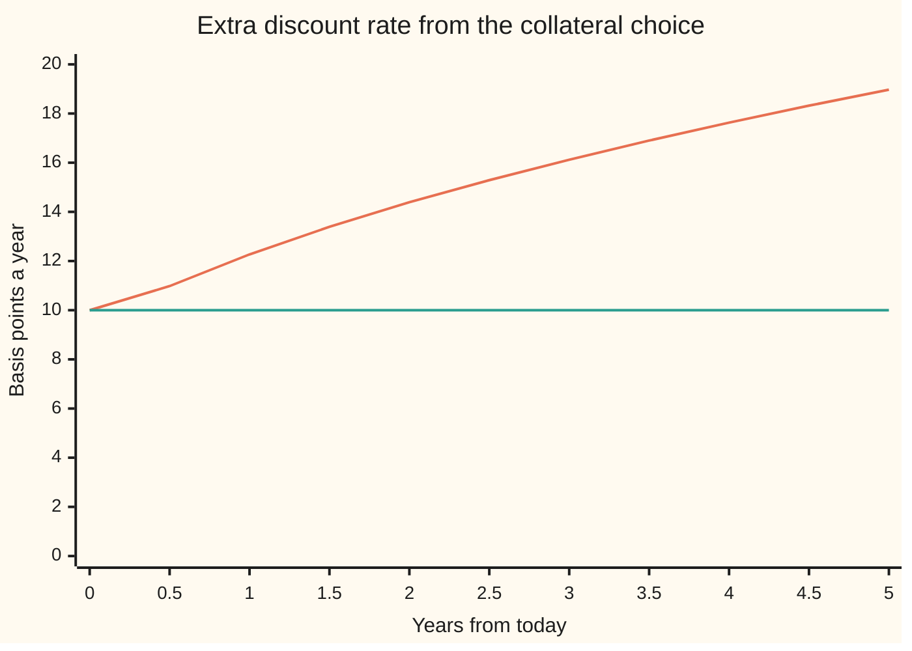

# Collateral in several currencies: the poster picks the cheapest, and the option that choice is worth

[Syllabus](../../../SYLLABUS.md) → [Financial mathematics](../README.md) → [Collateral, Funding and the Rest of the XVAs](../README.md#s47) → Collateral in several currencies

---

## General Overview

A bank holds an old five-year dollar swap with a European insurer. On \$100 million, the bank receives a fixed 5.00% a year and pays SOFR (the dollar overnight rate) compounded over each year. Today the floating side is forecast at 4.0811% a year, so the bank nets \$918,922.58 at each of the five year ends. On the dollar overnight curve the swap is worth **\$4,081,579.13** to the bank.

The insurer owes that value, so it posts cash collateral. The collateral agreement, the **credit support annex** (CSA), gives the poster a list: dollar cash, on which the holder pays SOFR, or euro cash, on which it pays €STR (the euro overnight rate). Euros sent through the currency market and back are worth 10 basis points (bp, hundredths of a percent) a year more than dollars today. The insurer sends euros.

That choice lowers the bank's value, because the collateral rate is the discount rate. And the choice is not made once. The insurer can switch currency whenever the gap changes sign. That right is an option, and on this swap it costs the bank **\$16,287.12**: \$11,896.99 for today's 10 bp gap, and \$4,390.13 for the right to switch later.

**When the poster may choose the collateral currency, every rate is compared in one currency, the poster delivers whichever pays the most, the trade is discounted at that highest rate, and the right to switch is a strip of options on the rate gap whose value is the collateral valuation adjustment, ColVA.**

**What kind of fact this is:** the highest-rate discounting is a theorem, proved on this card in Why it works, given collateral that can be swapped freely and a market with one collateral rate per currency. The value of the switch rests on a model: the gap moves along a bell curve whose standard deviation is 15 bp after one year (the Bachelier model).

### The picture: what the insurer's choice costs the bank

```
ColVA on the bank's swap, dollars (all three are losses to the bank)
today's 10 bp gap, frozen  ███████████████████████           11,896.99
the right to switch later  █████████                          4,390.13
ColVA, total               ████████████████████████████████  16,287.12
```

The top bar is what a desk sees if it picks today's cheapest currency and stops there. The middle bar is the part that only a model of the moving gap can see.

---

## The formula

Notation first, in words. All rates are yearly rates, continuously compounded. $`r`$ is SOFR, $`r_E`$ is €STR, and $`y`$ is the euro rate implied by the currency forward ([Cross-currency swaps](../28-Swaps/06-cross-currency-swaps-and-basis.md) reads it off the forward; it writes the euro overnight rate as $`r_f`$ and calls $`y - r_f`$ the implied funding difference).

Euro collateral, turned into dollars and back through the currency market, earns $`r_E + (r - y)`$ in dollar terms. Its **spread** over dollar collateral is

```math
s(t) = \bigl(r_E + r - y\bigr) - r = r_E - y
```

**Read it aloud:** the euro collateral's edge, in dollars, is the gap between €STR and the euro rate the forward implies; the two overnight levels cancel.

The **collateral rate** that discounts the trade is the best rate on the list, re-chosen at every instant $`t`$:

```math
r_c(t) = r + \max\bigl(s(t),\, 0\bigr)
```

A dollar paid at year $`T`$ is then worth today, with $`\mathbb{E}`$ the average under the pricing probabilities,

```math
D_{\mathrm{CTD}}(T) = D(T)\,\mathbb{E}\Bigl[e^{-\int_0^T \max(s(u),\,0)\,du}\Bigr] \approx D(T)\,e^{-\int_0^T c(u)\,du}
```

where $`D(T) = e^{-rT}`$ is the dollar overnight discount factor and $`c(u)`$ is the **switch rate**: the average of $`\max(s(u), 0)`$, a call on the spread struck at zero. CTD stands for **cheapest to deliver**, the market's name for the poster's best choice. With the spread at date $`u`$ on a bell curve centred on today's $`s_0`$, with standard deviation (typical distance from the centre) $`\sigma\sqrt{u}`$, Bachelier prices that call:

```math
c(u) = s_0\,N(d) + \sigma\sqrt{u}\;\varphi(d), \qquad d = \frac{s_0}{\sigma\sqrt{u}}
```

The adjustment is the swap's value with the choice minus its value with dollars only:

```math
\mathrm{ColVA} = \sum_{i=1}^{5} X_i\,\bigl(D_{\mathrm{CTD}}(i) - D(i)\bigr)
```

**Read it aloud:** discount the trade at the dollar rate plus the best currency's edge whenever it has one; the average edge at each date is a Bachelier call on the spread; ColVA is what that extra discounting does to the trade's cash flows.

| Symbol | Plain meaning | In our example | Push it up and ColVA… |
| --- | --- | --- | --- |
| $`r`$ | SOFR, the rate paid on dollar collateral | 4.00% | — (it is in both values) |
| $`r_E`$, $`y`$ | €STR; the euro rate the currency forward implies | 2.00%; 1.90% | $`r_E`$ up: a larger loss to the bank |
| $`s(t)`$, $`s_0`$ | spread of euro collateral over dollar collateral, in dollars; its value today | $`s_0`$ = 10 bp | a larger loss |
| $`\sigma`$ | normal volatility of the spread: its standard deviation after one year | 15 bp a year | a larger loss: a dearer switch |
| $`r_c(t)`$ | the collateral rate: the best rate on the list at $`t`$ | 4.10% today | — |
| $`c(t)`$ | the switch rate: the average edge at date $`t`$, a Bachelier call | 12.27 bp at 1 year, 18.97 bp at 5 | — |
| $`D(T)`$, $`D_{\mathrm{CTD}}(T)`$, $`I`$ | discount factor with dollar collateral only; with the choice; the extra yield to $`T`$ on one path, $`\int_0^T \max(s(u), 0)\,du`$ | 0.81873075; 0.81262516 at 5 years; $`I`$ averages 74.85 bp-years to 5 years | — |
| $`X_i`$, $`K`$, $`g`$ | the bank's net cash flow in year $`i`$; the fixed rate; the floating forecast | \$918,922.58; 5.00%; 4.0811% | a larger cash flow, a larger ColVA |
| $`N(x)`$, $`\varphi(x)`$, $`d`$ | bell-curve area to the left of $`x`$; its height ("phi"); the spread counted in standard deviations | $`d`$ = 0.6667 at 1 year | — |
| $`t`$, $`u`$, $`T`$, $`i`$ | dates and years from today; the year counter, 1 to 5 | 5 years | a longer trade, a larger loss |
| $`\mathbb{E}`$, Var; $`V`$, $`k`$, $`r_k`$, $`v`$, $`Z`$, $`z`$ | the average under the pricing probabilities; the variance (the squared standard deviation). In the proofs: a trade's value, a currency on the list and its rate in dollars, a standard deviation, a bell-curve draw and its value, each named where it appears | — | — |
| ColVA | value with the choice minus value with dollars only | −\$16,287.12 | — |

### When it holds

- **Both sides have the same list.** Then the rate is the maximum whoever posts, and every cash flow takes the same discount. If only one side may choose, the rate depends on the sign of the trade's value, and ColVA needs the trade's value simulated along each path, which no single discount curve gives.
- **Collateral can be swapped any day at no cost.** Real agreements often need the receiver's consent to swap posted collateral back. Collateral that "sticks" is re-chosen less often, and the switch is worth less than the strip priced here.
- **The spread is independent of SOFR and of the swap's cash flows.** Otherwise the average of a product is not the product of averages, and a correlation term appears.
- **A bell curve with a fixed volatility fits the gap.** The spread can go negative, which a bell curve allows and the percentage (lognormal) model does not. Sudden jumps, such as those in 2008 and 2020, are not on a bell curve and are underpriced.
- **First order in the average.** With $`I = \int_0^T \max(s(u), 0)\,du`$ the extra yield to $`T`$, the approximation $`\mathbb{E}[e^{-I}] \approx e^{-\mathbb{E}[I]}`$ drops an upward correction of about $`e^{-\mathbb{E}[I]}\,\mathrm{Var}(I)/2`$. The simulated paths below put it at 0.00002362 on the five-year factor: the same size as the simulation's standard error, 0.00002317, so the simulation cannot resolve it. Over the five cash flows it shrinks the loss by \$33.95, so the cents of ColVA on this card are those of the first-order formula.

---

## Why it works

### Step 0: collateral is a loan, and the poster picks the loan

On [Collateral discounting](../28-Swaps/05-ois-discounting-and-collateral.md), cash collateral is a loan from the poster to the holder, repaid with interest at the collateral rate. That loan finances the trade, so its rate is the discount rate.

With one currency there is one loan. With a list, the poster chooses which loan to make. It makes the one that pays it the most. So the holder pays the highest rate on the list, and the trade is discounted at that highest rate.

### Step 1: compare the rates in one currency

Euro cash earns 2.00% and dollar cash 4.00%. Read raw, dollars win by 2 points. But the insurer's money is in dollars. To post euros it sells dollars for euros today and buys them back forward, through an **FX swap** (a spot trade plus a forward trade in the opposite direction).

The forward is set by the market's euro rate in a dollar-funded world, $`y`$. The round trip earns the dollar holder $`r - y`$ = 2.10% a year on top of the euro interest. So euro collateral earns 2.00% + 2.10% = **4.10%** in dollars, against 4.00% for dollar collateral.

The spread is $`s_0 = r_E - y`$ = 10 bp. The overnight levels cancel; only the cross-currency basis (the gap between €STR and the forward's euro rate) decides.

### Step 2: one period, either side

Take the first cash flow, \$918,922.58 owed to the bank in a year. With dollar collateral it is worth $`918{,}922.58\,e^{-0.04}`$ = \$882,891.11. With euro collateral, $`918{,}922.58\,e^{-0.041}`$ = \$882,008.66. The insurer owes the cash flow; posting euros cuts its debt by **\$882.45**.

If the swap were worth less than zero to the bank, the bank would post, and it too would pick the highest rate, because a larger discount shrinks its debt. Whoever posts picks the maximum, so with a shared list the rate is $`r + \max(s, 0)`$ whatever the trade's sign.

<details>
<summary>Detailed proof: the poster's choice gives the maximum, for both signs</summary>

From Collateral discounting, a fully collateralised value $`V`$ grows on average at the collateral rate paid on it: under the pricing probabilities, $`\mathbb{E}[dV] = r_c V\,dt`$. If currency $`k`$ is posted, $`r_c = r_k`$, its rate in dollar terms.

Suppose $`V > 0`$: the counterparty posts. Over a short step $`dt`$, posting currency $`k`$ means the bank pays it $`r_k V\,dt`$ in dollar terms. The counterparty receives that, so it picks the $`k`$ with the largest $`r_k`$.

Suppose $`V < 0`$: the bank posts $`\lvert V\rvert`$ and receives $`r_k \lvert V\rvert\,dt`$. It picks the largest $`r_k`$ for the same reason.

In both cases $`r_c = \max_k r_k`$, so $`\mathbb{E}[dV] = (\max_k r_k)\,V\,dt`$ for every sign of $`V`$. The equation is linear in $`V`$, so its solution is

$`\displaystyle V(0) = \mathbb{E}\Bigl[e^{-\int_0^T \max_k r_k(u)\,du}\,V(T)\Bigr].`$

With two currencies, $`\max(r, r + s) = r + \max(s, 0)`$. With $`r`$ known and $`s`$ independent of the cash flows, the average splits into $`D(T)`$ times the average of $`e^{-\int \max(s,0)}`$, which is the formula for $`D_{\mathrm{CTD}}`$.

</details>

### Step 3: the choice is made every day, so it is a strip of options

The insurer is not bound to euros. If the basis moves and the spread turns negative, it swaps its euros for dollars. So the extra rate at each date is $`\max(s(t), 0)`$, the spread when positive and zero when not.

That is the payoff of a call on the spread struck at zero, one for every day of the trade. The order matters: the average of a maximum is at least the maximum of the averages. A desk that picks today's cheapest currency and keeps it discounts at a flat 10 bp and misses the strip's time value.

### Step 4: Bachelier prices each option

The spread can be negative, so a model that moves it in absolute basis points fits: [Bachelier](../05-Black-Scholes%20from%20the%20Ground%20Up/07-bachelier-model.md). With the spread at date $`u`$ on a bell curve centred on 10 bp, with standard deviation $`\sigma\sqrt{u}`$, the average of the positive part is $`c(u)`$ from The formula.

At one year, $`\sigma\sqrt{1}`$ = 15 bp and $`d`$ = 10/15 = 0.6667. The call is **12.27 bp**: 10 bp of intrinsic value (the payoff if the spread stayed put) and 2.27 bp of time value. At five years the spread could be one standard deviation, 33.54 bp, either side of 10 bp, and the call is 18.97 bp.



Orange, rising: the switch rate $`c(t)`$, the average edge the poster earns at date $`t`$. Green, flat: today's 10 bp held for ever. The gap between them is the time value of the switch, and it grows with the square root of time, as the spread's range does.

<details>
<summary>Detailed proof: the call on the spread, struck at zero</summary>

Write the spread at date $`u`$ as $`s_0 + v Z`$, with $`v = \sigma\sqrt{u}`$ and $`Z`$ a standard bell-curve draw. The positive part is $`s_0 + vZ`$ when $`Z > -s_0/v = -d`$, and zero otherwise. So

$`\displaystyle \mathbb{E}\bigl[\max(s, 0)\bigr] = \int_{-d}^{\infty} (s_0 + v z)\,\varphi(z)\,dz = s_0\,N(d) + v\,\varphi(d),`$

using $`\int_{-d}^\infty \varphi = N(d)`$ and $`\int_{-d}^\infty z\,\varphi(z)\,dz = \varphi(-d) = \varphi(d)`$, since $`\varphi'(z) = -z\varphi(z)`$. This is the Bachelier call with forward $`s_0`$, strike 0 and no discounting.

</details>

### Step 5: build the cheapest-to-deliver curve

Add the switch rate up over time. The discount factor to year $`T`$ is $`D(T)`$ times $`e^{-\int_0^T c(u)\,du}`$. The checks do the integral by Simpson's rule (a weighted sum over a fine grid of dates, spaced by the square root of time so that a curve rising like $`\sqrt{u}`$ from the start, as it does when the spread starts at zero, costs no accuracy). Over five years it is 74.85 bp-years.

| Year | Average switch rate in the year | $`D(i)`$, dollars only | $`D_{\mathrm{CTD}}(i)`$ |
| --- | ---: | ---: | ---: |
| 1 | 11.01 bp | 0.96078944 | 0.95973264 |
| 2 | 13.37 bp | 0.92311635 | 0.92086913 |
| 3 | 15.28 bp | 0.88692044 | 0.88341058 |
| 4 | 16.89 bp | 0.85214379 | 0.84733911 |
| 5 | 18.31 bp | 0.81873075 | 0.81262516 |

The CTD curve sits below the dollar curve, and further below each year.

### Step 6: ColVA is the value of the choice

Discount the five cash flows on each curve. Dollars only: \$4,081,579.13. Euros at today's 10 bp, frozen: \$4,069,682.14. With the switch: **\$4,065,292.01**. ColVA is the last minus the first, −\$16,287.12.

It splits in two. The **intrinsic part**, −\$11,896.99, is today's 10 bp gap applied for five years. The **switch option part**, −\$4,390.13, is the time value of the strip. Spread over the swap's annuity, ColVA is −0.37 bp a year on the notional.

The sign follows the trade. Here the bank is owed, so the insurer holds the live side of the choice and ColVA is a loss. On a swap worth less than zero to the bank, the same formula gives the bank a gain.

### The other roads: the bell curve by hand, and simulated spreads

Road 2 skips the Bachelier formula. It averages $`\max(s, 0)`$ over the bell curve directly, by Simpson's rule over spread values. At every year it agrees with $`c(t)`$ to twelve decimal places.

Road 3 simulates the spread: 20,000 paths, weekly steps for five years, in mirror-image pairs. On each path it adds up $`\max(s, 0)`$ over time and takes $`e^{-\text{total}}`$, with no first-order shortcut. The five-year factor comes out at 0.99252524, against 0.99254261 from the formula, with a standard error (the likely size of the simulation's random error) of 0.00002317. That is the size of the convexity the formula leaves out (When it holds), so the simulation confirms the formula but cannot see that correction. Priced on the simulated factors, the swap is \$4,065,262.47.

The simulation also checks a single-currency case with an exact answer. With euros only, the factor is $`e^{-s_0 T + \sigma^2 T^3/6}`$ = 0.99505912; the paths give 0.99506045.

---

## Worked numbers, by hand

The swap: \$100 million, bank receives 5.00% fixed, pays SOFR compounded, five annual payments. SOFR 4.00%, €STR 2.00%, forward-implied euro rate 1.90%, spread volatility 15 bp a year.

| Step | Arithmetic | Value |
| --- | --- | --- |
| floating forecast $`g`$ | $`e^{0.04} - 1`$ | 4.0811% |
| net cash flow $`X_i`$ | $`100{,}000{,}000 \times (0.05 - 0.040811)`$ | \$918,922.58 |
| euro collateral in dollars | $`2.00\% + (4.00\% - 1.90\%)`$ | 4.10% |
| spread today $`s_0`$ | $`4.10\% - 4.00\%`$ | 10 bp |
| switch rate at 1 year | $`10\,N(0.6667) + 15\,\varphi(0.6667)`$ | 12.27 bp |
| switch rate at 5 years | $`10\,N(0.2981) + 33.54\,\varphi(0.2981)`$ | 18.97 bp |
| extra yield to 5 years | Simpson's rule on $`c(u)`$ from 0 to 5 | 74.85 bp-years |
| $`D_{\mathrm{CTD}}(5)`$ | $`e^{-0.20} \times e^{-0.007485}`$ | 0.81262516 |
| swap, dollars only | $`918{,}922.58 \times (D(1) + \dots + D(5))`$ | \$4,081,579.13 |
| swap, with the choice | $`918{,}922.58 \times (D_{\mathrm{CTD}}(1) + \dots + D_{\mathrm{CTD}}(5))`$ | \$4,065,292.01 |
| intrinsic part | discount at 10 bp flat, minus dollars only | −\$11,896.99 |
| switch option part | with the choice, minus 10 bp flat | −\$4,390.13 |
| **ColVA** | $`4{,}065{,}292.01 - 4{,}081{,}579.13`$ | **−\$16,287.12** |

The insurer's right to pick its collateral currency takes \$16,287.12 off the bank's swap. About a quarter of it comes from the right to switch later, which no single discount curve built from today's quotes shows.

### What breaks if you drop a piece

Correct ColVA: −\$16,287.12.

| Mistake | Comes out at | What went wrong |
| --- | --- | --- |
| Pick today's cheapest currency and keep it | −\$11,896.99 | Drops the switch option: the poster re-chooses every day |
| Compare raw €STR with SOFR | \$0.00 | 2.00% against 4.00% hides the 2.10% the FX swap earns; rates must be in one currency |
| Let the holder choose (the minimum) | +\$4,415.52 | The wrong side: the poster chooses, and takes the highest rate |
| Use the 5-year switch rate for every year | −\$22,533.70 | Each date needs its own option, with its own time to that date |

---

## Code, from first principles, and it actually runs

The checks write their own bell curve, Simpson's rule and random numbers. They price the switch rate three independent ways: the Bachelier formula (Road 1), Simpson's rule over the bell curve (Road 2), and simulated spread paths (Road 3). They also check the euro-only case against its exact formula, the integral at a zero spread against its closed form, and the dollar-only swap against fixed-minus-floating times the annuity. Four mutations were tried: shrinking the call's time-value term, changing the euro-only formula, stretching the integral and inflating the simulated volatility. Each made an assert fail.

### Python

```python
# Multi-currency CSA and ColVA -- the check behind the card.  Standard library only.
# A 5-year USD swap whose CSA lets the poster deliver USD cash (earns SOFR) or EUR cash
# (earns ESTR, worth SOFR + s in dollars).  The spread s is normal: today 10 bp, vol 15 bp a year.
# Road 1: Bachelier on each instant, integrated by Simpson.  Road 2: quadrature over the bell
# curve.  Road 3: Monte Carlo spread paths.  Nothing imported knows the answer.
from math import exp, sqrt, pi, log, cos

def phi(x): return exp(-x * x / 2) / sqrt(2 * pi)
def N(x):  # normal CDF, Hart's rational approximation (double precision)
    a = abs(x); e = exp(-a * a / 2)
    if a > 37: c = 0.0
    elif a < 7.07106781186547:
        p = (((((0.0352624965998911 * a + 0.700383064443688) * a + 6.37396220353165) * a + 33.912866078383) * a + 112.079291497871) * a + 221.213596169931) * a + 220.206867912376
        s = ((((((0.0883883476483184 * a + 1.75566716318264) * a + 16.064177579207) * a + 86.7807322029461) * a + 296.564248779674) * a + 637.333633378831) * a + 793.826512519948) * a + 440.413735824752
        c = e * p / s
    else: c = e / (a + 1 / (a + 2 / (a + 3 / (a + 4 / (a + 0.65))))) / 2.506628274631
    return 1 - c if x > 0 else c

def simpson(f, a, b, n):
    h = (b - a) / n
    return h / 3 * sum((1 if i in (0, n) else 4 if i % 2 else 2) * f(a + i * h) for i in range(n + 1))

SOFR, ESTR, Y = 0.04, 0.02, 0.019        # continuous rates; Y = euro rate implied by the FX forward
S0, SIG = ESTR - Y, 0.0015                # spread of EUR collateral over SOFR today; normal vol a year
NOT, K, T = 100e6, 0.05, 5                # notional, fixed rate received, years
g = exp(SOFR) - 1                         # SOFR compounded over a year: the floating forecast
cf = NOT * (K - g)                        # the bank's net cash flow each year end
bp = 1e-4

def call(t, s0=S0, sig=SIG):  # Bachelier: E[max(s_t, 0)], the switch option's rate at date t
    sd = sig * sqrt(t)
    if sd == 0: return max(s0, 0.0)
    return s0 * N(s0 / sd) + sd * phi(s0 / sd)

def M(t, s0=S0, sig=SIG):  # integral of the switch rate from 0 to t: the CTD curve's extra yield,
    # over w = sqrt(u), which smooths the sqrt(u) kink at the start: du = 2w dw
    return simpson(lambda w: 2 * w * call(w * w, s0, sig), 0.0, sqrt(t), 2000) if t > 0 else 0.0

def D(i): return exp(-SOFR * i)
def value(extra): return sum(cf * D(i) * exp(-extra(i)) for i in range(1, T + 1))
def colva(s0, sig): return value(lambda i: M(i, s0, sig)) - value(lambda i: 0.0)

print(f"EUR collateral in dollars: ESTR + (SOFR - implied) {100 * (ESTR + SOFR - Y):.4f}%")
print(f"  FX swap pickup, SOFR - implied euro rate, % {100 * (SOFR - Y):.4f}")
print(f"spread over SOFR today, bp                    {S0 / bp:.2f}")
print(f"floating forecast g, %                        {100 * g:.4f}")
print(f"net cash flow a year, dollars                 {cf:.2f}")

# ---- One period: the poster of collateral against the first cash flow picks the higher rate ----
usd1, eur1 = cf * exp(-SOFR), cf * exp(-(SOFR + S0))
print(f"first cash flow valued with USD collateral    {usd1:.2f}")
print(f"first cash flow valued with EUR collateral    {eur1:.2f}")
print(f"  poster's saving by delivering EUR           {usd1 - eur1:.2f}")

print(f"sigma sqrt(t), bp, and d at 1 and 5 years    {SIG / bp:.2f} {S0 / SIG:.4f}  {SIG * sqrt(5) / bp:.2f} {S0 / (SIG * sqrt(5)):.4f}")
# ---- Road 2: E[max(s_t, 0)] by Simpson over the spread's bell curve, no Bachelier formula ----
print("year  switch rate bp: Bachelier  quadrature  intrinsic   time value")
for t in range(1, T + 1):
    sd = SIG * sqrt(t)
    q = simpson(lambda x: x * phi((x - S0) / sd) / sd, 0.0, S0 + 12 * sd, 4000)
    assert abs(q - call(t)) < 1e-12
    print(f"  {t}       {call(t) / bp:10.4f}  {q / bp:10.4f}  {max(S0, 0) / bp:9.4f}  {(call(t) - max(S0, 0)) / bp:9.4f}")

# ---- Road 3: Monte Carlo spread paths, weekly, antithetic pairs ----
st = 0x2545F4914F6CDD1D; MASK = (1 << 64) - 1
def unif():  # xorshift64*, top 53 bits, never 0
    global st
    st ^= st >> 12; st ^= (st << 25) & MASK; st ^= st >> 27
    return ((((st * 2685821657736338717) & MASK) >> 11) + 0.5) / 9007199254740992.0

STEPS, PAIRS = 52, 10000; dt = 1 / STEPS; sq = SIG * sqrt(dt)
sumf = [0.0] * (T + 1); sumf2 = [0.0] * (T + 1); sumI = 0.0; sumI2 = 0.0; sumE = 0.0
sumY = [0.0] * (T + 1); sumY2 = [0.0] * (T + 1)   # each path's extra yield I to year i, and I^2
for p in range(PAIRS):
    a = b = S0; Ia = Ib = Ea = Eb = 0.0
    for k in range(1, STEPS * T + 1):
        z = sqrt(-2 * log(unif())) * cos(2 * pi * unif())
        a2, b2 = a + sq * z, b - sq * z
        Ia += (max(a, 0) + max(a2, 0)) * dt / 2; Ib += (max(b, 0) + max(b2, 0)) * dt / 2
        Ea += (a + a2) * dt / 2; Eb += (b + b2) * dt / 2
        a, b = a2, b2
        if k % STEPS == 0:
            i = k // STEPS; f = (exp(-Ia) + exp(-Ib)) / 2
            sumf[i] += f; sumf2[i] += f * f; sumY[i] += Ia + Ib; sumY2[i] += Ia * Ia + Ib * Ib
    x = (Ia + Ib) / 2; sumI += x; sumI2 += x * x; sumE += (exp(-Ea) + exp(-Eb)) / 2
mc = [0.0] + [sumf[i] / PAIRS for i in range(1, T + 1)]
se = [0.0] + [sqrt((sumf2[i] / PAIRS - mc[i] ** 2) / PAIRS) for i in range(1, T + 1)]
mI = sumI / PAIRS; seI = sqrt((sumI2 / PAIRS - mI * mI) / PAIRS)
cvx = [0.0] + [exp(-M(i)) * (sumY2[i] / (2 * PAIRS) - (sumY[i] / (2 * PAIRS)) ** 2) / 2 for i in range(1, T + 1)]

print("year  period avg bp   D SOFR      D CTD      MC factor  first order  MC s.e.")
for i in range(1, T + 1):
    f1 = exp(-M(i))
    assert abs(mc[i] - f1) < 4 * se[i] + 2e-6    # convexity is about one standard error
    print(f"  {i}      {(M(i) - M(i - 1)) / bp:7.4f}   {D(i):.8f} {D(i) * f1:.8f}  {mc[i]:.8f} {f1:.8f}  {se[i]:.8f}")
print(f"convexity Var(I)/2 x factor, 5 years, MC     {cvx[T]:.8f}")
print(f"5-year extra yield, integral, bp-years        {M(T) / bp:.4f}")
print(f"  Monte Carlo average, s.e.                   {mI / bp:.4f}  {seI / bp:.4f}")
assert abs(mI - M(T)) < 4 * seI + 2e-7           # weekly trapezoid bias is tiny
eur_exact = exp(-S0 * T + SIG ** 2 * T ** 3 / 6)  # EUR-only CSA: Gaussian integral in closed form
print(f"EUR-only factor at 5 years: closed, MC        {eur_exact:.8f}  {sumE / PAIRS:.8f}")
assert abs(sumE / PAIRS - eur_exact) < 1e-5

V_usd = value(lambda i: 0.0)
V_frozen = value(lambda i: max(S0, 0) * i)
V_ctd = value(lambda i: M(i))
V_mc = sum(cf * D(i) * mc[i] for i in range(1, T + 1))
V_eur = value(lambda i: S0 * i - SIG ** 2 * i ** 3 / 6)
V_recv = value(lambda i: S0 * i - M(i))           # wrong: receiver picks, so min(s, 0)
A = sum(D(i) for i in range(1, T + 1))
annuity_check = NOT * (K - g) * A
assert abs(annuity_check - V_usd) < 1e-6
print(f"swap, USD-only CSA (SOFR)                     {V_usd:.2f}")
print(f"swap, EUR-only CSA                            {V_eur:.2f}")
print(f"swap, choice frozen at today's spread         {V_frozen:.2f}")
print(f"swap, choice with the switch option           {V_ctd:.2f}")
print(f"  same, Monte Carlo factors                   {V_mc:.2f}")
print(f"ColVA = choice minus USD-only                 {V_ctd - V_usd:.2f}")
print(f"  intrinsic part (10 bp frozen)               {V_frozen - V_usd:.2f}")
print(f"  switch option part (time value)             {V_ctd - V_frozen:.2f}")
print(f"  ColVA as running bp on notional             {(V_ctd - V_usd) / (NOT * A) / bp:.4f}")
print(f"  convexity's effect on ColVA, MC Var(I)      {sum(cf * D(i) * cvx[i] for i in range(1, T + 1)):.2f}")
assert V_ctd < V_frozen < V_usd and V_ctd < V_eur
assert abs(V_mc - V_ctd) < 4 * sum(abs(cf) * D(i) * se[i] for i in range(1, T + 1)) + 50
print(f"wrong: receiver chooses (min)                 {V_recv:.2f}")
print(f"  its ColVA                                   {V_recv - V_usd:.2f}")
print(f"wrong: compare raw ESTR with SOFR, ColVA      {value(lambda i: max(ESTR - SOFR, 0) * i) - V_usd:.2f}")
print(f"wrong: 5-year rate for every year, ColVA      {value(lambda i: call(T) * i) - V_usd:.2f}")
for s0, sig in ((0.0010, 0.0), (0.0010, 0.0030), (0.0, 0.0015), (-0.0010, 0.0015)):
    print(f"try: spread {s0 / bp:+3.0f} bp, vol {sig / bp:2.0f} bp, ColVA          {colva(s0, sig):.2f}")
assert abs(colva(0.0010, 0.0) - (V_frozen - V_usd)) < 1e-6
assert abs(M(T, 0.0) - SIG / sqrt(2 * pi) * 2 / 3 * T ** 1.5) < 1e-13   # spread 0: closed form
print("chart, switch rate bp at t = 0, 0.5, ..., 5:")
print("  " + " ".join(f"{call(j / 2) / bp:.2f}" for j in range(11)))
print("ALL CHECKS PASS")
```

**Ran 2026-11-23 on macOS, Python 3.14.10, standard library only. All checks passed. Output, pasted from the run:**

```
EUR collateral in dollars: ESTR + (SOFR - implied) 4.1000%
  FX swap pickup, SOFR - implied euro rate, % 2.1000
spread over SOFR today, bp                    10.00
floating forecast g, %                        4.0811
net cash flow a year, dollars                 918922.58
first cash flow valued with USD collateral    882891.11
first cash flow valued with EUR collateral    882008.66
  poster's saving by delivering EUR           882.45
sigma sqrt(t), bp, and d at 1 and 5 years    15.00 0.6667  33.54 0.2981
year  switch rate bp: Bachelier  quadrature  intrinsic   time value
  1          12.2668     12.2668    10.0000     2.2668
  2          14.3861     14.3861    10.0000     4.3861
  3          16.1232     16.1232    10.0000     6.1232
  4          17.6271     17.6271    10.0000     7.6271
  5          18.9713     18.9713    10.0000     8.9713
year  period avg bp   D SOFR      D CTD      MC factor  first order  MC s.e.
  1      11.0054   0.96078944 0.95973264  0.99889913 0.99890007  0.00000152
  2      13.3681   0.92311635 0.92086913  0.99756216 0.99756562  0.00000524
  3      15.2786   0.88692044 0.88341058  0.99603749 0.99604264  0.00001026
  4      16.8909   0.85214379 0.84733911  0.99435080 0.99436166  0.00001630
  5      18.3104   0.81873075 0.81262516  0.99252524 0.99254261  0.00002317
convexity Var(I)/2 x factor, 5 years, MC     0.00002362
5-year extra yield, integral, bp-years        74.8534
  Monte Carlo average, s.e.                   75.2657  0.2364
EUR-only factor at 5 years: closed, MC        0.99505912  0.99506045
swap, USD-only CSA (SOFR)                     4081579.13
swap, EUR-only CSA                            4069747.05
swap, choice frozen at today's spread         4069682.14
swap, choice with the switch option           4065292.01
  same, Monte Carlo factors                   4065262.47
ColVA = choice minus USD-only                 -16287.12
  intrinsic part (10 bp frozen)               -11896.99
  switch option part (time value)             -4390.13
  ColVA as running bp on notional             -0.3667
  convexity's effect on ColVA, MC Var(I)      33.95
wrong: receiver chooses (min)                 4085994.65
  its ColVA                                   4415.52
wrong: compare raw ESTR with SOFR, ColVA      0.00
wrong: 5-year rate for every year, ColVA      -22533.70
try: spread +10 bp, vol  0 bp, ColVA          -11896.99
try: spread +10 bp, vol 30 bp, ColVA          -24390.86
try: spread  +0 bp, vol 15 bp, ColVA          -8839.93
try: spread -10 bp, vol 15 bp, ColVA          -4407.80
chart, switch rate bp at t = 0, 0.5, ..., 5:
  10.00 10.98 12.27 13.39 14.39 15.29 16.12 16.90 17.63 18.32 18.97
ALL CHECKS PASS
```

### Rust

```rust
// Multi-currency CSA and ColVA -- the check behind the card.  std only, no crates.
// A 5-year USD swap whose CSA lets the poster deliver USD cash (earns SOFR) or EUR cash
// (earns ESTR, worth SOFR + s in dollars).  The spread s is normal: today 10 bp, vol 15 bp a year.
// Road 1: Bachelier on each instant, integrated by Simpson.  Road 2: quadrature over the bell
// curve.  Road 3: Monte Carlo spread paths.  Same numbers and labels as the Python check.
use std::f64::consts::PI;

const SOFR: f64 = 0.04; const ESTR: f64 = 0.02; const Y: f64 = 0.019;
const SIG: f64 = 0.0015; const NOT: f64 = 100e6; const K: f64 = 0.05; const T: usize = 5;
const BP: f64 = 1e-4;

fn phi(x: f64) -> f64 { (-x * x / 2.0).exp() / (2.0 * PI).sqrt() }
fn ncdf(x: f64) -> f64 { // normal CDF, Hart's rational approximation (double precision)
    let a = x.abs(); let e = (-a * a / 2.0).exp();
    let c = if a > 37.0 { 0.0 } else if a < 7.07106781186547 {
        let p = (((((0.0352624965998911 * a + 0.700383064443688) * a + 6.37396220353165) * a + 33.912866078383) * a + 112.079291497871) * a + 221.213596169931) * a + 220.206867912376;
        let s = ((((((0.0883883476483184 * a + 1.75566716318264) * a + 16.064177579207) * a + 86.7807322029461) * a + 296.564248779674) * a + 637.333633378831) * a + 793.826512519948) * a + 440.413735824752;
        e * p / s
    } else { e / (a + 1.0 / (a + 2.0 / (a + 3.0 / (a + 4.0 / (a + 0.65))))) / 2.506628274631 };
    if x > 0.0 { 1.0 - c } else { c }
}
fn simpson<F: Fn(f64) -> f64>(f: F, a: f64, b: f64, n: usize) -> f64 {
    let h = (b - a) / n as f64; let mut s = 0.0;
    for i in 0..=n {
        let w = if i == 0 || i == n { 1.0 } else if i % 2 == 1 { 4.0 } else { 2.0 };
        s += w * f(a + i as f64 * h);
    }
    h / 3.0 * s
}
// Bachelier: E[max(s_t, 0)], the switch option's rate at date t
fn call(t: f64, s0: f64, sig: f64) -> f64 {
    let sd = sig * t.sqrt();
    if sd == 0.0 { return s0.max(0.0); }
    s0 * ncdf(s0 / sd) + sd * phi(s0 / sd)
}
// integral of the switch rate from 0 to t: the CTD curve's extra yield,
// over w = sqrt(u), which smooths the sqrt(u) kink at the start: du = 2w dw
fn mm(t: f64, s0: f64, sig: f64) -> f64 {
    if t > 0.0 { simpson(|w| 2.0 * w * call(w * w, s0, sig), 0.0, t.sqrt(), 2000) } else { 0.0 }
}
fn d(i: usize) -> f64 { (-SOFR * i as f64).exp() }
fn cflow() -> f64 { NOT * (K - (SOFR.exp() - 1.0)) }
fn value<F: Fn(usize) -> f64>(extra: F) -> f64 {
    let mut s = 0.0;
    for i in 1..=T { s += cflow() * d(i) * (-extra(i)).exp(); }
    s
}
fn colva(s0: f64, sig: f64) -> f64 { value(|i| mm(i as f64, s0, sig)) - value(|_| 0.0) }

struct Rng(u64);
impl Rng { // xorshift64*, top 53 bits, never 0
    fn unif(&mut self) -> f64 {
        self.0 ^= self.0 >> 12; self.0 ^= self.0 << 25; self.0 ^= self.0 >> 27;
        ((self.0.wrapping_mul(2685821657736338717) >> 11) as f64 + 0.5) / 9007199254740992.0
    }
}

fn main() {
    let s0 = ESTR - Y; let g = SOFR.exp() - 1.0; let cf = cflow();
    let m = |t: f64| mm(t, s0, SIG);
    let c = |t: f64| call(t, s0, SIG);
    println!("EUR collateral in dollars: ESTR + (SOFR - implied) {:.4}%", 100.0 * (ESTR + SOFR - Y));
    println!("  FX swap pickup, SOFR - implied euro rate, % {:.4}", 100.0 * (SOFR - Y));
    println!("spread over SOFR today, bp                    {:.2}", s0 / BP);
    println!("floating forecast g, %                        {:.4}", 100.0 * g);
    println!("net cash flow a year, dollars                 {:.2}", cf);

    // One period: the poster of collateral against the first cash flow picks the higher rate
    let usd1 = cf * (-SOFR).exp(); let eur1 = cf * (-(SOFR + s0)).exp();
    println!("first cash flow valued with USD collateral    {:.2}", usd1);
    println!("first cash flow valued with EUR collateral    {:.2}", eur1);
    println!("  poster's saving by delivering EUR           {:.2}", usd1 - eur1);

    println!("sigma sqrt(t), bp, and d at 1 and 5 years    {:.2} {:.4}  {:.2} {:.4}", SIG / BP, s0 / SIG, SIG * 5f64.sqrt() / BP, s0 / (SIG * 5f64.sqrt()));
    // Road 2: E[max(s_t, 0)] by Simpson over the spread's bell curve, no Bachelier formula
    println!("year  switch rate bp: Bachelier  quadrature  intrinsic   time value");
    for t in 1..=T {
        let tf = t as f64; let sd = SIG * tf.sqrt();
        let q = simpson(|x| x * phi((x - s0) / sd) / sd, 0.0, s0 + 12.0 * sd, 4000);
        assert!((q - c(tf)).abs() < 1e-12);
        println!("  {}       {:10.4}  {:10.4}  {:9.4}  {:9.4}", t, c(tf) / BP, q / BP, s0.max(0.0) / BP, (c(tf) - s0.max(0.0)) / BP);
    }

    // Road 3: Monte Carlo spread paths, weekly, antithetic pairs
    let mut rng = Rng(0x2545F4914F6CDD1D);
    let steps = 52usize; let pairs = 10000usize; let dt = 1.0 / steps as f64; let sq = SIG * dt.sqrt();
    let mut sumf = [0.0f64; T + 1]; let mut sumf2 = [0.0f64; T + 1];
    let (mut sum_i, mut sum_i2, mut sum_e) = (0.0f64, 0.0f64, 0.0f64);
    let mut sum_y = [0.0f64; T + 1]; let mut sum_y2 = [0.0f64; T + 1]; // each path's extra yield I to year i, and I^2
    for _ in 0..pairs {
        let (mut a, mut b) = (s0, s0);
        let (mut ia, mut ib, mut ea, mut eb) = (0.0f64, 0.0f64, 0.0f64, 0.0f64);
        for k in 1..=steps * T {
            let u1 = rng.unif(); let u2 = rng.unif();
            let z = (-2.0 * u1.ln()).sqrt() * (2.0 * PI * u2).cos();
            let (a2, b2) = (a + sq * z, b - sq * z);
            ia += (a.max(0.0) + a2.max(0.0)) * dt / 2.0; ib += (b.max(0.0) + b2.max(0.0)) * dt / 2.0;
            ea += (a + a2) * dt / 2.0; eb += (b + b2) * dt / 2.0;
            a = a2; b = b2;
            if k % steps == 0 {
                let i = k / steps; let f = ((-ia).exp() + (-ib).exp()) / 2.0;
                sumf[i] += f; sumf2[i] += f * f; sum_y[i] += ia + ib; sum_y2[i] += ia * ia + ib * ib;
            }
        }
        let x = (ia + ib) / 2.0; sum_i += x; sum_i2 += x * x; sum_e += ((-ea).exp() + (-eb).exp()) / 2.0;
    }
    let pf = pairs as f64;
    let mut mc = [0.0f64; T + 1]; let mut se = [0.0f64; T + 1];
    for i in 1..=T { mc[i] = sumf[i] / pf; se[i] = ((sumf2[i] / pf - mc[i] * mc[i]) / pf).sqrt(); }
    let m_i = sum_i / pf; let se_i = ((sum_i2 / pf - m_i * m_i) / pf).sqrt();
    let mut cvx = [0.0f64; T + 1];
    for i in 1..=T { cvx[i] = (-m(i as f64)).exp() * (sum_y2[i] / (2.0 * pf) - (sum_y[i] / (2.0 * pf)).powi(2)) / 2.0; }

    println!("year  period avg bp   D SOFR      D CTD      MC factor  first order  MC s.e.");
    for i in 1..=T {
        let f1 = (-m(i as f64)).exp();
        assert!((mc[i] - f1).abs() < 4.0 * se[i] + 2e-6); // convexity is about one standard error
        println!("  {}      {:7.4}   {:.8} {:.8}  {:.8} {:.8}  {:.8}", i, (m(i as f64) - m((i - 1) as f64)) / BP, d(i), d(i) * f1, mc[i], f1, se[i]);
    }
    println!("convexity Var(I)/2 x factor, 5 years, MC     {:.8}", cvx[T]);
    println!("5-year extra yield, integral, bp-years        {:.4}", m(T as f64) / BP);
    println!("  Monte Carlo average, s.e.                   {:.4}  {:.4}", m_i / BP, se_i / BP);
    assert!((m_i - m(T as f64)).abs() < 4.0 * se_i + 2e-7); // weekly trapezoid bias is tiny
    let eur_exact = (-s0 * T as f64 + SIG * SIG * 125.0 / 6.0).exp(); // EUR-only CSA, closed form
    println!("EUR-only factor at 5 years: closed, MC        {:.8}  {:.8}", eur_exact, sum_e / pf);
    assert!((sum_e / pf - eur_exact).abs() < 1e-5);

    let v_usd = value(|_| 0.0);
    let v_frozen = value(|i| s0.max(0.0) * i as f64);
    let v_ctd = value(|i| m(i as f64));
    let mut v_mc = 0.0; for i in 1..=T { v_mc += cf * d(i) * mc[i]; }
    let v_eur = value(|i| s0 * i as f64 - SIG * SIG * (i * i * i) as f64 / 6.0);
    let v_recv = value(|i| s0 * i as f64 - m(i as f64)); // wrong: receiver picks, so min(s, 0)
    let mut ann = 0.0; for i in 1..=T { ann += d(i); }
    let annuity_check = NOT * (K - g) * ann;
    assert!((annuity_check - v_usd).abs() < 1e-6);
    println!("swap, USD-only CSA (SOFR)                     {:.2}", v_usd);
    println!("swap, EUR-only CSA                            {:.2}", v_eur);
    println!("swap, choice frozen at today's spread         {:.2}", v_frozen);
    println!("swap, choice with the switch option           {:.2}", v_ctd);
    println!("  same, Monte Carlo factors                   {:.2}", v_mc);
    println!("ColVA = choice minus USD-only                 {:.2}", v_ctd - v_usd);
    println!("  intrinsic part (10 bp frozen)               {:.2}", v_frozen - v_usd);
    println!("  switch option part (time value)             {:.2}", v_ctd - v_frozen);
    println!("  ColVA as running bp on notional             {:.4}", (v_ctd - v_usd) / (NOT * ann) / BP);
    let mut cvx_usd = 0.0; for i in 1..=T { cvx_usd += cf * d(i) * cvx[i]; }
    println!("  convexity's effect on ColVA, MC Var(I)      {:.2}", cvx_usd);
    assert!(v_ctd < v_frozen && v_frozen < v_usd && v_ctd < v_eur);
    let mut tol = 50.0; for i in 1..=T { tol += 4.0 * cf.abs() * d(i) * se[i]; }
    assert!((v_mc - v_ctd).abs() < tol);
    println!("wrong: receiver chooses (min)                 {:.2}", v_recv);
    println!("  its ColVA                                   {:.2}", v_recv - v_usd);
    println!("wrong: compare raw ESTR with SOFR, ColVA      {:.2}", value(|i| (ESTR - SOFR).max(0.0) * i as f64) - v_usd);
    println!("wrong: 5-year rate for every year, ColVA      {:.2}", value(|i| c(T as f64) * i as f64) - v_usd);
    for (a, b) in [(0.0010, 0.0), (0.0010, 0.0030), (0.0, 0.0015), (-0.0010, 0.0015)] {
        println!("try: spread {:+3.0} bp, vol {:2.0} bp, ColVA          {:.2}", a / BP, b / BP, colva(a, b));
    }
    assert!((colva(0.0010, 0.0) - (v_frozen - v_usd)).abs() < 1e-6);
    assert!((mm(T as f64, 0.0, SIG) - SIG / (2.0 * PI).sqrt() * 2.0 / 3.0 * (T as f64).powf(1.5)).abs() < 1e-13); // spread 0: closed form
    println!("chart, switch rate bp at t = 0, 0.5, ..., 5:");
    let pts: Vec<String> = (0..11).map(|j| format!("{:.2}", c(j as f64 / 2.0) / BP)).collect();
    println!("  {}", pts.join(" "));
    println!("ALL CHECKS PASS");
}
```

**Ran 2026-11-23 on macOS, rustc 1.98.1, no crates. All checks passed. Output, pasted from the run:**

```
EUR collateral in dollars: ESTR + (SOFR - implied) 4.1000%
  FX swap pickup, SOFR - implied euro rate, % 2.1000
spread over SOFR today, bp                    10.00
floating forecast g, %                        4.0811
net cash flow a year, dollars                 918922.58
first cash flow valued with USD collateral    882891.11
first cash flow valued with EUR collateral    882008.66
  poster's saving by delivering EUR           882.45
sigma sqrt(t), bp, and d at 1 and 5 years    15.00 0.6667  33.54 0.2981
year  switch rate bp: Bachelier  quadrature  intrinsic   time value
  1          12.2668     12.2668    10.0000     2.2668
  2          14.3861     14.3861    10.0000     4.3861
  3          16.1232     16.1232    10.0000     6.1232
  4          17.6271     17.6271    10.0000     7.6271
  5          18.9713     18.9713    10.0000     8.9713
year  period avg bp   D SOFR      D CTD      MC factor  first order  MC s.e.
  1      11.0054   0.96078944 0.95973264  0.99889913 0.99890007  0.00000152
  2      13.3681   0.92311635 0.92086913  0.99756216 0.99756562  0.00000524
  3      15.2786   0.88692044 0.88341058  0.99603749 0.99604264  0.00001026
  4      16.8909   0.85214379 0.84733911  0.99435080 0.99436166  0.00001630
  5      18.3104   0.81873075 0.81262516  0.99252524 0.99254261  0.00002317
convexity Var(I)/2 x factor, 5 years, MC     0.00002362
5-year extra yield, integral, bp-years        74.8534
  Monte Carlo average, s.e.                   75.2657  0.2364
EUR-only factor at 5 years: closed, MC        0.99505912  0.99506045
swap, USD-only CSA (SOFR)                     4081579.13
swap, EUR-only CSA                            4069747.05
swap, choice frozen at today's spread         4069682.14
swap, choice with the switch option           4065292.01
  same, Monte Carlo factors                   4065262.47
ColVA = choice minus USD-only                 -16287.12
  intrinsic part (10 bp frozen)               -11896.99
  switch option part (time value)             -4390.13
  ColVA as running bp on notional             -0.3667
  convexity's effect on ColVA, MC Var(I)      33.95
wrong: receiver chooses (min)                 4085994.65
  its ColVA                                   4415.52
wrong: compare raw ESTR with SOFR, ColVA      0.00
wrong: 5-year rate for every year, ColVA      -22533.70
try: spread +10 bp, vol  0 bp, ColVA          -11896.99
try: spread +10 bp, vol 30 bp, ColVA          -24390.86
try: spread  +0 bp, vol 15 bp, ColVA          -8839.93
try: spread -10 bp, vol 15 bp, ColVA          -4407.80
chart, switch rate bp at t = 0, 0.5, ..., 5:
  10.00 10.98 12.27 13.39 14.39 15.29 16.12 16.90 17.63 18.32 18.97
ALL CHECKS PASS
```

The two outputs agree line for line. Both use the same generator and seed, so they simulate the same paths.

### Lean

Lean proves the card's three exact results: for any spread paths, any currency list and any positive spread volatility.

- The spread of euro collateral over dollar collateral is $`s = r_E - y`$. The collateral rate is $`r + \max(s, 0)`$ at every instant.
- Suppose $`T \ge 0`$, SOFR is known today, and each rate can be integrated over time. Then $`D_{\mathrm{CTD}}(T) = D(T)\,\mathbb{E}\bigl[e^{-\int_0^T \max(s(u),\,0)\,du}\bigr]`$, exactly.
- Take any path of the spread. Then its cheapest-to-deliver factor is at most the dollar-only factor and at most the euro-only factor.
- Take a trade worth $`V \ne 0`$ and a shared list, with rate $`r_k`$ on currency $`k`$. Then the poster earns most on $`k`$ exactly when $`r_k`$ is the highest rate.
- Suppose $`\sigma, u > 0`$ and the spread at date $`u`$ is $`s_0 + \sigma\sqrt{u}\,Z`$, with $`Z`$ a standard bell-curve draw. Then $`c(u) = s_0\,N(d) + \sigma\sqrt{u}\;\varphi(d)`$, with $`d = s_0/(\sigma\sqrt{u})`$.
- Take the same spread. Then $`c(u) \ge \max(s_0, 0)`$: the switch's time value is never negative.
- Lean also checks the exact arithmetic behind the 4.10% euro rate, the 10 bp spread, and ColVA's split into its two parts.

The first-order step, the Simpson integral, the bell-curve values and the simulations are left to the Python and Rust checks.

```lean
-- Collateral in several currencies: when the poster may choose, the trade is discounted at the highest collateral rate in dollar terms, which equals SOFR plus the positive part of the spread and gives a discount factor below each single-currency one, and the average switch rate is the Bachelier call on the spread struck at zero, never below today's gap.
import Mathlib.Probability.Distributions.Gaussian.Real
import Mathlib.Probability.CDF
import Mathlib.MeasureTheory.Integral.IntervalIntegral.Basic
import Mathlib.Analysis.SpecialFunctions.Exp
import Mathlib.Data.Finset.Lattice.Fold
import Mathlib.MeasureTheory.Integral.IntegralEqImproper
import Mathlib.Analysis.SpecialFunctions.Gaussian.GaussianIntegral

open MeasureTheory ProbabilityTheory

/-! The model, in the card's notation.
* `r u` is SOFR at date `u`, known today (the card's `r`, with `D(T) = exp (-∫₀ᵀ r)`).
* `rE ω u` is €STR and `y ω u` the euro rate implied by the currency forward, on path `ω`.
* Euro collateral earns `rE + (r - y)` in dollars; its spread over dollar collateral is
  `s = rE - y`.
* The collateral rate with the choice is `max (r u) (rE ω u + (r u - y ω u))`.
* `P` is the pricing probability; `∫ ω, … ∂P` is the card's average `𝔼`.
* For the switch rate, `Z` is a standard bell-curve draw, the measure `gaussianReal 0 1`;
  `N(x)` is `cdf (gaussianReal 0 1) x` and `φ(x)` is `gaussianPDFReal 0 1 x`. -/

section CsaHelpers

open Filter Topology Set

lemma gaussPDF_hasDerivAt (x : ℝ) :
    HasDerivAt (fun z => -gaussianPDFReal 0 1 z) (x * gaussianPDFReal 0 1 x) x := by
  have h0 : HasDerivAt (fun z : ℝ => z ^ 2) (2 * x) x := by simpa using hasDerivAt_pow 2 x
  have h : HasDerivAt (fun z : ℝ => -z ^ 2 / 2) (-x) x := by
    convert h0.neg.div_const 2 using 1; ring
  have h2 := (h.exp.const_mul (√(2 * Real.pi))⁻¹).neg
  convert h2 using 1
  · funext z; simp [gaussianPDFReal]
  · simp only [gaussianPDFReal, NNReal.coe_one, sub_zero, mul_one]; ring

lemma gaussPDF_tendsto : Tendsto (fun z => -gaussianPDFReal 0 1 z) atTop (𝓝 0) := by
  have h1 : Tendsto (fun z : ℝ => -(z - 0) ^ 2 / (2 * ((1 : NNReal) : ℝ))) atTop atBot := by
    simp only [sub_zero, NNReal.coe_one, mul_one]
    have := (tendsto_pow_atTop (α := ℝ) two_ne_zero)
    exact (tendsto_neg_atTop_atBot.comp this).atBot_div_const (by norm_num)
  have h2 := (Real.tendsto_exp_atBot.comp h1).const_mul (√(2 * Real.pi * ((1 : NNReal) : ℝ)))⁻¹
  simpa [gaussianPDFReal] using h2.neg

lemma gaussPDF_mul_integrable : Integrable (fun z => z * gaussianPDFReal 0 1 z) := by
  have := (integrable_mul_exp_neg_mul_sq (b := 1/2) (by norm_num)).const_mul
    (√(2 * Real.pi * ((1 : NNReal) : ℝ)))⁻¹
  convert this using 2 with z
  simp only [gaussianPDFReal, NNReal.coe_one]; ring_nf

lemma gauss_setIntegral_id (c : ℝ) :
    ∫ z in Ioi c, z ∂(gaussianReal 0 1) = gaussianPDFReal 0 1 c := by
  rw [← integral_indicator measurableSet_Ioi,
    integral_gaussianReal_eq_integral_smul (by norm_num)]
  have : (fun x => gaussianPDFReal 0 1 x • (Ioi c).indicator (fun z => z) x) =
      (Ioi c).indicator (fun z => z * gaussianPDFReal 0 1 z) := by
    ext x; by_cases hx : x ∈ Ioi c <;> simp [hx, mul_comm]
  rw [this, integral_indicator measurableSet_Ioi,
    integral_Ioi_of_hasDerivAt_of_tendsto' (fun x _ => gaussPDF_hasDerivAt x)
      gaussPDF_mul_integrable.integrableOn gaussPDF_tendsto]
  ring

lemma gauss_real_Ioi_neg (d : ℝ) :
    (gaussianReal 0 1).real (Ioi (-d)) = (gaussianReal 0 1).real (Iic d) := by
  have hm : (gaussianReal 0 1).map (fun x => -x) = gaussianReal 0 1 := by
    rw [gaussianReal_map_neg]; simp
  have : (gaussianReal 0 1).real (Ioi (-d)) = (gaussianReal 0 1).real (Iio d) := by
    conv_lhs => rw [← hm]
    rw [map_measureReal_apply measurable_neg measurableSet_Ioi]
    congr 1; ext x; simp
  rw [this]
  have := nullSingletonClass_gaussianReal (μ := 0) (v := 1) (by norm_num)
  simp [measureReal_def, measure_congr Iio_ae_eq_Iic]

lemma gaussPDF_neg (d : ℝ) : gaussianPDFReal 0 1 (-d) = gaussianPDFReal 0 1 d := by
  simp [gaussianPDFReal]

end CsaHelpers

#print axioms gaussPDF_hasDerivAt
#print axioms gaussPDF_tendsto
#print axioms gaussPDF_mul_integrable
#print axioms gauss_setIntegral_id
#print axioms gauss_real_Ioi_neg
#print axioms gaussPDF_neg

/-- Highest-rate discounting with two collateral currencies: euro collateral's edge over
dollar collateral is `s = rE - y` (the overnight levels cancel); the collateral rate, the
best on the list at every instant, is `r + max(s, 0)`; so the cheapest-to-deliver discount
factor to `T` is `D(T)` times the average of `exp (-∫₀ᵀ max(s, 0))`, and on every path it is
at most the dollar-only factor and at most the euro-only factor. -/
theorem ctd_discount_at_highest_rate {Ω : Type*} [MeasurableSpace Ω] (P : Measure Ω)
    [IsProbabilityMeasure P] (r : ℝ → ℝ) (rE y : Ω → ℝ → ℝ) (T : ℝ) (hT : 0 ≤ T)
    (hr : IntervalIntegrable r volume 0 T)
    (hrE : ∀ ω, IntervalIntegrable (rE ω) volume 0 T)
    (hy : ∀ ω, IntervalIntegrable (y ω) volume 0 T) :
    (∀ ω u, (rE ω u + (r u - y ω u)) - r u = rE ω u - y ω u) ∧
    (∀ ω u, max (r u) (rE ω u + (r u - y ω u)) = r u + max (rE ω u - y ω u) 0) ∧
    (∫ ω, Real.exp (-∫ u in (0 : ℝ)..T, max (r u) (rE ω u + (r u - y ω u))) ∂P =
      Real.exp (-∫ u in (0 : ℝ)..T, r u) *
        ∫ ω, Real.exp (-∫ u in (0 : ℝ)..T, max (rE ω u - y ω u) 0) ∂P) ∧
    (∀ ω,
      Real.exp (-∫ u in (0 : ℝ)..T, max (r u) (rE ω u + (r u - y ω u))) ≤
          Real.exp (-∫ u in (0 : ℝ)..T, r u) ∧
      Real.exp (-∫ u in (0 : ℝ)..T, max (r u) (rE ω u + (r u - y ω u))) ≤
          Real.exp (-∫ u in (0 : ℝ)..T, (rE ω u + (r u - y ω u)))) := by
  have h2 : ∀ ω u, max (r u) (rE ω u + (r u - y ω u)) = r u + max (rE ω u - y ω u) 0 := by
    intro ω u
    simp only [max_def]
    split_ifs <;> linarith
  have hsi : ∀ ω, IntervalIntegrable (fun u => rE ω u - y ω u) volume 0 T :=
    fun ω => (hrE ω).sub (hy ω)
  have hs : ∀ ω, IntervalIntegrable (fun u => max (rE ω u - y ω u) 0) volume 0 T :=
    fun ω => ⟨(hsi ω).1.pos_part, (hsi ω).2.pos_part⟩
  have hI : ∀ ω, ∫ u in (0 : ℝ)..T, max (r u) (rE ω u + (r u - y ω u)) =
      (∫ u in (0 : ℝ)..T, r u) + ∫ u in (0 : ℝ)..T, max (rE ω u - y ω u) 0 := by
    intro ω
    simp_rw [h2 ω]
    exact intervalIntegral.integral_add hr (hs ω)
  refine ⟨fun ω u => by ring, h2, ?_, fun ω => ⟨?_, ?_⟩⟩
  · simp_rw [hI, neg_add, Real.exp_add]
    exact integral_const_mul _ _
  · rw [Real.exp_le_exp, neg_le_neg_iff, hI]
    have : 0 ≤ ∫ u in (0 : ℝ)..T, max (rE ω u - y ω u) 0 :=
      intervalIntegral.integral_nonneg hT (fun u _ => le_max_right _ _)
    linarith
  · rw [Real.exp_le_exp, neg_le_neg_iff, hI]
    have e1 : ∫ u in (0 : ℝ)..T, (rE ω u + (r u - y ω u)) =
        (∫ u in (0 : ℝ)..T, r u) + ∫ u in (0 : ℝ)..T, (rE ω u - y ω u) := by
      rw [← intervalIntegral.integral_add hr (hsi ω)]
      congr 1; funext u; ring
    have e2 : ∫ u in (0 : ℝ)..T, (rE ω u - y ω u) ≤
        ∫ u in (0 : ℝ)..T, max (rE ω u - y ω u) 0 :=
      intervalIntegral.integral_mono_on hT (hsi ω) (hs ω) (fun u _ => le_max_left _ _)
    linarith

/-- The poster picks the highest rate, whatever the trade's sign: with a shared list of
collateral currencies (rates in dollar terms) and a trade worth `V ≠ 0`, whoever posts
`|V|` earns `rate k * |V|` on currency `k`, and a currency gives the poster the most
interest exactly when its rate is the highest on the list. -/
theorem poster_picks_highest_rate {ι : Type*} (S : Finset ι) (hS : S.Nonempty)
    (rate : ι → ℝ) (V : ℝ) (hV : V ≠ 0) (k : ι) (hk : k ∈ S) :
    (∀ j ∈ S, rate j * |V| ≤ rate k * |V|) ↔ rate k = S.sup' hS rate := by
  have hV' : 0 < |V| := abs_pos.mpr hV
  simp_rw [mul_le_mul_iff_left₀ hV']
  constructor
  · intro h
    exact le_antisymm (Finset.le_sup' rate hk) (Finset.sup'_le hS rate h)
  · intro h j hj
    rw [h]
    exact Finset.le_sup' rate hj

/-- The switch rate is a Bachelier call on the spread struck at zero: with the spread at
date `u > 0` equal to `s₀ + σ √u Z` for a standard bell-curve draw `Z` and a positive normal
volatility `σ`, the average of `max(s, 0)` is `s₀ N(d) + σ √u φ(d)` with `d = s₀ / (σ √u)`,
and it is at least today's gap `max(s₀, 0)` (the average of a maximum is at least the
maximum of the averages, so the time value is never negative). -/
theorem switch_rate_bachelier (s₀ σ u : ℝ) (hσ : 0 < σ) (hu : 0 < u) :
    ∫ z, max (s₀ + σ * Real.sqrt u * z) 0 ∂(gaussianReal 0 1) =
        s₀ * cdf (gaussianReal 0 1) (s₀ / (σ * Real.sqrt u)) +
          σ * Real.sqrt u * gaussianPDFReal 0 1 (s₀ / (σ * Real.sqrt u)) ∧
      max s₀ 0 ≤ ∫ z, max (s₀ + σ * Real.sqrt u * z) 0 ∂(gaussianReal 0 1) := by
  set a := σ * Real.sqrt u with ha_def
  have ha : 0 < a := mul_pos hσ (Real.sqrt_pos.mpr hu)
  set d := s₀ / a with hd
  have hid : Integrable (fun z : ℝ => z) (gaussianReal 0 1) :=
    memLp_one_iff_integrable.mp (memLp_id_gaussianReal' 1 (by simp))
  have hlin : Integrable (fun z => s₀ + a * z) (gaussianReal 0 1) :=
    (integrable_const s₀).add (hid.const_mul a)
  refine ⟨?_, ?_⟩
  · have hmax : (fun z => max (s₀ + a * z) 0) = (Set.Ioi (-d)).indicator (fun z => s₀ + a * z) := by
      funext z
      by_cases hz : z ∈ Set.Ioi (-d)
      · rw [Set.indicator_of_mem hz]
        have : -s₀ < z * a := by
          have := hz.out; rw [hd, ← neg_div, div_lt_iff₀ ha] at this; exact this
        exact max_eq_left (by linarith)
      · rw [Set.indicator_of_notMem hz]
        have : z * a ≤ -s₀ := by
          have := not_lt.mp (show ¬ (-d < z) from hz); rw [hd, ← neg_div, le_div_iff₀ ha] at this; exact this
        exact max_eq_right (by linarith)
    rw [hmax, integral_indicator measurableSet_Ioi,
      integral_add (integrableOn_const (by simp)) (hid.const_mul a).integrableOn,
      setIntegral_const, integral_const_mul, gauss_setIntegral_id, gaussPDF_neg,
      gauss_real_Ioi_neg, cdf_eq_real, smul_eq_mul, mul_comm]
  · apply max_le
    · have e : ∫ z, (s₀ + a * z) ∂(gaussianReal 0 1) = s₀ := by
        rw [integral_add (integrable_const s₀) (hid.const_mul a), integral_const,
          integral_const_mul, integral_id_gaussianReal]
        simp
      calc s₀ = ∫ z, (s₀ + a * z) ∂(gaussianReal 0 1) := e.symm
        _ ≤ _ := integral_mono hlin hlin.pos_part (fun z => le_max_left _ _)
    · exact integral_nonneg (fun z => le_max_right _ _)

-- The card's worked numbers, as exact fractions (rates as fractions of 1, money in cents).
-- Euro collateral in dollars: 2.00% + (4.00% - 1.90%) = 4.10%.
example : (2 : ℚ) / 100 + (4 / 100 - 19 / 1000) = 41 / 1000 := by norm_num
-- The spread today: 4.10% - 4.00% = 10 bp, the same as €STR minus the implied rate.
example : (41 : ℚ) / 1000 - 4 / 100 = 1 / 1000 ∧ (2 : ℚ) / 100 - 19 / 1000 = 1 / 1000 := by
  norm_num
-- The collateral rate today: max(4.00%, 4.10%) = 4.00% + max(10 bp, 0) = 4.10%.
example : max ((4 : ℚ) / 100) (41 / 1000) = 4 / 100 + max (1 / 1000) 0 := by norm_num
-- Raw rates compared without the FX swap: max(2.00% - 4.00%, 0) = 0, the card's $0.00 mistake.
example : max ((2 : ℚ) / 100 - 4 / 100) 0 = 0 := by norm_num
-- d at one year: 10 bp over 15 bp is 2/3 (the card's 0.6667).
example : (10 : ℚ) / 15 = 2 / 3 := by norm_num
-- ColVA = 4,065,292.01 - 4,081,579.13 = -16,287.12 dollars.
example : (406529201 : ℤ) - 408157913 = -1628712 := by norm_num
-- Intrinsic part: 4,069,682.14 - 4,081,579.13 = -11,896.99; switch part: 4,065,292.01 - 4,069,682.14 = -4,390.13.
example : (406968214 : ℤ) - 408157913 = -1189699 ∧ (406529201 : ℤ) - 406968214 = -439013 := by
  norm_num
-- The two parts add up to ColVA.
example : (-1189699 : ℤ) + -439013 = -1628712 := by norm_num
-- The poster's saving on the first cash flow: 882,891.11 - 882,008.66 = 882.45 dollars.
example : (88289111 : ℤ) - 88200866 = 88245 := by norm_num

#print axioms ctd_discount_at_highest_rate
#print axioms poster_picks_highest_rate
#print axioms switch_rate_bachelier
```

**Checked 2026-11-23 on macOS, Lean 4.36.0-rc2, Mathlib v4.36.0-rc2. Every proof is complete and uses only Lean's standard axioms. Output, pasted from the run:**

```
'gaussPDF_hasDerivAt' depends on axioms: [propext, Classical.choice, Quot.sound]
'gaussPDF_tendsto' depends on axioms: [propext, Classical.choice, Quot.sound]
'gaussPDF_mul_integrable' depends on axioms: [propext, Classical.choice, Quot.sound]
'gauss_setIntegral_id' depends on axioms: [propext, Classical.choice, Quot.sound]
'gauss_real_Ioi_neg' depends on axioms: [propext, Classical.choice, Quot.sound]
'gaussPDF_neg' depends on axioms: [propext, Classical.choice, Quot.sound]
'ctd_discount_at_highest_rate' depends on axioms: [propext, Classical.choice, Quot.sound]
'poster_picks_highest_rate' depends on axioms: [propext, Classical.choice, Quot.sound]
'switch_rate_bachelier' depends on axioms: [propext, Classical.choice, Quot.sound]
```

> [!TIP]
> **Try changing**
> Guess the direction first. Then run it.
> - **Set the spread volatility to zero.** The switch can never pay beyond today's gap, so ColVA is the intrinsic part alone: **−\$11,896.99**.
> - **Double the volatility to 30 bp a year.** The switch option grows, and ColVA becomes **−\$24,390.86**.
> - **Start the spread at zero.** No intrinsic value at all, yet ColVA is **−\$8,839.93**: the choice is worth money even when the two currencies tie today.
> - **Start the spread at −10 bp, dollars cheapest today.** A desk discounting at SOFR would book nothing; ColVA is still **−\$4,407.80**.

---

## The usual mistake

> [!warning]
> **Building one discount curve from today's cheapest currency and stopping there.** That curve prices the intrinsic part, −\$11,896.99. It misses the poster's right to switch when the basis moves, \$4,390.13 more. The choice is a daily option, and an option has time value even when it is in the money.
>
> Smaller traps:
> - **Comparing rates in their own currencies.** €STR at 2.00% looks far worse than SOFR at 4.00%, so euros never seem cheapest and ColVA comes out at \$0.00. Only the dollar rate of the round trip, 4.10%, compares.
> - **Giving the choice to the wrong side.** The holder takes the lowest rate only in a contract that says so. Taking the minimum turns the bank's loss into a gain of \$4,415.52.
> - **One option for the whole trade.** Pricing every year with the five-year switch rate gives −\$22,533.70. A cash flow at one year sees only one year of moves.
>
> The percentage (lognormal) model is no way out for the spread: it needs a level above zero, and this spread can cross zero, which is why Bachelier is used.

---

## Where you meet it in real life

- **Legacy CSAs at dealers.** Older agreements often accept cash in several currencies and government bonds. Desks build a cheapest-to-deliver curve for each and value the switch, as Green's chapter on discounting describes.
- **Renegotiating to one currency.** The switch is hard to hedge, so dealers ask clients to move to a single-currency cash agreement. ColVA is the price of that move: the side giving up the choice expects to be paid for it.
- **Cleared trades.** A clearing house (the central counterparty between both sides) sets the currency of variation margin, usually the trade's own. There is no choice, so there is no ColVA.
- **Funding desks watching the basis.** When the cross-currency basis moved sharply in 2008 and 2020, the cheapest currency changed, and posters moved collateral. Every move shifted value between the two sides.
- **New trades with flexible agreements.** A dealer quoting a swap to a client whose CSA allows several currencies adds the ColVA to the price, next to the other adjustments.

> **Say it back**
> Collateral is a loan from the poster, and its rate discounts the trade. When the agreement lists several currencies, the poster lends in whichever earns the most once converted to one currency. So the trade is discounted at the highest rate, re-chosen every day. The extra rate at each date is a call on the spread struck at zero, priced by Bachelier. ColVA, the value of that choice, is −\$16,287.12 on this swap: −\$11,896.99 for today's gap and −\$4,390.13 for the right to switch.

---

## What this builds on

- [Collateral discounting](../28-Swaps/05-ois-discounting-and-collateral.md): collateral is a loan, and its rate discounts the trade. This card lets the poster choose the loan.
- [Cross-currency swaps](../28-Swaps/06-cross-currency-swaps-and-basis.md): the euro rate a dollar market implies through the forward, which turns euro collateral into a dollar rate.
- [Collateral](01-collateral-and-the-residual-exposure.md): the collateral agreement, its terms and the exposure it leaves. This card adds its currency clause.
- [Bachelier](../05-Black-Scholes%20from%20the%20Ground%20Up/07-bachelier-model.md): the normal model and its call formula, applied here to a spread that can cross zero.

## Where this goes next

- [ISDA SIMM](07-isda-simm-initial-margin.md): the other kind of collateral, initial margin, posted in advance and sized on a stressed move.
- [American Monte Carlo for exposure](08-american-monte-carlo-for-exposure.md): simulated exposure profiles, needed when only one side holds the choice and the rate depends on the trade's sign.
- [Burgard-Kjaer](09-burgard-kjaer-funding-pde.md): the pricing equation with collateral and funding rates in it, where the collateral rate of this card enters as one term.

This card treated collateral as freely swappable each day; what the choice is worth when posted collateral sticks, and cannot be swapped back without consent, is left open.

---

## Sources

Verified 2026-11-23: every link below resolves to the publisher's page.

- Vladimir Piterbarg, [Funding beyond discounting: collateral agreements and derivatives pricing](https://www.risk.net/derivatives/1589992/funding-beyond-discounting-collateral-agreements-and-derivatives-pricing), Risk, February 2010. The derivation that the collateral rate discounts a collateralised trade, which Step 2 extends to a choice of currencies.
- Andrew Green, [XVA: Credit, Funding and Capital Valuation Adjustments](https://www.wiley.com/en-us/XVA%3A+Credit%2C+Funding+and+Capital+Valuation+Adjustments-p-9781118556788), Wiley, 2015. Section 8.6.3, "Multi-currency collateral and the collateral option", sets out the cheapest-to-deliver curve and the option this card prices.
- Alexandre Antonov and Vladimir Piterbarg, [Collateral choice option valuation](https://doi.org/10.2139/ssrn.2337068), SSRN working paper, 2013. Values the choice with a moving spread, beyond the first-order strip used here.
