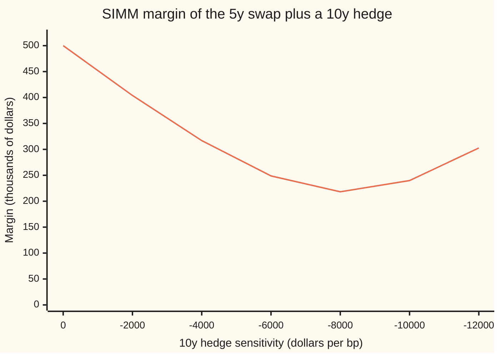

# ISDA SIMM: initial margin from sensitivities, risk weights and correlations, and why a hedge lowers it

[Syllabus](../../../SYLLABUS.md) → [Financial mathematics](../README.md) → [Collateral, Funding and the Rest of the XVAs](../README.md#s47) → ISDA SIMM

---

## General Overview

A bank has two US dollar interest rate swaps with the same pension fund. The first is a five-year swap that gains **\$10,000** for every basis point (0.01%) that the five-year rate rises. The second is a ten-year swap that loses **\$8,000** for every basis point the ten-year rate rises. That gain or loss per basis point is the swap's **sensitivity** ([Swap DV01](../28-Swaps/03-swap-dv01-and-hedging.md)).

Both swaps fall under the uncleared-margin rules. Each side must post **initial margin** to a custodian: a deposit that covers a bad ten-day move in the trades' value, defined on [MVA](03-mva.md). Most dealers size it with **ISDA SIMM**, the Standard Initial Margin Model published by the International Swaps and Derivatives Association. SIMM never reprices a trade. It takes the sensitivities, multiplies each by a published **risk weight**, and combines the results with published **correlations**.

With illustrative risk weights of 50 and 55 basis points and a correlation of 0.9, the five-year swap alone needs **\$500,000** of margin. The ten-year swap alone needs **\$440,000**. Booked with two different counterparties, the bank posts \$940,000. Booked together, in one **netting set** (all trades with one counterparty, margined as one), it posts **\$218,174**. The second swap is a hedge: when rates rise, it loses about what the first one gains.

**SIMM turns each sensitivity into a 99% ten-day loss by multiplying it by a risk weight, then adds those losses the way standard deviations add, as the square root of a correlated sum of squares; that root is never more than the sum of its parts, so within one currency two trades in one netting set never need more margin than the same trades booked apart, and a hedge needs far less.**

**What kind of fact this is:** a method: an industry rulebook resting on a model of normal, straight-line moves. Its numbers are set by committee, not by law. That, within one currency, the margin of two books together never exceeds the sum of their margins is a theorem, proved on this card in Why it works. Across currencies the formula's caps can break it by a little; Why it works gives an example.

### The picture: one pair of swaps, five ways of counting

```
margin in dollars, one block = $25,000
5y swap alone             ████████████████████ 500,000
10y swap alone            ██████████████████ 440,000
two separate netting sets ██████████████████████████████████████ 940,000
10y swap, same direction  ████████████████████████████████████▋ 916,297
the hedged pair, together █████████ 218,174
```

The last bar is what SIMM charges. The fourth bar shows that correlation alone buys little: if the ten-year swap pointed the same way, the margin would fall only from \$940,000 to \$916,297. The big saving comes from the hedge, opposite signs on two rates that move together.

---

## The formula

Notation first, in words. Number the sensitivities in one **bucket** (for rates, one currency) by $`k`$.

- $`s_k`$ is the sensitivity: dollars gained per basis point rise in rate $`k`$.
- $`\mathrm{RW}_k`$ is its risk weight, in basis points: the size of a 99% ten-day move in that rate.
- $`\mathrm{WS}_k = \mathrm{RW}_k\, s_k`$ is the **weighted sensitivity**: the 99% ten-day loss of that one position, with a sign.
- $`\rho_{kl}`$ (Greek "rho") is the correlation between rates $`k`$ and $`l`$, with $`\rho_{kk} = 1`$.

Inside one bucket:

```math
K_b = \sqrt{\sum_{k}\sum_{l} \rho_{kl}\,\mathrm{WS}_k\,\mathrm{WS}_l}
```

**Read it aloud:** the bucket's margin is the square root of every pair of weighted sensitivities multiplied together and by their correlation, added up.

For two sensitivities this is $`K = \sqrt{\mathrm{WS}_1^2 + \mathrm{WS}_2^2 + 2\rho\,\mathrm{WS}_1\mathrm{WS}_2}`$. With our numbers:

```math
K = \sqrt{500{,}000^2 + 440{,}000^2 - 2 \times 0.9 \times 500{,}000 \times 440{,}000} = 218{,}174.24
```

Across buckets $`b`$ and $`c`$ (currencies), the same shape repeats one level up:

```math
\mathrm{IM} = \sqrt{\sum_b K_b^2 + \sum_b \sum_{c \ne b} \gamma_{bc}\, S_b\, S_c}, \qquad S_b = \max\Bigl(\min\Bigl(\sum_k \mathrm{WS}_k,\; K_b\Bigr),\, -K_b\Bigr)
```

**Read it aloud:** add the buckets' margins as squares, plus a cross term for each pair of buckets: their correlation times each bucket's net weighted sensitivity, kept between minus and plus its own margin.

| Symbol | Plain meaning | In our example | Push it up and the answer… |
| --- | --- | --- | --- |
| $`s_k`$ | sensitivity: dollars gained per basis point rise in rate $`k`$ | +10,000 (5y); −8,000 (10y) | the margin rises, unless the position hedges another |
| $`\mathrm{RW}_k`$ | risk weight: a 99% ten-day move of rate $`k`$, in basis points (illustrative) | 50; 55 | rises in proportion for one position |
| $`\mathrm{WS}_k`$ | weighted sensitivity $`\mathrm{RW}_k s_k`$: one position's 99% ten-day loss, with sign | +500,000; −440,000 | — |
| $`\rho_{kl}`$ | correlation between two rates in one bucket | 0.9 | falls for opposite signs (better hedge); rises for same signs |
| $`K_b`$ | the margin of bucket $`b`$ on its own | USD 218,174.24; EUR 165,000 | — |
| $`S_b`$ | bucket $`b`$'s net weighted sensitivity, capped at $`\pm K_b`$ | USD +60,000; EUR −165,000 | — |
| $`\gamma_{bc}`$ | correlation between buckets (Greek "gamma") (illustrative) | 0.3 | rises if $`S_b, S_c`$ have the same sign |
| $`\mathrm{IM}`$ | initial margin of the netting set | 262,459.52 with the EUR swap | — |
| $`z_{0.99}`$, $`\sigma_k`$ | the 99th percentile of a standard bell curve; the ten-day standard deviation of rate $`k`$, $`\mathrm{RW}_k / z_{0.99}`$ | 2.326348; 21.49 and 23.64 bp | — |
| $`s_I`$ | margin funding spread, from the MVA card | 0.005 (50 bp) | MVA rises in proportion |
| $`\lambda`$, $`T`$ | the counterparty's hazard (yearly default rate); the horizon in years | 0.02; 1 | MVA falls slightly; rises |
| $`x_k`$; $`C`$, $`u`$, $`v`$ | ten-day move of rate $`k`$, in bp; in the proof, the correlation table and two books' weighted-sensitivity lists | standard deviations 21.49 and 23.64 bp; $`C`$ = `[[1, 0.9], [0.9, 1]]` | — |

### When it holds

- **Straight-line value changes.** SIMM's delta margin assumes value moves in proportion to the rate. Options bend, so SIMM adds separate vega and curvature terms (sensitivity to volatility, and to the bend). Two plain swaps need neither.
- **A valid correlation table.** The proof below needs the table to be a true correlation matrix (positive semidefinite: no portfolio may have negative variance). Correlations 0.9, 0.9 and −0.9 among three rates break this: one book gets −24,000,000,000 under the square root.
- **Normal-sized positions.** Real SIMM scales up the weighted sensitivities of very large positions by a **concentration factor**, because a huge book takes longer to close out. This card leaves those factors out.
- **Current weights.** ISDA republishes the risk weights and correlations, usually once a year. The 50, 55, 0.9 and 0.3 on this card are illustrative and not taken from any version. A real computation uses the version in force on the day.
- **Offsets only within a broad asset class.** The margin rules allow hedges to count within interest rates, or within equities, but not between them. SIMM combines risk classes inside a product class with correlations, then adds the product classes with no offset at all.

Conventions verified 2026-11-23 against the BCBS-IOSCO margin text (2020 version) and the ISDA SIMM page: a one-tailed 99% interval over a ten-day horizon with daily variation margin, offsets allowed only within a broad asset class. All risk weights and correlations here are illustrative.

---

## Why it works

### Step 0: the margin is a 99% loss, and losses add like standard deviations

Initial margin must cover a 99% ten-day loss of the netting set. If every rate moves by a bell-curve amount and the trades' value moves in straight lines, the book's loss is a bell curve too. Its 99% point is 2.326348 standard deviations ([Parametric VaR](../39-Value%20at%20Risk%20and%20Expected%20Shortfall/02-parametric-var-and-delta-normal.md)). Standard deviations do not add. Their squares add, plus a cross term for every correlated pair. SIMM is that rule with the 2.326348 already folded into the risk weights.

### Step 1: one sensitivity, one weight

A risk weight of 50 basis points says that the five-year rate moves against a position by more than 50 basis points over ten days only one time in a hundred. So the rate's ten-day standard deviation is 50 / 2.326348 = 21.49 bp. The five-year swap gains \$10,000 per basis point. Its 99% ten-day loss is \$10,000 × 50 = **\$500,000**: the weighted sensitivity. The ten-year swap gives −\$8,000 × 55 = −\$440,000. The sign records which way the position loses.

### Step 2: two sensitivities, one bucket

The pair's ten-day change is $`s_1 x_1 + s_2 x_2`$, where $`x_1, x_2`$ are the two rate moves in basis points, with standard deviations $`\sigma_1, \sigma_2`$ and correlation $`\rho`$. Its variance is

```math
s_1^2\sigma_1^2 + s_2^2\sigma_2^2 + 2\rho\, s_1 s_2\, \sigma_1 \sigma_2
```

Multiply by $`z_{0.99}^2`$ and use $`z_{0.99}\sigma_k = \mathrm{RW}_k`$. Every term becomes a product of weighted sensitivities, and the 99% loss is $`\sqrt{\mathrm{WS}_1^2 + \mathrm{WS}_2^2 + 2\rho\,\mathrm{WS}_1 \mathrm{WS}_2}`$: the bucket formula.

The cross term is where the hedge pays. Here $`\mathrm{WS}_1\mathrm{WS}_2`$ is negative, so the cross term subtracts 396 billion from 443.6 billion, leaving 47.6 billion under the root. The pair's margin is **\$218,174.24**.

A second road reaches the same number. Split the ten-year move into the part that follows the five-year move (0.9 of it) and an independent part (a **twist** of the curve, $`\sqrt{1 - 0.9^2}`$ of it). The two parts are uncorrelated, so their losses add as plain squares. The checks get \$218,174.24 this way too.

A third road simulates 200,000 ten-day pairs of rate moves with those standard deviations and that correlation, then reads off the 99% loss: \$217,694, a ratio of 0.9978 to the formula.

### Step 3: across buckets, the same shape one level up

Add a euro swap that loses \$3,000 per basis point at ten years, with weight 55. Its weighted sensitivity is −165,000, so the euro bucket alone has margin 165,000.

The dollar bucket's net weighted sensitivity is 500,000 − 440,000 = +60,000. That is inside ±218,174.24, so the cap does not bite: $`S_{\mathrm{USD}}`$ = +60,000, $`S_{\mathrm{EUR}}`$ = −165,000. With $`\gamma`$ = 0.3:

```math
\mathrm{IM} = \sqrt{218{,}174.24^2 + 165{,}000^2 + 2 \times 0.3 \times 60{,}000 \times (-165{,}000)} = 262{,}459.52
```

The cap exists because $`S_b`$ stands in for the bucket's direction in the cross term. A bucket that nets to a large sum but has small margin could otherwise push the cross term past what the buckets' own margins allow.

When the cap does not bite, the two-level formula equals one big quadratic form over all three weighted sensitivities, with 0.9 between the dollar tenors and 0.3 between each dollar tenor and the euro one. The checks compute it both ways: 262,459.52 each time. The sum of the two bucket margins is 383,174.24.

### Step 4: why, in one bucket, a hedge can never raise the margin of the pair above the parts

Write the margin of one bucket as a length. With a valid correlation table, the quantity under the root is the squared length of a vector built from the weighted sensitivities (Step 2's split into independent parts is that vector). Margin is then the length of the book's arrow.

Adding two books adds their arrows. One side of a triangle is never longer than the other two together. So

```math
\mathrm{IM}(A + B) \le \mathrm{IM}(A) + \mathrm{IM}(B)
```

**Read it aloud:** the margin of two books together is at most the sum of their separate margins. This property is **subadditivity**, one of the axioms of a coherent risk measure.

<details>
<summary>Detailed proof: the triangle inequality from the Cauchy–Schwarz inequality</summary>

Let $`C`$ be the correlation table, positive semidefinite, and write $`\langle u, v\rangle = u^\top C v`$ for weighted-sensitivity vectors $`u, v`$. This is an inner product on the directions that matter, so the Cauchy–Schwarz inequality holds: $`\langle u, v\rangle \le \sqrt{\langle u,u\rangle}\sqrt{\langle v,v\rangle}`$. Then

$`\displaystyle \mathrm{IM}(u+v)^2 = \langle u,u\rangle + 2\langle u,v\rangle + \langle v,v\rangle \le \bigl(\sqrt{\langle u,u\rangle} + \sqrt{\langle v,v\rangle}\bigr)^2 = \bigl(\mathrm{IM}(u) + \mathrm{IM}(v)\bigr)^2`$

Taking square roots gives the result. Equality needs $`u`$ and $`v`$ to point the same way in the inner-product sense: the two books are scaled copies of each other. Scaling a book by $`c > 0`$ scales its margin by $`c`$, which is the other half of being a length.

</details>

The checks test the claim on 20,000 random pairs of three-tenor books (5, 10 and 30 years, weights 50, 55 and 60, correlations 0.9, 0.8 and 0.9). There are 0 violations. The worst ratio of combined margin to the sum of parts is 0.999999: two books that happened to point almost the same way.

The proof covers one bucket, and the two-level formula while no cap binds, since it is then one quadratic form (Step 3). The caps can break the property. Book A holds a dollar ten-year swap at +\$10,000 per bp and a euro five-year swap at −\$2,000 per bp. Book B holds the same dollar swap and a euro ten-year swap at −\$2,000 per bp. Apart, their margins are 528,677.60 and 527,541.47. Together the margin is 1,056,788.23, which is 569.17 more than the sum. In the combined euro bucket the two tenors net to −210,000, but the bucket's own margin is only 204,694.89, so the cap trims the euro risk that offsets the dollar risk. That breach is small next to what a hedge saves. Concentration factors break the property too, because they scale large positions up faster than in proportion.

---

## Worked numbers, by hand

| Step | Arithmetic | Value |
| --- | --- | --- |
| weighted 5y | 10,000 × 50 | 500,000 |
| weighted 10y | −8,000 × 55 | −440,000 |
| squares | 500,000² + 440,000² | 443,600,000,000 |
| cross term | 2 × 0.9 × 500,000 × (−440,000) | −396,000,000,000 |
| under the root | 443.6 billion − 396 billion | 47,600,000,000 |
| **margin of the pair** | √47,600,000,000 | **218,174.24** |
| sum of standalone margins | 500,000 + 440,000 | 940,000 |
| saved by the hedge | 940,000 − 218,174.24 | 721,825.76 |

The bank posts \$218,174 for the pair, less than a quarter of the \$940,000 it would post if the two swaps sat with different counterparties.

### Feeding the margin into MVA

[MVA](03-mva.md) prices the cost of funding margin: the spread, times the margin, times the survival-weighted life of the trade. Take that card's 50 bp spread and 2% hazard over one year, the horizon of that card's example, and hold the margin at today's level (a simplification: a swap's margin shrinks as it ages). These are one-year figures: the swaps run five and ten years, and their full MVA adds the margin funded in every later year.

| Step | Arithmetic | Value |
| --- | --- | --- |
| survival-weighted life | $`(1 - e^{-0.02}) / 0.02`$ | 0.990066 years |
| MVA, pair in one netting set | 0.005 × 218,174.24 × 0.990066 | \$1,080.03 |
| MVA, trades apart | 0.005 × 940,000 × 0.990066 | \$4,653.31 |
| saving | 4,653.31 − 1,080.03 | \$3,573.28 |

This is why a desk may pay a client to put a hedging trade in the same netting set: the hedge cuts the margin, and the margin cut is worth money.

### What breaks if you drop a piece

Same two swaps; the correct margin is 218,174.24.

| Mistake | Comes out at | What went wrong |
| --- | --- | --- |
| Add the two standalone margins | 940,000 | Ignores that the trades offset; that is margin with no netting |
| Drop the signs | 916,297 | Treats the hedge as a second bet in the same direction |
| Correlation set to 0 | 666,033 | Adds the losses as if the 5y and 10y rates were unrelated |
| Net the weighted sensitivities (treat the two rates as one) | 60,000 | Correlation 1 between the tenors; ignores the twist risk between them |

---

## How the margin moves as the hedge grows

Keep the five-year swap. Grow the ten-year hedge from nothing, in steps of \$2,000 per basis point.

| 10y sensitivity (per bp) | 0 | −2,000 | −4,000 | −6,000 | −8,000 | −10,000 | −12,000 |
| --- | --- | --- | --- | --- | --- | --- | --- |
| Margin (thousands of \$) | 500.0 | 403.9 | 316.9 | 248.8 | 218.2 | 239.8 | 302.7 |



Orange: the margin of the pair. It falls, bottoms out and rises again. Three facts come out of it.

- **The lowest margin is at −\$8,181.82 per bp**, where the hedge's weighted sensitivity is −0.9 × 500,000. The margin there is \$217,944.95, which is 500,000 × √(1 − 0.9²). A grid search over hedge sizes finds the same point.
- **The margin never reaches zero.** The leftover \$217,944.95 is the twist risk: the part of the ten-year move that the five-year move does not explain. No amount of ten-year swap can hedge it.
- **The DV01-neutral hedge is not the cheapest.** Matching sensitivities exactly, −\$10,000 per bp, gives \$239,791.58 of margin. The cheapest hedge is the minimum-variance hedge (the one that leaves the smallest spread of outcomes): the correlation times the ratio of the risk weights, times the first sensitivity, −0.9 × 50/55 × 10,000 = −8,181.82 per bp. Both factors pull it below the DV01 match. Only 0.9 of the ten-year move follows the five-year one, so a full match over-hedges; and the ten-year weight is larger, so each ten-year basis point carries more risk. With equal weights the correlation alone would still keep the cheapest hedge below the DV01 match.

---

## Code, from first principles, and it actually runs

The checks reach the pair's margin by three independent roads: the bucket formula; the split into a parallel part and an independent twist; and a simulation of 200,000 correlated ten-day rate moves, read at their 99% point. They compute the across-bucket margin both through the capped two-level formula and as one 3 × 3 quadratic form. They test subadditivity on 20,000 random pairs of books, show a pair of two-currency books where the caps break it, find the lowest-margin hedge by formula and by grid search, and check the MVA's survival-weighted life against Simpson's rule. The normal CDF is a series, the percentile a bisection, and the random numbers splitmix64 with Box-Muller.

### Python

```python
# ISDA SIMM initial margin -- the check behind the card.  Standard library only.
# Two USD rate sensitivities (+10,000 per bp at 5 years, -8,000 per bp at 10 years),
# illustrative risk weights 50 and 55, correlation 0.9; then a EUR bucket, a random test of
# subadditivity, a simulated 99% ten-day loss, and the margin fed into the MVA formula.
# Nothing imported knows the answer: the normal CDF is a series, the percentile is bisection,
# the random numbers are splitmix64 plus Box-Muller, all written out below.
from math import exp, log, sqrt, pi, cos

S1, S2 = 10000.0, -8000.0          # dollars per basis point, 5y and 10y
RW1, RW2, RHO = 50.0, 55.0, 0.90   # illustrative risk weights (bp) and tenor correlation
S_EUR, RW_EUR, GAMMA = -3000.0, 55.0, 0.30   # EUR 10y sensitivity; cross-currency correlation
S_IM, LAM, T = 0.005, 0.02, 1.0    # MVA inputs from the MVA card: spread, hazard, years

def margin(ws, corr):              # sqrt(sum_k sum_l corr_kl ws_k ws_l)
    q = sum(corr[k][l] * ws[k] * ws[l] for k in range(len(ws)) for l in range(len(ws)))
    return sqrt(q)
C2 = [[1.0, RHO], [RHO, 1.0]]
w1, w2 = S1 * RW1, S2 * RW2
k_usd = margin([w1, w2], C2)
# road 2: split the 10y move into the part that follows the 5y move and an independent part
k_fac = sqrt((w1 + RHO * w2) ** 2 + (w2 * sqrt(1.0 - RHO * RHO)) ** 2)
same = margin([w1, -w2], C2)
print(f"inputs, s1 s2 per bp, RW1 RW2, rho: {S1:.0f} {S2:.0f} {RW1:.0f} {RW2:.0f} {RHO:.2f}")
print(f"weighted, WS1 WS2: {w1:.0f} {w2:.0f}")
print(f"margin, 5y alone 10y alone sum: {abs(w1):.0f} {abs(w2):.0f} {abs(w1) + abs(w2):.0f}")
print(f"hand, squares, cross term, under the root: {w1 * w1 + w2 * w2:.0f} {2.0 * RHO * w1 * w2:.0f} {k_usd * k_usd:.0f}")
print(f"margin, pair by formula, by factor split: {k_usd:.2f} {k_fac:.2f}")
print(f"margin, 10y pointing the same way: {same:.2f}")
print(f"margin, pair if rho were 0.99: {margin([w1, w2], [[1.0, 0.99], [0.99, 1.0]]):.2f}")
print(f"saved against the sum, hedged pair, same-way pair: {abs(w1) + abs(w2) - k_usd:.2f} {abs(w1) + abs(w2) - same:.2f}")
assert abs(k_usd - k_fac) < 1e-6

def phi(x): return exp(-0.5 * x * x) / sqrt(2.0 * pi)
def N(x):                          # 1/2 + phi(x)(x + x^3/3 + x^5/15 + ...)
    term, total, k = x, x, 1
    while abs(term) > 1e-17 * abs(total):
        k += 2; term *= x * x / k; total += term
    return 0.5 + phi(x) * total
lo, hi = 0.0, 8.0
for _ in range(200):
    mid = 0.5 * (lo + hi)
    lo, hi = (mid, hi) if N(mid) < 0.99 else (lo, mid)
Z99 = 0.5 * (lo + hi)

state = 20261123
def uniform():                     # splitmix64, a number in (0, 1)
    global state
    state = (state + 0x9E3779B97F4A7C15) & 0xFFFFFFFFFFFFFFFF
    z = state
    z = ((z ^ (z >> 30)) * 0xBF58476D1CE4E5B9) & 0xFFFFFFFFFFFFFFFF
    z = ((z ^ (z >> 27)) * 0x94D049BB133111EB) & 0xFFFFFFFFFFFFFFFF
    return ((z ^ (z >> 31)) >> 11) * (1.0 / 9007199254740992.0) + 0.5 / 9007199254740992.0
def gauss(): return sqrt(-2.0 * log(uniform())) * cos(2.0 * pi * uniform())

# road 3: a risk weight is a 99% ten-day move, so simulate ten-day rate moves and read the 99% loss
sd1, sd2, n = RW1 / Z99, RW2 / Z99, 200000
losses = []
for _ in range(n):
    e1, e2 = gauss(), gauss()
    x1, x2 = sd1 * e1, sd2 * (RHO * e1 + sqrt(1.0 - RHO * RHO) * e2)
    losses.append(-(S1 * x1 + S2 * x2))
losses.sort()
mc = losses[int(0.99 * n)]
print(f"z99, ten-day sd 5y 10y bp: {Z99:.6f} {sd1:.2f} {sd2:.2f}")
print(f"simulated 99% ten-day loss, draws, ratio to formula: {mc:.0f} {n} {mc / k_usd:.4f}")
assert abs(mc / k_usd - 1.0) < 0.02

# across buckets: USD and EUR, each bucket margin K_b and net S_b capped at +-K_b
w_eur = S_EUR * RW_EUR
k_eur = abs(w_eur)
def cap(s, k): return max(min(s, k), -k)
s_usd, s_eur = cap(w1 + w2, k_usd), cap(w_eur, k_eur)
def total(g): return sqrt(k_usd ** 2 + k_eur ** 2 + 2.0 * g * s_usd * s_eur)
big = margin([w1, w2, w_eur], [[1.0, RHO, GAMMA], [RHO, 1.0, GAMMA], [GAMMA, GAMMA, 1.0]])
print(f"across, EUR WS K: {w_eur:.0f} {k_eur:.0f}")
print(f"across, S_USD S_EUR: {s_usd:.0f} {s_eur:.0f}")
print(f"across, total gamma 0.30, gamma 0, sum of buckets: {total(GAMMA):.2f} {total(0.0):.2f} {k_usd + k_eur:.2f}")
print(f"across, one 3x3 quadratic form: {big:.2f}")
assert abs(total(GAMMA) - big) < 1e-6

# the caps can break subadditivity: each book is a USD 10y swap with a small EUR hedge
def simm(u5, u10, e5, e10):        # the capped two-bucket formula for 5y/10y in USD and EUR
    k = [margin([a * RW1, b * RW2], C2) for a, b in ((u5, u10), (e5, e10))]
    sb = [cap(a * RW1 + b * RW2, kb) for (a, b), kb in zip(((u5, u10), (e5, e10)), k)]
    return sqrt(k[0] ** 2 + k[1] ** 2 + 2.0 * GAMMA * sb[0] * sb[1])
im_a, im_b, im_ab = simm(0, 1e4, -2e3, 0), simm(0, 1e4, 0, -2e3), simm(0, 2e4, -2e3, -2e3)
print(f"caps break it, IM of A, B, A+B, excess: {im_a:.2f} {im_b:.2f} {im_ab:.2f} {im_ab - im_a - im_b:.2f}")
print(f"  A+B EUR bucket, net WS, K: {-2e3 * (RW1 + RW2):.0f} {margin([-2e3 * RW1, -2e3 * RW2], C2):.2f}")
assert abs(simm(S1, S2, 0.0, S_EUR) - big) < 1e-6
assert im_ab > im_a + im_b + 100.0

# subadditivity, tested: random pairs of three-tenor books (5y, 10y, 30y)
RW3 = [50.0, 55.0, 60.0]
C3 = [[1.0, 0.9, 0.8], [0.9, 1.0, 0.9], [0.8, 0.9, 1.0]]
def im3(s): return margin([s[i] * RW3[i] for i in range(3)], C3)
bad, worst, pairs = 0, 0.0, 20000
for _ in range(pairs):
    a = [20000.0 * uniform() - 10000.0 for _ in range(3)]
    b = [20000.0 * uniform() - 10000.0 for _ in range(3)]
    ratio = im3([a[i] + b[i] for i in range(3)]) / (im3(a) + im3(b))
    worst = max(worst, ratio)
    bad += ratio > 1.0 + 1e-12
q_bad = sum([[1, .9, .9], [.9, 1, -.9], [.9, -.9, 1]][k][l] * v[k] * v[l]
            for v in [[100000.0, -100000.0, -100000.0]] for k in range(3) for l in range(3))
print(f"subadditive, pairs tested, violations, worst ratio: {pairs} {bad} {worst:.6f}")
print(f"not a valid correlation table, quantity under the root: {q_bad:.0f}")
assert bad == 0 and worst <= 1.0

# the hedge sweep: margin as the 10y sensitivity grows
sweep = [0.0, -2000.0, -4000.0, -6000.0, -8000.0, -10000.0, -12000.0]
print("sweep, 10y per bp: " + " ".join(f"{s:.0f}" for s in sweep))
print("sweep, margin thousands: " + " ".join(f"{margin([w1, s * RW2], C2) / 1000:.1f}" for s in sweep))
b_star, floor = -RHO * w1 / RW2, abs(w1) * sqrt(1.0 - RHO * RHO)
grid = min((margin([w1, (-12000.0 + 0.01 * i) * RW2], C2), -12000.0 + 0.01 * i) for i in range(1200001))
print(f"lowest-margin hedge per bp, margin; grid search: {b_star:.2f} {floor:.2f}; {grid[1]:.2f} {grid[0]:.2f}")
print(f"DV01-neutral hedge -10000 per bp, margin: {margin([w1, -10000.0 * RW2], C2):.2f}")
assert abs(grid[0] - floor) < 0.01 and abs(grid[1] - b_star) < 0.01

# what breaks
print(f"breaks, no netting, signs dropped, rho 0, tenors netted: {abs(w1) + abs(w2):.0f} {same:.0f} "
      f"{margin([w1, w2], [[1.0, 0.0], [0.0, 1.0]]):.0f} {abs(w1 + w2):.0f}")

# feed into MVA: spread x margin x survival-weighted life, margin held at today's level
ann = (1.0 - exp(-LAM * T)) / LAM
m = 1000
simp = sum((1 if i in (0, m) else 4 if i % 2 else 2) * exp(-LAM * T * i / m) for i in range(m + 1)) * T / m / 3
mva_pair, mva_apart = S_IM * k_usd * ann, S_IM * (abs(w1) + abs(w2)) * ann
print(f"mva, survival-weighted life closed form, by Simpson: {ann:.6f} {simp:.6f}")
print(f"mva, pair in one netting set, trades apart, saving: {mva_pair:.2f} {mva_apart:.2f} {mva_apart - mva_pair:.2f}")
assert abs(ann - simp) < 1e-9
print("ALL CHECKS PASS")
```

**Ran 2026-11-23 on macOS, Python 3.14.10, standard library only. All checks passed. Output, pasted from the run:**

```
inputs, s1 s2 per bp, RW1 RW2, rho: 10000 -8000 50 55 0.90
weighted, WS1 WS2: 500000 -440000
margin, 5y alone 10y alone sum: 500000 440000 940000
hand, squares, cross term, under the root: 443600000000 -396000000000 47600000000
margin, pair by formula, by factor split: 218174.24 218174.24
margin, 10y pointing the same way: 916296.90
margin, pair if rho were 0.99: 89442.72
saved against the sum, hedged pair, same-way pair: 721825.76 23703.10
z99, ten-day sd 5y 10y bp: 2.326348 21.49 23.64
simulated 99% ten-day loss, draws, ratio to formula: 217694 200000 0.9978
across, EUR WS K: -165000 165000
across, S_USD S_EUR: 60000 -165000
across, total gamma 0.30, gamma 0, sum of buckets: 262459.52 273541.59 383174.24
across, one 3x3 quadratic form: 262459.52
caps break it, IM of A, B, A+B, excess: 528677.60 527541.47 1056788.23 569.17
  A+B EUR bucket, net WS, K: -210000 204694.89
subadditive, pairs tested, violations, worst ratio: 20000 0 0.999999
not a valid correlation table, quantity under the root: -24000000000
sweep, 10y per bp: 0 -2000 -4000 -6000 -8000 -10000 -12000
sweep, margin thousands: 500.0 403.9 316.9 248.8 218.2 239.8 302.7
lowest-margin hedge per bp, margin; grid search: -8181.82 217944.95; -8181.82 217944.95
DV01-neutral hedge -10000 per bp, margin: 239791.58
breaks, no netting, signs dropped, rho 0, tenors netted: 940000 916297 666033 60000
mva, survival-weighted life closed form, by Simpson: 0.990066 0.990066
mva, pair in one netting set, trades apart, saving: 1080.03 4653.31 3573.28
ALL CHECKS PASS
```

### Rust

```rust
// ISDA SIMM initial margin -- the same check as isda_simm_initial_margin_check.py, in Rust.
// Standard library only, no crates.  Two USD rate sensitivities (+10,000 per bp at 5 years,
// -8,000 per bp at 10 years), illustrative risk weights 50 and 55, correlation 0.9; then a EUR
// bucket, a random test of subadditivity, a simulated 99% ten-day loss, and the margin fed into
// the MVA formula.  The normal CDF is a series, the percentile is bisection, the random numbers
// are splitmix64 plus Box-Muller.
use std::f64::consts::PI;

const S1: f64 = 10000.0; const S2: f64 = -8000.0;     // dollars per basis point, 5y and 10y
const RW1: f64 = 50.0; const RW2: f64 = 55.0; const RHO: f64 = 0.90;   // illustrative
const S_EUR: f64 = -3000.0; const RW_EUR: f64 = 55.0; const GAMMA: f64 = 0.30;
const S_IM: f64 = 0.005; const LAM: f64 = 0.02; const T: f64 = 1.0;   // MVA inputs

fn margin(ws: &[f64], corr: &[Vec<f64>]) -> f64 {   // sqrt(sum_k sum_l corr_kl ws_k ws_l)
    let mut q = 0.0;
    for k in 0..ws.len() { for l in 0..ws.len() { q += corr[k][l] * ws[k] * ws[l]; } }
    q.sqrt()
}

fn phi(x: f64) -> f64 { (-0.5 * x * x).exp() / (2.0 * PI).sqrt() }
fn n_cdf(x: f64) -> f64 {
    let (mut term, mut total, mut k) = (x, x, 1.0);
    while term.abs() > 1e-17 * total.abs() {
        k += 2.0;
        term *= x * x / k;
        total += term;
    }
    0.5 + phi(x) * total
}

struct Rng { state: u64 }
impl Rng {
    fn uniform(&mut self) -> f64 {
        self.state = self.state.wrapping_add(0x9E3779B97F4A7C15);
        let mut z = self.state;
        z = (z ^ (z >> 30)).wrapping_mul(0xBF58476D1CE4E5B9);
        z = (z ^ (z >> 27)).wrapping_mul(0x94D049BB133111EB);
        ((z ^ (z >> 31)) >> 11) as f64 * (1.0 / 9007199254740992.0) + 0.5 / 9007199254740992.0
    }
    fn gauss(&mut self) -> f64 {
        let u1 = self.uniform();
        let u2 = self.uniform();
        (-2.0 * u1.ln()).sqrt() * (2.0 * PI * u2).cos()
    }
}

fn cap(s: f64, k: f64) -> f64 { s.min(k).max(-k) }
// the capped two-bucket formula for 5y/10y in USD and EUR
fn simm(u5: f64, u10: f64, e5: f64, e10: f64, c2: &[Vec<f64>]) -> f64 {
    let (ku, ke) = (margin(&[u5 * RW1, u10 * RW2], c2), margin(&[e5 * RW1, e10 * RW2], c2));
    let (su, se) = (cap(u5 * RW1 + u10 * RW2, ku), cap(e5 * RW1 + e10 * RW2, ke));
    (ku * ku + ke * ke + 2.0 * GAMMA * su * se).sqrt()
}

fn main() {
    let c2 = vec![vec![1.0, RHO], vec![RHO, 1.0]];
    let (w1, w2) = (S1 * RW1, S2 * RW2);
    let k_usd = margin(&[w1, w2], &c2);
    let k_fac = ((w1 + RHO * w2).powi(2) + (w2 * (1.0 - RHO * RHO).sqrt()).powi(2)).sqrt();
    let same = margin(&[w1, -w2], &c2);
    let sum = w1.abs() + w2.abs();
    println!("inputs, s1 s2 per bp, RW1 RW2, rho: {:.0} {:.0} {:.0} {:.0} {:.2}", S1, S2, RW1, RW2, RHO);
    println!("weighted, WS1 WS2: {:.0} {:.0}", w1, w2);
    println!("margin, 5y alone 10y alone sum: {:.0} {:.0} {:.0}", w1.abs(), w2.abs(), sum);
    println!("hand, squares, cross term, under the root: {:.0} {:.0} {:.0}", w1 * w1 + w2 * w2, 2.0 * RHO * w1 * w2, k_usd * k_usd);
    println!("margin, pair by formula, by factor split: {:.2} {:.2}", k_usd, k_fac);
    println!("margin, 10y pointing the same way: {:.2}", same);
    println!("margin, pair if rho were 0.99: {:.2}", margin(&[w1, w2], &[vec![1.0, 0.99], vec![0.99, 1.0]]));
    println!("saved against the sum, hedged pair, same-way pair: {:.2} {:.2}", sum - k_usd, sum - same);
    assert!((k_usd - k_fac).abs() < 1e-6);

    let (mut lo, mut hi) = (0.0f64, 8.0f64);
    for _ in 0..200 {
        let mid = 0.5 * (lo + hi);
        if n_cdf(mid) < 0.99 { lo = mid } else { hi = mid }
    }
    let z99 = 0.5 * (lo + hi);

    let mut rng = Rng { state: 20261123 };
    let (sd1, sd2, n) = (RW1 / z99, RW2 / z99, 200000usize);
    let mut losses = Vec::with_capacity(n);
    for _ in 0..n {
        let e1 = rng.gauss();
        let e2 = rng.gauss();
        let x1 = sd1 * e1;
        let x2 = sd2 * (RHO * e1 + (1.0 - RHO * RHO).sqrt() * e2);
        losses.push(-(S1 * x1 + S2 * x2));
    }
    losses.sort_by(|a, b| a.partial_cmp(b).unwrap());
    let mc = losses[(0.99 * n as f64) as usize];
    println!("z99, ten-day sd 5y 10y bp: {:.6} {:.2} {:.2}", z99, sd1, sd2);
    println!("simulated 99% ten-day loss, draws, ratio to formula: {:.0} {} {:.4}", mc, n, mc / k_usd);
    assert!((mc / k_usd - 1.0).abs() < 0.02);

    let w_eur = S_EUR * RW_EUR;
    let k_eur = w_eur.abs();
    let (s_usd, s_eur) = (cap(w1 + w2, k_usd), cap(w_eur, k_eur));
    let total = |g: f64| (k_usd * k_usd + k_eur * k_eur + 2.0 * g * s_usd * s_eur).sqrt();
    let c3x = vec![vec![1.0, RHO, GAMMA], vec![RHO, 1.0, GAMMA], vec![GAMMA, GAMMA, 1.0]];
    let big = margin(&[w1, w2, w_eur], &c3x);
    println!("across, EUR WS K: {:.0} {:.0}", w_eur, k_eur);
    println!("across, S_USD S_EUR: {:.0} {:.0}", s_usd, s_eur);
    println!("across, total gamma 0.30, gamma 0, sum of buckets: {:.2} {:.2} {:.2}", total(GAMMA), total(0.0), k_usd + k_eur);
    println!("across, one 3x3 quadratic form: {:.2}", big);
    assert!((total(GAMMA) - big).abs() < 1e-6);

    // the caps can break subadditivity: each book is a USD 10y swap with a small EUR hedge
    let (im_a, im_b, im_ab) = (simm(0.0, 1e4, -2e3, 0.0, &c2), simm(0.0, 1e4, 0.0, -2e3, &c2), simm(0.0, 2e4, -2e3, -2e3, &c2));
    println!("caps break it, IM of A, B, A+B, excess: {:.2} {:.2} {:.2} {:.2}", im_a, im_b, im_ab, im_ab - im_a - im_b);
    println!("  A+B EUR bucket, net WS, K: {:.0} {:.2}", -2e3 * (RW1 + RW2), margin(&[-2e3 * RW1, -2e3 * RW2], &c2));
    assert!((simm(S1, S2, 0.0, S_EUR, &c2) - big).abs() < 1e-6);
    assert!(im_ab > im_a + im_b + 100.0);

    let rw3 = [50.0, 55.0, 60.0];
    let c3 = vec![vec![1.0, 0.9, 0.8], vec![0.9, 1.0, 0.9], vec![0.8, 0.9, 1.0]];
    let im3 = |s: &[f64; 3]| margin(&[s[0] * rw3[0], s[1] * rw3[1], s[2] * rw3[2]], &c3);
    let (mut bad, mut worst, pairs) = (0, 0.0f64, 20000);
    for _ in 0..pairs {
        let mut a = [0.0; 3];
        let mut b = [0.0; 3];
        for v in a.iter_mut() { *v = 20000.0 * rng.uniform() - 10000.0; }
        for v in b.iter_mut() { *v = 20000.0 * rng.uniform() - 10000.0; }
        let ab = [a[0] + b[0], a[1] + b[1], a[2] + b[2]];
        let ratio = im3(&ab) / (im3(&a) + im3(&b));
        worst = worst.max(ratio);
        if ratio > 1.0 + 1e-12 { bad += 1; }
    }
    let cb = [[1.0, 0.9, 0.9], [0.9, 1.0, -0.9], [0.9, -0.9, 1.0]];
    let v = [100000.0, -100000.0, -100000.0];
    let mut q_bad = 0.0;
    for k in 0..3 { for l in 0..3 { q_bad += cb[k][l] * v[k] * v[l]; } }
    println!("subadditive, pairs tested, violations, worst ratio: {} {} {:.6}", pairs, bad, worst);
    println!("not a valid correlation table, quantity under the root: {:.0}", q_bad);
    assert!(bad == 0 && worst <= 1.0);

    let sweep = [0.0, -2000.0, -4000.0, -6000.0, -8000.0, -10000.0, -12000.0];
    let s1: Vec<String> = sweep.iter().map(|s| format!("{:.0}", s)).collect();
    let s2: Vec<String> = sweep.iter().map(|s| format!("{:.1}", margin(&[w1, s * RW2], &c2) / 1000.0)).collect();
    println!("sweep, 10y per bp: {}", s1.join(" "));
    println!("sweep, margin thousands: {}", s2.join(" "));
    let (b_star, floor) = (-RHO * w1 / RW2, w1.abs() * (1.0 - RHO * RHO).sqrt());
    let (mut gm, mut gb) = (f64::INFINITY, 0.0);
    for i in 0..1200001 {
        let b = -12000.0 + 0.01 * i as f64;
        let m = margin(&[w1, b * RW2], &c2);
        if m < gm { gm = m; gb = b; }
    }
    println!("lowest-margin hedge per bp, margin; grid search: {:.2} {:.2}; {:.2} {:.2}", b_star, floor, gb, gm);
    println!("DV01-neutral hedge -10000 per bp, margin: {:.2}", margin(&[w1, -10000.0 * RW2], &c2));
    assert!((gm - floor).abs() < 0.01 && (gb - b_star).abs() < 0.01);

    let c0 = vec![vec![1.0, 0.0], vec![0.0, 1.0]];
    println!("breaks, no netting, signs dropped, rho 0, tenors netted: {:.0} {:.0} {:.0} {:.0}",
             sum, same, margin(&[w1, w2], &c0), (w1 + w2).abs());

    let ann = (1.0 - (-LAM * T).exp()) / LAM;
    let m = 1000;
    let mut simp = 0.0;
    for i in 0..=m {
        let wt = if i == 0 || i == m { 1.0 } else if i % 2 == 1 { 4.0 } else { 2.0 };
        simp += wt * (-LAM * T * i as f64 / m as f64).exp();
    }
    simp *= T / m as f64 / 3.0;
    let (mva_pair, mva_apart) = (S_IM * k_usd * ann, S_IM * sum * ann);
    println!("mva, survival-weighted life closed form, by Simpson: {:.6} {:.6}", ann, simp);
    println!("mva, pair in one netting set, trades apart, saving: {:.2} {:.2} {:.2}", mva_pair, mva_apart, mva_apart - mva_pair);
    assert!((ann - simp).abs() < 1e-9);
    println!("ALL CHECKS PASS");
}
```

**Ran 2026-11-23 on macOS, rustc 1.98.1, no crates. All checks passed. Output, pasted from the run:**

```
inputs, s1 s2 per bp, RW1 RW2, rho: 10000 -8000 50 55 0.90
weighted, WS1 WS2: 500000 -440000
margin, 5y alone 10y alone sum: 500000 440000 940000
hand, squares, cross term, under the root: 443600000000 -396000000000 47600000000
margin, pair by formula, by factor split: 218174.24 218174.24
margin, 10y pointing the same way: 916296.90
margin, pair if rho were 0.99: 89442.72
saved against the sum, hedged pair, same-way pair: 721825.76 23703.10
z99, ten-day sd 5y 10y bp: 2.326348 21.49 23.64
simulated 99% ten-day loss, draws, ratio to formula: 217694 200000 0.9978
across, EUR WS K: -165000 165000
across, S_USD S_EUR: 60000 -165000
across, total gamma 0.30, gamma 0, sum of buckets: 262459.52 273541.59 383174.24
across, one 3x3 quadratic form: 262459.52
caps break it, IM of A, B, A+B, excess: 528677.60 527541.47 1056788.23 569.17
  A+B EUR bucket, net WS, K: -210000 204694.89
subadditive, pairs tested, violations, worst ratio: 20000 0 0.999999
not a valid correlation table, quantity under the root: -24000000000
sweep, 10y per bp: 0 -2000 -4000 -6000 -8000 -10000 -12000
sweep, margin thousands: 500.0 403.9 316.9 248.8 218.2 239.8 302.7
lowest-margin hedge per bp, margin; grid search: -8181.82 217944.95; -8181.82 217944.95
DV01-neutral hedge -10000 per bp, margin: 239791.58
breaks, no netting, signs dropped, rho 0, tenors netted: 940000 916297 666033 60000
mva, survival-weighted life closed form, by Simpson: 0.990066 0.990066
mva, pair in one netting set, trades apart, saving: 1080.03 4653.31 3573.28
ALL CHECKS PASS
```

### Lean

Lean proves the card's one-bucket facts, for every correlation table and every book that meets each fact's conditions.

- Suppose $`C`$ is a valid correlation table for one bucket: positive semidefinite, with ones on the diagonal. Then the margin of books $`u`$ and $`v`$ together is at most the sum of their separate margins.
- Take one bucket with two sensitivities and correlation $`\rho`$ between them. Then the margin equals the card's two-sensitivity formula, for every $`\rho`$ and every pair of weighted sensitivities.
- Take a book and a number $`c > 0`$. Then scaling the book by $`c`$ scales its margin by $`c`$.
- The hand arithmetic holds exactly: weighted sensitivities 500,000 and −440,000, and 47,600,000,000 under the root for the pair.
- Netting the two tenors, as if their correlation were 1, leaves $`60{,}000^2`$ under the root.
- The table with correlations 0.9, 0.9 and −0.9 gives one book −24,000,000,000 under the root, so it is not valid.

The dollar margins, the across-bucket formula and its caps, the simulation and the MVA figures are left to the Python and Rust checks.

```lean
-- ISDA SIMM: within one bucket, with a valid correlation table, the margin of two books together is at most the sum of their separate margins.
import Mathlib.LinearAlgebra.Matrix.PosDef
import Mathlib.Analysis.Real.Sqrt
import Mathlib.LinearAlgebra.Matrix.Notation
import Mathlib.Algebra.QuadraticDiscriminant

open Matrix

/-- The SIMM margin of one bucket: the square root of the correlated sum
`∑ k, ∑ l, C k l * ws k * ws l` of the weighted sensitivities `ws` (each sensitivity
times its risk weight), with correlation table `C`. -/
noncomputable def simmMargin {ι : Type*} [Fintype ι] (C : Matrix ι ι ℝ) (ws : ι → ℝ) : ℝ :=
  Real.sqrt (ws ⬝ᵥ (C *ᵥ ws))

/-- Subadditivity (why a hedge never raises the margin): if the correlation table `C` is a true
correlation matrix (positive semidefinite, with ones on the diagonal), then the margin of two books
`u` and `v` combined in one netting set is at most the sum of their separate margins. -/
theorem simm_margin_subadditive {ι : Type*} [Fintype ι] (C : Matrix ι ι ℝ)
    (hC : C.PosSemidef) (hdiag : ∀ i, C i i = 1) (u v : ι → ℝ) :
    simmMargin C (u + v) ≤ simmMargin C u + simmMargin C v := by
  unfold simmMargin
  set q : (ι → ℝ) → ℝ := fun x => x ⬝ᵥ (C *ᵥ x) with hq
  have hnn : ∀ x, 0 ≤ q x := by
    intro x
    have := hC.dotProduct_mulVec_nonneg x
    simpa [hq] using this
  have hsymm : v ⬝ᵥ (C *ᵥ u) = u ⬝ᵥ (C *ᵥ v) := by
    have hT : Cᵀ = C := by
      have h1 := hC.1
      rw [IsHermitian, conjTranspose_eq_transpose_of_trivial] at h1
      exact h1
    rw [dotProduct_mulVec, ← mulVec_transpose, hT, dotProduct_comm]
  set b := u ⬝ᵥ (C *ᵥ v) with hb
  have hexp : ∀ t : ℝ, q (t • u + v) = q u * (t * t) + 2 * b * t + q v := by
    intro t
    simp only [hq, mulVec_add, mulVec_smul, add_dotProduct, dotProduct_add, smul_dotProduct,
      dotProduct_smul, smul_eq_mul, hsymm, hb]
    ring
  have hdisc : discrim (q u) (2 * b) (q v) ≤ 0 :=
    discrim_le_zero fun t => by rw [← hexp t]; exact hnn _
  have hcs : b * b ≤ q u * q v := by
    unfold discrim at hdisc; nlinarith
  have huv : q (u + v) = q u + 2 * b + q v := by
    have := hexp 1
    simpa using this
  have hbsq : b ≤ Real.sqrt (q u) * Real.sqrt (q v) := by
    rw [← Real.sqrt_mul (hnn u)]
    calc b ≤ |b| := le_abs_self b
      _ = Real.sqrt (b * b) := (Real.sqrt_mul_self_eq_abs b).symm
      _ ≤ Real.sqrt (q u * q v) := Real.sqrt_le_sqrt hcs
  show Real.sqrt (q (u + v)) ≤ Real.sqrt (q u) + Real.sqrt (q v)
  rw [show Real.sqrt (q u) + Real.sqrt (q v)
      = Real.sqrt ((Real.sqrt (q u) + Real.sqrt (q v)) ^ 2) from
      (Real.sqrt_sq (by positivity)).symm]
  apply Real.sqrt_le_sqrt
  rw [huv, add_sq, Real.sq_sqrt (hnn u), Real.sq_sqrt (hnn v)]
  linarith

/-- The bucket formula for two sensitivities: with correlation `ρ` between the two rates, the margin
is `√(WS₁² + WS₂² + 2 ρ WS₁ WS₂)`. -/
theorem simm_margin_two_sensitivities (ρ w₁ w₂ : ℝ) :
    simmMargin !![1, ρ; ρ, 1] ![w₁, w₂] = Real.sqrt (w₁ ^ 2 + w₂ ^ 2 + 2 * ρ * w₁ * w₂) := by
  simp only [simmMargin, dotProduct, mulVec, Fin.sum_univ_two]
  congr 1
  simp
  ring

/-- The other half of being a length: scaling a book by `c > 0` scales its margin by `c`. -/
theorem simm_margin_scale {ι : Type*} [Fintype ι] (C : Matrix ι ι ℝ) (ws : ι → ℝ)
    (c : ℝ) (hc : 0 < c) :
    simmMargin C (c • ws) = c * simmMargin C ws := by
  unfold simmMargin
  rw [mulVec_smul, smul_dotProduct, dotProduct_smul, smul_eq_mul, smul_eq_mul, ← mul_assoc,
    Real.sqrt_mul (mul_self_nonneg c), Real.sqrt_mul_self hc.le]

-- Weighted sensitivities: 10,000 × 50 and −8,000 × 55.
example : (10000 : ℤ) * 50 = 500000 ∧ (-8000 : ℤ) * 55 = -440000 := by norm_num

-- Under the root for the hedged pair with correlation 0.9: 47,600,000,000.
example : ![(500000 : ℝ), -440000] ⬝ᵥ (!![1, 9/10; 9/10, 1] *ᵥ ![(500000 : ℝ), -440000])
    = 47600000000 := by
  simp [dotProduct, mulVec, Fin.sum_univ_two]
  norm_num

-- Netting the two tenors (correlation 1) leaves (500,000 − 440,000)² = 60,000² under the root.
example : ![(500000 : ℝ), -440000] ⬝ᵥ (!![1, 1; 1, 1] *ᵥ ![(500000 : ℝ), -440000])
    = 60000 ^ 2 := by
  simp [dotProduct, mulVec, Fin.sum_univ_two]
  norm_num

-- Not a valid correlation table: correlations 0.9, 0.9 and −0.9 give −24,000,000,000 under the root.
example : ![(100000 : ℝ), -100000, -100000] ⬝ᵥ
    (!![1, 9/10, 9/10; 9/10, 1, -9/10; 9/10, -9/10, 1] *ᵥ ![(100000 : ℝ), -100000, -100000])
    = -24000000000 := by
  simp [dotProduct, mulVec, Fin.sum_univ_three]
  norm_num

#print axioms simm_margin_subadditive
#print axioms simm_margin_two_sensitivities
#print axioms simm_margin_scale
```

**Checked 2026-11-23 on macOS, Lean 4.36.0-rc2, Mathlib v4.36.0-rc2. Every proof is complete and uses only Lean's standard axioms. Output, pasted from the run:**

```
'simm_margin_subadditive' depends on axioms: [propext, Classical.choice, Quot.sound]
'simm_margin_two_sensitivities' depends on axioms: [propext, Classical.choice, Quot.sound]
'simm_margin_scale' depends on axioms: [propext, Classical.choice, Quot.sound]
```

> [!TIP]
> **Try changing**
> - **Rates that move almost as one.** Guess first: does a tighter correlation help the hedge? Set the 0.9 in `C2` to 0.99. The pair's margin falls to **89,442.72**: with less twist risk, more of the hedge counts.
> - **Hedge DV01-neutral.** Guess first: lower margin than the −8,000 hedge? Set `S2 = -10000.0`. It comes out at **239,791.58**, higher: with a correlation of 0.9 and a larger ten-year weight, a full match over-hedges.
> - **Turn the second swap around.** Set `S2 = 8000.0`. Guess first: how much does correlation save now? The margin is **916,296.90**, only 23,703.10 below the sum of parts.
> - **Make currencies independent.** Set `GAMMA = 0.0`. Guess first: up or down? The dollar and euro buckets net in opposite directions, so removing the cross term raises the margin from 262,459.52 to **273,541.59**.

---

## The usual mistake

> [!warning]
> **Adding margins trade by trade.** SIMM margins the netting set, not each trade. The two swaps' margins, \$500,000 and \$440,000, add to \$940,000, but the pair together needs \$218,174.24. Adding trade margins overstates margin and MVA for every hedged book, and misprices any trade that offsets existing risk.
>
> Smaller traps:
> - **Netting across tenors.** Five-year and ten-year rates are different risks. Netting the weighted sensitivities first gives 60,000 and misses the twist.
> - **Dropping the correlation.** Adding squares with no cross term gives 666,033, three times the true margin.
> - **Assuming the DV01-neutral hedge minimises margin.** The cheapest hedge is the correlation times the ratio of risk weights, −0.9 × 50/55 × 10,000 = −8,181.82 per bp, which gives 217,944.95; −10,000 gives 239,791.58. A correlation below 1 keeps the minimum short of the DV01 match even with equal weights.
> - **Using last year's weights.** Risk weights and correlations change with each SIMM version. A margin computed on a stale version can disagree with the counterparty's and start a dispute.

---

## Where you meet it in real life

- **The uncleared-margin rules.** Phased in from 2016 to 2022, they require large banks and funds to exchange two-way initial margin on derivatives not sent to a clearing house. SIMM is the model most of them agree to use, so both sides get the same number.
- **Margin disputes.** Each side computes SIMM from its own sensitivities. When the two numbers differ, the gap is traced back to a sensitivity, a risk weight or a version.
- **Choosing where to book a hedge.** A hedge placed with the same counterparty cuts margin; the same hedge placed elsewhere adds margin with a second counterparty. The difference shows up as MVA.
- **Paying for a trade that reduces risk.** A client trade that offsets the dealer's existing book lowers the dealer's margin. The dealer may improve the client's price by part of the MVA saved.
- **The rest of the XVA desk.** MVA from this margin joins the other adjustments in [Putting the adjustments together](05-the-xva-desk-view.md). Variation margin, the daily cash that settles value changes, is on [Collateral](01-collateral-and-the-residual-exposure.md).

> **Say it back**
> SIMM sizes initial margin from sensitivities instead of repricing trades. Each sensitivity times its risk weight is that position's 99% ten-day loss. The losses in one currency combine as the square root of a correlated sum of squares, and currencies combine the same way one level up. Because that square root is a length, the margin of two books in one currency is never more than the sum of their margins (across currencies the caps can break this by a little), so a hedge booked in the same netting set costs less margin than the same hedge booked elsewhere. For the two dollar swaps it falls from \$940,000 to \$218,174, and the one-year MVA from \$4,653 to \$1,080.

---

## What this builds on

- [MVA](03-mva.md): what initial margin is, why it is segregated, and the funding cost that this card's margin feeds into.
- [Parametric VaR](../39-Value%20at%20Risk%20and%20Expected%20Shortfall/02-parametric-var-and-delta-normal.md): the square root of exposures times a correlation table times exposures, which SIMM uses with the 99% factor built into the weights.
- [Swap DV01](../28-Swaps/03-swap-dv01-and-hedging.md): the sensitivity per basis point that SIMM takes as its input, and the DV01-neutral hedge this card compares against.

## Where this goes next

- [American Monte Carlo for exposure](08-american-monte-carlo-for-exposure.md): MVA needs the margin at future dates, so SIMM must be estimated along simulated paths; regression on those paths makes that affordable.

This card computes today's margin; what it leaves open is how that margin evolves over the trade's life, and so what the full MVA integral really costs.

---

## Sources

Verified 2026-11-23: every link below resolves to the publisher's page.

- Basel Committee on Banking Supervision and IOSCO. *Margin requirements for non-centrally cleared derivatives*. Bank for International Settlements, 2015, revised April 2020. [bis.org/bcbs/publ/d499](https://www.bis.org/bcbs/publ/d499.htm). The 99% one-tailed, ten-day standard for initial margin models, and offsets allowed only within a broad asset class.
- International Swaps and Derivatives Association. *ISDA SIMM*. [isda.org/category/margin/isda-simm](https://www.isda.org/category/margin/isda-simm/). The model's methodology documents, with the risk weights and correlations of each version.
- Artzner, Philippe, Freddy Delbaen, Jean-Marc Eber, and David Heath. "Coherent Measures of Risk." *Mathematical Finance* 9, no. 3 (1999): 203–228. [doi:10.1111/1467-9965.00068](https://doi.org/10.1111/1467-9965.00068). Subadditivity as an axiom of a sound risk measure: the property proved in Step 4.
