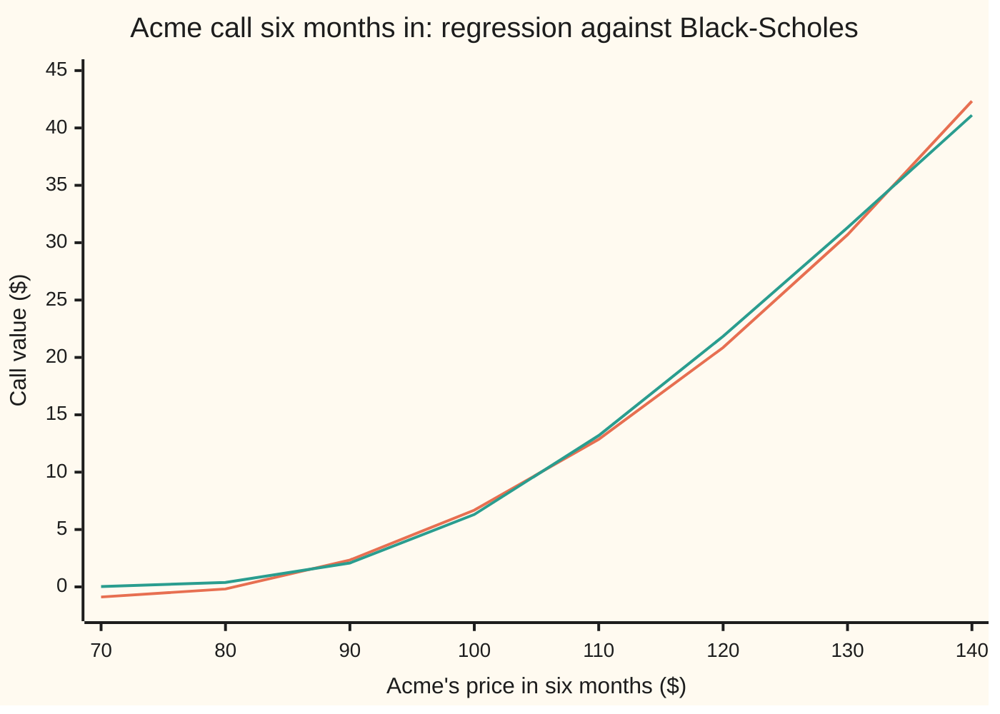
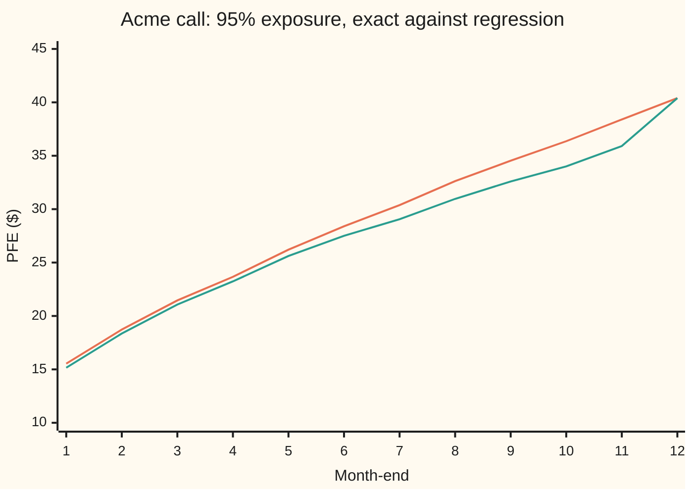

# American Monte Carlo for exposure: regress future values on the simulated state, so exposure profiles work for any trade

[Syllabus](../../../SYLLABUS.md) → [Financial mathematics](../README.md) → [Collateral, Funding and the Rest of the XVAs](../README.md#s47) → American Monte Carlo for exposure

---

## General Overview

A bank holds the one-year Acme call that Northwind sold it. Acme trades at \$100, the strike is \$100, and the call is worth \$9.23 today. To price Northwind's credit risk, the bank needs the call's value on every simulated path at every future month-end. Those values give the expected exposure (EE, the average amount Northwind would owe on a date) and the potential future exposure (PFE, the 95th percentile of that amount) ([Expected exposure over time](../46-Counterparty%20Risk%20and%20CVA/02-expected-exposure-profiles.md)).

For a plain call the revaluation is one Black-Scholes formula per path. A real bank's book has thousands of trades, and most have no formula. The brute-force fix is a nested simulation: start 1,000 fresh paths from every path at every month-end and average their payoffs. For this one call that is 550,000,000 extra paths.

**American Monte Carlo** (AMC) avoids that. Each path already carries its own answer, in noisy form: the payoff it goes on to collect. Fit a curve through the cloud of (price on the date, discounted payoff) points by least squares: choose the curve that makes the sum of squared misses as small as possible. The curve is an estimate of the trade's value as a function of the state. The name comes from the American-option method of [Longstaff-Schwartz](../06-Numerical%20Methods%20for%20Pricing/06-longstaff-schwartz-least-squares-monte-carlo.md), which uses the same fit.

Six months in, a parabola fitted on 50,000 paths puts the call at \$6.69 when Acme is at \$100; Black-Scholes says \$6.31. At Acme's 95th-percentile price of \$126.82 the fit says \$27.36 against the exact \$28.26. The average exposure barely notices the miss: \$9.50 by the fit against \$9.53 by exact revaluation on the same paths.

**Regressing each path's discounted future cash on the state at a date estimates the trade's value there for every path at once, because the payoff's noise averages to zero given the state; exposure profiles then come from the fitted values, for any trade whose cash flows can be simulated.**

**What kind of fact this is:** a method. The fact underneath it is a theorem, proved on this card in Why it works: the least-squares fit of the discounted payoff on functions of the state is the closest such function to the true value.

### The picture: the fitted value against the exact one, six months in



Orange: the fitted parabola $`45.3881 - 130.0125x + 91.3096x^2`$, with $`x`$ the price divided by the strike. Green: the exact Black-Scholes value. The parabola dips below zero at low prices, where a call cannot be worth less than nothing. It runs a little low near \$120 to \$130, which is where the 95th percentile sits.

---

## The formula

Notation first, in words. A date $`t`$ is a month-end, in years from today. $`S_t`$ is Acme's price on that date and $`x = S_t/K`$ is that price in strikes. $`H`$ is the cash the trade pays at expiry $`T`$; for the call $`H = \max(S_T - K, 0)`$.

On each simulated path $`i`$, the realised payoff carried back to date $`t`$ is

```math
Y_i = e^{-r(T-t)}\,H_i .
```

The fit chooses three weights that miss these $`Y_i`$ by as little as possible, squared and summed over the fitting paths:

```math
h(x) = b_0 + b_1 x + b_2 x^2, \qquad (b_0, b_1, b_2) = \arg\min_{b} \sum_{i} \big(Y_i - h(x_i)\big)^2 .
```

**Read it aloud:** on each date, find the parabola in the price that best predicts the discounted payoff each path goes on to collect.

The fitted curve stands in for the trade's value $`V(t)`$. On a fresh set of $`N`$ paths:

```math
\mathrm{EE}(t) \approx \frac{1}{N}\sum_{i=1}^{N} \max\big(h(x_i),\,0\big), \qquad \mathrm{PFE}_{95}(t) \approx \text{the 95th percentile of } \max\big(h(x_i),\,0\big).
```

**Read it aloud:** floor the fitted value at zero on every fresh path, then average for EE and sort for PFE.

The reason it works is one line. In the pricing world (the pretend world where every asset's total return, dividends included, averages the bank rate), the trade's value is the average discounted payoff given what is known on the date:

```math
\mathbb{E}\big[\,Y \mid S_t\,\big] = V(t).
```

**Read it aloud:** on average over the paths that pass through a given price, the discounted payoff equals the trade's value at that price.

| Symbol | Plain meaning | In our example | Push it up and the answer… |
| --- | --- | --- | --- |
| $`t`$, $`T`$ | a future month-end; the call's expiry, in years | 0.5; 1 | $`t`$ near $`T`$: the fit misses more |
| $`S_0`$, $`S_t`$, $`S_T`$, $`K`$ | Acme's price today, on the date and at expiry; the strike | \$100; \$126.82 at the 95th percentile; random; \$100 | exposure rises with $`S_t`$ |
| $`x`$ | the price in strikes, $`S_t/K`$, so the fit's inputs sit near 1 | 1.268224 at the 95th percentile | |
| $`H`$, $`Y`$ | the payoff at expiry; that payoff carried back to date $`t`$ | $`Y = e^{-0.025}H`$ at six months | |
| $`V(t)`$, $`C_0`$ | the trade's true value on date $`t`$; the call's price today | \$28.26 at \$126.82; $`C_0`$ = \$9.23 | |
| $`h`$, $`b_0`$, $`b_1`$, $`b_2`$ | the fitted curve and its three weights | 45.3881, −130.0125, 91.3096 | more terms: smaller miss |
| $`\mathrm{EE}`$, $`\mathrm{PFE}_{95}`$ | average floored value; its 95th percentile | \$9.50 and \$27.51 by the fit | |
| $`N`$ | paths, in each of two sets: one to fit, one to use | 50,000 | sampling noise shrinks like $`1/\sqrt{N}`$ |
| $`r`$, $`q`$, $`\sigma`$ | bank rate, Acme's dividend yield, its volatility | 5%, 2%, 20% | |
| $`B`$ | the knock-out barrier, checked at each month-end | \$90; 68.17% of paths alive at six months | |
| $`\varepsilon`$ | root-mean-square miss: the typical size of fit minus exact, over paths | \$0.70 at six months | |
| $`\mathbb{E}[\,\cdot \mid S_t]`$, $`i`$ | average over the paths passing through price $`S_t`$; a path's number. In the proof, $`M`$, $`D`$, $`g`$, $`p`$, $`a_0`$ to $`a_2`$ are helpers named there | | |

### When it holds

- **Paths from the pricing world.** $`\mathbb{E}[Y \mid S_t] = V(t)`$ needs Acme to drift at $`r - q`$. With a real-world drift the fit estimates a forecast of the payoff, not a value, and the profile no longer feeds [CVA](../46-Counterparty%20Risk%20and%20CVA/03-cva.md).
- **The state carries everything the value depends on.** For the call, the price alone is enough. For the barrier option the state must include whether the path is still alive; drop that and dead paths get a positive fitted value.
- **The curve family can bend like the value.** A parabola misses by \$0.70 at six months and by \$2.11 at eleven months, where the value is nearly the kinked payoff. A straight line misses by \$2.16 even at six months.
- **Enough paths.** The fit inherits the noise of the fitting paths. In an edited run with 5,000 paths instead of 50,000 (Try changing), the six-month EE by the fit comes out at \$9.62 against \$9.46 exact on its paths, and the check fails.
- **Fitting paths and exposure paths kept apart.** Fitting on the same paths lets the curve learn their noise. Here the effect is small; separate sets make the error honest and cost nothing extra to code.

---

## Why it works

### Step 0: each path carries a noisy reading of the value

On a path where Acme stands at \$110 in six months, the call's value there is a number nobody can see on that path alone. What the path does show is the payoff it goes on to collect. That payoff is the value plus luck: sometimes Acme rallies, sometimes it falls. Across many paths near \$110 the luck averages out. A least-squares fit does that averaging at every price at once.

### Step 1: the discounted payoff averages to the value

The pricing world's defining property ([Black–Scholes call](../08-The%20Black-Scholes%20call%20and%20put/01-black-scholes-call.md)): a trade's value on date $`t`$ is its payoff, shrunk by the bank rate over the time left, averaged over every way the future can go from there. That is exactly $`\mathbb{E}[Y \mid S_t] = V(t)`$. So $`Y`$ is the value plus a miss $`Y - V(t)`$ whose average, given the price, is zero.

### Step 2: least squares projects the payoff, and the noise drops out

A least-squares fit is an orthogonal projection: it drops the target onto the family of allowed curves, and the miss is at right angles to every curve in the family: the miss times any such curve averages to zero ([Conditional expectation as a projection](../../10-Measure%20and%20integration/09-Conditional%20Expectation/03-conditional-expectation-as-projection.md)). The miss $`Y - V(t)`$ is at right angles to every function of the price, because its average given the price is zero. Parabolas in the price are such functions. So projecting $`Y`$ onto parabolas gives the same curve as projecting $`V(t)`$ itself.

The fit is therefore aiming at the closest parabola to the true value curve. The payoff's noise does not bias it. Two errors remain: the family's own limit (a parabola is not a Black-Scholes curve) and sampling noise from a finite set of paths.

<details>
<summary>Detailed proof: the fit of the payoff equals the fit of the value</summary>

Write $`M = V(t)`$ and $`D = Y - M`$. For any function $`g`$ of the price with a finite mean square, the tower rule (averaging a conditional average gives the plain average) gives

$`\displaystyle \mathbb{E}[D\,g(S_t)] = \mathbb{E}\big[g(S_t)\,\mathbb{E}[D \mid S_t]\big] = 0 .`$

Now take any parabola $`p(x) = a_0 + a_1x + a_2x^2`$. Split the squared miss:

$`\displaystyle \mathbb{E}\big[(Y - p)^2\big] = \mathbb{E}\big[D^2\big] + 2\,\mathbb{E}\big[D\,(M - p)\big] + \mathbb{E}\big[(M - p)^2\big].`$

The middle term is zero by the first line, since $`M - p`$ is a function of the price. The first term does not depend on $`p`$. So the parabola that minimises the miss to $`Y`$ is the parabola that minimises the miss to $`M`$. The sample version, with averages over 50,000 paths in place of $`\mathbb{E}`$, converges to it as the paths grow. That convergence, and its rate, is the subject of the Clément, Lamberton and Protter paper in Sources.

</details>

### Step 3: the fit keeps the average, so EE is robust and PFE is not

A fit with a constant term has residuals (misses) that sum to zero. So the average fitted value over the fitting paths equals the average $`Y`$: 9.3643 both, at six months. On the fitting paths, before the floor, the fit's average is their own Monte Carlo price grown at the bank rate: \$9.1331 × $`e^{0.025}`$ = \$9.3643.

That makes EE robust: the shape of the curve hardly matters to an average. PFE is a different story. It reads the curve at one high price, where any shape error shows in full: \$27.36 against \$28.26 at the six-month 95th percentile.

The floor adds a small upward push. Where the parabola dips below zero, the floor lifts it back to zero, and those paths add nothing negative.

### Step 4: fit on one set of paths, use another

The weights come from 50,000 fitting paths. The exposures come from 50,000 fresh paths. On the fresh paths the exact Black-Scholes value is also computed, so fit and exact are compared path by path, with the same sampling luck. Any gap is then the regression's error alone.

The fitting paths' own price is \$9.1331, below the true \$9.2270. Step 3 says that shortfall passes straight into the fit's EE. That is most of why the fit's EE in month one, \$9.14, sits under the exact \$9.26 on the fresh paths.

### Step 5: any trade, by adding to the state

Nothing above used the Black-Scholes formula. The method needs only simulated paths, each trade's cash flows along them, and a state rich enough to pin down the value. For a trade with many cash flows, $`Y`$ is the sum of all cash after date $`t`$, each discounted back to $`t`$. For a trade with an exercise right, the cash flows follow the exercise rule found by [Longstaff-Schwartz](../06-Numerical%20Methods%20for%20Pricing/06-longstaff-schwartz-least-squares-monte-carlo.md).

The down-and-out call shows the state growing. It pays like the call, but dies the first time Acme closes a month-end at or below \$90. Its value depends on the price and on whether the path is still alive. Dead paths are worth zero, known for certain. On live paths, fit the discounted payoff on the price, using live fitting paths only. A month-end barrier has no exact closed form; the continuous-barrier formula with a shifted barrier is only an approximation ([Daily monitoring](../16-Barriers%2C%20touches%20and%20lookbacks/03-discrete-monitoring-correction.md)). Here a one-dimensional grid is the referee; on a book with many risk factors no grid fits, and the regression is the only road.

---

## Worked numbers, by hand

The Acme call six months in: $`S_0`$ = \$100, $`K`$ = \$100, $`r`$ = 5%, $`q`$ = 2%, $`\sigma`$ = 20%. The fit on 50,000 paths gives the three weights in the first row.

| Step | Arithmetic | Value |
| --- | --- | --- |
| the weights | least squares on 50,000 fitting paths | 45.3881, −130.0125, 91.3096 |
| fit at Acme \$100, $`x = 1`$ | 45.3881 − 130.0125 + 91.3096 | \$6.6852 |
| exact at Acme \$100 | Black-Scholes, half a year left | \$6.3076 |
| Acme's 95th-percentile price in six months | from [Expected exposure over time](../46-Counterparty%20Risk%20and%20CVA/02-expected-exposure-profiles.md) | \$126.8224 |
| fit there, $`x = 1.268224`$ | 45.3881 − 130.0125 × 1.268224 + 91.3096 × 1.268224² | \$27.3648 |
| exact there | Black-Scholes | \$28.2603 |
| EE closed form | \$9.2270 × $`e^{0.05 \times 0.5}`$ | \$9.4606 |
| EE, exact revaluation on 50,000 fresh paths | average of Black-Scholes values | \$9.5316 |
| **EE, by the fit on the same fresh paths** | average of floored fitted values | **\$9.5049** |
| PFE, exact revaluation on the fresh paths | 47,500th of 50,000 sorted values | \$28.3951 |
| **PFE, by the fit** | 47,500th sorted floored fitted value | **\$27.5078** |

Six months in, the regression gives an average exposure of \$9.50 against \$9.53 by exact revaluation, and a 95% level of \$27.51 against \$28.40. The average feeds the credit charge; the tail feeds Northwind's credit limit, and it is the tail that needs the better basis.

The full profile, month by month:

| Month | EE closed form | EE exact | EE by the fit | PFE exact | PFE by the fit | miss $`\varepsilon`$ |
| ---: | ---: | ---: | ---: | ---: | ---: | ---: |
| 1 | 9.2655 | 9.2587 | 9.1392 | 15.5359 | 15.1544 | 0.1774 |
| 3 | 9.3431 | 9.3909 | 9.3136 | 21.4559 | 21.0690 | 0.2379 |
| 6 | 9.4606 | 9.5316 | 9.5049 | 28.3951 | 27.5078 | 0.7020 |
| 9 | 9.5796 | 9.5903 | 9.7281 | 34.5382 | 32.5936 | 1.3901 |
| 11 | 9.6598 | 9.6808 | 9.9669 | 38.3946 | 35.9099 | 2.1102 |
| 12 | 9.7001 | 9.7612 | 9.7612 | 40.3974 | 40.3974 | 0.0000 |

At month 12 the value is the payoff itself, so there is nothing to fit. The printed output below has all twelve months.

### The down-and-out call, where only regression works in a big book

Barrier \$90, checked at each month-end; otherwise the same call. The grid road prices it at \$8.4142 today; the 50,000 fresh paths give \$8.4962, with a standard error of \$0.0622. Moving the barrier down to \$50, where Acme almost never goes, the grid returns \$9.2279 against Black-Scholes \$9.2270: the grid is sound.

| Month | alive | EE grid | EE by the fit | EE grid, today's dollars | PFE grid | PFE by the fit |
| ---: | ---: | ---: | ---: | ---: | ---: | ---: |
| 1 | 0.9683 | 8.4447 | 8.3347 | 8.4096 | 15.3426 | 14.9968 |
| 6 | 0.6817 | 8.7160 | 8.6613 | 8.5008 | 28.3752 | 27.6898 |
| 11 | 0.5464 | 8.8506 | 8.9198 | 8.4541 | 38.0954 | 36.9989 |
| 12 | 0.5283 | 8.9319 | 8.9319 | 8.4963 | 40.0983 | 40.0983 |

By expiry only 52.83% of paths are still alive, yet EE in today's dollars stays near the price, \$8.41 to \$8.51. That is the flat line of [Expected exposure over time](../46-Counterparty%20Risk%20and%20CVA/02-expected-exposure-profiles.md) again: a bought option's value, discounted, averages to its price on every date. The fit tracks the grid's EE closely at every month; its worst month is the first, \$8.33 against \$8.44.

### What breaks if you drop a piece

| Mistake | Comes out at | What went wrong |
| --- | --- | --- |
| Use each path's own discounted payoff as its six-month value | PFE \$39.40 (right: \$28.40); EE \$9.52 | Foresight: the payoff is the value plus luck. The average survives; the tail is the luck. |
| Fit on the constant 1 only | EE and PFE both \$9.36 | The fit ignores the price, so every path gets the same value and the tail vanishes. |
| Fit on 1 and $`x`$, a straight line | PFE \$24.83 (right: \$28.40) | A line cannot bend like the call's value. |
| Forget the discount, fit on $`H`$ instead of $`Y`$ | EE \$9.75 (right: \$9.50 by the same fit) | Values in expiry dollars, too high by $`e^{0.025}`$. |

---

## How the miss moves with the date

The fit is good early and poor late. Two forces meet. Early on, Acme has not moved far, the paths sit in a narrow band of prices, and over that band the call's value is gently curved. Late on, the paths spread wide and the value is almost the payoff $`\max(S - K, 0)`$, with a sharp corner at the strike. A parabola cannot turn a corner.

```
month   root-mean-square miss of the parabola (each █ = 10 cents)
    1   ██                       $0.18
    3   ██                       $0.24
    6   ███████                  $0.70
    9   ██████████████           $1.39
   11   █████████████████████    $2.11
   12                            $0.00
```

The PFE profile shows the same growth. The parabola must bend round the corner at \$100, so it cannot also follow the nearly straight high-price wing where the 95th percentile sits, and it reads that wing low:



Top line (orange): PFE by exact revaluation on the fresh paths. Bottom line (green): PFE by the parabola. The gap grows from \$15.15 against \$15.54 in month one to \$35.91 against \$38.39 in month eleven, then closes at month twelve, where no fit is needed. Adding a cubic term halves the six-month miss, from \$0.70 to \$0.32. Desks go further: separate curves on each side of the strike, or the trade's own simple price as one of the regressors.

---

## Code, from first principles, and it actually runs

The script simulates two sets of 50,000 monthly Acme paths: one to fit, one to use. For the call, EE comes three ways on every date: the closed form $`C_0e^{rt}`$, exact Black-Scholes revaluation on each fresh path, and the regression. PFE comes two ways, exact and fitted, on the same paths. For the barrier option, a grid marches the value back month by month by Simpson's rule over the bell curve. It is checked against Black-Scholes with the barrier out of reach, and against the plain simulation price. The regression is then compared with it date by date. The random numbers, the normal curve, the fit (the same normal-equations routine as [Longstaff-Schwartz](../06-Numerical%20Methods%20for%20Pricing/06-longstaff-schwartz-least-squares-monte-carlo.md)) and the grid are all written out. The asserts compare the regression with the best fit of the same shape: the curve fitted to the exact values on the same fitting paths. What is left between them is the payoff's luck, which Step 2 says averages out, so the asserts test the method rather than the parabola's built-in miss, and they pass on other random seeds too.

### Python

```python
# American Monte Carlo for exposure -- the check behind the card.  Standard library only.  The Acme
# call Northwind sold to the bank, then a down-and-out call.  Nothing imported knows an answer: the
# random numbers, normal curve, least-squares fit, Black-Scholes and the barrier grid are written out.
from math import exp, log, sqrt, pi, cos
def uniform(s):                                   # 64-bit congruential generator, wrapping
    s[0] = (6364136223846793005 * s[0] + 1442695040888963407) % (1 << 64)
    return (s[0] >> 11) * (1.0 / 9007199254740992.0)
def normal(s):                                    # Box-Muller: two uniforms, one bell draw
    u1 = uniform(s) or 1e-300
    return sqrt(-2.0 * log(u1)) * cos(2.0 * pi * uniform(s))
def phi(x): return exp(-0.5 * x * x) / sqrt(2.0 * pi)            # bell-curve height
def N(x):                                         # 1/2 + phi(x)(x + x^3/3 + x^5/15 + ...)
    if abs(x) > 9.0: return 0.0 if x < 0 else 1.0
    term, total, k = x, x, 1
    while abs(term) > 1e-17 * abs(total):
        k += 2; term *= x * x / k; total += term
    return 0.5 + phi(x) * total
def fit(xs, ys, m):     # least squares, as on the Longstaff-Schwartz card: normal equations,
    mom = [0.0] * (2 * m - 1); rhs = [0.0] * (2 * m - 1)   # then pivoted elimination
    for x, y in zip(xs, ys):
        p = 1.0
        for k in range(2 * m - 1): mom[k] += p; rhs[k] += p * y; p *= x
    M = [[mom[i + j] for j in range(m)] + [rhs[i]] for i in range(m)]
    for c in range(m):
        p = max(range(c, m), key=lambda k: abs(M[k][c])); M[c], M[p] = M[p], M[c]
        for k in range(c + 1, m):
            f = M[k][c] / M[c][c]; M[k] = [a - f * bb for a, bb in zip(M[k], M[c])]
    b = [0.0] * m
    for i in range(m - 1, -1, -1): b[i] = (M[i][m] - sum(M[i][j] * b[j] for j in range(i + 1, m))) / M[i][i]
    return b
def curve(b, x, o=0.0):                           # b0 + b1 x + b2 x^2 + ..., by Horner
    for c in reversed(b): o = o * x + c
    return o
S0, K, R, Q, SIG, T, B, L = 100.0, 100.0, 0.05, 0.02, 0.20, 1.0, 90.0, 12   # house market; barrier $90
DT = T / L; MU = (R - Q - 0.5 * SIG * SIG) * DT; VOL = SIG * sqrt(DT)
def call(s, tau):                                 # Black-Scholes value, tau years left
    if tau <= 0.0: return max(s - K, 0.0)
    v = SIG * sqrt(tau); d1 = (log(s / K) + (R - Q + 0.5 * SIG * SIG) * tau) / v
    return s * exp(-Q * tau) * N(d1) - K * exp(-R * tau) * N(d1 - v)
seed = [20261123]; NP = 50000                     # 50,000 paths to fit on, 50,000 fresh ones to use
def path():
    x = S0; row = [x]
    for _ in range(L): x *= exp(MU + VOL * normal(seed)); row.append(x)
    return row
train = [path() for _ in range(NP)]; use = [path() for _ in range(NP)]
def alive(p, j): return all(p[i] > B for i in range(1, j + 1))   # barrier checked on month-ends
def q95(v): w = sorted(v); return w[-(-95 * len(w) // 100) - 1]  # the ceil(0.95 n)-th smallest
def mean(v): return sum(v) / len(v)
def amc(j, m=3, barrier=False, disc=True, val=None):   # fit on train, revalue every path in use;
    tau = T - j * DT; pts = [p for p in train if not barrier or alive(p, j)]   # val: fit exact values
    pay = lambda p: max(p[L] - K, 0.0) * (1.0 if not barrier or alive(p, L) else 0.0)
    b = fit([p[j] / K for p in pts], [val(p[j]) if val else pay(p) * (exp(-R * tau) if disc else 1.0) for p in pts], m)
    return b, [max(curve(b, p[j] / K), 0.0) if (not barrier or alive(p, j)) else 0.0 for p in use]
C0 = call(S0, T); z95 = 1.6448536269514722         # the 95% normal quantile
print("Acme call bought from Northwind: 12 month-ends, fit on 1, x, x^2 with x = S/K")
print(f"{'month':>5}{'EE closed':>10}{'EE exact':>9}{'EE AMC':>8}{'PFE95 exact':>12}{'PFE95 AMC':>10}{'RMS miss':>9}")
van = []
for j in range(1, L + 1):
    u = j * DT; ex = [call(p[j], T - u) for p in use]
    if j < L: b, est = amc(j); ide = amc(j, len(b), val=lambda s: call(s, T - u))[1]   # best fit
    else: est = ide = ex                          # at expiry the value is the payoff: nothing to fit
    rms = sqrt(mean([(a - c) * (a - c) for a, c in zip(est, ex)]))
    van.append((u, C0 * exp(R * u), mean(ex), mean(est), q95(ex), q95(est), rms, mean(ide), q95(ide)))
    print(f"{j:5d}" + "".join(f"{x:{w}.4f}" for x, w in zip(van[-1][1:], (10, 9, 8, 12, 10, 9))))
ex6 = [call(p[6], 0.5) for p in use]; b6 = amc(6)[0]; s95 = S0 * exp(MU * 6 + SIG * sqrt(0.5) * z95)
b6i = amc(6, val=lambda s: call(s, 0.5))[0]       # the best parabola: fitted to exact values
pts6 = [p[6] / K for p in train]; y6 = [max(p[L] - K, 0.0) * exp(-R * 0.5) for p in train]
for name, x in [("call today C0", C0), ("six months: b0", b6[0]), ("  b1", b6[1]), ("  b2", b6[2]),
                ("  fit at S = 100", curve(b6, 1.0)), ("  Black-Scholes at S = 100", call(100.0, 0.5)),
                ("  Acme at its 95th percentile", s95), ("  fit there", curve(b6, s95 / K)),
                ("  Black-Scholes there", call(s95, 0.5)),
                ("  in-sample mean of fit", mean([curve(b6, x) for x in pts6])), ("  in-sample mean of Y", mean(y6)),
                ("  fitting paths' price, Y e^(-r/2)", mean(y6) * exp(-R * 0.5)), ("  fresh paths' price", mean(ex6) * exp(-R * 0.5))]:
    print(f"{name:<34}{x:10.4f}")
grid = [70.0 + 10.0 * i for i in range(8)]
print("six months, S:      " + "".join(f"{g:7.0f}" for g in grid))
print("  fitted value:     " + "".join(f"{curve(b6, g / K):7.2f}" for g in grid))
print("  Black-Scholes:    " + "".join(f"{call(g, 0.5):7.2f}" for g in grid))
print("six months, by basis   EE      PFE95   RMS miss")
basis = {}
for m, name in ((1, "1"), (2, "1, x"), (3, "1, x, x^2"), (4, "1, x, x^2, x^3")):
    e = amc(6, m)[1]; basis[m] = sqrt(mean([(a - c) * (a - c) for a, c in zip(e, ex6)]))
    print(f"  {name:<18}{mean(e):8.4f}{q95(e):9.4f}{basis[m]:9.4f}")
peek = [max(p[L] - K, 0.0) * exp(-R * 0.5) for p in use]          # the path's own future, discounted
nod = amc(6, disc=False)[1]
for name, x in [("mistake: own future, PFE95", q95(peek)), ("mistake: own future, EE", mean(peek)),
                ("mistake: no discounting, EE", mean(nod))]:
    print(f"{name:<34}{x:10.4f}")
print(f"nested simulation instead, 1000 inner paths per path per date: {NP * (L - 1) * 1000} inner paths")
# Road 2 for the barrier: march the value back month by month on a grid of log prices.
G, NZ = 1200, 200
def grid(bb):                                     # value of the down-and-out at barrier bb, month by month
    lo = log(bb); hg = (log(5.0 * S0) - lo) / (G - 1)
    def look(v, s, tau):                          # value on the grid; far above, the barrier is moot
        y = (log(s) - lo) / hg                    # the first node sits on the barrier itself:
        if y < -1e-9: return 0.0                  # only a price clearly below it is knocked out
        y = max(y, 0.0)
        if y >= G - 1: return s * exp(-Q * tau) - K * exp(-R * tau)
        i = int(y); f = y - i
        return v[i] * (1.0 - f) + v[i + 1] * f
    def back(v, s, tau):                          # e^(-r dt) times the average of next month's value
        za = max((log(bb / s) - MU) / VOL, -8.0)
        if za >= 8.0: return 0.0
        h = (8.0 - za) / NZ; tot = 0.0
        for i in range(NZ + 1):
            z = za + i * h; w = 1.0 if i in (0, NZ) else (4.0 if i % 2 else 2.0)
            tot += w * phi(z) * look(v, s * exp(MU + VOL * z), tau)
        return exp(-R * DT) * tot * h / 3.0
    vg = [[0.0] * G for _ in range(L + 1)]
    vg[L] = [max(exp(lo + i * hg) - K, 0.0) for i in range(G)]
    for j in range(L - 1, 0, -1): vg[j] = [back(vg[j + 1], exp(lo + i * hg), T - (j + 1) * DT) for i in range(G)]
    return (lambda j, s: look(vg[j], s, T - j * DT)), back(vg[1], S0, T - DT)
vlook, bar0 = grid(B); bar_lo = grid(50.0)[1]
dpay = [exp(-R * T) * max(p[L] - K, 0.0) * alive(p, L) for p in use]
bmc = mean(dpay); bse = sqrt(mean([(x - bmc) * (x - bmc) for x in dpay]) / (NP - 1))
print(f"down-and-out call, barrier {B:.0f} on month-ends: price by grid {bar0:.4f}, by paths {bmc:.4f} +/- {bse:.4f}")
print(f"  grid with the barrier moved to $50: {bar_lo:.4f}, Black-Scholes {C0:.4f}")
print(f"{'month':>5}{'alive':>7}{'EE grid':>9}{'EE AMC':>8}{'disc EE':>8}{'PFE95 grid':>11}{'PFE95 AMC':>10}{'RMS miss':>9}")
bar = []
for j in range(1, L + 1):
    u = j * DT; al = [alive(p, j) for p in use]
    ex = [vlook(j, p[j]) if a else 0.0 for p, a in zip(use, al)]
    est, ide = (amc(j, barrier=True)[1], amc(j, barrier=True, val=lambda s: vlook(j, s))[1]) if j < L else (ex, ex)
    rms = sqrt(sum((a - c) * (a - c) for a, c, f in zip(est, ex, al) if f) / sum(al))
    bar.append((sum(al) / NP, mean(ex), mean(est), mean(ex) * exp(-R * u), q95(ex), q95(est), rms, mean(ide)))
    print(f"{j:5d}" + "".join(f"{x:{w}.4f}" for x, w in zip(bar[-1], (7, 9, 8, 8, 11, 10, 9))))
for j, (u, cl, e, a, pe, pa, rms, ai, pai) in enumerate(van[:-1]):   # against the best fit: only luck
    assert abs(a - ai) < 0.25, "regression EE near the best parabola's: the payoff's luck averages out"
    assert abs(e - cl) < 0.20, "exact revaluation EE near the closed form C0 e^(ru)"
    assert abs(pa - pai) < 0.8, "regression PFE near the best parabola's"
assert abs(call(s95, 0.5) - 28.2603) < 1e-3 and abs(curve(b6, s95 / K) - curve(b6i, s95 / K)) < 0.8, "six-month PFE"
assert abs(mean([curve(b6, x) for x in pts6]) - mean(y6)) < 1e-9, "a fit with a constant matches the mean"
assert basis[1] > basis[2] > basis[3] > basis[4] and van[5][6] < 1.0, "more terms, smaller miss"
assert q95(peek) > van[5][4] + 5.0, "a path's own future overstates PFE"
assert abs(bar_lo - C0) < 2e-3, "the grid with no barrier in reach is Black-Scholes"
assert abs(bar0 - bmc) < 3.0 * bse and bar0 < C0 - 0.5, "grid barrier price agrees with the paths"
for t in bar[:-1]:
    assert abs(t[3] - bar0) < 0.25, "discounted barrier EE stays at today's price"
    assert abs(t[2] - t[7]) < 0.25, "regression barrier EE near the best fit to the grid's values"
print("ALL CHECKS PASS")
```

**Ran 2026-11-23 on macOS, Python 3.14.10, standard library only. All checks passed. Output, pasted from the run:**

```
Acme call bought from Northwind: 12 month-ends, fit on 1, x, x^2 with x = S/K
month EE closed EE exact  EE AMC PFE95 exact PFE95 AMC RMS miss
    1    9.2655   9.2587  9.1392     15.5359   15.1544   0.1774
    2    9.3042   9.3436  9.2522     18.7286   18.3595   0.1671
    3    9.3431   9.3909  9.3136     21.4559   21.0690   0.2379
    4    9.3821   9.4146  9.3506     23.6631   23.2387   0.3545
    5    9.4213   9.5057  9.4727     26.2073   25.6134   0.4924
    6    9.4606   9.5316  9.5049     28.3951   27.5078   0.7020
    7    9.5001   9.5292  9.5412     30.3768   29.0557   0.9123
    8    9.5398   9.5612  9.6218     32.6237   30.9635   1.1297
    9    9.5796   9.5903  9.7281     34.5382   32.5936   1.3901
   10    9.6196   9.6203  9.8350     36.3620   34.0075   1.7208
   11    9.6598   9.6808  9.9669     38.3946   35.9099   2.1102
   12    9.7001   9.7612  9.7612     40.3974   40.3974   0.0000
call today C0                         9.2270
six months: b0                       45.3881
  b1                               -130.0125
  b2                                 91.3096
  fit at S = 100                      6.6852
  Black-Scholes at S = 100            6.3076
  Acme at its 95th percentile       126.8224
  fit there                          27.3648
  Black-Scholes there                28.2603
  in-sample mean of fit               9.3643
  in-sample mean of Y                 9.3643
  fitting paths' price, Y e^(-r/2)    9.1331
  fresh paths' price                  9.2962
six months, S:           70     80     90    100    110    120    130    140
  fitted value:       -0.88  -0.18   2.34   6.69  12.86  20.86  30.69  42.34
  Black-Scholes:       0.03   0.39   2.08   6.31  13.19  21.84  31.32  41.11
six months, by basis   EE      PFE95   RMS miss
  1                   9.3643   9.3643   9.2800
  1, x                9.9373  24.8312   2.1592
  1, x, x^2           9.5049  27.5078   0.7020
  1, x, x^2, x^3      9.4702  28.0059   0.3161
mistake: own future, PFE95           39.4000
mistake: own future, EE               9.5202
mistake: no discounting, EE           9.7455
nested simulation instead, 1000 inner paths per path per date: 550000000 inner paths
down-and-out call, barrier 90 on month-ends: price by grid 8.4142, by paths 8.4962 +/- 0.0622
  grid with the barrier moved to $50: 9.2279, Black-Scholes 9.2270
month  alive  EE grid  EE AMC disc EE PFE95 grid PFE95 AMC RMS miss
    1 0.9683   8.4447  8.3347  8.4096    15.3426   14.9968   0.1714
    2 0.8959   8.5315  8.4513  8.4607    18.6536   18.3278   0.1413
    3 0.8262   8.5740  8.5018  8.4675    21.4281   21.1072   0.1434
    4 0.7672   8.5966  8.5348  8.4545    23.6537   23.3131   0.2216
    5 0.7212   8.6913  8.6460  8.5121    26.1931   25.7478   0.2914
    6 0.6817   8.7160  8.6613  8.5008    28.3752   27.6898   0.4557
    7 0.6468   8.7105  8.6606  8.4601    30.3413   29.3886   0.5980
    8 0.6162   8.7420  8.6934  8.4554    32.5338   31.4302   0.7084
    9 0.5895   8.7748  8.7518  8.4518    34.4139   33.2930   0.7853
   10 0.5672   8.7998  8.8192  8.4406    36.1903   35.0087   0.8480
   11 0.5464   8.8506  8.9198  8.4541    38.0954   36.9989   0.9394
   12 0.5283   8.9319  8.9319  8.4963    40.0983   40.0983   0.0000
ALL CHECKS PASS
```

### Rust

The same generator, fit, grid and printing, written again with nothing outside the standard library.

```rust
// American Monte Carlo for exposure -- the same check as the Python, in Rust.  No crates.  The Acme
// call Northwind sold to the bank, then a down-and-out call.  Nothing imported knows an answer: the
// random numbers, normal curve, least-squares fit, Black-Scholes and the barrier grid are written out.
use std::f64::consts::PI;
const S0: f64 = 100.0; const K: f64 = 100.0; const R: f64 = 0.05; const Q: f64 = 0.02;
const SIG: f64 = 0.20; const T: f64 = 1.0; const B: f64 = 90.0; const L: usize = 12;   // barrier $90
const NP: usize = 50000; const G: usize = 1200; const NZ: usize = 200;
fn uniform(s: &mut u64) -> f64 {                  // 64-bit congruential generator, wrapping
    *s = s.wrapping_mul(6364136223846793005).wrapping_add(1442695040888963407);
    ((*s >> 11) as f64) * (1.0 / 9007199254740992.0)
}
fn normal(s: &mut u64) -> f64 {                   // Box-Muller: two uniforms, one bell draw
    let mut u1 = uniform(s); if u1 == 0.0 { u1 = 1e-300 }
    (-2.0 * u1.ln()).sqrt() * (2.0 * PI * uniform(s)).cos()
}
fn phi(x: f64) -> f64 { (-0.5 * x * x).exp() / (2.0 * PI).sqrt() }
fn n_cdf(x: f64) -> f64 {                         // 1/2 + phi(x)(x + x^3/3 + x^5/15 + ...)
    if x < -9.0 { return 0.0 } if x > 9.0 { return 1.0 }
    let (mut term, mut total, mut k) = (x, x, 1.0);
    while term.abs() > 1e-17 * total.abs() { k += 2.0; term *= x * x / k; total += term }
    0.5 + phi(x) * total
}
fn fit(xs: &[f64], ys: &[f64], m: usize) -> Vec<f64> {   // least squares, as on the Longstaff-Schwartz
    let mut mom = vec![0.0; 2 * m - 1]; let mut rhs = vec![0.0; 2 * m - 1];  // card: normal equations,
    for (x, y) in xs.iter().zip(ys.iter()) { let mut p = 1.0;             // then pivoted elimination
        for k in 0..2 * m - 1 { mom[k] += p; rhs[k] += p * y; p *= x } }
    let mut mm: Vec<Vec<f64>> = (0..m).map(|i| (0..=m).map(|j| if j < m { mom[i + j] } else { rhs[i] }).collect()).collect();
    for c in 0..m {
        let mut p = c; for k in c + 1..m { if mm[k][c].abs() > mm[p][c].abs() { p = k } } mm.swap(c, p);
        for k in c + 1..m { let f = mm[k][c] / mm[c][c];
            let row: Vec<f64> = (0..=m).map(|j| mm[k][j] - f * mm[c][j]).collect(); mm[k] = row }
    }
    let mut b = vec![0.0; m];
    for i in (0..m).rev() { let mut s = 0.0; for j in i + 1..m { s += mm[i][j] * b[j] } b[i] = (mm[i][m] - s) / mm[i][i] }
    b
}
fn curve(b: &[f64], x: f64) -> f64 { let mut o = 0.0; for c in b.iter().rev() { o = o * x + c } o }   // Horner
fn call(s: f64, tau: f64) -> f64 {                // Black-Scholes value, tau years left
    if tau <= 0.0 { return (s - K).max(0.0) }
    let v = SIG * tau.sqrt(); let d1 = ((s / K).ln() + (R - Q + 0.5 * SIG * SIG) * tau) / v;
    s * (-Q * tau).exp() * n_cdf(d1) - K * (-R * tau).exp() * n_cdf(d1 - v)
}
fn alive(p: &[f64], j: usize) -> bool { (1..=j).all(|i| p[i] > B) }      // barrier checked on month-ends
fn q95(v: &[f64]) -> f64 { let mut w = v.to_vec(); w.sort_by(|a, b| a.partial_cmp(b).unwrap()); w[(95 * w.len() + 99) / 100 - 1] }
fn mean(v: &[f64]) -> f64 { let mut s = 0.0; for x in v { s += x } s / v.len() as f64 }
fn rms(a: &[f64], c: &[f64]) -> f64 { mean(&a.iter().zip(c).map(|(x, y)| (x - y) * (x - y)).collect::<Vec<f64>>()).sqrt() }
struct Grid { lo: f64, hg: f64, vg: Vec<Vec<f64>> }
impl Grid {                                       // the barrier's value marched back on log prices
    fn look(&self, s: f64, tau: f64, v: &[f64]) -> f64 {
        let mut y = (s.ln() - self.lo) / self.hg;           // the first node sits on the barrier:
        if y < -1e-9 { return 0.0 } y = y.max(0.0);            // only a price clearly below is out
        if y >= (G - 1) as f64 { return s * (-Q * tau).exp() - K * (-R * tau).exp() }
        let i = y as usize; let f = y - i as f64; v[i] * (1.0 - f) + v[i + 1] * f
    }
    fn back(&self, bb: f64, v: &[f64], s: f64, tau: f64, mu: f64, vol: f64) -> f64 {
        let za = (((bb / s).ln() - mu) / vol).max(-8.0);
        if za >= 8.0 { return 0.0 }
        let h = (8.0 - za) / NZ as f64; let mut tot = 0.0;
        for i in 0..=NZ {
            let z = za + i as f64 * h; let w = if i == 0 || i == NZ { 1.0 } else if i % 2 == 1 { 4.0 } else { 2.0 };
            tot += w * phi(z) * self.look(s * (mu + vol * z).exp(), tau, v);
        }
        (-R * (T / L as f64)).exp() * tot * h / 3.0
    }
}
fn grid(bb: f64, mu: f64, vol: f64) -> (Grid, f64) {
    let dt = T / L as f64; let lo = bb.ln(); let hg = ((5.0 * S0).ln() - lo) / (G - 1) as f64;
    let mut g = Grid { lo, hg, vg: vec![vec![0.0; G]; L + 1] };
    g.vg[L] = (0..G).map(|i| ((lo + i as f64 * hg).exp() - K).max(0.0)).collect();
    for j in (1..L).rev() {
        let row: Vec<f64> = (0..G).map(|i| g.back(bb, &g.vg[j + 1], (lo + i as f64 * hg).exp(), T - (j + 1) as f64 * dt, mu, vol)).collect();
        g.vg[j] = row;
    }
    let p = g.back(bb, &g.vg[1], S0, T - dt, mu, vol); (g, p)
}
fn main() {
    let dt = T / L as f64; let mu = (R - Q - 0.5 * SIG * SIG) * dt; let vol = SIG * dt.sqrt();
    let mut seed = 20261123u64;                   // 50,000 paths to fit on, 50,000 fresh ones to use
    let mut path = || { let mut x = S0; let mut row = vec![x];
        for _ in 0..L { x *= (mu + vol * normal(&mut seed)).exp(); row.push(x) } row };
    let train: Vec<Vec<f64>> = (0..NP).map(|_| path()).collect(); let usep: Vec<Vec<f64>> = (0..NP).map(|_| path()).collect();
    let amc = |j: usize, m: usize, barrier: bool, disc: bool, val: Option<&dyn Fn(f64) -> f64>| -> (Vec<f64>, Vec<f64>) {
        // fit on train, revalue use; val: fit the exact values instead, for the best fit
        let tau = T - j as f64 * dt; let pts: Vec<&Vec<f64>> = train.iter().filter(|p| !barrier || alive(p, j)).collect();
        let pay = |p: &Vec<f64>| (p[L] - K).max(0.0) * (if !barrier || alive(p, L) { 1.0 } else { 0.0 });
        let xs: Vec<f64> = pts.iter().map(|p| p[j] / K).collect();
        let ys: Vec<f64> = pts.iter().map(|p| match val { Some(f) => f(p[j]), None => pay(p) * (if disc { (-R * tau).exp() } else { 1.0 }) }).collect();
        let b = fit(&xs, &ys, m);
        let est = usep.iter().map(|p| if !barrier || alive(p, j) { curve(&b, p[j] / K).max(0.0) } else { 0.0 }).collect();
        (b, est)
    };
    let c0 = call(S0, T); let z95 = 1.6448536269514722_f64;   // the 95% normal quantile
    println!("Acme call bought from Northwind: 12 month-ends, fit on 1, x, x^2 with x = S/K");
    println!("{:>5}{:>10}{:>9}{:>8}{:>12}{:>10}{:>9}", "month", "EE closed", "EE exact", "EE AMC", "PFE95 exact", "PFE95 AMC", "RMS miss");
    let mut van: Vec<[f64; 9]> = vec![];
    for j in 1..=L {
        let u = j as f64 * dt; let ex: Vec<f64> = usep.iter().map(|p| call(p[j], T - u)).collect();
        let (b, est) = if j < L { amc(j, 3, false, true, None) } else { (vec![], ex.clone()) };   // at expiry: the payoff
        let ide = if j < L { amc(j, b.len(), false, true, Some(&|s: f64| call(s, T - u))).1 } else { ex.clone() };   // best fit
        let t = [u, c0 * (R * u).exp(), mean(&ex), mean(&est), q95(&ex), q95(&est), rms(&est, &ex), mean(&ide), q95(&ide)];
        println!("{:5}{:10.4}{:9.4}{:8.4}{:12.4}{:10.4}{:9.4}", j, t[1], t[2], t[3], t[4], t[5], t[6]); van.push(t);
    }
    let ex6: Vec<f64> = usep.iter().map(|p| call(p[6], 0.5)).collect();
    let b6 = amc(6, 3, false, true, None).0; let s95 = S0 * (mu * 6.0 + SIG * 0.5_f64.sqrt() * z95).exp();
    let b6i = amc(6, 3, false, true, Some(&|s: f64| call(s, 0.5))).0;   // the best parabola: fitted to exact values
    let pts6: Vec<f64> = train.iter().map(|p| p[6] / K).collect();
    let y6: Vec<f64> = train.iter().map(|p| (p[L] - K).max(0.0) * (-R * 0.5).exp()).collect();
    let fit_mean = mean(&pts6.iter().map(|&x| curve(&b6, x)).collect::<Vec<f64>>());
    for (name, x) in [("call today C0", c0), ("six months: b0", b6[0]), ("  b1", b6[1]), ("  b2", b6[2]),
        ("  fit at S = 100", curve(&b6, 1.0)), ("  Black-Scholes at S = 100", call(100.0, 0.5)),
        ("  Acme at its 95th percentile", s95), ("  fit there", curve(&b6, s95 / K)), ("  Black-Scholes there", call(s95, 0.5)),
        ("  in-sample mean of fit", fit_mean), ("  in-sample mean of Y", mean(&y6)),
        ("  fitting paths' price, Y e^(-r/2)", mean(&y6) * (-R * 0.5).exp()), ("  fresh paths' price", mean(&ex6) * (-R * 0.5).exp())] {
        println!("{:<34}{:10.4}", name, x);
    }
    let gr: Vec<f64> = (0..8).map(|i| 70.0 + 10.0 * i as f64).collect();
    println!("six months, S:      {}", gr.iter().map(|g| format!("{:7.0}", g)).collect::<String>());
    println!("  fitted value:     {}", gr.iter().map(|g| format!("{:7.2}", curve(&b6, g / K))).collect::<String>());
    println!("  Black-Scholes:    {}", gr.iter().map(|g| format!("{:7.2}", call(*g, 0.5))).collect::<String>());
    println!("six months, by basis   EE      PFE95   RMS miss");
    let mut basis = [0.0; 5];
    for (m, name) in [(1usize, "1"), (2, "1, x"), (3, "1, x, x^2"), (4, "1, x, x^2, x^3")] {
        let e = amc(6, m, false, true, None).1; basis[m] = rms(&e, &ex6);
        println!("  {:<18}{:8.4}{:9.4}{:9.4}", name, mean(&e), q95(&e), basis[m]);
    }
    let peek: Vec<f64> = usep.iter().map(|p| (p[L] - K).max(0.0) * (-R * 0.5).exp()).collect();   // own future
    let nod = amc(6, 3, false, false, None).1;
    for (name, x) in [("mistake: own future, PFE95", q95(&peek)), ("mistake: own future, EE", mean(&peek)),
                      ("mistake: no discounting, EE", mean(&nod))] { println!("{:<34}{:10.4}", name, x) }
    println!("nested simulation instead, 1000 inner paths per path per date: {} inner paths", NP * (L - 1) * 1000);
    let (g, bar0) = grid(B, mu, vol); let bar_lo = grid(50.0, mu, vol).1;
    let dpay: Vec<f64> = usep.iter().map(|p| (-R * T).exp() * (p[L] - K).max(0.0) * (if alive(p, L) { 1.0 } else { 0.0 })).collect();
    let bmc = mean(&dpay); let bse = (mean(&dpay.iter().map(|x| (x - bmc) * (x - bmc)).collect::<Vec<f64>>()) / (NP - 1) as f64).sqrt();
    println!("down-and-out call, barrier {:.0} on month-ends: price by grid {:.4}, by paths {:.4} +/- {:.4}", B, bar0, bmc, bse);
    println!("  grid with the barrier moved to $50: {:.4}, Black-Scholes {:.4}", bar_lo, c0);
    println!("{:>5}{:>7}{:>9}{:>8}{:>8}{:>11}{:>10}{:>9}", "month", "alive", "EE grid", "EE AMC", "disc EE", "PFE95 grid", "PFE95 AMC", "RMS miss");
    let mut bar: Vec<[f64; 8]> = vec![];
    for j in 1..=L {
        let u = j as f64 * dt; let al: Vec<bool> = usep.iter().map(|p| alive(p, j)).collect();
        let ex: Vec<f64> = usep.iter().zip(&al).map(|(p, &a)| if a { g.look(p[j], T - u, &g.vg[j]) } else { 0.0 }).collect();
        let est = if j < L { amc(j, 3, true, true, None).1 } else { ex.clone() };
        let ide = if j < L { amc(j, 3, true, true, Some(&|s: f64| g.look(s, T - u, &g.vg[j]))).1 } else { ex.clone() };
        let (mut ss, mut na) = (0.0, 0usize);
        for i in 0..NP { if al[i] { ss += (est[i] - ex[i]) * (est[i] - ex[i]); na += 1 } }
        let t = [na as f64 / NP as f64, mean(&ex), mean(&est), mean(&ex) * (-R * u).exp(), q95(&ex), q95(&est), (ss / na as f64).sqrt(), mean(&ide)];
        println!("{:5}{:7.4}{:9.4}{:8.4}{:8.4}{:11.4}{:10.4}{:9.4}", j, t[0], t[1], t[2], t[3], t[4], t[5], t[6]); bar.push(t);
    }
    for t in &van[..L - 1] {                      // against the best fit: only luck is left
        assert!((t[3] - t[7]).abs() < 0.25, "regression EE near the best parabola's: the payoff's luck averages out");
        assert!((t[2] - t[1]).abs() < 0.20, "exact revaluation EE near the closed form C0 e^(ru)");
        assert!((t[5] - t[8]).abs() < 0.8, "regression PFE near the best parabola's");
    }
    assert!((call(s95, 0.5) - 28.2603).abs() < 1e-3 && (curve(&b6, s95 / K) - curve(&b6i, s95 / K)).abs() < 0.8, "six-month PFE");
    assert!((fit_mean - mean(&y6)).abs() < 1e-9, "a fit with a constant matches the mean");
    assert!(basis[1] > basis[2] && basis[2] > basis[3] && basis[3] > basis[4] && van[5][6] < 1.0, "more terms, smaller miss");
    assert!(q95(&peek) > van[5][4] + 5.0, "a path's own future overstates PFE");
    assert!((bar_lo - c0).abs() < 2e-3, "the grid with no barrier in reach is Black-Scholes");
    assert!((bar0 - bmc).abs() < 3.0 * bse && bar0 < c0 - 0.5, "grid barrier price agrees with the paths");
    for t in &bar[..L - 1] {
        assert!((t[3] - bar0).abs() < 0.25, "discounted barrier EE stays at today's price");
        assert!((t[2] - t[7]).abs() < 0.25, "regression barrier EE near the best fit to the grid's values");
    }
    println!("ALL CHECKS PASS");
}
```

**Ran 2026-11-23 on macOS, rustc 1.98.1, no crates. All checks passed. Output, pasted from the run:**

```
Acme call bought from Northwind: 12 month-ends, fit on 1, x, x^2 with x = S/K
month EE closed EE exact  EE AMC PFE95 exact PFE95 AMC RMS miss
    1    9.2655   9.2587  9.1392     15.5359   15.1544   0.1774
    2    9.3042   9.3436  9.2522     18.7286   18.3595   0.1671
    3    9.3431   9.3909  9.3136     21.4559   21.0690   0.2379
    4    9.3821   9.4146  9.3506     23.6631   23.2387   0.3545
    5    9.4213   9.5057  9.4727     26.2073   25.6134   0.4924
    6    9.4606   9.5316  9.5049     28.3951   27.5078   0.7020
    7    9.5001   9.5292  9.5412     30.3768   29.0557   0.9123
    8    9.5398   9.5612  9.6218     32.6237   30.9635   1.1297
    9    9.5796   9.5903  9.7281     34.5382   32.5936   1.3901
   10    9.6196   9.6203  9.8350     36.3620   34.0075   1.7208
   11    9.6598   9.6808  9.9669     38.3946   35.9099   2.1102
   12    9.7001   9.7612  9.7612     40.3974   40.3974   0.0000
call today C0                         9.2270
six months: b0                       45.3881
  b1                               -130.0125
  b2                                 91.3096
  fit at S = 100                      6.6852
  Black-Scholes at S = 100            6.3076
  Acme at its 95th percentile       126.8224
  fit there                          27.3648
  Black-Scholes there                28.2603
  in-sample mean of fit               9.3643
  in-sample mean of Y                 9.3643
  fitting paths' price, Y e^(-r/2)    9.1331
  fresh paths' price                  9.2962
six months, S:           70     80     90    100    110    120    130    140
  fitted value:       -0.88  -0.18   2.34   6.69  12.86  20.86  30.69  42.34
  Black-Scholes:       0.03   0.39   2.08   6.31  13.19  21.84  31.32  41.11
six months, by basis   EE      PFE95   RMS miss
  1                   9.3643   9.3643   9.2800
  1, x                9.9373  24.8312   2.1592
  1, x, x^2           9.5049  27.5078   0.7020
  1, x, x^2, x^3      9.4702  28.0059   0.3161
mistake: own future, PFE95           39.4000
mistake: own future, EE               9.5202
mistake: no discounting, EE           9.7455
nested simulation instead, 1000 inner paths per path per date: 550000000 inner paths
down-and-out call, barrier 90 on month-ends: price by grid 8.4142, by paths 8.4962 +/- 0.0622
  grid with the barrier moved to $50: 9.2279, Black-Scholes 9.2270
month  alive  EE grid  EE AMC disc EE PFE95 grid PFE95 AMC RMS miss
    1 0.9683   8.4447  8.3347  8.4096    15.3426   14.9968   0.1714
    2 0.8959   8.5315  8.4513  8.4607    18.6536   18.3278   0.1413
    3 0.8262   8.5740  8.5018  8.4675    21.4281   21.1072   0.1434
    4 0.7672   8.5966  8.5348  8.4545    23.6537   23.3131   0.2216
    5 0.7212   8.6913  8.6460  8.5121    26.1931   25.7478   0.2914
    6 0.6817   8.7160  8.6613  8.5008    28.3752   27.6898   0.4557
    7 0.6468   8.7105  8.6606  8.4601    30.3413   29.3886   0.5980
    8 0.6162   8.7420  8.6934  8.4554    32.5338   31.4302   0.7084
    9 0.5895   8.7748  8.7518  8.4518    34.4139   33.2930   0.7853
   10 0.5672   8.7998  8.8192  8.4406    36.1903   35.0087   0.8480
   11 0.5464   8.8506  8.9198  8.4541    38.0954   36.9989   0.9394
   12 0.5283   8.9319  8.9319  8.4963    40.0983   40.0983   0.0000
ALL CHECKS PASS
```

The two outputs are byte-identical: both languages run the same integer generator and the same arithmetic in the same order.

### Lean

Lean proves Step 2, with its detailed proof, and Step 3, for any trade whose value is a function of the price.

- Suppose $`\mathbb{E}[Y \mid S_t] = V(t)`$ and $`g(S_t)`$ has a finite mean square. Then $`\mathbb{E}[D\,g(S_t)] = 0`$.
- Take the same $`Y`$ and $`g`$. Then $`\mathbb{E}[(Y - g(S_t))^2] = \mathbb{E}[D^2] + \mathbb{E}[(M - g(S_t))^2]`$.
- Take any family of such functions $`g`$, parabolas for example. Then a member minimises the mean squared miss to $`Y`$ exactly when it minimises the miss to $`M`$.
- Take a least-squares fit of a polynomial in $`x`$ with a constant term, on any fitting paths. Then the residuals sum to zero, so the fitted values and the $`Y_i`$ share one average.
- Lean also confirms two counts: 550,000,000 inner paths for the nested simulation, and the 47,500th of 50,000 sorted values for PFE.

The sample fit's convergence as the paths grow, and every number on the card, are left to the Python and Rust checks.

```lean
-- American Monte Carlo for exposure: when the discounted payoff Y averages to the value v(S) given the state S, the noise Y - v(S) is orthogonal to every function of the state, so the least-squares fit of Y over any family of functions of the state is the least-squares fit of the value itself, and a sample fit with a constant term keeps the sample average.
import Mathlib.MeasureTheory.Function.ConditionalExpectation.Real
import Mathlib.MeasureTheory.Function.ConditionalExpectation.PullOut
import Mathlib.MeasureTheory.Function.L2Space
import Mathlib.Algebra.BigOperators.Fin

open MeasureTheory ProbabilityTheory

lemma amc_noise_orthogonal {Ω : Type*} {m₀ : MeasurableSpace Ω}
    {μ : Measure Ω} [IsProbabilityMeasure μ] {m : MeasurableSpace Ω} (hm : m ≤ m₀)
    {Y F : Ω → ℝ} (hY : MemLp Y 2 μ) (hF : StronglyMeasurable[m] F) (hF2 : MemLp F 2 μ) :
    ∫ ω, (Y ω - μ[Y | m] ω) * F ω ∂μ = 0 := by
  have hc : MemLp (μ[Y | m]) 2 μ := hY.condExp (by norm_num)
  have i1 : Integrable (F * Y) μ := hF2.integrable_mul hY
  have i2 : Integrable (F * μ[Y | m]) μ := hF2.integrable_mul hc
  have key : ∫ ω, (F * Y) ω ∂μ = ∫ ω, (F * μ[Y | m]) ω ∂μ := by
    rw [← integral_condExp hm (f := F * Y)]
    exact integral_congr_ae
      (condExp_mul_of_stronglyMeasurable_left hF i1 (hY.integrable (by norm_num)))
  have e : (fun ω => (Y ω - μ[Y | m] ω) * F ω) = fun ω => (F * Y) ω - (F * μ[Y | m]) ω := by
    funext ω; simp only [Pi.mul_apply]; ring
  rw [e, integral_sub i1 i2, key, sub_self]

#print axioms amc_noise_orthogonal

lemma amc_miss_splits {Ω : Type*} [MeasurableSpace Ω]
    {μ : Measure Ω} [IsProbabilityMeasure μ] {S Y : Ω → ℝ} {v g : ℝ → ℝ}
    (hS : Measurable S) (hY : MemLp Y 2 μ)
    (hV : (fun ω => v (S ω)) =ᵐ[μ] μ[Y | MeasurableSpace.comap S inferInstance])
    (hg : Measurable g) (hgS : MemLp (fun ω => g (S ω)) 2 μ) :
    ∫ ω, (Y ω - v (S ω)) * g (S ω) ∂μ = 0 ∧
    ∫ ω, (Y ω - g (S ω)) ^ 2 ∂μ =
      ∫ ω, (Y ω - v (S ω)) ^ 2 ∂μ + ∫ ω, (v (S ω) - g (S ω)) ^ 2 ∂μ := by
  have hm : MeasurableSpace.comap S inferInstance ≤ ‹MeasurableSpace Ω› := hS.comap_le
  have hgm : StronglyMeasurable[MeasurableSpace.comap S inferInstance] (fun ω => g (S ω)) :=
    (hg.comp (comap_measurable S)).stronglyMeasurable
  have hc2 : MemLp (μ[Y | MeasurableSpace.comap S inferInstance]) 2 μ :=
    hY.condExp (by norm_num)
  have hvS : MemLp (fun ω => v (S ω)) 2 μ := hc2.ae_eq hV.symm
  have hYv : MemLp (fun ω => Y ω - v (S ω)) 2 μ := hY.sub hvS
  have hvg : MemLp (fun ω => v (S ω) - g (S ω)) 2 μ := hvS.sub hgS
  constructor
  · have e : ∫ ω, (Y ω - v (S ω)) * g (S ω) ∂μ =
        ∫ ω, (Y ω - μ[Y | MeasurableSpace.comap S inferInstance] ω) * g (S ω) ∂μ :=
      integral_congr_ae (hV.mono fun ω hω => by simp only [hω])
    rw [e]
    exact amc_noise_orthogonal hm hY hgm hgS
  · have hF : StronglyMeasurable[MeasurableSpace.comap S inferInstance]
        (fun ω => μ[Y | MeasurableSpace.comap S inferInstance] ω - g (S ω)) :=
      stronglyMeasurable_condExp.sub hgm
    have hF2 : MemLp (fun ω => μ[Y | MeasurableSpace.comap S inferInstance] ω - g (S ω)) 2 μ :=
      hc2.sub hgS
    have h0 : ∫ ω, (Y ω - v (S ω)) * (v (S ω) - g (S ω)) ∂μ = 0 := by
      have e : ∫ ω, (Y ω - v (S ω)) * (v (S ω) - g (S ω)) ∂μ =
          ∫ ω, (Y ω - μ[Y | MeasurableSpace.comap S inferInstance] ω) *
            (μ[Y | MeasurableSpace.comap S inferInstance] ω - g (S ω)) ∂μ :=
        integral_congr_ae (hV.mono fun ω hω => by simp only [hω])
      rw [e]
      exact amc_noise_orthogonal hm hY hF hF2
    have i1 : Integrable (fun ω => (Y ω - v (S ω)) ^ 2) μ := hYv.integrable_sq
    have i2 : Integrable (fun ω => (v (S ω) - g (S ω)) ^ 2) μ := hvg.integrable_sq
    have i3 : Integrable (fun ω => (Y ω - v (S ω)) * (v (S ω) - g (S ω))) μ :=
      hYv.integrable_mul hvg
    have hpt : (fun ω => (Y ω - g (S ω)) ^ 2) = fun ω =>
        ((Y ω - v (S ω)) ^ 2 + (v (S ω) - g (S ω)) ^ 2) +
          2 * ((Y ω - v (S ω)) * (v (S ω) - g (S ω))) := by
      funext ω; ring
    have e1 : ∫ ω, (((Y ω - v (S ω)) ^ 2 + (v (S ω) - g (S ω)) ^ 2) +
          2 * ((Y ω - v (S ω)) * (v (S ω) - g (S ω)))) ∂μ =
        ∫ ω, ((Y ω - v (S ω)) ^ 2 + (v (S ω) - g (S ω)) ^ 2) ∂μ +
          ∫ ω, 2 * ((Y ω - v (S ω)) * (v (S ω) - g (S ω))) ∂μ :=
      integral_add (i1.add i2) (i3.const_mul 2)
    have e2 : ∫ ω, ((Y ω - v (S ω)) ^ 2 + (v (S ω) - g (S ω)) ^ 2) ∂μ =
        ∫ ω, (Y ω - v (S ω)) ^ 2 ∂μ + ∫ ω, (v (S ω) - g (S ω)) ^ 2 ∂μ :=
      integral_add i1 i2
    rw [hpt, e1, e2, integral_const_mul, h0, mul_zero, add_zero]

#print axioms amc_miss_splits

/-- The card's main claim (Why it works, Step 2 and the detailed proof). In the pricing world,
let `Y` be the discounted payoff with finite mean square and `S` the simulated state on the date.
If the value is a function `v` of the state with `E[Y | S] = v(S)`, then over any family of
functions `g` of the state (each with `g(S)` of finite mean square, for instance all parabolas
`b₀ + b₁ x + b₂ x²`), a curve `g₀` makes the mean squared miss to the payoff `Y` smallest exactly
when it makes the mean squared miss to the value `v(S)` smallest: the least-squares fit of the
payoff aims at the closest such curve to the true value, and the payoff's noise does not bias it. -/
theorem least_squares_fit_of_payoff_is_fit_of_value {Ω : Type*} [MeasurableSpace Ω]
    {μ : Measure Ω} [IsProbabilityMeasure μ] {S Y : Ω → ℝ} {v : ℝ → ℝ}
    (hS : Measurable S) (hY : MemLp Y 2 μ)
    (hV : (fun ω => v (S ω)) =ᵐ[μ] μ[Y | MeasurableSpace.comap S inferInstance])
    (𝓕 : Set (ℝ → ℝ)) (h𝓕 : ∀ g ∈ 𝓕, Measurable g ∧ MemLp (fun ω => g (S ω)) 2 μ)
    {g₀ : ℝ → ℝ} (hg₀ : g₀ ∈ 𝓕) :
    (∀ g ∈ 𝓕, ∫ ω, (Y ω - g₀ (S ω)) ^ 2 ∂μ ≤ ∫ ω, (Y ω - g (S ω)) ^ 2 ∂μ) ↔
      (∀ g ∈ 𝓕, ∫ ω, (v (S ω) - g₀ (S ω)) ^ 2 ∂μ ≤ ∫ ω, (v (S ω) - g (S ω)) ^ 2 ∂μ) := by
  have key : ∀ g ∈ 𝓕, ∫ ω, (Y ω - g (S ω)) ^ 2 ∂μ =
      ∫ ω, (Y ω - v (S ω)) ^ 2 ∂μ + ∫ ω, (v (S ω) - g (S ω)) ^ 2 ∂μ :=
    fun g hg => (amc_miss_splits hS hY hV (h𝓕 g hg).1 (h𝓕 g hg).2).2
  constructor
  · intro h g hg
    have := h g hg
    rw [key g hg, key g₀ hg₀] at this
    linarith
  · intro h g hg
    have := h g hg
    rw [key g hg, key g₀ hg₀]
    linarith

/-- The two lines of the detailed proof. With `E[Y | S] = v(S)`, the miss `D = Y - v(S)` times
any function `g(S)` of the state with finite mean square averages to zero, and the mean squared
miss of `g(S)` to the payoff splits as the payoff's own noise `E[D²]` plus the mean squared miss
of `g(S)` to the value. -/
theorem payoff_noise_orthogonal_and_miss_splits {Ω : Type*} [MeasurableSpace Ω]
    {μ : Measure Ω} [IsProbabilityMeasure μ] {S Y : Ω → ℝ} {v g : ℝ → ℝ}
    (hS : Measurable S) (hY : MemLp Y 2 μ)
    (hV : (fun ω => v (S ω)) =ᵐ[μ] μ[Y | MeasurableSpace.comap S inferInstance])
    (hg : Measurable g) (hgS : MemLp (fun ω => g (S ω)) 2 μ) :
    ∫ ω, (Y ω - v (S ω)) * g (S ω) ∂μ = 0 ∧
    ∫ ω, (Y ω - g (S ω)) ^ 2 ∂μ =
      ∫ ω, (Y ω - v (S ω)) ^ 2 ∂μ + ∫ ω, (v (S ω) - g (S ω)) ^ 2 ∂μ := by
  exact amc_miss_splits hS hY hV hg hgS

/-- Step 3: a least-squares fit with a constant term keeps the average. On `n` fitting paths with
states `x i` and discounted payoffs `y i`, if the weights `b` of the curve
`h(x) = b₀ + b₁ x + ... + b_k x^k` make the summed squared miss smallest among all such curves,
then the fitted values sum to the payoffs' sum (the residuals sum to zero). -/
theorem least_squares_fit_with_constant_keeps_the_mean {n k : ℕ} (x y : Fin n → ℝ)
    (b : Fin (k + 1) → ℝ)
    (hb : ∀ a : Fin (k + 1) → ℝ,
      ∑ i, (y i - ∑ j, b j * x i ^ (j : ℕ)) ^ 2 ≤ ∑ i, (y i - ∑ j, a j * x i ^ (j : ℕ)) ^ 2) :
    ∑ i, (∑ j, b j * x i ^ (j : ℕ)) = ∑ i, y i := by
  set r : Fin n → ℝ := fun i => y i - ∑ j, b j * x i ^ (j : ℕ) with hr
  set R : ℝ := ∑ i, r i with hR
  have shift : ∀ t : ℝ, ∀ i, (y i - ∑ j, (Fin.cons (b 0 + t) (Fin.tail b) : Fin (k + 1) → ℝ) j
      * x i ^ (j : ℕ)) = r i - t := by
    intro t i
    simp only [hr, Fin.sum_univ_succ, Fin.cons_zero, Fin.cons_succ, Fin.tail, Fin.val_zero,
      pow_zero, mul_one]
    ring
  have hineq : ∀ t : ℝ, 0 ≤ (n : ℝ) * t ^ 2 - 2 * t * R := by
    intro t
    have h := hb (Fin.cons (b 0 + t) (Fin.tail b))
    simp only [shift] at h
    have expand : ∑ i, (r i - t) ^ 2 = ∑ i, r i ^ 2 + ((n : ℝ) * t ^ 2 - 2 * t * R) := by
      have hn : (n : ℝ) * t ^ 2 = ∑ _i : Fin n, t ^ 2 := by simp
      rw [hR, Finset.mul_sum, hn, ← Finset.sum_sub_distrib, ← Finset.sum_add_distrib]
      apply Finset.sum_congr rfl; intro i _; ring
    have : ∑ i, r i ^ 2 ≤ ∑ i, (r i - t) ^ 2 := h
    linarith
  have hR0 : R = 0 := by
    rcases Nat.eq_zero_or_pos n with hn | hn
    · subst hn; simp [hR]
    · have hnpos : (0 : ℝ) < n := by exact_mod_cast hn
      have h := hineq (R / n)
      have : (n : ℝ) * (R / n) ^ 2 - 2 * (R / n) * R = -(R ^ 2 / n) := by
        field_simp; ring
      rw [this] at h
      have : R ^ 2 / n ≤ 0 := by linarith
      have h2 : R ^ 2 ≤ 0 := by
        have := (div_le_iff₀ hnpos).1 this; linarith
      nlinarith [sq_nonneg R]
  have : ∑ i, y i - ∑ i, (∑ j, b j * x i ^ (j : ℕ)) = 0 := by
    rw [← Finset.sum_sub_distrib]; exact hR0
  linarith

-- the nested simulation the method avoids: 50,000 paths, 11 dates to fit, 1,000 inner paths each
example : 50000 * 11 * 1000 = 550000000 := by norm_num

-- PFE is the ceil(0.95 n)-th smallest of n = 50,000 sorted values: the 47,500th
example : (95 * 50000 + 99) / 100 = 47500 := by norm_num

#print axioms least_squares_fit_of_payoff_is_fit_of_value
#print axioms payoff_noise_orthogonal_and_miss_splits
#print axioms least_squares_fit_with_constant_keeps_the_mean
```

**Checked 2026-11-23 on macOS, Lean 4.36.0-rc2, Mathlib v4.36.0-rc2. Every proof is complete and uses only Lean's standard axioms. Output, pasted from the run:**

```
'amc_noise_orthogonal' depends on axioms: [propext, Classical.choice, Quot.sound]
'amc_miss_splits' depends on axioms: [propext, Classical.choice, Quot.sound]
'least_squares_fit_of_payoff_is_fit_of_value' depends on axioms: [propext, Classical.choice, Quot.sound]
'payoff_noise_orthogonal_and_miss_splits' depends on axioms: [propext, Classical.choice, Quot.sound]
'least_squares_fit_with_constant_keeps_the_mean' depends on axioms: [propext, Classical.choice, Quot.sound]
```

> [!TIP]
> **Try changing**
> Guess first, then run. The answers come from these edited runs, not from the output above.
> - **Give the call a cubic.** In the month loop, change `amc(j)` to `amc(j, 4)`. Guess: PFE moves closer to exact. It does: \$28.01 against \$28.40 at six months, and the eleven-month miss falls from \$2.11 to \$1.13.
> - **Starve the fit.** Set `NP = 5000`. Guess: the fit's EE wanders further from exact. It does: \$9.62 against \$9.46 at six months, and the first assert fails: with a tenth of the paths, the payoff's luck no longer averages out.
> - **Raise the barrier to \$95.** Set `B` to 95.0. Guess: the price falls and fewer paths survive. The grid price is \$6.83, 46% of paths are alive at six months, and the fit's miss there drops to \$0.29. Dead paths are left out of the fit at either barrier; the live paths now cover a narrower range of prices, which one parabola fits better.
> - **Fit and use the same paths.** Set `use = train`. Guess: the numbers shift by sampling luck, nothing more. They do: the six-month EE is \$9.40 by the fit against \$9.43 exact, and every check still passes.

---

## The usual mistake

> [!warning]
> **Using a path's own future as its value.** It is tempting to skip the fit and read each path's value as the payoff it later collects, discounted. The average comes out right, \$9.52 at six months, because the luck averages away. The tail does not: the six-month PFE becomes \$39.40 instead of \$28.40. That number is the spread of payoffs, not of values. No one standing at six months knows which way Acme goes next, so the tail of values is narrower. The fit is the step that removes the luck.
>
> Smaller traps:
> - **Fitting on the constant alone.** Every path gets the same value, \$9.36 at six months, and PFE collapses onto EE. The state must enter the fit.
> - **Trusting a good EE as proof of a good fit.** At six months the parabola's EE is \$9.50 against \$9.53 exact, while its PFE is \$27.51 against \$28.40. Check the tail, not the average.
> - **One basis for all dates.** The same parabola that misses by \$0.18 in month one misses by \$2.11 in month eleven. Test the fit near expiry, where it is weakest.
> - **Leaving the discount out.** Fitting on the undiscounted payoff states values in expiry dollars: \$9.75 instead of \$9.50 at six months.

---

## Where you meet it in real life

- **Bank exposure engines.** A counterparty-risk system simulates rates, currencies and equities once, then values every trade in a netting set (all trades with one counterparty, which offset each other in a default) on every path and date by regression. The EE profile feeds [CVA](../46-Counterparty%20Risk%20and%20CVA/03-cva.md); the PFE profile feeds credit limits.
- **Trades with exercise rights.** Callable bonds and Bermudan swaptions (options to enter a swap on any of several set dates) change their cash flows when exercised. The exposure engine runs the exercise rule of [Longstaff-Schwartz](../06-Numerical%20Methods%20for%20Pricing/06-longstaff-schwartz-least-squares-monte-carlo.md) inside the same simulation, so exposure stops when the trade is called.
- **Initial margin forecasts.** The margin a counterparty must post later depends on the trade's future sensitivities. Banks regress those on the state too, then charge for funding the margin: [MVA](03-mva.md), with the margin model itself on [ISDA SIMM](07-isda-simm-initial-margin.md).
- **Collateralised exposure.** With collateral, exposure is the value change between margin calls ([Collateral](01-collateral-and-the-residual-exposure.md)). The regression supplies values at both ends of that short window on every path.
- **Regulatory capital.** Banks with approved internal models compute effective EPE (the regulator's one-year average of EE, with EE never allowed to fall from one date to the next) from these simulated profiles. The capital charge built from it is [KVA](04-kva.md).

> **Say it back**
> An exposure profile needs every trade's value on every path at every future date, and most trades have no formula. Each path already carries a noisy reading of that value: the payoff it goes on to collect, discounted back. A least-squares fit of that payoff on the state averages the noise away and estimates the value for every path at once. On the Acme call at six months the parabola gives EE \$9.50 against \$9.53 exact, but PFE \$27.51 against \$28.40, and the miss grows toward expiry. For a barrier option, adding "still alive" to the state is enough, and the fit tracks a grid closely.

---

## What this builds on

- [Expected exposure over time](../46-Counterparty%20Risk%20and%20CVA/02-expected-exposure-profiles.md): the EE and PFE definitions, the closed forms for the call, and the flat discounted line that the barrier option repeats.
- [Longstaff-Schwartz](../06-Numerical%20Methods%20for%20Pricing/06-longstaff-schwartz-least-squares-monte-carlo.md): the same regression of future cash on today's price, used there to decide exercise; its fitting routine is reused here.
- [CVA](../46-Counterparty%20Risk%20and%20CVA/03-cva.md): the credit charge that consumes the EE profile built here.
- [Conditional expectation as a projection](../../10-Measure%20and%20integration/09-Conditional%20Expectation/03-conditional-expectation-as-projection.md): why a least-squares fit of the payoff aims at the value, with the noise at right angles to every function of the state.

## Where this goes next

- [Burgard-Kjaer](09-burgard-kjaer-funding-pde.md): the funding and credit adjustments derived from a hedging argument as one equation, which needs the same future values this card estimates.

No theorem picks the regressors. For a book of ten thousand trades driven by dozens of risk factors, which few functions of the state capture each trade's value well enough to trust its tail?

---

## Sources

Verified 2026-11-23: every link below resolves to the publisher's page.

- Longstaff, Francis A., and Eduardo S. Schwartz. "Valuing American Options by Simulation: A Simple Least-Squares Approach." *The Review of Financial Studies* 14, no. 1 (2001): 113–147. [doi:10.1093/rfs/14.1.113](https://doi.org/10.1093/rfs/14.1.113). The regression of realised future cash on the simulated state, which gives the method its name.
- Cesari, Giovanni, John Aquilina, Niels Charpillon, Zlatko Filipović, Gordon Lee, and Ion Manda. *Modelling, Pricing, and Hedging Counterparty Credit Exposure: A Technical Guide*. Springer, 2009. [doi:10.1007/978-3-642-04454-0](https://doi.org/10.1007/978-3-642-04454-0). American Monte Carlo as an exposure engine for a whole portfolio: simulation, regression of trade values, and the exposure measures built from them.
- Clément, Emmanuelle, Damien Lamberton, and Philip Protter. "An Analysis of a Least Squares Regression Method for American Option Pricing." *Finance and Stochastics* 6, no. 4 (2002): 449–471. [doi:10.1007/s007800200071](https://doi.org/10.1007/s007800200071). Proves that the sample fit converges to the projection of Step 2 as the paths grow.
- Glasserman, Paul. *Monte Carlo Methods in Financial Engineering*. Springer, 2003. [doi:10.1007/978-0-387-21617-1](https://doi.org/10.1007/978-0-387-21617-1). Regression on simulated paths, the choice of basis functions, and the bias from fitting and using the same paths.
- Gregory, Jon. *The xVA Challenge: Counterparty Risk, Funding, Collateral, Capital and Initial Margin*, 4th ed. Wiley, 2020. [doi:10.1002/9781119508991](https://doi.org/10.1002/9781119508991). How banks build exposure profiles for whole books, including regression-based valuation and initial-margin forecasts.
