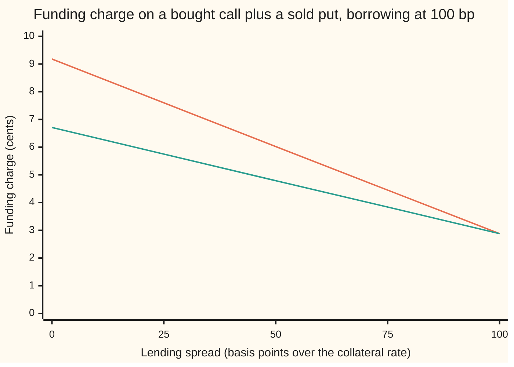

# Burgard-Kjaer: one pricing equation with funding and default inside, and why borrowing dearer than lending makes it nonlinear

[Syllabus](../../../SYLLABUS.md) → [Financial mathematics](../README.md) → [Collateral, Funding and the Rest of the XVAs](../README.md#s47) → Burgard-Kjaer

---

## General Overview

A bank buys a one-year call option on Acme shares from Northwind, with no collateral. Acme trades at \$100, the strike is \$100, and the clean price, the price if nobody could fail and money cost the collateral rate, is **\$9.23**. Earlier cards took the costs off one at a time. Northwind might fail: [CVA](../46-Counterparty%20Risk%20and%20CVA/03-cva.md), 10.96 cents. The bank must borrow the premium at 100 basis points over the collateral rate: [FVA](02-fva.md), 9.14 cents. (A basis point is a hundredth of a percent.)

This card writes all of it as **one equation**. It is the Black-Scholes equation for the bank's all-in value, with three extra terms: one for Northwind's default, one for the bank's own default, and one for the interest on the money the bank borrows or holds. Burgard and Kjaer derived it in 2011 by building a hedge that pays every one of those cash flows. When the bank borrows and lends at the same spread, the equation is linear and splits cleanly. The grid on this card solves it and gets back the CVA and FVA cards' numbers.

Now make borrowing dearer than lending, as it is for most banks: borrow at 100 basis points over, lend spare cash at the collateral rate with no extra. The funding term gets a kink at zero, and the equation stops being linear. The call alone never reaches the kink, because the bank only ever borrows for it. Its full answer, with both firms able to fail, is **19.90 cents**. Counting the bank's own default too, CVA and FVA become 10.91 and 9.09 cents, 20.00 in all; the full answer is a tenth of a cent under, because it funds the all-in value, not the clean value. The kink bites when values can change sign. Add a put the bank sold to Northwind, and switch defaults off to see funding alone. Priced trade by trade, the pair's funding costs 9.18 cents. Priced together, as one equation, it costs **6.71 cents**.

**Every cost of holding a trade is a cash flow, so the bank's all-in value obeys one pricing equation; with one funding rate it splits into CVA, DVA and FVA, and with a borrowing rate above the lending rate it becomes nonlinear, so a portfolio's price is no longer the sum of its trades' prices.**

**What kind of fact this is:** a model. The equation follows from a replication argument (a hedge that reproduces every cash flow) under stated assumptions: constant hazards, defaults independent of Acme, closeout at the clean value. Inside the model, the split into CVA, DVA and FVA is a theorem, proved on this card in Why it works. The nonlinear version has no closed form in general; it is solved on a grid and cross-checked on a tree.

### The picture: priced together, priced apart



Orange, upper: the two trades priced one at a time and the charges added. Green, lower: the pair priced as one position on the grid. Defaults are switched off here, to show funding alone. The lines meet only at the right, where lending earns the same 100 basis points as borrowing costs. Anywhere else the sum of the parts overstates the whole.

---

## The formula

Notation first, in words.

- $`S`$ is Acme's share price, $`K`$ the strike (\$100), $`T`$ the expiry (1 year), $`q`$ Acme's dividend yield and $`\sigma`$ its volatility.
- $`V(t,S)`$ is the trade's **clean value** to the bank at date $`t`$ (years from today) when Acme trades at $`S`$: its value if nobody could fail and money cost the collateral rate $`r`$.
- $`U(t,S)`$ is the bank's **all-in value**: the same trade with both defaults and the bank's funding included.
- $`X = V - U`$ is the **total adjustment**, the amount taken off the clean value.
- For any number $`x`$, the **positive part** is $`x^+ = \max(x, 0)`$ and the **negative part** is $`x^- = \max(-x, 0)`$.
- $`\lambda_C`$ ("lambda C") is Northwind's **hazard**, its yearly default rate among survivors, and $`R_C`$ its **recovery**, the fraction of a debt it pays after defaulting. $`\lambda_O`$ and $`R_O`$ are the bank's own (O for "own").
- $`s_b`$ is the bank's **borrowing spread** over $`r`$, and $`s_l`$ its **lending spread**, what spare cash earns over $`r`$.

```math
\frac{\partial U}{\partial t} + (r-q)S\frac{\partial U}{\partial S} + \tfrac12\sigma^2S^2\frac{\partial^2 U}{\partial S^2} - rU = \lambda_C\,(U - g_C) + \lambda_O\,(U - g_O) + s_b\,U^+ - s_l\,U^-
```

with the two **closeout amounts**, what the bank ends up holding when a default stops the trade,

```math
g_C = R_C\,V^+ - V^-, \qquad g_O = V^+ - R_O\,V^-, \qquad U(T,S) = \text{payoff}.
```

**Read it aloud:** the all-in value grows at the collateral rate, plus a charge for each firm's chance of defaulting times what that default would cost, plus the borrowing spread on whatever the bank has to borrow, minus the lending spread on whatever cash it holds.

The left side is the Black-Scholes equation ([Pricing on a grid](../06-Numerical%20Methods%20for%20Pricing/07-finite-differences-for-the-black-scholes-equation.md)). On the right, $`g_C`$ says that if Northwind fails, the bank collects a fraction $`R_C`$ of what it is owed and pays in full what it owes. $`g_O`$ is the mirror for the bank's own failure.

**When the two spreads are equal**, $`s_b = s_l = s`$, and the spread is charged on the clean value $`V`$, the adjustment has a closed form as four integrals:

```math
X = \underbrace{(1-R_C)\lambda_C\!\int_0^T\! W(t)\,\mathbb{E}[D(t)V^+]\,dt}_{\mathrm{CVA}} - \underbrace{(1-R_O)\lambda_O\!\int_0^T\! W(t)\,\mathbb{E}[D(t)V^-]\,dt}_{\mathrm{DVA}} + \underbrace{s\!\int_0^T\! W(t)\,\mathbb{E}[D(t)V^+]\,dt}_{\mathrm{FCA}} - \underbrace{s\!\int_0^T\! W(t)\,\mathbb{E}[D(t)V^-]\,dt}_{\mathrm{FBA}}
```

**Read it aloud:** the adjustment is the credit cost of Northwind's default, minus the gain from the bank's own, plus the funding cost on what the bank is owed, minus the funding benefit on what it owes.

Here $`D(t) = e^{-rt}`$ is the discount factor, $`\mathbb{E}`$ the average in the pricing world, and $`W(t) = e^{-(\lambda_C+\lambda_O)t}`$ the chance that both firms are still alive at $`t`$. These are exactly the formulas of [CVA](../46-Counterparty%20Risk%20and%20CVA/03-cva.md), [DVA](../46-Counterparty%20Risk%20and%20CVA/04-dva-and-bilateral-cva.md) and [FVA](02-fva.md). For a bought option, $`\mathbb{E}[D(t)V^+] = C_0`$ at every date and $`V^- = 0`$, so each integral is a rate times $`C_0`$ times the expected years both firms survive, $`A(\lambda_C+\lambda_O)`$, where $`A(k) = (1-e^{-kT})/k`$.

| Symbol | Plain meaning | In our example | Push it up and the adjustment… |
| --- | --- | --- | --- |
| $`U`$ | all-in value to the bank | \$9.028016 today | — |
| $`V`$, $`C_0`$, $`P_0`$ | clean value; clean call and put prices | \$9.227006; \$6.330081 | rises in proportion to $`C_0`$ |
| $`X = V - U`$, $`h`$; $`\delta`$, $`a_C`$, $`a_O`$, $`F`$ | total adjustment; $`h`$, the rate it builds up at (the proof fold); the hedge fold's shares, bonds and cash | 0.198989 (full equation) | — |
| $`S`$, $`K`$, $`T`$, $`t`$, $`\mathcal{L}`$ | Acme's price, strike, expiry, a date; the share-move terms of the left side | \$100, \$100, 1 year | longer $`T`$: rises |
| $`r`$, $`q`$, $`\sigma`$ | collateral rate, dividend yield, volatility | 5%, 2%, 20% | through $`C_0`$ |
| $`\lambda_C`$, $`R_C`$ | Northwind's hazard and recovery | 2%, 40% | $`\lambda_C`$ up: CVA up |
| $`\lambda_O`$, $`R_O`$, $`\lambda`$ | the bank's own hazard and recovery; both hazards added | 1%, 40%; 3% | $`\lambda_O`$ up: DVA up, other pieces down slightly |
| $`g_C`$, $`g_O`$ | closeout amounts at Northwind's and the bank's default | bought call: $`0.4\,V`$ and $`V`$ | — |
| $`s_b`$, $`s_l`$, $`s`$ | borrowing spread; lending spread; one shared spread | 1%; 0; 1% in the linear case | $`s_b`$ up: rises; $`s_l`$ up: falls |
| $`x^+`$, $`x^-`$ | positive part $`\max(x,0)`$; negative part $`\max(-x,0)`$ | bought call: $`V^+ = V`$, $`V^- = 0`$ | — |
| $`D(t)`$, $`\mathbb{E}`$, $`W(t)`$, $`A(k)`$ | discount factor; pricing-world average; both alive; expected years alive at rate $`k`$ | $`A(0.02) = 0.990066`$, $`A(0.03) = 0.985149`$ | — |
| CVA, DVA, FCA, FBA | credit and debit adjustments; funding cost and benefit | 0.109080, 0, 0.090900, 0 (both can fail) | — |

### When it holds

- **Closeout at the clean value.** At a default the trade is settled at $`V`$. If it were settled at the all-in value $`U`$, the closeout terms change; for the bought call the bank's own default then drops out of the equation.
- **Every risk can be hedged.** The argument needs Acme shares financed by repo (a loan secured on the shares) at $`r`$, and bonds of both firms to trade. Without the bank's own bonds, its own default cannot be hedged and the DVA cannot be turned into cash.
- **Defaults independent of Acme, at constant hazards.** If Northwind tends to fail when it owes most, CVA is larger ([Wrong-way risk](../46-Counterparty%20Risk%20and%20CVA/05-wrong-way-risk.md)).
- **The funding need is the all-in value, with no collateral.** Under a collateral agreement the bank borrows only $`U`$ minus the collateral held ([Collateral](01-collateral-and-the-residual-exposure.md)).
- **Fixed spreads, set apart from the bank's own default.** Spreads that move with the market add more state to the equation, and more grid dimensions. If $`s_b`$ is mostly the bank's own credit spread, $`(1-R_O)\lambda_O`$, the DVA and the FBA count the same own-default gain twice ([FVA](02-fva.md)).

---

## Why it works

### Step 0: a price is the cost of a hedge that pays every cash flow

Black-Scholes prices a call by building a portfolio that pays exactly what the call pays. Burgard and Kjaer use the same rule, with more cash flows. A real trade also pays closeout amounts when a firm fails, and costs interest on the cash it ties up. Each of those becomes one term in the equation. Nothing in the method is special to credit or funding: any cash flow the bank really meets can be written in, such as the cost of initial margin ([MVA](03-mva.md)) or of capital ([KVA](04-kva.md)).

### Step 1: without defaults or spreads, the all-in value is the clean value

Hedge Acme's moves with shares financed by repo at $`r`$. The hedged position has no risk over the next instant, so it must earn $`r`$. That gives the left side of the equation set to zero ([Black-Scholes by hedging](../05-Black-Scholes%20from%20the%20Ground%20Up/03-black-scholes-by-delta-hedging.md)). Its solution is the clean value $`V`$, \$9.227006 for the call.

### Step 2: each default is a jump, and its hedge adds one term

Over a short stretch $`dt`$, Northwind fails with chance $`\lambda_C\,dt`$. If it does, the bank's position jumps from $`U`$ to the closeout amount $`g_C`$. The bank hedges that jump by selling Northwind's bonds short, to the value $`U - g_C`$. Bonds that pay nothing at default yield $`\lambda_C`$ more than $`r`$. If Northwind fails, the short bonds gain what the trade loses; until then they cost that extra yield, $`\lambda_C(U - g_C)`$, the first default term on the right.

The bank's own failure works the same way, hedged with its own bonds, and adds $`\lambda_O(U - g_O)`$.

### Step 3: funding adds a term with a kink at zero

The bank holds a position worth $`U`$ and no cash came back for it. When $`U > 0`$ it has paid out money and borrows $`U^+`$ at $`r + s_b`$. When $`U < 0`$ it has received money and earns $`r + s_l`$ on $`U^-`$. The $`r`$ part is already in the left side. What is left per unit of time is $`s_b\,U^+ - s_l\,U^-`$.

If $`s_b = s_l = s`$, this is $`s\,U`$: a straight line in $`U`$. If $`s_b > s_l`$, the line bends at $`U = 0`$. That bend is the only nonlinear thing in the equation.

<details>
<summary>Detailed proof: the hedge that reproduces every cash flow</summary>

Against the trade, worth $`U`$, the bank sells short, on repo at $`r`$ so nothing is paid up front: $`\delta`$ Acme shares, paying their dividends at yield $`q`$; Northwind's bonds worth $`a_C`$; and its own bonds worth $`a_O`$ (negative: buying them back). The bonds pay nothing at default, so they yield $`\lambda_C`$ and $`\lambda_O`$ above $`r`$. The cash account holds $`F = -U`$, borrowed at $`r + s_b`$ or lent at $`r + s_l`$.

Over a step $`dt`$ with no default, Ito's lemma (the chain rule for random paths; subscripts are derivatives) gives the book's change:

$`\displaystyle \bigl(U_t + \tfrac12\sigma^2S^2U_{SS}\bigr)dt + (U_S - \delta)\,dS + \delta(r-q)S\,dt - \lambda_C a_C\,dt - \lambda_O a_O\,dt - \bigl(rU + s_bU^+ - s_lU^-\bigr)dt.`$

If Northwind defaults, the trade jumps by $`g_C - U`$ and the short bonds, now worthless, gain $`a_C`$. If the bank defaults, the jumps are $`g_O - U`$ and $`a_O`$. Choose $`\delta = U_S`$, $`a_C = U - g_C`$ and $`a_O = U - g_O`$. The share moves and both jumps cancel, so the book is riskless. It started at zero, so its drift must be zero, or it would make money for nothing. Moving the default and funding terms to the right gives the equation in The formula, term by term. For the bought call $`a_O < 0`$: the bank buys back its own bonds.

</details>

### Step 4: with one spread, the adjustment splits into CVA, DVA, FCA and FBA

Subtract the clean equation from the full one. With the spread charged on the clean value, the adjustment $`X`$ obeys a linear equation with a known right side, one term per cost. Linear equations add: the solution is the sum of the solutions for each term alone. The Feynman-Kac formula, proved on [Feynman-Kac](../../11-Stochastic%20processes%20and%20calculus/07-Changing%20Measure/06-feynman-kac-formula.md), turns each one into an average of discounted cash flows over the life, weighted by the chance both firms survive. Those averages are the four integrals in The formula.

<details>
<summary>Detailed proof: the adjustment equation and its four integrals</summary>

Write $`\mathcal{L}U = (r-q)SU_S + \tfrac12\sigma^2S^2U_{SS}`$, and $`\lambda = \lambda_C + \lambda_O`$. The clean value obeys $`V_t + \mathcal{L}V - rV = 0`$. Put $`U = V - X`$ into the closeout terms:

$`\displaystyle U - g_C = (1-R_C)V^+ - X, \qquad U - g_O = -(1-R_O)V^- - X.`$

Subtract the full equation from the clean one, with the funding term $`s\,V`$:

$`\displaystyle X_t + \mathcal{L}X - (r+\lambda)X = -\bigl[(1-R_C)\lambda_C V^+ - (1-R_O)\lambda_O V^- + sV^+ - sV^-\bigr] =: -h(t,S), \qquad X(T,S) = 0.`$

Apply Ito's lemma to $`e^{-(r+\lambda)t}X(t,S_t)`$ along an Acme path in the pricing world. The drift is $`e^{-(r+\lambda)t}\bigl(X_t + \mathcal{L}X - (r+\lambda)X\bigr) = -e^{-(r+\lambda)t}h`$, and the rest averages to zero. Integrate from 0 to $`T`$, use $`X(T) = 0`$ and take the average:

$`\displaystyle X(0,S_0) = \int_0^T e^{-\lambda t}\,\mathbb{E}\bigl[e^{-rt}h(t,S_t)\bigr]\,dt.`$

Split $`h`$ into its four parts: these are the CVA, DVA, FCA and FBA integrals with $`W(t) = e^{-\lambda t}`$. For a bought option, $`\mathbb{E}[e^{-rt}V^+(t,S_t)] = C_0`$ at every date, so each integral is its rate times $`C_0\,A(\lambda)`$.

</details>

### Step 5: the grid gets back the CVA and FVA cards

Switch off the bank's default ($`\lambda_O = 0`$) and solve each piece of Step 4 on the grid of Step 8. The CVA piece comes out at 0.109625 against the CVA card's 0.109624. The FCA piece comes out at 0.091354 against the FVA card's 0.091353. The last-digit gaps are the grid's own error.

Switch the bank's 1% hazard back on. Every piece is now weighted by both survivals, 0.985149 expected years instead of 0.990066. The CVA falls to 0.109080 and the FCA to 0.090900. A bought call never makes the bank owe Northwind anything, so its DVA and FBA are zero. The pieces add to **0.199979**.

The DVA appears once the trade is turned round. On the call sold to Northwind, the DVA piece is 0.054540 on the grid and in closed form. The full equation with no lending benefit leaves an adjustment of exactly −0.054540: the bank gains its DVA and nothing else, because it never borrows.

### Step 6: the full equation for the call, and why it is a little lower

Now solve the full equation, funding charged on $`U`$ itself, at $`s_b = 1\%`$ and $`s_l = 0`$. A bought call's all-in value is never negative, so the bank only ever borrows and the kink is never reached. The equation is then linear in $`U`$, and Step 4's method gives a closed form:

```math
X = \bigl[(1-R_C)\lambda_C + s_b\bigr]\,C_0\,A(\lambda_C + \lambda_O + s_b) = 0.022 \times 9.227006 \times 0.980264 = 0.198988.
```

**Read it aloud:** the credit rate plus the funding rate, times the clean price, times the expected years alive with the funding spread counted as an extra discount rate.

The grid gives 0.198989 and a 2,000-step tree gives 0.198965. The pieces gave 0.199979, the same rates times $`A(0.03) = 0.985149`$. The gap, 0.000990, comes from one thing. The bank borrows what the trade is worth to it, $`U`$, which already has the adjustments taken off. So it pays spread on a slightly smaller amount, and every adjustment is discounted at the funding spread as well. That gap is of the size of a spread times an adjustment: small for one call, larger for long trades and wide spreads.

### Step 7: the kink makes the price of a portfolio differ from the sum of its parts

A linear equation obeys **superposition**: the solution for two trades together is the sum of the solutions for each. A kinked one does not. To see the kink alone, switch both defaults off and give the bank two trades with Northwind: the bought call and a sold put, both struck at \$100.

- **Trade by trade.** The call must be borrowed for: 0.091810. The sold put brings in cash that earns nothing extra: 0. Sum: **0.091810**.
- **Together.** Today the bank pays \$9.23 and receives \$6.33, so it only borrows the difference, \$2.90. Call minus put is a forward, an agreement to buy Acme at \$100 in a year, and its value can go either way. The grid gives **0.067068**; the tree gives 0.067067.
- **With equal spreads.** At 100 basis points both ways the pair costs 0.028825 on the grid, exactly $`(C_0 - P_0)(1 - e^{-s})`$, and exactly the sum of the two trades' charges. The chart in the overview shows the two lines meeting there.

The pair costs more than 0.028825 because in the futures where Acme falls, the forward is worth less than nothing to the bank. It then holds net cash that earns no spread, while in the futures where Acme rises it still pays spread on its borrowing.

### Step 8: solving a kinked equation on a grid

The grid is the Crank-Nicolson scheme of [Pricing on a grid](../06-Numerical%20Methods%20for%20Pricing/07-finite-differences-for-the-black-scholes-equation.md): 300 cells across the log of Acme's price, wide enough that the far edges barely matter, and 200 steps back from expiry. Each step solves a tridiagonal system (one with entries only on the main diagonal and its two neighbours). The kink adds one loop to each step:

1. Guess, at each node, whether the bank borrows or lends, using the row just solved.
2. Give each node its discount rate: $`r + \lambda_C + \lambda_O + s_b`$ if it borrows, $`r + \lambda_C + \lambda_O + s_l`$ if it lends.
3. Solve the linear system with those rates.
4. If any node changed sign, repeat from step 2 with the new signs. Otherwise move to the next time step.

This loop is **policy iteration**: each round fixes a choice at every node, solves, and updates the choices. It stops after a few rounds because only nodes near the kink can change side. At the far edges the value is taken to be a straight line in the share price.

The tree is a separate road. It steps a binomial tree of 2,000 steps back from expiry and applies the same three terms at each node, choosing the funding rate by the sign of the continuation value (the discounted average of the two nodes below).

---

## Worked numbers, by hand

The Acme call bought from Northwind: $`S = K = 100`$, $`r = 5\%`$, $`q = 2\%`$, $`\sigma = 20\%`$, $`T = 1`$. No collateral. Hazards 2% (Northwind) and 1% (the bank), recovery 40% each. Borrowing at 100 basis points over $`r`$, lending at $`r`$.

| Step | Arithmetic | Value |
| --- | --- | --- |
| clean call $`C_0`$ | Black-Scholes | 9.227006 |
| CVA, Northwind only | $`0.6 \times 9.227006 \times (1 - e^{-0.02})`$; grid 0.109625 | 0.109624 |
| FCA, Northwind only | $`0.01 \times 9.227006 \times 0.990066`$; grid 0.091354 | 0.091353 |
| expected years both alive | $`A(0.03) = (1 - e^{-0.03})/0.03`$ | 0.985149 |
| CVA, both can fail | $`0.6 \times 0.02 \times 9.227006 \times 0.985149`$ | 0.109080 |
| FCA, both can fail | $`0.01 \times 9.227006 \times 0.985149`$ | 0.090900 |
| sum of the pieces | $`0.109080 + 0 + 0.090900`$, DVA and FBA zero | 0.199979 |
| expected years alive, spread counted | $`A(0.04) = (1 - e^{-0.04})/0.04`$ | 0.980264 |
| full equation, closed form | $`0.022 \times 9.227006 \times 0.980264`$ | 0.198988 |
| full equation, grid; tree | Crank-Nicolson with policy iteration; 2,000-step tree | 0.198989; 0.198965 |
| gap | pieces minus full equation | 0.000990 |
| **all-in value** | clean price minus the grid's adjustment | **9.028016** |

The bank should value the uncollateralised call at about \$9.03, not \$9.23. The single equation and the separate pieces agree to a tenth of a cent here, because the bank never has spare cash on this trade.

### What breaks if you drop a piece

The bought call plus the sold put, funding alone, borrowing at 100 basis points and lending at 0. Correct charge: 0.067068.

| Mistake | Comes out at | What went wrong |
| --- | --- | --- |
| Price each trade and add the charges | 0.091810 | Superposition fails at the kink: the put's cash pays for part of the call |
| Book a lending benefit at the borrowing spread | 0.028825 | Credits the spare cash with 100 basis points it never earns |
| One blended rate, 50 basis points both ways | 0.014448 | Averaging the spreads straightens the kink and halves the cost of what is borrowed |
| Pieces on the clean value, for the call alone | 0.199979, not 0.198989 | Funds the clean value instead of the all-in value: right to first order only |

Every number in that table is printed by the checks.

---

## Code, from first principles, and it actually runs

The scripts write their own normal CDF (a power series), tridiagonal solver and binomial tree; nothing imported knows an option price. The adjustment is reached by **three independent roads**: closed forms where the funding never changes sign, a Crank-Nicolson grid with policy iteration for the kink, and a 2,000-step binomial tree. The grid's linear pieces are checked against the CVA and FVA cards' formulas, the sold call's full-equation adjustment against its DVA, and the kinked pair against the tree. Every chart point and every "what breaks" number is printed.

### Python

```python
# Burgard-Kjaer -- the check behind the card.  Standard library only.
# The Acme call (S = K = 100, r = 5%, q = 2%, sigma = 20%, T = 1) bought from Northwind with no
# collateral.  Northwind's hazard 2%, the bank's own 1%, recovery 40% each; the bank borrows at
# 100 bp over r and lends at r.  One equation, three roads: closed forms where the funding never
# changes sign, a Crank-Nicolson grid (kink handled by policy iteration), and a binomial tree.
from math import exp, log, sqrt, pi

S0, K, r, q, sig, T = 100.0, 100.0, 0.05, 0.02, 0.20, 1.0
LC, LO, RC, RO, SB, SL = 0.02, 0.01, 0.40, 0.40, 0.01, 0.0   # hazards, recoveries, spreads

def phi(x): return exp(-0.5 * x * x) / sqrt(2.0 * pi)
def N(x):                                            # 1/2 + phi(x)(x + x^3/3 + x^5/15 + ...)
    if abs(x) > 9.0: return 0.0 if x < 0 else 1.0
    term, total, j = x, x, 1
    while abs(term) > 1e-17 * abs(total):
        j += 2; term *= x * x / j; total += term
    return 0.5 + phi(x) * total
def bs(s, left, put=False):                          # clean Acme option, `left` years to run
    v = sig * sqrt(left); d1 = (log(s / K) + (r - q + 0.5 * sig * sig) * left) / v
    if put: return K * exp(-r * left) * N(v - d1) - s * exp(-q * left) * N(-d1)
    return s * exp(-q * left) * N(d1) - K * exp(-r * left) * N(d1 - v)

M, NT, XM = 300, 200, 1.5                            # grid in x = ln(S/K), steps in time to go
h, k = 2 * XM / M, T / NT
A, B = 0.5 * sig * sig, r - q - 0.5 * sig * sig
lo, hi, md = A * k / h / h - B * k / 2 / h, A * k / h / h + B * k / 2 / h, 2 * A * k / h / h
ea, eb = exp(-h), exp(h)                             # far edges: value straight in S

def thomas(sub, dia, sup, rhs):
    n = len(dia); c, d = [0.0] * n, [0.0] * n
    c[0], d[0] = sup[0] / dia[0], rhs[0] / dia[0]
    for i in range(1, n):
        m = dia[i] - sub[i] * c[i - 1]
        c[i], d[i] = sup[i] / m, (rhs[i] - sub[i] * d[i - 1]) / m
    for i in range(n - 2, -1, -1): d[i] -= c[i] * d[i + 1]
    return d

def grid(pay, rate, src=None):
    """W_tau = A W_xx + B W_x - rate(W) W + src, Crank-Nicolson from expiry. rate(w) reads the
    node's own sign (the kink); each step re-solves until no node changes side.  All rows."""
    W, rows, z = list(pay), [list(pay)], [0.0] * (M + 1)
    for n in range(NT):
        s0, s1 = (src(n), src(n + 1)) if src else (z, z)
        rhs = [W[i] + 0.5 * (lo * W[i - 1] - (md + k * rate(W[i])) * W[i] + hi * W[i + 1])
               + 0.5 * k * (s0[i] + s1[i]) for i in range(1, M)]
        guess = W
        for _ in range(50):
            rho = [rate(w) for w in guess]
            dia = [1 + 0.5 * (md + k * rho[i]) for i in range(1, M)]
            sub, sup = [-0.5 * lo] * (M - 1), [-0.5 * hi] * (M - 1)
            dia[0] -= 0.5 * lo * (1 + ea); sup[0] += 0.5 * lo * ea
            dia[-1] -= 0.5 * hi * (1 + eb); sub[-1] += 0.5 * hi * eb
            u = thomas(sub, dia, sup, rhs)
            new = [(1 + ea) * u[0] - ea * u[1]] + u + [(1 + eb) * u[-1] - eb * u[-2]]
            if [rate(w) for w in new] == rho: break
            guess = new
        W = new; rows.append(W)
    return rows

S = [K * exp(-XM + i * h) for i in range(M + 1)]
mid = M // 2
cpay = [max(s - K, 0.0) for s in S]; cpay[mid] = K * (exp(h / 2) - 1 - h / 2) / h   # cell average
V = grid(cpay, lambda w: r)                          # clean call, every row
pos = lambda n: [max(v, 0.0) for v in V[n]]
z0 = [0.0] * (M + 1)
cva_g = grid(z0, lambda w: r + LC, lambda n: [(1 - RC) * LC * v for v in pos(n)])[-1][mid]
fca_g = grid(z0, lambda w: r + LC, lambda n: [SB * v for v in pos(n)])[-1][mid]
dva_g = grid(z0, lambda w: r + LC + LO, lambda n: [(1 - RO) * LO * v for v in pos(n)])[-1][mid]
# full Burgard-Kjaer for the bought call: U jumps to R_C V at Northwind's default, to V at the bank's
U = grid(cpay, lambda w: r + LC + LO + (SB if w > 0 else SL), lambda n: [(LC * RC + LO) * v for v in pos(n)])
bk_g = V[-1][mid] - U[-1][mid]
Us = grid([-c for c in cpay], lambda w: r + LC + LO + (SB if w > 0 else SL),   # the call sold instead
          lambda n: [-(LC + LO * RO) * v for v in pos(n)])
sold_g = -V[-1][mid] - Us[-1][mid]

C0, P0 = bs(S0, T), bs(S0, T, put=True)
ann = lambda lam: (1 - exp(-lam * T)) / lam          # expected years alive within the year
cva_u, fca_u = (1 - RC) * C0 * (1 - exp(-LC * T)), SB * C0 * ann(LC)
cva_b, fca_b, dva_b = (1 - RC) * LC * C0 * ann(LC + LO), SB * C0 * ann(LC + LO), (1 - RO) * LO * C0 * ann(LC + LO)
bk_c = ((1 - RC) * LC + SB) * C0 * ann(LC + LO + SB)   # U never changes sign: closed form

def tree(pay, lc, lo_, sl, n=2000):                  # binomial road, same rules one step at a time
    dt = T / n; u = exp(sig * sqrt(dt)); p = (exp((r - q) * dt) - 1 / u) / (u - 1 / u)
    v = [pay(S0 * u ** (2 * j - n)) for j in range(n + 1)]; w = list(v)
    for m in range(n - 1, -1, -1):
        v = [exp(-r * dt) * (p * v[j + 1] + (1 - p) * v[j]) for j in range(m + 1)]
        c = [p * w[j + 1] + (1 - p) * w[j] for j in range(m + 1)]
        w = [exp(-(r + lc + lo_ + (SB if c[j] > 0 else sl)) * dt) * c[j]
             + dt * (lc * (RC * max(v[j], 0) + min(v[j], 0)) + lo_ * (max(v[j], 0) + RO * min(v[j], 0)))
             for j in range(m + 1)]
    return v[0] - w[0]
bk_t = tree(lambda s: max(s - K, 0.0), LC, LO, SL)

# funding alone (no defaults): call bought plus put sold, one netting set = a forward at K
fpay = [s - K for s in S]
VF = grid(fpay, lambda w: r)[-1][mid]
net = {}
for bp in (0, 25, 50, 75, 100):
    sl = bp / 10000
    net[bp] = VF - grid(fpay, lambda w, sl=sl: r + (SB if w > 0 else sl))[-1][mid]
pieces = {bp: C0 * (1 - exp(-SB * T)) - P0 * (1 - exp(-bp / 10000 * T)) for bp in net}
net_t = tree(lambda s: s - K, 0.0, 0.0, SL)

rows = [
    ("clean call C0", C0), ("clean put P0", P0), ("clean forward C0 - P0", C0 - P0),
    ("expected years alive, Northwind only", ann(LC)), ("expected years alive, both", ann(LC + LO)),
    ("expected years alive, plus spread", ann(LC + LO + SB)),
    ("linear, Northwind only: CVA closed", cva_u), ("  CVA grid", cva_g),
    ("  FCA closed", fca_u), ("  FCA grid", fca_g),
    ("linear, both can fail: CVA", cva_b), ("  FCA", fca_b), ("  DVA (bought call)", 0.0),
    ("  sum of pieces", cva_b + fca_b), ("  DVA of the sold call, closed", dva_b),
    ("  DVA of the sold call, grid", dva_g),
    ("full equation, call: closed", bk_c), ("  grid", bk_g), ("  tree, 2000 steps", bk_t),
    ("  all-in value C0 - X", C0 - bk_g), ("  gap: pieces minus full", cva_b + fca_b - bk_g),
    ("funding alone: call FCA", C0 * (1 - exp(-SB * T))), ("  sold put, no lending benefit", 0.0),
    ("  trade by trade, sum", pieces[0]), ("  netting set, grid", net[0]),
    ("  netting set, tree", net_t), ("  netting set, symmetric 100 bp", net[100]),
    ("  symmetric closed (C0-P0)(1-e^-s)", (C0 - P0) * (1 - exp(-SB * T))),
    ("wrong: one blended rate, 50 bp", (C0 - P0) * (1 - exp(-0.005 * T))),
    ("try: sold call, full equation, grid", sold_g),
]
for name, v in rows: print(f"{name:<38}{v:12.6f}")
print("chart, lending spread bp " + " ".join(f"{bp:6d}" for bp in net))
print("chart, netting set grid  " + " ".join(f"{100 * net[bp]:6.2f}" for bp in net))
print("chart, trade by trade    " + " ".join(f"{100 * pieces[bp]:6.2f}" for bp in net))

assert abs(C0 - 9.227005508154) < 1e-9, "own normal CDF reproduces the house call"
assert abs(cva_g - cva_u) < 2e-5 and abs(fca_g - fca_u) < 2e-5, "linear grid gives the CVA and FVA cards"
assert abs(dva_g - dva_b) < 2e-5, "grid DVA of the sold call matches its closed form"
assert abs(bk_g - bk_c) < 2e-5, "nonlinear grid matches the closed form where U keeps one sign"
assert abs(sold_g + dva_b) < 2e-5, "sold call: the full equation leaves exactly minus the DVA"
assert abs(bk_t - bk_c) < 2e-4, "tree matches the closed form"
assert abs(net[100] - (C0 - P0) * (1 - exp(-SB * T))) < 2e-5, "symmetric funding: netting set adds up"
assert abs(net_t - net[0]) < 2e-4, "tree and grid agree on the kinked netting set"
assert net[100] + 1e-3 < net[0] < pieces[0] - 1e-3, "kink: neither symmetric nor additive"
print("ALL CHECKS PASS")
```

**Ran 2026-11-23 on macOS, Python 3.14.10, standard library only. All checks passed. Output, pasted from the run:**

```
clean call C0                             9.227006
clean put P0                              6.330081
clean forward C0 - P0                     2.896925
expected years alive, Northwind only      0.990066
expected years alive, both                0.985149
expected years alive, plus spread         0.980264
linear, Northwind only: CVA closed        0.109624
  CVA grid                                0.109625
  FCA closed                              0.091353
  FCA grid                                0.091354
linear, both can fail: CVA                0.109080
  FCA                                     0.090900
  DVA (bought call)                       0.000000
  sum of pieces                           0.199979
  DVA of the sold call, closed            0.054540
  DVA of the sold call, grid              0.054540
full equation, call: closed               0.198988
  grid                                    0.198989
  tree, 2000 steps                        0.198965
  all-in value C0 - X                     9.028016
  gap: pieces minus full                  0.000990
funding alone: call FCA                   0.091810
  sold put, no lending benefit            0.000000
  trade by trade, sum                     0.091810
  netting set, grid                       0.067068
  netting set, tree                       0.067067
  netting set, symmetric 100 bp           0.028825
  symmetric closed (C0-P0)(1-e^-s)        0.028825
wrong: one blended rate, 50 bp            0.014448
try: sold call, full equation, grid      -0.054540
chart, lending spread bp      0     25     50     75    100
chart, netting set grid    6.71   5.75   4.79   3.84   2.88
chart, trade by trade      9.18   7.60   6.02   4.45   2.88
ALL CHECKS PASS
```

### Rust

The same grid, tree and closed forms, built with `rustc --edition 2021 -O`.

```rust
// Burgard-Kjaer -- the same check as burgard_kjaer_funding_pde_check.py, in Rust.  No crates.
// The Acme call (S = K = 100, r = 5%, q = 2%, sigma = 20%, T = 1) bought from Northwind with no
// collateral.  Northwind's hazard 2%, the bank's own 1%, recovery 40% each; the bank borrows at
// 100 bp over r and lends at r.  One equation, three roads: closed forms where the funding never
// changes sign, a Crank-Nicolson grid (kink handled by policy iteration), and a binomial tree.
use std::f64::consts::PI;

const S0: f64 = 100.0;
const K: f64 = 100.0;
const R: f64 = 0.05;
const Q: f64 = 0.02;
const SIG: f64 = 0.20;
const T: f64 = 1.0;
const LC: f64 = 0.02; const LO: f64 = 0.01;           // hazards: Northwind's, the bank's own
const RC: f64 = 0.40; const RO: f64 = 0.40;           // recoveries
const SB: f64 = 0.01; const SL: f64 = 0.0;            // borrowing and lending spreads
const M: usize = 300; const NT: usize = 200; const XM: f64 = 1.5;   // grid in x = ln(S/K), steps

fn phi(x: f64) -> f64 { (-0.5 * x * x).exp() / (2.0 * PI).sqrt() }
fn n_cdf(x: f64) -> f64 {                              // 1/2 + phi(x)(x + x^3/3 + x^5/15 + ...)
    if x.abs() > 9.0 { return if x < 0.0 { 0.0 } else { 1.0 }; }
    let (mut term, mut total, mut j) = (x, x, 1.0);
    while term.abs() > 1e-17 * total.abs() { j += 2.0; term *= x * x / j; total += term; }
    0.5 + phi(x) * total
}
fn bs(s: f64, left: f64, put: bool) -> f64 {           // clean Acme option, `left` years to run
    let v = SIG * left.sqrt();
    let d1 = ((s / K).ln() + (R - Q + 0.5 * SIG * SIG) * left) / v;
    if put { return K * (-R * left).exp() * n_cdf(v - d1) - s * (-Q * left).exp() * n_cdf(-d1); }
    s * (-Q * left).exp() * n_cdf(d1) - K * (-R * left).exp() * n_cdf(d1 - v)
}

fn thomas(sub: &[f64], dia: &[f64], sup: &[f64], rhs: &[f64]) -> Vec<f64> {
    let n = dia.len();
    let (mut c, mut d) = (vec![0.0; n], vec![0.0; n]);
    c[0] = sup[0] / dia[0]; d[0] = rhs[0] / dia[0];
    for i in 1..n {
        let m = dia[i] - sub[i] * c[i - 1];
        c[i] = sup[i] / m; d[i] = (rhs[i] - sub[i] * d[i - 1]) / m;
    }
    for i in (0..n - 1).rev() { d[i] -= c[i] * d[i + 1]; }
    d
}

// W_tau = A W_xx + B W_x - rate(W) W + src, Crank-Nicolson from expiry.  rate(w) reads the node's
// own sign (the kink); each step re-solves until no node changes side.  Returns every row.
fn grid(pay: &[f64], rate: &dyn Fn(f64) -> f64, src: Option<&dyn Fn(usize) -> Vec<f64>>) -> Vec<Vec<f64>> {
    let (h, k) = (2.0 * XM / M as f64, T / NT as f64);
    let (a, b) = (0.5 * SIG * SIG, R - Q - 0.5 * SIG * SIG);
    let (lo, hi, md) = (a * k / h / h - b * k / 2.0 / h, a * k / h / h + b * k / 2.0 / h, 2.0 * a * k / h / h);
    let (ea, eb) = ((-h).exp(), h.exp());              // far edges: value straight in S
    let mut w = pay.to_vec();
    let mut rows = vec![w.clone()];
    let z = vec![0.0; M + 1];
    for n in 0..NT {
        let (s0, s1) = match src { Some(f) => (f(n), f(n + 1)), None => (z.clone(), z.clone()) };
        let rhs: Vec<f64> = (1..M).map(|i| w[i] + 0.5 * (lo * w[i - 1] - (md + k * rate(w[i])) * w[i] + hi * w[i + 1])
            + 0.5 * k * (s0[i] + s1[i])).collect();
        let mut guess = w.clone();
        let mut new = w.clone();
        for _ in 0..50 {
            let rho: Vec<f64> = guess.iter().map(|&x| rate(x)).collect();
            let mut dia: Vec<f64> = (1..M).map(|i| 1.0 + 0.5 * (md + k * rho[i])).collect();
            let (mut sub, mut sup) = (vec![-0.5 * lo; M - 1], vec![-0.5 * hi; M - 1]);
            dia[0] -= 0.5 * lo * (1.0 + ea); sup[0] += 0.5 * lo * ea;
            dia[M - 2] -= 0.5 * hi * (1.0 + eb); sub[M - 2] += 0.5 * hi * eb;
            let u = thomas(&sub, &dia, &sup, &rhs);
            new = vec![(1.0 + ea) * u[0] - ea * u[1]];
            new.extend_from_slice(&u);
            new.push((1.0 + eb) * u[M - 2] - eb * u[M - 3]);
            if new.iter().map(|&x| rate(x)).collect::<Vec<f64>>() == rho { break; }
            guess = new.clone();
        }
        w = new;
        rows.push(w.clone());
    }
    rows
}

// binomial road, same rules one step at a time
fn tree(pay: &dyn Fn(f64) -> f64, lc: f64, lo: f64, sl: f64, n: usize) -> f64 {
    let dt = T / n as f64;
    let u = (SIG * dt.sqrt()).exp();
    let p = (((R - Q) * dt).exp() - 1.0 / u) / (u - 1.0 / u);
    let mut v: Vec<f64> = (0..=n).map(|j| pay(S0 * u.powi(2 * j as i32 - n as i32))).collect();
    let mut w = v.clone();
    for m in (0..n).rev() {
        v = (0..=m).map(|j| (-R * dt).exp() * (p * v[j + 1] + (1.0 - p) * v[j])).collect();
        w = (0..=m).map(|j| {
            let c = p * w[j + 1] + (1.0 - p) * w[j];
            (-(R + lc + lo + if c > 0.0 { SB } else { sl }) * dt).exp() * c
                + dt * (lc * (RC * v[j].max(0.0) + v[j].min(0.0)) + lo * (v[j].max(0.0) + RO * v[j].min(0.0)))
        }).collect();
    }
    v[0] - w[0]
}

fn main() {
    let h = 2.0 * XM / M as f64;
    let s: Vec<f64> = (0..=M).map(|i| K * (-XM + i as f64 * h).exp()).collect();
    let mid = M / 2;
    let mut cpay: Vec<f64> = s.iter().map(|&x| (x - K).max(0.0)).collect();
    cpay[mid] = K * ((h / 2.0).exp() - 1.0 - h / 2.0) / h;   // cell average
    let v = grid(&cpay, &|_| R, None);                 // clean call, every row
    let pos = |n: usize, c: f64| -> Vec<f64> { v[n].iter().map(|&x| c * x.max(0.0)).collect() };
    let z0 = vec![0.0; M + 1];
    let cva_g = grid(&z0, &|_| R + LC, Some(&|n| pos(n, (1.0 - RC) * LC)))[NT][mid];
    let fca_g = grid(&z0, &|_| R + LC, Some(&|n| pos(n, SB)))[NT][mid];
    let dva_g = grid(&z0, &|_| R + LC + LO, Some(&|n| pos(n, (1.0 - RO) * LO)))[NT][mid];
    // full Burgard-Kjaer for the bought call: U jumps to R_C V at Northwind's default, to V at the bank's
    let u = grid(&cpay, &|w| R + LC + LO + if w > 0.0 { SB } else { SL }, Some(&|n| pos(n, LC * RC + LO)));
    let bk_g = v[NT][mid] - u[NT][mid];
    let neg: Vec<f64> = cpay.iter().map(|c| -c).collect();   // the call sold instead
    let us = grid(&neg, &|w| R + LC + LO + if w > 0.0 { SB } else { SL }, Some(&|n| pos(n, -(LC + LO * RO))));
    let sold_g = -v[NT][mid] - us[NT][mid];

    let (c0, p0) = (bs(S0, T, false), bs(S0, T, true));
    let ann = |lam: f64| (1.0 - (-lam * T).exp()) / lam; // expected years alive within the year
    let (cva_u, fca_u) = ((1.0 - RC) * c0 * (1.0 - (-LC * T).exp()), SB * c0 * ann(LC));
    let (cva_b, fca_b, dva_b) = ((1.0 - RC) * LC * c0 * ann(LC + LO), SB * c0 * ann(LC + LO), (1.0 - RO) * LO * c0 * ann(LC + LO));
    let bk_c = ((1.0 - RC) * LC + SB) * c0 * ann(LC + LO + SB);   // U never changes sign: closed form
    let bk_t = tree(&|x| (x - K).max(0.0), LC, LO, SL, 2000);

    // funding alone (no defaults): call bought plus put sold, one netting set = a forward at K
    let fpay: Vec<f64> = s.iter().map(|&x| x - K).collect();
    let vf = grid(&fpay, &|_| R, None)[NT][mid];
    let bps = [0, 25, 50, 75, 100];
    let net: Vec<f64> = bps.iter().map(|&bp| {
        let sl = bp as f64 / 10000.0;
        vf - grid(&fpay, &|w| R + if w > 0.0 { SB } else { sl }, None)[NT][mid]
    }).collect();
    let pieces: Vec<f64> = bps.iter().map(|&bp| c0 * (1.0 - (-SB * T).exp()) - p0 * (1.0 - (-(bp as f64) / 10000.0 * T).exp())).collect();
    let net_t = tree(&|x| x - K, 0.0, 0.0, SL, 2000);

    let rows: Vec<(&str, f64)> = vec![
        ("clean call C0", c0), ("clean put P0", p0), ("clean forward C0 - P0", c0 - p0),
        ("expected years alive, Northwind only", ann(LC)), ("expected years alive, both", ann(LC + LO)),
        ("expected years alive, plus spread", ann(LC + LO + SB)),
        ("linear, Northwind only: CVA closed", cva_u), ("  CVA grid", cva_g),
        ("  FCA closed", fca_u), ("  FCA grid", fca_g),
        ("linear, both can fail: CVA", cva_b), ("  FCA", fca_b), ("  DVA (bought call)", 0.0),
        ("  sum of pieces", cva_b + fca_b), ("  DVA of the sold call, closed", dva_b),
        ("  DVA of the sold call, grid", dva_g),
        ("full equation, call: closed", bk_c), ("  grid", bk_g), ("  tree, 2000 steps", bk_t),
        ("  all-in value C0 - X", c0 - bk_g), ("  gap: pieces minus full", cva_b + fca_b - bk_g),
        ("funding alone: call FCA", c0 * (1.0 - (-SB * T).exp())), ("  sold put, no lending benefit", 0.0),
        ("  trade by trade, sum", pieces[0]), ("  netting set, grid", net[0]),
        ("  netting set, tree", net_t), ("  netting set, symmetric 100 bp", net[4]),
        ("  symmetric closed (C0-P0)(1-e^-s)", (c0 - p0) * (1.0 - (-SB * T).exp())),
        ("wrong: one blended rate, 50 bp", (c0 - p0) * (1.0 - (-0.005 * T).exp())),
        ("try: sold call, full equation, grid", sold_g),
    ];
    for (name, x) in &rows { println!("{:<38}{:12.6}", name, x); }
    let join = |xs: Vec<String>| xs.join(" ");
    println!("chart, lending spread bp {}", join(bps.iter().map(|b| format!("{:6}", b)).collect()));
    println!("chart, netting set grid  {}", join(net.iter().map(|x| format!("{:6.2}", 100.0 * x)).collect()));
    println!("chart, trade by trade    {}", join(pieces.iter().map(|x| format!("{:6.2}", 100.0 * x)).collect()));

    assert!((c0 - 9.227005508154).abs() < 1e-9, "own normal CDF reproduces the house call");
    assert!((cva_g - cva_u).abs() < 2e-5 && (fca_g - fca_u).abs() < 2e-5, "linear grid gives the CVA and FVA cards");
    assert!((dva_g - dva_b).abs() < 2e-5, "grid DVA of the sold call matches its closed form");
    assert!((bk_g - bk_c).abs() < 2e-5, "nonlinear grid matches the closed form where U keeps one sign");
    assert!((sold_g + dva_b).abs() < 2e-5, "sold call: the full equation leaves exactly minus the DVA");
    assert!((bk_t - bk_c).abs() < 2e-4, "tree matches the closed form");
    assert!((net[4] - (c0 - p0) * (1.0 - (-SB * T).exp())).abs() < 2e-5, "symmetric funding: netting set adds up");
    assert!((net_t - net[0]).abs() < 2e-4, "tree and grid agree on the kinked netting set");
    assert!(net[4] + 1e-3 < net[0] && net[0] < pieces[0] - 1e-3, "kink: neither symmetric nor additive");
    println!("ALL CHECKS PASS");
}
```

**Ran 2026-11-23 on macOS, rustc 1.98.1, no crates. All checks passed. Output, pasted from the run:**

```
clean call C0                             9.227006
clean put P0                              6.330081
clean forward C0 - P0                     2.896925
expected years alive, Northwind only      0.990066
expected years alive, both                0.985149
expected years alive, plus spread         0.980264
linear, Northwind only: CVA closed        0.109624
  CVA grid                                0.109625
  FCA closed                              0.091353
  FCA grid                                0.091354
linear, both can fail: CVA                0.109080
  FCA                                     0.090900
  DVA (bought call)                       0.000000
  sum of pieces                           0.199979
  DVA of the sold call, closed            0.054540
  DVA of the sold call, grid              0.054540
full equation, call: closed               0.198988
  grid                                    0.198989
  tree, 2000 steps                        0.198965
  all-in value C0 - X                     9.028016
  gap: pieces minus full                  0.000990
funding alone: call FCA                   0.091810
  sold put, no lending benefit            0.000000
  trade by trade, sum                     0.091810
  netting set, grid                       0.067068
  netting set, tree                       0.067067
  netting set, symmetric 100 bp           0.028825
  symmetric closed (C0-P0)(1-e^-s)        0.028825
wrong: one blended rate, 50 bp            0.014448
try: sold call, full equation, grid      -0.054540
chart, lending spread bp      0     25     50     75    100
chart, netting set grid    6.71   5.75   4.79   3.84   2.88
chart, trade by trade      9.18   7.60   6.02   4.45   2.88
ALL CHECKS PASS
```

The two outputs agree line for line.

### Lean

Lean proves three steps of Why it works, for any spreads, hazards, recoveries and values.

- Suppose $`s_b = s_l`$. Then the funding term $`s_b\,U^+ - s_l\,U^-`$ equals $`s_b\,U`$, a straight line.
- Suppose $`s_l < s_b`$. Then funding two positions together never costs more than funding them apart, and for some pairs it costs strictly less.
- Take $`U = V - X`$ and the closeout amounts $`g_C`$ and $`g_O`$ of The formula. Then the default and funding terms, with spread $`s`$ on $`V`$, equal $`h - (\lambda_C + \lambda_O)X`$.
- Suppose $`\mathbb{E}[D(t)V^+] = C_0`$ at every date and $`\lambda > 0`$. Then each integral in The formula is its rate times $`C_0\,A(\lambda)`$.

The pricing equation itself, its grid and tree solutions, and every decimal are left to the Python and Rust checks.

```lean
-- Burgard-Kjaer: with one funding spread the funding term is linear and the adjustment's source splits into CVA, DVA, FCA and FBA pieces, each a rate times the clean price times the expected years both firms survive; with borrowing dearer than lending the funding term is kinked, so netting two trades costs less than funding them apart.
import Mathlib.Algebra.Order.Group.PosPart
import Mathlib.Analysis.SpecialFunctions.Integrals.Basic

open Real intervalIntegral

/-- The funding term `s_b U⁺ - s_l U⁻` of the Burgard-Kjaer equation.
With one spread (`s_b = s_l`) it is the straight line `s_b U`, so the equation is linear.
With borrowing dearer than lending (`s_l < s_b`) it has a kink at zero: the funding cost of two
positions held together is never more than the sum of their separate costs, and for some pairs
(a position the bank borrows for, plus one that brings in cash) it is strictly less, so
superposition fails and a portfolio's price is not the sum of its trades' prices. -/
theorem funding_term_linear_with_one_spread_subadditive_with_kink (sb sl : ℝ) :
    (sb = sl → ∀ x : ℝ, sb * x⁺ - sl * x⁻ = sb * x) ∧
    (sl < sb →
      (∀ x y : ℝ, sb * (x + y)⁺ - sl * (x + y)⁻ ≤ (sb * x⁺ - sl * x⁻) + (sb * y⁺ - sl * y⁻)) ∧
      ∃ x y : ℝ, sb * (x + y)⁺ - sl * (x + y)⁻ < (sb * x⁺ - sl * x⁻) + (sb * y⁺ - sl * y⁻)) := by
  have key : ∀ z : ℝ, z⁺ - z⁻ = z := fun z => posPart_sub_negPart z
  refine ⟨fun h x => ?_, fun h => ⟨fun x y => ?_, ⟨1, -1, ?_⟩⟩⟩
  · subst h
    have := key x
    linear_combination sb * this
  · have hpos : ∀ z : ℝ, 0 ≤ z⁺ := fun z => posPart_nonneg z
    have hle : ∀ z : ℝ, z ≤ z⁺ := fun z => le_posPart z
    have hsub : (x + y)⁺ ≤ x⁺ + y⁺ := by
      rcases le_total 0 (x + y) with hxy | hxy
      · rw [posPart_eq_self.mpr hxy]; linarith [hle x, hle y]
      · rw [posPart_eq_zero.mpr hxy]; linarith [hpos x, hpos y]
    have e1 := key (x + y)
    have e2 := key x
    have e3 := key y
    have n1 : (x + y)⁻ = (x + y)⁺ - (x + y) := by linarith [e1]
    have n2 : x⁻ = x⁺ - x := by linarith [e2]
    have n3 : y⁻ = y⁺ - y := by linarith [e3]
    rw [n1, n2, n3]
    nlinarith [mul_le_mul_of_nonneg_left hsub (le_of_lt (sub_pos.mpr h))]
  · have h1 : (1 : ℝ) + -1 = 0 := by norm_num
    rw [h1]
    simp
    linarith

/-- Step 4's split. Write the all-in value as `U = V - X`, with closeout amounts
`g_C = R_C V⁺ - V⁻` and `g_O = V⁺ - R_O V⁻`, and the spread `s` charged on the clean value `V`.
Then the right side of the equation is the CVA, DVA, FCA and FBA source
`h = (1 - R_C) λ_C V⁺ - (1 - R_O) λ_O V⁻ + s V⁺ - s V⁻`, minus both hazards times the
adjustment `X` (which becomes the extra discount rate `λ_C + λ_O`). -/
theorem adjustment_source_splits_into_cva_dva_fca_fba
    (V X U gC gO lamC lamO RC RO s : ℝ)
    (hU : U = V - X) (hgC : gC = RC * V⁺ - V⁻) (hgO : gO = V⁺ - RO * V⁻) :
    lamC * (U - gC) + lamO * (U - gO) + s * V
      = ((1 - RC) * lamC * V⁺ - (1 - RO) * lamO * V⁻ + s * V⁺ - s * V⁻)
        - (lamC + lamO) * X := by
  subst hU hgC hgO
  have := posPart_sub_negPart V
  linear_combination (-(lamC + lamO + s)) * this

/-- For a bought option the discounted exposure `E[D(t) V⁺]` equals the clean price `C₀` at every
date, so each piece `c ∫₀ᵀ W(t) E[D(t) V⁺] dt`, with both-alive weight `W(t) = e^{-λ t}`, is the
rate `c` times `C₀` times the expected years alive `A(λ) = (1 - e^{-λ T}) / λ`. -/
theorem bought_option_piece_eq_rate_mul_price_mul_years_alive
    (c C0 lam T : ℝ) (hlam : 0 < lam) :
    ∫ t in (0 : ℝ)..T, Real.exp (-lam * t) * (c * C0)
      = c * C0 * ((1 - Real.exp (-lam * T)) / lam) := by
  have hderiv : ∀ x ∈ Set.uIcc (0:ℝ) T,
      HasDerivAt (fun t => -(Real.exp (-lam * t)) / lam * (c * C0))
        (Real.exp (-lam * x) * (c * C0)) x := by
    intro x _
    have h1 : HasDerivAt (fun t => -lam * t) (-lam) x := by
      simpa using (hasDerivAt_id x).const_mul (-lam)
    have h2 := (h1.exp).neg.div_const lam |>.mul_const (c * C0)
    convert h2 using 1
    field_simp
  rw [integral_eq_sub_of_hasDerivAt hderiv (by
    apply Continuous.intervalIntegrable; fun_prop)]
  simp only [mul_zero, Real.exp_zero]
  field_simp
  ring

#print axioms funding_term_linear_with_one_spread_subadditive_with_kink
#print axioms adjustment_source_splits_into_cva_dva_fca_fba
#print axioms bought_option_piece_eq_rate_mul_price_mul_years_alive
```

**Checked 2026-11-23 on macOS, Lean 4.36.0-rc2, Mathlib v4.36.0-rc2. Every proof is complete and uses only Lean's standard axioms. Output, pasted from the run:**

```
'funding_term_linear_with_one_spread_subadditive_with_kink' depends on axioms: [propext, Classical.choice, Quot.sound]
'adjustment_source_splits_into_cva_dva_fca_fba' depends on axioms: [propext, Classical.choice, Quot.sound]
'bought_option_piece_eq_rate_mul_price_mul_years_alive' depends on axioms: [propext, Classical.choice, Quot.sound]
```

> [!TIP]
> **Try changing**
> Guess first, then run.
> - **Lend at half the borrowing spread.** Set the lending spread to 50 basis points in the pair. Guess first whether the gap to the trade-by-trade sum closes by half. The grid gives **4.79 cents** against a sum of 6.02 (the chart's middle points), and 6.71 against 9.18 at zero: yes, the gap halves almost exactly, since both costs fall in a near-straight line.
> - **Sell the call instead.** Give the full equation the payoff of a sold call. Guess first what is left. The adjustment is **−0.054540**: the bank's DVA alone, since it never borrows and earns nothing on its cash.
> - **Lend at the borrowing spread.** Set `SL = 0.01`. Guess first whether the pair still differs from the sum. It does not: both are **0.028825**, because the equation is linear again.

---

## The usual mistake

> [!warning]
> **Adding up adjustments trade by trade when borrowing costs more than lending.** With one funding rate the equation is linear, so CVA, DVA and FVA can be computed per trade and added. With a borrowing spread above the lending spread they cannot. The bought call and sold put cost 0.091810 when priced apart and 0.067068 when priced together. Funding has to be priced on the whole netting set (all trades under one agreement with one counterparty), or better on the whole bank's cash.
>
> - **Booking a lending benefit the bank does not get.** Charging the pair at 100 basis points both ways gives 0.028825, less than half the true cost.
> - **Splitting the difference.** One blended spread of 50 basis points gives 0.014448: a straight line cannot stand in for a kink.
> - **Funding the clean value.** For the call alone the pieces give 0.199979 against the full equation's 0.198989. The error is small here but grows with spread, hazard and term.
> - **Forgetting the bank's own default.** With $`\lambda_O = 0`$ the call's CVA is 0.109624, not 0.109080: each firm's survival shortens the other's exposure.

---

## Where you meet it in real life

- **XVA desks.** A bank's XVA desk (the desk that prices credit, funding and capital costs) runs an engine that values each netting set as a whole, by regression on simulated paths ([American Monte Carlo for exposure](08-american-monte-carlo-for-exposure.md)). The kink in the funding term is one reason the engine cannot price trades one at a time and add.
- **Incremental pricing.** A new trade is priced by its effect on the whole netting set: the all-in value with the trade minus the value without it. A trade that offsets existing exposure can carry a funding charge near zero, or below.
- **Treasury policy.** Some banks credit spare cash from trading at the collateral rate only, while charging borrowing at a spread. That policy is exactly $`s_l = 0 < s_b`$, the case on this card.
- **The accounting argument.** Whether funding belongs in a price at all is still argued; the equation makes the choice explicit as the spread terms. The two positions are set out on [FVA](02-fva.md), and the assembled stack on [Putting the adjustments together](05-the-xva-desk-view.md).

> **Say it back**
> A bank's all-in value of a trade obeys one pricing equation: the Black-Scholes equation plus a term for each firm's default and a term for funding. With one funding rate the equation is linear, and its solution splits into CVA, DVA, FCA and FBA, which the grid reproduces. When borrowing costs more than lending, the funding term has a kink, and the price of a portfolio is no longer the sum of its trades' prices. For the Acme call alone the full equation gives 0.198989 against the pieces' 0.199979. For a bought call plus a sold put, funding priced together is 0.067068 against 0.091810 apart.

---

## What this builds on

- [FVA](02-fva.md): the funding cost as spread times exposure times survival; here it becomes the funding term of the equation, and the grid reproduces its 0.091353.
- [CVA](../46-Counterparty%20Risk%20and%20CVA/03-cva.md): the expected loss from Northwind's default; here it is the term $`\lambda_C(U - g_C)`$, and the grid reproduces its 0.109624.
- [DVA](../46-Counterparty%20Risk%20and%20CVA/04-dva-and-bilateral-cva.md): the bank's own-default gain and the both-alive weighting, which here come from the term $`\lambda_O(U - g_O)`$.
- [Pricing on a grid](../06-Numerical%20Methods%20for%20Pricing/07-finite-differences-for-the-black-scholes-equation.md): the Crank-Nicolson scheme and tridiagonal solve that this card extends with a policy-iteration loop for the kink.

## Where this goes next

This is the last card on the shelf, and no later card builds on it yet.

The question this card leaves open: a real bank funds all its netting sets from one pool of cash, so the kink applies to the whole bank's balance; how can a price for one trade be fair when it depends on every other trade the bank holds?

---

## Sources

Verified 2026-11-23: every link below resolves to the publisher's page.

- Burgard, Christoph, and Mats Kjaer. "Partial differential equation representations of derivatives with bilateral counterparty risk and funding costs." *The Journal of Credit Risk* 7(3), 2011, 75–93. [DOI 10.21314/JCR.2011.131](https://doi.org/10.21314/JCR.2011.131). The replication argument and the pricing equation with both defaults and funding, and its split into CVA, DVA and a funding term.
- Bergman, Yaacov Z. "Option pricing with differential interest rates." *The Review of Financial Studies* 8(2), 1995, 475–500. [DOI 10.1093/rfs/8.2.475](https://doi.org/10.1093/rfs/8.2.475). The first nonlinear pricing equation from a borrowing rate above the lending rate, and the failure of superposition it causes.
- Green, Andrew. *XVA: Credit, Funding and Capital Valuation Adjustments*. Wiley, 2015. [Publisher page](https://www.wiley.com/en-us/XVA%3A+Credit%2C+Funding+and+Capital+Valuation+Adjustments-p-9781118556788). Chapter 9, "Funding Costs: Funding Valuation Adjustment (FVA)": section 9.4.1 sets out the Burgard-Kjaer semi-replication model, and section 9.3 the double counting of FVA and DVA.
- Crank, J., and P. Nicolson. "A practical method for numerical evaluation of solutions of partial differential equations of the heat-conduction type." *Mathematical Proceedings of the Cambridge Philosophical Society* 43(1), 1947, 50–67. [DOI 10.1017/S0305004100023197](https://doi.org/10.1017/S0305004100023197). The time-stepping scheme the grid uses.
