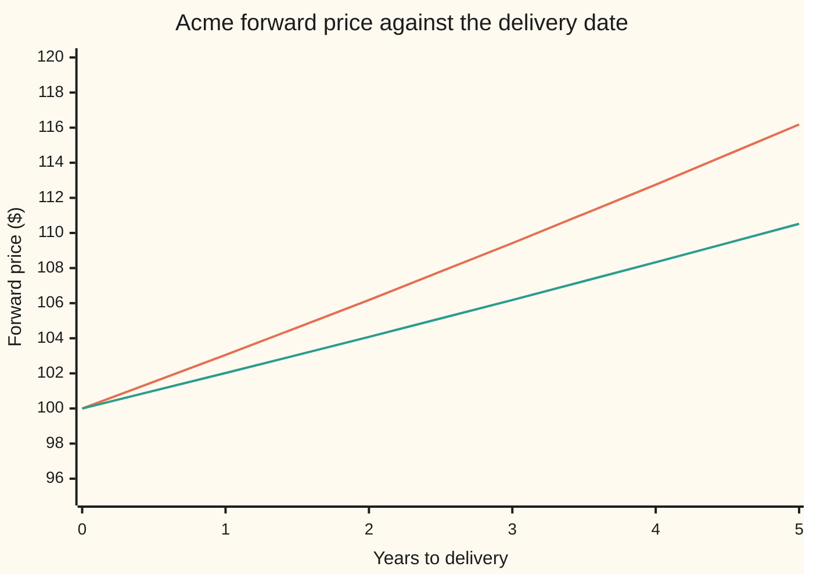

# Stock borrow and repo: the fee to short a share, the forward it sets, and the implied repo read from the market

[Syllabus](../../../SYLLABUS.md) → [Financial mathematics](../README.md) → [Equity financing - borrow, total return swaps and dividends](../README.md#s52) → Stock borrow and repo

---

## General Overview

Acme trades at $100.00. The bank rate is 5% a year and Acme pays a 2% dividend yield. Cash and carry then prices a one-year forward (a contract to buy the share in a year at a price fixed today) at **$103.05** ([Forward price](../03-Contracts%20and%20No-Arbitrage/03-forward-price-by-cash-and-carry.md)).

Yet the market quotes **$102.02**. Nobody is wrong. Selling a share you do not own means borrowing it first, and the owner charges for the loan. This charge is the **borrow fee**: a yearly percentage of the share's value, here 1%. A pension fund that holds Acme lends it out and collects that 1%.

So holding Acme pays its owner two incomes, not one: the 2% dividend and the 1% lending fee. Carry the share at 5% less both, and the forward is $`100 \times e^{0.05-0.02-0.01}`$ = **$102.0201**. Leave the fee out and the forward is $1.0253 too high.

The same fact runs backwards. The forward quote, the overnight bank rate SOFR (the Secured Overnight Financing Rate, [Money markets](../02-Curves/03-money-market-instruments-and-sofr.md)) and the declared dividend together pin the fee: exactly 1.00%. The rate at which a holder of Acme can borrow cash against it, 5% less the fee, is the share's **repo rate**: 4%.

**The fee for lending a share is income to whoever holds it, so it lowers the forward exactly as a dividend does, and a forward quote read with the bank rate and the dividend gives the fee back.**

**What kind of fact this is:** a theorem inside a stated model (one fee paid by borrowers and earned by lenders, fees and dividends known for the term), proved in Why it works. Run backwards, it is a method for reading the fee from market prices.

### The picture: the forward with and without the fee, for six delivery dates



The upper line ignores the fee: Acme carried at 5% less 2%. The lower line includes the 1% fee. At one year they are $103.05 and $102.02; at five years, $116.18 and $110.52. The fee is a rate, so its effect grows with the wait.

---

## The formula

Five letters carry the main formula. Four come from [Forward price](../03-Contracts%20and%20No-Arbitrage/03-forward-price-by-cash-and-carry.md): the spot price $`S`$, the bank rate $`r`$, the dividend yield $`q`$ and the years to delivery $`T`$, all rates continuously compounded (growing smoothly every instant, so a year at 5% multiplies money by $`e^{0.05}`$). The new one is $`b`$, the **borrow fee**, also a continuous yearly rate.

```math
F = S\,e^{(r - q - b)\,T}
```

**Read it aloud:** the forward is today's price carried at the bank rate, less the dividend and less the fee, both of which go to whoever holds the share.

The same formula in the language of repo. The **repo rate** $`\rho`$ (say "rho") of a share is the rate at which its holder can borrow cash with the share as collateral. It is the bank rate less the fee:

```math
\rho = r - b, \qquad F = S\,e^{(\rho - q)\,T}
```

Run backwards, the forward gives the **carry** $`c`$: the net rate the forward grows at over spot. Two outside facts split it.

```math
c = \frac{\ln(F/S)}{T} = r - q - b, \qquad \rho = q + c, \qquad b = r - q - c
```

The implied repo rate needs only the forward, the spot and the dividend. The fee needs the bank rate too. The bank rate can come from SOFR compounded over the term, or from a **box spread**: a call bought and a put sold at a low strike $`K_1`$, with the same pair reversed at a high strike $`K_2`$. It pays $`K_2 - K_1`$ for certain, so its price fixes the discount factor $`D`$ with no dividend or fee inside ([Implied forward and dividend from parity](../11-Implied%20volatility%20and%20the%20vanilla%20inverses/05-implied-forward-and-dividend-from-parity.md)):

```math
D = \frac{g_1 - g_2}{K_2 - K_1}, \qquad r = -\frac{\ln D}{T}, \qquad F = K + \frac{C - P}{D}
```

| Symbol | Plain meaning | In our example | Push it up and the answer… |
| --- | --- | --- | --- |
| $`F`$ | the forward price: cash paid for one share on delivery day | $102.0201 | the implied fee falls |
| $`S`$ | Acme's price today | $100.00 | the forward rises in proportion |
| $`r`$ | the bank rate (SOFR, or the box rate) | 5% | the forward rises; the implied fee rises one for one |
| $`q`$ | the dividend yield, the dividend as a yearly fraction of the price | 2% | the forward falls; the implied fee falls one for one |
| $`b`$; $`b_s`$, $`b_l`$ | the borrow fee: what a short seller pays and a lender earns, yearly; in the fold, the fee shorts pay and the fee lenders receive | 1%; 1.00%, 0.80% | the forward falls, exactly as a dividend would push it |
| $`\rho`$ | the repo rate $`r - b`$: what cash costs when the share is the collateral | 4% | the forward rises |
| $`T`$ | years to delivery | 1 | the fee's effect grows with it; a quote error moves the implied fee less |
| $`c`$ | the carry $`\ln(F/S)/T`$, read from the quote | 2% | the implied repo rises one for one; the implied fee falls one for one |
| $`D`$ | the discount factor: one dollar on delivery day, valued today | 0.951229 | a higher $`D`$ means a lower rate |
| $`K`$, $`K_1`$, $`K_2`$ | option strikes: the parity strike and the box's low and high strikes | $100, $90, $110 | wider box strikes: quote errors move $`D`$ less |
| $`C`$, $`P`$ | the call's and the put's price at one strike | $8.6525, $6.7309 | $`C`$ up: the forward rises |
| $`g_1`$, $`g_2`$ | call minus put at the box's two strikes | $11.4339, −$7.5907 | a wider difference means a larger $`D`$ |

### When it holds

- **One fee for borrowers and lenders.** In practice an agent lender keeps part of the fee. If shorts pay 1.00% and lenders receive 0.80%, the two trades stop at different prices, and the forward is pinned only to a band from $102.0201 to $102.2244.
- **The fee is known for the whole term.** Most stock loans are open: the lender can recall the share, and the fee can be reset daily. A forward then carries the risk of the fee jumping, and the formula holds only with a term (fixed-period) loan.
- **The share can be borrowed at all.** When no lender is found, the trade that holds the forward up from below is impossible. The forward can then sit far under the formula, with no trade to correct it.
- **The dividend is known.** The fee falls out as whatever the dividend leaves unexplained. A dividend cut that the market expects shows up as a false fee.
- **The rate fits the trade.** SOFR is a rate on Treasury-backed overnight loans. The box rate is the options market's own rate, and research measures it a little above Treasury yields. Mix them and that gap lands in the fee.

---

## Why it works

### Step 0: owning the share pays two incomes, not one

[Forward price](../03-Contracts%20and%20No-Arbitrage/03-forward-price-by-cash-and-carry.md) proves that a forward is spot carried at what cash earns, less what the share pays its holder. That card counted one payment, the dividend.

A holder can also lend the share. A **securities loan** moves the share to a borrower, who pays the fee and hands over an equal amount for every dividend paid in the meantime (a **manufactured dividend**). The lender keeps the full economics of owning the share and adds the fee. So the fee is a second income from holding, and it enters the formula next to $`q`$.

### Step 1: one share on delivery day costs $97.04 today

Buy $`e^{-(q+b)T}`$ of a share: $`e^{-0.03}`$ = 0.970446 of a share, costing $97.0446. Lend it out. Each day, spend the dividend and the fee on more Acme. The holding grows at 3% a year and reaches exactly one share on delivery day.

That $97.0446 is the **prepaid forward**: one share in a year, paid for now. Acme's price along the way does not matter. Each day's income is a fixed fraction of that day's price, so it buys a fixed fraction of a share.

### Step 2: pay on delivery day instead, and the price is $102.02

Two packages both end with one share. Package A signs a forward at $`F`$ and banks $`F\,e^{-rT}`$. Package B is Step 1's holding, lent out. Equal endings mean equal prices today:

```math
F\,e^{-rT} = S\,e^{-(q+b)T} \quad\Longrightarrow\quad F = S\,e^{(r-q-b)T}
```

For Acme: $`97.0446 \times e^{0.05}`$ = **$102.0201**, worked from the unrounded prepaid forward.

### Step 3: any other quote pays someone for nothing

**Quote too high: $103.0455**, the price that forgets the fee. A holder sells the forward, borrows $97.0446 at 5%, buys 0.970446 of a share and lends it out. On delivery day the share is handed over for $103.0455 and the loan costs $102.0201. Profit: **$1.0253**, with no money down.

**Quote too low: $101.00.** A short seller borrows 0.970446 of a share, pays the fee and the manufactured dividends by shorting a little more, and banks the $97.0446 sale proceeds. On delivery day the bank holds $102.0201. The forward delivers one share for $101.00, which is returned to the lender. Profit: **$1.0201**.

The first trade earns the fee and the second pays it. With one fee on both sides, they squeeze the forward to one number.

### Step 4: the same fee, written as a rebate and as a repo rate

In the US, the lender usually holds the short seller's sale proceeds as cash collateral. The lender pays interest on that cash at the **rebate rate**: the bank rate less the fee, $`r - b`$ = 4%. So the fee is never sent as a bill. It is the interest the short seller does not get.

The holder's side is a **repo**: sell the share today and agree to buy it back later at a higher price, so the share secures a loan of cash. A lender of cash who wants the share pays for it by accepting a lower rate. That lower rate is $`\rho = r - b`$. Shares in high demand to borrow are called **special**, and their repo rates sit far below the bank rate, sometimes under zero.

Desks use both words. Some quote $`b`$ itself as "the repo", so read which number a screen shows.

### Step 5: three rates, one quote, two outside facts

A forward quote gives one number, the carry $`c = \ln(F/S)/T`$. For Acme, $`\ln(1.020201)`$ = 2.0000%. That is one equation in three unknowns: $`r`$, $`q`$ and $`b`$. [Implied forward and dividend from parity](../11-Implied%20volatility%20and%20the%20vanilla%20inverses/05-implied-forward-and-dividend-from-parity.md) stopped here: given the rate, it calls the remainder a 3.00% yield.

Two outside facts finish the split:

1. **The rate.** SOFR gives 5%. Or the box: it pays $20 for certain, so dividends and fees cancel out of it. On Acme's options it returns $`D`$ = 0.951229 and a rate of 5.0000%.
2. **The dividend.** Declared dividends give 2% ([Known cash dividends](../08-The%20Black-Scholes%20call%20and%20put/08-known-cash-dividends.md) handles a dated cash amount).

Then the implied repo rate is $`q + c`$ = 4.0000% and the fee is $`r - q - c`$ = **1.0000%**.

<details>
<summary>Detailed proof: the band when fees differ, one answer for the inverse, and how a quote error travels</summary>

**The band.** Let shorts pay $`b_s`$ and lenders receive $`b_l \le b_s`$. Step 3's first trade earns $`b_l`$, so it forces $`F \le S\,e^{(r-q-b_l)T}`$. The second trade pays $`b_s`$, so it forces $`F \ge S\,e^{(r-q-b_s)T}`$. Neither trade works inside the band:

$`\displaystyle S\,e^{(r-q-b_s)T} \;\le\; F \;\le\; S\,e^{(r-q-b_l)T}.`$

With $`b_s`$ = 1.00% and $`b_l`$ = 0.80% the band runs from $102.0201 to $102.2244. When the share cannot be borrowed at all, the lower bound disappears.

**One answer.** For fixed $`S`$, $`r`$, $`q`$ and $`T > 0`$, the map $`b \mapsto S\,e^{(r-q-b)T}`$ is strictly decreasing and takes every positive value once. So each positive quote gives exactly one fee:

$`\displaystyle b = r - q - \frac{\ln(F/S)}{T}.`$

A negative answer is legal algebra but not a lending fee. It says the rate, the dividend or the quote is wrong, or the dividend is expected to rise.

**The error rule.** Differentiate: $`\partial b / \partial F = -1/(F\,T)`$. The error is divided by $`T`$, so on a one-month forward the same cent moves the fee about twelve times as far as on a one-year forward. A one-month quote one cent low reads the fee as 1.12% instead of 1.00%.

**The box.** At strikes $`K_1 < K_2`$, parity gives $`g_i = D\,(F - K_i)`$. Subtract: $`g_1 - g_2 = D\,(K_2 - K_1)`$. The forward cancels, and with it every dividend and fee, so $`D`$ is the options market's pure discount factor.

</details>

---

## Worked numbers, by hand

Acme at $`S`$ = $100.00, $`r`$ = 5%, $`q`$ = 2%, $`b`$ = 1%, $`T`$ = 1 year.

| Step | Arithmetic | Value |
| --- | --- | --- |
| share fraction to buy and lend | $`e^{-(0.02+0.01)}`$ | 0.970446 |
| prepaid forward | $`100.00 \times 0.970446`$ | $97.0446 |
| **forward with the fee** | $`97.0446 \times e^{0.05}`$, or $`100 \times e^{0.02}`$ | **$102.0201** |
| forward ignoring the fee | $`100 \times e^{0.03}`$ | $103.0455 |
| what the fee is worth on delivery day | $`103.0455 - 102.0201`$ | $1.0253 |
| repo rate | $`5\% - 1\%`$ | 4.0000% |
| *Backwards from a quote of $102.0201* | | |
| carry | $`\ln(102.0201 / 100) / 1`$ | 2.0000% |
| implied yield, as the parity card reads it | $`5\% - 2\%`$ | 3.0000% |
| implied repo rate | $`2\% + 2\%`$ | 4.0000% |
| **implied borrow fee** | $`5\% - 2\% - 2\%`$ | **1.0000%** |
| *Backwards from options, rate not given* | | |
| call minus put at $90 and $110 | $`14.3689 - 2.9350`$ and $`4.7978 - 12.3884`$ | $11.4339 and −$7.5907 |
| box discount factor | $`(11.4339 + 7.5907) / 20`$ | 0.951229 |
| box rate | $`-\ln(0.951229)`$ | 5.0000% |
| forward by parity at $100 | $`100 + (8.6525 - 6.7309) / 0.951229`$ | $102.0201 |
| implied borrow fee | $`5\% - 2\% - 2\%`$ | 1.0000% |

A forward of $102.02 on a $100 share means the market charges 1% a year to borrow Acme. With the dividend known and the rate taken from SOFR or from the box, nothing else is left to explain the price. (Each value comes from unrounded inputs, so a few rows, such as the fee's worth on delivery day, differ in the last digit from the rounded arithmetic shown.)

### What breaks if you drop a piece

Right answers: forward $102.0201, fee 1.00%.

| Mistake | Comes out at | What went wrong |
| --- | --- | --- |
| Fee left out | forward $103.0455 | the holder's lending income is ignored; $1.0253 too high |
| Fee added to the carry instead of subtracted | forward $104.0811 | the fee is income to the holder, not a cost of holding |
| Whole implied yield read as the dividend | dividend 3.00% | the parity yield is dividend plus fee together |
| Dividend forgotten when solving for the fee | fee 3.00% | the whole carry gap is blamed on the borrow |
| One-month forward quoted one cent low | fee 1.12% | dividing by a short $`T`$ swells a small price error |

Both checks print every number in that table.

---

## How the forward moves when the fee moves

Most large shares lend cheaply. A share that many investors want to short becomes special, and its fee can reach tens of percent a year. Hold everything else and slide the fee:

```
fee      one-year Acme forward (bars start at $75)
  0%   ██████████████████████████████████████████  $103.05
  1%   █████████████████████████████████████████   $102.02
  5%   ███████████████████████████████████         $98.02
 10%   ███████████████████████████                 $93.24
 25%   ████████                                    $80.25
```

Once the fee passes 3%, the bank rate less the dividend, the forward sits below spot: $98.02 at a 5% fee. At 25% it is $80.25. Anyone reading only the options would see a share "paying" a large yield while its dividend stays at 2%.

The second force is the wait, in the picture at the top. Each extra year multiplies the forward by $`e^{-b}`$ once more, so the two lines spread apart.

---

## Code, from first principles, and it actually runs

The checks reach the forward and the fee by four roads, two of them independent. Road 1 is the formula. Road 2 runs the holder's trade day by day down three random Acme paths, buying shares with each day's dividend and fee. Road 3 runs the short seller's trade, with the cash earning the rebate rate. Roads 2 and 3 restate the formula one day at a time: each day's income is a fraction of that day's price and buys shares at that same price, so the price cancels and the paths cannot move the answer. They check the bookkeeping of rates and share counts. Road 4 is the independent one: it prices calls and puts by averaging their payoffs over the bell curve (Simpson's rule: an area added up from evenly spaced samples), then reads the rate from the box, the forward from parity and the fee from both; a bisection root finder (halve the search interval until the fee is pinned) confirms the logarithm.

### Python

```python
# Stock borrow and repo -- the check behind the card.  Standard library only, and
# nothing imported that already holds the answer: the random numbers, the option
# integrals (Simpson's rule) and the root finder are all written out here.
# Acme trades at 100.00, the bank rate is 5%, the dividend yield 2%, the fee to
# borrow the share 1% a year, delivery one year out.  Four roads to one forward.
import math

S, r, q, b, T = 100.0, 0.05, 0.02, 0.01, 1.0

def fwd(S, r, q, b, T):
    """Road 1, the formula: spot carried at the bank rate less dividend less fee."""
    return S * math.exp((r - q - b) * T)

def rng(seed):
    """A small linear congruential generator, then Box-Muller for bell-curve draws."""
    while True:
        seed = (seed * 6364136223846793005 + 1442695040888963407) % 2**64
        u1 = (seed >> 11) / 2**53 + 1e-300
        seed = (seed * 6364136223846793005 + 1442695040888963407) % 2**64
        u2 = (seed >> 11) / 2**53
        yield math.sqrt(-2 * math.log(u1)) * math.cos(2 * math.pi * u2)

def ledger(seed, fee, side, days=365, sigma=0.3):
    """Roads 2 and 3: run the hedge day by day down a random Acme path.
    Long: borrow cash at r, buy shares, lend them out; dividends and fee buy more.
    Short: borrow shares and sell them; the cash stays with the lender as collateral
    and earns the rebate r - fee; dividends owed are paid by shorting a sliver more.
    Returns the break-even forward (cash per share at delivery) and the last price."""
    dt, z, price = T / days, rng(seed), S
    grow = q + fee if side == "long" else q          # what the share count grows by
    rate = r if side == "long" else r - fee          # what the cash grows at
    shares = math.exp(-grow * T)             # start small, grow into one share
    cash = shares * price                    # loan (long) or collateral (short)
    for _ in range(days):
        price *= math.exp((r - q - 0.5 * sigma**2) * dt + sigma * math.sqrt(dt) * next(z))
        cash *= math.exp(rate * dt)
        income = shares * price * (math.exp(grow * dt) - 1)   # cash value, this day
        shares += income / price             # bought (long) or owed (short)
    assert abs(shares - 1) < 1e-12           # exactly one share at delivery
    return cash, price

def simpson(f, a, c, n=2000):
    h = (c - a) / n
    s = f(a) + f(c) + sum((4 if i % 2 else 2) * f(a + i * h) for i in range(1, n))
    return s * h / 3

def option(K, kind, rr, carry, sigma=0.2):
    """Road 4's inputs: a call or put priced by averaging its payoff over the bell
    curve, never by a closed form.  'carry' is everything the share pays its holder."""
    m, v = math.log(S) + (rr - carry - 0.5 * sigma**2) * T, sigma * math.sqrt(T)
    dens = lambda z: math.exp(-z * z / 2) / math.sqrt(2 * math.pi)
    zk = (math.log(K) - m) / v               # split at the kink, so Simpson is exact-ish
    if kind == "call":
        f, a, c = (lambda z: (math.exp(m + v * z) - K) * dens(z)), zk, 10.0
    else:
        f, a, c = (lambda z: (K - math.exp(m + v * z)) * dens(z)), -10.0, zk
    return math.exp(-rr * T) * simpson(f, a, c)

def bisect(g, lo, hi):
    for _ in range(200):
        mid = 0.5 * (lo + hi)
        lo, hi = (mid, hi) if g(lo) * g(mid) > 0 else (lo, mid)
    return 0.5 * (lo + hi)

out = lambda label, x, d=4: print(f"{label:<46}{x:>14.{d}f}")
print("Acme 100.00, r 5%, q 2%, borrow fee 1%, T 1 year")
F, F0 = fwd(S, r, q, b, T), fwd(S, r, q, 0, T)
out("forward with the borrow fee", F); out("forward ignoring the fee", F0)
out("gap the fee makes", F0 - F)
out("share fraction to buy, exp(-(q+b)T)", math.exp(-(q + b) * T), 6)
out("cost of that fraction, prepaid forward", S * math.exp(-(q + b) * T))
out("repo rate rho = r - b, percent", 100 * (r - b))
out("forward as S exp((rho - q)T)", S * math.exp((r - b - q) * T))
assert abs(F - 102.0201) < 5e-5 and abs(F0 - 103.0455) < 5e-5

print("roads 2 and 3: day-by-day ledgers on random paths, sigma 30%")
for seed in (1, 2, 3):
    c_long, p_end = ledger(seed, b, "long")
    c_short, _ = ledger(seed, b, "short")
    print(f"  path {seed}: Acme ends {p_end:8.2f}  long break-even {c_long:9.4f}"
          f"  short break-even {c_short:9.4f}")
    assert abs(c_long - F) < 1e-6 and abs(c_short - F) < 1e-6

print("arbitrage ledgers, profit on delivery day")
out("  quote 103.0455 (fee ignored): carry and lend", F0 - F)
out("  quote 101.0000: short, pay the fee", F - 101.0)
lo_, hi_ = fwd(S, r, q, 0.010, T), fwd(S, r, q, 0.008, T)
out("band, shorts pay 1.00%: lowest forward", lo_)
out("band, lenders get 0.80%: highest forward", hi_)
assert lo_ < F0 and lo_ < hi_ < F0

print("inverse 1: a listed forward 102.0201, SOFR 5%, known dividend 2%")
Fq = 102.0201
carry = math.log(Fq / S) / T
out("carry ln(F/S)/T, percent", 100 * carry)
out("implied yield r - carry, percent", 100 * (r - carry))
out("implied repo rho = q + carry, percent", 100 * (q + carry))
b_log = r - q - carry
b_bis = bisect(lambda x: fwd(S, r, q, x, T) - Fq, -0.5, 0.5)
out("implied borrow fee, by logarithm, percent", 100 * b_log)
out("implied borrow fee, by bisection, percent", 100 * b_bis)
assert abs(b_log - 0.01) < 1e-5 and abs(b_bis - b_log) < 1e-9

print("inverse 2: box spread and parity, options priced with r 5%, q+b 3%")
g = {}
for K in (90, 100, 110):
    c, p = option(K, "call", r, q + b), option(K, "put", r, q + b)
    g[K] = c - p
    print(f"  strike {K}: call {c:8.4f}  put {p:8.4f}  call - put {g[K]:8.4f}")
D = (g[90] - g[110]) / 20
rb = -math.log(D) / T
Fb = 100 + g[100] / D
out("box: discount factor D", D, 6); out("box: rate -ln(D)/T, percent", 100 * rb)
out("parity at 100: forward 100 + (C - P)/D", Fb)
out("implied repo q + ln(F/S)/T, percent", 100 * (q + math.log(Fb / S) / T))
out("implied borrow fee, percent", 100 * (rb - q - math.log(Fb / S) / T))
assert abs(rb - r) < 1e-6 and abs(Fb - F) < 1e-5
assert abs(rb - q - math.log(Fb / S) / T - b) < 1e-6

print("what breaks")
out("  fee left out", F0)
out("  fee added to the cost of carry", fwd(S, r, q, -b, T))
out("  whole implied yield read as dividend, %", 100 * (r - carry))
out("  dividend forgotten, fee read as, %", 100 * (r - carry))
out("  short-dated 1-month quote 0.01 low: fee, %", 100 * (r - q - math.log(
    (fwd(S, r, q, b, 1 / 12) - 0.01) / S) * 12))

print("how it moves: one-year forward against the fee")
for fee in (0.0, 0.01, 0.05, 0.10, 0.25):
    out(f"  fee {100 * fee:5.1f}%", fwd(S, r, q, fee, T), 2)
print("chart, years      " + "".join(f"{t:>8d}" for t in range(6)))
print("chart, no fee     " + "".join(f"{fwd(S, r, q, 0, t):8.2f}" for t in range(6)))
print("chart, fee 1%     " + "".join(f"{fwd(S, r, q, b, t):8.2f}" for t in range(6)))
print("ALL CHECKS PASS")
```

**Ran 2026-11-23 on macOS, Python 3.14.10, standard library only. All checks passed. Output, pasted from the run:**

```
Acme 100.00, r 5%, q 2%, borrow fee 1%, T 1 year
forward with the borrow fee                         102.0201
forward ignoring the fee                            103.0455
gap the fee makes                                     1.0253
share fraction to buy, exp(-(q+b)T)                 0.970446
cost of that fraction, prepaid forward               97.0446
repo rate rho = r - b, percent                        4.0000
forward as S exp((rho - q)T)                        102.0201
roads 2 and 3: day-by-day ledgers on random paths, sigma 30%
  path 1: Acme ends   124.60  long break-even  102.0201  short break-even  102.0201
  path 2: Acme ends    78.79  long break-even  102.0201  short break-even  102.0201
  path 3: Acme ends    66.57  long break-even  102.0201  short break-even  102.0201
arbitrage ledgers, profit on delivery day
  quote 103.0455 (fee ignored): carry and lend        1.0253
  quote 101.0000: short, pay the fee                  1.0201
band, shorts pay 1.00%: lowest forward              102.0201
band, lenders get 0.80%: highest forward            102.2244
inverse 1: a listed forward 102.0201, SOFR 5%, known dividend 2%
carry ln(F/S)/T, percent                              2.0000
implied yield r - carry, percent                      3.0000
implied repo rho = q + carry, percent                 4.0000
implied borrow fee, by logarithm, percent             1.0000
implied borrow fee, by bisection, percent             1.0000
inverse 2: box spread and parity, options priced with r 5%, q+b 3%
  strike 90: call  14.3689  put   2.9350  call - put  11.4339
  strike 100: call   8.6525  put   6.7309  call - put   1.9216
  strike 110: call   4.7978  put  12.3884  call - put  -7.5907
box: discount factor D                              0.951229
box: rate -ln(D)/T, percent                           5.0000
parity at 100: forward 100 + (C - P)/D              102.0201
implied repo q + ln(F/S)/T, percent                   4.0000
implied borrow fee, percent                           1.0000
what breaks
  fee left out                                      103.0455
  fee added to the cost of carry                    104.0811
  whole implied yield read as dividend, %             3.0000
  dividend forgotten, fee read as, %                  3.0000
  short-dated 1-month quote 0.01 low: fee, %          1.1198
how it moves: one-year forward against the fee
  fee   0.0%                                          103.05
  fee   1.0%                                          102.02
  fee   5.0%                                           98.02
  fee  10.0%                                           93.24
  fee  25.0%                                           80.25
chart, years             0       1       2       3       4       5
chart, no fee       100.00  103.05  106.18  109.42  112.75  116.18
chart, fee 1%       100.00  102.02  104.08  106.18  108.33  110.52
ALL CHECKS PASS
```

### Rust

Same checks, same labels, same output. No crates.

```rust
// Stock borrow and repo -- the same check as the Python file, in Rust.  Standard
// library only, no crates.  The random numbers, the option integrals (Simpson's
// rule) and the root finder are written out here.  Acme trades at 100.00, the bank
// rate is 5%, the dividend yield 2%, the borrow fee 1% a year, delivery in one year.
// Compile: rustc --edition 2021 -O stock_borrow_repo_and_the_equity_forward_check.rs

const S: f64 = 100.0;
const R: f64 = 0.05;
const Q: f64 = 0.02;
const B: f64 = 0.01;
const T: f64 = 1.0;

/// Road 1, the formula: spot carried at the bank rate less dividend less fee.
fn fwd(s: f64, r: f64, q: f64, b: f64, t: f64) -> f64 {
    s * ((r - q - b) * t).exp()
}

/// A small linear congruential generator, then Box-Muller for bell-curve draws.
struct Rng(u64);
impl Rng {
    fn step(&mut self) -> f64 {
        self.0 = self.0.wrapping_mul(6364136223846793005).wrapping_add(1442695040888963407);
        (self.0 >> 11) as f64 / 9007199254740992.0
    }
    fn normal(&mut self) -> f64 {
        let u1 = self.step() + 1e-300;
        let u2 = self.step();
        (-2.0 * u1.ln()).sqrt() * (2.0 * std::f64::consts::PI * u2).cos()
    }
}

/// Roads 2 and 3: the hedge run day by day down a random Acme path.
/// Long: borrow cash at r, buy shares, lend them out; dividends and fee buy more.
/// Short: borrow shares and sell them; the cash stays with the lender as collateral
/// and earns the rebate r - fee; dividends owed are paid by shorting a sliver more.
fn ledger(seed: u64, fee: f64, long: bool) -> (f64, f64) {
    let (days, sigma) = (365, 0.3);
    let dt = T / days as f64;
    let mut z = Rng(seed);
    let mut price = S;
    let grow = if long { Q + fee } else { Q };
    let rate = if long { R } else { R - fee };
    let mut shares = (-grow * T).exp();
    let mut cash = shares * price;
    for _ in 0..days {
        price *= ((R - Q - 0.5 * sigma * sigma) * dt + sigma * dt.sqrt() * z.normal()).exp();
        cash *= (rate * dt).exp();
        let income = shares * price * ((grow * dt).exp() - 1.0);
        shares += income / price;
    }
    assert!((shares - 1.0).abs() < 1e-12);
    (cash, price)
}

fn simpson(f: &dyn Fn(f64) -> f64, a: f64, c: f64, n: usize) -> f64 {
    let h = (c - a) / n as f64;
    let mut s = f(a) + f(c);
    for i in 1..n {
        s += if i % 2 == 1 { 4.0 } else { 2.0 } * f(a + i as f64 * h);
    }
    s * h / 3.0
}

/// A call or put priced by averaging its payoff over the bell curve, split at the kink.
fn option(k: f64, call: bool, rr: f64, carry: f64) -> f64 {
    let sigma = 0.2;
    let m = S.ln() + (rr - carry - 0.5 * sigma * sigma) * T;
    let v = sigma * T.sqrt();
    let dens = |z: f64| (-z * z / 2.0).exp() / (2.0 * std::f64::consts::PI).sqrt();
    let zk = (k.ln() - m) / v;
    let val = if call {
        simpson(&|z: f64| ((m + v * z).exp() - k) * dens(z), zk, 10.0, 2000)
    } else {
        simpson(&|z: f64| (k - (m + v * z).exp()) * dens(z), -10.0, zk, 2000)
    };
    (-rr * T).exp() * val
}

fn bisect(g: &dyn Fn(f64) -> f64, mut lo: f64, mut hi: f64) -> f64 {
    for _ in 0..200 {
        let mid = 0.5 * (lo + hi);
        if g(lo) * g(mid) > 0.0 { lo = mid } else { hi = mid }
    }
    0.5 * (lo + hi)
}

fn out(label: &str, x: f64, d: usize) {
    println!("{:<46}{:>14.*}", label, d, x);
}

fn main() {
    println!("Acme 100.00, r 5%, q 2%, borrow fee 1%, T 1 year");
    let (f, f0) = (fwd(S, R, Q, B, T), fwd(S, R, Q, 0.0, T));
    out("forward with the borrow fee", f, 4);
    out("forward ignoring the fee", f0, 4);
    out("gap the fee makes", f0 - f, 4);
    out("share fraction to buy, exp(-(q+b)T)", (-(Q + B) * T).exp(), 6);
    out("cost of that fraction, prepaid forward", S * (-(Q + B) * T).exp(), 4);
    out("repo rate rho = r - b, percent", 100.0 * (R - B), 4);
    out("forward as S exp((rho - q)T)", S * ((R - B - Q) * T).exp(), 4);
    assert!((f - 102.0201).abs() < 5e-5 && (f0 - 103.0455).abs() < 5e-5);

    println!("roads 2 and 3: day-by-day ledgers on random paths, sigma 30%");
    for seed in 1..=3u64 {
        let (c_long, p_end) = ledger(seed, B, true);
        let (c_short, _) = ledger(seed, B, false);
        println!("  path {}: Acme ends {:8.2}  long break-even {:9.4}  short break-even {:9.4}",
                 seed, p_end, c_long, c_short);
        assert!((c_long - f).abs() < 1e-6 && (c_short - f).abs() < 1e-6);
    }

    println!("arbitrage ledgers, profit on delivery day");
    out("  quote 103.0455 (fee ignored): carry and lend", f0 - f, 4);
    out("  quote 101.0000: short, pay the fee", f - 101.0, 4);
    let (lo, hi) = (fwd(S, R, Q, 0.010, T), fwd(S, R, Q, 0.008, T));
    out("band, shorts pay 1.00%: lowest forward", lo, 4);
    out("band, lenders get 0.80%: highest forward", hi, 4);
    assert!(lo < f0 && lo < hi && hi < f0);

    println!("inverse 1: a listed forward 102.0201, SOFR 5%, known dividend 2%");
    let fq = 102.0201;
    let carry = (fq / S).ln() / T;
    out("carry ln(F/S)/T, percent", 100.0 * carry, 4);
    out("implied yield r - carry, percent", 100.0 * (R - carry), 4);
    out("implied repo rho = q + carry, percent", 100.0 * (Q + carry), 4);
    let b_log = R - Q - carry;
    let b_bis = bisect(&|x: f64| fwd(S, R, Q, x, T) - fq, -0.5, 0.5);
    out("implied borrow fee, by logarithm, percent", 100.0 * b_log, 4);
    out("implied borrow fee, by bisection, percent", 100.0 * b_bis, 4);
    assert!((b_log - 0.01).abs() < 1e-5 && (b_bis - b_log).abs() < 1e-9);

    println!("inverse 2: box spread and parity, options priced with r 5%, q+b 3%");
    let mut g = [0.0; 3];
    for (i, k) in [90.0, 100.0, 110.0].iter().enumerate() {
        let c = option(*k, true, R, Q + B);
        let p = option(*k, false, R, Q + B);
        g[i] = c - p;
        println!("  strike {}: call {:8.4}  put {:8.4}  call - put {:8.4}", k, c, p, g[i]);
    }
    let d = (g[0] - g[2]) / 20.0;
    let rb = -d.ln() / T;
    let fb = 100.0 + g[1] / d;
    out("box: discount factor D", d, 6);
    out("box: rate -ln(D)/T, percent", 100.0 * rb, 4);
    out("parity at 100: forward 100 + (C - P)/D", fb, 4);
    out("implied repo q + ln(F/S)/T, percent", 100.0 * (Q + (fb / S).ln() / T), 4);
    out("implied borrow fee, percent", 100.0 * (rb - Q - (fb / S).ln() / T), 4);
    assert!((rb - R).abs() < 1e-6 && (fb - f).abs() < 1e-5);
    assert!((rb - Q - (fb / S).ln() / T - B).abs() < 1e-6);

    println!("what breaks");
    out("  fee left out", f0, 4);
    out("  fee added to the cost of carry", fwd(S, R, Q, -B, T), 4);
    out("  whole implied yield read as dividend, %", 100.0 * (R - carry), 4);
    out("  dividend forgotten, fee read as, %", 100.0 * (R - carry), 4);
    let short_f = fwd(S, R, Q, B, 1.0 / 12.0) - 0.01;
    out("  short-dated 1-month quote 0.01 low: fee, %", 100.0 * (R - Q - (short_f / S).ln() * 12.0), 4);

    println!("how it moves: one-year forward against the fee");
    for fee in [0.0, 0.01, 0.05, 0.10, 0.25] {
        out(&format!("  fee {:5.1}%", 100.0 * fee), fwd(S, R, Q, fee, T), 2);
    }
    let row = |name: &str, h: &dyn Fn(f64) -> String| {
        println!("{}{}", name, (0..6).map(|t| h(t as f64)).collect::<String>());
    };
    row("chart, years      ", &|t| format!("{:>8}", t as i64));
    row("chart, no fee     ", &|t| format!("{:8.2}", fwd(S, R, Q, 0.0, t)));
    row("chart, fee 1%     ", &|t| format!("{:8.2}", fwd(S, R, Q, B, t)));
    println!("ALL CHECKS PASS");
}
```

**Ran 2026-11-23 on macOS, rustc 1.98.1, no crates. All checks passed. Output, pasted from the run:**

```
Acme 100.00, r 5%, q 2%, borrow fee 1%, T 1 year
forward with the borrow fee                         102.0201
forward ignoring the fee                            103.0455
gap the fee makes                                     1.0253
share fraction to buy, exp(-(q+b)T)                 0.970446
cost of that fraction, prepaid forward               97.0446
repo rate rho = r - b, percent                        4.0000
forward as S exp((rho - q)T)                        102.0201
roads 2 and 3: day-by-day ledgers on random paths, sigma 30%
  path 1: Acme ends   124.60  long break-even  102.0201  short break-even  102.0201
  path 2: Acme ends    78.79  long break-even  102.0201  short break-even  102.0201
  path 3: Acme ends    66.57  long break-even  102.0201  short break-even  102.0201
arbitrage ledgers, profit on delivery day
  quote 103.0455 (fee ignored): carry and lend        1.0253
  quote 101.0000: short, pay the fee                  1.0201
band, shorts pay 1.00%: lowest forward              102.0201
band, lenders get 0.80%: highest forward            102.2244
inverse 1: a listed forward 102.0201, SOFR 5%, known dividend 2%
carry ln(F/S)/T, percent                              2.0000
implied yield r - carry, percent                      3.0000
implied repo rho = q + carry, percent                 4.0000
implied borrow fee, by logarithm, percent             1.0000
implied borrow fee, by bisection, percent             1.0000
inverse 2: box spread and parity, options priced with r 5%, q+b 3%
  strike 90: call  14.3689  put   2.9350  call - put  11.4339
  strike 100: call   8.6525  put   6.7309  call - put   1.9216
  strike 110: call   4.7978  put  12.3884  call - put  -7.5907
box: discount factor D                              0.951229
box: rate -ln(D)/T, percent                           5.0000
parity at 100: forward 100 + (C - P)/D              102.0201
implied repo q + ln(F/S)/T, percent                   4.0000
implied borrow fee, percent                           1.0000
what breaks
  fee left out                                      103.0455
  fee added to the cost of carry                    104.0811
  whole implied yield read as dividend, %             3.0000
  dividend forgotten, fee read as, %                  3.0000
  short-dated 1-month quote 0.01 low: fee, %          1.1198
how it moves: one-year forward against the fee
  fee   0.0%                                          103.05
  fee   1.0%                                          102.02
  fee   5.0%                                           98.02
  fee  10.0%                                           93.24
  fee  25.0%                                           80.25
chart, years             0       1       2       3       4       5
chart, no fee       100.00  103.05  106.18  109.42  112.75  116.18
chart, fee 1%       100.00  102.02  104.08  106.18  108.33  110.52
ALL CHECKS PASS
```

The two outputs are identical. Acme ends between $66.57 and $124.60 on the three paths, and every ledger breaks even at $102.0201, as it must: the price cancels from each day's purchase.

### Lean

Lean proves that a quote gives back exactly one fee, the two-fee band and the box spread, for any inputs meeting the conditions below.

- Suppose $`S`$, $`F`$ and $`T`$ are all positive. Then $`F = S\,e^{(r-q-b)T}`$ holds exactly when $`b = r - q - \ln(F/S)/T`$.
- Take the same positive $`S`$, $`F`$ and $`T`$. Then the same formula holds exactly when the repo rate is $`r - b = q + \ln(F/S)/T`$.
- Suppose the spot and the term are not negative, shorts pay $`b_s`$ and lenders receive $`b_l \le b_s`$. Then neither Step 3 trade earns money for nothing exactly when $`F`$ lies inside the band.
- Take the same fees. Then the band's bottom, $`S\,e^{(r-q-b_s)T}`$, is never above its top, $`S\,e^{(r-q-b_l)T}`$.
- Suppose parity gives $`g_1 = D(F - K_1)`$ and $`g_2 = D(F - K_2)`$, with $`K_1 < K_2`$. Then $`D = (g_1 - g_2)/(K_2 - K_1)`$, and if $`D \ne 0`$ then $`F = K_1 + g_1/D`$.

The day-by-day ledgers, the error rule, the option prices and every dollar figure are left to the Python and Rust checks.

```lean
-- Stock borrow and repo: with a borrow fee b the forward is F = S e^((r - q - b)T), a quote gives the fee back as b = r - q - ln(F/S)/T and the repo rate as r - b = q + ln(F/S)/T, unequal fees pin the forward only to a band, and a box spread fixes the discount factor with no dividend or fee inside.
import Mathlib.Analysis.SpecialFunctions.Log.Basic

open Real

/-! Notation, as on the card. `S` is Acme's price today, `F` the forward price, `r` the bank rate,
`q` the dividend yield, `b` the borrow fee, all continuously compounded, and `T` the years to
delivery. The repo rate is `r - b`. The card's model (one fee for borrowers and lenders, the fee
and the dividend known for the term, the share can be borrowed, the rate fits the trade) is what
makes the prepaid forward `S e^(-(q+b)T)`: buy that fraction of a share, lend it out, and reinvest
the dividend and the fee until it is one whole share on delivery day. -/

/-- The card's main claim. The fee for lending a share is income to whoever holds it, so it lowers
the forward exactly as a dividend does: `F = S e^((r - q - b)T)`. Run backwards, for a positive
spot, a positive quote and `T > 0`, the quote read with the bank rate and the dividend gives the
fee back, and only one fee fits: `b = r - q - ln(F/S)/T`. In repo terms the same quote gives the
repo rate `r - b = q + ln(F/S)/T`. -/
theorem borrow_fee_read_from_forward (S F r q b T : ℝ) (hS : 0 < S) (hF : 0 < F) (hT : 0 < T) :
    (F = S * exp ((r - q - b) * T) ↔ b = r - q - log (F / S) / T) ∧
    (F = S * exp ((r - q - b) * T) ↔ r - b = q + log (F / S) / T) := by
  have key : ∀ x : ℝ, F = S * exp (x * T) ↔ x = log (F / S) / T := by
    intro x
    constructor
    · intro h
      have hx : F / S = exp (x * T) := by
        rw [h]; field_simp
      rw [hx, log_exp]; field_simp
    · intro h
      have hx : x * T = log (F / S) := by
        rw [h]; field_simp
      rw [hx, exp_log (div_pos hF hS)]; field_simp
  constructor
  · rw [key]; constructor <;> intro h <;> linarith
  · rw [key]; constructor <;> intro h <;> linarith

/-- Step 3 and the detailed proof's band. Shorts pay the fee `bs`, lenders receive `bl ≤ bs`.
The holder's trade (sell the forward at `F`, borrow `S e^(-(q+bl)T)`, buy that fraction of a share
and lend it out) nets `F - S e^(-(q+bl)T) e^(rT)` on delivery day; the short seller's trade nets
`S e^(-(q+bs)T) e^(rT) - F`. Neither makes a riskless profit exactly when
`S e^((r-q-bs)T) ≤ F ≤ S e^((r-q-bl)T)`, and this band is not empty. With one fee
(`bs = bl = b`) it shrinks to the single forward `S e^((r-q-b)T)`. -/
theorem no_arbitrage_band_with_two_fees (S F r q bs bl T : ℝ)
    (hS : 0 ≤ S) (hT : 0 ≤ T) (hfee : bl ≤ bs) :
    ((F - S * exp (-((q + bl) * T)) * exp (r * T) ≤ 0 ∧
        S * exp (-((q + bs) * T)) * exp (r * T) - F ≤ 0) ↔
      (S * exp ((r - q - bs) * T) ≤ F ∧ F ≤ S * exp ((r - q - bl) * T))) ∧
    S * exp ((r - q - bs) * T) ≤ S * exp ((r - q - bl) * T) := by
  have e1 : exp (-((q + bl) * T)) * exp (r * T) = exp ((r - q - bl) * T) := by
    rw [← exp_add]; ring_nf
  have e2 : exp (-((q + bs) * T)) * exp (r * T) = exp ((r - q - bs) * T) := by
    rw [← exp_add]; ring_nf
  refine ⟨?_, ?_⟩
  · rw [mul_assoc, mul_assoc, e1, e2]
    constructor
    · rintro ⟨h1, h2⟩; exact ⟨by linarith, by linarith⟩
    · rintro ⟨h1, h2⟩; exact ⟨by linarith, by linarith⟩
  · apply mul_le_mul_of_nonneg_left _ hS
    apply exp_le_exp.mpr
    apply mul_le_mul_of_nonneg_right _ hT
    linarith

/-- The box spread. Parity at strike `K` says call minus put is `g = D (F - K)`. At two strikes
`K1 < K2` the forward cancels: the box fixes the discount factor `D = (g1 - g2)/(K2 - K1)` with no
dividend or fee inside, and then parity gives the forward back as `F = K1 + g1/D`. -/
theorem box_spread_discount_factor (K1 K2 D F g1 g2 : ℝ) (hK : K1 < K2)
    (h1 : g1 = D * (F - K1)) (h2 : g2 = D * (F - K2)) :
    D = (g1 - g2) / (K2 - K1) ∧ (D ≠ 0 → F = K1 + g1 / D) := by
  have hne : K2 - K1 ≠ 0 := by linarith
  refine ⟨?_, ?_⟩
  · rw [eq_div_iff hne, h1, h2]; ring
  · intro hD
    rw [h1]; field_simp; ring

-- Card, Step 4: repo rate 5% less a 1% fee is 4% (in percent).
example : (5 : ℤ) - 1 = 4 := by norm_num
-- Card, Step 5: carry 2%, dividend 2%: implied repo 2% + 2% = 4%, implied fee 5% - 2% - 2% = 1%.
example : (2 : ℤ) + 2 = 4 := by norm_num
example : (5 : ℤ) - 2 - 2 = 1 := by norm_num
-- Card, worked numbers: the parity card's implied yield 5% - 2% = 3%.
example : (5 : ℤ) - 2 = 3 := by norm_num
-- Card, Step 5: the box at strikes 90 and 110 pays 110 - 90 = 20 dollars for certain.
example : (110 : ℤ) - 90 = 20 := by norm_num

#print axioms borrow_fee_read_from_forward
#print axioms no_arbitrage_band_with_two_fees
#print axioms box_spread_discount_factor
```

**Checked 2026-11-23 on macOS, Lean 4.36.0-rc2, Mathlib v4.36.0-rc2. Every proof is complete and uses only Lean's standard axioms. Output, pasted from the run:**

```
'borrow_fee_read_from_forward' depends on axioms: [propext, Classical.choice, Quot.sound]
'no_arbitrage_band_with_two_fees' depends on axioms: [propext, Classical.choice, Quot.sound]
'box_spread_discount_factor' depends on axioms: [propext, Classical.choice, Quot.sound]
```

> [!TIP]
> **Try changing**
> - Guess first: what happens to the forward if the fee rises to 5%? Read the `how it moves` block, fee 5.0%. The forward is **$98.02**, below today's $100.00 price.
> - Guess first: how far apart are the two forwards at five years? Read the `chart` lines. With the fee, **$110.52**; without it, **$116.18**.
> - Guess first: does a wilder share change the break-even? Set `sigma=0.6` in `ledger`. Every path still breaks even at **$102.0201**. Each day's income buys a fixed fraction of a share, whatever the price.
> - Guess first: how badly does a one-cent error hurt a short forward? The `what breaks` block shows it: a one-month quote one cent low gives a fee of **1.12%**, not 1.00%.

---

## The usual mistake

> [!warning]
> **Reading the implied yield as the dividend.** The yield that parity or a forward returns is the dividend plus the borrow fee. On Acme it is 3.00%, of which only 2.00% is dividend. On a special share the implied yield can be large while the company pays nothing.
>
> - **Leaving the fee out of a forward.** Acme's forward comes out at $103.0455, $1.0253 too high.
> - **Getting the sign backwards.** The fee is income to the holder, so it lowers the forward. Treat it as a cost and the forward is $104.0811.
> - **Blaming the whole gap on borrow.** Forget the dividend when solving and the fee comes out at 3.00%, not 1.00%.
> - **Trusting short-dated quotes.** A one-cent error on a one-month forward moves the fee from 1.00% to 1.12%. Read the fee from longer dates, or from many strikes.

---

## Where you meet it in real life

- **Hard-to-borrow shares and put prices.** When a share is costly to borrow, its puts look dear against its calls. Studies of individual-stock options trace these apparent parity breaks to the borrowing cost.
- **Securities lending desks.** Index funds and pension funds lend their shares and earn the fee. The income is small on most shares and large on specials.
- **Prime brokers.** A hedge fund's broker finances its long positions by repo and lends it shares to short. The spread between those two rates is the broker's business.
- **Index futures desks.** The gap between a futures price and the index, after rates and dividends, is read as the implied financing of the basket. Desks trade that number as a rate.
- **Box spreads as a rate.** Researchers read riskless rates from index option prices through parity and find them about 0.4 percentage point above Treasury yields. That box rate is the right $`r`$ when the forward comes from the same options.

> **Say it back**
> To short a share, you borrow it and pay the owner a fee. That fee is income to whoever holds the share, so it lowers the forward exactly as a dividend does: $`F = S\,e^{(r-q-b)T}`$, $102.0201 for Acme instead of $103.0455. Written as a repo rate, the holder borrows cash against the share at $`r - b`$, 4%. A forward quote gives only the carry, rate less dividend less fee. Take the rate from SOFR or a box spread and the dividend from the declaration, and the fee falls out: 1.00%.

---

## What this builds on

- [Forward price](../03-Contracts%20and%20No-Arbitrage/03-forward-price-by-cash-and-carry.md): cash and carry with one income, the dividend. This card adds the second income, the lending fee.
- [Implied forward and dividend from parity](../11-Implied%20volatility%20and%20the%20vanilla%20inverses/05-implied-forward-and-dividend-from-parity.md): reads the forward and the box rate from option prices. Its single carry number is what this card splits.
- [Known cash dividends](../08-The%20Black-Scholes%20call%20and%20put/08-known-cash-dividends.md): how a declared cash dividend on a date enters the price; the source of the dividend leg here.
- [Money markets](../02-Curves/03-money-market-instruments-and-sofr.md): SOFR and repo for Treasuries, the bank rate this card takes as known.

## Where this goes next

- [Total return swaps](02-equity-swaps-and-total-return-swaps.md): a swap that hands over a share's whole return for a floating rate plus a spread. That spread prices the same borrow and financing this card isolates.
- [Dividend futures and swaps](03-dividend-futures-and-dividend-swaps.md): the dividend leg traded on its own, so the dividend stops being an outside fact and gets a market price.

This card took the fee as fixed for the term; what a forward is worth when the lender can recall the share or reset the fee tomorrow is left open.

---

## Sources

Verified 2026-11-23: every link below resolves to the publisher's page.

- Hull, John C. *Options, Futures, and Other Derivatives*, 11th ed. Pearson. [Publisher page](https://www.pearson.com/en-us/subject-catalog/p/options-futures-and-other-derivatives/P200000005938). Chapter 5: short selling, forward prices with a known yield, and cash and carry.
- Duffie, Darrell, Nicolae Gârleanu, and Lasse Heje Pedersen. "Securities Lending, Shorting, and Pricing." *Journal of Financial Economics* 66, no. 2–3 (2002): 307–339. [doi:10.1016/S0304-405X(02)00226-X](https://doi.org/10.1016/S0304-405X(02)00226-X). A model in which lending fees are part of what owning a share pays.
- D'Avolio, Gene. "The Market for Borrowing Stock." *Journal of Financial Economics* 66, no. 2–3 (2002): 271–306. [doi:10.1016/S0304-405X(02)00206-4](https://doi.org/10.1016/S0304-405X(02)00206-4). How the US stock-lending market works: collateral, rebates, specials and recalls.
- Ofek, Eli, Matthew Richardson, and Robert F. Whitelaw. "Limited Arbitrage and Short Sales Restrictions: Evidence from the Options Markets." *Journal of Financial Economics* 74, no. 2 (2004): 305–342. [doi:10.1016/j.jfineco.2003.05.008](https://doi.org/10.1016/j.jfineco.2003.05.008). Ties put-call parity breaks on single stocks to the rebate rate spread.
- van Binsbergen, Jules H., William F. Diamond, and Marco Grotteria. "Risk-Free Interest Rates." *Journal of Financial Economics* 143, no. 1 (2022): 1–29. [doi:10.1016/j.jfineco.2021.06.012](https://doi.org/10.1016/j.jfineco.2021.06.012). Reads riskless rates from option prices and measures them about 0.4 percentage point above Treasury yields.
