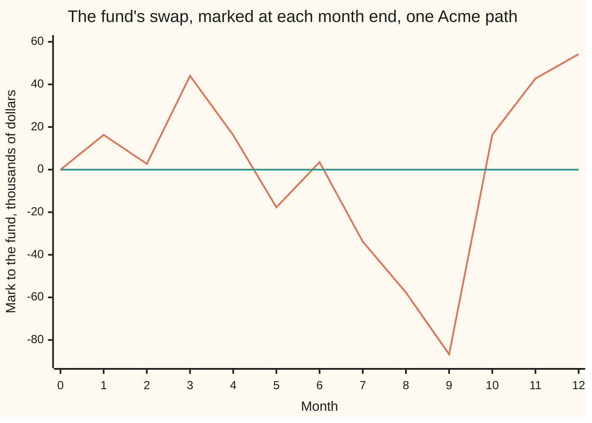

# Total return swaps: owning a share's return without owning the share, and the funding spread that prices it

[Syllabus](../../../SYLLABUS.md) → [Financial mathematics](../README.md) → [Equity financing - borrow, total return swaps and dividends](../README.md#s52) → Total return swaps

---

## General Overview

A fund wants 1,000,000 dollars of Acme for one year. Acme trades at 100, so that is 10,000 shares. The fund does not want to buy them. Buying means finding the cash, and holding the shares on its own books.

So it signs a **total return swap** with a dealer (a bank that trades with clients). Every quarter, on a **reset date** when cash changes hands and the swap restarts, the dealer pays the fund what 10,000 Acme shares earned: the change in their price plus any dividends. The fund pays interest on the shares' value at the start of the quarter, at SOFR plus a fixed **spread**. SOFR is the Secured Overnight Financing Rate, the dollar market's floating rate, here 5 percent. The fund ends each quarter exactly as if it had bought the shares with borrowed money.

The dealer does not guess where Acme goes. It buys the 10,000 shares itself, borrows the 1,000,000 dollars at SOFR plus 0.40 percent, and lends the shares to short sellers (traders who sell borrowed shares) for a **borrow fee** of 1 percent a year. Whatever Acme does, the shares cover what the dealer owes the fund. So the spread only has to cover the net cost of this **hedge** (the trades that offset what the dealer owes): 0.40 percent of funding less 1 percent of fee. The fair spread, this dealer's break-even, is **SOFR minus 0.60 percent**.

Three months later Acme is at 105 and has paid a 0.50 dividend. The fund is owed 50,000 of price gain plus 5,000 of dividends, less 11,000 of interest: **44,000**. That is the swap's mark (its value if closed today) on the reset date. Once the 44,000 is paid, the swap restarts at 1,050,000 dollars and is worth zero again.

**A total return swap is a share bought with borrowed money, put into one contract: its fair spread is the dealer's funding spread minus the borrow fee its hedge shares earn, and between resets it is worth the gain since the last reset less the interest owed.**

**What kind of fact this is:** a theorem, proved on this card in Why it works, inside the market set out under When it holds. It holds path by path: no model of Acme's price is used. The contract is a definition; the funding spread and the borrow fee are market quotes.

### The picture: the mark through the year



The first line is the mark. Months 3, 6, 9 and 12 are reset dates, marked just before the cash changes hands. The second line is zero. Right after each payment the mark falls back to zero, so the line never strays far: the swap only ever holds one quarter's gain or loss. The path is traced in "How the mark moves between resets".

---

## The formula

Two results. The first prices the swap when it is signed. The second marks it on any later day.

```math
s^{*} = f - b
```

**Read it aloud:** the fair spread, the dealer's break-even, is its funding spread over SOFR, minus the borrow fee the hedge shares earn when lent out.

```math
V_t = \frac{n\,S_t\,\bigl(1 + \tau\,(L_t + s^{*})\bigr) + C - N_{i-1}\,\bigl(1 + \alpha\,(L_i + s)\bigr)}{1 + L_t\,\tau}
```

**Read it aloud:** the shares' value today, carried to the next reset at the fair financing rate, plus dividends already received, less the reset notional and its interest, all brought back to today at SOFR.

| Symbol | Plain meaning | In our example | Push it up and the answer… |
| --- | --- | --- | --- |
| $`n`$ | the number of shares the swap is written on | 10,000 | every dollar figure scales with it |
| $`S_t`$, $`S_{i-1}`$, $`S_i`$ | Acme's price today, at the last reset, and at the next reset | 105 at three months; 100 at the start; 105 at the first reset | $`S_t`$ up: the mark rises a dollar per share |
| $`i`$, $`N_{i-1}`$ | the quarter now running, and its **reset notional** $`n S_{i-1}`$: the shares' value at the last reset | quarter 1; 1,000,000 dollars | the fund owes more interest and gets less gain |
| $`\alpha`$, $`\tau`$ | the quarter's length in years, and the years left until the next reset | 0.25; 0 on the reset date | — |
| $`L_i`$, $`L_t`$ | SOFR fixed for quarter $`i`$, and SOFR from today to the next reset | 5 percent; 5 percent | $`L_i`$ up: more interest owed, so the mark falls |
| $`f`$ | the dealer's **funding spread**: what it pays above SOFR to borrow | 0.40 percent | $`s^{*}`$ rises one for one |
| $`b`$ | the **borrow fee**: what short sellers pay a year to borrow Acme, as a fraction of its value | 1 percent | $`s^{*}`$ falls one for one |
| $`s^{*}`$ | the fair spread on a swap signed today | −0.60 percent | — it is the answer |
| $`s`$ | the spread written into this swap, fixed for its life | −0.60 percent | the fund pays more: its mark falls |
| $`C`$ | dividends Acme has paid since the last reset, held to be paid over at the reset | 5,000 dollars on the reset date | the mark rises one for one |
| $`D_i`$ | dividends per share paid over quarter $`i`$ | 0.50 dollars | the fund receives more, and the dealer's hedge pays it over |
| $`V_t`$ | the mark: the swap's value to the fund today | 44,000 dollars | — it is the answer |

A **basis point** is 0.01 percent, so −0.60 percent is "SOFR minus 60 basis points". On a reset date $`\tau = 0`$ and the formula is plain addition: 1,050,000 + 5,000 − 1,011,000 = 44,000.

### When it holds

- **The dealer can hold the hedge, borrow at SOFR plus $`f`$, and lend the shares at $`b`$.** Step 1 runs on these three trades. Here $`f`$ is what the dealer pays for cash the shares cannot raise themselves: a repo haircut, balance-sheet charges, or shares lent against bonds rather than cash. A hedge fully financed by repo at Acme's repo rate ([Stock borrow and repo](01-stock-borrow-repo-and-the-equity-forward.md)) drops $`f`$ out, and the fair spread is $`-b`$, −1.00 percent. A dealer that cannot lend the shares out earns no fee, so for that dealer the fair spread is $`f`$ itself.
- **The fee and the funding spread stay where they were.** The spread $`s`$ is fixed for the swap's life, but $`b`$ is not. If Acme becomes hard to borrow and the fee jumps to 5 percent, a new swap prices at SOFR minus 4.60 percent. The old one still charges minus 0.60, so every quarter left now costs the fund too much, and the mark must carry that gap.
- **Dividends pass through in full.** Many cross-border swaps pass on only the dividend left after withholding tax. The dealer then keeps part of each dividend, and the fair spread drops by what it keeps.
- **Interest and the borrow fee are simple, on the reset notional, with SOFR known at the start of the quarter.** Real dollar swaps count actual days over 360 and compound SOFR over the quarter, known only at its end ([Money markets](../02-Curves/03-money-market-instruments-and-sofr.md)). If the dealer's loan floats the same way, the cancellation in Step 2 is unchanged. Only the cents move. A real stock loan charges its fee on the shares' value each day. The fee leg then moves with Acme's path, and Step 2 leaves a small residue: the fee times the price change over the quarter.
- **Both sides pay.** The 44,000 is owed, not banked, until the reset. Swaps like this are collateralised: cash is posted daily against the mark, so a default costs one day's move, not a quarter's.

---

## Why it works

### Step 0: the fund's payoff can be built from shares and a loan

Each quarter the fund receives what 10,000 shares earn and pays interest on what they cost at the reset. That is exactly the cash of a simple trade. Buy the shares at the reset with borrowed money, keep the dividends, sell at the next reset, repay the loan.

The dealer runs that trade itself and hands the result to the fund. Whatever Acme does, the dealer's shares pay what the dealer owes. So the swap's price is not a view on Acme. It is the cost of the dealer's copy.

### Step 1: the dealer's quarter, one item at a time

Quarter 1, with Acme going from 100 to 105 and paying a 0.50 dividend. The dealer's cash on the reset date:

| Item | Cash to the dealer |
| --- | --- |
| sell the 10,000 shares at 105 | +1,050,000 |
| dividends: 0.50 a share, passed back by the share borrower | +5,000 |
| borrow fee: 1 percent a year on 1,000,000 for a quarter | +2,500 |
| repay the loan: 1,000,000 at 5.40 percent for a quarter | −1,013,500 |
| pay the fund: price gain plus dividends | −55,000 |
| receive from the fund: SOFR minus 0.60 percent on 1,000,000 for a quarter | +11,000 |
| **net** | **0** |

The dealer bought the shares with borrowed money, so it started the quarter with nothing of its own. It ends with nothing. Its hedge book (shares, dividends, fee and loan) holds exactly 44,000, the amount it owes the fund.

### Step 2: everything that depends on Acme cancels

Write the same six items with letters. The shares are sold for $`n S_i`$, and the fund is paid $`n(S_i - S_{i-1})`$ plus the dividends. Acme's price at the end, and the dividend, appear once with a plus and once with a minus. What survives is the interest and the fee on the reset notional:

```math
\text{dealer's net} = N_{i-1}\,\alpha\,(s - f + b)
```

This is zero for every Acme price and every SOFR fixing exactly when $`s = f - b`$. Any other spread leaves the dealer a sure profit or a sure loss each quarter, from a position that cost nothing. Competition between dealers removes it.

The check runs the ledger item by item on 2,000 random Acme paths, with random dividends and random SOFR fixings. At the fair spread the dealer's worst result is 0.0000 dollars. At 0.10 percent above it, the dealer gains exactly $`N_{i-1} \times 0.25 \times 0.001`$ a quarter, on every path. Bisection on the ledger alone, with no formula, finds the fair spread at −0.6000 percent.

<details>
<summary>The algebra of the cancellation</summary>

The six items, in order: shares sold, dividends, fee, loan repaid, paid to the fund, received from the fund. With $`D_i`$ the dividends per share over the quarter:

$`\displaystyle n S_i + n D_i + N_{i-1}\alpha b - N_{i-1}\bigl(1 + \alpha(L_i + f)\bigr) - \bigl(n(S_i - S_{i-1}) + n D_i\bigr) + N_{i-1}\alpha(L_i + s).`$

The terms in $`S_i`$ and $`D_i`$ cancel. Then $`n S_{i-1} = N_{i-1}`$ cancels the repaid principal, and the SOFR interest $`N_{i-1}\alpha L_i`$ cancels too. What is left is $`N_{i-1}\alpha(b - f + s)`$.

Nothing here assumed how Acme moves, or how SOFR moves. The identity holds for each quarter separately, so it holds for the sum over all four.

</details>

### Step 3: quarters not yet started are worth nothing

On each reset date a fresh quarter begins on the new notional, at the fair spread. By Step 2 it is worth zero to both sides on that day, whatever Acme's price is then. Something worth zero in every possible future is worth zero now.

So only the quarter now running carries value. This is the equity version of a fact from [Interest rate swaps](../28-Swaps/01-interest-rate-swaps.md): a floating-rate note is worth its face on every reset date. Here the share plus its financing is worth its notional on every reset date.

### Step 4: between resets, the running quarter is an old forward

Between resets the fund is due $`n S_i`$ plus dividends at the next reset, and owes $`N_{i-1}(1 + \alpha(L_i + s))`$, a figure fixed at the last reset. The second is known. The first is not.

Price the unknown by copying it. A new dealer taking over today buys $`n`$ shares at $`S_t`$, borrows the cost at $`L_t + f`$ for $`\tau`$ years, and lends the shares at $`b`$. At the reset its shares deliver $`n S_i`$ plus the dividends, and it owes $`n S_t(1 + \tau(L_t + f - b))`$. So the unknown leg is worth that fixed amount, due at the reset.

Both legs are now fixed sums due on the same day. Their gap, brought back to today at SOFR, is the mark. It is SOFR, not the dealer's own rate, because the swap is collateralised: cash posted against the mark earns SOFR, so a fixed sum due at the reset is worth its SOFR-discounted value. This is the shape of [An old forward](../03-Contracts%20and%20No-Arbitrage/04-forward-value-after-inception.md): today's forward price less the locked price, discounted. The forward here is on Acme's total return, financed at SOFR plus $`s^{*}`$.

The check also runs this takeover hedge item by item, from Acme at 107 in month 4 to 100 random prices at the reset. On every one, the hedge's result matches the mark to 0.0000 dollars.

### Step 5: the same trade as the shelf's forward

With $`f = 0`$ the fair spread is minus the fee, so the fund finances Acme at SOFR minus 1 percent. That is the repo rate on [Stock borrow and repo](01-stock-borrow-repo-and-the-equity-forward.md). Carried for one year, with continuous compounding and the 2 percent dividend yield, it gives a forward of 102.0201, the shelf's forward. A rate of 5 percent with no fee would give 103.0455. A total return swap and a forward are the same financed position. The swap settles every quarter. The forward settles once, at the end.

---

## Worked numbers, by hand

The fund's swap: $`n`$ = 10,000 shares, Acme at 100, SOFR 5 percent, $`f`$ = 0.40 percent, $`b`$ = 1 percent, quarterly resets, $`\alpha`$ = 0.25.

| Step | Arithmetic | Value |
| --- | --- | --- |
| fair spread | $`0.40\% - 1.00\%`$ | −0.60 percent |
| reset notional | $`10{,}000 \times 100`$ | 1,000,000.00 |
| price return, quarter 1 | $`10{,}000 \times (105 - 100)`$ | 50,000.00 |
| dividends, quarter 1 | $`10{,}000 \times 0.50`$ | 5,000.00 |
| funding leg | $`1{,}000{,}000 \times 0.25 \times (5\% - 0.60\%)`$ | 11,000.00 |
| **mark at three months, before the exchange** | $`50{,}000 + 5{,}000 - 11{,}000`$ | **44,000.00** |
| dealer's hedge book, same day | $`1{,}050{,}000 + 5{,}000 + 2{,}500 - 1{,}013{,}500`$ | 44,000.00 |
| mark after the exchange | new notional 1,050,000, fair spread | 0.00 |
| month 4: Acme 107 carried to the reset | $`1{,}070{,}000 \times (1 + \tfrac{2}{12} \times 4.40\%)`$ | 1,077,846.67 |
| month 4: owed at the reset | $`1{,}050{,}000 \times (1 + 0.25 \times 4.40\%)`$ | 1,061,550.00 |
| month 4: gap at the reset | $`1{,}077{,}846.67 - 1{,}061{,}550.00`$ | 16,296.67 |
| **month 4: mark, between resets** | $`16{,}296.67 / (1 + 0.05 \times \tfrac{2}{12})`$, the divisor 1.0083 | **16,161.98** |

Three months in, the fund is 44,000 dollars ahead, and the dealer's hedge holds exactly that sum to pay it. A month later the fund's gain is 16,161.98: Acme's 2 dollar rise since the reset, less about one month of interest already run up, discounted. The two months still to come cancel, because the shares carried to the reset earn the same rate the fund pays.

### What breaks if you drop a piece

Same swap, same day; correct mark 44,000.00 at the fair spread of −0.60 percent.

| Mistake | Comes out at | What went wrong |
| --- | --- | --- |
| spread set to the dealer's funding only, +0.40 percent | 41,500.00 | the borrow fee the hedge earns was left out, so the fund overpays 2,500 every quarter |
| dividends left out of the equity leg | 39,000.00 | a total return swap pays price return plus dividends; price return alone is a different swap |
| funding leg forgotten | 55,000.00 | the swap's gain counted, the loan it contains ignored |
| the 44,000 kept as the swap's value after it is paid | 44,000.00 (right: 0.00) | the cash has moved; counting it again double-counts the quarter |

Every number in the table is printed by both checks.

---

## How the mark moves between resets

The mark swings with Acme inside each quarter and snaps to zero at each reset. One Acme path, marked at every month end, with a 0.50 dividend on each reset date:

| Month | Acme | Reset notional | Mark to the fund | Cash paid at the reset |
| --- | --- | --- | --- | --- |
| 0 | 100 | 1,000,000.00 | 0.00 | — |
| 1 | 102 | 1,000,000.00 | 16,343.80 | — |
| 2 | 101 | 1,000,000.00 | 2,692.12 | — |
| 3 | 105 | 1,000,000.00 | 44,000.00 | 44,000.00 |
| 4 | 107 | 1,050,000.00 | 16,161.98 | — |
| 5 | 104 | 1,050,000.00 | −17,663.07 | — |
| 6 | 106 | 1,050,000.00 | 3,450.00 | 3,450.00 |
| 7 | 103 | 1,060,000.00 | −33,824.79 | — |
| 8 | 101 | 1,060,000.00 | −57,716.18 | — |
| 9 | 98 | 1,060,000.00 | −86,660.00 | −86,660.00 |
| 10 | 100 | 980,000.00 | 16,416.53 | — |
| 11 | 103 | 980,000.00 | 42,818.26 | — |
| 12 | 104 | 980,000.00 | 54,220.00 | 54,220.00 |

Two things move the mark. Acme's move since the last reset moves it 10,000 dollars per dollar of share price. The interest owed builds up steadily: 11,000 dollars over the first quarter. Month 2 shows both: Acme is 1 dollar above the reset price, worth 10,000, but most of the quarter's interest is already owed, so the mark is only 2,692.12.

The reset notional follows Acme. After Acme falls to 98 in month 9, the fund pays 86,660 and the next quarter starts on 980,000 dollars. The gain from 98 back to 104 is then earned on 980,000, not on the original 1,000,000.

The cash at the four resets, one █ per 5,000 dollars:

```
reset    cash to the fund, one █ = 5,000 dollars
month 3  (in)   █████████              44,000.00
month 6  (in)   █                       3,450.00
month 9  (out)  █████████████████     -86,660.00
month 12 (in)   ███████████            54,220.00
```

Over the year the fund receives 15,010.00 dollars in total. That is Acme's rise from 100 to 104 plus four dividends, less a year of interest at SOFR minus 0.60 percent on the changing notional. It is what the fund would have made buying the shares with a loan at that rate, reset each quarter to the shares' value.

---

## Code, from first principles, and it actually runs

Both scripts value the swap three independent ways. Road one is the closed forms: the spread $`f - b`$ and the mark. Road two is the dealer's hedge ledger, cash item by item, run on 2,000 random paths, with bisection on that ledger finding the spread with no formula. Road three is the dealer's hedge book, on the reset date and in a takeover from month 4, against the mark. Both scripts use the same small random-number generator, written out, so their outputs match line for line.

### Python

```python
# Total return swap on Acme -- the check behind the card.  Standard library only.
# Road 1: the closed forms (fair spread f - b, and the mark).  Road 2: the dealer's hedge
# ledger, cash item by item, on 2,000 random paths, plus bisection on that ledger for the
# spread.  Road 3: the dealer's hedge book at the reset, against the mark.
from math import exp

n, S0 = 10_000.0, 100.0                 # shares, Acme's price at the start: notional 1,000,000
a, L = 0.25, 0.05                       # quarter as a year fraction; SOFR, simple, flat
f, b = 0.004, 0.01                      # dealer's funding spread over SOFR; borrow fee
d = 0.50                                # Acme's dividend per share, paid on each reset date
s_fair = f - b                          # road 1: the fair spread

def hedge_quarter(Sa, Sb, div, Lq, s, fee=b, fund=f):
    # Road 2: the dealer's quarter, one cash item at a time; returns its net cash at the end.
    loan = n * Sa                       # borrow at SOFR + f to buy n shares at the reset
    cash = n * Sb + n * div             # sell the shares at the next reset; dividends received
    cash += n * Sa * a * fee            # fee for lending the shares out over the quarter
    cash -= loan * (1 + a * (Lq + fund))  # repay the loan with interest
    cash -= n * (Sb - Sa) + n * div     # pay the receiver: price return plus dividends
    cash += loan * a * (Lq + s)         # collect the funding leg: SOFR + s on the reset notional
    return cash

def mark(St, tau, N_prev, s, cash_now=0.0):
    # Road 1: value to the receiver, tau years before the next reset.
    owed = N_prev * (1 + a * (L + s))   # the funding leg plus the reset notional, due at the reset
    return (n * St * (1 + tau * (L + s_fair)) + cash_now - owed) / (1 + L * tau)

M = (1 << 64) - 1
state = 88172645463325252
def rnd():                              # xorshift64, the same generator as the Rust check
    global state
    state ^= (state << 13) & M; state ^= state >> 7; state ^= (state << 17) & M
    return (state >> 11) / 9007199254740992.0

def random_path():
    S, out = S0, []
    for _ in range(4):
        z = sum(rnd() for _ in range(12)) - 6.0          # roughly a bell-curve draw
        S1 = S * exp(0.10 * z)                           # 20% a year volatility, one quarter
        out.append((S, S1, rnd(), 0.03 + 0.04 * rnd()))  # dividend 0 to 1, SOFR fixing 3% to 7%
        S = S1
    return out

worst_fair, worst_leak, first = 0.0, 0.0, None
for _ in range(2000):
    p = random_path()
    first = first or p
    worst_fair = max(worst_fair, abs(sum(hedge_quarter(*q, s_fair) for q in p)))
    leak = sum(hedge_quarter(*q, s_fair + 0.001) for q in p)
    worst_leak = max(worst_leak, abs(leak - sum(n * q[0] * a * 0.001 for q in p)))
lo, hi = -0.05, 0.05                    # bisection on the ledger of the first path
for _ in range(100):
    mid = 0.5 * (lo + hi)
    if sum(hedge_quarter(*q, mid) for q in first) < 0: lo = mid
    else: hi = mid
s_bisect = 0.5 * (lo + hi)

N1, S3 = n * S0, 105.0                  # the 3-month reset: Acme at 105, dividend just paid
v3 = mark(S3, 0.0, N1, s_fair, n * d)
book = n * S3 + n * d + N1 * a * b - N1 * (1 + a * (L + f))   # road 3: the dealer's hedge book
v4, tau4 = mark(107.0, 2 / 12, n * S3, s_fair), 2 / 12   # month 4: a new dealer hedges from 107
worst4 = 0.0
for _ in range(100):                    # its book at the reset, item by item, for random endings
    S6, div = 107.0 * exp(0.1 * (rnd() - 0.5)), rnd()
    book4 = n * S6 + n * div + n * 107.0 * tau4 * b - n * 107.0 * (1 + tau4 * (L + f))
    book4 += -(n * (S6 - S3) + n * div) + n * S3 * a * (L + s_fair)
    worst4 = max(worst4, abs(book4 + v4 * (1 + L * tau4)))
F_house = S0 * exp((L + (0.0 - b) - 0.02) * 1.0)               # f = 0: financing at SOFR - 1%
F_noborrow = S0 * exp((L - 0.02) * 1.0)
rows = [
    ("fair spread f - b, %", 100 * s_fair), ("fair spread by bisection on the ledger, %", 100 * s_bisect),
    ("worst |dealer P&L| at fair spread, 2000 paths", worst_fair),
    ("worst |leak - predicted| at fair + 0.10%", worst_leak),
    ("3m: price return", n * (S3 - S0)), ("3m: dividends", n * d),
    ("3m: funding leg SOFR + s", N1 * a * (L + s_fair)),
    ("3m: mark before the exchange", v3), ("3m: dealer's hedge book", book),
    ("3m hedge: fee for lending the shares", N1 * a * b), ("3m hedge: loan repaid", N1 * (1 + a * (L + f))),
    ("3m: mark after the exchange", mark(S3, a, n * S3, s_fair)),
    ("4m: Acme 107 carried to the reset", n * 107.0 * (1 + 2 / 12 * (L + s_fair))),
    ("4m: owed at the reset", n * S3 * (1 + a * (L + s_fair))),
    ("4m: gap at the reset", n * 107.0 * (1 + 2 / 12 * (L + s_fair)) - n * S3 * (1 + a * (L + s_fair))),
    ("4m: SOFR growth to the reset", 1 + L * 2 / 12),
    ("4m: mark, the gap discounted", v4), ("4m: worst |takeover hedge - mark|", worst4),
    ("wrong: spread = dealer funding only", mark(S3, 0.0, N1, f, n * d)),
    ("wrong: dividends left out", mark(S3, 0.0, N1, s_fair)),
    ("wrong: funding leg forgotten", n * (S3 - S0) + n * d),
    ("house: 1y forward financed at SOFR - 1%", F_house), ("house: 1y forward, no borrow fee", F_noborrow),
    ("try: borrow fee 0.25%, fair spread %", 100 * (f - 0.0025)),
    ("try: borrow fee 5%, fair spread %", 100 * (f - 0.05)),
    ("try: dealer funds at SOFR, fair spread %", 100 * (0.0 - b)),
    ("try: Acme at 95 at 3m, mark", mark(95.0, 0.0, N1, s_fair, n * d)),
]
for name, v in rows:
    print(f"{name:<46} {v:>14.4f}")

print()
print("month  Acme  quarter-start notional  mark to the receiver  cash paid at reset")
path = [100, 102, 101, 105, 107, 104, 106, 103, 101, 98, 100, 103, 104]
Nq, total, marks = n * S0, 0.0, []
for m in range(13):
    reset = m > 0 and m % 3 == 0
    St, tau = float(path[m]), 0.0 if reset else (3 - m % 3) / 12.0
    v = mark(St, tau, Nq, s_fair, n * d if reset else 0.0)
    marks.append(v)
    paid = v if reset else 0.0
    total += paid
    print(f"{m:>5} {St:5.0f} {Nq:>23,.2f} {v:>21,.2f} {paid:>19,.2f}")
    if reset: Nq = n * St
print(f"cash to the receiver over the year {total:,.2f}")
print("chart, mark in thousands " + " ".join(f"{v / 1000:.1f}" for v in marks))

assert abs(s_bisect - s_fair) < 1e-12,  "bisection on the hedge ledger lands on f - b"
assert worst_fair < 1e-6,               "the hedge at the fair spread is flat on every path"
assert worst_leak < 1e-6,               "an off-market spread leaks exactly n S a (s - s*) a quarter"
assert abs(v3 - book) < 1e-6,           "the mark at the reset equals the dealer's hedge book"
assert worst4 < 1e-6,                   "between resets: the takeover hedge pays the mark, path by path"
assert abs(v3 - 44_000.0) < 1e-6,       "the card's worked number"
assert abs(F_house - 102.0201) < 1e-4,  "the shelf's house forward"
print("ALL CHECKS PASS")
```

**Ran 2026-11-23 on macOS, Python 3.14.10, standard library only. All checks passed. Output, pasted from the run:**

```
fair spread f - b, %                                  -0.6000
fair spread by bisection on the ledger, %             -0.6000
worst |dealer P&L| at fair spread, 2000 paths          0.0000
worst |leak - predicted| at fair + 0.10%               0.0000
3m: price return                                   50000.0000
3m: dividends                                       5000.0000
3m: funding leg SOFR + s                           11000.0000
3m: mark before the exchange                       44000.0000
3m: dealer's hedge book                            44000.0000
3m hedge: fee for lending the shares                2500.0000
3m hedge: loan repaid                            1013500.0000
3m: mark after the exchange                            0.0000
4m: Acme 107 carried to the reset                1077846.6667
4m: owed at the reset                            1061550.0000
4m: gap at the reset                               16296.6667
4m: SOFR growth to the reset                           1.0083
4m: mark, the gap discounted                       16161.9835
4m: worst |takeover hedge - mark|                      0.0000
wrong: spread = dealer funding only                41500.0000
wrong: dividends left out                          39000.0000
wrong: funding leg forgotten                       55000.0000
house: 1y forward financed at SOFR - 1%              102.0201
house: 1y forward, no borrow fee                     103.0455
try: borrow fee 0.25%, fair spread %                   0.1500
try: borrow fee 5%, fair spread %                     -4.6000
try: dealer funds at SOFR, fair spread %              -1.0000
try: Acme at 95 at 3m, mark                       -56000.0000

month  Acme  quarter-start notional  mark to the receiver  cash paid at reset
    0   100            1,000,000.00                  0.00                0.00
    1   102            1,000,000.00             16,343.80                0.00
    2   101            1,000,000.00              2,692.12                0.00
    3   105            1,000,000.00             44,000.00           44,000.00
    4   107            1,050,000.00             16,161.98                0.00
    5   104            1,050,000.00            -17,663.07                0.00
    6   106            1,050,000.00              3,450.00            3,450.00
    7   103            1,060,000.00            -33,824.79                0.00
    8   101            1,060,000.00            -57,716.18                0.00
    9    98            1,060,000.00            -86,660.00          -86,660.00
   10   100              980,000.00             16,416.53                0.00
   11   103              980,000.00             42,818.26                0.00
   12   104              980,000.00             54,220.00           54,220.00
cash to the receiver over the year 15,010.00
chart, mark in thousands 0.0 16.3 2.7 44.0 16.2 -17.7 3.5 -33.8 -57.7 -86.7 16.4 42.8 54.2
ALL CHECKS PASS
```

### Rust

```rust
// Total return swap on Acme -- the same check as equity_swaps_and_total_return_swaps_check.py.
// Standard library only, no crates.  Road 1: the closed forms (fair spread f - b, and the mark).
// Road 2: the dealer's hedge ledger, cash item by item, on 2,000 random paths, plus bisection on
// that ledger for the spread.  Road 3: the dealer's hedge book at the reset, against the mark.
const N_SH: f64 = 10_000.0; // shares
const S0: f64 = 100.0; // Acme's price at the start: notional 1,000,000
const A: f64 = 0.25; // quarter as a year fraction
const L: f64 = 0.05; // SOFR, simple, flat
const F: f64 = 0.004; // dealer's funding spread over SOFR
const B: f64 = 0.01; // borrow fee
const D: f64 = 0.50; // Acme's dividend per share, paid on each reset date
const S_FAIR: f64 = F - B; // road 1: the fair spread

// Road 2: the dealer's quarter, one cash item at a time; returns its net cash at the end.
fn hedge_quarter(sa: f64, sb: f64, div: f64, lq: f64, s: f64) -> f64 {
    let loan = N_SH * sa; // borrow at SOFR + f to buy n shares at the reset
    let mut cash = N_SH * sb + N_SH * div; // sell the shares at the next reset; dividends received
    cash += N_SH * sa * A * B; // fee for lending the shares out over the quarter
    cash -= loan * (1.0 + A * (lq + F)); // repay the loan with interest
    cash -= N_SH * (sb - sa) + N_SH * div; // pay the receiver: price return plus dividends
    cash += loan * A * (lq + s); // collect the funding leg: SOFR + s on the reset notional
    cash
}

// Road 1: value to the receiver, tau years before the next reset.
fn mark(st: f64, tau: f64, n_prev: f64, s: f64, cash_now: f64) -> f64 {
    let owed = n_prev * (1.0 + A * (L + s)); // the funding leg plus the reset notional
    (N_SH * st * (1.0 + tau * (L + S_FAIR)) + cash_now - owed) / (1.0 + L * tau)
}

struct Rng(u64);
impl Rng {
    fn next(&mut self) -> f64 { // xorshift64, the same generator as the Python check
        self.0 ^= self.0 << 13;
        self.0 ^= self.0 >> 7;
        self.0 ^= self.0 << 17;
        (self.0 >> 11) as f64 / 9007199254740992.0
    }
}

fn random_path(rng: &mut Rng) -> Vec<(f64, f64, f64, f64)> {
    let (mut s, mut out) = (S0, Vec::new());
    for _ in 0..4 {
        let mut z = 0.0;
        for _ in 0..12 { z += rng.next(); } // roughly a bell-curve draw
        let s1 = s * (0.10 * (z - 6.0)).exp(); // 20% a year volatility, one quarter
        let div = rng.next();
        let lq = 0.03 + 0.04 * rng.next(); // dividend 0 to 1, SOFR fixing 3% to 7%
        out.push((s, s1, div, lq));
        s = s1;
    }
    out
}

fn ledger(p: &[(f64, f64, f64, f64)], s: f64) -> f64 {
    p.iter().map(|q| hedge_quarter(q.0, q.1, q.2, q.3, s)).sum()
}

fn commas(v: f64) -> String { // 1234567.891 -> 1,234,567.89
    let t = format!("{:.2}", v.abs());
    let (int, frac) = t.split_at(t.len() - 3);
    let mut g = String::new();
    for (i, c) in int.chars().enumerate() {
        if i > 0 && (int.len() - i) % 3 == 0 { g.push(','); }
        g.push(c);
    }
    format!("{}{}{}", if v < 0.0 && t != "0.00" { "-" } else { "" }, g, frac)
}

fn main() {
    let mut rng = Rng(88172645463325252);
    let (mut worst_fair, mut worst_leak) = (0.0_f64, 0.0_f64);
    let mut first: Vec<(f64, f64, f64, f64)> = Vec::new();
    for k in 0..2000 {
        let p = random_path(&mut rng);
        if k == 0 { first = p.clone(); }
        worst_fair = worst_fair.max(ledger(&p, S_FAIR).abs());
        let leak = ledger(&p, S_FAIR + 0.001);
        let predicted: f64 = p.iter().map(|q| N_SH * q.0 * A * 0.001).sum();
        worst_leak = worst_leak.max((leak - predicted).abs());
    }
    let (mut lo, mut hi) = (-0.05_f64, 0.05_f64); // bisection on the ledger of the first path
    for _ in 0..100 {
        let mid = 0.5 * (lo + hi);
        if ledger(&first, mid) < 0.0 { lo = mid; } else { hi = mid; }
    }
    let s_bisect = 0.5 * (lo + hi);

    let (n1, s3) = (N_SH * S0, 105.0_f64); // the 3-month reset: Acme at 105, dividend just paid
    let v3 = mark(s3, 0.0, n1, S_FAIR, N_SH * D);
    let book = N_SH * s3 + N_SH * D + n1 * A * B - n1 * (1.0 + A * (L + F)); // road 3
    let (tau4, v4) = (2.0 / 12.0, mark(107.0, 2.0 / 12.0, N_SH * s3, S_FAIR, 0.0)); // month 4
    let mut worst4 = 0.0_f64; // a new dealer hedges from 107; its book at the reset, item by item
    for _ in 0..100 {
        let s6 = 107.0 * (0.1 * (rng.next() - 0.5)).exp();
        let div = rng.next();
        let mut book4 = N_SH * s6 + N_SH * div + N_SH * 107.0 * tau4 * B - N_SH * 107.0 * (1.0 + tau4 * (L + F));
        book4 += -(N_SH * (s6 - s3) + N_SH * div) + N_SH * s3 * A * (L + S_FAIR);
        worst4 = worst4.max((book4 + v4 * (1.0 + L * tau4)).abs());
    }
    let f_house = S0 * ((L + (0.0 - B) - 0.02) * 1.0).exp(); // f = 0: financing at SOFR - 1%
    let f_noborrow = S0 * ((L - 0.02) * 1.0).exp();
    let carried = N_SH * 107.0 * (1.0 + 2.0 / 12.0 * (L + S_FAIR));
    let owed4 = N_SH * s3 * (1.0 + A * (L + S_FAIR));
    let rows: Vec<(&str, f64)> = vec![
        ("fair spread f - b, %", 100.0 * S_FAIR), ("fair spread by bisection on the ledger, %", 100.0 * s_bisect),
        ("worst |dealer P&L| at fair spread, 2000 paths", worst_fair),
        ("worst |leak - predicted| at fair + 0.10%", worst_leak),
        ("3m: price return", N_SH * (s3 - S0)), ("3m: dividends", N_SH * D),
        ("3m: funding leg SOFR + s", n1 * A * (L + S_FAIR)),
        ("3m: mark before the exchange", v3), ("3m: dealer's hedge book", book),
        ("3m hedge: fee for lending the shares", n1 * A * B), ("3m hedge: loan repaid", n1 * (1.0 + A * (L + F))),
        ("3m: mark after the exchange", mark(s3, A, N_SH * s3, S_FAIR, 0.0)),
        ("4m: Acme 107 carried to the reset", carried),
        ("4m: owed at the reset", owed4),
        ("4m: gap at the reset", carried - owed4),
        ("4m: SOFR growth to the reset", 1.0 + L * 2.0 / 12.0),
        ("4m: mark, the gap discounted", v4), ("4m: worst |takeover hedge - mark|", worst4),
        ("wrong: spread = dealer funding only", mark(s3, 0.0, n1, F, N_SH * D)),
        ("wrong: dividends left out", mark(s3, 0.0, n1, S_FAIR, 0.0)),
        ("wrong: funding leg forgotten", N_SH * (s3 - S0) + N_SH * D),
        ("house: 1y forward financed at SOFR - 1%", f_house), ("house: 1y forward, no borrow fee", f_noborrow),
        ("try: borrow fee 0.25%, fair spread %", 100.0 * (F - 0.0025)),
        ("try: borrow fee 5%, fair spread %", 100.0 * (F - 0.05)),
        ("try: dealer funds at SOFR, fair spread %", 100.0 * (0.0 - B)),
        ("try: Acme at 95 at 3m, mark", mark(95.0, 0.0, n1, S_FAIR, N_SH * D)),
    ];
    for (name, v) in &rows { println!("{:<46} {:>14.4}", name, v); }

    println!();
    println!("month  Acme  quarter-start notional  mark to the receiver  cash paid at reset");
    let path = [100.0, 102.0, 101.0, 105.0, 107.0, 104.0, 106.0, 103.0, 101.0, 98.0, 100.0, 103.0, 104.0_f64];
    let (mut nq, mut total, mut marks) = (N_SH * S0, 0.0_f64, Vec::new());
    for m in 0..13usize {
        let reset = m > 0 && m % 3 == 0;
        let (st, tau) = (path[m], if reset { 0.0 } else { (3 - m % 3) as f64 / 12.0 });
        let v = mark(st, tau, nq, S_FAIR, if reset { N_SH * D } else { 0.0 });
        marks.push(v);
        let paid = if reset { v } else { 0.0 };
        total += paid;
        println!("{:>5} {:5.0} {:>23} {:>21} {:>19}", m, st, commas(nq), commas(v), commas(paid));
        if reset { nq = N_SH * st; }
    }
    println!("cash to the receiver over the year {}", commas(total));
    let ch: Vec<String> = marks.iter().map(|v| format!("{:.1}", v / 1000.0)).collect();
    println!("chart, mark in thousands {}", ch.join(" "));

    assert!((s_bisect - S_FAIR).abs() < 1e-12, "bisection on the hedge ledger lands on f - b");
    assert!(worst_fair < 1e-6, "the hedge at the fair spread is flat on every path");
    assert!(worst_leak < 1e-6, "an off-market spread leaks exactly n S a (s - s*) a quarter");
    assert!((v3 - book).abs() < 1e-6, "the mark at the reset equals the dealer's hedge book");
    assert!(worst4 < 1e-6, "between resets: the takeover hedge pays the mark, path by path");
    assert!((v3 - 44_000.0).abs() < 1e-6, "the card's worked number");
    assert!((f_house - 102.0201).abs() < 1e-4, "the shelf's house forward");
    println!("ALL CHECKS PASS");
}
```

**Ran 2026-11-23 on macOS, rustc 1.98.1, no crates. All checks passed. Output, pasted from the run:**

```
fair spread f - b, %                                  -0.6000
fair spread by bisection on the ledger, %             -0.6000
worst |dealer P&L| at fair spread, 2000 paths          0.0000
worst |leak - predicted| at fair + 0.10%               0.0000
3m: price return                                   50000.0000
3m: dividends                                       5000.0000
3m: funding leg SOFR + s                           11000.0000
3m: mark before the exchange                       44000.0000
3m: dealer's hedge book                            44000.0000
3m hedge: fee for lending the shares                2500.0000
3m hedge: loan repaid                            1013500.0000
3m: mark after the exchange                            0.0000
4m: Acme 107 carried to the reset                1077846.6667
4m: owed at the reset                            1061550.0000
4m: gap at the reset                               16296.6667
4m: SOFR growth to the reset                           1.0083
4m: mark, the gap discounted                       16161.9835
4m: worst |takeover hedge - mark|                      0.0000
wrong: spread = dealer funding only                41500.0000
wrong: dividends left out                          39000.0000
wrong: funding leg forgotten                       55000.0000
house: 1y forward financed at SOFR - 1%              102.0201
house: 1y forward, no borrow fee                     103.0455
try: borrow fee 0.25%, fair spread %                   0.1500
try: borrow fee 5%, fair spread %                     -4.6000
try: dealer funds at SOFR, fair spread %              -1.0000
try: Acme at 95 at 3m, mark                       -56000.0000

month  Acme  quarter-start notional  mark to the receiver  cash paid at reset
    0   100            1,000,000.00                  0.00                0.00
    1   102            1,000,000.00             16,343.80                0.00
    2   101            1,000,000.00              2,692.12                0.00
    3   105            1,000,000.00             44,000.00           44,000.00
    4   107            1,050,000.00             16,161.98                0.00
    5   104            1,050,000.00            -17,663.07                0.00
    6   106            1,050,000.00              3,450.00            3,450.00
    7   103            1,060,000.00            -33,824.79                0.00
    8   101            1,060,000.00            -57,716.18                0.00
    9    98            1,060,000.00            -86,660.00          -86,660.00
   10   100              980,000.00             16,416.53                0.00
   11   103              980,000.00             42,818.26                0.00
   12   104              980,000.00             54,220.00           54,220.00
cash to the receiver over the year 15,010.00
chart, mark in thousands 0.0 16.3 2.7 44.0 16.2 -17.7 3.5 -33.8 -57.7 -86.7 16.4 42.8 54.2
ALL CHECKS PASS
```

### Lean

Lean proves the card's three main results on every path, and checks its key numbers exactly.

- Suppose the swap has $`n > 0`$ shares, quarters of length $`\alpha > 0`$, and at least one quarter. Then the dealer's hedge ledger nets to zero on every path exactly when $`s = f - b`$.
- Take any path of Acme prices, dividends and SOFR fixings. Then the dealer's net over all quarters is the sum of $`N_{i-1}\,\alpha\,(s - f + b)`$.
- Take the fair spread $`s^{*} = f - b`$, with $`1 + L_t\,\tau > 0`$. Then the swap's payment at the next reset equals the takeover hedge's result plus the mark $`V_t`$ carried there at SOFR.
- At the fair spread, the quarter 1 ledger nets to zero. At 0.10 percent above it, the dealer gains 250.
- The marks come out exactly: 44,000 at three months, 41,500 and 39,000 for the two mistakes, and −56,000 with Acme at 95.
- The month 4 mark is exactly 1,955,600/121, and the cash at the four resets totals 15,010.

The random paths, the bisection, the other monthly marks and the 102.0201 forward are left to the Python and Rust checks.

```lean
-- Total return swaps: the dealer's hedge ledger leaves it flat on every share-price, dividend and SOFR path exactly when the spread equals its funding spread minus the borrow fee, and between resets a takeover hedge pays the swap's mark carried at SOFR.
import Mathlib.Algebra.BigOperators.Group.Finset.Basic
import Mathlib.Basic.Real.Basic
import Mathlib.Tactic.FieldSimp
import Mathlib.Tactic.Linarith
import Mathlib.Tactic.NormNum
import Mathlib.Tactic.Ring

open Finset

/-- The dealer's cash at the end of one quarter of the swap, item by item, on `n` shares bought
at the reset price `Sa` (reset notional `n Sa`) and worth `Sb` at the next reset, with dividends
`D` per share, SOFR fixing `L`, quarter length `α`, funding spread `f`, borrow fee `b` and swap
spread `s`: sell the shares, receive the dividends, earn the fee for lending the shares, repay the
loan at SOFR plus `f`, pay the fund the price return plus dividends, and receive SOFR plus `s`. -/
def dealerQuarter (n Sa Sb D L α f b s : ℝ) : ℝ :=
  n * Sb + n * D + n * Sa * α * b - n * Sa * (1 + α * (L + f))
    - (n * (Sb - Sa) + n * D) + n * Sa * α * (L + s)

/-- The mark to the fund, `τ` years before the next reset:
`V_t = (n S_t (1 + τ (L_t + s*)) + C - N_{i-1} (1 + α (L_i + s))) / (1 + L_t τ)`. -/
noncomputable def markToFund (n St τ Lt sStar C Nprev α Li s : ℝ) : ℝ :=
  (n * St * (1 + τ * (Lt + sStar)) + C - Nprev * (1 + α * (Li + s))) / (1 + Lt * τ)

/-- The payment the fund receives at the next reset: the price return on `n` shares since the
last reset price `Sprev`, the dividends `C` already paid since that reset, the dividends `n Drest`
still to come, less the funding leg `SOFR + s` on the reset notional `n Sprev`. -/
def swapPayment (n Si Sprev C Drest α Li s : ℝ) : ℝ :=
  n * (Si - Sprev) + C + n * Drest - n * Sprev * α * (Li + s)

/-- A new dealer's takeover hedge, valued at the next reset: buy `n` shares at today's price
`St` with money borrowed at SOFR `Lt` plus `f` for `τ` years, lend them out at fee `b`, collect
the dividends `n Drest` still to come, and sell at the reset price `Si`. -/
def takeoverHedge (n St τ Lt f b Si Drest : ℝ) : ℝ :=
  n * Si + n * Drest + n * St * τ * b - n * St * (1 + τ * (Lt + f))

/-- **The fair spread is the funding spread minus the borrow fee.** A dealer that hedges a total
return swap on `n > 0` shares by buying them with money borrowed at SOFR plus `f` and lending them
out at fee `b`, over `k ≥ 1` quarters of length `α > 0`, ends with zero cash on every path of
positive share prices, dividends and SOFR fixings exactly when the swap spread is `s = f - b`. -/
theorem fair_spread_eq_funding_minus_fee (n α f b s : ℝ) (k : ℕ)
    (hn : 0 < n) (hα : 0 < α) (hk : 0 < k) :
    (∀ S D L : ℕ → ℝ, (∀ i, 0 < S i) →
        ∑ i ∈ range k, dealerQuarter n (S i) (S (i + 1)) (D i) (L i) α f b s = 0)
      ↔ s = f - b := by
  constructor
  · intro h
    have h1 := h (fun _ => 1) (fun _ => 0) (fun _ => 0) (fun _ => one_pos)
    have hq : ∀ i ∈ range k, dealerQuarter n ((fun _ : ℕ => (1 : ℝ)) i) ((fun _ : ℕ => (1 : ℝ)) (i + 1))
        ((fun _ : ℕ => (0 : ℝ)) i) ((fun _ : ℕ => (0 : ℝ)) i) α f b s = n * α * (s - f + b) := by
      intro i _
      simp only [dealerQuarter]
      ring
    rw [sum_congr rfl hq, sum_const, card_range, nsmul_eq_mul] at h1
    have hk' : (k : ℝ) ≠ 0 := by exact_mod_cast hk.ne'
    have h2 : n * α * (s - f + b) = 0 := by
      rcases mul_eq_zero.mp h1 with h3 | h3
      · exact absurd h3 hk'
      · exact h3
    have hnα : n * α ≠ 0 := mul_ne_zero hn.ne' hα.ne'
    rcases mul_eq_zero.mp h2 with h3 | h3
    · exact absurd h3 hnα
    · linarith
  · intro hs S D L _
    apply sum_eq_zero
    intro i _
    simp only [dealerQuarter]
    rw [hs]
    ring

/-- **Everything that depends on the share cancels.** On any path of share prices, dividends and
SOFR fixings, the dealer's hedge ledger over `k` quarters comes to the interest and fee left on
each reset notional: `∑ N_{i-1} α (s - f + b)`, with `N_{i-1} = n S_{i-1}`. -/
theorem dealer_ledger_eq_spread_gap (n α f b s : ℝ) (k : ℕ) (S D L : ℕ → ℝ) :
    ∑ i ∈ range k, dealerQuarter n (S i) (S (i + 1)) (D i) (L i) α f b s
      = ∑ i ∈ range k, n * S i * α * (s - f + b) := by
  apply sum_congr rfl
  intro i _
  simp only [dealerQuarter]
  ring

/-- **Between resets the mark is the takeover hedge's gap.** With the fair spread `s* = f - b`
and SOFR growth `1 + L_t τ` to the next reset, for every reset price `S_i` and every dividend
still to come, the swap's payment to the fund at the reset equals the takeover hedge's result
plus the mark `V_t` carried at SOFR: `payment = hedge + V_t (1 + L_t τ)`. -/
theorem mark_eq_takeover_hedge_gap (n St Sprev τ Lt C α Li f b s Si Drest : ℝ)
    (hgrowth : 0 < 1 + Lt * τ) :
    swapPayment n Si Sprev C Drest α Li s
      = takeoverHedge n St τ Lt f b Si Drest
        + markToFund n St τ Lt (f - b) C (n * Sprev) α Li s * (1 + Lt * τ) := by
  simp only [swapPayment, takeoverHedge, markToFund]
  rw [div_mul_cancel₀ _ hgrowth.ne']
  ring

/-- The card's fair spread: funding 0.40 percent less a 1 percent fee is -0.60 percent. -/
example : (4 / 1000 : ℝ) - 1 / 100 = -6 / 1000 := by norm_num

/-- Quarter 1 of the dealer's ledger (Acme 100 to 105, dividend 0.50) nets to zero at the fair spread. -/
example : dealerQuarter 10000 100 105 (1 / 2) (1 / 20) (1 / 4) (4 / 1000) (1 / 100) (-6 / 1000) = 0 := by
  norm_num [dealerQuarter]

/-- At 0.10 percent above the fair spread the dealer gains `1,000,000 × 0.25 × 0.001 = 250` a quarter. -/
example : dealerQuarter 10000 100 105 (1 / 2) (1 / 20) (1 / 4) (4 / 1000) (1 / 100) (-5 / 1000) = 250 := by
  norm_num [dealerQuarter]

/-- The mark at three months, before the exchange: `1,050,000 + 5,000 - 1,011,000 = 44,000`. -/
example : markToFund 10000 105 0 (1 / 20) (-6 / 1000) 5000 1000000 (1 / 4) (1 / 20) (-6 / 1000) = 44000 := by
  norm_num [markToFund]

/-- Month 4, Acme at 107, two months to the reset: the mark is `1,955,600 / 121`, about 16,161.98. -/
example : markToFund 10000 107 (1 / 6) (1 / 20) (-6 / 1000) 0 1050000 (1 / 4) (1 / 20) (-6 / 1000)
    = 1955600 / 121 := by
  norm_num [markToFund]

/-- Spread set to the dealer's funding only: the three-month mark comes out at 41,500. -/
example : markToFund 10000 105 0 (1 / 20) (-6 / 1000) 5000 1000000 (1 / 4) (1 / 20) (4 / 1000) = 41500 := by
  norm_num [markToFund]

/-- Dividends left out: the three-month mark comes out at 39,000. -/
example : markToFund 10000 105 0 (1 / 20) (-6 / 1000) 0 1000000 (1 / 4) (1 / 20) (-6 / 1000) = 39000 := by
  norm_num [markToFund]

/-- Acme at 95 after three months: the mark is -56,000. -/
example : markToFund 10000 95 0 (1 / 20) (-6 / 1000) 5000 1000000 (1 / 4) (1 / 20) (-6 / 1000) = -56000 := by
  norm_num [markToFund]

/-- The cash at the four resets on the card's path (44,000, 3,450, -86,660 and 54,220) totals 15,010. -/
example :
    markToFund 10000 105 0 (1 / 20) (-6 / 1000) 5000 1000000 (1 / 4) (1 / 20) (-6 / 1000)
      + markToFund 10000 106 0 (1 / 20) (-6 / 1000) 5000 1050000 (1 / 4) (1 / 20) (-6 / 1000)
      + markToFund 10000 98 0 (1 / 20) (-6 / 1000) 5000 1060000 (1 / 4) (1 / 20) (-6 / 1000)
      + markToFund 10000 104 0 (1 / 20) (-6 / 1000) 5000 980000 (1 / 4) (1 / 20) (-6 / 1000)
      = 15010 := by
  norm_num [markToFund]

#print axioms fair_spread_eq_funding_minus_fee
#print axioms dealer_ledger_eq_spread_gap
#print axioms mark_eq_takeover_hedge_gap
```

**Checked 2026-11-23 on macOS, Lean 4.36.0-rc2, Mathlib v4.36.0-rc2. Every proof is complete and uses only Lean's standard axioms. Output, pasted from the run:**

```
'fair_spread_eq_funding_minus_fee' depends on axioms: [propext, Classical.choice, Quot.sound]
'dealer_ledger_eq_spread_gap' depends on axioms: [propext, Classical.choice, Quot.sound]
'mark_eq_takeover_hedge_gap' depends on axioms: [propext, Classical.choice, Quot.sound]
```

> [!TIP]
> **Try changing**
> Each answer is already in the output, on a `try:` row. (Editing the constants themselves trips the asserts that guard the card's own numbers.)
> - Guess first: an easy-to-borrow share, with a fee of 0.25 percent. The `try: borrow fee 0.25%` row puts 0.0025 in place of `b`. The fair spread turns positive: **SOFR plus 0.15 percent**. Most large shares sit here, which is why typical swap spreads are a little above SOFR.
> - Guess first: a hard-to-borrow share, with a fee of 5 percent. Read the `try: borrow fee 5%` row. The fair spread is **SOFR minus 4.60 percent**. Short sellers pay so much to borrow Acme that the dealer can almost fund the fund for free.
> - Guess first: a dealer that funds at SOFR flat. Read the `try: dealer funds at SOFR` row. The fair spread is **SOFR minus 1.00 percent**, the repo rate of the shelf's first card, and the one-year forward it implies is **102.0201**.
> - Guess first: Acme at 95 after three months. Read the `try: Acme at 95 at 3m` row. The mark is **−56,000.00**: a 50,000 price loss, plus 5,000 of dividends, less 11,000 of interest. The fund pays it at the reset.

---

## The usual mistake

> [!warning]
> **Reading the spread as the dealer's bet against the fund.** It is not. The dealer is hedged: it owns the shares it owes. The spread is a financing price, set by the dealer's funding spread and the borrow fee. A view on Acme does not enter it, so a client's view does not change the spread it is quoted.
>
> Four smaller traps:
> - **Pricing from funding alone.** Charging SOFR plus 0.40 percent ignores the 1 percent the hedge shares earn. The fund overpays 2,500 a quarter, and its three-month mark shows 41,500 instead of 44,000.
> - **Price return for total return.** Without the dividends the three-month mark is 39,000, not 44,000. A price return swap exists, but it is a different contract with a lower fair spread.
> - **Counting paid cash twice.** After the reset the 44,000 sits in the fund's bank account and the swap is worth 0.00. Keeping both on the books double-counts the quarter.
> - **Assuming the spread stays fair.** The spread is fixed for the swap's life; the borrow fee is not. If the fee jumps to 5 percent, a new swap prices at SOFR minus 4.60 percent, and the fund's old swap at minus 0.60 now costs too much every quarter.

---

## Where you meet it in real life

- **Hedge fund financing.** Prime brokers (the dealers that lend to hedge funds) offer swaps as an alternative to margin loans (loans secured on the shares they buy). The fund gets the same return; the dealer holds the shares and earns the borrow fee.
- **Exposure without owning.** A swap gives exposure to a share without holding it. That can avoid transfer taxes on share purchases, or reach a market a fund cannot easily buy into. The shares sit on the dealer's books, not the fund's.
- **Hidden concentration.** Because the shares sit with the dealers, a fund can build a huge position across several dealers without any one of them seeing all of it. In 2021 one family office's swaps on a handful of shares failed this way, and its dealers lost billions unwinding the hedges.
- **Index swaps.** Pension funds and some exchange-traded funds take the return of a whole index by swap rather than buying every share. The pricing is this card's, with the index in place of Acme.
- **Credit total return swaps.** The same contract on a bond or a loan: one side receives the coupons and price changes, the other pays SOFR plus a spread. The financing logic is this card's. Default risk on the bond adds a layer this card does not cover.

> **Say it back**
> A total return swap pays one side a share's price change plus dividends, and the other side SOFR plus a fixed spread on the share's value at each reset. The dealer hedges by buying the shares with borrowed money and lending them out. Everything that depends on the share cancels, so the fair spread is the dealer's funding spread minus the borrow fee. Each quarter starts fresh at zero value, so the swap's mark is only the running quarter: the gain since the last reset less the interest owed, discounted. That running quarter is an old forward on the share's total return.

---

## What this builds on

- [Stock borrow and repo](01-stock-borrow-repo-and-the-equity-forward.md): the borrow fee, the repo rate it sets, and the forward of 102.0201. This card turns that financing rate into a swap spread.
- [An old forward](../03-Contracts%20and%20No-Arbitrage/04-forward-value-after-inception.md): an existing contract is worth the discounted gap between today's forward and the locked price. Between resets, the running quarter of a swap is exactly that.
- [Interest rate swaps](../28-Swaps/01-interest-rate-swaps.md): legs, notional, resets, and the floating-rate note at par on each reset date. The funding leg here is that floating leg plus a spread.

## Where this goes next

- [Dividend futures and swaps](03-dividend-futures-and-dividend-swaps.md): this swap passes the dividends on together with the price. That card trades the dividends alone and reads their market price from options.

The question this card leaves open: when the borrow fee itself moves, what is a fixed-spread swap worth, and how does a dealer hedge a fee nobody can lock in?

---

## Sources

Verified 2026-11-23: every link below resolves to the publisher's page. Each DOI was checked against Crossref for its title and first author.

- Hull, John C. *Options, Futures, and Other Derivatives*, 11th ed. Pearson, 2022. [Publisher page](https://www.pearson.com/en-us/subject-catalog/p/options-futures-and-other-derivatives/P200000005938). The standard treatment of equity swaps, valued as an exchange of a share's return for a floating leg.
- D'Avolio, Gene. "The Market for Borrowing Stock." *Journal of Financial Economics* 66, no. 2–3 (2002): 271–306. [doi:10.1016/S0304-405X(02)00206-4](https://doi.org/10.1016/S0304-405X(02)00206-4). How borrow fees are set, and why most shares are cheap to borrow while a few are very expensive: the source of $`b`$.
- Andersen, Leif, Darrell Duffie, and Yang Song. "Funding Value Adjustments." *Journal of Finance* 74, no. 1 (2019): 145–192. [doi:10.1111/jofi.12739](https://doi.org/10.1111/jofi.12739). Why a dealer's own funding spread enters the prices it charges: the source of $`f`$.
