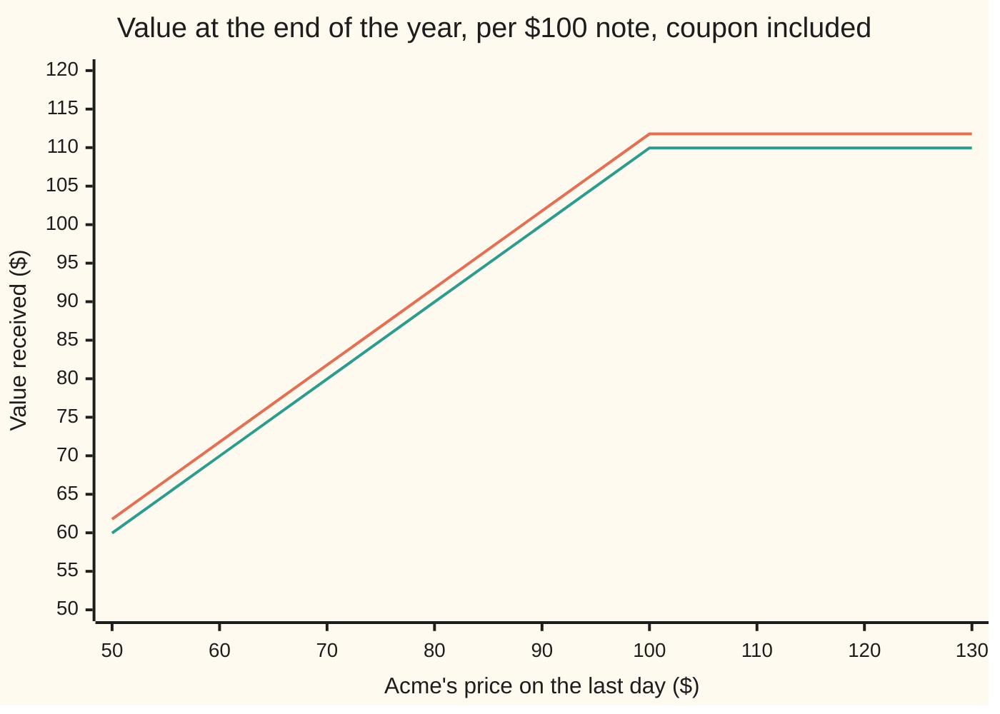
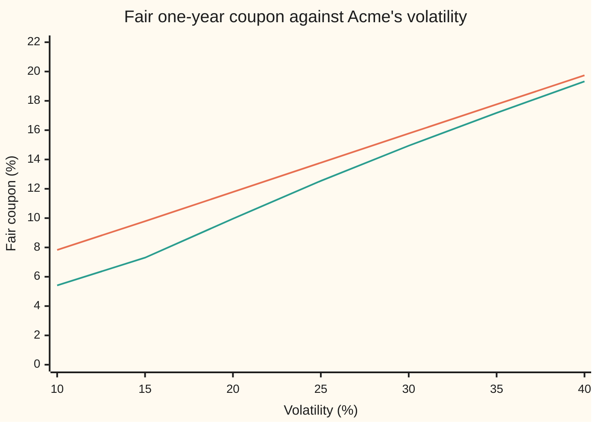

# Reverse convertibles: a bond plus a sold put, and the barrier version that sells a knock-in put

[Syllabus](../../../SYLLABUS.md) → [Financial mathematics](../README.md) → [Equity structured notes - reverse convertibles, autocallables and convertibles](../README.md#s53) → Reverse convertibles

---

## General Overview

Acme shares trade at $100. A bank offers a one-year note on them. The buyer pays $100 today. In a year the note pays a coupon (a fixed interest payment) of **$11.78** in cash, whatever happens. Then:

- **Acme ends at $100 or more.** The buyer gets the $100 back.
- **Acme ends below $100.** The buyer gets one Acme share instead, worth less than $100. At $70 that is $70 plus the $11.78 coupon: $81.78 back for $100 paid.

A safe one-year deposit on this market pays only $5.13 on $100. The extra $6.65 is not a gift. The buyer has quietly sold the bank a **put option**: the right to hand over a share and receive $100 for it. This note is a **reverse convertible**: "convertible" because the bond can turn into shares, "reverse" because the right to convert belongs to the issuer, not to the buyer as in an ordinary convertible bond.

A popular variant adds a safety line, the **barrier**, at $80. The buyer gets shares only if Acme also traded at $80 or lower at some moment during the year. The buyer now sells a cheaper put that exists only after that touch, a **down-and-in put**, so the coupon falls to **$9.96**.

**A reverse convertible is a zero-coupon bond plus a sold put, so its fair coupon is the bond's interest plus the put's price carried to the end of the year; the barrier version sells a down-and-in put instead, and earns a smaller coupon.**

**What kind of fact this is:** the split into a bond and a put is a theorem that holds in any market without free money, proved on this card in Why it works. The two prices, and so the coupons 11.78% and 9.96%, come from the Black-Scholes model: an assumption about how Acme moves, not a law.

### The picture: what the note pays back at the end of the year

Acme's price on the last day runs left to right. Each line is the total cash and share value the buyer holds then, per $100 note, coupon included.



Orange: the plain note. It caps the gain at $111.78 and loses dollar for dollar below $100, exactly like a sold put. Green: the barrier note when Acme touched $80 during the year: the same shape, $1.82 lower (1.821514). When Acme never touched $80, the barrier note pays a flat $109.96 instead. That case has no line, because it can happen only at a final price above $80.

---

## The formula

Everything is per note of face value $`F`$ (the $100 paid in). The note gives $`F/K`$ shares when it converts, one share here.

```math
c = \frac{F - F e^{-rT} + \tfrac{F}{K}\,P}{F e^{-rT}}
```

**Read it aloud:** the fair coupon is the face value, minus the bond's price, plus the put's price, all divided by the bond's price.

The bond's price is $`B = F e^{-rT}`$: today's cost of $`F`$ paid for certain in $`T`$ years. For the barrier note, replace the put $`P`$ by the down-and-in put $`P_{\text{di}}`$:

```math
c_{\text{barrier}} = \frac{F - F e^{-rT} + \tfrac{F}{K}\,P_{\text{di}}}{F e^{-rT}}
```

| Symbol | Plain meaning | In our example | Push it up and the fair coupon… |
| --- | --- | --- | --- |
| $`F`$ | face value: the cash paid in and repaid if no conversion | $100 | stays the same in percent: everything scales |
| $`c`$, $`V`$ | the coupon rate, paid in cash at the end on top of the repayment; $`V`$ is the note's value today at that coupon | 11.78%, or 9.96% with the barrier; $`V = 100`$ at the fair coupon | — |
| $`S`$, $`S_T`$ | Acme's price today, and on the last day, $`T`$ years out | $100, unknown today | $`S`$ up: falls, the put is further from paying |
| $`K`$ | the strike: the price below which the note converts into $`F/K`$ shares | $100 | rises: the sold put is worth more |
| $`H`$, $`\text{touched}`$ | the barrier: the level that must be touched before conversion is allowed; $`\text{touched}`$ is 1 if Acme reached it during the year, else 0 | $80 | rises: touches become likelier, up to the plain note's coupon |
| $`T`$ | time to the end, in years | 1 | rises: more interest and a dearer put |
| $`r`$, $`q`$ | the riskless rate and Acme's dividend yield, both continuously compounded | 5%, 2% | $`r`$ up: more interest, a cheaper put; $`q`$ up: rises, the put gains |
| $`\sigma`$ | volatility: the yearly spread of Acme's log price moves | 20% | rises, and this is the input that matters most |
| $`B`$ | the zero-coupon bond: $`F e^{-rT}`$ | 95.122942 | — |
| $`P`$ | the Black-Scholes put, strike $`K`$ | 6.330081 | — |
| $`P_{\text{di}}`$ | the down-and-in put: a put that exists only once Acme has touched $`H`$ | 4.597403 | — |
| $`N`$, $`d_1`$, $`d_2`$ | the bell-curve area and its two cut points, as on the [Black-Scholes put](../08-The%20Black-Scholes%20call%20and%20put/02-black-scholes-put.md) | $`e^{-rT}N(d_2) = 0.494581`$ | — |

### When it holds

- **The issuer always pays.** The bond is discounted at the riskless rate. A real note is an unsecured promise of the issuing bank. If the bank fails, the buyer loses the $100 as well. Discounting at the bank's own borrowing rate gives a cheaper bond and a higher fair coupon.
- **The barrier is watched continuously.** The down-and-in put counts a touch at any instant. Many notes check only daily closes, so fewer paths count as touched and the put is cheaper: 4.447687 by the shifted barrier of [Daily monitoring](../16-Barriers%2C%20touches%20and%20lookbacks/03-discrete-monitoring-correction.md), and 4.417765 in the simulation below, against 4.597403. A cheaper put gives a slightly lower fair coupon: 9.80% against 9.96%.
- **Black-Scholes prices for the put.** One volatility for every strike. Real markets price low strikes at higher volatility (the skew), which makes the put, and above all the down-and-in put, dearer than this model says. Then the fair coupons are higher too.
- **The coupon is paid in every case.** Some notes pay it only if no conversion happened. That is a different payoff and needs a digital option in the split.
- **Shares or cash are the same thing.** Delivering $`F/K`$ shares or their cash value $`F S_T/K`$ is worth the same, so physical and cash settlement price alike. Fractions of a share are paid in cash.

---

## Why it works

### Step 0: two holdings that pay the same must cost the same

If a bundle of simple contracts pays exactly what the note pays, in every future, the note must cost what the bundle costs. Otherwise a trader buys the cheaper one, sells the dearer one, and keeps the difference with no risk. This card only needs to find the bundle.

### Step 1: the repayment is the face value minus a put payoff

At the end the note repays $`F`$ if $`S_T \ge K`$ and $`F/K`$ shares, worth $`F S_T / K`$, if $`S_T < K`$. Both cases fit one line:

```math
\min\!\left(F,\ \tfrac{F}{K} S_T\right) = F - \tfrac{F}{K}\,\max(K - S_T,\ 0)
```

**Read it aloud:** the smaller of the face value and the shares' value equals the face value minus a put's payoff on $`F/K`$ shares.

Check both cases. Above the strike the put pays 0, and the right side is $`F`$. Below it, the right side is $`F - F + \tfrac{F}{K}S_T = \tfrac{F}{K}S_T`$. At $`S_T = 70`$: $`100 - 1 \times 30 = 70`$, the share.

So the buyer holds a bond paying $`F(1+c)`$ and has sold $`F/K`$ puts with strike $`K`$. The issuer has bought that put from the buyer and paid for it inside the coupon.

### Step 2: price the two pieces

The bond pays $`F(1+c)`$ for sure, so it is worth $`(1+c)\,F e^{-rT}`$ today. Each sold put is worth $`P`$ to the issuer, a cost to the buyer. So the note is worth

```math
V = (1+c)\,F e^{-rT} - \tfrac{F}{K}\,P
```

**Read it aloud:** the note is worth the bond that repays face value and coupon, minus the puts the buyer sold.

### Step 3: solve for the fair coupon

The note sells at its face value, $100. A **fair coupon** is the one that makes the note worth exactly what it costs: $`V = F`$. The value is a straight line in $`c`$, so one step of algebra solves it:

```math
(1+c)\,F e^{-rT} = F + \tfrac{F}{K}P \quad\Longrightarrow\quad c = \frac{F - F e^{-rT} + \tfrac{F}{K}P}{F e^{-rT}}
```

The numerator has two parts. $`F - B`$ is the interest a safe deposit earns, in today's money. $`\tfrac{F}{K}P`$ is the premium for the sold put. Dividing by $`B`$ turns both into an amount paid at the end of the year.

### Step 4: the barrier note sells a down-and-in put

The barrier note converts only if Acme touched $`H`$ during the year **and** ends below $`K`$. Write $`\text{touched}`$ for 1 if Acme reached $`H`$ at some moment and 0 if not. The repayment is now

```math
F - \tfrac{F}{K}\,\text{touched} \times \max(K - S_T,\ 0)
```

The second term is the payoff of $`F/K`$ down-and-in puts: a put that is born at the first touch of $`H`$ and otherwise pays nothing ([Knock-out and knock-in options](../16-Barriers%2C%20touches%20and%20lookbacks/01-knock-out-and-knock-in-options.md)). So Steps 2 and 3 go through unchanged with $`P_{\text{di}}`$ in place of $`P`$. Its closed form is the down-and-in put row of [The eight barrier formulas](../16-Barriers%2C%20touches%20and%20lookbacks/02-reiner-rubinstein-barrier-formulas.md), which gives 4.597403 on this market.

Every path that converts the barrier note also converts the plain one, so $`P_{\text{di}} \le P`$ and the barrier coupon is always the smaller. The gap, $`P - P_{\text{di}}`$ = 1.732678, is the down-and-out put: the protection the barrier buys back.

### Step 5: a second road, through digitals

Read the repayment as two prizes instead. The note pays $`F`$ cash if $`S_T \ge K`$: that is $`F`$ cash-or-nothing digitals, each worth $`e^{-rT}N(d_2)`$ ([Cash-or-nothing digital](../10-Digitals%20and%20the%20implied%20density/01-cash-or-nothing-digital.md)). It pays $`F/K`$ shares if $`S_T < K`$: that is $`F/K`$ asset-or-nothing puts, each worth $`S e^{-qT} N(-d_1)`$ ([Asset-or-nothing digital](../10-Digitals%20and%20the%20implied%20density/02-asset-or-nothing-digital.md)). No put appears anywhere, yet the same coupon comes out, as the checks confirm to ten decimal places.

The same total, 88.792862 before the coupon, is also a **covered call**: one share held less its dividends, $`S e^{-qT}`$, with a call sold against it. That is [Put-call parity](../08-The%20Black-Scholes%20call%20and%20put/03-put-call-parity.md) at work: bond minus put equals share minus call.

---

## Worked numbers, by hand

House market: $`S = K = F = 100`$, $`r = 5\%`$, $`q = 2\%`$, $`\sigma = 20\%`$, $`T = 1`$, barrier $`H = 80`$.

| Step | Arithmetic | Value |
| --- | --- | --- |
| bond, $`B`$ | $`100 \times e^{-0.05}`$ | 95.122942 |
| deposit interest in today's money, $`F - B`$ | $`100 - 95.122942`$ | 4.877058 |
| put, $`P`$ | Black-Scholes, strike 100 | 6.330081 |
| numerator, plain | $`4.877058 + 1 \times 6.330081`$ | 11.207138 |
| fair coupon, plain | $`11.207138 / 95.122942`$ | **11.781740%** |
| down-and-in put, $`P_{\text{di}}`$ | barrier formula, $`H = 80`$ | 4.597403 |
| numerator, barrier | $`4.877058 + 1 \times 4.597403`$ | 9.474460 |
| fair coupon, barrier | $`9.474460 / 95.122942`$ | **9.960226%** |

The plain note pays $11.78 on $100; the barrier note pays $9.96. The barrier costs the buyer $1.82 of coupon, and in return the chance of receiving shares halves: from 0.480061 to 0.236977. Both are pricing-world chances: chances in the model's world where Acme grows on average at the riskless rate less its dividend yield, not forecasts.

The coupon splits cleanly into its two sources, both counted at the end of the year:

| Part of the coupon | Arithmetic | Value |
| --- | --- | --- |
| safe interest | $`100 \times (e^{0.05} - 1)`$ | 5.127110 |
| sold put, carried to the end | $`6.330081 \times e^{0.05}`$ | 6.654631 |
| total | $`5.127110 + 6.654631`$ | 11.78 |

### What breaks if you drop a piece

Correct answers 11.781740% plain, 9.960226% barrier.

| Mistake | Comes out at | What went wrong |
| --- | --- | --- |
| Divide the numerator by the face value, not the bond | 11.207138% | The coupon is paid at the end; the numerator is in today's money and must be grown by dividing by $`B`$ |
| Leave the put out | 5.127110% | Prices a plain deposit; the note's whole risk, and its extra coupon, are gone |
| Use the knock-out put for the barrier note | 6.948624% | The buyer's risk starts at the touch, so the put is born there; the knock-out dies there |
| Price the put with no dividend | 10.986396% | Dividends lower the expected share price and make the put dearer; the buyer gives them up by not owning the share |

---

## How the coupon moves with volatility

The buyer is paid for selling insurance against a fall. The jumpier the share, the more that insurance is worth, so the fair coupon climbs with volatility. This is why high coupons are offered on volatile shares. The puzzle is the barrier note: its coupon starts far below the plain note's and almost catches it up.

One story, volatility rising from 10% to 40%:

| Volatility | Put $`P`$ | Down-and-in put $`P_{\text{di}}`$ | Plain coupon | Barrier coupon |
| ---: | ---: | ---: | ---: | ---: |
| 10% | 2.57 | 0.27 | 7.83% | 5.41% |
| 20% | 6.33 | 4.60 | 11.78% | 9.96% |
| 30% | 10.12 | 9.33 | 15.77% | 14.94% |
| 40% | 13.90 | 13.51 | 19.74% | 19.33% |

Volatility raises both puts. It raises the down-and-in put faster, because it also makes a touch of $80 likelier. At 10% the down-and-in put is 0.27 of the put's 2.57; at 40% it is 13.51 of 13.90.



Orange: the plain note. Green: the barrier note with $`H = 80`$. At low volatility a 20% fall is rare, so the barrier removes most of the put and the coupon nearly drops to the safe 5.13%. At high volatility a touch of $80 becomes likely, and the two notes converge.

The barrier's level works the same way. Each block is 0.25 percentage points of coupon:

```
barrier H   fair coupon, barrier note, one year, sigma 20%
     $50   █████████████████████                             5.15%
     $60   ██████████████████████                            5.50%
     $70   █████████████████████████████                     7.13%
     $80   ████████████████████████████████████████          9.96%
     $90   ██████████████████████████████████████████████   11.62%
     $95   ███████████████████████████████████████████████  11.77%
```

A barrier at $50 is almost never touched, so the note is close to a deposit. A barrier at $95 is touched on almost every path that ends below $100, so the note is close to the plain one at 11.78%.

---

## Code, from first principles, and it actually runs

The checks reach the fair coupons by **four roads**.

- Road 1 is the split: the bond, the Black-Scholes put and the closed-form down-and-in put, then the linear solve.
- Road 2 prices the plain note as cash and asset digitals, with no put anywhere, and also as a covered call.
- Road 3 averages the note's shortfall over the bell curve of Acme's log price by Simpson's rule, using the mirror-image density for touched paths from the knock-in card. No option formula appears. A bisection then finds the coupon that makes the note worth $100.
- Road 4 simulates 20,000 one-year paths of 252 daily closes from a hand-written random number generator. Each path's chance of touching $80 between closes is added by a Brownian-bridge weight, so the barrier is watched continuously. The same paths also give the daily-close version, checked against the shifted-barrier formula of [Daily monitoring](../16-Barriers%2C%20touches%20and%20lookbacks/03-discrete-monitoring-correction.md). The plain put serves as a control variate (a quantity with a known price, used to cancel most of the noise; see [Cheaper Monte Carlo](../06-Numerical%20Methods%20for%20Pricing/02-variance-reduction-for-pricing.md)): the simulation prices only the part of the put that the barrier removes and subtracts it from the exact put. That shrinks the error bar enough to tell the two monitoring rules apart. One more assert checks the bridge's extra touches directly: continuous minus daily on the same paths is 0.151008, error bar 0.008878, and must match the gap between the two formulas.

The bell-curve area, the integrator, the solver and the random numbers are all written out.

### Python

```python
# Reverse convertibles -- the check behind the card.  Standard library only.
# House market: Acme S = 100, strike K = 100, r = 5%, q = 2%, sigma = 20%, one year.
# A note of face F = 100 pays its coupon in cash, then 100 back if Acme ends at or above K,
# or F/K shares if it ends below.  The barrier note delivers shares only if Acme also
# touched H = 80 during the year.  Four roads: closed forms, digitals, an integral over the
# end-price density, and a 20,000-path daily simulation.  Coupons are solved by bisection.
from math import log, exp, sqrt, pi, cos, sin

def phi(x): return exp(-0.5 * x * x) / sqrt(2.0 * pi)            # bell-curve height
def N(x):                                                          # bell-curve area, power series
    if x < -9.0: return 0.0
    if x > 9.0: return 1.0
    term, s, k = x, x, 0
    while k < 400 and abs(term) > 1e-17 * abs(s):
        k += 1; term *= x * x / (2 * k + 1); s += term
    return 0.5 + phi(x) * s

def d12(S, K, r, q, v, T):
    d1 = (log(S / K) + (r - q + 0.5 * v * v) * T) / (v * sqrt(T)); return d1, d1 - v * sqrt(T)
def put(S, K, r, q, v, T):                                         # Black-Scholes put
    d1, d2 = d12(S, K, r, q, v, T); return K * exp(-r * T) * N(-d2) - S * exp(-q * T) * N(-d1)
def call(S, K, r, q, v, T):                                        # Black-Scholes call, for the covered call
    d1, d2 = d12(S, K, r, q, v, T); return S * exp(-q * T) * N(d1) - K * exp(-r * T) * N(d2)
def dip(S, K, H, r, q, v, T):                                      # down-and-in put, H <= K, H < S
    sT, lam = v * sqrt(T), (r - q + 0.5 * v * v) / (v * v)
    x1 = log(S / H) / sT + lam * sT; y = log(H * H / (S * K)) / sT + lam * sT; y1 = log(H / S) / sT + lam * sT
    return (-S * exp(-q * T) * N(-x1) + K * exp(-r * T) * N(-x1 + sT)
            + S * exp(-q * T) * (H / S) ** (2 * lam) * (N(y) - N(y1))
            - K * exp(-r * T) * (H / S) ** (2 * lam - 2) * (N(y - sT) - N(y1 - sT)))

def fair(F, B, opt): return (F - B + opt) / B                     # (face - bond + option) / bond

def simpson(f, a, b, n=20000):
    h = (b - a) / n; s = f(a) + f(b)
    for i in range(1, n): s += (4 if i % 2 else 2) * f(a + i * h)
    return s * h / 3.0

def by_density(S, K, H, r, q, v, T, F):
    # Road 3: the shortfall F/K (K - S_T) averaged over where ln(S_T/S) ends.  No option formula.
    nu, sd = r - q - 0.5 * v * v, v * sqrt(T); b, k = log(H / S), log(K / S)
    p = lambda x: phi((x - nu * T) / sd) / sd
    short = lambda x: F / K * (K - S * exp(x))
    lo = nu * T - 12.0 * sd
    plain = simpson(lambda x: short(x) * p(x), lo, k)
    w = exp(2 * nu * b / (v * v))                                  # reflection weight for touched paths
    touched = simpson(lambda x: short(x) * p(x), lo, b) + simpson(lambda x: short(x) * w * p(x - 2 * b), b, k)
    p_plain = simpson(p, lo, k); p_touch = simpson(p, lo, b) + simpson(lambda x: w * p(x - 2 * b), b, k)
    return exp(-r * T) * plain, exp(-r * T) * touched, p_plain, p_touch

def by_simulation(S, K, H, r, q, v, T, F, paths=20000, days=252, seed=20261123):
    # Road 4: daily closes; the barrier is watched continuously by a Brownian-bridge weight.
    state = [seed]
    def unif():                                                    # splitmix64, written out
        state[0] = (state[0] + 0x9E3779B97F4A7C15) & 0xFFFFFFFFFFFFFFFF
        z = state[0]
        z = ((z ^ (z >> 30)) * 0xBF58476D1CE4E5B9) & 0xFFFFFFFFFFFFFFFF
        z = ((z ^ (z >> 27)) * 0x94D049BB133111EB) & 0xFFFFFFFFFFFFFFFF
        return ((z ^ (z >> 31)) >> 11) * 2.0 ** -53 + 2.0 ** -54
    dt = T / days; mu = (r - q - 0.5 * v * v) * dt; sd = v * sqrt(dt); h = log(H / S)
    sums = [[0.0, 0.0] for _ in range(4)]
    for _ in range(paths):
        x, surv, daily, z2 = 0.0, 1.0, 1.0, None
        for _ in range(days):
            if z2 is None:
                u1, u2 = unif(), unif(); rad = sqrt(-2.0 * log(u1))
                z, z2 = rad * cos(2 * pi * u2), rad * sin(2 * pi * u2)
            else: z, z2 = z2, None
            nx = x + mu + sd * z
            if nx <= h: surv = 0.0; daily = 0.0
            elif surv > 0.0: surv *= 1.0 - exp(-2.0 * (x - h) * (nx - h) / (v * v * dt))
            x = nx
        loss = exp(-r * T) * F / K * max(K - S * exp(x), 0.0)
        for j, y in enumerate((loss, -loss * surv, -loss * daily, loss * (daily - surv))):  # put; DIP - P, two ways; their gap
            sums[j][0] += y; sums[j][1] += y * y
    return [(s / paths, sqrt((s2 / paths - (s / paths) ** 2) / (paths - 1))) for s, s2 in sums]

def bisect(value, target, lo=0.0, hi=1.0):                         # coupon c with value(c) = target
    for _ in range(100):
        mid = 0.5 * (lo + hi); lo, hi = (mid, hi) if value(mid) < target else (lo, mid)
    return 0.5 * (lo + hi)

S, K, H, r, q, v, T, F = 100.0, 100.0, 80.0, 0.05, 0.02, 0.20, 1.0, 100.0
B = F * exp(-r * T); P = put(S, K, r, q, v, T); DIP = dip(S, K, H, r, q, v, T)
c_rc, c_brc = fair(F, B, F / K * P), fair(F, B, F / K * DIP); d1, d2 = d12(S, K, r, q, v, T)
cash_dig, asset_dig = exp(-r * T) * N(d2), S * exp(-q * T) * N(-d1)          # Road 2 pieces
c_dig = (F - F * cash_dig - F / K * asset_dig) / B
P_int, DIP_int, prob_rc, prob_brc = by_density(S, K, H, r, q, v, T, F)
c_bis_rc = bisect(lambda c: B * (1 + c) - P_int, F); c_bis_brc = bisect(lambda c: B * (1 + c) - DIP_int, F)
mc = by_simulation(S, K, H, r, q, v, T, F)                                  # DIP = exact P + simulated (DIP - P)
DIP_d = dip(S, K, H * exp(-0.5826 * v * sqrt(T / 252)), r, q, v, T)          # daily closes: the shifted barrier
rows = [("bond F e^-rT", B), ("put P", P), ("down-and-in put, H = 80", DIP),
    ("down-and-out put = P - DIP", P - DIP), ("F - B", F - B), ("F - B + P", F - B + P), ("F - B + DIP", F - B + DIP),
    ("1 fair coupon %, plain", 100 * c_rc), ("1 fair coupon %, barrier", 100 * c_brc),
    ("2 cash digital e^-rT N(d2)", cash_dig), ("2 asset digital S e^-qT N(-d1)", asset_dig),
    ("2 note before coupon, digitals", F * cash_dig + F / K * asset_dig),
    ("2 same, covered call S e^-qT - C", F / K * (S * exp(-q * T) - call(S, K, r, q, v, T))),
    ("2 fair coupon %, plain, digitals", 100 * c_dig),
    ("3 put, density integral", P_int), ("3 DIP, density integral", DIP_int),
    ("3 coupon % by bisection, plain", 100 * c_bis_rc), ("3 coupon % by bisection, barrier", 100 * c_bis_brc),
    ("4 put, simulation", mc[0][0]), ("  its error bar (1 s.e.)", mc[0][1]),
    ("4 DIP, simulation, continuous", P + mc[1][0]), ("  its error bar (1 s.e.)", mc[1][1]),
    ("4 DIP, simulation, daily closes", P + mc[2][0]), ("  its error bar (1 s.e.)", mc[2][1]),
    ("4 continuous - daily, same paths", mc[3][0]), ("  its error bar (1 s.e.)", mc[3][1]),
    ("DIP, daily, shifted barrier formula", DIP_d), ("fair coupon %, daily closes", 100 * fair(F, B, DIP_d)),
    ("coupon cash at T, plain", F * c_rc), ("coupon cash at T, barrier", F * c_brc), ("coupon gap, plain - barrier", F * (c_rc - c_brc)),
    ("chance of shares, plain", prob_rc), ("chance of shares, barrier", prob_brc),
    ("put carried to T, P e^rT", P * exp(r * T)), ("check: F(1+c) - P e^rT", F * (1 + c_rc) - P * exp(r * T)),
    ("  F e^rT", F * exp(r * T)),
    ("wrong %: divide by face, not bond", 100 * (F - B + P) / F), ("wrong %: bond only, no put", 100 * fair(F, B, 0.0)),
    ("wrong %: knock-out put for barrier", 100 * fair(F, B, P - DIP)),
    ("wrong %: dividend left out of put", 100 * fair(F, B, put(S, K, r, 0.0, v, T))),
    ("try %: sigma 30%, plain", 100 * fair(F, B, put(S, K, r, q, .3, T))),
    ("try %: sigma 30%, barrier", 100 * fair(F, B, dip(S, K, H, r, q, .3, T))),
    ("try %: strike 90, plain", 100 * fair(F, B, F / 90 * put(S, 90.0, r, q, v, T))),
    ("try %: two years, plain", 100 * fair(F, F * exp(-2 * r), put(S, K, r, q, v, 2.0)))]
for name, val in rows: print(f"{name:<36} {val:>11.6f}")
vols = (0.10, 0.15, 0.20, 0.25, 0.30, 0.35, 0.40)
print("chart, sigma %    :" + "".join(f"{100 * s:>7.0f}" for s in vols))
print("chart, plain %    :" + "".join(f"{100 * fair(F, B, put(S, K, r, q, s, T)):>7.2f}" for s in vols))
print("chart, barrier %  :" + "".join(f"{100 * fair(F, B, dip(S, K, H, r, q, s, T)):>7.2f}" for s in vols))
print("story, put P      :" + "".join(f"{put(S, K, r, q, s, T):>7.2f}" for s in vols))
print("story, DIP        :" + "".join(f"{dip(S, K, H, r, q, s, T):>7.2f}" for s in vols))
hs = (50.0, 60.0, 70.0, 80.0, 90.0, 95.0)
print("bars, barrier H   :" + "".join(f"{h:>7.0f}" for h in hs))
print("bars, coupon %    :" + "".join(f"{100 * fair(F, B, dip(S, K, h, r, q, v, T)):>7.2f}" for h in hs))
ends = [50.0 + 10 * i for i in range(9)]
print("payoff, S_T       :" + "".join(f"{s:>7.0f}" for s in ends))
print("payoff, plain     :" + "".join(f"{F * min(1, s / K) + F * c_rc:>7.2f}" for s in ends))
print("payoff, touched   :" + "".join(f"{F * min(1, s / K) + F * c_brc:>7.2f}" for s in ends))
assert abs(P - 6.330080627550) < 1e-9, "put vs the Black-Scholes card"
assert abs(DIP - 4.597403) < 1e-6, "down-and-in put vs the eight-barrier card"
assert abs(c_dig - c_rc) < 1e-10, "digitals road vs the put road"
assert abs(P_int - P) < 1e-7, "density integral vs the put formula"
assert abs(DIP_int - DIP) < 1e-7, "density integral with reflection vs the closed-form DIP"
assert abs(P + mc[1][0] - DIP) < 3 * mc[1][1], "simulated DIP, barrier watched by the bridge, vs the closed form"
assert abs(P + mc[2][0] - DIP_d) < 3 * mc[2][1], "simulated DIP on daily closes vs the shifted-barrier formula"
assert abs(mc[3][0] - (DIP - DIP_d)) < 3 * mc[3][1], "touches between closes: the bridge vs the two formulas"
assert abs(c_rc - 0.1178) < 5e-5, "plain coupon vs the hand value 11.78%"
assert abs(c_brc - 0.0996) < 5e-5, "barrier coupon vs the hand value 9.96%"
print("ALL CHECKS PASS")
```

**Ran 2026-11-23 on macOS, Python 3.14.10, standard library only. All checks passed. Output, pasted from the run:**

```
bond F e^-rT                           95.122942
put P                                   6.330081
down-and-in put, H = 80                 4.597403
down-and-out put = P - DIP              1.732678
F - B                                   4.877058
F - B + P                              11.207138
F - B + DIP                             9.474460
1 fair coupon %, plain                 11.781740
1 fair coupon %, barrier                9.960226
2 cash digital e^-rT N(d2)              0.494581
2 asset digital S e^-qT N(-d1)         39.334753
2 note before coupon, digitals         88.792862
2 same, covered call S e^-qT - C       88.792862
2 fair coupon %, plain, digitals       11.781740
3 put, density integral                 6.330081
3 DIP, density integral                 4.597403
3 coupon % by bisection, plain         11.781740
3 coupon % by bisection, barrier        9.960226
4 put, simulation                       6.385974
  its error bar (1 s.e.)                0.064924
4 DIP, simulation, continuous           4.568773
  its error bar (1 s.e.)                0.026739
4 DIP, simulation, daily closes         4.417765
  its error bar (1 s.e.)                0.028662
4 continuous - daily, same paths        0.151008
  its error bar (1 s.e.)                0.008878
DIP, daily, shifted barrier formula     4.447687
fair coupon %, daily closes             9.802835
coupon cash at T, plain                11.781740
coupon cash at T, barrier               9.960226
coupon gap, plain - barrier             1.821514
chance of shares, plain                 0.480061
chance of shares, barrier               0.236977
put carried to T, P e^rT                6.654631
check: F(1+c) - P e^rT                105.127110
  F e^rT                              105.127110
wrong %: divide by face, not bond      11.207138
wrong %: bond only, no put              5.127110
wrong %: knock-out put for barrier      6.948624
wrong %: dividend left out of put      10.986396
try %: sigma 30%, plain                15.769502
try %: sigma 30%, barrier              14.935710
try %: strike 90, plain                 8.297847
try %: two years, plain                19.277339
chart, sigma %    :     10     15     20     25     30     35     40
chart, plain %    :   7.83   9.79  11.78  13.78  15.77  17.76  19.74
chart, barrier %  :   5.41   7.30   9.96  12.54  14.94  17.18  19.33
story, put P      :   2.57   4.44   6.33   8.23  10.12  12.02  13.90
story, DIP        :   0.27   2.07   4.60   7.06   9.33  11.47  13.51
bars, barrier H   :     50     60     70     80     90     95
bars, coupon %    :   5.15   5.50   7.13   9.96  11.62  11.77
payoff, S_T       :     50     60     70     80     90    100    110    120    130
payoff, plain     :  61.78  71.78  81.78  91.78 101.78 111.78 111.78 111.78 111.78
payoff, touched   :  59.96  69.96  79.96  89.96  99.96 109.96 109.96 109.96 109.96
ALL CHECKS PASS
```

### Rust

```rust
// Reverse convertibles -- the check behind the card.  std only, no crates.
// House market: Acme S = 100, strike K = 100, r = 5%, q = 2%, sigma = 20%, one year.
// A note of face F = 100 pays its coupon in cash, then 100 back if Acme ends at or above K,
// or F/K shares if it ends below.  The barrier note delivers shares only if Acme also
// touched H = 80 during the year.  Four roads: closed forms, digitals, an integral over the
// end-price density, and a 20,000-path daily simulation.  Coupons are solved by bisection.
use std::f64::consts::PI;

fn phi(x: f64) -> f64 { (-0.5 * x * x).exp() / (2.0 * PI).sqrt() }
fn nn(x: f64) -> f64 {
    if x < -9.0 { return 0.0; }
    if x > 9.0 { return 1.0; }
    let (mut term, mut s, mut k) = (x, x, 0);
    while k < 400 && term.abs() > 1e-17 * s.abs() {
        k += 1; term *= x * x / (2 * k + 1) as f64; s += term;
    }
    0.5 + phi(x) * s
}
fn d12(s: f64, k: f64, r: f64, q: f64, v: f64, t: f64) -> (f64, f64) {
    let d1 = ((s / k).ln() + (r - q + 0.5 * v * v) * t) / (v * t.sqrt());
    (d1, d1 - v * t.sqrt())
}
fn put(s: f64, k: f64, r: f64, q: f64, v: f64, t: f64) -> f64 {
    let (d1, d2) = d12(s, k, r, q, v, t);
    k * (-r * t).exp() * nn(-d2) - s * (-q * t).exp() * nn(-d1)
}
fn call(s: f64, k: f64, r: f64, q: f64, v: f64, t: f64) -> f64 {
    let (d1, d2) = d12(s, k, r, q, v, t);
    s * (-q * t).exp() * nn(d1) - k * (-r * t).exp() * nn(d2)
}
fn dip(s: f64, k: f64, h: f64, r: f64, q: f64, v: f64, t: f64) -> f64 {
    let (st, lam) = (v * t.sqrt(), (r - q + 0.5 * v * v) / (v * v));
    let x1 = (s / h).ln() / st + lam * st;
    let y = (h * h / (s * k)).ln() / st + lam * st;
    let y1 = (h / s).ln() / st + lam * st;
    -s * (-q * t).exp() * nn(-x1) + k * (-r * t).exp() * nn(-x1 + st)
        + s * (-q * t).exp() * (h / s).powf(2.0 * lam) * (nn(y) - nn(y1))
        - k * (-r * t).exp() * (h / s).powf(2.0 * lam - 2.0) * (nn(y - st) - nn(y1 - st))
}
fn fair(f: f64, b: f64, opt: f64) -> f64 { (f - b + opt) / b }
fn simpson(f: &dyn Fn(f64) -> f64, a: f64, b: f64) -> f64 {
    let n = 20000; let h = (b - a) / n as f64; let mut s = f(a) + f(b);
    for i in 1..n { s += (if i % 2 == 1 { 4.0 } else { 2.0 }) * f(a + i as f64 * h); }
    s * h / 3.0
}
fn by_density(s: f64, k: f64, h: f64, r: f64, q: f64, v: f64, t: f64, f: f64) -> (f64, f64, f64, f64) {
    let (nu, sd) = (r - q - 0.5 * v * v, v * t.sqrt());
    let (b, kk) = ((h / s).ln(), (k / s).ln());
    let p = move |x: f64| phi((x - nu * t) / sd) / sd;
    let short = move |x: f64| f / k * (k - s * x.exp());
    let lo = nu * t - 12.0 * sd;
    let w = (2.0 * nu * b / (v * v)).exp();
    let plain = simpson(&|x| short(x) * p(x), lo, kk);
    let touched = simpson(&|x| short(x) * p(x), lo, b) + simpson(&|x| short(x) * w * p(x - 2.0 * b), b, kk);
    let p_plain = simpson(&p, lo, kk);
    let p_touch = simpson(&p, lo, b) + simpson(&|x| w * p(x - 2.0 * b), b, kk);
    ((-r * t).exp() * plain, (-r * t).exp() * touched, p_plain, p_touch)
}
fn by_simulation(s: f64, k: f64, h: f64, r: f64, q: f64, v: f64, t: f64, f: f64) -> Vec<(f64, f64)> {
    let (paths, days) = (20000usize, 252usize);
    let mut state: u64 = 20261123;
    let mut unif = move || {
        state = state.wrapping_add(0x9E3779B97F4A7C15);
        let mut z = state;
        z = (z ^ (z >> 30)).wrapping_mul(0xBF58476D1CE4E5B9);
        z = (z ^ (z >> 27)).wrapping_mul(0x94D049BB133111EB);
        ((z ^ (z >> 31)) >> 11) as f64 * 2f64.powi(-53) + 2f64.powi(-54)
    };
    let dt = t / days as f64; let mu = (r - q - 0.5 * v * v) * dt; let sd = v * dt.sqrt(); let hl = (h / s).ln();
    let mut sums = [[0.0f64; 2]; 4];
    for _ in 0..paths {
        let (mut x, mut surv, mut daily) = (0.0f64, 1.0f64, 1.0f64);
        let mut z2: Option<f64> = None;
        for _ in 0..days {
            let z = match z2 {
                None => { let (u1, u2) = (unif(), unif()); let rad = (-2.0 * u1.ln()).sqrt();
                          z2 = Some(rad * (2.0 * PI * u2).sin()); rad * (2.0 * PI * u2).cos() }
                Some(w) => { z2 = None; w }
            };
            let nx = x + mu + sd * z;
            if nx <= hl { surv = 0.0; daily = 0.0; }
            else if surv > 0.0 { surv *= 1.0 - (-2.0 * (x - hl) * (nx - hl) / (v * v * dt)).exp(); }
            x = nx;
        }
        let loss = (-r * t).exp() * f / k * (k - s * x.exp()).max(0.0);
        for (j, y) in [loss, -loss * surv, -loss * daily, loss * (daily - surv)].iter().enumerate() { // put; DIP - P, two ways; their gap
            sums[j][0] += y; sums[j][1] += y * y;
        }
    }
    let n = paths as f64;
    sums.iter().map(|a| (a[0] / n, ((a[1] / n - (a[0] / n).powi(2)) / (n - 1.0)).sqrt())).collect()
}
fn bisect(value: &dyn Fn(f64) -> f64, target: f64) -> f64 {
    let (mut lo, mut hi) = (0.0f64, 1.0f64);
    for _ in 0..100 { let mid = 0.5 * (lo + hi); if value(mid) < target { lo = mid } else { hi = mid } }
    0.5 * (lo + hi)
}
fn line(label: &str, xs: &[f64], f: &dyn Fn(f64) -> f64, w: usize) {
    let body: String = xs.iter().map(|&x| format!("{:>7.*}", w, f(x))).collect();
    println!("{:<18}:{}", label, body);
}

fn main() {
    let (s, k, h, r, q, v, t, f): (f64, f64, f64, f64, f64, f64, f64, f64) = (100.0, 100.0, 80.0, 0.05, 0.02, 0.20, 1.0, 100.0);
    let b = f * (-r * t).exp(); let p = put(s, k, r, q, v, t); let di = dip(s, k, h, r, q, v, t);
    let (c_rc, c_brc) = (fair(f, b, f / k * p), fair(f, b, f / k * di));
    let (d1, d2) = d12(s, k, r, q, v, t);
    let (cash_dig, asset_dig) = ((-r * t).exp() * nn(d2), s * (-q * t).exp() * nn(-d1));
    let c_dig = (f - f * cash_dig - f / k * asset_dig) / b;
    let (p_int, dip_int, prob_rc, prob_brc) = by_density(s, k, h, r, q, v, t, f);
    let c_bis_rc = bisect(&|c| b * (1.0 + c) - p_int, f);
    let c_bis_brc = bisect(&|c| b * (1.0 + c) - dip_int, f);
    let mc = by_simulation(s, k, h, r, q, v, t, f);                       // DIP = exact P + simulated (DIP - P)
    let dip_d = dip(s, k, h * (-0.5826 * v * (t / 252.0).sqrt()).exp(), r, q, v, t); // daily closes: the shifted barrier
    let rows: Vec<(&str, f64)> = vec![("bond F e^-rT", b), ("put P", p), ("down-and-in put, H = 80", di),
        ("down-and-out put = P - DIP", p - di), ("F - B", f - b), ("F - B + P", f - b + p), ("F - B + DIP", f - b + di),
        ("1 fair coupon %, plain", 100.0 * c_rc), ("1 fair coupon %, barrier", 100.0 * c_brc),
        ("2 cash digital e^-rT N(d2)", cash_dig), ("2 asset digital S e^-qT N(-d1)", asset_dig),
        ("2 note before coupon, digitals", f * cash_dig + f / k * asset_dig),
        ("2 same, covered call S e^-qT - C", f / k * (s * (-q * t).exp() - call(s, k, r, q, v, t))),
        ("2 fair coupon %, plain, digitals", 100.0 * c_dig),
        ("3 put, density integral", p_int), ("3 DIP, density integral", dip_int),
        ("3 coupon % by bisection, plain", 100.0 * c_bis_rc), ("3 coupon % by bisection, barrier", 100.0 * c_bis_brc),
        ("4 put, simulation", mc[0].0), ("  its error bar (1 s.e.)", mc[0].1),
        ("4 DIP, simulation, continuous", p + mc[1].0), ("  its error bar (1 s.e.)", mc[1].1),
        ("4 DIP, simulation, daily closes", p + mc[2].0), ("  its error bar (1 s.e.)", mc[2].1),
        ("4 continuous - daily, same paths", mc[3].0), ("  its error bar (1 s.e.)", mc[3].1),
        ("DIP, daily, shifted barrier formula", dip_d), ("fair coupon %, daily closes", 100.0 * fair(f, b, dip_d)),
        ("coupon cash at T, plain", f * c_rc), ("coupon cash at T, barrier", f * c_brc), ("coupon gap, plain - barrier", f * (c_rc - c_brc)),
        ("chance of shares, plain", prob_rc), ("chance of shares, barrier", prob_brc),
        ("put carried to T, P e^rT", p * (r * t).exp()), ("check: F(1+c) - P e^rT", f * (1.0 + c_rc) - p * (r * t).exp()),
        ("  F e^rT", f * (r * t).exp()),
        ("wrong %: divide by face, not bond", 100.0 * (f - b + p) / f),
        ("wrong %: bond only, no put", 100.0 * fair(f, b, 0.0)),
        ("wrong %: knock-out put for barrier", 100.0 * fair(f, b, p - di)),
        ("wrong %: dividend left out of put", 100.0 * fair(f, b, put(s, k, r, 0.0, v, t))),
        ("try %: sigma 30%, plain", 100.0 * fair(f, b, put(s, k, r, q, 0.3, t))),
        ("try %: sigma 30%, barrier", 100.0 * fair(f, b, dip(s, k, h, r, q, 0.3, t))),
        ("try %: strike 90, plain", 100.0 * fair(f, b, f / 90.0 * put(s, 90.0, r, q, v, t))),
        ("try %: two years, plain", 100.0 * fair(f, f * (-2.0 * r).exp(), put(s, k, r, q, v, 2.0)))];
    for (name, val) in &rows { println!("{:<36} {:>11.6}", name, val); }
    let vols = [0.10, 0.15, 0.20, 0.25, 0.30, 0.35, 0.40];
    line("chart, sigma %", &vols, &|x| 100.0 * x, 0);
    line("chart, plain %", &vols, &|x| 100.0 * fair(f, b, put(s, k, r, q, x, t)), 2);
    line("chart, barrier %", &vols, &|x| 100.0 * fair(f, b, dip(s, k, h, r, q, x, t)), 2);
    line("story, put P", &vols, &|x| put(s, k, r, q, x, t), 2);
    line("story, DIP", &vols, &|x| dip(s, k, h, r, q, x, t), 2);
    let hs = [50.0, 60.0, 70.0, 80.0, 90.0, 95.0];
    line("bars, barrier H", &hs, &|x| x, 0);
    line("bars, coupon %", &hs, &|x| 100.0 * fair(f, b, dip(s, k, x, r, q, v, t)), 2);
    let ends: Vec<f64> = (0..9).map(|i| 50.0 + 10.0 * i as f64).collect();
    line("payoff, S_T", &ends, &|x| x, 0);
    line("payoff, plain", &ends, &|x| f * (x / k).min(1.0) + f * c_rc, 2);
    line("payoff, touched", &ends, &|x| f * (x / k).min(1.0) + f * c_brc, 2);
    assert!((p - 6.330080627550).abs() < 1e-9, "put vs the Black-Scholes card");
    assert!((di - 4.597403).abs() < 1e-6, "down-and-in put vs the eight-barrier card");
    assert!((c_dig - c_rc).abs() < 1e-10, "digitals road vs the put road");
    assert!((p_int - p).abs() < 1e-7, "density integral vs the put formula");
    assert!((dip_int - di).abs() < 1e-7, "density integral with reflection vs the closed-form DIP");
    assert!((p + mc[1].0 - di).abs() < 3.0 * mc[1].1, "simulated DIP, barrier watched by the bridge, vs the closed form");
    assert!((p + mc[2].0 - dip_d).abs() < 3.0 * mc[2].1, "simulated DIP on daily closes vs the shifted-barrier formula");
    assert!((mc[3].0 - (di - dip_d)).abs() < 3.0 * mc[3].1, "touches between closes: the bridge vs the two formulas");
    assert!((c_rc - 0.1178).abs() < 5e-5, "plain coupon vs the hand value 11.78%");
    assert!((c_brc - 0.0996).abs() < 5e-5, "barrier coupon vs the hand value 9.96%");
    println!("ALL CHECKS PASS");
}
```

**Ran 2026-11-23 on macOS, rustc 1.98.1, no crates. All checks passed. Output, pasted from the run:**

```
bond F e^-rT                           95.122942
put P                                   6.330081
down-and-in put, H = 80                 4.597403
down-and-out put = P - DIP              1.732678
F - B                                   4.877058
F - B + P                              11.207138
F - B + DIP                             9.474460
1 fair coupon %, plain                 11.781740
1 fair coupon %, barrier                9.960226
2 cash digital e^-rT N(d2)              0.494581
2 asset digital S e^-qT N(-d1)         39.334753
2 note before coupon, digitals         88.792862
2 same, covered call S e^-qT - C       88.792862
2 fair coupon %, plain, digitals       11.781740
3 put, density integral                 6.330081
3 DIP, density integral                 4.597403
3 coupon % by bisection, plain         11.781740
3 coupon % by bisection, barrier        9.960226
4 put, simulation                       6.385974
  its error bar (1 s.e.)                0.064924
4 DIP, simulation, continuous           4.568773
  its error bar (1 s.e.)                0.026739
4 DIP, simulation, daily closes         4.417765
  its error bar (1 s.e.)                0.028662
4 continuous - daily, same paths        0.151008
  its error bar (1 s.e.)                0.008878
DIP, daily, shifted barrier formula     4.447687
fair coupon %, daily closes             9.802835
coupon cash at T, plain                11.781740
coupon cash at T, barrier               9.960226
coupon gap, plain - barrier             1.821514
chance of shares, plain                 0.480061
chance of shares, barrier               0.236977
put carried to T, P e^rT                6.654631
check: F(1+c) - P e^rT                105.127110
  F e^rT                              105.127110
wrong %: divide by face, not bond      11.207138
wrong %: bond only, no put              5.127110
wrong %: knock-out put for barrier      6.948624
wrong %: dividend left out of put      10.986396
try %: sigma 30%, plain                15.769502
try %: sigma 30%, barrier              14.935710
try %: strike 90, plain                 8.297847
try %: two years, plain                19.277339
chart, sigma %    :     10     15     20     25     30     35     40
chart, plain %    :   7.83   9.79  11.78  13.78  15.77  17.76  19.74
chart, barrier %  :   5.41   7.30   9.96  12.54  14.94  17.18  19.33
story, put P      :   2.57   4.44   6.33   8.23  10.12  12.02  13.90
story, DIP        :   0.27   2.07   4.60   7.06   9.33  11.47  13.51
bars, barrier H   :     50     60     70     80     90     95
bars, coupon %    :   5.15   5.50   7.13   9.96  11.62  11.77
payoff, S_T       :     50     60     70     80     90    100    110    120    130
payoff, plain     :  61.78  71.78  81.78  91.78 101.78 111.78 111.78 111.78 111.78
payoff, touched   :  59.96  69.96  79.96  89.96  99.96 109.96 109.96 109.96 109.96
ALL CHECKS PASS
```

The two outputs match line for line, simulation included. The simulated put, 6.385974, sits within one error bar of its formula, 6.330081. With the control variate the down-and-in put's error bar falls to 0.026739, and each simulated down-and-in put sits about one error bar from its formula: 4.568773 against 4.597403 watched continuously, 4.417765 against the shifted barrier's 4.447687 on daily closes.

### Lean

Lean proves the payoff split, the fair coupon, and why the barrier coupon is smaller, for any positive face value and strike.

- Suppose the face value $`F`$ and the strike $`K`$ are positive. Then $`\min(F, \tfrac{F}{K} S_T) = F - \tfrac{F}{K}\max(K - S_T, 0)`$ for every final price.
- Take any coupon $`c`$, rate $`r`$, time $`T`$ and put price $`P`$, with $`F`$ positive. Then $`V = F`$ exactly when $`c`$ is the fair coupon.
- Suppose the down-and-in put costs at most the put, $`P_{\text{di}} \le P`$, with $`F`$ and $`K`$ positive. Then the barrier coupon is at most the plain coupon.
- At a final price of $70 the note repays $70, and at $130 it repays the face value $100.

Pricing the two puts, the fact that $`P_{\text{di}} \le P`$, and every coupon such as 11.78% are left to the Python and Rust checks.

```lean
-- Reverse convertibles: the note's repayment is the face value minus a put payoff, the coupon that makes the note worth its face value is the bond's interest plus the put's price divided by the bond's price, and a cheaper knock-in put gives a smaller coupon.
import Mathlib.Analysis.SpecialFunctions.Exp
import Mathlib.Order.MinMax

/-- The card's main claim (The formula, Why it works Steps 2 and 3). A note of face value `F`
pays the coupon rate `c` in cash at the end, `T` years out, and the buyer has sold `F/K` puts of
price `P`, so at riskless rate `r` it is worth `V = (1 + c) F e^{-rT} - (F/K) P` today. The note
is worth exactly its face value (`V = F`) if and only if the coupon is the fair coupon
`c = (F - F e^{-rT} + (F/K) P) / (F e^{-rT})`. For the barrier note put the down-and-in put's
price in place of `P`. -/
theorem fair_coupon_of_reverse_convertible (F K P r T c : ℝ) (hF : 0 < F) :
    (1 + c) * (F * Real.exp (-r * T)) - F / K * P = F ↔
      c = (F - F * Real.exp (-r * T) + F / K * P) / (F * Real.exp (-r * T)) := by
  have hE : 0 < F * Real.exp (-r * T) := mul_pos hF (Real.exp_pos _)
  rw [eq_div_iff hE.ne']
  constructor <;> intro h <;> linarith

/-- Why it works, Step 1: the repayment is the face value minus a put payoff. A note of face
value `F > 0` with strike `K > 0` repays the smaller of `F` and the value `(F/K) S_T` of `F/K`
shares, and that equals `F` minus the payoff `max (K - S_T) 0` of `F/K` puts with strike `K`. -/
theorem repayment_eq_face_minus_put_payoff (F K S_T : ℝ) (hF : 0 < F) (hK : 0 < K) :
    min F (F / K * S_T) = F - F / K * max (K - S_T) 0 := by
  have hFK : 0 < F / K := div_pos hF hK
  have hKK : F / K * K = F := div_mul_cancel₀ F hK.ne'
  rcases le_total S_T K with h | h
  · have h1 : F / K * S_T ≤ F := by nlinarith
    rw [min_eq_right h1, max_eq_left (by linarith)]
    nlinarith
  · have h1 : F ≤ F / K * S_T := by nlinarith
    rw [min_eq_left h1, max_eq_right (by linarith)]
    ring

/-- Why it works, Step 4: the barrier note earns the smaller coupon. Every path that converts the
barrier note also converts the plain one, so the down-and-in put is worth at most the put,
`P_di ≤ P`; then the fair coupon with `P_di` in place of `P` is at most the plain fair coupon. -/
theorem barrier_coupon_le_plain_coupon (F K P P_di r T : ℝ) (hF : 0 < F) (hK : 0 < K)
    (hP : P_di ≤ P) :
    (F - F * Real.exp (-r * T) + F / K * P_di) / (F * Real.exp (-r * T)) ≤
      (F - F * Real.exp (-r * T) + F / K * P) / (F * Real.exp (-r * T)) := by
  have hE : 0 < F * Real.exp (-r * T) := mul_pos hF (Real.exp_pos _)
  have hFK : 0 < F / K := div_pos hF hK
  apply div_le_div_of_nonneg_right _ hE.le
  nlinarith

-- Step 1 at S_T = 70 with F = K = 100: the note repays one share worth 70, and 100 - 1 * 30 = 70
example : min (100 : ℝ) (100 / 100 * 70) = 70 := by norm_num
example : (100 : ℝ) - 100 / 100 * max (100 - 70) 0 = 70 := by norm_num

-- Above the strike, at S_T = 130, the put pays nothing and the note repays the face value 100
example : min (100 : ℝ) (100 / 100 * 130) = 100 - 100 / 100 * max (100 - 130) 0 := by norm_num

#print axioms fair_coupon_of_reverse_convertible
#print axioms repayment_eq_face_minus_put_payoff
#print axioms barrier_coupon_le_plain_coupon
```

**Checked 2026-11-23 on macOS, Lean 4.36.0-rc2, Mathlib v4.36.0-rc2. Every proof is complete and uses only Lean's standard axioms. Output, pasted from the run:**

```
'fair_coupon_of_reverse_convertible' depends on axioms: [propext, Classical.choice, Quot.sound]
'repayment_eq_face_minus_put_payoff' depends on axioms: [propext, Classical.choice, Quot.sound]
'barrier_coupon_le_plain_coupon' depends on axioms: [propext, Classical.choice, Quot.sound]
```

> [!TIP]
> **Try changing**
> Guess the direction first. If you edit the code, the asserts pinned to the house numbers (the put, the down-and-in put, 11.78% and 9.96%) fail on purpose; the other roads still agree with each other.
> - **Raise volatility to 30%.** Set `v = 0.30` in the house-market line, or read the `try %: sigma 30%` rows. The plain coupon rises to **15.769502%** and the barrier coupon to **14.935710%**: the gap between them shrinks below 1 point, from 1.821514.
> - **Lower the strike to $90.** Set `K = 90.0`, or read the `try %: strike 90` row. The note now converts into $`100/90`$ shares only below $90. The coupon falls to **8.297847%**: the buyer sells a smaller put.
> - **Stretch the note to two years.** Set `T = 2.0`, or read the `try %: two years` row. The coupon, paid once at the end, rises to **19.277339%**: two years of interest plus a two-year put.

---

## The usual mistake

> [!warning]
> **Reading the coupon as the expected return.** 11.78% looks like twice the bank rate. It is not a return; it is the bank rate plus the price of insurance the buyer has sold. In the pricing world the note grows at exactly the riskless rate: $111.78 promised, minus the put's expected payout of $6.65 at the end, leaves $105.13, which is $100 grown at 5%. The buyer earns more only if the market overprices the insurance, and studies of retail notes find the opposite: issuers usually sell them above the cost of the bundle.
>
> Smaller traps:
> - **Treating the barrier as a floor.** Once Acme touches $80, the barrier note loses exactly as much as the plain one. At a final price of $60 it returns $69.96, not $80.
> - **Dividing by the face value.** Gives 11.207138% instead of 11.781740%: the numerator is in today's money and the coupon is paid in a year.
> - **Pricing the barrier note with a knock-out put.** Gives 6.948624%. The risk is switched on by the touch, not switched off.
> - **Forgetting the issuer's credit.** A riskless bond overstates what the promise is worth when the issuer can fail; the honest fair coupon is higher, and the buyer carries that risk too.

---

## Where you meet it in real life

- **Retail notes in Germany and Switzerland.** Reverse convertibles on single shares and indexes are sold to savers in large numbers. Wilkens, Erner and Röder compared them with the cost of building the same payoff from exchange-traded options and found a premium over that cost at nearly every issuer.
- **Barrier reverse convertibles.** The barrier version, often with the barrier at 60% to 80% of the starting price, is the most widely sold form, because it lets the buyer believe the capital is protected unless a crash happens.
- **Discount certificates.** A share sold below its price with the gain capped at a level: the covered call of Step 5, with no coupon. The same arithmetic prices it.
- **Retail notes in the United States.** Sold as reverse exchangeable notes. Henderson and Pearson studied the pricing of a related equity-linked retail note and found it sold well above the value of its option parts.
- **The issuer's side.** The bank that sells the note has bought a put. It hedges by trading Acme shares, so a large issue of notes on one share affects how dealers trade that share.

> **Say it back**
> A reverse convertible repays the face value if the share ends above the strike and shares if it ends below, with a coupon paid either way. Its repayment equals the face value minus a put's payoff, so the note is a zero-coupon bond plus a sold put. Setting the note's value equal to its price gives the fair coupon: face value minus bond plus put, divided by the bond, 11.78% on the Acme note. The barrier version converts only after a touch of the barrier, so the buyer sells a down-and-in put worth 4.60 instead of 6.33, and the coupon falls to 9.96%. The coupon is the bank rate plus the price of insurance sold, not an expected return.

---

## What this builds on

- [Black-Scholes put](../08-The%20Black-Scholes%20call%20and%20put/02-black-scholes-put.md): the put $`P`$ = 6.330081 that the plain note's buyer sells.
- [Knock-out and knock-in options](../16-Barriers%2C%20touches%20and%20lookbacks/01-knock-out-and-knock-in-options.md): what a down-and-in put is, in-out parity, and the mirror-image density used in road 3.
- [The eight barrier formulas](../16-Barriers%2C%20touches%20and%20lookbacks/02-reiner-rubinstein-barrier-formulas.md): the closed form for the down-and-in put, 4.597403 on this market.
- [Asset-or-nothing digital](../10-Digitals%20and%20the%20implied%20density/02-asset-or-nothing-digital.md): the share-if-below prize that, with cash digitals, rebuilds the note with no put in road 2.

## Where this goes next

- [Autocallables](02-autocallables-and-phoenix-notes.md): the note that repays early, with its coupon, whenever the share is above its starting level on an observation date.
- [Worst-of autocallables](03-worst-of-autocallables-and-their-risk.md): the same note on several shares at once, paying on the worst one, and the correlation risk that brings.
- [Convertible bonds](04-convertible-bonds-on-a-tree.md): the opposite deal, where the buyer holds the right to convert and accepts a lower coupon for it.
- [Convertible risk](05-convertible-bond-greeks-and-implied-volatility.md): the sensitivities of a convertible and the volatility implied by its price.

This card priced a note with one fixed end date; what it leaves open is the note that can end early, where each observation date is a fresh decision and no single put describes the payoff.

---

## Sources

Verified 2026-11-23: every link below resolves to the publisher's page.

- Black, Fischer, and Myron Scholes. "The Pricing of Options and Corporate Liabilities." *Journal of Political Economy* 81, no. 3 (1973): 637–654. [doi:10.1086/260062](https://doi.org/10.1086/260062). The put price inside the plain note.
- Merton, Robert C. "Theory of Rational Option Pricing." *Bell Journal of Economics and Management Science* 4, no. 1 (1973): 141–183. [doi:10.2307/3003143](https://doi.org/10.2307/3003143). Pricing by replication, and the first closed-form barrier option.
- Wilkens, Sascha, Carsten Erner, and Klaus Röder. "The Pricing of Structured Products in Germany." *Journal of Derivatives* 11, no. 1 (2003): 55–69. [doi:10.3905/jod.2003.319211](https://doi.org/10.3905/jod.2003.319211). Reverse convertibles priced against replication with exchange-traded options, and the issuer premium found.
- Henderson, Brian J., and Neil D. Pearson. "The Dark Side of Financial Innovation: A Case Study of the Pricing of a Retail Financial Product." *Journal of Financial Economics* 100, no. 2 (2011): 227–247. [doi:10.1016/j.jfineco.2010.12.006](https://doi.org/10.1016/j.jfineco.2010.12.006). A retail equity-linked note priced by its option parts, and how far its offer price sat above that value.
- Hull, John C. *Options, Futures, and Other Derivatives*, 11th ed. Pearson. [Publisher page](https://www.pearson.com/en-us/subject-catalog/p/options-futures-and-other-derivatives/P200000005938). Barrier options, in-out parity and the building-block view of structured notes.
