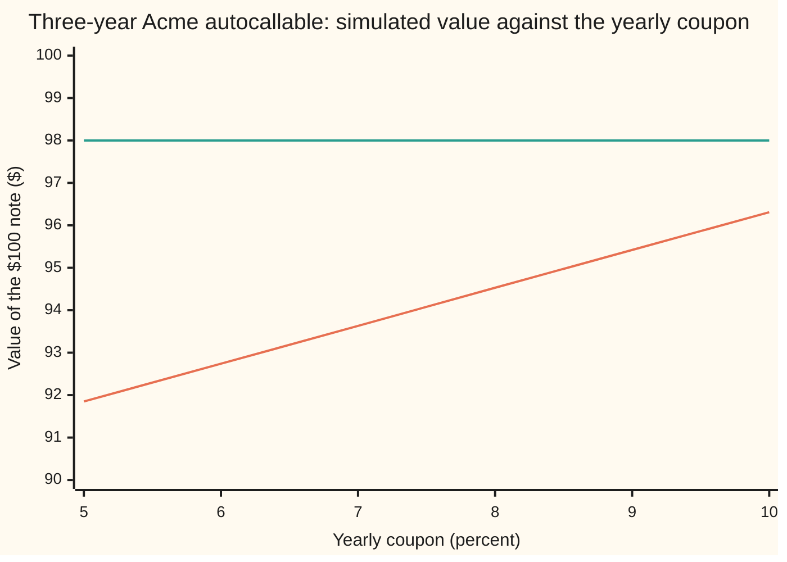

# Autocallables: a note that repays early when the share is up, the Phoenix coupon with memory, and the coupon that makes it fair

[Syllabus](../../../SYLLABUS.md) → [Financial mathematics](../README.md) → [Equity structured notes - reverse convertibles, autocallables and convertibles](../README.md#s53) → Autocallables

---

## General Overview

A bank sells a three-year note on Acme shares for $100. Acme trades at $100 today. Once a year, on the anniversary, the bank looks at Acme's closing price.

- **Year 1 or year 2.** If Acme is at or above $100, the note ends early. The holder gets the $100 back plus one coupon for every year that has passed. This early ending is the **autocall** (automatic call).
- **Year 3, Acme at or above $100.** The holder gets $100 plus three coupons.
- **Year 3, Acme between $70 and $100.** The holder gets the $100 back and no coupon.
- **Year 3, Acme below $70.** The holder gets Acme's value instead: $61 if Acme closes at $61. The $70 line is the **knock-in level**: below it, a sold put (a promise to absorb the share's fall) comes alive, and the holder takes the whole fall from $100.

The bank keeps a margin of 2 percent, so the note it sells for $100 must be worth $98 in the market model. The question a structurer (the person who designs the note) answers every morning is: which yearly coupon makes the note worth exactly $98?

This card answers it for Acme on the house market: rate 5 percent, dividend yield 2 percent, volatility 20 percent a year. Simulated over 100,000 paths, the note is worth $91.85 at a 5 percent coupon and $96.31 at 10 percent. The coupon that prices it at $98 is **11.84 percent a year**, by numerical integration with no random numbers. The simulation's estimate, 11.89 percent with a sampling error of 0.07 percentage points, agrees.

The same card prices a **Phoenix** variant: a coupon of 2 percent a quarter, paid whenever Acme is at or above $70 on a quarterly date, with **memory** (a missed coupon is paid later, on the next date when Acme is back above $70).

**An autocallable's value is a straight line in its coupon, so the fair coupon is one division: the money still missing after the redemption, divided by the value of one unit of coupon.**

**What kind of fact this is:** a model price. The share's path is *taken* to follow the Black–Scholes model, which is an assumption. Inside that model, the straight-line rule is a theorem, proved on this card in Why it works, and the price itself is a simulation estimate with a measured error.

### The picture: the note's value against its coupon



The rising line is the simulated value for coupons from 5 to 10 percent. The flat line is the target, $98. Each extra percentage point of coupon adds the same amount, so the line is straight. Extend it upward and it crosses $98 at 11.89 percent.

---

## The formula

Notation first, in words. $`S_t`$ is Acme's price at year $`t`$. The note pays a coupon of $`c`$ per year per $100. A price in "the model" is a discounted average over paths in the pricing world, where every asset earns the bank rate in total, dividends included ([Monte Carlo pricing](../06-Numerical%20Methods%20for%20Pricing/01-monte-carlo-pricing.md)).

The note's value splits into a part that does not depend on the coupon, $`A`$, and a part that grows with it, $`c\,B`$:

```math
V(c) = A + c\,B, \qquad c^* = \frac{V^* - A}{B}
```

**Read it aloud:** the note is worth its redemption value plus the coupon times the value of one unit of coupon, and the fair coupon is the shortfall to the target divided by that unit value.

The two pieces come from the chances of each ending:

```math
B = 100\left(1\cdot e^{-r}P_1 + 2\,e^{-2r}P_2 + 3\,e^{-3r}P_3^{\uparrow}\right), \qquad A = 100\left(e^{-r}P_1 + e^{-2r}P_2 + e^{-3r}(1 - P_1 - P_2)\right) - L
```

In words: one unit of coupon is paid once if the note is called in year 1, twice if called in year 2, and three times if it reaches year 3 with Acme at or above $100. The redemption is $100 on whichever date the note ends, less the discounted loss when Acme finishes below $70.

| Symbol | Plain meaning | In our example | Push it up and the answer… |
| --- | --- | --- | --- |
| $`S_t`$ | Acme's price at year $`t`$ | starts at 100.00 | a higher start means earlier calls |
| $`r`$ | the riskless rate, continuously compounded | 5% | lowers every discount factor; the fair coupon rises |
| $`e^{-rt}`$ | the discount factor: today's value of $1 paid at year $`t`$ | 0.951229, 0.904837, 0.860708 | every payment counts for more |
| $`c`$ | the coupon per year, as a fraction of $100 | 0.05 to 0.10 | $`V(c)`$ rises in a straight line |
| $`P_1,\ P_2`$ | chance the note is called in year 1, in year 2 | 0.518100, 0.128720 | the note ends sooner; fewer coupons pile up |
| $`P_3^{\uparrow}`$ | chance it reaches year 3 with Acme at or above $100 | 0.064440 | more three-coupon endings; $`B`$ rises |
| $`L`$ | the discounted loss below the knock-in level, averaged | 3.938993 | $`A`$ falls; the fair coupon rises |
| $`A`$ | the redemption value: what the note is worth with no coupon | 87.389755 | the fair coupon falls |
| $`B`$ | the value of one unit of coupon: one whole $100 a year | 89.216538 | the fair coupon falls |
| $`V(c)`$ | the note's value at coupon $`c`$ | 94.527078 at 8% | — |
| $`V^*`$ | the target value: issue price less the margin | 98 | the fair coupon rises |
| $`c^*`$ | the fair coupon | 11.892688% | — |

Acme's volatility (20 percent a year) and dividend yield (2 percent) enter only through the simulated paths, so they have no symbol here.

### When it holds

- **The paths come from the pricing world.** The growth is the rate less the dividend yield less the volatility drag (half the squared volatility, 0.02 a year), never a forecast. A note priced with a forecast drift gets a coupon the bank cannot hedge.
- **The coupon is a fixed number per date.** Then each path's payment is a straight line in $`c`$, and so is the average. A coupon tied to another rate, or capped by a formula, breaks the straight line, and the fair coupon needs a search instead of one division.
- **The issuer pays as promised.** The card ignores the bank's own default. A real note is also a loan to the bank, and the bank's credit spread changes the fair coupon.
- **One volatility for every date and level.** Flat 20 percent is a model choice. Autocallables are sensitive to how volatility changes with the price and over time, so desks price them with richer models (Where this goes next).
- **The knock-in is watched only on the last day.** Here the $70 test happens once, at year 3. A note that watches $70 every day knocks in more often and needs a higher coupon.

---

## Why it works

### Step 0: each path pays a straight line in the coupon

Fix one simulated path of Acme. That path decides when the note ends and how much of the $100 comes back. It also decides how many coupons are paid: 0, 1, 2 or 3. The coupon rate only multiplies that count.

So each path pays (redemption) + $`c`$ × (count × $100), each part discounted from its own date. A straight line in $`c`$, with a path-dependent intercept and slope.

An average of straight lines is a straight line. That is the whole trick behind the formula: $`A`$ is the average intercept, $`B`$ the average slope.

### Step 1: where the paths end

The note ends on exactly one of five outcomes. The simulation counts them across 100,000 paths.

```
one █ = 0.01 of the paths, the share of paths ending each way
called in year 1             ████████████████████████████████████████████████████  0.518100
called in year 2             █████████████                                         0.128720
year 3, at or above 100      ██████                                                0.064440
year 3, 70 to 100            ██████████████████                                    0.177860
year 3, below 70 (loss)      ███████████                                           0.110880
```

Half the notes end after one year. The average life is 1.835080 years, not 3. A "10 percent a year for three years" headline describes the rarest good ending, not the typical one.

The year-1 chance has a closed form. Being called in year 1 is a bet that Acme finishes a one-year period at or above $100: a [Cash-or-nothing digital](../10-Digitals%20and%20the%20implied%20density/01-cash-or-nothing-digital.md). Its chance is the bell-curve area to the left of 0.05, which is 0.519939. The simulation's 0.518100 agrees within the sampling noise of 100,000 paths.

### Step 2: the coupon value $`B`$

One unit of coupon ($100 a year) pays $100 in year 1 on a year-1 call, $200 in year 2 on a year-2 call, and $300 in year 3 if Acme ends at or above $100. Each payment is discounted from its own date and weighted by its chance. Adding the three gives $`B`$.

### Step 3: the redemption value $`A`$

The $100 comes back on the date the note ends, so it is discounted by that date's factor. The only exception is a year-3 ending below $70. There the holder receives Acme's price, so the $100 is reduced by the shortfall, $100 minus Acme's price. The average of that shortfall, discounted from year 3, is $`L`$.

### Step 4: solve the line

The target is $98. With $`V(c) = A + cB`$ a straight line rising in $`c`$, it crosses $98 exactly once, at $`c^* = (98 - A)/B`$. No search is needed.

A search lands in the same place. Bisection ([Solving backwards](../07-Greeks%20by%20Numbers%20and%20Calibration/05-root-finding-for-inverses.md)) halves a range of coupons until the simulated value hits $98, and on the same 100,000 paths it gives the same 11.892688 percent. That is not an independent check, because it searches the same straight line. A search is needed only when the value is not a straight line in the coupon (When it holds, second bullet), and then reusing the same paths matters. If each trial coupon got fresh random paths, the noise would move the price by about 0.060452 a trial, the standard error. That is 0.067759 percentage points of coupon.

### Step 5: a second road with no random numbers

Each part of the note can also be computed by numerical integration, working backwards one year at a time.

1. **Year 2 to year 3.** If the note is still alive at year 2, its value is a payment at year 3 that depends only on Acme then. That is three coupons paid if Acme ends at or above $100, plus the $100 back less the whole fall from $100 if Acme ends below $70. Both have bell-curve closed forms, as on the [Cash-or-nothing digital](../10-Digitals%20and%20the%20implied%20density/01-cash-or-nothing-digital.md) card.
2. **Year 1 to year 2.** Average the year-2 value over the bell curve of Acme's one-year move. Above $100 the note is called, so that region is a fixed payment times its chance. Below $100, Simpson's rule adds up thin slices of the smooth part.
3. **Today to year 1.** The same step again.

Splitting each integral exactly at $100 matters. The note's value jumps there, and Simpson's rule loses accuracy across a jump. Split, both pieces are smooth.

This road gives $`A`$ = 87.413703 and $`B`$ = 89.387959, so the fair coupon is 11.843090 percent. The simulation's 11.892688 percent differs by 0.05 points, under one standard error of 0.067759 points.

<details>
<summary>Detailed proof: why the value is a straight line, and why the root is unique</summary>

Fix one path. The date the note ends depends on the path, not on $`c`$. So does the number of coupons paid, 0 to 3, and the redemption: $100, or Acme's price below $70.

On that path the discounted payment is the discounted redemption plus $`c`$ times the discounted coupon count times 100. Call these the path's intercept and slope. Neither involves $`c`$.

$`\displaystyle \text{payment on one path} = \text{intercept} + c \times \text{slope}`$

The model's price is the average payment over paths. The average of intercept plus $`c`$ times slope is the average intercept plus $`c`$ times the average slope. So $`V(c) = A + cB`$ exactly. The same identity holds for the simulation's sample average, because a sample average is also an average.

$`B`$ is positive, because a year-1 call has positive chance and a positive slope. So $`V`$ rises strictly in $`c`$. A strictly rising straight line meets the level 98 at one point, and that point is $`(98 - A)/B`$. If $`A`$ were already above 98, the fair coupon would be negative: the note would be too generous even with no coupon.

</details>

### Step 6: the Phoenix coupon and its memory

The Phoenix note keeps the same redemption: calls at $100 on years 1 and 2, and the $70 knock-in at year 3. Its coupon is different. On each of the 12 quarterly dates, if Acme is at or above $70, the note pays 2 percent of $100, plus every coupon it missed since the last payment. That catch-up is the **memory**.

The code counts memory in two independent ways, and they must agree on every path.

- **A ledger.** Walk forward through the quarters. Each quarter adds one coupon to the amount owed. On a good date (Acme at or above $70), pay everything owed and reset to zero.
- **A next-good-date scan.** Walk backward. Each quarter's coupon is paid on the first good date at or after it, if there is one before the note ends.

Both give 644.291757 per unit of quarterly coupon. At 2 percent a quarter, the coupons are worth 0.02 × 644.291757. The Phoenix is worth $100.275590, which is above the $98 target. The fair quarterly coupon is 1.646807 percent.

Four quarters of 1.646807 percent make 6.587230 percent a year, well below the autocallable's 11.84 percent. Why? The Phoenix coupon is paid far more often. Acme sits above $70 on most quarterly dates, while the autocallable's coupon needs Acme above $100.

The first quarterly coupon is again a digital: 2 percent paid if Acme is above $70 after three months. Its closed-form value per $1 of coupon (so twice that for the $2 coupon on $100) is 0.987416, and the simulation gives 0.987410. Both sit close to the three-month discount factor, because missing the coupon needs a 30 percent fall in three months. The test that it is a digital is that chance of missing: 0.000164 by the closed form and 0.000170 in the simulation, well within sampling error.

---

## Worked numbers, by hand

The fair coupon from the printed chances, using the discount factors 0.951229, 0.904837 and 0.860708.

| Step | Arithmetic | Value |
| --- | --- | --- |
| coupon value from a year-1 call | $`100 \times 0.951229 \times 0.518100`$ | 49.283196 |
| coupon value from a year-2 call | $`200 \times 0.904837 \times 0.128720`$ | 23.294134 |
| coupon value from year 3, at or above 100 | $`300 \times 0.860708 \times 0.064440`$ | 16.639207 |
| $`B`$, value of one unit of coupon | $`49.283196 + 23.294134 + 16.639207`$ | 89.216538 |
| $100 back, discounted from its end date | $`100(0.951229 \times 0.518100 + 0.904837 \times 0.128720 + 0.860708 \times (0.064440 + 0.177860 + 0.110880))`$ | 91.328748 |
| $`L`$, the average discounted loss below 70 | from the simulation | 3.938993 |
| $`A`$, the redemption value | $`91.328748 - 3.938993`$ | 87.389755 |
| money still missing to reach 98 | $`98 - 87.389755`$ | 10.610245 |
| fair coupon | $`10.610245 / 89.216538`$ | **11.892688%** |

The three chances in the last bracket are the year-3 endings. So a coupon of 11.89 percent a year, on a note that lives 1.835080 years on average, gives the bank its $2 margin. The numerical integration gives 11.84 percent.

The price table, simulation against integration:

| Coupon | Simulated value | Standard error | Integration |
| --- | --- | --- | --- |
| 5% | 91.850582 | 0.049495 | 91.883101 |
| 6% | 92.742748 | 0.050928 | 92.776981 |
| 7% | 93.634913 | 0.052422 | 93.670861 |
| 8% | 94.527078 | 0.053971 | 94.564740 |
| 9% | 95.419244 | 0.055572 | 95.458620 |
| 10% | 96.311409 | 0.057219 | 96.352499 |

### One path, both notes

The first simulated path, Acme each quarter: 90.16, 95.72, 101.31, 88.69, 74.74, 77.60, 71.19, 71.94, 63.92, 60.22, 59.52, 61.00.

- **The autocallable.** Year 1 (quarter 4) is 88.69 and year 2 (quarter 8) is 71.94, so no call. Year 3 ends at 61.00, below $70. The holder gets $61, worth 52.503913 today, and no coupon.
- **The Phoenix.** Quarters 1 to 8 are all at or above $70, so it pays eight quarterly coupons of $2. Quarters 9 to 12 are below $70, so those coupons are missed, and memory never gets a chance to pay them. The redemption is the same $61.

On this path, the Phoenix holder collects eight coupons and takes the same loss. Per unit of quarterly coupon, those eight are worth 756.552439 today.

### What breaks if you drop a piece

The right answer is 11.892688 percent for the autocallable and $100.275590 for the Phoenix at 2 percent a quarter. Every wrong number uses the same 100,000 paths.

| Mistake | Comes out at | What went wrong |
| --- | --- | --- |
| Treating the coupon as certain, every year for three years | 3.905456% | That values the note like a bond. The coupon is paid only on good endings, a few times on average. |
| Discounting every payment from year 3 | 19.028768% | Half the notes repay in year 1. Money back early is worth more, and ignoring it makes the note look cheap. |
| Counting the loss only below 70 | 8.683576% | Below $70 the holder loses the whole fall from $100, not just the part below $70. |
| Pricing the Phoenix without memory | 99.831418 | Missed coupons are paid later. Dropping them loses the gap up to 100.275590. |

---

## Code, from first principles, and it actually runs

Each script simulates 100,000 paths of Acme in 12 quarterly steps, from the same printed recurrence and Box–Muller draws as [Monte Carlo pricing](../06-Numerical%20Methods%20for%20Pricing/01-monte-carlo-pricing.md). It prices both notes, computes the bell-curve area from its own series, and solves for the fair coupons.

The answer is reached by **independent roads**:

- the simulation against numerical integration (no random numbers), for $`A`$, $`B`$ and the fair coupon;
- the year-1 call chance and the first Phoenix coupon against digital closed forms;
- the memory ledger against the next-good-date scan.

Every road above shares the pricing-world growth rate, so one more assert checks that rate from outside the model: discounted to today, Acme at year 1 must average $`100\,e^{-0.02}`$ = 98.019867, the price today of a share handed over in a year without its 2 percent dividends. The simulation gives 97.994837 with standard error 0.062612, so a wrong growth rate cannot pass unseen. The bisection in the code is printed as an illustration, not as a road: it searches the same straight line that one division solves.

### Python

```python
# Autocallables and Phoenix notes -- the check behind the card.  Standard library only.
# Uniforms: the printed recurrence; normals: Box-Muller; bell-curve area: its own series.
from math import cos, exp, log, pi, sin, sqrt

S0, R, Q, SIG = 100.0, 0.05, 0.02, 0.20       # the house market
CALL, KI, ISSUE = 100.0, 70.0, 98.0           # autocall level, knock-in level, target price
SEED, PATHS, DT = 20261123, 100000, 0.25      # twelve quarterly steps per path
COUPONS, PHX = (0.05, 0.06, 0.07, 0.08, 0.09, 0.10), 0.02   # PHX: Phoenix coupon a quarter
MOD, MU = 1 << 32, R - Q - 0.5 * SIG * SIG    # MU: pricing-world growth per year

def uniform(state):                           # one step of the recurrence
    state = (1664525 * state + 1013904223) % MOD
    return state, (state + 0.5) / MOD

def normal_pair(state):                       # Box-Muller: two uniforms -> two normals
    state, u = uniform(state)
    state, v = uniform(state)
    rad, ang = sqrt(-2.0 * log(u)), 2.0 * pi * v
    return state, rad * cos(ang), rad * sin(ang)

def ncdf(x):                                  # bell-curve area left of x, Taylor series
    if x < -9.0 or x > 9.0:
        return 0.0 if x < 0 else 1.0
    s, t, b, i = x, 0.0, x, 1
    while s != t:
        t, i = s, i + 2
        b *= x * x / i
        s = t + b
    return 0.5 + s * exp(-0.5 * x * x - 0.91893853320467274178)

def at_maturity(s):                           # year 2, not called: year 3 valued at year 2
    d2 = lambda k: (log(s / k) + MU) / SIG
    a = 100.0 - 100.0 * ncdf(-d2(KI)) + s * exp(R - Q) * ncdf(-d2(KI) - SIG)
    return exp(-R) * a, exp(-R) * 300.0 * ncdf(d2(CALL))

def roll(cont, year, s, n=160):               # one year back: call region exact, rest by Simpson
    zc = min((log(CALL / s) - MU) / SIG, 9.0)
    h, sa, sb = (zc + 9.0) / n, 0.0, 0.0
    for i in range(n + 1):
        z = -9.0 + i * h
        w = (1.0 if i in (0, n) else 4.0 if i % 2 else 2.0) * exp(-0.5 * z * z) / sqrt(2.0 * pi)
        a, b = cont(s * exp(MU + SIG * z))
        sa, sb = sa + w * a, sb + w * b
    up = 1.0 - ncdf(zc)                       # chance of being called at this date
    return exp(-R) * (sa * h / 3.0 + up * 100.0), exp(-R) * (sb * h / 3.0 + up * 100.0 * year)
QA, QB = roll(lambda s: roll(at_maturity, 2, s), 1, S0)   # road 2: quadrature
e = [exp(-R * DT * j) for j in range(13)]                 # quarterly discount factors
acc, state, first = [0.0] * 22, SEED, None
for p in range(PATHS):
    s, path = S0, []
    for _ in range(6):
        state, z1, z2 = normal_pair(state)
        for z in (z1, z2):
            s *= exp(MU * DT + SIG * sqrt(DT) * z)
            path.append(s)
    y1, y2, y3 = path[3], path[7], path[11]
    end3 = 100.0 if y3 >= KI else y3                     # redemption at year 3, S0 = 100
    k = 1 if y1 >= CALL else 2 if y2 >= CALL else 3
    a = 100.0 * e[4 * k] if k < 3 else e[12] * end3
    b = 100.0 * k * e[4 * k] if (k < 3 or y3 >= CALL) else 0.0
    a_d3, b_d3 = a * e[12] / e[4 * k], b * e[12] / e[4 * k]
    a_ki = e[12] * (100.0 - (KI - y3)) if (k == 3 and y3 < KI) else a
    loss = e[12] * (100.0 - y3) if (k == 3 and y3 < KI) else 0.0
    owed, pa, pb, pbn, last = 0, 0.0, 0.0, 0.0, 12        # Phoenix, road 1: a ledger
    for j, sj in enumerate(path, 1):
        owed += 1
        if sj >= KI:
            pb, pbn, owed = pb + 100.0 * owed * e[j], pbn + 100.0 * e[j], 0
        if j in (4, 8) and sj >= CALL:
            pa, last = 100.0 * e[j], j
            break
        if j == 12:
            pa = e[12] * (100.0 if sj >= KI else sj)
    pb2, nxt = 0.0, 0                                     # road 2: each quarter's coupon
    for j in range(last, 0, -1):                          # is paid at the next good date
        nxt = j if path[j - 1] >= KI else nxt
        pb2 += 100.0 * e[nxt] if nxt else 0.0
    dig = e[1] if path[0] >= KI else 0.0
    row = (a, b, a * a, a * b, b * b, a_d3, b_d3, a_ki, loss, pa, pb, pbn, pb2,
           dig, k == 1, k == 2, k == 3 and y3 >= CALL, k == 3 and KI <= y3 < CALL,
           k == 3 and y3 < KI, float(k), e[4] * y1, e[4] * y1 * e[4] * y1)
    acc = [x + float(v) for x, v in zip(acc, row)]
    if first is None:
        first = (path, k, a, b, pa, pb)
m = [x / PATHS for x in acc]
A, B, P1, P2, P3U, P3M, P3D = m[0], m[1], m[14], m[15], m[16], m[17], m[18]
B_SURE = 100.0 * (e[4] + e[8] + e[12])        # coupon read as certain, every year
def se(c):                                    # standard error of the price at coupon c
    return sqrt((m[2] + 2 * c * m[3] + c * c * m[4] - (A + c * B) ** 2) / (PATHS - 1))
fair = (ISSUE - A) / B                        # the price is A + cB: solve the line
lo, hi = 0.0, 0.5                             # a search on the same line, for illustration
for _ in range(60):
    mid = 0.5 * (lo + hi)
    lo, hi = (mid, hi) if A + mid * B < ISSUE else (lo, mid)
fair_q, d2q, d2c = (ISSUE - QA) / QB, (log(S0 / KI) + MU * DT) / (SIG * sqrt(DT)), (log(S0 / CALL) + MU) / SIG
print(f"house: S0 = 100  r = 5%  q = 2%  sigma = 20%   autocall 100, knock-in 70, target {ISSUE:.0f}")
print(f"{PATHS} paths of 12 quarterly steps from seed {SEED}")
print("first path, Acme each quarter: " + " ".join(f"{x:.2f}" for x in first[0]))
print(f"first path: ends in year {first[1]}, autocall redemption {first[2]:.6f}  coupon part {first[3]:.6f}")
print(f"            Phoenix redemption {first[4]:.6f}  coupon units {first[5]:.6f}")
print(f"outcomes   called year 1 {P1:.6f}  (closed form N({d2c:.2f}) {ncdf(d2c):.6f})  year 2 {P2:.6f}")
print(f"           year 3 at or above 100 {P3U:.6f}   70 to 100 {P3M:.6f}   below 70 {P3D:.6f}")
print(f"expected life in years {m[19]:.6f}")
print(f"discount factors year 1 {e[4]:.6f}  year 2 {e[8]:.6f}  year 3 {e[12]:.6f}")
print(f"Acme at year 1, discounted  MC {m[20]:.6f}  se {sqrt((m[21] - m[20] * m[20]) / (PATHS - 1)):.6f}"
      f"  S0 e^-q {S0 * exp(-Q):.6f}")
print(f"A, redemption value      MC {A:.6f}   quadrature {QA:.6f}")
print(f"B, value per unit coupon MC {B:.6f}   quadrature {QB:.6f}")
print(f"knock-in loss L, discounted MC {m[8]:.6f}")
print(f"by hand, B: {100 * e[4] * P1:.6f} + {200 * e[8] * P2:.6f} + {300 * e[12] * P3U:.6f}")
print(f"by hand, A: {100 * (e[4] * P1 + e[8] * P2 + e[12] * (P3U + P3M + P3D)):.6f} - L;"
      f"  gap 98 - A {ISSUE - A:.6f}")
print("coupon   MC price   std error   quadrature")
for c in COUPONS:
    print(f"{c * 100:5.0f}%  {A + c * B:10.6f}  {se(c):10.6f}  {QA + c * QB:11.6f}")
print(f"fair coupon for {ISSUE:.0f}: line {fair * 100:.6f}%  bisection {0.5 * (lo + hi) * 100:.6f}%"
      f"  quadrature {fair_q * 100:.6f}%")
print(f"std error of the price at the fair coupon {se(fair):.6f}; of the coupon {se(fair) / B * 100:.6f}%")
print(f"Phoenix first coupon as a digital, per $1  MC {m[13]:.6f}   closed form {e[1] * ncdf(d2q):.6f}")
print(f"  chance Acme is below 70 at quarter 1  MC {1 - m[13] / e[1]:.6f}   closed form {ncdf(-d2q):.6f}")
print(f"Phoenix coupon units  ledger {m[10]:.6f}   next-good-date scan {m[12]:.6f}")
print(f"Phoenix redemption {m[9]:.6f}  price at 2% a quarter {m[9] + PHX * m[10]:.6f}")
print(f"Phoenix fair quarterly coupon for {ISSUE:.0f}: {(ISSUE - m[9]) / m[10] * 100:.6f}%"
      f"  four quarters {4 * (ISSUE - m[9]) / m[10] * 100:.6f}%")
print("what breaks")
print(f"  coupon read as certain for 3 years: fair coupon {(ISSUE - A) / B_SURE * 100:.6f}%")
print(f"  every payment discounted from year 3: fair coupon {(ISSUE - m[5]) / m[6] * 100:.6f}%")
print(f"  loss counted only below 70: fair coupon {(ISSUE - m[7]) / B * 100:.6f}%")
print(f"  Phoenix without memory, 2% a quarter: price {m[9] + PHX * m[11]:.6f}")
print("chart, coupon %   " + " ".join(f"{c * 100:6.0f}" for c in COUPONS))
print("chart, MC price   " + " ".join(f"{A + c * B:6.2f}" for c in COUPONS))

assert abs(A - QA) < 4 * se(0.0), "redemption value: simulation agrees with quadrature"
assert abs(B - QB) < 4 * sqrt((m[4] - B * B) / (PATHS - 1)), "coupon value: the same"
assert abs(fair - fair_q) < 0.002, "fair coupon: simulation agrees with quadrature"
assert abs(P1 - ncdf(d2c)) < 0.005, "year-1 call chance is a digital"
assert abs(m[13] / e[1] - ncdf(d2q)) < 4 * sqrt(ncdf(d2q) * ncdf(-d2q) / PATHS), "first Phoenix coupon is a digital"
assert abs(m[10] - m[12]) < 1e-9, "memory ledger equals the next-good-date scan"
assert abs(m[20] - S0 * exp(-Q)) < 4 * sqrt((m[21] - m[20] * m[20]) / (PATHS - 1)), "pricing-world growth: Acme vs S0 e^-q"
print("ALL CHECKS PASS")
```

**Ran 2026-11-23 on macOS, Python 3.14.10, standard library only. All checks passed. Output, pasted from the run:**

```
house: S0 = 100  r = 5%  q = 2%  sigma = 20%   autocall 100, knock-in 70, target 98
100000 paths of 12 quarterly steps from seed 20261123
first path, Acme each quarter: 90.16 95.72 101.31 88.69 74.74 77.60 71.19 71.94 63.92 60.22 59.52 61.00
first path: ends in year 3, autocall redemption 52.503913  coupon part 0.000000
            Phoenix redemption 52.503913  coupon units 756.552439
outcomes   called year 1 0.518100  (closed form N(0.05) 0.519939)  year 2 0.128720
           year 3 at or above 100 0.064440   70 to 100 0.177860   below 70 0.110880
expected life in years 1.835080
discount factors year 1 0.951229  year 2 0.904837  year 3 0.860708
Acme at year 1, discounted  MC 97.994837  se 0.062612  S0 e^-q 98.019867
A, redemption value      MC 87.389755   quadrature 87.413703
B, value per unit coupon MC 89.216538   quadrature 89.387959
knock-in loss L, discounted MC 3.938993
by hand, B: 49.283196 + 23.294134 + 16.639207
by hand, A: 91.328748 - L;  gap 98 - A 10.610245
coupon   MC price   std error   quadrature
    5%   91.850582    0.049495    91.883101
    6%   92.742748    0.050928    92.776981
    7%   93.634913    0.052422    93.670861
    8%   94.527078    0.053971    94.564740
    9%   95.419244    0.055572    95.458620
   10%   96.311409    0.057219    96.352499
fair coupon for 98: line 11.892688%  bisection 11.892688%  quadrature 11.843090%
std error of the price at the fair coupon 0.060452; of the coupon 0.067759%
Phoenix first coupon as a digital, per $1  MC 0.987410   closed form 0.987416
  chance Acme is below 70 at quarter 1  MC 0.000170   closed form 0.000164
Phoenix coupon units  ledger 644.291757   next-good-date scan 644.291757
Phoenix redemption 87.389755  price at 2% a quarter 100.275590
Phoenix fair quarterly coupon for 98: 1.646807%  four quarters 6.587230%
what breaks
  coupon read as certain for 3 years: fair coupon 3.905456%
  every payment discounted from year 3: fair coupon 19.028768%
  loss counted only below 70: fair coupon 8.683576%
  Phoenix without memory, 2% a quarter: price 99.831418
chart, coupon %        5      6      7      8      9     10
chart, MC price    91.85  92.74  93.63  94.53  95.42  96.31
ALL CHECKS PASS
```

### Rust

The same recurrence, the same draws and the same labels, built with `rustc --edition 2021 -O`.

```rust
// Autocallables and Phoenix notes -- the same check as the Python, in Rust.  No crates.
// Uniforms: the printed recurrence; normals: Box-Muller; bell-curve area: its own series.
use std::f64::consts::PI;

const S0: f64 = 100.0; const R: f64 = 0.05; const Q: f64 = 0.02; const SIG: f64 = 0.20; // house
const CALL: f64 = 100.0; const KI: f64 = 70.0; const ISSUE: f64 = 98.0; // call, knock-in, target
const SEED: u64 = 20261123; const PATHS: usize = 100000; const DT: f64 = 0.25; // 12 quarters
const PHX: f64 = 0.02;                          // the Phoenix coupon, per quarter
const COUPONS: [f64; 6] = [0.05, 0.06, 0.07, 0.08, 0.09, 0.10];
const MOD: u64 = 1 << 32;
const MU: f64 = R - Q - 0.5 * SIG * SIG;        // pricing-world growth per year

fn uniform(state: &mut u64) -> f64 {           // one step of the recurrence
    *state = (1664525 * *state + 1013904223) % MOD;
    (*state as f64 + 0.5) / MOD as f64
}

fn normal_pair(state: &mut u64) -> (f64, f64) { // Box-Muller: two uniforms -> two normals
    let u = uniform(state);
    let v = uniform(state);
    let (rad, ang) = ((-2.0 * u.ln()).sqrt(), 2.0 * PI * v);
    (rad * ang.cos(), rad * ang.sin())
}

fn ncdf(x: f64) -> f64 {                        // bell-curve area left of x, Taylor series
    if x < -9.0 || x > 9.0 {
        return if x < 0.0 { 0.0 } else { 1.0 };
    }
    let (mut s, mut t, mut b, mut i) = (x, 0.0, x, 1.0);
    while s != t {
        t = s;
        i += 2.0;
        b *= x * x / i;
        s = t + b;
    }
    0.5 + s * (-0.5 * x * x - 0.91893853320467274178).exp()
}

fn at_maturity(s: f64) -> (f64, f64) {          // year 2, not called: year 3 valued at year 2
    let d2 = |k: f64| ((s / k).ln() + MU) / SIG;
    let a = 100.0 - 100.0 * ncdf(-d2(KI)) + s * (R - Q).exp() * ncdf(-d2(KI) - SIG);
    ((-R).exp() * a, (-R).exp() * 300.0 * ncdf(d2(CALL)))
}

fn roll(cont: &dyn Fn(f64) -> (f64, f64), year: f64, s: f64) -> (f64, f64) {
    let n = 160;                                // one year back: call region exact, rest by Simpson
    let zc = (((CALL / s).ln() - MU) / SIG).min(9.0);
    let (h, mut sa, mut sb) = ((zc + 9.0) / n as f64, 0.0, 0.0);
    for i in 0..=n {
        let z = -9.0 + i as f64 * h;
        let wt = if i == 0 || i == n { 1.0 } else if i % 2 == 1 { 4.0 } else { 2.0 };
        let w = wt * (-0.5 * z * z).exp() / (2.0 * PI).sqrt();
        let (a, b) = cont(s * (MU + SIG * z).exp());
        sa += w * a;
        sb += w * b;
    }
    let up = 1.0 - ncdf(zc);                    // chance of being called at this date
    ((-R).exp() * (sa * h / 3.0 + up * 100.0), (-R).exp() * (sb * h / 3.0 + up * 100.0 * year))
}

fn main() {
    let (qa, qb) = roll(&|s| roll(&at_maturity, 2.0, s), 1.0, S0);   // road 2: quadrature
    let e: Vec<f64> = (0..13).map(|j| (-R * DT * j as f64).exp()).collect();
    let mut acc = [0.0f64; 22];
    let mut state = SEED;
    let mut first: Option<(Vec<f64>, usize, f64, f64, f64, f64)> = None;
    for _ in 0..PATHS {
        let (mut s, mut path) = (S0, Vec::with_capacity(12));
        for _ in 0..6 {
            let (z1, z2) = normal_pair(&mut state);
            for z in [z1, z2] {
                s *= (MU * DT + SIG * DT.sqrt() * z).exp();
                path.push(s);
            }
        }
        let (y1, y2, y3) = (path[3], path[7], path[11]);
        let end3 = if y3 >= KI { 100.0 } else { y3 };      // redemption at year 3, S0 = 100
        let k = if y1 >= CALL { 1 } else if y2 >= CALL { 2 } else { 3 };
        let a = if k < 3 { 100.0 * e[4 * k] } else { e[12] * end3 };
        let b = if k < 3 || y3 >= CALL { 100.0 * k as f64 * e[4 * k] } else { 0.0 };
        let (a_d3, b_d3) = (a * e[12] / e[4 * k], b * e[12] / e[4 * k]);
        let hit = k == 3 && y3 < KI;
        let a_ki = if hit { e[12] * (100.0 - (KI - y3)) } else { a };
        let loss = if hit { e[12] * (100.0 - y3) } else { 0.0 };
        let (mut owed, mut pa, mut pb, mut pbn, mut last) = (0usize, 0.0, 0.0, 0.0, 12usize);
        for j in 1..=12 {                                  // Phoenix, road 1: a ledger
            let sj = path[j - 1];
            owed += 1;
            if sj >= KI { pb += 100.0 * owed as f64 * e[j]; pbn += 100.0 * e[j]; owed = 0; }
            if (j == 4 || j == 8) && sj >= CALL { pa = 100.0 * e[j]; last = j; break; }
            if j == 12 { pa = e[12] * (if sj >= KI { 100.0 } else { sj }); }
        }
        let (mut pb2, mut nxt) = (0.0, 0usize);            // road 2: each quarter's coupon
        for j in (1..=last).rev() {                         // is paid at the next good date
            if path[j - 1] >= KI { nxt = j; }
            pb2 += if nxt > 0 { 100.0 * e[nxt] } else { 0.0 };
        }
        let dig = if path[0] >= KI { e[1] } else { 0.0 };
        let f = |c: bool| if c { 1.0 } else { 0.0 };
        let row = [a, b, a * a, a * b, b * b, a_d3, b_d3, a_ki, loss, pa, pb, pbn, pb2, dig,
                   f(k == 1), f(k == 2), f(k == 3 && y3 >= CALL), f(k == 3 && KI <= y3 && y3 < CALL),
                   f(hit), k as f64, e[4] * y1, e[4] * y1 * e[4] * y1];
        for (x, v) in acc.iter_mut().zip(row.iter()) { *x += v; }
        if first.is_none() { first = Some((path.clone(), k, a, b, pa, pb)); }
    }
    let m: Vec<f64> = acc.iter().map(|x| x / PATHS as f64).collect();
    let (a, b) = (m[0], m[1]);
    let (p1, p2, p3u, p3m, p3d) = (m[14], m[15], m[16], m[17], m[18]);
    let b_sure = 100.0 * (e[4] + e[8] + e[12]);      // coupon read as certain, every year
    let se = |c: f64| {                               // standard error of the price at coupon c
        ((m[2] + 2.0 * c * m[3] + c * c * m[4] - (a + c * b).powi(2)) / (PATHS - 1) as f64).sqrt() };
    let fair = (ISSUE - a) / b;                       // the price is A + cB: solve the line
    let (mut lo, mut hi) = (0.0f64, 0.5f64);          // a search on the same line, for illustration
    for _ in 0..60 { let mid = 0.5 * (lo + hi); if a + mid * b < ISSUE { lo = mid; } else { hi = mid; } }
    let fair_q = (ISSUE - qa) / qb;
    let (d2q, d2c) = (((S0 / KI).ln() + MU * DT) / (SIG * DT.sqrt()), ((S0 / CALL).ln() + MU) / SIG);
    let fp = first.unwrap();
    println!("house: S0 = 100  r = 5%  q = 2%  sigma = 20%   autocall 100, knock-in 70, target {:.0}", ISSUE);
    println!("{} paths of 12 quarterly steps from seed {}", PATHS, SEED);
    let qs: Vec<String> = fp.0.iter().map(|x| format!("{:.2}", x)).collect();
    println!("first path, Acme each quarter: {}", qs.join(" "));
    println!("first path: ends in year {}, autocall redemption {:.6}  coupon part {:.6}", fp.1, fp.2, fp.3);
    println!("            Phoenix redemption {:.6}  coupon units {:.6}", fp.4, fp.5);
    println!("outcomes   called year 1 {:.6}  (closed form N({:.2}) {:.6})  year 2 {:.6}", p1, d2c, ncdf(d2c), p2);
    println!("           year 3 at or above 100 {:.6}   70 to 100 {:.6}   below 70 {:.6}", p3u, p3m, p3d);
    println!("expected life in years {:.6}", m[19]);
    println!("discount factors year 1 {:.6}  year 2 {:.6}  year 3 {:.6}", e[4], e[8], e[12]);
    println!("Acme at year 1, discounted  MC {:.6}  se {:.6}  S0 e^-q {:.6}",
             m[20], ((m[21] - m[20] * m[20]) / (PATHS - 1) as f64).sqrt(), S0 * (-Q).exp());
    println!("A, redemption value      MC {:.6}   quadrature {:.6}", a, qa);
    println!("B, value per unit coupon MC {:.6}   quadrature {:.6}", b, qb);
    println!("knock-in loss L, discounted MC {:.6}", m[8]);
    println!("by hand, B: {:.6} + {:.6} + {:.6}", 100.0 * e[4] * p1, 200.0 * e[8] * p2, 300.0 * e[12] * p3u);
    println!("by hand, A: {:.6} - L;  gap 98 - A {:.6}",
             100.0 * (e[4] * p1 + e[8] * p2 + e[12] * (p3u + p3m + p3d)), ISSUE - a);
    println!("coupon   MC price   std error   quadrature");
    for c in COUPONS {
        println!("{:5.0}%  {:10.6}  {:10.6}  {:11.6}", c * 100.0, a + c * b, se(c), qa + c * qb);
    }
    println!("fair coupon for {:.0}: line {:.6}%  bisection {:.6}%  quadrature {:.6}%",
             ISSUE, fair * 100.0, 0.5 * (lo + hi) * 100.0, fair_q * 100.0);
    println!("std error of the price at the fair coupon {:.6}; of the coupon {:.6}%", se(fair), se(fair) / b * 100.0);
    println!("Phoenix first coupon as a digital, per $1  MC {:.6}   closed form {:.6}", m[13], e[1] * ncdf(d2q));
    println!("  chance Acme is below 70 at quarter 1  MC {:.6}   closed form {:.6}", 1.0 - m[13] / e[1], ncdf(-d2q));
    println!("Phoenix coupon units  ledger {:.6}   next-good-date scan {:.6}", m[10], m[12]);
    println!("Phoenix redemption {:.6}  price at 2% a quarter {:.6}", m[9], m[9] + PHX * m[10]);
    println!("Phoenix fair quarterly coupon for {:.0}: {:.6}%  four quarters {:.6}%", ISSUE,
             (ISSUE - m[9]) / m[10] * 100.0, 4.0 * (ISSUE - m[9]) / m[10] * 100.0);
    println!("what breaks");
    println!("  coupon read as certain for 3 years: fair coupon {:.6}%", (ISSUE - a) / b_sure * 100.0);
    println!("  every payment discounted from year 3: fair coupon {:.6}%", (ISSUE - m[5]) / m[6] * 100.0);
    println!("  loss counted only below 70: fair coupon {:.6}%", (ISSUE - m[7]) / b * 100.0);
    println!("  Phoenix without memory, 2% a quarter: price {:.6}", m[9] + PHX * m[11]);
    let cs: Vec<String> = COUPONS.iter().map(|c| format!("{:6.0}", c * 100.0)).collect();
    let ps: Vec<String> = COUPONS.iter().map(|c| format!("{:6.2}", a + c * b)).collect();
    println!("chart, coupon %   {}", cs.join(" "));
    println!("chart, MC price   {}", ps.join(" "));

    assert!((a - qa).abs() < 4.0 * se(0.0), "redemption value: simulation agrees with quadrature");
    assert!((b - qb).abs() < 4.0 * ((m[4] - b * b) / (PATHS - 1) as f64).sqrt(), "coupon value: the same");
    assert!((fair - fair_q).abs() < 0.002, "fair coupon: simulation agrees with quadrature");
    assert!((p1 - ncdf(d2c)).abs() < 0.005, "year-1 call chance is a digital");
    assert!((m[13] / e[1] - ncdf(d2q)).abs() < 4.0 * (ncdf(d2q) * ncdf(-d2q) / PATHS as f64).sqrt(),
            "first Phoenix coupon is a digital");
    assert!((m[10] - m[12]).abs() < 1e-9, "memory ledger equals the next-good-date scan");
    let fwd_se = ((m[21] - m[20] * m[20]) / (PATHS - 1) as f64).sqrt();
    assert!((m[20] - S0 * (-Q).exp()).abs() < 4.0 * fwd_se, "pricing-world growth: Acme vs S0 e^-q");
    println!("ALL CHECKS PASS");
}
```

**Ran 2026-11-23 on macOS, rustc 1.98.1, no crates. All checks passed. Output, pasted from the run:**

```
house: S0 = 100  r = 5%  q = 2%  sigma = 20%   autocall 100, knock-in 70, target 98
100000 paths of 12 quarterly steps from seed 20261123
first path, Acme each quarter: 90.16 95.72 101.31 88.69 74.74 77.60 71.19 71.94 63.92 60.22 59.52 61.00
first path: ends in year 3, autocall redemption 52.503913  coupon part 0.000000
            Phoenix redemption 52.503913  coupon units 756.552439
outcomes   called year 1 0.518100  (closed form N(0.05) 0.519939)  year 2 0.128720
           year 3 at or above 100 0.064440   70 to 100 0.177860   below 70 0.110880
expected life in years 1.835080
discount factors year 1 0.951229  year 2 0.904837  year 3 0.860708
Acme at year 1, discounted  MC 97.994837  se 0.062612  S0 e^-q 98.019867
A, redemption value      MC 87.389755   quadrature 87.413703
B, value per unit coupon MC 89.216538   quadrature 89.387959
knock-in loss L, discounted MC 3.938993
by hand, B: 49.283196 + 23.294134 + 16.639207
by hand, A: 91.328748 - L;  gap 98 - A 10.610245
coupon   MC price   std error   quadrature
    5%   91.850582    0.049495    91.883101
    6%   92.742748    0.050928    92.776981
    7%   93.634913    0.052422    93.670861
    8%   94.527078    0.053971    94.564740
    9%   95.419244    0.055572    95.458620
   10%   96.311409    0.057219    96.352499
fair coupon for 98: line 11.892688%  bisection 11.892688%  quadrature 11.843090%
std error of the price at the fair coupon 0.060452; of the coupon 0.067759%
Phoenix first coupon as a digital, per $1  MC 0.987410   closed form 0.987416
  chance Acme is below 70 at quarter 1  MC 0.000170   closed form 0.000164
Phoenix coupon units  ledger 644.291757   next-good-date scan 644.291757
Phoenix redemption 87.389755  price at 2% a quarter 100.275590
Phoenix fair quarterly coupon for 98: 1.646807%  four quarters 6.587230%
what breaks
  coupon read as certain for 3 years: fair coupon 3.905456%
  every payment discounted from year 3: fair coupon 19.028768%
  loss counted only below 70: fair coupon 8.683576%
  Phoenix without memory, 2% a quarter: price 99.831418
chart, coupon %        5      6      7      8      9     10
chart, MC price    91.85  92.74  93.63  94.53  95.42  96.31
ALL CHECKS PASS
```

The two outputs agree line for line, because the draws come from integer arithmetic that both languages do exactly.

### Lean

Lean proves the card's straight-line rule and its single fair coupon, for any probability-weighted average over paths.

- Suppose each path pays an intercept plus $`c`$ times a slope, and neither depends on $`c`$. Then $`V(c) = A + c\,B`$, with $`A`$ the average intercept and $`B`$ the average slope.
- Suppose also that $`B > 0`$. Then $`V`$ rises strictly in $`c`$, and $`V(c) = V^*`$ exactly when $`c = (V^* - A)/B`$.
- Suppose no path has a negative slope, and paths with positive chance, such as year-1 calls, have a positive slope. Then $`B > 0`$.

The simulation, the numerical integration, the values of $`A`$ and $`B`$, and every dollar figure are left to the Python and Rust checks.

```lean
-- Autocallables: a note's model value is a straight line in its coupon, so a positive coupon value gives exactly one fair coupon, (target - A) / B.
import Mathlib.MeasureTheory.Integral.Bochner.Basic
import Mathlib.MeasureTheory.Measure.Typeclasses.Probability

open MeasureTheory

/-- The note's value is a straight line in its coupon. Fix the pricing-world probability
measure `μ` on paths. On each path `ω` the coupon is a fixed number per date, so the
discounted payment is `a ω + c * s ω`: a redemption part `a ω` (the intercept) plus the
coupon `c` times the discounted coupon count `s ω` (the slope); neither depends on `c`.
Then the price, the average payment, is `V(c) = A + c * B`, where `A` is the average
intercept (the redemption value) and `B` the average slope (the value of one unit of coupon). -/
theorem note_value_affine_in_coupon {Ω : Type*} [MeasurableSpace Ω]
    (μ : Measure Ω) [IsProbabilityMeasure μ] (a s : Ω → ℝ)
    (ha : Integrable a μ) (hs : Integrable s μ) (c : ℝ) :
    ∫ ω, (a ω + c * s ω) ∂μ = (∫ ω, a ω ∂μ) + c * ∫ ω, s ω ∂μ := by
  rw [integral_add ha (hs.const_mul c), integral_const_mul]

/-- The fair coupon is one division. If one unit of coupon has positive value `B`, the
note's value `V(c) = ∫ (a + c s) dμ` rises strictly in `c`, and it equals the target `V*`
at exactly one coupon, `c* = (V* - A) / B`. -/
theorem fair_coupon_unique {Ω : Type*} [MeasurableSpace Ω]
    (μ : Measure Ω) [IsProbabilityMeasure μ] (a s : Ω → ℝ)
    (ha : Integrable a μ) (hs : Integrable s μ)
    (hB : 0 < ∫ ω, s ω ∂μ) (Vstar : ℝ) :
    StrictMono (fun c : ℝ => ∫ ω, (a ω + c * s ω) ∂μ) ∧
      ∀ c : ℝ, (∫ ω, (a ω + c * s ω) ∂μ = Vstar ↔
        c = (Vstar - ∫ ω, a ω ∂μ) / ∫ ω, s ω ∂μ) := by
  have h1 : ∀ c : ℝ, ∫ ω, (a ω + c * s ω) ∂μ = (∫ ω, a ω ∂μ) + c * ∫ ω, s ω ∂μ := fun c =>
    note_value_affine_in_coupon μ a s ha hs c
  refine ⟨fun x y hxy => ?_, fun c => ?_⟩
  · simp only [h1]
    have := mul_lt_mul_of_pos_right hxy hB
    linarith
  · rw [h1, eq_div_iff hB.ne']
    constructor <;> intro h <;> linarith

/-- The value of one unit of coupon is positive: the discounted coupon count is never
negative, and it is positive on an event of positive chance (a year-1 call). -/
theorem coupon_value_pos {Ω : Type*} [MeasurableSpace Ω]
    (μ : Measure Ω) [IsProbabilityMeasure μ] (s : Ω → ℝ) (hs : Integrable s μ)
    (hnn : ∀ ω, 0 ≤ s ω) (E : Set Ω) (hE : 0 < μ E) (hpos : ∀ ω ∈ E, 0 < s ω) :
    0 < ∫ ω, s ω ∂μ := by
  rw [integral_pos_iff_support_of_nonneg (fun ω => hnn ω) hs]
  refine lt_of_lt_of_le hE (measure_mono fun ω hω => ?_)
  exact (hpos ω hω).ne'

#print axioms note_value_affine_in_coupon
#print axioms fair_coupon_unique
#print axioms coupon_value_pos
```

**Checked 2026-11-23 on macOS, Lean 4.36.0-rc2, Mathlib v4.36.0-rc2. Every proof is complete and uses only Lean's standard axioms. Output, pasted from the run:**

```
'note_value_affine_in_coupon' depends on axioms: [propext, Classical.choice, Quot.sound]
'fair_coupon_unique' depends on axioms: [propext, Classical.choice, Quot.sound]
'coupon_value_pos' depends on axioms: [propext, Classical.choice, Quot.sound]
```

> [!TIP]
> **Try changing**
> Guess first, then run it. Every assert still holds after each change below.
> - **Guess first: does a lower call level raise or lower the fair coupon?** Set `CALL` to `95.0`. More notes are called, the average life falls to 1.651760 years, and fewer paths reach the loss. The fair coupon falls to 10.154291 percent.
> - **Guess first: what does a deeper knock-in do?** Set `KI` to `60.0`. $`L`$ shrinks to 2.225724 and the fair coupon falls to 9.972340 percent. The Phoenix coupon line moves to $60 too, so at 2 percent a quarter it is now worth 102.558905.
> - **Guess first: what does a smaller margin do?** Set `ISSUE` to `100.0`. The shortfall grows by $2, divided by the same $`B`$. The fair coupon becomes 14.134425 percent.
> - **Guess first: what does more volatility do?** Set `SIG` to `0.25`. More paths fall below $70: $`L`$ grows to 6.477871 and the fair coupon rises to 15.559834 percent. The holder is selling volatility, and is paid in coupon.

---

## The usual mistake

> [!warning]
> **Reading the coupon as a yield.** "11.84 percent a year" is not what the holder earns. The note lives 1.835080 years on average. On 0.110880 of the paths it ends below $70 and hands back Acme's price, as on the first path ($61 for $100). The coupon is payment for selling the bank a put and an early-call right. It is not interest.
>
> - **Valuing the coupon as certain.** That prices the coupon leg as three sure yearly payments and gives a fair coupon of 3.905456 percent. The real coupon leg is worth 89.216538 per unit.
> - **Discounting everything from the last date.** Half the notes repay after one year. Discounting from year 3 gives 19.028768 percent.
> - **Thinking the $70 line limits the loss to the part below it.** Below $70 the holder loses everything from $100 down. Pricing the loss as only the part below $70 gives 8.683576 percent.
> - **Dropping the Phoenix memory.** Without memory the Phoenix is worth 99.831418 instead of 100.275590.

---

## Where you meet it in real life

- **Retail structured products.** Banks sell autocallables widely to individual savers. Their term sheets quote a coupon per year, which is the coupon on this card.
- **Private banks.** Phoenix notes with memory are sold to clients who want regular income. The memory feature makes a missed quarter feel less final.
- **Equity derivatives desks.** The bank that issues the note hedges the put and the call features. Autocallables leave desks holding large amounts of volatility risk.
- **Investor disclosure.** A term sheet that shows only the coupon hides the average life and the chance of a loss. This card's outcome bars are the numbers a careful buyer asks for.

> **Say it back**
> An autocallable repays early with its coupons if the share is at or above its starting level on an observation date. At the end it repays in full unless the share is below the knock-in level, when the holder takes the whole fall. Each path pays a straight line in the coupon, so the note's value is a redemption part plus the coupon times a coupon value. For Acme, integration with no random numbers gives the coupon that makes the note worth $98: 11.843090 percent. The simulation puts the two parts at 87.389755 and 89.216538 and its coupon at 11.892688 percent, within its sampling error. The Phoenix variant pays a smaller coupon more often, with missed coupons paid later; at 2 percent a quarter it is worth 100.275590.

---

## What this builds on

- [Reverse convertibles](01-reverse-convertibles.md): the one-year note with a sold put. Its house coupon is 11.78 percent, or 9.96 percent when the put knocks in only after Acme touches $80. This card adds early repayment.
- [Monte Carlo pricing](../06-Numerical%20Methods%20for%20Pricing/01-monte-carlo-pricing.md): the simulated paths, the random-number recurrence and the standard error used here.
- [Cash-or-nothing digital](../10-Digitals%20and%20the%20implied%20density/01-cash-or-nothing-digital.md): the year-1 call and each Phoenix coupon are digitals, which gives the closed-form cross-checks.
- [Solving backwards](../07-Greeks%20by%20Numbers%20and%20Calibration/05-root-finding-for-inverses.md): bisection, shown here landing where one division lands; a note whose value is not a straight line in its coupon needs it.

## Where this goes next

- [Worst-of autocallables](03-worst-of-autocallables-and-their-risk.md): the same note on the worst of several shares, where correlation sets the coupon.
- [Convertible bonds](04-convertible-bonds-on-a-tree.md): a note that can turn into shares, priced on a tree.
- [Convertible risk](05-convertible-bond-greeks-and-implied-volatility.md): the sensitivities and implied volatility of that bond.
- [Pricing with local volatility](../13-Local%20volatility%20and%20jumps/03-pricing-under-local-volatility-and-the-forward-smile.md): a volatility that depends on price and date. Autocallables are a standard case where it moves the price.
- [Stochastic-local volatility](../14-Stochastic%20volatility%20-%20Heston%2C%20SABR%20and%20their%20mix/06-stochastic-local-volatility.md): the model most desks use to price autocallables.

This card uses one flat volatility. The open question is how much the fair coupon moves when the volatility smile and its future shape are priced in.

---

## Sources

Verified 2026-11-23: every link below resolves to the publisher's page.

- Bouzoubaa, Mohamed, and Adel Osseiran. *Exotic Options and Hybrids: A Guide to Structuring, Pricing and Trading*. Wiley, 2010. [doi:10.1002/9781119206965](https://doi.org/10.1002/9781119206965). A structurer's account of autocallable structures, including snowball and bonus coupons (chapter 12), their payoffs and their risks.
- Glasserman, Paul. *Monte Carlo Methods in Financial Engineering*. Springer, 2003. [Publisher page](https://link.springer.com/book/10.1007/978-0-387-21617-1). The simulation estimator, its standard error, and path-dependent payoffs.
- Bergomi, Lorenzo. *Stochastic Volatility Modeling*. Chapman and Hall/CRC, 2016. [Publisher page](https://www.routledge.com/Stochastic-Volatility-Modeling/Bergomi/p/book/9781482244069). Local volatility (chapter 2) and local-stochastic volatility (chapter 12), the models that replace this card's flat volatility.
