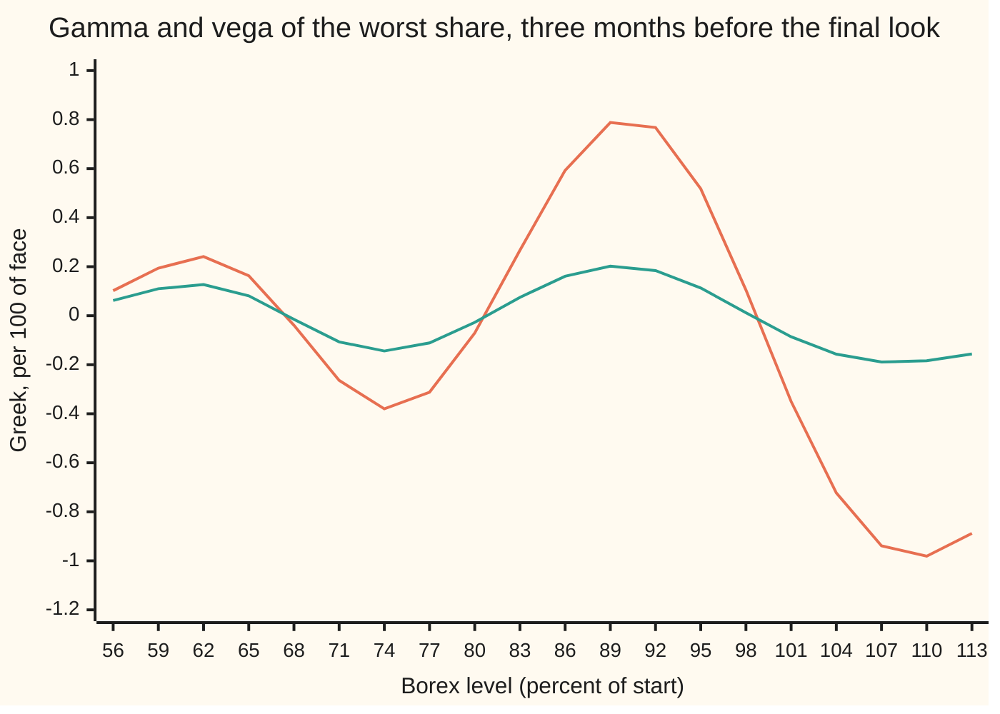

# Worst-of autocallables: three shares, one correlation, and Greeks that change sign near the barriers

[Syllabus](../../../SYLLABUS.md) → [Financial mathematics](../README.md) → [Equity structured notes - reverse convertibles, autocallables and convertibles](../README.md#s53) → Worst-of autocallables

---

## General Overview

A bank sells a three-year note for 100. It watches three house shares: Acme, Borex and Cobalt. Each share's **level** is its price as a percent of its price on the start date, so every level starts at 100. Each share has Acme's market numbers: volatility 20% a year, dividend yield 2%, bank rate 5%. Every pair of shares has correlation 0.5.

The terms are the previous card's, with one change. On each anniversary the bank looks at the **worst** of the three levels:

- **Worst at 100 or more:** the note ends early (it is "called"). The holder gets 100 plus the yearly coupon times the years so far.
- **Not called by year 3, worst at 70 or more:** the holder gets 100 back and no coupon.
- **Not called, worst below 70:** the holder gets the worst level. If Borex ends at 60, the holder gets 60.

On Acme alone this note is fair at a coupon of 11.84% a year. Fair here means the note is worth 98, so the bank keeps 2 as its margin. On the worst of three shares the fair coupon is **28.33%**, a simulation estimate with a sampling error of 0.18 points. The holder needs all three shares to do well. One bad share is enough to lose the coupon or part of the money.

Correlation sets the price. When the three shares move together, the worst share is rarely far behind the others. When they move apart, one of them usually lags. The fair coupon runs from 35.11% at correlation 0.3 to 20.00% at 0.8.

**A worst-of autocallable pays only as well as its weakest share, so the coupon pays the holder for the chance that the shares drift apart; and near the end its Greeks (the price's sensitivities to the share's level and volatility) flip sign each time the worst share crosses a step in the payoff.**

**What kind of fact this is:** a computed result inside a model. Prices and Greeks come from simulation of three lognormal shares (each log price moves along a bell curve) with one fixed correlation, and two quadratures (numerical integrals with no random numbers) confirm them. The model is an assumption, not a law.

### The picture: the fair coupon at each correlation

```
correlation of every pair   fair yearly coupon, one block = 2 percentage points
        0.0   █████████████████████████                                50.43%
        0.3   ██████████████████                                       35.11%
        0.5   ██████████████                                           28.33%
        0.8   ██████████                                               20.00%
        1.0   ██████                                                   11.79%
```

At correlation 1 the three shares move as one, and the note is the one-share note: 11.79% by simulation, 11.84% by quadrature. At correlation 0 the shares move independently, and the coupon climbs to 50.43%.

---

## The formula

Notation first, in words. $`S_i(t)`$ is share i's level at time t in years, as a percent of its start price. $`W_n`$ is the worst of the three levels on anniversary n. $`\tau`$ (say "tau") is the year the note is called, if it is. $`E[\cdot]`$ is the average over all outcomes in the pretend world where every share grows at the bank rate less its dividend ([Monte Carlo pricing](../06-Numerical%20Methods%20for%20Pricing/01-monte-carlo-pricing.md)). $`\mathbf{1}\{\cdot\}`$ is a switch: 1 when the statement in the brackets is true, 0 when not.

The value of the note per 100 of face, with yearly coupon c:

```math
V(c) = E\Big[\mathbf{1}\{\text{called}\}\,e^{-r\tau}(100 + 100\,c\,\tau) + \mathbf{1}\{\text{not called}\}\,e^{-3r}\big(100\cdot\mathbf{1}\{W_3 \ge 70\} + W_3\cdot\mathbf{1}\{W_3 < 70\}\big)\Big] = A + 100\,c\,B
```

**Read it aloud:** the note is worth its discounted repayments, averaged over every way the three shares can move, and that average is a fixed part plus the coupon times a second fixed part.

The fair coupon solves $`V(c) = 98`$:

```math
c^* = \frac{98 - A}{100\,B}
```

**Read it aloud:** the coupon is the gap between the target price and the coupon-free value, shared out over the expected discounted coupon-years.

The Greeks of the worst share come from repricing with a bump, on the same random draws each time ([Bump and revalue](../07-Greeks%20by%20Numbers%20and%20Calibration/01-bump-and-revalue-and-common-random-numbers.md)):

```math
\Delta \approx \frac{V(S+h) - V(S-h)}{2h}, \qquad \Gamma \approx \frac{V(S+h) - 2V(S) + V(S-h)}{h^2}, \qquad \nu \approx V(\sigma + 0.01) - V(\sigma)
```

**Read it aloud:** delta is the price change per point of the worst share, gamma is how fast delta changes, and vega is the price change when that share's volatility rises one point.

| Symbol | Plain meaning | In our example | Push it up and the answer… |
| --- | --- | --- | --- |
| $`S_i(t)`$, $`W_n`$ | share i's level, a percent of its start price; the worst level on anniversary n | all 100 at the start | a higher worst level raises the note's value |
| $`c`$, $`c^*`$ | the yearly coupon; the coupon that makes the note worth 98 | 28.33% at correlation 0.5 | a higher coupon raises V |
| $`\tau`$ | the year the note is called: 1, 2 or 3 | — | a later call pays more coupon years, discounted more |
| $`V(c)`$, $`A`$, $`B`$ | note value; value with no coupon; average discounted coupon-years (the $`B`$ of [Autocallables](02-autocallables-and-phoenix-notes.md) divided by 100) | 98.00; 79.9008; 0.6389 | — |
| $`r`$, $`q`$, $`\sigma`$ | bank rate, dividend yield, volatility of each share | 5%; 2%; 20% | more volatility lowers the value at the start |
| $`\rho`$, $`L`$, $`M`$ | correlation of every pair; its Cholesky factor; the draw shared by all three shares | 0.5; rows in the output; one standard normal draw | a higher correlation raises V |
| $`\Delta`$, $`\Gamma`$ | delta and gamma to the worst share, per point of level | 1.648 and −0.144 at level 74 | change sign near each step |
| $`\nu`$ | vega: value change when the worst share's volatility rises from 20% to 21% | −0.380 at level 74 | has the sign of gamma |
| $`h`$, $`T`$ | the bump, in points of level; the time left to the final look, in years | 2 points; 0.25 | — |
| $`H`$, $`K`$, $`D`$ | the height and level of one step in the payoff; the value of that step alone | 30 at 70; 84.99 at 100 | a taller step means larger Greeks |
| $`N`$, $`\varphi`$, $`d_1`$, $`d_2`$, $`Z_i`$, $`\varepsilon_i`$ | the bell curve's area to the left and its height; the Black-Scholes distances; share i's whole standard normal draw, and the part of it that is share i's own | — | — |
| $`E`$, $`\mathbf{1}\{\cdot\}`$, $`\Pr`$, $`x`$ | the average in the pretend world; a switch, 1 when true and 0 when not; a chance in the pretend world; a level used inside an integral | — | — |

### When it holds

- **Lognormal shares with fixed volatility.** Real shares show a skew: the market charges more for protection against falls. The sold put on the worst share then costs more than this model says, so the fair coupon here is too low.
- **One fixed correlation for three years.** Real correlations rise in sell-offs, the moment the knock-in matters most. If correlation alone rises from 0.5 to 0.8, the note is worth 104.29, not 98, and the issuing bank has lost the difference.
- **Looks only on the anniversaries.** A knock-in watched every day is hit more often. That is a different note and needs daily steps in the simulation.
- **The bank pays.** The holder lends 100 to the bank. If the bank defaults, the formula's repayments do not arrive. Credit risk is not in this price.
- **The Greeks are for the last quarter.** The sign changes are sharp because only three months remain. With years left, each step is smoothed out and the Greeks change slowly.

---

## Why it works

### Step 0: the holder has sold a put on the worst share

Split the payoff into parts. The holder gets a repayment of 100, a coupon that arrives only if all three shares stand at 100 or more on an anniversary, and a loss of 100 minus the worst level if the worst ends below 70. That last part is a sold put on the worst share that only exists below 70: the **knock-in put** from [Reverse convertibles](01-reverse-convertibles.md). Every part depends on the worst level alone. So the question is how low the worst of three shares tends to go.

### Step 1: the value is a straight line in the coupon

On every path the coupon enters once, multiplied by the call year and its discount factor. So the value is a straight line in c: $`V(c) = A + 100cB`$. The simulation finds $`A`$ and $`B`$ from the same paths. Then one division gives the fair coupon, with no root-finding.

### Step 2: low correlation pushes the worst share down

With correlation 1 the three levels are the same number on every path. With lower correlation each share takes more of its own path, and the minimum of three spread-out numbers sits lower. Two things follow:

- **Fewer calls.** All three must stand at 100 or more, and that gets rarer. The expected discounted coupon-years $`B`$ falls from 0.7548 at correlation 0.8 to 0.5622 at 0.3.
- **More losses.** The worst ends below 70 more often. The coupon-free value $`A`$ falls from 82.9077 to 78.2620.

Hold the coupon at 28.33%. The note is worth 94.1883 at correlation 0.3, 98.0000 at 0.5 and 104.2900 at 0.8. Near 0.5 each 0.01 of correlation adds 0.1877. The note gains when correlation rises, so the holder is **long correlation** (gains when it rises). The bank on the other side is **short correlation**: it loses when the shares start to move together.

The simulation builds the three correlated draws from one Cholesky factor (a triangle of numbers that mixes independent draws into correlated ones), as on [Correlated paths](../06-Numerical%20Methods%20for%20Pricing/04-correlated-paths-and-cholesky.md). The same random numbers serve every correlation, so the differences between correlations are not swamped by noise.

### Step 3: at correlation 1 there is a second road

At correlation 1 the worst-of note is the one-share note. That note can be priced with no simulation at all. In the last year, the value is a sum of Black-Scholes pieces in closed form: a fixed sum if the share ends at 100 or more, 100 if it ends between 70 and 100, and the share itself below 70. Each earlier year is one integral over the next year's bell curve, taken by Simpson's rule only over the levels where the note is not called. This backward quadrature gives 11.84%. The simulation at correlation 1 gives 11.79%, with standard error 0.07%.

### Step 4: a step in the payoff makes gamma change sign

Move to the last quarter. The note has survived both anniversaries. Three months remain to the final look. Acme and Cobalt stand at 120, and Borex is the worst share. The payoff is now a function of Borex's final level, with two steps up:

- at 70, from the worst level up to 100: a step of $`H = 30`$;
- at 100, from 100 up to 184.99, the repayment plus three coupons: a step of $`H = 84.99`$.

Three months of uncertainty smooth each step into an S-shaped curve. The S bends upward below the step and downward above it. Gamma is that bend, so a pure step gives positive gamma below it and negative gamma above it. For one share and one pure step, the sign changes where $`d_1 = 0`$, as on [Digital Greeks and pin risk](../10-Digitals%20and%20the%20implied%20density/03-digital-greeks-and-pin-risk.md):

```math
S = K\,e^{-(r - q + \sigma^2/2)T}
```

**Read it aloud:** the bend changes direction just below the step, by the drift plus half the variance over the time left.

That gives 98.76 for the step at 100. The step at 70 is not pure. Below 70 the holder receives the worst level itself, which moves point for point with Borex; from 70 up the payoff is flat at 100. So near 70 the payoff is

```math
W + 30\cdot\mathbf{1}\{W \ge 70\} - \max(W - 70,\ 0)
```

**Read it aloud:** the worst level, plus a 30-point step at 70, minus a call struck at 70 that the holder has sold.

A sold call bends the price downward, so it adds negative gamma and pulls the sign change below the pure step's 69.13. For one share it moves to 67.54 (the fold has the formula). On the three-share note, gamma changes sign between 65 and 68, and between 98 and 101: around 67.54 and 98.76, as one share predicts. It changes sign a third time between 80 and 83, where the downward bend above 70 meets the upward bend below 100.

<details>
<summary>Detailed proof: where gamma changes sign, and the last-quarter price as two integrals</summary>

**One step.** A payment of H if the share ends at or above K is worth $`D(S) = H e^{-rT} N(d_2)`$, with $`d_2 = (\ln(S/K) + (r - q - \sigma^2/2)T)/(\sigma\sqrt{T})`$ and $`d_1 = d_2 + \sigma\sqrt{T}`$. Its gamma, derived on [Digital Greeks and pin risk](../10-Digitals%20and%20the%20implied%20density/03-digital-greeks-and-pin-risk.md), is

$`\displaystyle D''(S) = -\frac{H e^{-rT}\varphi(d_2)\,d_1}{S^2\sigma^2 T}`$

Every factor but $`-d_1`$ is positive. So gamma is positive when $`d_1 < 0`$ and negative when $`d_1 > 0`$. Solving $`d_1 = 0`$ gives $`S = K e^{-(r - q + \sigma^2/2)T}`$.

**A step plus a sold call.** A call struck at K has gamma $`e^{-qT}\varphi(d_1)/(S\sigma\sqrt{T})`$. The Black-Scholes identity $`S e^{-qT}\varphi(d_1) = K e^{-rT}\varphi(d_2)`$ turns the sold call's gamma into

$`\displaystyle -\frac{K e^{-rT}\varphi(d_2)}{S^2\sigma\sqrt{T}}`$

Add it to $`D''(S)`$. The common factor $`e^{-rT}\varphi(d_2)/(S^2\sigma\sqrt{T})`$ is positive, so the total is zero where $`H d_1/(\sigma\sqrt{T}) + K = 0`$, that is $`d_1 = -(K/H)\,\sigma\sqrt{T}`$:

$`\displaystyle S = K\,e^{-(r - q + \sigma^2/2)T - (K/H)\,\sigma^2 T}`$

With K = 70, H = 30, σ = 20% and T = 0.25, this is 67.54.

**The last-quarter price.** Write the shared draw as M and give each share its own draw: $`Z_i = \sqrt{\rho}\,M + \sqrt{1 - \rho}\,\varepsilon_i`$, which gives correlation ρ between every pair. Given M, the three shares are independent. So the chance that the worst ends below a level x is one minus the chance that all three end above it:

$`\displaystyle \Pr(W < x \mid M) = 1 - \prod_{i=1}^{3}\big(1 - \Pr(S_i < x \mid M)\big)`$

The payoff is $`100 + 3 \times 100c \cdot \mathbf{1}\{W \ge 100\} - (100 - W)\mathbf{1}\{W < 70\}`$. Integrate the loss piece by parts:

$`\displaystyle E\big[(100 - W)\mathbf{1}\{W < 70\}\big] = 30\Pr(W < 70) + \int_0^{70}\Pr(W < x)\,dx`$

So the price needs only the chance curve of the worst share: one integral over x inside one integral over M, both by Simpson's rule. No random numbers enter.

</details>

### Step 5: vega follows gamma

For a payoff on one share at one date, Black-Scholes ties vega to gamma exactly: $`\nu = \sigma T S^2 \Gamma`$ per unit of volatility. The reason is that the price depends on volatility only through the total variance $`\sigma^2 T`$. Adding variance spreads the final level, and spreading is worth something exactly where the payoff bends upward. So vega has gamma's sign. It is **positive far from the barrier**, at 89, where spreading gives a chance to reach 100. It is **negative near the barrier**, at 74, where spreading risks a fall below 70.

On the three-share note the ratio of vega to $`0.01\,\sigma T S^2\Gamma`$ is 0.99, 0.97, 0.98 and 0.87 at levels 62, 74, 89 and 107. At 107 Borex is closer to the other two shares, so they share more of the risk.

### Step 6: common random numbers keep the bumps clean

A bumped price minus the base price, each with its own random draws, is two noisy numbers subtracted. With the same draws, the two prices differ only on paths where the bump moves the worst share across a step, or where Borex ends below 70 and is paid out directly. Every other path cancels exactly. At level 74 the shared draws give gamma −0.126 with standard error 0.011, against the quadrature's −0.144. Fresh draws give standard errors 0.030 for gamma and 0.071 for vega, against 0.011 and 0.013.

The common-draw Greeks are computed at four levels, 62, 74, 89 and 107, one in each stretch between sign changes. They confirm the signs: gamma and vega positive, negative, positive, negative. The quadrature, which has no sampling noise, locates the crossings themselves.

---

## Worked numbers, by hand

The three-year note at correlation 0.5, from the simulation's two averages.

| Step | Arithmetic | Value |
| --- | --- | --- |
| coupon-free value | average of discounted repayments, coupon 0 | A = 79.9008 |
| discounted coupon-years | average of $`e^{-r\tau}\tau`$ on called paths | B = 0.6389 |
| gap to the target | 98 − 79.9008 | 18.0992 |
| coupon value of 1% a year | 100 × 0.6389 × 1% | 0.6389 |
| **fair coupon** | 18.0992 / (100 × 0.6389) | **28.33%** |
| same at correlation 0.3 | (98 − 78.2620) / (100 × 0.5622) | 35.11% |
| same at correlation 0.8 | (98 − 82.9077) / (100 × 0.7548) | 20.00% |
| one share, by quadrature | (98 − 87.4137) / (100 × 0.8939) | 11.84% |
| called at year 3 | 100 + 3 × 28.33 | 184.99 |

The bank can pay 28.33% a year because the holder has sold it the risk that one of three shares falls behind. That risk is worth far more than the same risk on one share.

### What breaks if you drop a piece

Right answers: fair coupon 28.33%; at level 74 in the last quarter, gamma −0.144 and vega −0.380.

| Mistake | Comes out at | What went wrong |
| --- | --- | --- |
| Price the note on one share | 11.84% | At correlation 1 the worst is never behind; the bank would pay far too little and the holder would be underpaid for the risk |
| Assume the shares are independent | 50.43% | Correlation 0 spreads the shares too far; the bank would overpay the holder |
| Fresh random draws for each bumped price | gamma −0.164 (se 0.030), vega −0.421 (se 0.071) | Noise from paths that never cross a step stays in |
| A 10-point bump at 74, across the barrier | gamma −0.089 | The bump averages the bend over 64 to 84, mixing the upward bend below 70 with the downward bend above it |

---

## How the Greeks move as the worst share falls

The puzzle: the same note can be long gamma or short gamma, and long vega or short vega, depending only on where Borex stands. Hold the clock at three months to the final look and Acme and Cobalt at 120. Slide Borex down.

| Borex level | Note value | Delta | Gamma | Vega |
| ---: | ---: | ---: | ---: | ---: |
| 107 | 160.78 | 2.254 | −0.189 | −0.939 |
| 98 | 134.44 | 3.262 | 0.012 | 0.105 |
| 89 | 109.15 | 2.032 | 0.202 | 0.788 |
| 80 | 97.07 | 1.046 | −0.027 | −0.071 |
| 74 | 89.42 | 1.648 | −0.144 | −0.380 |
| 68 | 77.33 | 2.221 | −0.015 | −0.039 |
| 62 | 64.75 | 1.796 | 0.127 | 0.241 |

Delta peaks twice, at 98 and 68, once on each step. Delta is above 1 because a one-point move near a step shifts the chance of a large payment. Gamma and vega change sign together, three times.

### Force one: the step at 100

```
Borex level   gamma near the autocall level, one block = 0.02
    83   +  ████                                       0.075
    86   +  ████████                                   0.161
    89   +  ██████████                                 0.202
    92   +  █████████                                  0.184
    95   +  ██████                                     0.113
    98   +  █                                          0.012
   101   −  ████                                      -0.086
   104   −  ████████                                  -0.157
   107   −  █████████                                 -0.189
   110   −  █████████                                 -0.184
   113   −  ████████                                  -0.156
```

Below 100, the holder gains from movement: a jump up collects 84.99 of coupons. Above 100, movement can only lose it.

### Force two: the step at 70

```
Borex level   gamma near the knock-in barrier, one block = 0.02
    56   +  ███                                        0.062
    59   +  ██████                                     0.110
    62   +  ██████                                     0.127
    65   +  ████                                       0.081
    68   −  █                                         -0.015
    71   −  █████                                     -0.107
    74   −  ███████                                   -0.144
    77   −  ██████                                    -0.111
    80   −  █                                         -0.027
```

Below 70, a move up restores the 100. Just above 70, a move down costs the 30-point step. Gamma is already negative at 68, below the barrier: the sold call of Step 4 moves the sign change down to about 67.54.

### Both forces in one picture



First line, vega per volatility point. Second line, gamma per point of level squared. Both cross zero in the same three gaps: between 65 and 68, between 80 and 83, and between 98 and 101. A bank that hedges this note must switch from buying volatility to selling it as Borex moves a few points.

---

## Code, from first principles, and it actually runs

Both programs take three independent roads. Road 1 simulates 100,000 paths of three shares, correlated by a Cholesky factor, and finds the fair coupon at correlations 0, 0.3, 0.5, 0.8 and 1 on the same random numbers. Road 2 prices the one-share note at correlation 1 by backward quadrature, with no random numbers, and must agree with road 1. Road 3 prices the last quarter by quadrature over the shared draw M, and its bumped Greeks must agree with simulated Greeks on common random numbers at four levels. Two identities close the loop: the vega-gamma ratio, and the one-share sign-change points (67.54 for the step plus sold call at 70, 98.76 for the step at 100), each of which must fall inside the gap where the three-share gamma changes sign. The bell-curve area is a written-out fit; the random numbers come from splitmix64 with the Box-Muller transform. Seven asserts; one of them runs on all twelve simulated Greeks. Five deliberate breaks each trip an assert: a wrong Cholesky entry, a barrier of 60 in the simulation, a missing 30-point step in the quadrature, two coupons instead of three at year 3, and a call level of 90 in the quadrature.

### Python

```python
# Worst-of autocallable on three house shares -- the check behind the card. Standard library only.
# Road 1: Monte Carlo with a Cholesky factor. Road 2: nested quadrature at correlation 1 (one share).
# Road 3: one-factor quadrature for the last quarter, against Monte Carlo with common random numbers.
import math
R, Q, SIG, T3, PRICE = 0.05, 0.02, 0.20, 3, 98.0   # bank rate, dividend, volatility, years, target price
CALL, KNOCK, OTHERS, TLEFT, BUMP = 100.0, 70.0, 120.0, 0.25, 2.0

def ncdf(x):   # normal CDF from a written-out erfc (Chebyshev fit, error below 1.2e-7)
    z = abs(x) / math.sqrt(2); t = 1 / (1 + 0.5 * z)
    e = t * math.exp(-z * z - 1.26551223 + t * (1.00002368 + t * (0.37409196 + t * (0.09678418 + t * (-0.18628806
        + t * (0.27886807 + t * (-1.13520398 + t * (1.48851587 + t * (-0.82215223 + t * 0.17087277)))))))))
    return 1 - 0.5 * e if x >= 0 else 0.5 * e

def simpson(f, a, b, n):
    h = (b - a) / n
    return h / 3 * (f(a) + f(b) + sum((4 if i % 2 else 2) * f(a + i * h) for i in range(1, n)))

class Rng:     # splitmix64 uniforms, Box-Muller normals
    def __init__(s, seed): s.x, s.spare = seed, None
    def u(s):
        s.x = (s.x + 0x9E3779B97F4A7C15) & 0xFFFFFFFFFFFFFFFF; z = s.x
        z = ((z ^ (z >> 30)) * 0xBF58476D1CE4E5B9) & 0xFFFFFFFFFFFFFFFF
        z = ((z ^ (z >> 27)) * 0x94D049BB133111EB) & 0xFFFFFFFFFFFFFFFF
        return (((z ^ (z >> 31)) >> 11) + 0.5) / 2.0 ** 53
    def g(s):
        if s.spare is not None: v, s.spare = s.spare, None; return v
        a, b = math.sqrt(-2 * math.log(s.u())), 2 * math.pi * s.u(); s.spare = a * math.sin(b); return a * math.cos(b)

def cholesky(rho):  # 3 by 3, every pair at rho
    L = [[0.0] * 3 for _ in range(3)]
    for i in range(3):
        for j in range(i + 1):
            s = (1.0 if i == j else rho) - sum(L[i][k] * L[j][k] for k in range(j))
            L[i][j] = math.sqrt(s) if i == j else s / L[j][j]
    return L

def mean_se(xs):
    m = sum(xs) / len(xs); return m, math.sqrt(sum((x - m) * (x - m) for x in xs) / (len(xs) - 1) / len(xs))

def note_mc(rho, n, seed=2026):  # per path: (value of the note with no coupon, discounted coupon-years)
    L = cholesky(rho) if rho < 1 else [[1, 0, 0], [1, 0, 0], [1, 0, 0]]; g = Rng(seed); out = []
    for _ in range(n):
        x = [0.0] * 3; done = None
        for yr in range(1, T3 + 1):
            z = [g.g() for _ in range(3)]
            x = [x[i] + R - Q - 0.5 * SIG * SIG + SIG * sum(L[i][k] * z[k] for k in range(3)) for i in range(3)]
            w = 100 * math.exp(min(x)); df = math.exp(-R * yr)
            if done is None and w >= CALL: done = (100 * df, yr * df)
        out.append(done or (df * (100 if w >= KNOCK else w), 0.0))
    return out

def fair(paths):   # value is A + 100 c B on every path, so the fair coupon solves one line
    A, B = (sum(p[k] for p in paths) / len(paths) for k in (0, 1)); c = (PRICE - A) / (100 * B)
    return A, B, c, mean_se([a + 100 * c * b for a, b in paths])[1] / (100 * B)

def note_rho1(c, n=200):   # one share, backwards: closed form in the last year, Simpson before that
    mu, df = R - Q - 0.5 * SIG * SIG, math.exp(-R)
    def up(s, k): return ncdf((math.log(s / k) + mu) / SIG)
    def v2(s): return df * ((100 + 300 * c) * up(s, CALL) + 100 * (up(s, KNOCK) - up(s, CALL))
                            + s * math.exp(R - Q) * (1 - ncdf((math.log(s / KNOCK) + mu) / SIG + SIG)))
    def roll(s, k, vnext):
        zs = (math.log(CALL / s) - mu) / SIG
        tail = simpson(lambda z: vnext(s * math.exp(mu + SIG * z)) * math.exp(-z * z / 2), -8, zs, n)
        return df * ((100 + 100 * k * c) * up(s, CALL) + tail / math.sqrt(2 * math.pi))
    return roll(100.0, 1, lambda s: roll(s, 2, v2))

def quad(levels, sigs, c, rho=0.5, nm=100, nx=100):   # last quarter: condition on the shared factor
    a, b = math.sqrt(rho), math.sqrt(1 - rho)
    def given(m):
        mus = [math.log(l / 100) + (R - Q - 0.5 * s * s) * TLEFT + s * math.sqrt(TLEFT) * a * m for l, s in zip(levels, sigs)]
        sds = [s * math.sqrt(TLEFT) * b for s in sigs]
        def fw(x): return 1 - math.prod(1 - ncdf((math.log(x / 100) - u) / d) for u, d in zip(mus, sds))
        return 100 + 300 * c * (1 - fw(CALL)) - (100 - KNOCK) * fw(KNOCK) - simpson(fw, 1e-6, KNOCK, nx)
    return math.exp(-R * TLEFT) * simpson(lambda m: given(m) * math.exp(-m * m / 2), -8, 8, nm) / math.sqrt(2 * math.pi)

def mc_last(draws, levels, sigs, c):
    def pay(w): return 100 + 300 * c if w >= CALL else (100 if w >= KNOCK else w)
    return [math.exp(-R * TLEFT) * pay(min(l * math.exp((R - Q - 0.5 * s * s) * TLEFT + s * math.sqrt(TLEFT) * z)
            for l, s, z in zip(levels, sigs, d))) for d in draws]

def corr_draws(n, seed, L):
    g = Rng(seed); zs = [[g.g() for _ in range(3)] for _ in range(n)]
    return [[sum(L[i][k] * z[k] for k in range(3)) for i in range(3)] for z in zs]

print("house: three shares, each at its start level 100, vol 20%, dividend 2%, bank 5%; target price 98")
L = cholesky(0.5); print("cholesky at 0.5: rows", " ".join("(" + ", ".join(f"{v:.6f}" for v in row) + ")" for row in L))
assert all(abs(sum(L[i][k] * L[j][k] for k in range(3)) - (1 if i == j else 0.5)) < 1e-12 for i in range(3) for j in range(3))
N3 = 100000; res = {}
for rho in (0.0, 0.3, 0.5, 0.8, 1.0):
    p = note_mc(rho, N3); res[rho] = (p, *fair(p)); A, B, c, se = res[rho][1:]
    print(f"rho {rho:.1f}: no-coupon value {A:.4f}, coupon-years {B:.4f}, fair coupon {100*c:.2f}% (se {100*se:.2f}%)")
c5 = res[0.5][3]; vals = {rho: sum(a + 100 * c5 * b for a, b in res[rho][0]) / N3 for rho in (0.3, 0.5, 0.8, 1.0)}
print("note at the 0.5 fair coupon, by correlation:", ", ".join(f"{k:.1f} -> {v:.4f}" for k, v in vals.items()))
up, dn = (sum(a + 100 * c5 * b for a, b in note_mc(rr, N3)) / N3 for rr in (0.55, 0.45))
print(f"correlation sensitivity at 0.5, common draws: {(up - dn) / 10:+.4f} per 0.01")
A1 = note_rho1(0.0); B1 = (note_rho1(1.0) - A1) / 100; c1 = (PRICE - A1) / (100 * B1)
print(f"rho 1.0 by quadrature: no-coupon value {A1:.4f}, coupon-years {B1:.4f}, fair coupon {100*c1:.2f}%")
assert abs(res[1.0][3] - c1) < 3 * res[1.0][4], "Monte Carlo at correlation 1 misses the one-share quadrature"
assert res[0.3][3] > res[0.5][3] + 5 * res[0.5][4] > res[0.8][3] + 10 * res[0.8][4], "fair coupon not falling in rho"
assert vals[0.3] < vals[0.5] < vals[0.8] and up > dn, "the holder is not long correlation"

print(f"last quarter: other two shares at {OTHERS:.0f}, coupon {100*c5:.2f}%, bump {BUMP:.0f} points, vega per vol point; "
      f"called at year 3 pays {100 + 300 * c5:.2f}, a step of {300 * c5:.2f}")
grid = list(range(56, 114, 3)); rows = {"value": [], "delta": [], "gamma": [], "vega": []}
for lv in grid:
    v, u, d = (quad([lv + s, OTHERS, OTHERS], [SIG] * 3, c5) for s in (0, BUMP, -BUMP))
    rows["value"].append(v); rows["delta"].append((u - d) / (2 * BUMP)); rows["gamma"].append((u - 2 * v + d) / (BUMP * BUMP))
    rows["vega"].append(quad([lv, OTHERS, OTHERS], [SIG + 0.01, SIG, SIG], c5) - v)
print("chart,level," + ",".join(str(x) for x in grid))
for k in rows: print(f"chart,{k}," + ",".join(f"{x:.{2 if k == 'value' else 3}f}" for x in rows[k]))
draws = corr_draws(100000, 77, L); fresh = corr_draws(100000, 78, L); fresh2 = corr_draws(100000, 79, L)
for lv in (62, 74, 89, 107):
    lev = [[lv + s, OTHERS, OTHERS] for s in (0, BUMP, -BUMP)]
    v, u, d = (mc_last(draws, l, [SIG] * 3, c5) for l in lev)
    vg = mc_last(draws, lev[0], [SIG + 0.01, SIG, SIG], c5); i = grid.index(lv)
    de, ga, ve = (mean_se(x) for x in ([(a - b) / (2 * BUMP) for a, b in zip(u, d)],
                  [(a - 2 * b + e) / (BUMP * BUMP) for a, b, e in zip(u, v, d)], [a - b for a, b in zip(vg, v)]))
    print(f"level {lv}: common draws delta {de[0]:.3f} ({de[1]:.3f}), gamma {ga[0]:+.3f} ({ga[1]:.3f}), vega {ve[0]:+.3f} ({ve[1]:.3f})"
          f"; quadrature {rows['delta'][i]:.3f}, {rows['gamma'][i]:+.3f}, {rows['vega'][i]:+.3f}")
    for est, ref in ((de, rows["delta"][i]), (ga, rows["gamma"][i]), (ve, rows["vega"][i])):
        assert abs(est[0] - ref) < 4 * est[1] + 0.002, "common-draw Greek misses the quadrature"
    if lv == 74:
        fu, fd = (mean_se(mc_last(f, l, [SIG] * 3, c5)) for f, l in ((fresh, lev[1]), (fresh2, lev[2])))
        fv, b = mean_se(mc_last(fresh, lev[0], [SIG + 0.01, SIG, SIG], c5)), mean_se(v)
        print(f"mistake, fresh draws for the bumped legs at 74: gamma {(fu[0] - 2 * b[0] + fd[0]) / (BUMP * BUMP):+.3f} "
              f"({math.sqrt(fu[1] * fu[1] + 4 * b[1] * b[1] + fd[1] * fd[1]) / (BUMP * BUMP):.3f}), vega {fv[0] - b[0]:+.3f} ({math.hypot(fv[1], b[1]):.3f})")
        wide = (quad([84, OTHERS, OTHERS], [SIG] * 3, c5) - 2 * rows["value"][i] + quad([64, OTHERS, OTHERS], [SIG] * 3, c5)) / 100
        print(f"mistake, a 10-point bump across the barrier at 74: gamma {wide:+.3f}")
print(f"mistake, price on one share (correlation 1): fair coupon {100*c1:.2f}% against {100*c5:.2f}%")
print(f"mistake, assume independent shares (correlation 0): fair coupon {100*res[0.0][3]:.2f}%")
signs = [g > 0 for g in rows["gamma"]]; flips = [grid[i] for i in range(1, len(grid)) if signs[i] != signs[i - 1]]
print("gamma changes sign between", ", ".join(f"{f - 3} and {f}" for f in flips))
drift = (R - Q + 0.5 * SIG * SIG) * TLEFT; kink = KNOCK * math.exp(-drift - KNOCK / (100 - KNOCK) * SIG * SIG * TLEFT)
print(f"one share: gamma changes sign at {KNOCK * math.exp(-drift):.2f} (pure step at 70), {kink:.2f} (step plus sold call at 70), "
      f"{CALL * math.exp(-drift):.2f} (step at 100)")
ratio = [rows["vega"][grid.index(x)] / (0.01 * SIG * TLEFT * x * x * rows["gamma"][grid.index(x)]) for x in (62, 74, 89, 107)]
print("vega over 0.01 sigma T level^2 gamma at 62, 74, 89, 107:", ", ".join(f"{x:.2f}" for x in ratio))
assert all(0.8 < x < 1.1 for x in ratio), "vega does not follow gamma"
assert len(flips) == 3 and flips[0] - 3 < kink <= flips[0] and flips[2] - 3 < CALL * math.exp(-drift) <= flips[2], "sign changes misplaced"
print("ALL CHECKS PASS")
```

**Ran 2026-11-23 on macOS, Python 3.14.10, standard library only. All checks passed. Output, pasted from the run:**

```
house: three shares, each at its start level 100, vol 20%, dividend 2%, bank 5%; target price 98
cholesky at 0.5: rows (1.000000, 0.000000, 0.000000) (0.500000, 0.866025, 0.000000) (0.500000, 0.288675, 0.816497)
rho 0.0: no-coupon value 76.0654, coupon-years 0.4350, fair coupon 50.43% (se 0.36%)
rho 0.3: no-coupon value 78.2620, coupon-years 0.5622, fair coupon 35.11% (se 0.23%)
rho 0.5: no-coupon value 79.9008, coupon-years 0.6389, fair coupon 28.33% (se 0.18%)
rho 0.8: no-coupon value 82.9077, coupon-years 0.7548, fair coupon 20.00% (se 0.12%)
rho 1.0: no-coupon value 87.4464, coupon-years 0.8948, fair coupon 11.79% (se 0.07%)
note at the 0.5 fair coupon, by correlation: 0.3 -> 94.1883, 0.5 -> 98.0000, 0.8 -> 104.2900, 1.0 -> 112.7936
correlation sensitivity at 0.5, common draws: +0.1877 per 0.01
rho 1.0 by quadrature: no-coupon value 87.4137, coupon-years 0.8939, fair coupon 11.84%
last quarter: other two shares at 120, coupon 28.33%, bump 2 points, vega per vol point; called at year 3 pays 184.99, a step of 84.99
chart,level,56,59,62,65,68,71,74,77,80,83,86,89,92,95,98,101,104,107,110,113
chart,value,56.09,59.93,64.75,70.69,77.33,83.84,89.42,93.73,97.07,100.17,103.94,109.15,116.16,124.80,134.44,144.20,153.19,160.78,166.69,170.95
chart,delta,1.173,1.433,1.796,2.118,2.221,2.033,1.648,1.258,1.046,1.119,1.479,2.032,2.620,3.073,3.262,3.148,2.778,2.254,1.690,1.177
chart,gamma,0.062,0.110,0.127,0.081,-0.015,-0.107,-0.144,-0.111,-0.027,0.075,0.161,0.202,0.184,0.113,0.012,-0.086,-0.157,-0.189,-0.184,-0.156
chart,vega,0.102,0.194,0.241,0.163,-0.039,-0.264,-0.380,-0.312,-0.071,0.267,0.593,0.788,0.768,0.518,0.105,-0.350,-0.723,-0.939,-0.981,-0.888
level 62: common draws delta 1.790 (0.008), gamma +0.123 (0.008), vega +0.235 (0.010); quadrature 1.796, +0.127, +0.241
level 74: common draws delta 1.648 (0.010), gamma -0.126 (0.011), vega -0.384 (0.013); quadrature 1.648, -0.144, -0.380
mistake, fresh draws for the bumped legs at 74: gamma -0.164 (0.030), vega -0.421 (0.071)
mistake, a 10-point bump across the barrier at 74: gamma -0.089
level 89: common draws delta 2.008 (0.019), gamma +0.220 (0.020), vega +0.800 (0.028); quadrature 2.032, +0.202, +0.788
level 107: common draws delta 2.273 (0.021), gamma -0.166 (0.022), vega -0.961 (0.028); quadrature 2.254, -0.189, -0.939
mistake, price on one share (correlation 1): fair coupon 11.84% against 28.33%
mistake, assume independent shares (correlation 0): fair coupon 50.43%
gamma changes sign between 65 and 68, 80 and 83, 98 and 101
one share: gamma changes sign at 69.13 (pure step at 70), 67.54 (step plus sold call at 70), 98.76 (step at 100)
vega over 0.01 sigma T level^2 gamma at 62, 74, 89, 107: 0.99, 0.97, 0.98, 0.87
ALL CHECKS PASS
```

### Rust

```rust
// Worst-of autocallable on three house shares -- the check behind the card. std only.
// Road 1: Monte Carlo with a Cholesky factor. Road 2: nested quadrature at correlation 1 (one share).
// Road 3: one-factor quadrature for the last quarter, against Monte Carlo with common random numbers.
const R: f64 = 0.05; const Q: f64 = 0.02; const SIG: f64 = 0.20; const T3: usize = 3; const PRICE: f64 = 98.0;
const CALL: f64 = 100.0; const KNOCK: f64 = 70.0; const OTHERS: f64 = 120.0; const TLEFT: f64 = 0.25; const BUMP: f64 = 2.0;
const PI: f64 = std::f64::consts::PI;

fn ncdf(x: f64) -> f64 { // normal CDF from a written-out erfc (Chebyshev fit, error below 1.2e-7)
    let z = x.abs() / 2f64.sqrt(); let t = 1.0 / (1.0 + 0.5 * z); let e = t * (-z * z - 1.26551223 + t * (1.00002368 + t * (0.37409196 + t * (0.09678418 + t * (-0.18628806
        + t * (0.27886807 + t * (-1.13520398 + t * (1.48851587 + t * (-0.82215223 + t * 0.17087277))))))))).exp();
    if x >= 0.0 { 1.0 - 0.5 * e } else { 0.5 * e }
}
fn simpson(f: &dyn Fn(f64) -> f64, a: f64, b: f64, n: usize) -> f64 {
    let h = (b - a) / n as f64; let mut s = 0.0;
    for i in 1..n { s += (if i % 2 == 1 { 4.0 } else { 2.0 }) * f(a + i as f64 * h); }
    h / 3.0 * (f(a) + f(b) + s)
}
struct Rng { x: u64, spare: Option<f64> } // splitmix64 uniforms, Box-Muller normals
impl Rng {
    fn u(&mut self) -> f64 {
        self.x = self.x.wrapping_add(0x9E3779B97F4A7C15); let mut z = self.x;
        z = (z ^ (z >> 30)).wrapping_mul(0xBF58476D1CE4E5B9);
        z = (z ^ (z >> 27)).wrapping_mul(0x94D049BB133111EB);
        (((z ^ (z >> 31)) >> 11) as f64 + 0.5) / 2f64.powi(53)
    }
    fn g(&mut self) -> f64 {
        if let Some(v) = self.spare.take() { return v; }
        let a = (-2.0 * self.u().ln()).sqrt(); let b = 2.0 * PI * self.u();
        self.spare = Some(a * b.sin()); a * b.cos()
    }
}
fn cholesky(rho: f64) -> [[f64; 3]; 3] { // 3 by 3, every pair at rho
    let mut l = [[0.0; 3]; 3];
    for i in 0..3 { for j in 0..=i {
        let mut acc = 0.0; for k in 0..j { acc += l[i][k] * l[j][k]; }
        let s = (if i == j { 1.0 } else { rho }) - acc;
        l[i][j] = if i == j { s.sqrt() } else { s / l[j][j] };
    } }
    l
}
fn mean_se(xs: &[f64]) -> (f64, f64) {
    let n = xs.len() as f64; let m = xs.iter().fold(0.0, |s, x| s + x) / n;
    (m, (xs.iter().fold(0.0, |s, x| s + (x - m) * (x - m)) / (n - 1.0) / n).sqrt())
}
fn note_mc(rho: f64, n: usize, seed: u64) -> Vec<(f64, f64)> { // per path: (no-coupon value, coupon-years)
    let l = if rho < 1.0 { cholesky(rho) } else { [[1.0, 0.0, 0.0], [1.0, 0.0, 0.0], [1.0, 0.0, 0.0]] };
    let mut g = Rng { x: seed, spare: None }; let mut out = Vec::with_capacity(n);
    for _ in 0..n {
        let mut x = [0.0f64; 3]; let mut done: Option<(f64, f64)> = None; let (mut w, mut df) = (0.0, 0.0);
        for yr in 1..=T3 {
            let z = [g.g(), g.g(), g.g()];
            for i in 0..3 { x[i] = x[i] + R - Q - 0.5 * SIG * SIG + SIG * (0.0 + l[i][0] * z[0] + l[i][1] * z[1] + l[i][2] * z[2]); }
            w = 100.0 * x[0].min(x[1]).min(x[2]).exp(); df = (-R * yr as f64).exp();
            if done.is_none() && w >= CALL { done = Some((100.0 * df, yr as f64 * df)); }
        }
        out.push(done.unwrap_or((df * (if w >= KNOCK { 100.0 } else { w }), 0.0)));
    }
    out
}
fn fair(p: &[(f64, f64)]) -> (f64, f64, f64, f64) { // value is A + 100 c B on every path
    let n = p.len() as f64;
    let a = p.iter().fold(0.0, |s, x| s + x.0) / n; let b = p.iter().fold(0.0, |s, x| s + x.1) / n;
    let c = (PRICE - a) / (100.0 * b);
    let v: Vec<f64> = p.iter().map(|x| x.0 + 100.0 * c * x.1).collect();
    (a, b, c, mean_se(&v).1 / (100.0 * b))
}
fn note_rho1(c: f64, n: usize) -> f64 { // one share, backwards: closed form in the last year, Simpson before that
    let mu = R - Q - 0.5 * SIG * SIG; let df = (-R).exp();
    let up = |s: f64, k: f64| ncdf(((s / k).ln() + mu) / SIG);
    let v2 = |s: f64| df * ((100.0 + 300.0 * c) * up(s, CALL) + 100.0 * (up(s, KNOCK) - up(s, CALL))
        + s * (R - Q).exp() * (1.0 - ncdf(((s / KNOCK).ln() + mu) / SIG + SIG)));
    let roll = |s: f64, k: f64, vnext: &dyn Fn(f64) -> f64| {
        let zs = ((CALL / s).ln() - mu) / SIG;
        let tail = simpson(&|z: f64| vnext(s * (mu + SIG * z).exp()) * (-z * z / 2.0).exp(), -8.0, zs, n);
        df * ((100.0 + 100.0 * k * c) * up(s, CALL) + tail / (2.0 * PI).sqrt())
    };
    roll(100.0, 1.0, &|s: f64| roll(s, 2.0, &v2))
}
fn quad(levels: [f64; 3], sigs: [f64; 3], c: f64) -> f64 { // last quarter: condition on the shared factor
    let (rho, nm, nx) = (0.5f64, 100, 100); let (a, b) = (rho.sqrt(), (1.0 - rho).sqrt());
    let given = |m: f64| {
        let mut mus = [0.0; 3]; let mut sds = [0.0; 3];
        for i in 0..3 { let s = sigs[i];
            mus[i] = (levels[i] / 100.0).ln() + (R - Q - 0.5 * s * s) * TLEFT + s * TLEFT.sqrt() * a * m;
            sds[i] = s * TLEFT.sqrt() * b; }
        let fw = |x: f64| { let mut p = 1.0; for i in 0..3 { p = p * (1.0 - ncdf(((x / 100.0).ln() - mus[i]) / sds[i])); } 1.0 - p };
        100.0 + 300.0 * c * (1.0 - fw(CALL)) - (100.0 - KNOCK) * fw(KNOCK) - simpson(&fw, 1e-6, KNOCK, nx)
    };
    (-R * TLEFT).exp() * simpson(&|m: f64| given(m) * (-m * m / 2.0).exp(), -8.0, 8.0, nm) / (2.0 * PI).sqrt()
}
fn mc_last(draws: &[[f64; 3]], levels: [f64; 3], sigs: [f64; 3], c: f64) -> Vec<f64> {
    let pay = |w: f64| if w >= CALL { 100.0 + 300.0 * c } else if w >= KNOCK { 100.0 } else { w };
    draws.iter().map(|d| { let mut w = f64::INFINITY;
        for i in 0..3 { let s = sigs[i]; w = w.min(levels[i] * ((R - Q - 0.5 * s * s) * TLEFT + s * TLEFT.sqrt() * d[i]).exp()); }
        (-R * TLEFT).exp() * pay(w) }).collect()
}
fn corr_draws(n: usize, seed: u64, l: &[[f64; 3]; 3]) -> Vec<[f64; 3]> {
    let mut g = Rng { x: seed, spare: None };
    (0..n).map(|_| { let z = [g.g(), g.g(), g.g()]; let mut o = [0.0; 3];
        for i in 0..3 { o[i] = 0.0 + l[i][0] * z[0] + l[i][1] * z[1] + l[i][2] * z[2]; } o }).collect()
}

fn main() {
    println!("house: three shares, each at its start level 100, vol 20%, dividend 2%, bank 5%; target price 98");
    let l = cholesky(0.5);
    println!("cholesky at 0.5: rows {}", l.iter().map(|r| format!("({:.6}, {:.6}, {:.6})", r[0], r[1], r[2])).collect::<Vec<_>>().join(" "));
    for i in 0..3 { for j in 0..3 { assert!(((0..3).map(|k| l[i][k] * l[j][k]).sum::<f64>() - if i == j { 1.0 } else { 0.5 }).abs() < 1e-12); } }
    let n3 = 100000; let rhos = [0.0, 0.3, 0.5, 0.8, 1.0]; let mut res = Vec::new();
    for &rho in &rhos {
        let p = note_mc(rho, n3, 2026); let (a, b, c, se) = fair(&p);
        println!("rho {:.1}: no-coupon value {:.4}, coupon-years {:.4}, fair coupon {:.2}% (se {:.2}%)", rho, a, b, 100.0 * c, 100.0 * se);
        res.push((p, c, se)); }
    let c5 = res[2].1; let val = |p: &Vec<(f64, f64)>| p.iter().fold(0.0, |s, x| s + (x.0 + 100.0 * c5 * x.1)) / n3 as f64;
    let vals: Vec<f64> = (1..5).map(|i| val(&res[i].0)).collect();
    let vs: Vec<String> = (1..5).map(|i| format!("{:.1} -> {:.4}", rhos[i], vals[i - 1])).collect();
    println!("note at the 0.5 fair coupon, by correlation: {}", vs.join(", "));
    let (up, dn) = (val(&note_mc(0.55, n3, 2026)), val(&note_mc(0.45, n3, 2026)));
    println!("correlation sensitivity at 0.5, common draws: {:+.4} per 0.01", (up - dn) / 10.0);
    let a1 = note_rho1(0.0, 200); let b1 = (note_rho1(1.0, 200) - a1) / 100.0; let c1 = (PRICE - a1) / (100.0 * b1);
    println!("rho 1.0 by quadrature: no-coupon value {:.4}, coupon-years {:.4}, fair coupon {:.2}%", a1, b1, 100.0 * c1);
    assert!((res[4].1 - c1).abs() < 3.0 * res[4].2, "Monte Carlo at correlation 1 misses the one-share quadrature");
    assert!(res[1].1 > res[2].1 + 5.0 * res[2].2 && res[2].1 + 5.0 * res[2].2 > res[3].1 + 10.0 * res[3].2, "fair coupon not falling in rho");
    assert!(vals[0] < vals[1] && vals[1] < vals[2] && up > dn, "the holder is not long correlation");
    println!("last quarter: other two shares at {:.0}, coupon {:.2}%, bump {:.0} points, vega per vol point; called at year 3 pays {:.2}, a step of {:.2}", OTHERS, 100.0 * c5, BUMP, 100.0 + 300.0 * c5, 300.0 * c5);
    let grid: Vec<i32> = (56..114).step_by(3).collect(); let mut rows: [Vec<f64>; 4] = Default::default();
    let base = [SIG; 3]; let bumped = [SIG + 0.01, SIG, SIG];
    for &lv in &grid { let lv = lv as f64;
        let v = quad([lv, OTHERS, OTHERS], base, c5); let u = quad([lv + BUMP, OTHERS, OTHERS], base, c5); let d = quad([lv - BUMP, OTHERS, OTHERS], base, c5);
        rows[0].push(v); rows[1].push((u - d) / (2.0 * BUMP)); rows[2].push((u - 2.0 * v + d) / (BUMP * BUMP));
        rows[3].push(quad([lv, OTHERS, OTHERS], bumped, c5) - v); }
    println!("chart,level,{}", grid.iter().map(|x| x.to_string()).collect::<Vec<_>>().join(","));
    for (k, name) in ["value", "delta", "gamma", "vega"].iter().enumerate() {
        let xs: Vec<String> = rows[k].iter().map(|x| if k == 0 { format!("{:.2}", x) } else { format!("{:.3}", x) }).collect();
        println!("chart,{},{}", name, xs.join(","));
    }
    let draws = corr_draws(100000, 77, &l); let fresh = corr_draws(100000, 78, &l); let fresh2 = corr_draws(100000, 79, &l);
    for &lv in &[62, 74, 89, 107] {
        let i = grid.iter().position(|&g| g == lv).unwrap(); let lf = lv as f64;
        let lev = [[lf, OTHERS, OTHERS], [lf + BUMP, OTHERS, OTHERS], [lf - BUMP, OTHERS, OTHERS]];
        let (v, u, d) = (mc_last(&draws, lev[0], base, c5), mc_last(&draws, lev[1], base, c5), mc_last(&draws, lev[2], base, c5));
        let vg = mc_last(&draws, lev[0], bumped, c5);
        let de = mean_se(&u.iter().zip(&d).map(|(a, b)| (a - b) / (2.0 * BUMP)).collect::<Vec<f64>>());
        let ga = mean_se(&(0..v.len()).map(|j| (u[j] - 2.0 * v[j] + d[j]) / (BUMP * BUMP)).collect::<Vec<f64>>());
        let ve = mean_se(&vg.iter().zip(&v).map(|(a, b)| a - b).collect::<Vec<f64>>());
        println!("level {}: common draws delta {:.3} ({:.3}), gamma {:+.3} ({:.3}), vega {:+.3} ({:.3}); quadrature {:.3}, {:+.3}, {:+.3}",
            lv, de.0, de.1, ga.0, ga.1, ve.0, ve.1, rows[1][i], rows[2][i], rows[3][i]);
        for (est, rf) in [(de, rows[1][i]), (ga, rows[2][i]), (ve, rows[3][i])] {
            assert!((est.0 - rf).abs() < 4.0 * est.1 + 0.002, "common-draw Greek misses the quadrature"); }
        if lv == 74 {
            let fu = mean_se(&mc_last(&fresh, lev[1], base, c5)); let fd = mean_se(&mc_last(&fresh2, lev[2], base, c5));
            let fv = mean_se(&mc_last(&fresh, lev[0], bumped, c5)); let b = mean_se(&v);
            println!("mistake, fresh draws for the bumped legs at 74: gamma {:+.3} ({:.3}), vega {:+.3} ({:.3})",
                (fu.0 - 2.0 * b.0 + fd.0) / (BUMP * BUMP), (fu.1 * fu.1 + 4.0 * b.1 * b.1 + fd.1 * fd.1).sqrt() / (BUMP * BUMP), fv.0 - b.0, fv.1.hypot(b.1));
            let wide = (quad([84.0, OTHERS, OTHERS], base, c5) - 2.0 * rows[0][i] + quad([64.0, OTHERS, OTHERS], base, c5)) / 100.0;
            println!("mistake, a 10-point bump across the barrier at 74: gamma {:+.3}", wide);
        }
    }
    println!("mistake, price on one share (correlation 1): fair coupon {:.2}% against {:.2}%", 100.0 * c1, 100.0 * c5);
    println!("mistake, assume independent shares (correlation 0): fair coupon {:.2}%", 100.0 * res[0].1);
    let flips: Vec<i32> = (1..grid.len()).filter(|&i| (rows[2][i] > 0.0) != (rows[2][i - 1] > 0.0)).map(|i| grid[i]).collect();
    println!("gamma changes sign between {}", flips.iter().map(|f| format!("{} and {}", f - 3, f)).collect::<Vec<_>>().join(", "));
    let drift = (R - Q + 0.5 * SIG * SIG) * TLEFT; let kink = KNOCK * (-drift - KNOCK / (100.0 - KNOCK) * SIG * SIG * TLEFT).exp();
    println!("one share: gamma changes sign at {:.2} (pure step at 70), {:.2} (step plus sold call at 70), {:.2} (step at 100)", KNOCK * (-drift).exp(), kink, CALL * (-drift).exp());
    let at = |x: i32| grid.iter().position(|&g| g == x).unwrap(); let inside = |x: f64, i: usize| ((flips[i] - 3) as f64) < x && x <= flips[i] as f64;
    let ratio: Vec<f64> = [62, 74, 89, 107].iter().map(|&x| rows[3][at(x)] / (0.01 * SIG * TLEFT * x as f64 * x as f64 * rows[2][at(x)])).collect();
    println!("vega over 0.01 sigma T level^2 gamma at 62, 74, 89, 107: {}", ratio.iter().map(|x| format!("{:.2}", x)).collect::<Vec<_>>().join(", "));
    assert!(ratio.iter().all(|&x| 0.8 < x && x < 1.1), "vega does not follow gamma");
    assert!(flips.len() == 3 && inside(kink, 0) && inside(CALL * (-drift).exp(), 2), "sign changes misplaced");
    println!("ALL CHECKS PASS");
}
```

**Ran 2026-11-23 on macOS, rustc 1.98.1, no crates. All checks passed. Output, pasted from the run:**

```
house: three shares, each at its start level 100, vol 20%, dividend 2%, bank 5%; target price 98
cholesky at 0.5: rows (1.000000, 0.000000, 0.000000) (0.500000, 0.866025, 0.000000) (0.500000, 0.288675, 0.816497)
rho 0.0: no-coupon value 76.0654, coupon-years 0.4350, fair coupon 50.43% (se 0.36%)
rho 0.3: no-coupon value 78.2620, coupon-years 0.5622, fair coupon 35.11% (se 0.23%)
rho 0.5: no-coupon value 79.9008, coupon-years 0.6389, fair coupon 28.33% (se 0.18%)
rho 0.8: no-coupon value 82.9077, coupon-years 0.7548, fair coupon 20.00% (se 0.12%)
rho 1.0: no-coupon value 87.4464, coupon-years 0.8948, fair coupon 11.79% (se 0.07%)
note at the 0.5 fair coupon, by correlation: 0.3 -> 94.1883, 0.5 -> 98.0000, 0.8 -> 104.2900, 1.0 -> 112.7936
correlation sensitivity at 0.5, common draws: +0.1877 per 0.01
rho 1.0 by quadrature: no-coupon value 87.4137, coupon-years 0.8939, fair coupon 11.84%
last quarter: other two shares at 120, coupon 28.33%, bump 2 points, vega per vol point; called at year 3 pays 184.99, a step of 84.99
chart,level,56,59,62,65,68,71,74,77,80,83,86,89,92,95,98,101,104,107,110,113
chart,value,56.09,59.93,64.75,70.69,77.33,83.84,89.42,93.73,97.07,100.17,103.94,109.15,116.16,124.80,134.44,144.20,153.19,160.78,166.69,170.95
chart,delta,1.173,1.433,1.796,2.118,2.221,2.033,1.648,1.258,1.046,1.119,1.479,2.032,2.620,3.073,3.262,3.148,2.778,2.254,1.690,1.177
chart,gamma,0.062,0.110,0.127,0.081,-0.015,-0.107,-0.144,-0.111,-0.027,0.075,0.161,0.202,0.184,0.113,0.012,-0.086,-0.157,-0.189,-0.184,-0.156
chart,vega,0.102,0.194,0.241,0.163,-0.039,-0.264,-0.380,-0.312,-0.071,0.267,0.593,0.788,0.768,0.518,0.105,-0.350,-0.723,-0.939,-0.981,-0.888
level 62: common draws delta 1.790 (0.008), gamma +0.123 (0.008), vega +0.235 (0.010); quadrature 1.796, +0.127, +0.241
level 74: common draws delta 1.648 (0.010), gamma -0.126 (0.011), vega -0.384 (0.013); quadrature 1.648, -0.144, -0.380
mistake, fresh draws for the bumped legs at 74: gamma -0.164 (0.030), vega -0.421 (0.071)
mistake, a 10-point bump across the barrier at 74: gamma -0.089
level 89: common draws delta 2.008 (0.019), gamma +0.220 (0.020), vega +0.800 (0.028); quadrature 2.032, +0.202, +0.788
level 107: common draws delta 2.273 (0.021), gamma -0.166 (0.022), vega -0.961 (0.028); quadrature 2.254, -0.189, -0.939
mistake, price on one share (correlation 1): fair coupon 11.84% against 28.33%
mistake, assume independent shares (correlation 0): fair coupon 50.43%
gamma changes sign between 65 and 68, 80 and 83, 98 and 101
one share: gamma changes sign at 69.13 (pure step at 70), 67.54 (step plus sold call at 70), 98.76 (step at 100)
vega over 0.01 sigma T level^2 gamma at 62, 74, 89, 107: 0.99, 0.97, 0.98, 0.87
ALL CHECKS PASS
```

### Lean

Lean proves three facts about the last quarter, for any share levels, any coupon of 0 or more and any positive volatility.

- Take a coupon of 0 or more and any three final levels. Then the note on the worst level pays no more than the same note on any one share.
- Suppose the worst level $`W`$ is below 100. Then the payoff is $`W + 30\cdot\mathbf{1}\{W \ge 70\} - \max(W - 70,\ 0)`$, as in Step 4.
- Take the fold's gamma for a step of height $`H > 0`$ at level $`K > 0`$, plus a sold call struck at $`K`$. Take also $`\sigma > 0`$ and $`T > 0`$. Then gamma is zero exactly at $`S = K\,e^{-(r - q + \sigma^2/2)T - (K/H)\,\sigma^2 T}`$. Gamma is positive below that level and negative above it.

The simulation, the quadrature, every price and Greek, and the levels 67.54 and 98.76 are left to the Python and Rust checks.

```lean
-- Worst-of autocallables: in the last quarter the note pays no more than the same note on any one share, its payoff near 70 is the worst level plus a 30-point step minus a sold call, and the gamma of that step plus sold call is positive below S = K e^(-(r - q + σ²/2)T - (K/H)σ²T) and negative above it.
import Mathlib.Probability.Distributions.Gaussian.Real
import Mathlib.Analysis.SpecialFunctions.Log.Basic
import Mathlib.Analysis.SpecialFunctions.Sqrt
import Mathlib.Data.Finset.Lattice.Fold

open Real ProbabilityTheory

/-- `φ(x) = e^(-x²/2) / √(2π)`: the bell curve's height at `x`, the standard normal density. -/
noncomputable def stdNormalPDF (x : ℝ) : ℝ := gaussianPDFReal 0 1 x

/-- The cash-side distance to the strike, `d₂ = (ln(S/K) + (r - q - σ²/2) T) / (σ√T)`. -/
noncomputable def bsD2 (S K r q σ T : ℝ) : ℝ :=
  (log (S / K) + (r - q - σ ^ 2 / 2) * T) / (σ * √T)

/-- The share-side distance to the strike, `d₁ = d₂ + σ√T`. -/
noncomputable def bsD1 (S K r q σ T : ℝ) : ℝ :=
  bsD2 S K r q σ T + σ * √T

/-- Gamma near the knock-in, per point of the worst share, with time `T` left: the gamma of a
step of height `H` at level `K`, `-H e^(-rT) φ(d₂) d₁ / (S²σ²T)`, plus the gamma of the call
struck at `K` that the holder has sold, `-e^(-qT) φ(d₁) / (Sσ√T)`. The worst level itself is a
straight line and adds no gamma. -/
noncomputable def stepMinusCallGamma (S K H r q σ T : ℝ) : ℝ :=
  -(H * exp (-r * T) * stdNormalPDF (bsD2 S K r q σ T) * bsD1 S K r q σ T) / (S ^ 2 * σ ^ 2 * T)
    - exp (-q * T) * stdNormalPDF (bsD1 S K r q σ T) / (S * σ * √T)

/-- The final payoff in the last quarter, per 100 of face, given the worst level `w` and the
yearly coupon `c`: 100 plus three coupons if the worst is at 100 or more, 100 if it is at 70 or
more, and the worst level itself below 70. -/
noncomputable def finalPay (c w : ℝ) : ℝ :=
  if 100 ≤ w then 100 + 300 * c else if 70 ≤ w then 100 else w

/-- The share-side and cash-side densities are linked: `e^(-qT) φ(d₁) S = e^(-rT) K φ(d₂)`. -/
lemma pdf_d1_mul_eq (S K r q σ T : ℝ) (hS : 0 < S) (hK : 0 < K) (hσ : 0 < σ) (hT : 0 < T) :
    exp (-q * T) * stdNormalPDF (bsD1 S K r q σ T) * S
      = exp (-r * T) * K * stdNormalPDF (bsD2 S K r q σ T) := by
  have hsT : 0 < √T := Real.sqrt_pos.mpr hT
  have hsq : √T ^ 2 = T := Real.sq_sqrt hT.le
  have hne : σ * √T ≠ 0 := by positivity
  have hd2 : bsD2 S K r q σ T * (σ * √T) = log S - log K + (r - q - σ ^ 2 / 2) * T := by
    unfold bsD2
    rw [div_mul_cancel₀ _ hne, Real.log_div hS.ne' hK.ne']
  have key : -q * T + -(bsD1 S K r q σ T - 0) ^ 2 / (2 * ((1 : NNReal) : ℝ)) + log S
      = -r * T + log K + -(bsD2 S K r q σ T - 0) ^ 2 / (2 * ((1 : NNReal) : ℝ)) := by
    unfold bsD1
    simp only [NNReal.coe_one, sub_zero]
    have : (bsD2 S K r q σ T + σ * √T) ^ 2
        = bsD2 S K r q σ T ^ 2 + 2 * (bsD2 S K r q σ T * (σ * √T)) + σ ^ 2 * √T ^ 2 := by ring
    rw [this, hd2, hsq]
    ring
  unfold stdNormalPDF gaussianPDFReal
  have e1 : exp (-q * T) * ((√(2 * π * ((1 : NNReal) : ℝ)))⁻¹
      * exp (-(bsD1 S K r q σ T - 0) ^ 2 / (2 * ((1 : NNReal) : ℝ)))) * S
      = (√(2 * π * ((1 : NNReal) : ℝ)))⁻¹
        * exp (-q * T + -(bsD1 S K r q σ T - 0) ^ 2 / (2 * ((1 : NNReal) : ℝ)) + log S) := by
    rw [Real.exp_add, Real.exp_add, Real.exp_log hS]; ring
  have e2 : exp (-r * T) * K * ((√(2 * π * ((1 : NNReal) : ℝ)))⁻¹
      * exp (-(bsD2 S K r q σ T - 0) ^ 2 / (2 * ((1 : NNReal) : ℝ))))
      = (√(2 * π * ((1 : NNReal) : ℝ)))⁻¹
        * exp (-r * T + log K + -(bsD2 S K r q σ T - 0) ^ 2 / (2 * ((1 : NNReal) : ℝ))) := by
    rw [Real.exp_add, Real.exp_add, Real.exp_log hK]; ring
  rw [e1, e2, key]

/-- The gamma is a negative multiple of `log S - log S*`. -/
lemma stepMinusCallGamma_eq (S K H r q σ T : ℝ)
    (hS : 0 < S) (hK : 0 < K) (hH : 0 < H) (hσ : 0 < σ) (hT : 0 < T) :
    stepMinusCallGamma S K H r q σ T
      = -(exp (-r * T) * stdNormalPDF (bsD2 S K r q σ T) * H / (S ^ 2 * σ ^ 2 * T * (σ * √T)))
        * (log S - log (K * exp (-(r - q + σ ^ 2 / 2) * T - (K / H) * σ ^ 2 * T))) := by
  have hsT : 0 < √T := Real.sqrt_pos.mpr hT
  have hsq : √T ^ 2 = T := Real.sq_sqrt hT.le
  have hne : σ * √T ≠ 0 := by positivity
  have hrel := pdf_d1_mul_eq S K r q σ T hS hK hσ hT
  have hphi1 : exp (-q * T) * stdNormalPDF (bsD1 S K r q σ T)
      = exp (-r * T) * K * stdNormalPDF (bsD2 S K r q σ T) / S := by
    rw [← hrel]; field_simp
  have hd2 : bsD2 S K r q σ T = (log S - log K + (r - q - σ ^ 2 / 2) * T) / (σ * √T) := by
    unfold bsD2; rw [Real.log_div hS.ne' hK.ne']
  rw [Real.log_mul hK.ne' (Real.exp_pos _).ne', Real.log_exp]
  unfold stepMinusCallGamma
  rw [mul_div_assoc (exp (-q * T)), ← mul_div_assoc, hphi1]
  unfold bsD1
  rw [hd2]
  field_simp
  rw [hsq]
  ring

#print axioms pdf_d1_mul_eq
#print axioms stepMinusCallGamma_eq

/-- Gamma changes sign near the knock-in. For a step of height `H > 0` at level `K > 0` plus a
sold call struck at `K`, with volatility `σ > 0` and time left `T > 0`, the gamma at share level
`S > 0` is positive below `S* = K e^(-(r - q + σ²/2)T - (K/H)σ²T)`, zero at `S*` and negative
above it. (With `K = 70`, `H = 30`, `σ = 20%`, `T = 0.25`, `r = 5%`, `q = 2%`, `S*` is 67.54.) -/
theorem step_minus_call_gamma_changes_sign (S K H r q σ T : ℝ)
    (hS : 0 < S) (hK : 0 < K) (hH : 0 < H) (hσ : 0 < σ) (hT : 0 < T) :
    let Sstar := K * exp (-(r - q + σ ^ 2 / 2) * T - (K / H) * σ ^ 2 * T)
    (0 < stepMinusCallGamma S K H r q σ T ↔ S < Sstar) ∧
      (stepMinusCallGamma S K H r q σ T = 0 ↔ S = Sstar) ∧
      (stepMinusCallGamma S K H r q σ T < 0 ↔ Sstar < S) := by
  intro Sstar
  have hsT : 0 < √T := Real.sqrt_pos.mpr hT
  have hSstar : 0 < Sstar := by positivity
  have hC : 0 < exp (-r * T) * stdNormalPDF (bsD2 S K r q σ T) * H
      / (S ^ 2 * σ ^ 2 * T * (σ * √T)) := by
    have : 0 < stdNormalPDF (bsD2 S K r q σ T) :=
      gaussianPDFReal_pos _ _ _ one_ne_zero
    positivity
  have hg := stepMinusCallGamma_eq S K H r q σ T hS hK hH hσ hT
  rw [hg]
  set C := exp (-r * T) * stdNormalPDF (bsD2 S K r q σ T) * H / (S ^ 2 * σ ^ 2 * T * (σ * √T))
  have hlt : S < Sstar ↔ log S - log Sstar < 0 := by
    rw [sub_neg]; exact (Real.log_lt_log_iff hS hSstar).symm
  have hgt : Sstar < S ↔ 0 < log S - log Sstar := by
    rw [sub_pos]; exact (Real.log_lt_log_iff hSstar hS).symm
  have heq : S = Sstar ↔ log S - log Sstar = 0 := by
    rw [sub_eq_zero]
    exact ⟨fun h => by rw [h], fun h => Real.log_injOn_pos hS hSstar h⟩
  refine ⟨?_, ?_, ?_⟩
  · rw [hlt]
    constructor
    · intro h; by_contra h'; have h'' := not_lt.mp h'; nlinarith
    · intro h; nlinarith
  · rw [heq]
    constructor
    · intro h
      have : C * (log S - log Sstar) = 0 := by linarith
      rcases mul_eq_zero.mp this with h1 | h1
      · exact absurd h1 hC.ne'
      · exact h1
    · intro h; rw [h]; ring
  · rw [hgt]
    constructor
    · intro h; by_contra h'; have h'' := not_lt.mp h'; nlinarith
    · intro h; nlinarith

/-- A worst-of note pays only as well as its weakest share. In the last quarter, with a coupon
`c ≥ 0`, the note on the worst of the three levels pays no more than the same note on any one
of the three shares alone. -/
theorem worst_of_pays_at_most_each_share (c : ℝ) (hc : 0 ≤ c) (S : Fin 3 → ℝ) (i : Fin 3) :
    finalPay c (Finset.univ.inf' Finset.univ_nonempty S) ≤ finalPay c (S i) := by
  have hle : Finset.univ.inf' Finset.univ_nonempty S ≤ S i :=
    Finset.inf'_le _ (Finset.mem_univ i)
  set w := Finset.univ.inf' Finset.univ_nonempty S
  unfold finalPay
  split_ifs <;> linarith

/-- Below the call level the payoff is the worst level, plus a step of `100 - 70 = 30` at 70,
minus a call struck at 70 that the holder has sold: `W + 30·1{W ≥ 70} - max(W - 70, 0)`. -/
theorem final_pay_eq_step_minus_call (c W : ℝ) (hW : W < 100) :
    finalPay c W = W + (if 70 ≤ W then 30 else 0) - max (W - 70) 0 := by
  unfold finalPay
  by_cases h2 : 70 ≤ W
  · simp only [not_le.mpr hW, h2, ite_true, ite_false, max_eq_left (sub_nonneg.mpr h2)]
    ring
  · simp only [not_le.mpr hW, h2, ite_false,
      max_eq_right (sub_nonpos.mpr (le_of_lt (not_le.mp h2)))]
    ring

-- If Borex is the worst share and ends at 60, the holder gets 60.
example (c : ℝ) : finalPay c 60 = 60 := by norm_num [finalPay]
-- The step at 70 is 30 points high: 100 back against the worst level 70.
example : (100 : ℤ) - 70 = 30 := by norm_num
-- At 80 the decomposition gives 80 + 30 - 10 = 100, the repayment.
example : (80 : ℤ) + 30 - max (80 - 70) 0 = 100 := by norm_num

#print axioms step_minus_call_gamma_changes_sign
#print axioms worst_of_pays_at_most_each_share
#print axioms final_pay_eq_step_minus_call
```

**Checked 2026-11-23 on macOS, Lean 4.36.0-rc2, Mathlib v4.36.0-rc2. Every proof is complete and uses only Lean's standard axioms. Output, pasted from the run:**

```
'pdf_d1_mul_eq' depends on axioms: [propext, Classical.choice, Quot.sound]
'stepMinusCallGamma_eq' depends on axioms: [propext, Classical.choice, Quot.sound]
'step_minus_call_gamma_changes_sign' depends on axioms: [propext, Classical.choice, Quot.sound]
'worst_of_pays_at_most_each_share' depends on axioms: [propext, Classical.choice, Quot.sound]
'final_pay_eq_step_minus_call' depends on axioms: [propext, Classical.choice, Quot.sound]
```

> [!TIP]
> **Try changing**
> - Guess first: how high must the coupon go if the three shares move independently? Read the line for correlation 0.0: 50.43%.
> - Guess first: which assert catches a knock-in barrier typed as 60 in the simulation only? Change `KNOCK` to 60 inside `note_mc`. The correlation-1 check fails: the simulation no longer matches the one-share quadrature.
> - Guess first: does a wider bump give a better gamma at 74? Compare the 2-point bump, −0.144, with the 10-point bump, −0.089. The wider bump straddles the barrier and blurs the sign change.
> - Guess first: how much do fresh draws cost? Compare the standard errors at 74: 0.030 and 0.071 with fresh draws, 0.011 and 0.013 with shared ones.

---

## The usual mistake

> [!warning]
> **Reading three shares as diversification.** Three shares sound safer than one. In a worst-of note they are not: the holder is paid like the weakest share, so each extra share adds a new way to lose. The fair coupon is 28.33% on three shares against 11.84% on one, and a high coupon is the price of that risk, not a gift.
>
> Smaller traps:
> - **Getting the correlation sign backwards.** The holder gains when correlation rises: at a 28.33% coupon the note is worth 94.1883 at correlation 0.3 and 104.2900 at 0.8. The holder is long correlation and the bank is short. Read the sign from the price, not from a sales label.
> - **Assuming independence.** Correlation 0 asks for a 50.43% coupon. Real shares in one market rarely move independently.
> - **Bumping across a barrier.** A 10-point bump at 74 gives gamma −0.089 against −0.144, because it averages the bends on both sides of 70.
> - **Fresh draws for each bump.** Gamma at 74 comes out at −0.164 with standard error 0.030; shared draws give 0.011.

---

## Where you meet it in real life

- **Retail structured notes.** Banks sell worst-of autocallables on three or four large shares or indices to private clients. Sales sheets often show a high coupon with a barrier well below the start level, a step-down call level and memory coupons ([Autocallables](02-autocallables-and-phoenix-notes.md)). Each of those features lowers the coupon from the plain version priced here.
- **The issuing bank's correlation book.** Every worst-of note sold leaves the bank short correlation. Banks offset part of it with trades that gain when correlation rises, such as buying options on an index while selling options on its member shares ([Correlation Greeks and implied correlation](../18-Many%20underlyings%20-%20exchange%2C%20spread%2C%20basket%20and%20rainbow/05-correlation-greeks-and-implied-correlation.md)).
- **Hedging near the barrier.** Close to a final look, the bank's delta to the worst share jumps around 70 and 100, and gamma changes sign. The hedge must buy or sell large amounts of one share within a few points of its price. This is called pin risk ([Digital Greeks and pin risk](../10-Digitals%20and%20the%20implied%20density/03-digital-greeks-and-pin-risk.md)).
- **Sell-offs.** In a market fall, correlation tends to rise and the worst share falls toward the barrier at the same time. The bank's correlation loss and its hedging cost arrive together.

> **Say it back**
> A worst-of autocallable repays early with coupons when all three shares stand at their start level, and passes on the worst share's loss if it ends below 70. Its value is a straight line in the coupon, so one division gives the fair coupon: 28.33% at correlation 0.5, against 11.84% on one share. Lower correlation pushes the worst share down, so the holder is long correlation and the bank is short. Near the end, each step in the payoff gives an S-shaped price, so gamma changes sign near each step: just below 100, and at about 67.54 near the barrier, where the loss below 70 adds a sold call. Vega follows gamma: positive at 89, negative at 74, just above the barrier.

---

## What this builds on

- [Autocallables](02-autocallables-and-phoenix-notes.md): the one-share note, its call schedule and its fair coupon; this card swaps the one share for the worst of three.
- [Rainbow options](../18-Many%20underlyings%20-%20exchange%2C%20spread%2C%20basket%20and%20rainbow/04-rainbow-best-of-and-worst-of.md): payoffs on the worst of several shares, and how correlation moves their price.
- [Correlated paths](../06-Numerical%20Methods%20for%20Pricing/04-correlated-paths-and-cholesky.md): the Cholesky factor that turns independent draws into three correlated shares.
- [Bump and revalue](../07-Greeks%20by%20Numbers%20and%20Calibration/01-bump-and-revalue-and-common-random-numbers.md): central differences, bump size, and common random numbers for Greeks from a simulation.
- [Reverse convertibles](01-reverse-convertibles.md): the knock-in put that a note holder sells for a high coupon.

## Where this goes next

- [Convertible bonds](04-convertible-bonds-on-a-tree.md): a note the holder may turn into shares, priced on a tree; the holder now owns the option instead of selling it.
- [Convertible risk](05-convertible-bond-greeks-and-implied-volatility.md): the Greeks and implied volatility of a convertible bond.

This card fixes one correlation and one volatility for three years. How much the price moves when the market's skew and its correlations change together in a sell-off is the question it leaves open.

---

## Sources

Verified 2026-11-23: every link below resolves to the publisher's page.

- Bouzoubaa, Mohamed, and Adel Osseiran. *Exotic Options and Hybrids: A Guide to Structuring, Pricing and Trading.* Wiley, 2010. [doi:10.1002/9781119206965](https://doi.org/10.1002/9781119206965); [publisher's page](https://www.wiley.com/en-us/Exotic+Options+and+Hybrids%3A+A+Guide+to+Structuring%2C+Pricing+and+Trading-p-9780470688038). Its chapters on correlation and on autocallable structures describe the products and their correlation risk.
- Glasserman, Paul. *Monte Carlo Methods in Financial Engineering.* Springer, 2003. [doi:10.1007/978-0-387-21617-1](https://doi.org/10.1007/978-0-387-21617-1). Correlated normal draws by Cholesky factor, and finite-difference sensitivities with common random numbers.
- Stulz, René M. "Options on the Minimum or the Maximum of Two Risky Assets: Analysis and Applications." *Journal of Financial Economics* 10, no. 2 (1982): 161–185. [doi:10.1016/0304-405X(82)90011-3](https://doi.org/10.1016/0304-405X(82)90011-3). The first pricing of options on the worse of two assets, and the role of correlation in their value.
