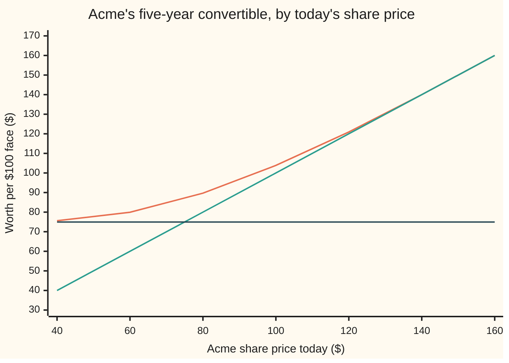

# Convertible bonds: a bond the holder may swap for shares, priced on a tree that splits cash from equity

[Syllabus](../../../SYLLABUS.md) → [Financial mathematics](../README.md) → [Equity structured notes - reverse convertibles, autocallables and convertibles](../README.md#s53) → Convertible bonds

---

## General Overview

Acme borrows money for five years by selling a **convertible bond**. Each bond has a face of $100, repaid at the end of year five, and pays a coupon of $2 at the end of every year. The holder has one extra right: on any day, they may hand the bond back and take one Acme share instead. That swap is **conversion**, and the one share per bond is the **conversion ratio**.

Acme shares trade at $100, on the house market: a riskless rate of 5% a year, a dividend yield of 2% and a volatility of 20%. Acme's own debt pays 3% a year more than the riskless rate. That extra is Acme's **credit spread**: the price of the chance that Acme defaults.

Two plain values set a lower limit on the bond's worth. As a bond with no swap, its coupons and face discounted at 5% + 3% = 8% are worth **$74.95**. That is the **bond floor**. Swapped today, it is worth one share, **$100**. That is **parity**. The bond is worth more than both, because the holder can wait and choose later. A tree prices it at **$103.86**.

The tree's one new idea is a split. Every future dollar the bond might pay is either **cash** that Acme must find, or **shares** that Acme can always hand over. Cash can be lost in a default, so it is discounted at 8%. Shares cannot, so they are discounted at 5%. Of the $103.86, $34.00 is cash and $69.86 is shares.

**A convertible bond is worth the larger of conversion and holding at every node of a share-price tree, where holding is the cash part discounted at the risky rate plus the share part discounted at the riskless rate.**

**What kind of fact this is:** a model: the cash-and-share split is a pricing convention published by Tsiveriotis and Fernandes in 1998, not a law, and later work refines it. Inside the model, "the price is never below the bond floor or parity" is a theorem, proved on this card in Why it works.

### The picture: worth against the share price



Orange: the convertible from the tree. Green: parity, the share price times one share. Dark: the bond floor, $74.95 at every share price. When Acme is low, the convertible hugs the floor and behaves like a bond. When Acme is high, it hugs parity and behaves like a share. In between, it sits above both, and that gap is the price of the holder's choice.

---

## The formula

Notation first, in words. The tree is the share-price tree from [Cox-Ross-Rubinstein](../04-Binomial%20Trees/04-crr-tree-and-convergence.md): each step of length $`\Delta t`$ multiplies the share by $`u`$ (up) or $`d`$ (down), with pricing weight $`p`$ on the up branch. At each node the bond's worth $`V`$ is split into a **cash part** $`B`$ and a **share part** $`V - B`$. "Up" and "down" below mean the two nodes one step later.

First, the value of holding the bond for one more step:

```math
B_{\text{hold}} = e^{-(r+s)\Delta t}\big[p\,B_{\text{up}} + (1-p)\,B_{\text{down}}\big] + c_t
```

```math
V_{\text{hold}} = B_{\text{hold}} + e^{-r\Delta t}\big[p\,(V-B)_{\text{up}} + (1-p)\,(V-B)_{\text{down}}\big]
```

**Read it aloud:** the cash part one step on, averaged and discounted at the risky rate, plus any coupon paid at this node; then add the share part one step on, averaged and discounted at the riskless rate.

Then the three choices, applied in this order:

```math
V = \max\Big(S,\; \min\big(\max(V_{\text{hold}},\,K_p + c_t),\; K_c + c_t\big)\Big)
```

**Read it aloud:** the holder may put the bond back for $`K_p`$ and the issuer may call it away for $`K_c`$, each paying any coupon due that day on top; and the holder may always convert into the share instead, whichever is worth more.

Each choice also decides what kind of money the node holds:

- **Converted:** $`V = S`$ and $`B = 0`$. The node is all shares.
- **Called or put:** $`V = B = K_c + c_t`$ or $`K_p + c_t`$. Acme pays cash, so it is all cash.
- **Held:** $`V = V_{\text{hold}}`$ and $`B = B_{\text{hold}}`$.

At maturity the bond pays the larger of $102 in cash (face plus last coupon) and one share. A put or call applies only on its own dates; at other nodes leave its term out.

| Symbol | Plain meaning | In our example | Push it up and the answer… |
| --- | --- | --- | --- |
| $`S`$ | Acme's share price at a node; also parity, since one bond converts into one share | $100 today | rises: the share part grows |
| $`F`$, $`c`$, $`c_t`$ | face; yearly coupon; coupon paid at this node (zero between coupon dates) | $100; $2 | rises: a higher floor |
| $`T`$, $`\Delta t`$ | life in years; one step's length | 5; 0.005 at 1,000 steps | — |
| $`r`$ | riskless rate, continuously compounded | 5% | mixed: shares grow faster, cash is worth less |
| $`q`$ | Acme's dividend yield, which the holder misses until converting | 2% | falls: the share part leaks dividends |
| $`\sigma`$ | volatility, how jumpy Acme is. Say "sigma". | 20% | rises: the choice is worth more |
| $`s`$ | Acme's credit spread over the riskless rate | 3% | falls: cash is worth less |
| $`u`$, $`d`$, $`p`$ | up factor, down factor, up weight | 1.2214, 0.8187, 0.5258 on a one-year step | — |
| $`V`$, $`B`$, $`V - B`$ | the bond's worth at a node; its cash part; its share part, also written $`E`$ | $103.86; $34.00; $69.86 today | — |
| $`P_t`$ | the straight bond's worth at a node at time $`t`$: the bond floor there | $74.95 today; $102 at maturity | — |
| $`K_c`$ | call price: what the issuer pays to buy the bond back early | $130 from year 2 | rises: the call bites less |
| $`K_p`$ | put price: what the holder may demand back early | $100 at year 3 | rises: the put is worth more |

### When it holds

- **Shares carry no credit risk.** The split assumes Acme can always deliver a share. In a real default the share collapses towards zero. The model ignores that link, and [Ayache, Forsyth and Vetzal](https://doi.org/10.3905/jod.2003.319208) show cases where it misprices because of it.
- **The cash part loses value at a steady spread.** Discounting cash at $`r + s`$ is the recovery-of-market-value rule (a default destroys a fixed fraction of the bond's market value) from [A risky bond from the hazard curve](../44-Reduced-Form%20Models%20-%20Risky%20Bonds%2C%20Spreads%20and%20Random%20Hazards/01-pricing-a-defaultable-bond-from-the-survival-curve.md), with the hazard times the fraction lost equal to 3%. If the spread widens as Acme falls, as it usually does, the tree overprices the bond near the floor.
- **One fixed volatility, rate and dividend yield.** These are the assumptions of [Cox-Ross-Rubinstein](../04-Binomial%20Trees/04-crr-tree-and-convergence.md). Over five years each one moves, and the tree cannot see it.
- **Both sides act at once and without error.** The holder converts the moment it pays. The issuer calls the moment holding is worth more than $`K_c`$. Real issuers often call late, and real calls give 30 days' notice, which hands the holder an option the tree leaves out.
- **Conversion forfeits the coupon due that day; a put or call pays it.** That is the convention here, and for puts and calls it is the standard term. Between coupon dates the card ignores accrued interest, which real puts and calls also pay. Some contracts pay accrued interest on conversion too, which raises the price slightly.

---

## Why it works

### Step 0: two kinds of money, two kinds of risk

Everything the bond can ever pay is one of two things. Either Acme pays cash: coupons, face, or a call or put price. Or Acme hands over a share.

Cash is a promise, and a promise from Acme can be broken. The market prices that risk in the 3% spread, so a cash promise is discounted at 8%. A share is different. Acme can issue a new share whenever it likes, so delivering one does not depend on Acme having money. The split keeps the two kinds apart and discounts each at its own rate.

A single rate cannot do this. All at 8% treats the share part as if it could default. All at 5% treats the cash part as if it could not. The right answer sits between those two prices, and it moves towards one or the other depending on how likely conversion is.

### Step 1: the share tree is the ordinary tree

The share price follows the tree from [Cox-Ross-Rubinstein](../04-Binomial%20Trees/04-crr-tree-and-convergence.md): up by $`u = e^{\sigma\sqrt{\Delta t}}`$, down by $`d = 1/u`$, with up weight $`p = (e^{(r-q)\Delta t} - d)/(u - d)`$. Nothing about the bond changes the share's tree. The credit spread enters only in how the bond's cash is discounted.

The 1,000-step tree has 200 steps a year, so every coupon date falls exactly on a column of nodes.

### Step 2: label each payment at maturity

At year five, each node knows what happens. If the share is above $102, the holder converts: the node is worth the share and is all equity. Below $102, the holder takes $102 in cash: the node is all cash. So the last column carries two numbers per node, its worth and its cash part.

### Step 3: walk back, carrying both numbers

One step earlier, the cash part is averaged over the two branches and discounted at 8%. The share part is averaged and discounted at 5%. Their sum, plus any coupon due, is the value of holding. This is the first formula, done at every node.

The split follows the money, not the node. A node that holds a mix carries both kinds forward in proportion, because each branch passes on its own cash and share parts.

### Step 4: the choices relabel the money

At each node three choices may override holding, as on [Early exercise](../04-Binomial%20Trees/05-american-exercise-on-a-tree.md), where the holder compares exercise with holding at every node:

1. **The holder's put.** Year 3 is a coupon date. If holding, with that day's $2 coupon, is worth less than $102, the holder hands the bond back for $100 in cash plus the $2 coupon. The node becomes all cash.
2. **The issuer's call.** From year 2, if holding is worth more than $130, Acme buys the bond back for $130 in cash, plus the coupon on a coupon date. The node becomes all cash. The issuer acts to keep the bond cheap, so it takes the smaller of the two numbers.
3. **The holder's conversion.** If the share is worth more than what is left, the holder converts. The node becomes all shares. When Acme calls, the holder can still convert, so a call when the share is worth more than the call price forces conversion.

### Step 5: the price never falls below the floor or parity

**Parity.** Conversion is allowed at every node, and it is the last choice taken. So every node is worth at least its share price.

**The floor.** Write $`P_t`$ for the straight bond's worth at a node at time $`t`$: its remaining coupons and face, discounted at 8%. The proof runs backwards from maturity. At maturity, $`V \ge 102 = P_T`$.

Suppose every node one step later is worth at least $`P`$ there. The share part $`V - B`$ is never negative: it is a share price, zero, or carried forward from non-negative values. Discounting it at 5% instead of 8% only raises it. So holding is worth at least the whole $`V`$ discounted at 8%, which is at least $`P`$ discounted at 8%, which is today's $`P_t`$.

The put only raises a node. The call lowers a node to $130 plus any coupon due, but the straight bond there is never worth more than $102 plus that coupon, so it stays above the floor. Conversion only raises a node. The induction closes.

<details>
<summary>The floor step, written out</summary>

Write $`E = V - B`$ for the share part. The share discount $`e^{-r\Delta t}`$ is at least the cash discount $`e^{-(r+s)\Delta t}`$. Then:

$`\displaystyle V_{\text{hold}} = e^{-(r+s)\Delta t}\bar B + e^{-r\Delta t}\bar E + c_t \;\ge\; e^{-(r+s)\Delta t}(\bar B + \bar E) + c_t \;\ge\; e^{-(r+s)\Delta t}\bar P + c_t = P_t.`$

Here a bar means the $`p`$-weighted average over the two branches. The first inequality needs $`\bar E \ge 0`$ and the larger share discount. The second is the induction step. The last equality is the straight bond's own backward walk, which discounts every cash flow at 8%.

The checks test the claim at every node of three trees: the plain bond, the bond with the call, and the bond with both call and put. No node falls below either bound. They also test Step 4's labels at every node: a node worth no more than its share holds no cash, and a node worth exactly a call or put payment is all cash.

</details>

### Step 6: an exact last step

A tree that lands its last column near $102 prices the cash-or-share split badly. The cash part jumps from $102 to zero at one share price, and the tree's nodes fall on either side of that jump almost at random. The price then jumps by cents from one step count to the next.

The fix replaces the last step with the exact one-step answer. Over one short step, the logarithm of the share's end price follows the bell curve, and the chance it ends above $102 has a closed form ([Black–Scholes call](../08-The%20Black-Scholes%20call%20and%20put/01-black-scholes-call.md)). The tree uses that closed form at its last step and walks back as usual from there. Broadie and Detemple introduced this smoothing for American options.

### Step 7: a row of nodes on the call price

The call makes a second sharp edge, at $130. From year 2 the call forces conversion once the share reaches $130 ($132 on a coupon date, when the call also pays the coupon), so a node there is all shares. A node just below $130 that the tree finds worth more than $130 is called instead, and becomes all cash. The two labels are discounted at different rates on the way back, so the price depends on exactly where the nodes fall around $130.

On the two-branch tree the rows of nodes sit at fixed multiples of today's price, and they slide past $130 as the step count changes. The callable price saws up and down: 103.0990 at 1,050 steps, 103.7546 at 1,010. More steps do not cure it. Each time a row crosses just below $130, that row is called for cash again and again through the three years.

The cure is to put a row of nodes exactly on $130. A two-branch tree cannot, because its rows alternate from one step to the next. A trinomial tree can ([Trinomial trees](../04-Binomial%20Trees/06-trinomial-trees-and-the-grid-connection.md)): its third branch leaves the rung spacing (the gap between neighbouring prices on its fixed ladder) free, so the spacing is chosen to fit a whole number of rungs between $100 and $130, each rung about 1.25 standard deviations of one step. On that row the share equals the call price. The node counts as shares, because the call forces conversion the moment the share reaches $130.

The trinomial tree here has 40 rungs from $100 to $130 and the exact last step of Step 6. It prices the plain bond at 103.8613, against 103.8592 on the two-branch tree, and the callable bond at 103.6866. With 60 rungs the call's cost moves from 0.1747 to 0.1669, so it is about 17 cents, give or take 1.

---

## Worked numbers, by hand

One node, on a tree with one step a year: year 4, with Acme at $100 (two ups and two downs). One step later the share is $122.14 or $81.87.

| Step | Arithmetic | Value |
| --- | --- | --- |
| up factor $`u`$ | $`e^{0.20}`$ | 1.2214 |
| down factor $`d`$ | $`e^{-0.20}`$ | 0.8187 |
| up weight $`p`$ | $`(e^{0.03} - 0.8187)/(1.2214 - 0.8187)`$ | 0.5258 |
| after an up | $`100 \times 1.2214`$: above $102, convert, all shares | 122.1403 |
| after a down | $`100 \times 0.8187`$: below $102, take $102, all cash | 81.8731 |
| cash part | $`e^{-0.08} \times (1 - 0.5258) \times 102`$ | 44.6499 |
| share part | $`e^{-0.05} \times 0.5258 \times 122.14`$ | 61.0889 |
| hold, with this year's $2 coupon | $`44.6499 + 61.0889 + 2`$ | **107.7388** |
| convert instead | one share | 100 |

Holding wins: $107.74 against $100. Discounting the whole node at 8% would give only $105.93, because it treats the share part as risky cash.

The same walk at every node gives the whole bond:

| Step | Arithmetic | Value |
| --- | --- | --- |
| bond floor | $`2(e^{-0.08} + \dots + e^{-0.40}) + 100\,e^{-0.40}`$ | 74.9487 |
| parity | one share at $100 | 100.0000 |
| tree, one step a year | the walk above, at every node | 103.6415 |
| tree, 1,000 steps | 200 steps a year, exact last step | **103.8592** |
| cash part of it | carried through the tree | 34.0029 |
| share part of it | $`103.8592 - 34.0029`$ | 69.8564 |
| trinomial tree, 40 rungs to $130 | Step 7's tree, no call or put | 103.8613 |
| issuer call at 130 from year 2 | the same tree, capped at the larger of 130 and the share | **103.6866** |
| holder put at 100 at year 3 | the same tree, raised to 100 plus the $2 coupon | 105.3446 |
| both | capped and raised | 105.1626 |

The bond is worth $103.86: 3.86% over parity, and far above the floor of $74.95. The call at 130 costs the holder about 17 cents, give or take 1: 0.1747 with 40 rungs to $130, 0.1669 with 60. That is small. Above $130 the call forces conversion, but there the bond is worth little more than its share, so little is lost. The put is worth about $1.48, give or take 2 cents: 1.4834 on the trinomial tree, while the two-branch tree prices the bond with the put 2 cents lower, at 105.3260, inside its wobble.

### What breaks if you drop a piece

| Mistake | Comes out at | What went wrong |
| --- | --- | --- |
| Discount everything at 8% | 100.3483 | Treats the shares as if Acme could fail to deliver them |
| Discount everything at 5% | 108.9479 | Ignores Acme's credit: the cash promises are priced as if riskless |
| Allow conversion only at maturity | 101.9560 | Drops the right to convert early, worth $1.90 here |
| Ignore the issuer's call at 130 | 103.8613 instead of 103.6866 | Gives the holder about 17 cents that Acme can take back |
| Price the call on the two-branch tree | 103.0990 to 103.7546 between 1,000 and 1,200 steps | $130 falls between rows of nodes, and a row just below it is called for cash |

---

## Code, from first principles, and it actually runs

The scripts price the bond on a 1,000-step tree with the cash-and-share split, price the call and the put on Step 7's trinomial tree, then take **four independent roads** to check them.

1. With early conversion switched off, the bond has a closed form: the discounted coupons, plus $102 times the chance of ending below $102 at 8%, plus the share above $102 at 5%. The tree must match it. It does: 101.9560 against 101.9558.
2. The trinomial tree has its own ladder and its own loop. It must agree with the two-branch tree on the plain bond (103.8613 against 103.8592), on the soft call (103.7521 against 103.7565), and on the put within the two-branch tree's wobble (105.3446 against 105.3260). With 40 and 60 rungs, the call's cost must agree within 2 cents.
3. Every node of three two-branch trees is tested against the bond floor and parity, as Step 5 proves. Every node of the main trees, two-branch and three-branch, is tested for the labels of Step 4.
4. The price must sit between two single-rate trees, everything at 8% and everything at 5%.

The bell-curve area is built from a Taylor series and a continued fraction, not imported.

### Python

```python
# Convertible bonds on a tree -- the check behind the card.  Standard library only.
# Nothing imported knows the answer: the bell-curve area is a series written out
# here, and both trees are loops.  Money is per bond, face 100, converting into 1 share.
from math import exp, sqrt, log, pi, ceil
def N(x):                                   # bell-curve area left of x, built here:
    if abs(x) > 3.0:                        # far out, a continued fraction for the tail
        f = abs(x)
        for k in range(80, 0, -1): f = abs(x) + k / f
        tail = exp(-x * x / 2.0) / sqrt(2.0 * pi) / f; return tail if x < 0 else 1.0 - tail
    term, total, k = x, x, 0                # near the middle, the Taylor series
    while abs(term) > 1e-17:
        k += 1; term *= -x * x / 2.0 / k; total += term / (2 * k + 1)
    return 0.5 + total / sqrt(2.0 * pi)
S0, F, c, T, r, q, sig, s = 100.0, 100.0, 2.0, 5, 0.05, 0.02, 0.20, 0.03
def floor_at(t):                            # straight bond: coupons and face at r + s
    return sum(c * exp(-(r + s) * (k - t)) for k in range(1, T + 1) if k > t + 1e-12) + F * exp(-(r + s) * (T - t))
def last_step(S, tau, rc, re):              # maturity payoff max(102, share), split:
    K = F + c                               # cash 102 below, share above; Black-Scholes
    d1 = (log(S / K) + (r - q + 0.5 * sig * sig) * tau) / (sig * sqrt(tau)); d2 = d1 - sig * sqrt(tau)
    return K * exp(-rc * tau) * N(-d2), S * exp((r - q - re) * tau) * N(d1)
def tree(S, steps, american=True, call=None, put=None, mode="tf", smooth=True):
    # call = (price, first year, share trigger), put = (price, year), each also paying any coupon
    # due.  mode "tf": cash at r + s, shares at r ("risky", "safe": all at r + s, all at r).
    dt = T / steps
    u = exp(sig * sqrt(dt)); d = 1.0 / u; p = (exp((r - q) * dt) - d) / (u - d)
    dc = exp(-(r + s) * dt) if mode != "safe" else exp(-r * dt); de = exp(-r * dt) if mode != "risky" else dc
    per = steps // T                        # steps per year: coupon dates are nodes
    spot = [S * u ** j * d ** (steps - j) for j in range(steps + 1)]
    V, B, bad = [max(F + c, x) for x in spot], [F + c if F + c > x else 0.0 for x in spot], 0
    for i in range(steps - 1, -1, -1):
        t, spot = i * dt, [x / d for x in spot[:i + 1]]
        cpn = c if i % per == 0 and i > 0 else 0.0
        fl = floor_at(t) + cpn
        nV, nB = [], []
        for j in range(i + 1):
            if i == steps - 1 and smooth:    # last step: the exact one-step split
                b, e = last_step(spot[j], dt, -log(dc) / dt, -log(de) / dt); b += cpn
            else:                            # plain step: average the two branches
                b = dc * (p * B[j + 1] + (1 - p) * B[j]) + cpn
                e = de * (p * (V[j + 1] - B[j + 1]) + (1 - p) * (V[j] - B[j]))
            v = b + e
            if put and abs(t - put[1]) < 1e-9 and v < put[0] + cpn:
                v = b = put[0] + cpn         # holder hands the bond back for cash
            if call and t >= call[1] - 1e-9 and v > call[0] + cpn and spot[j] >= call[2]:
                v = b = call[0] + cpn        # issuer buys it back for cash
            if american and spot[j] > v:
                v, b = spot[j], 0.0          # holder converts: all equity
            nV.append(v); nB.append(b)
            cash = (put and put[0] + cpn, call and call[0] + cpn)     # a choice leaves one kind:
            if v < max(fl, spot[j]) - 1e-9 or (b != 0.0 if spot[j] >= v else v in cash and b != v): bad += 1
        V, B = nV, nB
    return V[0], B[0], bad
def tri(S, rungs, call=None, put=None, level=130.0):
    # three branches, one ladder of prices with a rung on the call level; a tie there converts
    dx = log(level / S) / rungs; w = 1.25 * sig / dx   # a rung is 1.25 standard deviations of a step
    steps = 5 * ceil(T * w * w / 5)                    # a multiple of 5: coupon dates are nodes
    dt = T / steps; nu = r - q - sig * sig / 2; a = (sig * sig * dt + nu * dt * nu * dt) / (dx * dx)
    pu, pm, pd = (a + nu * dt / dx) / 2, 1 - a, (a - nu * dt / dx) / 2
    K, per, bad = int(6 * sig * sqrt(T) / dx), steps // T, 0   # rungs kept: six standard deviations
    lv = [S * exp(k * dx) for k in range(-K, K + 1)]; lv[K + rungs] = level
    walk = lambda W, f: [f * W[0]] + [f * (pu * W[k + 1] + pm * W[k] + pd * W[k - 1]) for k in range(1, 2 * K)]
    B, E = zip(*[last_step(x, dt, r + s, r) for x in lv])  # last step: the exact one-step split
    for i in range(steps - 1, -1, -1):
        t, cpn, nB, nE = i * dt, (c if i % per == 0 and i > 0 else 0.0), [], []
        if i < steps - 1: B, E = walk(B, exp(-(r + s) * dt)) + [0.0], walk(E, exp(-r * dt)) + [lv[-1]]
        for x, b, e in zip(lv, B, E):
            b += cpn; v = b + e
            if put and abs(t - put[1]) < 1e-9 and v < put[0] + cpn: v = b = put[0] + cpn
            if call and t >= call[1] - 1e-9 and v > call[0] + cpn and x >= call[2]: v = b = call[0] + cpn
            if x >= v: v, b = x, 0.0
            nB.append(b); nE.append(v - b)
            bad += b != 0.0 if x >= v else (v in (put and put[0] + cpn, call and call[0] + cpn) and b != v)
        B, E = nB, nE
    return B[K] + E[K], B[K], bad
def euro_closed(S):                         # conversion only at maturity, no call
    cash, share = last_step(S, T, r + s, r)
    cash += sum(c * exp(-(r + s) * k) for k in range(1, T)); return cash + share, cash
n, hard, soft, put3 = 1000, (130.0, 2, 0.0), (100.0, 2, 130.0), (100.0, 3)
floor0, parity = floor_at(0), S0 * 1.0
plain, plain_cash, bad = tree(S0, n)
called, _, bad_c = tree(S0, n, call=hard)
soft_v, putted, bad_b = tree(S0, n, call=soft)[0], tree(S0, n, put=put3)[0], tree(S0, n, call=hard, put=put3)[2]
(euro_tree, euro_tree_cash, _), (euro_cf, euro_cf_cash) = tree(S0, n, american=False), euro_closed(S0)
risky, safe = tree(S0, n, mode="risky")[0], tree(S0, n, mode="safe")[0]
tri40 = [tri(S0, 40, call=k, put=h) for k, h in [(None, None), (hard, None), (soft, None), (None, put3), (hard, put3)]]
t_plain, t_call, t_soft, t_put, t_both = [x[0] for x in tri40]
cost60 = tri(S0, 60)[0] - tri(S0, 60, call=hard)[0]
print("market: S 100, r 5%, q 2%, sigma 20%; bond: face 100, coupon 2, 5 years, 1 share")
for name, val in [("bond floor at r + s = 8%", floor0), ("parity: 1 share x 100", parity),
                  ("tree price, 1000 steps", plain), ("  cash part", plain_cash), ("  share part", plain - plain_cash),
                  ("premium over parity, %", 100 * (plain / parity - 1)), ("three-branch tree, 40 rungs to 130", t_plain),
                  ("with issuer call 130 from year 2", t_call), ("  cost of that call", t_plain - t_call),
                  ("  the same cost, 60 rungs to 130", cost60), ("with holder put 100 at year 3", t_put),
                  ("  value of that put", t_put - t_plain), ("with the call and the put", t_both),
                  ("soft call: 100 once share >= 130", soft_v), ("  three-branch tree", t_soft),
                  ("two-branch tree, call 130", called), ("two-branch tree, put 100", putted),
                  ("convert at maturity only, tree", euro_tree), ("  the same, closed form", euro_cf),
                  ("  tree cash part", euro_tree_cash), ("  closed-form cash part", euro_cf_cash),
                  ("right to convert early is worth", plain - euro_tree), ("everything at 8%", risky),
                  ("everything at 5%", safe), ("5-step tree, plain last step", tree(S0, 5, smooth=False)[0])]:
    print(f"{name:<38}{val:>11.4f}")
print(f"nodes below max(floor, parity) or mislabelled: {bad}, {bad_c} with the call, {bad_b} with call and put")
saw = sorted((tree(S0, k, call=hard)[0], k) for k in range(1000, 1201, 5))
print(f"two-branch tree, call 130, 1000 to 1200 steps: {saw[0][0]:.4f} at {saw[0][1]} to {saw[-1][0]:.4f} at {saw[-1][1]}")
u, d = exp(sig), exp(-sig); p = (exp(r - q) - d) / (u - d)
cash_h, eq_h = exp(-(r + s)) * (1 - p) * (F + c), exp(-r) * p * 100 * u; print("by hand: the year-4 node at S = 100, one step a year")
for name, val in [("up factor u", u), ("down factor d", d), ("up weight p", p), ("share after an up", 100 * u),
                  ("share after a down", 100 * d), ("cash: e^-0.08 x (1-p) x 102", cash_h),
                  ("share: e^-0.05 x p x 122.14", eq_h), ("hold: cash + share + coupon 2", cash_h + eq_h + c),
                  ("the same node, all at 8%", exp(-(r + s)) * (p * 100 * u + (1 - p) * (F + c)) + c)]:
    print(f"{name:<38}{val:>11.4f}")
counts = (100, 250, 500, 1000, 2000); conv = [tree(S0, k)[0] for k in counts]
print("steps     " + "".join(f"{k:>9d}" for k in counts))
print("price     " + "".join(f"{v:>9.4f}" for v in conv))
spots = [40.0 + 20.0 * i for i in range(7)]; curve = [tree(x, n)[0] for x in spots]
print("chart, Acme today     " + "".join(f"{x:>8.0f}" for x in spots))
print("chart, convertible    " + "".join(f"{v:>8.2f}" for v in curve))
print(f"chart, bond floor     {floor0:>8.2f} at every share price; parity = share price")
sig = 0.30; try_vol = tree(S0, n)[0]; sig = 0.20
s = 0.06; try_spr, try_fl = tree(S0, n)[0], floor_at(0); s = 0.03
q = 0.0; try_q0 = tree(S0, n)[0]; try_q0e = try_q0 - tree(S0, n, american=False)[0]; q = 0.02
try_c115, _, bad_t = tri(S0, 21, call=(115.0, 2, 0.0), level=115.0); bad_t += sum(x[2] for x in tri40)
print(f"try: sigma 30% {try_vol:.4f}; spread 6% {try_spr:.4f} (floor {try_fl:.4f})")
print(f"try: no dividend {try_q0:.4f} (early conversion {try_q0e:.4f}); call at 115 {try_c115:.4f} (cost {t_plain - try_c115:.4f})")
assert abs(N(0.3) - 0.617911422188953) < 1e-12, "the series against a tabled bell-curve area"
assert abs(euro_tree - euro_cf) < 0.005, "tree without early conversion vs the closed form"
assert abs(euro_tree_cash - euro_cf_cash) < 0.02, "the two cash parts agree too"
assert abs(plain - t_plain) < 0.01, "two-branch and three-branch trees: one American price"
assert abs(soft_v - t_soft) < 0.01, "and one soft-call price: the trigger only forces conversion"
assert abs(putted - t_put) < 0.05, "and one put price, to the two-branch tree's wobble"
assert abs(cost60 - (t_plain - t_call)) < 0.02, "the call's cost has settled on the three-branch tree"
assert bad + bad_c + bad_b + bad_t == 0, "never below floor or parity, never mislabelled, at any node"
assert risky < plain < safe, "between the all-at-8% and all-at-5% trees"
assert t_call < t_plain < t_both < t_put and soft_v < plain, "a call takes value away, a put adds it"
assert abs(conv[-1] - conv[-2]) < 0.01, "the tree has settled"
assert all(curve[i] >= max(floor0, spots[i]) for i in range(7)), "chart above both bounds"
assert try_q0e < 1e-9 < plain - euro_tree, "no dividend: early conversion is worth nothing"
print("ALL CHECKS PASS")
```

**Ran 2026-11-23 on macOS, Python 3.14.10, standard library only. All checks passed. Output, pasted from the run:**

```
market: S 100, r 5%, q 2%, sigma 20%; bond: face 100, coupon 2, 5 years, 1 share
bond floor at r + s = 8%                  74.9487
parity: 1 share x 100                    100.0000
tree price, 1000 steps                   103.8592
  cash part                               34.0029
  share part                              69.8564
premium over parity, %                     3.8592
three-branch tree, 40 rungs to 130       103.8613
with issuer call 130 from year 2         103.6866
  cost of that call                        0.1747
  the same cost, 60 rungs to 130           0.1669
with holder put 100 at year 3            105.3446
  value of that put                        1.4834
with the call and the put                105.1626
soft call: 100 once share >= 130         103.7565
  three-branch tree                      103.7521
two-branch tree, call 130                103.7382
two-branch tree, put 100                 105.3260
convert at maturity only, tree           101.9560
  the same, closed form                  101.9558
  tree cash part                          38.9247
  closed-form cash part                   38.9220
right to convert early is worth            1.9032
everything at 8%                         100.3483
everything at 5%                         108.9479
5-step tree, plain last step             103.6415
nodes below max(floor, parity) or mislabelled: 0, 0 with the call, 0 with call and put
two-branch tree, call 130, 1000 to 1200 steps: 103.0990 at 1050 to 103.7546 at 1010
by hand: the year-4 node at S = 100, one step a year
up factor u                                1.2214
down factor d                              0.8187
up weight p                                0.5258
share after an up                        122.1403
share after a down                        81.8731
cash: e^-0.08 x (1-p) x 102               44.6499
share: e^-0.05 x p x 122.14               61.0889
hold: cash + share + coupon 2            107.7388
the same node, all at 8%                 105.9334
steps           100      250      500     1000     2000
price      103.8355 103.8503 103.8473 103.8592 103.8611
chart, Acme today           40      60      80     100     120     140     160
chart, convertible       75.61   79.93   89.68  103.86  120.92  140.00  160.00
chart, bond floor        74.95 at every share price; parity = share price
try: sigma 30% 109.8172; spread 6% 100.3842 (floor 64.9715)
try: no dividend 109.9166 (early conversion 0.0000); call at 115 103.5165 (cost 0.3447)
ALL CHECKS PASS
```

### Rust

```rust
// Convertible bonds on a tree -- the check behind the card.  std only, no crates.
// Nothing imported knows the answer: the bell-curve area is a series written out
// here, and both trees are loops.  Money is per bond, face 100, converting into 1 share.
use std::f64::consts::PI;
fn n_cdf(x: f64) -> f64 {                   // bell-curve area left of x, built here:
    if x.abs() > 3.0 {                      // far out, a continued fraction for the tail
        let mut f = x.abs();
        for k in (1..=80).rev() { f = x.abs() + k as f64 / f; }
        let tail = (-x * x / 2.0).exp() / (2.0 * PI).sqrt() / f; return if x < 0.0 { tail } else { 1.0 - tail };
    }
    let (mut term, mut total, mut k) = (x, x, 0.0);   // near the middle, the Taylor series
    while term.abs() > 1e-17 { k += 1.0; term *= -x * x / 2.0 / k; total += term / (2.0 * k + 1.0); }
    0.5 + total / (2.0 * PI).sqrt()
}
#[derive(Clone, Copy)]
struct M { r: f64, q: f64, sig: f64, s: f64 }   // rate, dividend yield, volatility, spread
const S0: f64 = 100.0; const F: f64 = 100.0; const C: f64 = 2.0; const T: usize = 5;
type Call = Option<(f64, f64, f64)>; type Put = Option<(f64, f64)>;   // (price, first year, trigger), (price, year)
fn floor_at(m: M, t: f64) -> f64 {          // straight bond: coupons and face at r + s
    let mut sum = 0.0;
    for k in 1..=T { if k as f64 > t + 1e-12 { sum += C * (-(m.r + m.s) * (k as f64 - t)).exp(); } }
    sum + F * (-(m.r + m.s) * (T as f64 - t)).exp()
}
fn last_step(m: M, s: f64, tau: f64, rc: f64, re: f64) -> (f64, f64) {
    let k = F + C;                          // maturity payoff max(102, share), split
    let d1 = ((s / k).ln() + (m.r - m.q + 0.5 * m.sig * m.sig) * tau) / (m.sig * tau.sqrt()); let d2 = d1 - m.sig * tau.sqrt();
    (k * (-rc * tau).exp() * n_cdf(-d2), s * ((m.r - m.q - re) * tau).exp() * n_cdf(d1))
}
// a choice leaves one kind: worth no more than its share, no cash; worth a call or put price, all cash
fn mislabelled(s: f64, v: f64, b: f64, cash: [Option<f64>; 2]) -> bool {
    if s >= v { b != 0.0 } else { cash.iter().any(|&k| k == Some(v)) && b != v }
}
// A call or put also pays any coupon due.  mode 0 discounts the cash part at r + s and the share
// part at r; 1 puts both at r + s, 2 both at r.
fn tree(m: M, s0: f64, steps: usize, american: bool, call: Call, put: Put, mode: u8, smooth: bool) -> (f64, f64, usize) {
    let dt = T as f64 / steps as f64;
    let u = (m.sig * dt.sqrt()).exp(); let d = 1.0 / u; let p = (((m.r - m.q) * dt).exp() - d) / (u - d);
    let dc = if mode != 2 { (-(m.r + m.s) * dt).exp() } else { (-m.r * dt).exp() }; let de = if mode != 1 { (-m.r * dt).exp() } else { dc };
    let per = steps / T;                    // steps per year: coupon dates are nodes
    let mut spot: Vec<f64> = (0..=steps).map(|j| s0 * u.powf(j as f64) * d.powf((steps - j) as f64)).collect();
    let mut v_: Vec<f64> = spot.iter().map(|&x| (F + C).max(x)).collect();
    let (mut b_, mut bad): (Vec<f64>, usize) = (spot.iter().map(|&x| if F + C > x { F + C } else { 0.0 }).collect(), 0);
    for i in (0..steps).rev() {
        let t = i as f64 * dt; spot = spot[..i + 1].iter().map(|x| x / d).collect();
        let cpn = if i % per == 0 && i > 0 { C } else { 0.0 }; let fl = floor_at(m, t) + cpn;
        let (mut nv, mut nb) = (Vec::with_capacity(i + 1), Vec::with_capacity(i + 1));
        for j in 0..=i {
            let (mut b, e);
            if i == steps - 1 && smooth {   // last step: the exact one-step split
                let (bb, ee) = last_step(m, spot[j], dt, -dc.ln() / dt, -de.ln() / dt); b = bb + cpn; e = ee;
            } else {                        // plain step: average the two branches
                b = dc * (p * b_[j + 1] + (1.0 - p) * b_[j]) + cpn;
                e = de * (p * (v_[j + 1] - b_[j + 1]) + (1.0 - p) * (v_[j] - b_[j]));
            }
            let mut v = b + e;
            if let Some((kp, tp)) = put { if (t - tp).abs() < 1e-9 && v < kp + cpn { v = kp + cpn; b = v; } }   // put for cash
            if let Some((kc, tc, trig)) = call { if t >= tc - 1e-9 && v > kc + cpn && spot[j] >= trig { v = kc + cpn; b = v; } }
            if american && spot[j] > v { v = spot[j]; b = 0.0; }   // holder converts
            nv.push(v); nb.push(b);
            let cash = [put.map(|(kp, _)| kp + cpn), call.map(|(kc, _, _)| kc + cpn)];
            if v < fl.max(spot[j]) - 1e-9 || mislabelled(spot[j], v, b, cash) { bad += 1; }
        }
        v_ = nv; b_ = nb;
    }
    (v_[0], b_[0], bad)
}
// three branches, one ladder of prices with a rung on the call level; a tie there converts
fn tri(m: M, s0: f64, rungs: usize, call: Call, put: Put, level: f64) -> (f64, f64, usize) {
    let dx = (level / s0).ln() / rungs as f64; let w = 1.25 * m.sig / dx;   // a rung: 1.25 step sds
    let steps = 5 * (T as f64 * w * w / 5.0).ceil() as usize;            // coupon dates are nodes
    let dt = T as f64 / steps as f64; let nu = m.r - m.q - m.sig * m.sig / 2.0;
    let a = (m.sig * m.sig * dt + nu * dt * nu * dt) / (dx * dx);
    let (pu, pm, pd) = ((a + nu * dt / dx) / 2.0, 1.0 - a, (a - nu * dt / dx) / 2.0);
    let (k, per, mut bad) = ((6.0 * m.sig * (T as f64).sqrt() / dx) as usize, steps / T, 0usize);
    let mut lv: Vec<f64> = (0..=2 * k).map(|i| s0 * ((i as f64 - k as f64) * dx).exp()).collect(); lv[k + rungs] = level;
    let walk = |w: &Vec<f64>, f: f64, top: f64| -> Vec<f64> {
        let mut o = vec![f * w[0]];
        for i in 1..2 * k { o.push(f * (pu * w[i + 1] + pm * w[i] + pd * w[i - 1])); }
        o.push(top); o
    };
    let (mut b_, mut e_): (Vec<f64>, Vec<f64>) = lv.iter().map(|&x| last_step(m, x, dt, m.r + m.s, m.r)).unzip();
    for i in (0..steps).rev() {
        let (t, cpn) = (i as f64 * dt, if i % per == 0 && i > 0 { C } else { 0.0 });
        if i < steps - 1 { b_ = walk(&b_, (-(m.r + m.s) * dt).exp(), 0.0); e_ = walk(&e_, (-m.r * dt).exp(), lv[2 * k]); }
        for j in 0..=2 * k {
            let x = lv[j]; let mut b = b_[j] + cpn; let mut v = b + e_[j];
            if let Some((kp, tp)) = put { if (t - tp).abs() < 1e-9 && v < kp + cpn { v = kp + cpn; b = v; } }
            if let Some((kc, tc, trig)) = call { if t >= tc - 1e-9 && v > kc + cpn && x >= trig { v = kc + cpn; b = v; } }
            if x >= v { v = x; b = 0.0; }
            b_[j] = b; e_[j] = v - b;
            if mislabelled(x, v, b, [put.map(|(kp, _)| kp + cpn), call.map(|(kc, _, _)| kc + cpn)]) { bad += 1; }
        }
    }
    (b_[k] + e_[k], b_[k], bad)
}
fn euro_closed(m: M, s0: f64) -> (f64, f64) {   // conversion only at maturity, no call
    let (mut cash, share) = last_step(m, s0, T as f64, m.r + m.s, m.r);
    for k in 1..T { cash += C * (-(m.r + m.s) * k as f64).exp(); } (cash + share, cash)
}
fn row(name: &str, val: f64) { println!("{:<38}{:>11.4}", name, val); }
fn main() {
    let m = M { r: 0.05, q: 0.02, sig: 0.20, s: 0.03 };
    let (n, hard, soft, put3) = (1000, Some((130.0, 2.0, 0.0)), Some((100.0, 2.0, 130.0)), Some((100.0, 3.0)));
    let tr = |m: M, s0: f64, k: usize, call: Call, put: Put| tree(m, s0, k, true, call, put, 0, true);
    let (floor0, parity) = (floor_at(m, 0.0), S0 * 1.0);
    let (plain, plain_cash, bad) = tr(m, S0, n, None, None);
    let (called, _, bad_c) = tr(m, S0, n, hard, None);
    let (soft_v, putted, bad_b) = (tr(m, S0, n, soft, None).0, tr(m, S0, n, None, put3).0, tr(m, S0, n, hard, put3).2);
    let ((euro_tree, euro_tree_cash, _), (euro_cf, euro_cf_cash)) = (tree(m, S0, n, false, None, None, 0, true), euro_closed(m, S0));
    let (risky, safe) = (tree(m, S0, n, true, None, None, 1, true).0, tree(m, S0, n, true, None, None, 2, true).0);
    let tri40: Vec<(f64, f64, usize)> = [(None, None), (hard, None), (soft, None), (None, put3), (hard, put3)]
        .iter().map(|&(k, h)| tri(m, S0, 40, k, h, 130.0)).collect();
    let (t_plain, t_call, t_soft, t_put, t_both) = (tri40[0].0, tri40[1].0, tri40[2].0, tri40[3].0, tri40[4].0);
    let cost60 = tri(m, S0, 60, None, None, 130.0).0 - tri(m, S0, 60, hard, None, 130.0).0;
    println!("market: S 100, r 5%, q 2%, sigma 20%; bond: face 100, coupon 2, 5 years, 1 share");
    for (name, val) in [("bond floor at r + s = 8%", floor0), ("parity: 1 share x 100", parity),
        ("tree price, 1000 steps", plain), ("  cash part", plain_cash), ("  share part", plain - plain_cash),
        ("premium over parity, %", 100.0 * (plain / parity - 1.0)), ("three-branch tree, 40 rungs to 130", t_plain),
        ("with issuer call 130 from year 2", t_call), ("  cost of that call", t_plain - t_call),
        ("  the same cost, 60 rungs to 130", cost60), ("with holder put 100 at year 3", t_put),
        ("  value of that put", t_put - t_plain), ("with the call and the put", t_both),
        ("soft call: 100 once share >= 130", soft_v), ("  three-branch tree", t_soft),
        ("two-branch tree, call 130", called), ("two-branch tree, put 100", putted),
        ("convert at maturity only, tree", euro_tree), ("  the same, closed form", euro_cf),
        ("  tree cash part", euro_tree_cash), ("  closed-form cash part", euro_cf_cash),
        ("right to convert early is worth", plain - euro_tree), ("everything at 8%", risky),
        ("everything at 5%", safe), ("5-step tree, plain last step", tree(m, S0, 5, true, None, None, 0, false).0)] { row(name, val); }
    println!("nodes below max(floor, parity) or mislabelled: {}, {} with the call, {} with call and put", bad, bad_c, bad_b);
    let mut saw: Vec<(f64, usize)> = (1000..=1200).step_by(5).map(|k| (tr(m, S0, k, hard, None).0, k)).collect();
    saw.sort_by(|a, b| a.partial_cmp(b).unwrap());
    let (lo, hi) = (saw[0], saw[saw.len() - 1]);
    println!("two-branch tree, call 130, 1000 to 1200 steps: {:.4} at {} to {:.4} at {}", lo.0, lo.1, hi.0, hi.1);
    let (u, d) = (m.sig.exp(), (-m.sig).exp()); let p = ((m.r - m.q).exp() - d) / (u - d);
    let (cash_h, eq_h) = ((-(m.r + m.s)).exp() * (1.0 - p) * (F + C), (-m.r).exp() * p * 100.0 * u);
    println!("by hand: the year-4 node at S = 100, one step a year");
    for (name, val) in [("up factor u", u), ("down factor d", d), ("up weight p", p), ("share after an up", 100.0 * u),
        ("share after a down", 100.0 * d), ("cash: e^-0.08 x (1-p) x 102", cash_h),
        ("share: e^-0.05 x p x 122.14", eq_h), ("hold: cash + share + coupon 2", cash_h + eq_h + C),
        ("the same node, all at 8%", (-(m.r + m.s)).exp() * (p * 100.0 * u + (1.0 - p) * (F + C)) + C)] { row(name, val); }
    let counts = [100usize, 250, 500, 1000, 2000]; let conv: Vec<f64> = counts.iter().map(|&k| tr(m, S0, k, None, None).0).collect();
    println!("steps     {}", counts.iter().map(|k| format!("{:>9}", k)).collect::<String>());
    println!("price     {}", conv.iter().map(|v| format!("{:>9.4}", v)).collect::<String>());
    let spots: Vec<f64> = (0..7).map(|i| 40.0 + 20.0 * i as f64).collect();
    let curve: Vec<f64> = spots.iter().map(|&x| tr(m, x, n, None, None).0).collect();
    let line = |v: &Vec<f64>, dp: usize| v.iter().map(|x| format!("{:>8.*}", dp, x)).collect::<String>();
    println!("chart, Acme today     {}", line(&spots, 0));
    println!("chart, convertible    {}", line(&curve, 2));
    println!("chart, bond floor     {:>8.2} at every share price; parity = share price", floor0);
    let (m6, m0, try_vol) = (M { s: 0.06, ..m }, M { q: 0.0, ..m }, tr(M { sig: 0.30, ..m }, S0, n, None, None).0);
    let (try_spr, try_fl) = (tr(m6, S0, n, None, None).0, floor_at(m6, 0.0));
    let try_q0 = tr(m0, S0, n, None, None).0; let try_q0e = try_q0 - tree(m0, S0, n, false, None, None, 0, true).0;
    let (try_c115, _, bad_115) = tri(m, S0, 21, Some((115.0, 2.0, 0.0)), None, 115.0);
    let bad_t = bad_115 + tri40.iter().map(|x| x.2).sum::<usize>();
    println!("try: sigma 30% {:.4}; spread 6% {:.4} (floor {:.4})", try_vol, try_spr, try_fl);
    println!("try: no dividend {:.4} (early conversion {:.4}); call at 115 {:.4} (cost {:.4})", try_q0, try_q0e, try_c115, t_plain - try_c115);
    assert!((n_cdf(0.3) - 0.617911422188953).abs() < 1e-12, "the series against a tabled bell-curve area");
    assert!((euro_tree - euro_cf).abs() < 0.005, "tree without early conversion vs the closed form");
    assert!((euro_tree_cash - euro_cf_cash).abs() < 0.02, "the two cash parts agree too");
    assert!((plain - t_plain).abs() < 0.01, "two-branch and three-branch trees: one American price");
    assert!((soft_v - t_soft).abs() < 0.01, "and one soft-call price: the trigger only forces conversion");
    assert!((putted - t_put).abs() < 0.05, "and one put price, to the two-branch tree's wobble");
    assert!((cost60 - (t_plain - t_call)).abs() < 0.02, "the call's cost has settled on the three-branch tree");
    assert!(bad + bad_c + bad_b + bad_t == 0, "never below floor or parity, never mislabelled, at any node");
    assert!(risky < plain && plain < safe, "between the all-at-8% and all-at-5% trees");
    assert!(t_call < t_plain && t_plain < t_both && t_both < t_put && soft_v < plain, "a call takes value away, a put adds it");
    assert!((conv[4] - conv[3]).abs() < 0.01, "the tree has settled");
    assert!((0..7).all(|i| curve[i] >= floor0.max(spots[i])), "chart above both bounds");
    assert!(try_q0e < 1e-9 && 1e-9 < plain - euro_tree, "no dividend: early conversion is worth nothing");
    println!("ALL CHECKS PASS");
}
```

**Ran 2026-11-23 on macOS, rustc 1.98.1, no crates. All checks passed. Output, pasted from the run:**

```
market: S 100, r 5%, q 2%, sigma 20%; bond: face 100, coupon 2, 5 years, 1 share
bond floor at r + s = 8%                  74.9487
parity: 1 share x 100                    100.0000
tree price, 1000 steps                   103.8592
  cash part                               34.0029
  share part                              69.8564
premium over parity, %                     3.8592
three-branch tree, 40 rungs to 130       103.8613
with issuer call 130 from year 2         103.6866
  cost of that call                        0.1747
  the same cost, 60 rungs to 130           0.1669
with holder put 100 at year 3            105.3446
  value of that put                        1.4834
with the call and the put                105.1626
soft call: 100 once share >= 130         103.7565
  three-branch tree                      103.7521
two-branch tree, call 130                103.7382
two-branch tree, put 100                 105.3260
convert at maturity only, tree           101.9560
  the same, closed form                  101.9558
  tree cash part                          38.9247
  closed-form cash part                   38.9220
right to convert early is worth            1.9032
everything at 8%                         100.3483
everything at 5%                         108.9479
5-step tree, plain last step             103.6415
nodes below max(floor, parity) or mislabelled: 0, 0 with the call, 0 with call and put
two-branch tree, call 130, 1000 to 1200 steps: 103.0990 at 1050 to 103.7546 at 1010
by hand: the year-4 node at S = 100, one step a year
up factor u                                1.2214
down factor d                              0.8187
up weight p                                0.5258
share after an up                        122.1403
share after a down                        81.8731
cash: e^-0.08 x (1-p) x 102               44.6499
share: e^-0.05 x p x 122.14               61.0889
hold: cash + share + coupon 2            107.7388
the same node, all at 8%                 105.9334
steps           100      250      500     1000     2000
price      103.8355 103.8503 103.8473 103.8592 103.8611
chart, Acme today           40      60      80     100     120     140     160
chart, convertible       75.61   79.93   89.68  103.86  120.92  140.00  160.00
chart, bond floor        74.95 at every share price; parity = share price
try: sigma 30% 109.8172; spread 6% 100.3842 (floor 64.9715)
try: no dividend 109.9166 (early conversion 0.0000); call at 115 103.5165 (cost 0.3447)
ALL CHECKS PASS
```

> [!TIP]
> **Try changing**
> - Guess first: does more volatility help the holder? Set `sig = 0.30`. The bond rises from $103.86 to **$109.82**. The holder owns a choice, and choices gain from jumpiness.
> - Guess first: what does doubling Acme's spread do? Set `s = 0.06`. The floor falls from $74.95 to **$64.97**, but the bond falls only to **$100.38**. At $100 the bond is mostly shares, and shares are not discounted at the spread.
> - Guess first: is early conversion still worth $1.90 without dividends? Set `q = 0.0`. The bond is worth **$109.92**, and the right to convert early is worth **$0.0000**. With no dividend to collect, the holder never gains by converting before maturity.
> - Guess first: does a lower call price hurt the holder much more? Call at 115 from year 2 instead of 130, on a trinomial tree with a row of nodes on $115 (21 rungs). The price falls to **$103.52**, so the call costs about **34 cents** (0.3447), twice the call at 130. At $115 the bond is still worth well above its share, so forcing conversion there takes more.

---

## The usual mistake

> [!warning]
> **Discounting the whole bond at one rate.** One rate cannot be right, because the bond holds two kinds of money. All at the risky 8% gives $100.35; all at the riskless 5% gives $108.95. The answer, $103.86, lies between them and moves with the share price: near the floor the bond is mostly cash, near parity mostly shares.
>
> - **Pricing it as bond floor plus a call option.** That allows conversion only at maturity. Even with the call's $102 strike discounted at 8%, as the split requires, it gives $101.96. The early-conversion right is worth $1.90, because conversion starts the dividend stream sooner.
> - **Treating the call as a cap at the call price.** The holder can convert when called, so the bond is capped at the larger of $130 and the share price, not at $130. The call here costs only about 17 cents.
> - **Ignoring soft-call triggers.** Most real calls are soft: Acme may call at $100 only once the share has traded above $130, typically for 20 of 30 trading days. The checks test a one-day version of that rule and get $103.76, between the plain bond and the hard call.
> - **Trusting one step count.** The price wobbles as steps are added: 103.8355 at 100 steps, 103.8503 at 250, 103.8473 at 500, 103.8611 at 2,000. For the plain bond, read the row and quote about one cent of uncertainty. With the call it is far worse: on the two-branch tree the callable price runs from 103.0990 at 1,050 steps to 103.7546 at 1,010, because $130 falls between rows of nodes. Price a call on a tree with a row of nodes on the call price, as in Step 7.

---

## Where you meet it in real life

- **Growth companies raising money.** Firms with volatile shares sell convertibles to pay a low coupon, here 2% against 8% on straight debt. Investors accept the low coupon because the conversion right is worth the difference.
- **Convertible arbitrage funds.** These funds buy convertibles and sell borrowed Acme shares (sell short) to hedge the share part. What remains is a position in credit and volatility. The hedge ratio comes from this tree: [Convertible risk](05-convertible-bond-greeks-and-implied-volatility.md).
- **The issuer's treasury desk.** The call schedule and soft-call trigger decide when Acme can force conversion and clean the debt off its balance sheet. The tree prices what those terms cost.
- **Bank structured notes.** A convertible is the opposite of a reverse convertible ([Reverse convertibles](01-reverse-convertibles.md)). There the bank holds the conversion choice and the investor sold it. Here the investor owns it.
- **Contingent convertibles (CoCos).** Bank capital bonds that convert into shares when the bank is in trouble. The conversion is forced, not chosen, so the same tree needs a different rule at each node.

> **Say it back**
> A convertible bond pays coupons and face like a bond, but the holder may swap it for shares at any time. It is worth at least its bond floor, the coupons and face discounted at the risky rate, and at least parity, the shares it converts into. A tree prices it by carrying two numbers at every node: the cash part, discounted at the riskless rate plus the credit spread, and the share part, discounted at the riskless rate. At each node the holder's put, the issuer's call and the holder's conversion may override holding, and each choice relabels the node as all cash or all shares. For Acme the bond is worth $103.86, between $100.35 and $108.95, the two single-rate answers.

---

## What this builds on

- [Cox-Ross-Rubinstein](../04-Binomial%20Trees/04-crr-tree-and-convergence.md): the share-price tree, its up and down factors, its up weight, and why the price wobbles as steps are added.
- [Early exercise](../04-Binomial%20Trees/05-american-exercise-on-a-tree.md): the comparison at every node. This card makes three comparisons at each node and gives the call to the other side.
- [Trinomial trees](../04-Binomial%20Trees/06-trinomial-trees-and-the-grid-connection.md): a third branch frees the rung spacing, so a row of nodes can sit exactly on the call price.
- [Bond price and yield](../01-Money%2C%20Dates%20and%20Discounting/05-bonds-price-and-yield.md): the bond floor is a bond price, every coupon and the face discounted at one rate.
- [A risky bond from the hazard curve](../44-Reduced-Form%20Models%20-%20Risky%20Bonds%2C%20Spreads%20and%20Random%20Hazards/01-pricing-a-defaultable-bond-from-the-survival-curve.md): why a risky cash promise is discounted at the riskless rate plus a spread, the rate this card uses for the cash part.
- [Reverse convertibles](01-reverse-convertibles.md), [Autocallables](02-autocallables-and-phoenix-notes.md) and [Worst-of autocallables](03-worst-of-autocallables-and-their-risk.md): the shelf's notes where the bank holds the choice; this card turns it round.

## Where this goes next

- [Convertible risk](05-convertible-bond-greeks-and-implied-volatility.md): the same tree read backwards. A quoted price gives the volatility or the spread, and the first nodes give the hedge ratio.

The split treats Acme's shares as safe even when Acme defaults. What should the tree do when a default sends the share price to zero along with the cash?

---

## Sources

Verified 2026-11-23: every link below resolves to the publisher's page.

- Tsiveriotis, Kostas, and Chris Fernandes. "Valuing Convertible Bonds with Credit Risk." *Journal of Fixed Income* 8, no. 2 (1998): 95–102. [doi:10.3905/jfi.1998.408243](https://doi.org/10.3905/jfi.1998.408243). The cash-and-share split, with each part discounted at its own rate.
- Ayache, E., P. A. Forsyth, and Kenneth R. Vetzal. "Valuation of Convertible Bonds With Credit Risk." *Journal of Derivatives* 11, no. 1 (2003): 9–29. [doi:10.3905/jod.2003.319208](https://doi.org/10.3905/jod.2003.319208). Shows where the split is inconsistent and models the share's fall at default.
- De Spiegeleer, Jan, and Wim Schoutens, eds. *The Handbook of Convertible Bonds: Pricing, Strategies and Risk Management*. Wiley, 2011. [doi:10.1002/9781118374696](https://doi.org/10.1002/9781118374696). Bond floor, parity, call and put terms, soft calls and tree pricing as the market uses them.
- Cox, John C., Stephen A. Ross, and Mark Rubinstein. "Option Pricing: A Simplified Approach." *Journal of Financial Economics* 7, no. 3 (1979): 229–263. [doi:10.1016/0304-405X(79)90015-1](https://doi.org/10.1016/0304-405X(79)90015-1). The share-price tree.
- Broadie, Mark, and Jerome Detemple. "American Option Valuation: New Bounds, Approximations, and a Comparison of Existing Methods." *Review of Financial Studies* 9, no. 4 (1996): 1211–1250. [doi:10.1093/rfs/9.4.1211](https://doi.org/10.1093/rfs/9.4.1211). The exact last step that smooths the tree's wobble.
