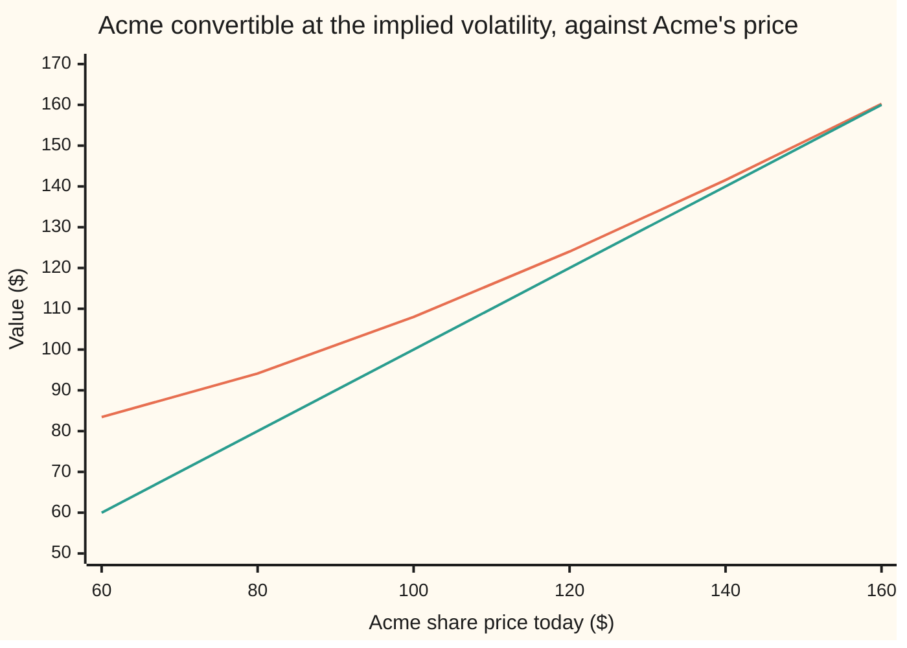
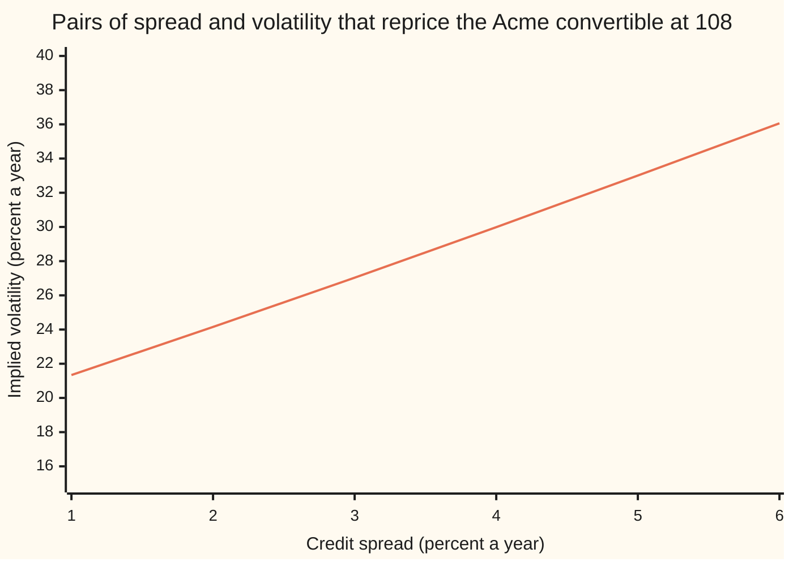

# Convertible risk: delta, gamma, credit sensitivity, and the volatility and spread a price implies

[Syllabus](../../../SYLLABUS.md) → [Financial mathematics](../README.md) → [Equity structured notes - reverse convertibles, autocallables and convertibles](../README.md#s53) → Convertible risk

---

## General Overview

Acme has a five-year convertible bond outstanding. Each bond has face $100, pays a $2 coupon once a year, and may be swapped at any time for one Acme share; a swap gives up the coupon due that day. Acme trades at $100. Cash earns 5 percent a year, Acme pays a 2 percent dividend yield, and the market charges Acme a credit spread of 3 percent: the extra yield lenders demand for the chance Acme fails to pay.

The tree of [Convertible bonds](04-convertible-bonds-on-a-tree.md) prices this bond at **$103.86** if Acme's volatility (how jumpy the share is, per year) is 20 percent. The screen quotes it at **$108**. A trader holding that gap needs four answers, and this card reads every one off the same tree:

- **What volatility does $108 imply?** At a 3 percent spread, **27.0286 percent**. Or, keeping volatility at 20 percent, the implied spread is **50.90 basis points** (a basis point, bp, is 0.01 percent).
- **How many shares does the bond behave like?** Its **delta** (dollars of bond value per dollar of Acme) is **0.7542**, and its **gamma** (how fast delta changes per dollar of Acme) is **0.005412**.
- **What does credit cost?** Each 1 bp rise in Acme's spread takes about **$0.0179** off each bond.
- **How big is the hedge?** A fund buying 100,000 bonds shorts **75423** shares, and then makes money when Acme jumps either way.

That last line is **convertible arbitrage**: buy the bond, short delta shares against it, and earn from Acme's swings while the share price itself washes out.

**One quote fixes one equation, so it buys one unknown: name the spread and the price gives a volatility, name the volatility and it gives a spread; delta and gamma come free from the tree's first nodes, and credit risk lives only in the bond's cash part.**

**What kind of fact this is:** a set of methods on a model. The tree is a model (an assumption that fits well enough, not a law). The inverses are exact for that model, because its price moves in one direction with each input, which the price scans in the code show across the range used.

### The picture: the bond against the share



Upper line: the convertible, priced at 27.0286 percent volatility and 3 percent spread. Lower line: **parity**, the value of the one share the bond converts into. Far below, the bond leans on its **bond floor** (its worth with no conversion right), $74.948719. Far above, it hugs parity. Delta is the slope of the upper line: 0.434 at Acme $60, 0.754 at $100, 0.961 at $160.

---

## The formula

The tree splits each node's value $`V`$ into two parts, as [Convertible bonds](04-convertible-bonds-on-a-tree.md) explains. The **equity part** $`E`$ is what will be paid in shares; it is discounted at the riskless rate $`r`$. The **cash part** $`B`$ is what will be paid in coupons and face; it is discounted at $`r + s`$, with $`s`$ the credit spread. This card asks five questions of that tree.

The two inverses, with $`Q`$ the quoted price:

```math
V(\sigma^*, s) = Q \qquad\text{and}\qquad V(\sigma, s^*) = Q
```

**Read it aloud:** the implied volatility $`\sigma^*`$ is the volatility that makes the tree hit the quote at a given spread; the implied spread $`s^*`$ is the spread that makes it hit the quote at a given volatility.

Delta and gamma come off the first two rows of the tree. $`V_n(j)`$ is the bond's value after $`n`$ steps of which $`j`$ went up, and $`S_n(j)`$ is Acme's price there, as on [Greeks from a tree or grid](../07-Greeks%20by%20Numbers%20and%20Calibration/04-greeks-from-a-tree-or-grid.md). The gaps two steps in are $`h_+ = S_2(2) - S_2(1)`$ above the middle node and $`h_- = S_2(1) - S_2(0)`$ below it.

```math
\Delta = \frac{V_1(1) - V_1(0)}{S_1(1) - S_1(0)}, \qquad \Gamma = \frac{2}{h_+ + h_-}\left(\frac{V_2(2) - V_2(1)}{h_+} - \frac{V_2(1) - V_2(0)}{h_-}\right)
```

**Read it aloud:** delta is the bond's gap over the share's gap one step in; gamma is the change in that slope across the three nodes two steps in, spread over their width.

Credit sensitivity, written $`\mathrm{CS01}`$ (dollars per 1 bp of spread), reaches the price only through the cash part. $`D`$ is the cash part's **spread duration**: the share of the cash part lost per unit of spread, in years. If the conversion line stayed put, it would be the cash part's average time to payment, weighted by how much of each payment stays in the cash part.

```math
\mathrm{CS01} = 0.0001\,\frac{\partial V}{\partial s} = -B \cdot D \cdot 0.0001
```

**Read it aloud:** the price change for one basis point of spread, read off the price's slope in the spread, is minus the cash part, times its duration, times one basis point.

The hedge for $`N`$ bonds, and what it earns when Acme moves by $`\delta S`$ dollars:

```math
\text{shares short} = N\Delta, \qquad \text{hedged P\&L} \approx \tfrac{1}{2}\, N\, \Gamma\, (\delta S)^2
```

**Read it aloud:** short delta shares per bond, and the position then gains half of gamma times the move squared, whichever way Acme goes.

| Symbol | Plain meaning | In our example | Push it up and the answer… |
| --- | --- | --- | --- |
| $`S`$ | Acme's share price; parity, since one bond converts into one share | $100 today | bond price rises, delta climbs toward 1 |
| $`V`$, $`Q`$ | the tree's price of one bond; the quoted price | 108.0000 at the implied volatility; $108 | — |
| $`E`$, $`B`$ | equity part and cash part of $`V`$ | 68.2727 and 39.7273 | — |
| $`\sigma`$, $`\sigma^*`$ | Acme's volatility; the one the quote implies. Say "sigma". | 20%; 27.0286% at 3% spread | price rises: 0.6164 per vol point |
| $`s`$, $`s^*`$ | Acme's credit spread; the one the quote implies | 3%; 50.90 bp at 20% volatility | price falls: 0.0179 per bp |
| $`r`$, $`q`$ | riskless rate; Acme's dividend yield | 5% and 2% | — |
| $`T`$, $`M`$, $`\Delta t`$ | the bond's life; tree steps; one step's length, $`T/M`$ | 5 years; 255 steps | more steps: closer to the model's price |
| $`u`$, $`d`$, $`p`$ | the tree's up and down factors per step; the weight on the up branch | 1.038573, 0.962860 and 0.498311 at the implied volatility | — |
| $`V_n(j)`$, $`S_n(j)`$ | bond value and Acme's price after $`n`$ steps, $`j`$ of them up | see Worked numbers | — |
| $`\Delta`$, $`\Gamma`$, $`h_\pm`$ | delta; gamma; the dollar gaps two steps in | 0.7542; 0.005412 | — |
| $`\mathrm{CS01}`$, $`D`$ | dollars per bp of spread; the cash part's spread duration | −0.017900; 4.5057 years | longer $`D`$: more credit risk |
| $`N`$, $`\delta S`$ | bonds held; a move in Acme | 100000; −20.31 to +25.49 in the hedge table | — |

### When it holds

- **One unknown per quote.** A single price pins one of volatility and spread. Leave both free and every pair on a curve fits $108: 21.34 percent at a 1 percent spread, 36.06 percent at 6 percent.
- **The price moves one way in each input.** Bisection needs the price to rise with volatility and fall with spread. If an issuer call caps the upside, more volatility can lower the price near the call level, and the inverse may have two answers or none.
- **A spread that is a number, not a process.** The spread is fixed for five years. If Acme's credit worsens as its share falls, as it usually does, delta understates how much the bond drops with the share.
- **Node Greeks are dated.** The pair one step in lives at $`\Delta t`$ and the triple at $`2\Delta t`$, about one and two weeks out here. On a short-dated tree that staleness grows.
- **Bumps on a tree must respect the lattice.** Moving Acme's price by a dollar slides the nodes past the conversion line, and the price wiggles. Step 2 of Why it works shows the size: delta 0.7560 instead of 0.7534, and 0.7061 if the last step is not smoothed.

---

## Why it works

### Step 0: one price, two unknowns, so fix one and solve for the other

The tree's price depends on volatility and spread together. More volatility makes the conversion right worth more: the bond keeps its floor when Acme falls and follows Acme when it rises. A wider spread discounts the cash part harder. So the price climbs with $`\sigma`$ and falls with $`s`$:

- at 3 percent spread: 100.00, 103.86, 109.83, 116.06 for volatility 10, 20, 30, 40 percent;
- at 20 percent volatility: 108.95, 105.42, 102.46, 100.36 for spread 0, 2, 4, 6 percent.

The 100.00 at 10 percent volatility is parity: with so little movement, converting at once beats waiting.

One equation cannot fix two numbers. It fixes a curve of pairs, each repricing $108:



The line is the implied volatility at each spread. Every point on it is the same $108. A wider spread takes value out of the cash part, so more volatility must put it back into the equity part. That is why an implied volatility on a convertible means nothing without the spread it was solved at.

### Step 1: bisection, because the price is monotone

Subtract the quote and the problem is finding where a curve crosses zero, as on [Solving backwards](../07-Greeks%20by%20Numbers%20and%20Calibration/05-root-finding-for-inverses.md). Start with volatilities 5 and 60 percent: the first prices below $108, the second above. Halve the range, keep the half where the sign changes, repeat. Monotone means one crossing, and each halving cannot lose it.

Bisection reached 27.0286 percent in 31 trees. A secant search (aim along the line through the last two guesses) reached the same number in 8, with no guarantee. For the spread, bisection took 28 trees and the secant 8, both landing on 50.90 bp. Two different solvers agreeing is the check that the root is real.

### Step 2: delta and gamma from the first nodes, and why a plain bump fails

The backward walk already priced the bond at Acme's two prices one step in and three prices two steps in. Delta is the chord across the first pair. Gamma is the bend of the one parabola through the triple, with the unequal gaps $`h_+`$ and $`h_-`$ respected. That reading is taught on [Greeks from a tree or grid](../07-Greeks%20by%20Numbers%20and%20Calibration/04-greeks-from-a-tree-or-grid.md), and [Delta](../09-The%20Greeks%2C%20one%20each/01-delta.md) gives what delta means as a hedge.

The obvious second road is a bump: price at Acme $101 and $99, divide by 2. The trouble is the conversion line. The tree's nodes sit at fixed multiples of the start price. Shift the start by a dollar and every node slides relative to the prices where converting starts to pay, so the price jumps a little up or down as nodes cross them. The price is a wiggly function of the start price, and a one-dollar bump measures the wiggle.

The worst kink is at maturity, where the bond pays the larger of one share and $102 (face plus last coupon). This tree smooths its last step too, but not the way [Convertible bonds](04-convertible-bonds-on-a-tree.md) does. That card uses the exact one-step answer on 1,000 steps. This one uses 255 steps and a cheaper fix: the one final node whose cell (the price range halfway, in log terms, to its two neighbours) straddles $102 is paid the payoff averaged over that cell. It needs no bell-curve area and costs almost nothing, which suits a card that prices hundreds of trees. The two trees agree on the bond at 20 percent volatility, 103.8605 here against 103.8592 there, but the fourth decimals on this card belong to this 255-step tree. With that smoothing, the $1 bump gives **0.7560**. Without it, the bump gives **0.7061**, and the price itself moves from 108.0000 to 108.0670.

The cure is to bump by exactly one lattice level, which is two tree steps: start trees at $`100\,d^2`$, $`100`$ and $`100\,u^2`$ ($92.7099, $100, $107.8634), with $`u`$ and $`d`$ the tree's up and down factors. Every node of the shifted trees lands on a node of the original lattice, so no node crosses the conversion line. This is the extended-tree idea of Pelsser and Vorst. The three-point formulas on those three prices give delta 0.7534 and gamma 0.005380, dated today. The node readings, dated one and two weeks out, are 0.7542 and 0.005412.

### Step 3: credit risk lives in the cash part

The spread enters the tree in one place: the cash part's discount factor $`e^{-(r+s)\Delta t}`$. The equity part never sees it. So differentiate the backward walk with respect to $`s`$. At each node, the slope of the cash part is the discounted average of the slopes one step later, minus $`\Delta t`$ times the cash part itself. Where the holder converts, the cash part is zero and so is its slope.

The code runs that recursion alongside the price. It gives −0.018264 per bp, but it holds the conversion line still, and a change in spread moves the line. Repricing the whole tree 10 bp either side, and scaling to 1 bp, gives −0.017900: about 2 percent less credit risk. The fold explains the gap. A finer tree does not close it: on 1,005 steps the recursion gives −0.018277 and the 10 bp bump −0.017841. Narrow bumps mislead here: ±0.1 bp happens to give −0.018264, the recursion's number, and ±1 bp gives −0.017390. Divide −0.017900 by the cash part, 39.7273, and the result is the cash part's spread duration, 4.5057 years: each bp of spread costs 39.7273 × 4.5057 × 0.0001 dollars per bond. With the line held still it would be 4.5972 years.

<details>
<summary>Detailed derivation: the slope of the cash part in the spread</summary>

Write $`k = e^{-(r+s)\Delta t}`$ and $`p`$ for the tree's up weight. Away from conversion, one backward step of the cash part is

$`\displaystyle B_n(j) = k\,\big[p\,B_{n+1}(j+1) + (1-p)\,B_{n+1}(j)\big] + c_n,`$

with $`c_n`$ the coupon paid at step $`n`$, if any. The coupon does not depend on $`s`$, and $`\partial k/\partial s = -\Delta t\,k`$. Write $`G = \partial B/\partial s`$. The product rule gives

$`\displaystyle G_n(j) = k\,\big[p\,G_{n+1}(j+1) + (1-p)\,G_{n+1}(j)\big] - \Delta t\,\big(B_n(j) - c_n\big).`$

At the last step $`G = 0`$, since the final payment is fixed. At a node where the holder converts, $`B = 0`$ for every nearby $`s`$, so $`G = 0`$. The equity part is discounted at $`r`$ alone, so its slope in $`s`$ is zero away from the conversion line.

Unrolling the recursion, $`G_0`$ is minus the sum, over every future step, of $`\Delta t`$ times the expected discounted cash part still alive at that step. Dividing by $`B_0`$ turns that into a weighted average time: the spread duration $`D = -G_0/B_0`$.

The recursion ignores one thing: a spread change moves the conversion line itself. At a node on the line, holding and converting are worth the same, so a flip leaves that node's value unchanged. It does move value between the two parts: converting turns the cash part into equity. The two parts are discounted at different rates on the way back, so each flip shifts today's price by a small step. As the spread rises, the steps all go the same way, up, so they add to a slope of their own instead of cancelling. A finer tree takes smaller steps but more of them, and the total stays, as the 1,005-step numbers show. So the recursion is exact only between flips, and the price's real slope comes from repricing across several flips: a ±10 bp bump gives −0.017900. A ±0.1 bp bump matches the recursion only because no flip falls within 0.1 bp of 3 percent; a ±1 bp bump catches one flip and reads −0.017390.

</details>

### Step 4: the hedge, and what it leaves

Hold $`N`$ bonds and short $`N\Delta`$ shares. Expand the bond's value around today's Acme price: a first-order term, which the short shares cancel, then half of gamma times the move squared. That second term is positive whichever way Acme moves. The fund owns **convexity**: the bond gains more on a rise than it loses on a fall.

For 100,000 bonds at $108 (cost $10,800,000) the short is 75423 shares. Revaluing the whole tree at each new Acme price gives the hedged profit:

| Acme jumps to | Hedged P&L, full revaluation | Delta-gamma estimate |
| --- | ---: | ---: |
| 79.69 | 126,964 | 112,622 |
| 85.95 | 58,103 | 54,204 |
| 92.71 | 14,873 | 14,873 |
| 107.86 | 16,012 | 16,012 |
| 116.35 | 65,218 | 70,575 |
| 125.49 | 149,802 | 172,819 |

The moves sit on the tree's own price levels, so the revaluation sees no wiggle. The estimate uses the three-tree delta and gamma, 0.7534 and 0.005380: half of $`N`$ times gamma times the move squared, plus a small first-order term, because the short was sized with the node delta, 0.7542. One lattice level either way, the estimate is exact, because delta and gamma were fitted through those very trees. Further out, the curve bends differently than a parabola: gamma is larger below $100 and smaller above.

What the shares do not hedge: **credit**. If Acme's spread widens by 100 bp with the share standing still, the position loses **$171,580**. That is far more than the 14,873 or 16,012 earned on a jump of one lattice level either way. Desks hedge it separately, usually by buying credit protection on Acme.

---

## Worked numbers, by hand

The bond at the implied volatility 27.0286 percent and 3 percent spread, on 255 steps.

| Step | Arithmetic | Value |
| --- | --- | --- |
| model price at 20% volatility, 3% spread | the tree | 103.8605 |
| same, on 1005 steps | the tree | 103.8585 |
| implied volatility at 3% spread | bisection, 31 trees | **27.0286%** |
| implied spread at 20% volatility | bisection, 28 trees | **50.90 bp** |
| price at the implied volatility | equity part 68.2727 + cash part 39.7273 | 108.0000 |
| Acme one step in, $`S_1(0)`$ and $`S_1(1)`$ | $`100\,d`$, $`100\,u`$ | 96.2860 and 103.8573 |
| bond one step in, $`V_1(0)`$ and $`V_1(1)`$ | backward walk | 105.2837 and 110.9942 |
| **delta** | $`(110.9942 - 105.2837)/(103.8573 - 96.2860)`$ | **0.7542** |
| Acme two steps in | $`100\,d^2`$, $`100`$, $`100\,u^2`$ | 92.7099, 100.0000, 107.8634 |
| bond two steps in | backward walk | 102.7488, 108.0925, 114.1788 |
| **gamma** | $`\frac{2}{107.8634 - 92.7099}\Big(\frac{114.1788 - 108.0925}{107.8634 - 100} - \frac{108.0925 - 102.7488}{100 - 92.7099}\Big)`$ | **0.005412** |
| **credit per +1 bp** | price at 3.10% spread minus price at 2.90%, over 20 | **−0.017900** |
| spread duration | $`0.017900 / (39.7273 \times 0.0001)`$, in years | 4.5057 |
| vega, per volatility point | half the price change from −1 to +1 point | 0.6164 |
| **shares to short** for 100,000 bonds | $`100{,}000 \times \Delta`$, with delta unrounded, to the nearest share | **75423** |

The bond moves like three quarters of a share, its delta rises by about 0.005 for each dollar Acme rises, and it loses 1.8 cents for each basis point Acme's credit worsens.

### What breaks if you drop a piece

| Mistake | Comes out at | What went wrong |
| --- | --- | --- |
| Delta from a plain $1 bump of Acme | 0.7560, against 0.7534 | The nodes slide past the conversion line; bump by whole lattice levels instead |
| Last step not smoothed, then a $1 bump | price 108.0670, delta 0.7061 | The kink at $102 jumps from node to node as the start price moves |
| Implied volatility solved at zero spread | 18.6528%, against 27.0286% | Credit risk ignored, so the bond looks cheap: the volatility it implies is too low |
| Gamma with the two gaps taken as equal | 0.01294, against 0.005412 | The gaps differ, and with a small bend the difference swamps it |
| Hedge with one share per bond, Acme to 107.86 | −177,247, against +16,012 | The bond moves like 0.7542 of a share, not one |
| Whole bond discounted at the risky rate | price 103.3317, credit per bp −0.025475 | Shares are not a debt of Acme; spreading credit over the equity part too overstates credit risk |

The code prints every number in that table.

---

## How the hedge drifts as Acme moves

A delta hedge is right for one share price. Acme moves, delta moves with it, and the fund must trade shares to keep up. Node delta at the implied volatility, by Acme's price today:

```
Acme price   node delta, one block per 0.05
    60       █████████                  0.434
    80       ████████████               0.622
   100       ███████████████            0.754
   120       █████████████████          0.844
   140       ██████████████████         0.906
   160       ███████████████████        0.961
```

Delta rises fastest at low prices, where the bond is turning from a bond into an option, and flattens toward 1 as conversion becomes certain. The fund sells more shares as Acme rises and buys them back as it falls: selling high and buying low, which is where gamma's profit comes from. The first picture shows the same thing as the slope of the bond's curve.

---

## Code, from first principles, and it actually runs

The script prices the convertible on a 255-step tree that splits equity part from cash part. It solves both inverses, reads the Greeks, sizes the hedge and reprints every "what breaks" number. Nothing imported knows a convertible; the tree, both solvers and the slope recursion are written out. Six independent roads check the work:

1. the tree with conversion switched off against the closed-form bond floor;
2. the price at 20 percent volatility against the 1,000-step tree of [Convertible bonds](04-convertible-bonds-on-a-tree.md), which smooths its last step another way: 103.8605 against 103.8592;
3. bisection against the secant method, for both inverses;
4. node delta and gamma against three trees started one lattice level apart;
5. the credit slope with the conversion line held against repricing 10 bp either side: the repriced slope must be flatter, by less than 3 percent, on 255 and on 1,005 steps;
6. full revaluation of the hedged position against the delta-gamma estimate.

### Python

```python
# Convertible risk -- the check behind the card.  Standard library only; nothing
# imported knows a convertible.  The bond: five years, face 100, 2% coupon paid
# yearly, convertible at any time into one Acme share.  Acme: 100 today, riskless
# rate 5%, dividend yield 2%.  The tree splits value Tsiveriotis-Fernandes style:
# the equity part is discounted at the riskless rate, the cash part at riskless
# plus the credit spread.  Converting forfeits the coupon due.  255 steps.
import math

R, Q, T, FACE, CPN, M, QUOTE = 0.05, 0.02, 5.0, 100.0, 2.0, 255, 108.0
CB04 = 103.8592                               # Convertible bonds: 1000 steps, exact last step

def cb(sig, spr, s0=100.0, m=M, ratio=1.0, split=True, smooth=True):
    """Price, equity part, cash part, d(price)/d(spread) and the first two rows."""
    dt = T / m; u = math.exp(sig * math.sqrt(dt)); d = 1.0 / u
    p = (math.exp((R - Q) * dt) - d) / (u - d)
    dr = math.exp(-R * dt) if split else math.exp(-(R + spr) * dt)
    dk = math.exp(-(R + spr) * dt); per = round(m / T)
    h, K = sig * math.sqrt(dt), FACE + CPN
    E, B, G = [], [], []                      # G = slope of the cash part in the spread
    for j in range(m + 1):
        s = s0 * u ** j * d ** (m - j)
        x0 = math.log(K / (ratio * s)) if ratio > 0 else h      # maturity: max(share, 102)
        if smooth and abs(x0) < h:                              # a cell across 102: average it
            e0, b0 = ratio * s * (math.exp(h) - math.exp(x0)) / (2 * h), K * (x0 + h) / (2 * h)
        else: e0, b0 = (ratio * s, 0.0) if x0 < 0 else (0.0, K)
        E.append(e0); B.append(b0); G.append(0.0)
    rows = {}
    for n in range(m - 1, -1, -1):
        cp = CPN if n % per == 0 and n > 0 else 0.0
        for j in range(n + 1):
            s = s0 * u ** j * d ** (n - j)
            e = dr * (p * E[j + 1] + (1 - p) * E[j])
            g = dk * (p * G[j + 1] + (1 - p) * G[j])
            b = dk * (p * B[j + 1] + (1 - p) * B[j])
            g -= dt * b                        # product rule on dk * (...)
            if not split: g -= dt * e
            b += cp                            # converting forfeits the coupon due
            if ratio * s > e + b: e, b, g = ratio * s, 0.0, 0.0
            E[j], B[j], G[j] = e, b, g
        if n <= 2: rows[n] = [(s0 * u ** j * d ** (n - j), E[j] + B[j]) for j in range(n + 1)]
    return E[0] + B[0], E[0], B[0], G[0], rows

def bisect(f, lo, hi, tol=1e-9):
    flo, k = f(lo), 1                         # k counts every tree priced
    while hi - lo > tol:
        mid = 0.5 * (lo + hi); fm = f(mid); k += 1
        if (fm > 0) == (flo > 0): lo, flo = mid, fm
        else: hi = mid
    return 0.5 * (lo + hi), k

def secant(f, a, b, tol=1e-12):
    fa, fb, k = f(a), f(b), 2
    while abs(b - a) > tol:
        a, b, fa = b, b - fb * (b - a) / (fb - fa), fb; fb = f(b); k += 1
    return b, k

print("convertible: 5 years, face 100, coupon 2, one share; Acme 100, r 5%, q 2%; tree", M, "steps")
floor = sum(CPN * math.exp(-(R + 0.03) * t) for t in range(1, 6)) + FACE * math.exp(-(R + 0.03) * T)
tf = cb(0.20, 0.03, ratio=0.0)[0]
print(f"bond floor at 3% spread: closed form {floor:.6f}  tree with no conversion {tf:.6f}")
assert abs(floor - tf) < 1e-9
p20, e20, b20, _, _ = cb(0.20, 0.03)
print(f"model price at vol 20%, spread 3%: {p20:.4f} (equity part {e20:.4f}, cash part {b20:.4f}); quote {QUOTE:.2f}")
p1005 = cb(0.20, 0.03, m=1005)[0]
print(f"same price on 1005 steps: {p1005:.4f}; on the 1000-step tree of Convertible bonds: {CB04:.4f}")
assert abs(p20 - p1005) < 0.01 and p20 > max(floor, 100.0)
assert abs(p20 - CB04) < 0.01                 # another tree, another smoothing, the same model

print("price against volatility, spread 3%:", " ".join(f"{v}%:{cb(v / 100, 0.03)[0]:.2f}" for v in (10, 20, 30, 40)))
print("price against spread, vol 20%:     ", " ".join(f"{s}%:{cb(0.20, s / 100)[0]:.2f}" for s in (0, 2, 4, 6)))
fv = lambda v: cb(v, 0.03)[0] - QUOTE
iv, kb = bisect(fv, 0.05, 0.60); iv2, ks = secant(fv, 0.20, 0.30)
print(f"implied vol at 3% spread: bisection {100 * iv:.4f}% in {kb} trees, secant {100 * iv2:.4f}% in {ks} trees")
fs = lambda s: cb(0.20, s)[0] - QUOTE
isp, kb = bisect(fs, -0.01, 0.10); isp2, ks = secant(fs, 0.03, 0.02)
print(f"implied spread at 20% vol: bisection {1e4 * isp:.2f} bp in {kb} trees, secant {1e4 * isp2:.2f} bp in {ks} trees")
assert abs(iv - iv2) < 1e-7 and abs(isp - isp2) < 1e-7
assert abs(cb(iv, 0.03)[0] - QUOTE) < 1e-6 and abs(cb(0.20, isp)[0] - QUOTE) < 1e-6
pairs = [(s, bisect(lambda v: cb(v, s / 100)[0] - QUOTE, 0.05, 0.60, 1e-6)[0]) for s in (1, 2, 3, 4, 5, 6)]
print("chart, spread and the vol that reprices 108:", " ".join(f"{s}%:{100 * v:.2f}" for s, v in pairs))
assert all(a[1] < b[1] for a, b in zip(pairs, pairs[1:]))

V, E0, B0, G0, rows = cb(iv, 0.03)
print(f"at the implied vol: price {V:.4f} = equity part {E0:.4f} + cash part {B0:.4f}")
uu = math.exp(iv * math.sqrt(T / M)); pp = (math.exp((R - Q) * T / M) - 1 / uu) / (uu - 1 / uu)
print(f"tree factors: up u {uu:.6f}  down d {1 / uu:.6f}  up weight p {pp:.6f}")
(s10, v10), (s11, v11) = rows[1]; (s20, v20), (s21, v21), (s22, v22) = rows[2]
print(f"one step in:  Acme {s10:.4f} {s11:.4f}  bond {v10:.4f} {v11:.4f}")
print(f"two steps in: Acme {s20:.4f} {s21:.4f} {s22:.4f}  bond {v20:.4f} {v21:.4f} {v22:.4f}")
delta = (v11 - v10) / (s11 - s10)
hp, hm = s22 - s21, s21 - s20
gamma = 2 * ((v22 - v21) / hp - (v21 - v20) / hm) / (hp + hm)
u2 = math.exp(2 * iv * math.sqrt(T / M))          # two lattice steps: the kink stays put
a, b, c = cb(iv, 0.03, 100 * u2)[0], V, cb(iv, 0.03, 100 / u2)[0]
kp, km = 100 * u2 - 100, 100 - 100 / u2
tdelta = (km * km * (a - b) + kp * kp * (b - c)) / (kp * km * (kp + km))
tgamma = 2 * ((a - b) / kp - (b - c) / km) / (kp + km)
print(f"three trees from Acme {100 / u2:.4f}, 100, {100 * u2:.4f}: prices {c:.4f} {b:.4f} {a:.4f}")
print(f"delta: nodes {delta:.4f}  three trees {tdelta:.4f};  gamma: nodes {gamma:.6f}  three trees {tgamma:.6f}")
assert abs(delta - tdelta) < 0.002 and abs(gamma / tgamma - 1) < 0.02
vega = (cb(iv + 0.01, 0.03)[0] - cb(iv - 0.01, 0.03)[0]) / 2
cs01, cs1 = 5 * (cb(iv, 0.03001)[0] - cb(iv, 0.02999)[0]), (cb(iv, 0.0301)[0] - cb(iv, 0.0299)[0]) / 2
cs10 = (cb(iv, 0.031)[0] - cb(iv, 0.029)[0]) / 20   # reprice 10 bp either side: the line moves too
print(f"vega per vol point {vega:.4f};  credit per +1 bp: bump 10 bp {cs10:.6f}  bump 1 bp {cs1:.6f}  bump 0.1 bp {cs01:.6f}")
g1005, c1005 = cb(iv, 0.03, m=1005)[3] * 1e-4, (cb(iv, 0.031, m=1005)[0] - cb(iv, 0.029, m=1005)[0]) / 20
print(f"  slope with the conversion line held {G0 * 1e-4:.6f};  on 1005 steps {g1005:.6f}, bump 10 bp {c1005:.6f}")
assert G0 * 1e-4 < cs10 < 0.97 * G0 * 1e-4 and g1005 < c1005 < 0.97 * g1005   # held line: too steep, < 3%
print(f"cash part's spread duration: {-cs10 / (B0 * 1e-4):.4f} years ({-G0 / B0:.4f} with the line held)")

N = 100_000
short = round(N * delta)
print(f"hedge: buy {N} bonds (face 10,000,000, cost {N * V:,.0f}), short {short} shares")
for k in (-3, -2, -1, 1, 2, 3):                  # moves onto the tree's own price levels
    s = 100 * u2 ** k
    full = N * (cb(iv, 0.03, s)[0] - V) - short * (s - 100)
    taylor = N * (0.5 * tgamma * (s - 100) ** 2) + (N * tdelta - short) * (s - 100)
    print(f"  Acme jumps to {s:6.2f} (move {s - 100:+6.2f}): hedged P&L full {full:9,.0f}   delta-gamma estimate {taylor:9,.0f}")
    assert full > 0 and abs(full - taylor) < 0.25 * taylor
wide = N * (cb(iv, 0.04)[0] - V)
print(f"  spread widens 100 bp, Acme still: hedged P&L {wide:,.0f}")

print("chart, Acme price:   ", " ".join(f"{s:6d}" for s in range(60, 161, 20)))
curve = [cb(iv, 0.03, s) for s in range(60, 161, 20)]
print("chart, bond price:   ", " ".join(f"{c[0]:6.2f}" for c in curve))
dl = [(r[1][1][1] - r[1][0][1]) / (r[1][1][0] - r[1][0][0]) for *_, r in curve]
print("chart, node delta:   ", " ".join(f"{x:6.3f}" for x in dl))
assert all(a < b for a, b in zip(dl, dl[1:])) and all(c[0] >= max(floor, s) for c, s in zip(curve, range(60, 161, 20)))

print("what breaks")
bump = (cb(iv, 0.03, 101)[0] - cb(iv, 0.03, 99)[0]) / 2
print(f"  delta from a plain bump of 1 dollar     {bump:.4f}")
rough = [cb(iv, 0.03, x, smooth=False)[0] for x in (101, 100, 99)]
print(f"  last step not smoothed: price {rough[1]:.4f}, 1-dollar bump delta {(rough[0] - rough[2]) / 2:.4f}")
print(f"  implied vol solved at zero spread       {100 * bisect(lambda v: cb(v, 0.0)[0] - QUOTE, 0.05, 0.6)[0]:.4f}%")
print(f"  gamma with the two gaps taken as equal  {((v22 - v21) - (v21 - v20)) / ((hp + hm) / 2) ** 2:.5f}")
print(f"  hedge one share per bond, Acme to {100 * u2:.2f} {N * (a - V) - N * (100 * u2 - 100):,.0f}")
nos = cb(iv, 0.03, split=False)
print(f"  whole bond at the risky rate: price {nos[0]:.4f}, credit per bp {nos[3] * 1e-4:.6f}")
print("ALL CHECKS PASS")
```

**Ran 2026-11-23 on macOS, Python 3.14.10, standard library only. All checks passed. Output, pasted from the run:**

```
convertible: 5 years, face 100, coupon 2, one share; Acme 100, r 5%, q 2%; tree 255 steps
bond floor at 3% spread: closed form 74.948719  tree with no conversion 74.948719
model price at vol 20%, spread 3%: 103.8605 (equity part 69.8535, cash part 34.0070); quote 108.00
same price on 1005 steps: 103.8585; on the 1000-step tree of Convertible bonds: 103.8592
price against volatility, spread 3%: 10%:100.00 20%:103.86 30%:109.83 40%:116.06
price against spread, vol 20%:      0%:108.95 2%:105.42 4%:102.46 6%:100.36
implied vol at 3% spread: bisection 27.0286% in 31 trees, secant 27.0286% in 8 trees
implied spread at 20% vol: bisection 50.90 bp in 28 trees, secant 50.90 bp in 8 trees
chart, spread and the vol that reprices 108: 1%:21.34 2%:24.15 3%:27.03 4%:29.99 5%:33.01 6%:36.06
at the implied vol: price 108.0000 = equity part 68.2727 + cash part 39.7273
tree factors: up u 1.038573  down d 0.962860  up weight p 0.498311
one step in:  Acme 96.2860 103.8573  bond 105.2837 110.9942
two steps in: Acme 92.7099 100.0000 107.8634  bond 102.7488 108.0925 114.1788
three trees from Acme 92.7099, 100, 107.8634: prices 102.6503 108.0000 114.0909
delta: nodes 0.7542  three trees 0.7534;  gamma: nodes 0.005412  three trees 0.005380
vega per vol point 0.6164;  credit per +1 bp: bump 10 bp -0.017900  bump 1 bp -0.017390  bump 0.1 bp -0.018264
  slope with the conversion line held -0.018264;  on 1005 steps -0.018277, bump 10 bp -0.017841
cash part's spread duration: 4.5057 years (4.5972 with the line held)
hedge: buy 100000 bonds (face 10,000,000, cost 10,800,000), short 75423 shares
  Acme jumps to  79.69 (move -20.31): hedged P&L full   126,964   delta-gamma estimate   112,622
  Acme jumps to  85.95 (move -14.05): hedged P&L full    58,103   delta-gamma estimate    54,204
  Acme jumps to  92.71 (move  -7.29): hedged P&L full    14,873   delta-gamma estimate    14,873
  Acme jumps to 107.86 (move  +7.86): hedged P&L full    16,012   delta-gamma estimate    16,012
  Acme jumps to 116.35 (move +16.35): hedged P&L full    65,218   delta-gamma estimate    70,575
  Acme jumps to 125.49 (move +25.49): hedged P&L full   149,802   delta-gamma estimate   172,819
  spread widens 100 bp, Acme still: hedged P&L -171,580
chart, Acme price:        60     80    100    120    140    160
chart, bond price:     83.44  94.14 108.00 124.03 141.56 160.25
chart, node delta:     0.434  0.622  0.754  0.844  0.906  0.961
what breaks
  delta from a plain bump of 1 dollar     0.7560
  last step not smoothed: price 108.0670, 1-dollar bump delta 0.7061
  implied vol solved at zero spread       18.6528%
  gamma with the two gaps taken as equal  0.01294
  hedge one share per bond, Acme to 107.86 -177,247
  whole bond at the risky rate: price 103.3317, credit per bp -0.025475
ALL CHECKS PASS
```

### Rust

```rust
// Convertible risk -- the check behind the card.  std only; nothing used knows a
// convertible.  The bond: five years, face 100, 2% coupon paid yearly, convertible
// at any time into one Acme share.  Acme: 100 today, riskless rate 5%, dividend
// yield 2%.  The tree splits value Tsiveriotis-Fernandes style: the equity part is
// discounted at the riskless rate, the cash part at riskless plus the credit spread.
// Converting forfeits the coupon due.  255 steps.
const R: f64 = 0.05; const Q: f64 = 0.02; const T: f64 = 5.0; const FACE: f64 = 100.0;
const CPN: f64 = 2.0; const M: usize = 255; const QUOTE: f64 = 108.0;
const CB04: f64 = 103.8592;                   // Convertible bonds: 1000 steps, exact last step

struct Out { v: f64, e: f64, b: f64, g: f64, r1: Vec<(f64, f64)>, r2: Vec<(f64, f64)> }

// Price, equity part, cash part, d(price)/d(spread) and the first two rows.
fn cb_full(sig: f64, spr: f64, s0: f64, m: usize, ratio: f64, split: bool, smooth: bool) -> Out {
    let dt = T / m as f64; let u = (sig * dt.sqrt()).exp(); let d = 1.0 / u;
    let p = (((R - Q) * dt).exp() - d) / (u - d);
    let dr = if split { (-R * dt).exp() } else { (-(R + spr) * dt).exp() };
    let dk = (-(R + spr) * dt).exp(); let per = (m as f64 / T).round() as usize;
    let (h, k) = (sig * dt.sqrt(), FACE + CPN);
    let node = |n: usize, j: usize| s0 * u.powf(j as f64) * d.powf((n - j) as f64);
    let (mut e, mut b, mut g) = (vec![0.0; m + 1], vec![0.0; m + 1], vec![0.0; m + 1]);
    for j in 0..=m {
        let s = node(m, j);
        let x0 = if ratio > 0.0 { (k / (ratio * s)).ln() } else { h }; // maturity: max(share, 102)
        if smooth && x0.abs() < h { // a cell across 102: average it
            e[j] = ratio * s * (h.exp() - x0.exp()) / (2.0 * h); b[j] = k * (x0 + h) / (2.0 * h);
        } else if x0 < 0.0 { e[j] = ratio * s; } else { b[j] = k; }
    }
    let (mut r1, mut r2) = (vec![], vec![]);
    for n in (0..m).rev() {
        let cp = if n % per == 0 && n > 0 { CPN } else { 0.0 };
        for j in 0..=n {
            let s = node(n, j);
            let mut ee = dr * (p * e[j + 1] + (1.0 - p) * e[j]);
            let mut gg = dk * (p * g[j + 1] + (1.0 - p) * g[j]);
            let mut bb = dk * (p * b[j + 1] + (1.0 - p) * b[j]);
            gg -= dt * bb; // product rule on dk * (...)
            if !split { gg -= dt * ee; }
            bb += cp; // converting forfeits the coupon due
            if ratio * s > ee + bb { ee = ratio * s; bb = 0.0; gg = 0.0; }
            e[j] = ee; b[j] = bb; g[j] = gg;
        }
        if n == 1 { r1 = (0..2).map(|j| (node(1, j), e[j] + b[j])).collect(); }
        if n == 2 { r2 = (0..3).map(|j| (node(2, j), e[j] + b[j])).collect(); }
    }
    Out { v: e[0] + b[0], e: e[0], b: b[0], g: g[0], r1, r2 }
}
fn cb(sig: f64, spr: f64, s0: f64) -> f64 { cb_full(sig, spr, s0, M, 1.0, true, true).v }

fn bisect(f: &dyn Fn(f64) -> f64, mut lo: f64, mut hi: f64, tol: f64) -> (f64, usize) {
    let (mut flo, mut k) = (f(lo), 1);        // k counts every tree priced
    while hi - lo > tol {
        let mid = 0.5 * (lo + hi); let fm = f(mid); k += 1;
        if (fm > 0.0) == (flo > 0.0) { lo = mid; flo = fm; } else { hi = mid; }
    }
    (0.5 * (lo + hi), k)
}

fn secant(f: &dyn Fn(f64) -> f64, mut a: f64, mut b: f64) -> (f64, usize) {
    let (mut fa, mut fb, mut k) = (f(a), f(b), 2);
    while (b - a).abs() > 1e-12 {
        let nb = b - fb * (b - a) / (fb - fa);
        a = b; b = nb; fa = fb; fb = f(b); k += 1;
    }
    (b, k)
}

fn commas(x: f64) -> String {
    let s = format!("{:.0}", x.abs());
    let mut out = String::new();
    for (i, ch) in s.chars().enumerate() {
        if i > 0 && (s.len() - i) % 3 == 0 { out.push(','); }
        out.push(ch);
    }
    if x < -0.5 { format!("-{}", out) } else { out }
}

fn main() {
    println!("convertible: 5 years, face 100, coupon 2, one share; Acme 100, r 5%, q 2%; tree {} steps", M);
    let floor: f64 = (1..6).map(|t| CPN * (-(R + 0.03) * t as f64).exp()).sum::<f64>() + FACE * (-(R + 0.03) * T).exp();
    let tf = cb_full(0.20, 0.03, 100.0, M, 0.0, true, true).v;
    println!("bond floor at 3% spread: closed form {:.6}  tree with no conversion {:.6}", floor, tf);
    assert!((floor - tf).abs() < 1e-9);
    let o20 = cb_full(0.20, 0.03, 100.0, M, 1.0, true, true);
    println!("model price at vol 20%, spread 3%: {:.4} (equity part {:.4}, cash part {:.4}); quote {:.2}", o20.v, o20.e, o20.b, QUOTE);
    let p1005 = cb_full(0.20, 0.03, 100.0, 1005, 1.0, true, true).v;
    println!("same price on 1005 steps: {:.4}; on the 1000-step tree of Convertible bonds: {:.4}", p1005, CB04);
    assert!((o20.v - p1005).abs() < 0.01 && o20.v > floor.max(100.0));
    assert!((o20.v - CB04).abs() < 0.01);      // another tree, another smoothing, the same model

    let vs: Vec<String> = [10, 20, 30, 40].iter().map(|&v| format!("{}%:{:.2}", v, cb(v as f64 / 100.0, 0.03, 100.0))).collect();
    println!("price against volatility, spread 3%: {}", vs.join(" "));
    let ss: Vec<String> = [0, 2, 4, 6].iter().map(|&s| format!("{}%:{:.2}", s, cb(0.20, s as f64 / 100.0, 100.0))).collect();
    println!("price against spread, vol 20%:      {}", ss.join(" "));
    let fv = |v: f64| cb(v, 0.03, 100.0) - QUOTE;
    let (iv, kb) = bisect(&fv, 0.05, 0.60, 1e-9); let (iv2, ks) = secant(&fv, 0.20, 0.30);
    println!("implied vol at 3% spread: bisection {:.4}% in {} trees, secant {:.4}% in {} trees", 100.0 * iv, kb, 100.0 * iv2, ks);
    let fs = |s: f64| cb(0.20, s, 100.0) - QUOTE;
    let (isp, kb) = bisect(&fs, -0.01, 0.10, 1e-9); let (isp2, ks) = secant(&fs, 0.03, 0.02);
    println!("implied spread at 20% vol: bisection {:.2} bp in {} trees, secant {:.2} bp in {} trees", 1e4 * isp, kb, 1e4 * isp2, ks);
    assert!((iv - iv2).abs() < 1e-7 && (isp - isp2).abs() < 1e-7);
    assert!((cb(iv, 0.03, 100.0) - QUOTE).abs() < 1e-6 && (cb(0.20, isp, 100.0) - QUOTE).abs() < 1e-6);
    let pairs: Vec<(i32, f64)> = (1..7).map(|s| (s, bisect(&|v: f64| cb(v, s as f64 / 100.0, 100.0) - QUOTE, 0.05, 0.60, 1e-6).0)).collect();
    let ps: Vec<String> = pairs.iter().map(|&(s, v)| format!("{}%:{:.2}", s, 100.0 * v)).collect();
    println!("chart, spread and the vol that reprices 108: {}", ps.join(" "));
    assert!(pairs.windows(2).all(|w| w[0].1 < w[1].1));

    let o = cb_full(iv, 0.03, 100.0, M, 1.0, true, true); let v = o.v;
    println!("at the implied vol: price {:.4} = equity part {:.4} + cash part {:.4}", v, o.e, o.b);
    let uu = (iv * (T / M as f64).sqrt()).exp(); let pp = (((R - Q) * T / M as f64).exp() - 1.0 / uu) / (uu - 1.0 / uu);
    println!("tree factors: up u {:.6}  down d {:.6}  up weight p {:.6}", uu, 1.0 / uu, pp);
    let ((s10, v10), (s11, v11)) = (o.r1[0], o.r1[1]);
    let ((s20, v20), (s21, v21), (s22, v22)) = (o.r2[0], o.r2[1], o.r2[2]);
    println!("one step in:  Acme {:.4} {:.4}  bond {:.4} {:.4}", s10, s11, v10, v11);
    println!("two steps in: Acme {:.4} {:.4} {:.4}  bond {:.4} {:.4} {:.4}", s20, s21, s22, v20, v21, v22);
    let delta = (v11 - v10) / (s11 - s10);
    let (hp, hm) = (s22 - s21, s21 - s20);
    let gamma = 2.0 * ((v22 - v21) / hp - (v21 - v20) / hm) / (hp + hm);
    let u2 = (2.0 * iv * (T / M as f64).sqrt()).exp(); // two lattice steps: the kink stays put
    let (a, b, c) = (cb(iv, 0.03, 100.0 * u2), v, cb(iv, 0.03, 100.0 / u2));
    let (kp, km) = (100.0 * u2 - 100.0, 100.0 - 100.0 / u2);
    let tdelta = (km * km * (a - b) + kp * kp * (b - c)) / (kp * km * (kp + km));
    let tgamma = 2.0 * ((a - b) / kp - (b - c) / km) / (kp + km);
    println!("three trees from Acme {:.4}, 100, {:.4}: prices {:.4} {:.4} {:.4}", 100.0 / u2, 100.0 * u2, c, b, a);
    println!("delta: nodes {:.4}  three trees {:.4};  gamma: nodes {:.6}  three trees {:.6}", delta, tdelta, gamma, tgamma);
    assert!((delta - tdelta).abs() < 0.002 && (gamma / tgamma - 1.0).abs() < 0.02);
    let vega = (cb(iv + 0.01, 0.03, 100.0) - cb(iv - 0.01, 0.03, 100.0)) / 2.0;
    let (cs01, cs1) = (5.0 * (cb(iv, 0.03001, 100.0) - cb(iv, 0.02999, 100.0)), (cb(iv, 0.0301, 100.0) - cb(iv, 0.0299, 100.0)) / 2.0);
    let cs10 = (cb(iv, 0.031, 100.0) - cb(iv, 0.029, 100.0)) / 20.0;   // reprice 10 bp either side: the line moves too
    println!("vega per vol point {:.4};  credit per +1 bp: bump 10 bp {:.6}  bump 1 bp {:.6}  bump 0.1 bp {:.6}", vega, cs10, cs1, cs01);
    let full1005 = |s: f64| cb_full(iv, s, 100.0, 1005, 1.0, true, true);
    let (g1005, c1005) = (full1005(0.03).g * 1e-4, (full1005(0.031).v - full1005(0.029).v) / 20.0);
    println!("  slope with the conversion line held {:.6};  on 1005 steps {:.6}, bump 10 bp {:.6}", o.g * 1e-4, g1005, c1005);
    assert!(o.g * 1e-4 < cs10 && cs10 < 0.97 * o.g * 1e-4 && g1005 < c1005 && c1005 < 0.97 * g1005);   // held line: too steep, < 3%
    println!("cash part's spread duration: {:.4} years ({:.4} with the line held)", -cs10 / (o.b * 1e-4), -o.g / o.b);

    let n = 100_000.0;
    let short = (n * delta).round();
    println!("hedge: buy {} bonds (face 10,000,000, cost {}), short {} shares", n, commas(n * v), short);
    for k in [-3, -2, -1, 1, 2, 3] { // moves onto the tree's own price levels
        let s = 100.0 * u2.powf(k as f64);
        let full = n * (cb(iv, 0.03, s) - v) - short * (s - 100.0);
        let taylor = n * (0.5 * tgamma * (s - 100.0).powf(2.0)) + (n * tdelta - short) * (s - 100.0);
        println!("  Acme jumps to {:6.2} (move {:+6.2}): hedged P&L full {:>9}   delta-gamma estimate {:>9}", s, s - 100.0, commas(full), commas(taylor));
        assert!(full > 0.0 && (full - taylor).abs() < 0.25 * taylor);
    }
    let wide = n * (cb(iv, 0.04, 100.0) - v);
    println!("  spread widens 100 bp, Acme still: hedged P&L {}", commas(wide));

    let lv: Vec<i32> = (0..6).map(|i| 60 + 20 * i).collect();
    println!("chart, Acme price:    {}", lv.iter().map(|s| format!("{:6}", s)).collect::<Vec<_>>().join(" "));
    let curve: Vec<Out> = lv.iter().map(|&s| cb_full(iv, 0.03, s as f64, M, 1.0, true, true)).collect();
    println!("chart, bond price:    {}", curve.iter().map(|c| format!("{:6.2}", c.v)).collect::<Vec<_>>().join(" "));
    let dl: Vec<f64> = curve.iter().map(|c| (c.r1[1].1 - c.r1[0].1) / (c.r1[1].0 - c.r1[0].0)).collect();
    println!("chart, node delta:    {}", dl.iter().map(|x| format!("{:6.3}", x)).collect::<Vec<_>>().join(" "));
    assert!(dl.windows(2).all(|w| w[0] < w[1]) && curve.iter().zip(&lv).all(|(c, &s)| c.v >= floor.max(s as f64)));

    println!("what breaks");
    let bump = (cb(iv, 0.03, 101.0) - cb(iv, 0.03, 99.0)) / 2.0;
    println!("  delta from a plain bump of 1 dollar     {:.4}", bump);
    let rough: Vec<f64> = [101.0, 100.0, 99.0].iter().map(|&x| cb_full(iv, 0.03, x, M, 1.0, true, false).v).collect();
    println!("  last step not smoothed: price {:.4}, 1-dollar bump delta {:.4}", rough[1], (rough[0] - rough[2]) / 2.0);
    println!("  implied vol solved at zero spread       {:.4}%", 100.0 * bisect(&|v: f64| cb(v, 0.0, 100.0) - QUOTE, 0.05, 0.6, 1e-9).0);
    println!("  gamma with the two gaps taken as equal  {:.5}", ((v22 - v21) - (v21 - v20)) / ((hp + hm) / 2.0).powf(2.0));
    println!("  hedge one share per bond, Acme to {:.2} {}", 100.0 * u2, commas(n * (a - v) - n * (100.0 * u2 - 100.0)));
    let nos = cb_full(iv, 0.03, 100.0, M, 1.0, false, true);
    println!("  whole bond at the risky rate: price {:.4}, credit per bp {:.6}", nos.v, nos.g * 1e-4);
    println!("ALL CHECKS PASS");
}
```

**Ran 2026-11-23 on macOS, rustc 1.98.1, no crates. All checks passed. Output, pasted from the run:**

```
convertible: 5 years, face 100, coupon 2, one share; Acme 100, r 5%, q 2%; tree 255 steps
bond floor at 3% spread: closed form 74.948719  tree with no conversion 74.948719
model price at vol 20%, spread 3%: 103.8605 (equity part 69.8535, cash part 34.0070); quote 108.00
same price on 1005 steps: 103.8585; on the 1000-step tree of Convertible bonds: 103.8592
price against volatility, spread 3%: 10%:100.00 20%:103.86 30%:109.83 40%:116.06
price against spread, vol 20%:      0%:108.95 2%:105.42 4%:102.46 6%:100.36
implied vol at 3% spread: bisection 27.0286% in 31 trees, secant 27.0286% in 8 trees
implied spread at 20% vol: bisection 50.90 bp in 28 trees, secant 50.90 bp in 8 trees
chart, spread and the vol that reprices 108: 1%:21.34 2%:24.15 3%:27.03 4%:29.99 5%:33.01 6%:36.06
at the implied vol: price 108.0000 = equity part 68.2727 + cash part 39.7273
tree factors: up u 1.038573  down d 0.962860  up weight p 0.498311
one step in:  Acme 96.2860 103.8573  bond 105.2837 110.9942
two steps in: Acme 92.7099 100.0000 107.8634  bond 102.7488 108.0925 114.1788
three trees from Acme 92.7099, 100, 107.8634: prices 102.6503 108.0000 114.0909
delta: nodes 0.7542  three trees 0.7534;  gamma: nodes 0.005412  three trees 0.005380
vega per vol point 0.6164;  credit per +1 bp: bump 10 bp -0.017900  bump 1 bp -0.017390  bump 0.1 bp -0.018264
  slope with the conversion line held -0.018264;  on 1005 steps -0.018277, bump 10 bp -0.017841
cash part's spread duration: 4.5057 years (4.5972 with the line held)
hedge: buy 100000 bonds (face 10,000,000, cost 10,800,000), short 75423 shares
  Acme jumps to  79.69 (move -20.31): hedged P&L full   126,964   delta-gamma estimate   112,622
  Acme jumps to  85.95 (move -14.05): hedged P&L full    58,103   delta-gamma estimate    54,204
  Acme jumps to  92.71 (move  -7.29): hedged P&L full    14,873   delta-gamma estimate    14,873
  Acme jumps to 107.86 (move  +7.86): hedged P&L full    16,012   delta-gamma estimate    16,012
  Acme jumps to 116.35 (move +16.35): hedged P&L full    65,218   delta-gamma estimate    70,575
  Acme jumps to 125.49 (move +25.49): hedged P&L full   149,802   delta-gamma estimate   172,819
  spread widens 100 bp, Acme still: hedged P&L -171,580
chart, Acme price:        60     80    100    120    140    160
chart, bond price:     83.44  94.14 108.00 124.03 141.56 160.25
chart, node delta:     0.434  0.622  0.754  0.844  0.906  0.961
what breaks
  delta from a plain bump of 1 dollar     0.7560
  last step not smoothed: price 108.0670, 1-dollar bump delta 0.7061
  implied vol solved at zero spread       18.6528%
  gamma with the two gaps taken as equal  0.01294
  hedge one share per bond, Acme to 107.86 -177,247
  whole bond at the risky rate: price 103.3317, credit per bp -0.025475
ALL CHECKS PASS
```

> [!TIP]
> **Try changing**
> Guess first, then look for the answer in the output.
> - **Guess first:** bump Acme by a plain dollar instead of one lattice level (two tree steps). Does delta move by a little or a lot? A little on this smoothed tree: 0.7560 against 0.7534. A lot without the smoothing: 0.7061.
> - **Guess first:** solve the implied volatility with the spread set to zero. Higher or lower than 27.0286%? Lower: 18.6528%, because a riskless bond is worth more, so less option value is needed to reach $108.
> - **Guess first:** widen the spread by 100 bp with Acme still. Does the hedged fund gain or lose, and by more or less than a jump of one lattice level earns? It loses $171,580, far more than the 14,873 or 16,012 such a jump earns.
> - **Guess first:** set the tree to 1005 steps. How far does the price at 20% volatility move? From 103.8605 to 103.8585, under a cent: 255 steps is fine enough.

---

## The usual mistake

> [!warning]
> **Quoting an implied volatility without its spread.** The same $108 is 21.34 percent volatility at a 1 percent spread and 36.06 percent at 6 percent. Two desks that disagree about Acme's credit will disagree about its volatility while seeing the same price. A convertible's implied volatility is always "at spread so-and-so".
>
> - **Bumping a tree by an arbitrary amount.** A $1 bump gives delta 0.7560 where trees one lattice level apart say 0.7534, and 0.7061 if the last step is not smoothed; bump by whole lattice levels.
> - **Ignoring credit when solving.** Solving at zero spread gives 18.6528 percent and makes the bond look cheap on volatility when it is not.
> - **Hedging one share per bond.** The bond is not the share; on a rise to 107.86 the over-hedged fund loses 177,247 instead of gaining 16,012.
> - **Calling the hedged position riskless.** Delta-neutral is not credit-neutral: 100 bp of spread costs 171,580 with Acme unchanged.

---

## Where you meet it in real life

- **Convertible arbitrage funds.** The strategy on this card: buy convertibles whose implied volatility looks low, short delta shares, rebalance as delta drifts and collect from gamma. It works when Acme's realised swings beat the implied volatility paid.
- **New issues.** When a company sells convertibles, banks and buyers compare the offer price with the model as an implied volatility at an agreed spread. That is how "this deal is cheap" is said.
- **Daily risk reports.** Desks report delta, gamma, vega and credit per basis point for every convertible, and the tree that prices each bond is the tree the numbers come off.
- **Credit hedging.** The cash part's credit risk is often stripped off and sold separately or covered with credit protection, which leaves the fund holding mostly the conversion option.

> **Say it back**
> A convertible's price depends on both volatility and credit spread, so one quote fixes only one of them: name the spread and bisection finds the implied volatility, name the volatility and it finds the implied spread. Delta and gamma come off the tree's first two rows, and a check by bumping must move the start price by whole lattice levels, or the conversion line makes the price wiggle. Credit risk reaches the price only through the cash part, so its sensitivity is the cash part times its spread duration, read by repricing because the conversion line moves with the spread. A fund that buys the bond and shorts delta shares gains when Acme jumps either way, but still loses when Acme's credit worsens.

---

## What this builds on

- [Convertible bonds](04-convertible-bonds-on-a-tree.md): the tree that splits equity part from cash part; this card asks it for slopes and inverses.
- [Greeks from a tree or grid](../07-Greeks%20by%20Numbers%20and%20Calibration/04-greeks-from-a-tree-or-grid.md): the node formulas for delta and gamma, and why they are dated.
- [Solving backwards](../07-Greeks%20by%20Numbers%20and%20Calibration/05-root-finding-for-inverses.md): bisection and the secant idea, and why a bracket guarantees a root.
- [Delta](../09-The%20Greeks%2C%20one%20each/01-delta.md): delta as the hedge ratio, the reading the convertible hedge uses.

The shelf's other notes, [Reverse convertibles](01-reverse-convertibles.md), [Autocallables](02-autocallables-and-phoenix-notes.md) and [Worst-of autocallables](03-worst-of-autocallables-and-their-risk.md), sell investors an option; the convertible is the one where the investor buys it.

## Where this goes next

This card closes the shelf and the wing's structured-notes run; no later card builds on it yet.

The open question is the fixed spread: when Acme's credit worsens as its share falls, delta and credit risk interact, and a model with the spread tied to the share price is needed to measure how much.

---

## Sources

Verified 2026-11-23: every link below resolves to the publisher's page.

- Tsiveriotis, Kostas, and Chris Fernandes. "Valuing Convertible Bonds with Credit Risk." *Journal of Fixed Income* 8, no. 2 (1998): 95–102. [doi:10.3905/jfi.1998.408243](https://doi.org/10.3905/jfi.1998.408243). The split into equity part and cash part, with the spread applied to the cash part only.
- De Spiegeleer, Jan, and Wim Schoutens, eds. *The Handbook of Convertible Bonds: Pricing, Strategies and Risk Management*. Wiley, 2011. [doi:10.1002/9781118374696](https://doi.org/10.1002/9781118374696). Chapter 6 ("Basic Binomial Trees") for the tree, chapter 9 ("Measuring the Risk") for the sensitivities, chapter 10 ("Dynamic Hedging") for the delta-hedged position.
- Pelsser, Antoon, and Ton Vorst. "The Binomial Model and the Greeks." *Journal of Derivatives* 1, no. 3 (1994): 45–49. [doi:10.3905/jod.1994.407888](https://doi.org/10.3905/jod.1994.407888). Greeks from an extended tree, the idea behind bumping by whole lattice steps.
- Cox, John C., Stephen A. Ross, and Mark Rubinstein. "Option Pricing: A Simplified Approach." *Journal of Financial Economics* 7, no. 3 (1979): 229–263. [doi:10.1016/0304-405X(79)90015-1](https://doi.org/10.1016/0304-405X(79)90015-1). The recombining tree the whole card runs on.
