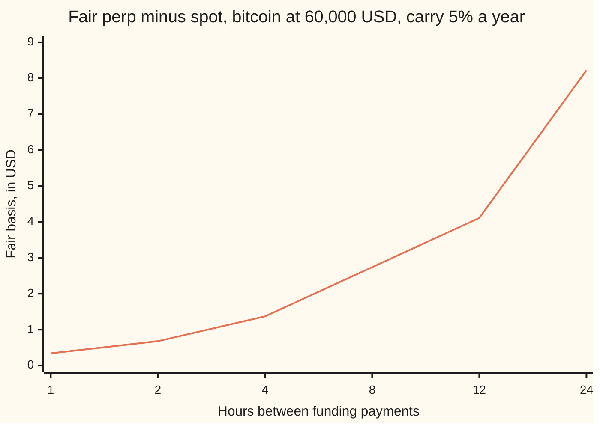

# Perpetual futures: a future that never expires, held near spot by a funding payment

[Syllabus](../../../SYLLABUS.md) → [Financial mathematics](../README.md) → [Digital assets - perpetuals, inverse contracts and AMMs](../README.md#s54) → Perpetual futures

---

## General Overview

Bitcoin trades at 60,000 US dollars (USD) on the spot market, where coins change hands now. On the same exchange a second contract trades on bitcoin: the **perpetual future**, or **perp**. It settles every day in cash like a futures contract, but it has no expiry date. Nobody ever delivers a coin.

A normal future is pulled onto the spot price because on expiry day it *becomes* spot. A perp has no expiry day, so something else must pull it. That something is the **funding payment**: every 8 hours, if the perp trades above spot, buyers of the perp (longs) pay sellers (shorts) an amount set by the gap. If the perp trades below spot, shorts pay longs.

Say the perp trades at 60,300. The gap, called the **premium**, is 300 USD or 0.5% of spot. If the funding rule charges the whole premium every 8 hours, a long holding 1 BTC pays 300 USD three times a day. That is 547.5% a year. Nobody holds a long at that price for long, and sellers who own spot coins rush in to collect it. The perp falls back toward spot.

But funding does not pull the perp all the way to 60,000. Holding bitcoin costs money: the dollars tied up could earn interest. At a 5% a year cost, the perp's fair price is **60,002.74**, a gap of 2.74 USD. At that gap, the funding the long pays is exactly the interest on coins worth the perp's price.

**A perpetual future pays out its premium over spot as funding, so it behaves like a blend of forwards whose delivery dates average one funding period away, and its no-arbitrage price is spot times κ / (κ − δ), where κ is how fast funding is charged and δ is the cost of carrying the coin.**

**What kind of fact this is:** a theorem inside a model, proved on this card in Why it works. The model: funding paid continuously in proportion to the premium, one interest rate for borrowing and lending, no fees. Real exchanges clamp and cap the funding rate; that is a convention, dated under Where you meet it in real life.

### The picture: fund less often, and the perp drifts further from spot



The line is the fair **basis**, the perp price minus spot. It grows almost in step with the time between payments: funding every hour holds the perp 0.34 USD above spot, funding once a day lets it sit 8.22 above. A perp behaves like a forward that is always about one funding period from delivery.

---

## The formula

A long perp position gains when the perp price rises. It also pays funding all the time, at a rate set by the premium. Write the funding as a flow per year:

```math
\text{funding paid by the long, per year} \;=\; \kappa\,(F - S)
```

**Read it aloud:** the long pays the gap between the perp and spot, κ times a year.

No free money then fixes the perp price:

```math
F \;=\; \frac{\kappa}{\kappa - \delta}\,S, \qquad \delta = r - q
```

**Read it aloud:** the fair perp is spot, scaled up by funding intensity over funding intensity minus the cost of carry.

For bitcoin: $`60{,}000 \times 1{,}095 / (1{,}095 - 0.05) = 60{,}002.74`$.

| Symbol | Plain meaning | In our example | Push it up and the answer… |
| --- | --- | --- | --- |
| $`S`$ | spot price: the index the exchange builds from spot trades | 60,000 USD | the fair perp rises in proportion |
| $`F`$ | the perp's price | 60,002.74 fair; 60,300 as seen | — |
| $`r`$ | the dollar interest rate, continuously compounded | 5%, for example | the fair perp rises |
| $`q`$ | what one bitcoin earns when lent out, a yield like a dividend | 0%, for example | the fair perp falls |
| $`\delta`$ | the cost of carry, $`r - q`$: what it costs a year to hold one coin, as a fraction of its price | 5% a year | the basis grows in proportion |
| $`\kappa`$ | funding intensity: how many times a year the whole premium is charged | 1,095 a year | the perp is held closer to spot |
| $`h`$ | one funding period | 1/1,095 year, 8 hours | — |
| $`\theta`$ | the share of the premium charged at each funding time, $`\kappa h`$ | 1, the whole premium | the perp is held closer to spot |
| $`g`$ | one period's carry growth, $`e^{\delta h}`$ | $`e^{0.05/1095}`$ | — |
| $`p`$ | the premium as a rate, $`(F - S)/S`$: the funding rate before any clamp | 0.5% at 60,300 | the long pays more |
| $`c`$ | the multiplier $`F/S`$ | 1.000045664 | — |
| $`u`$, $`n`$ | how far off one forward inside the blend delivers: $`u`$ years in the smooth blend, $`n`$ funding periods in the lumpy one | $`u`$ averages 1/κ, 8 hours | — |

The basis at the fair price is $`F - S = 2.74`$ USD. That is 0.004566% of spot, charged every 8 hours.

### When it holds

- **Funding is charged on the premium alone, at a steady intensity κ.** Real exchanges add an interest term and clamp it. Inside the clamp band the funding stays fixed at 0.01% per 8 hours whatever the premium: 10.95% a year, more than the 5% carry. A long there pays more than the carry, so free arbitrage pushes the perp down and out of the band, to where the clamp binds and funding moves with the premium again. Funding must then equal one period's carry, 0.05/1,095, and that pins the price at $`60{,}000 / (1 + 0.0005 - 0.05/1{,}095) = 59{,}972.75`$, where 0.0005 is the clamp's 0.05%. That is 27.25 USD *below* spot (He et al. 2022, Corollary 2). Only when the interest term equals the carry can the price float inside a range.
- **The cost of carry δ is known and below κ.** If δ reached κ, the denominator would hit zero. At 8-hourly funding, δ would have to reach 1,095 a year, far beyond any real interest rate.
- **Arbitrage is free to run: spot coins can be bought, borrowed and sold short, with no fees.** Fees and borrowing limits turn the single price into a band. Measured deviations of crypto perps from the no-arbitrage price are larger than those in traditional currency markets (He et al. 2022).
- **Every margin call is met.** A trader closed out by force cannot hold the hedge that enforces the price. In a crash the perp can stray far from spot for hours.
- **The spot index is a fair price.** Funding is measured against the exchange's index. If the index is stale or manipulated, the perp is held to the wrong number.

Volatility does not appear. The perp's payoff is linear in spot, so the house example's 80% volatility changes how much margin a trader posts, not the fair price.

---

## Why it works

### Step 0: funding plays the role of an expiry date

A normal future is anchored at one date: on expiry it equals spot. A perp has no such date. Funding replaces it.

Each funding payment settles part of the gap between the perp and spot. Paying the whole premium every 8 hours is like the contract being reset to spot every 8 hours. So a perp behaves like a future that always has about 8 hours left. An 8-hour forward on bitcoin is worth spot plus 8 hours of carry: 2.74 USD.

### Step 1: what a long perp position earns

Over a short slice of time, a long perp position gains the change in the perp price and pays funding $`\kappa(F - S)`$ per year. It costs nothing to enter. Daily settlement moves gains and losses in cash, as on [Futures](../03-Contracts%20and%20No-Arbitrage/05-futures-margining-and-the-forward-futures-difference.md).

In this model, a contract with no date and a funding rule that scales with price prices as a fixed multiple of spot: $`F = c\,S`$. Nothing in the contract says what time it is, so the multiple cannot change with time.

### Step 2: hedge it, and the hedge must earn nothing

Short one perp. Buy $`c`$ coins with borrowed dollars. Each year this position:

- **On the coins:** gains $`c`$ times the change in spot, and pays carry $`c\,\delta\,S`$ (interest on the loan, less what the coins earn lent out).
- **On the short perp:** loses $`c`$ times the change in spot, since $`F = cS`$, and receives funding $`\kappa(c - 1)\,S`$.

The spot moves cancel. The position is riskless and cost nothing to set up, so its net flow must be zero:

```math
\kappa\,(c - 1) \;=\; c\,\delta \quad\Longrightarrow\quad c = \frac{\kappa}{\kappa - \delta}
```

**Read it aloud:** the funding received must exactly pay the carry on the coins.

If the net flow were positive, everyone would run this hedge and collect money from nothing. If negative, they would run it in reverse. Either way the perp price moves until the flow is zero. For bitcoin, $`c = 1.000045664`$ and $`F = 60{,}002.74`$.

A useful consequence: at the fair price, the funding a long pays in a year, $`\kappa(F - S) = 3{,}000.14`$ USD, equals $`\delta F = 3{,}000.14`$. **The funding is the carry.** A long perp is a coin bought with borrowed dollars, and funding is the interest bill.

### Step 3: the second road, a blend of forwards

Read the same price another way. From [Forward price](../03-Contracts%20and%20No-Arbitrage/03-forward-price-by-cash-and-carry.md), a forward for delivery in $`u`$ years is worth $`S e^{\delta u}`$. Weight each delivery date $`u`$ by $`\kappa e^{-\kappa u}`$, a weight that fades as funding wears the contract down, and add them up:

```math
F \;=\; \int_0^\infty \kappa\, e^{-\kappa u}\; S\, e^{\delta u}\, du \;=\; \frac{\kappa}{\kappa - \delta}\, S
```

**Read it aloud:** the perp is an average of forwards, with near dates weighted most, and the average delivery date is 1/κ, 8 hours away.

Multiply the two exponentials and the curve under the integral is $`\kappa S e^{-(\kappa - \delta)u}`$, which decays at rate κ − δ. The area under $`e^{-(\kappa - \delta)u}`$ from 0 to infinity is $`1/(\kappa - \delta)`$, so the total is $`\kappa S/(\kappa - \delta)`$. The checks compute it numerically and get 60,002.739851, the same as Step 2 to six decimals.

### Step 4: real funding comes in lumps, not a flow

Exchanges charge funding at set times, not continuously. Charge a share θ of the premium once per period $`h`$. The same no-arbitrage argument, run one period at a time, gives a geometric series: the perp is a forward for one period with weight θ, two periods with weight θ(1 − θ), and so on.

```math
F \;=\; S \sum_{n=1}^{\infty} \theta\,(1-\theta)^{n-1} g^{n} \;=\; \frac{\theta\, g}{1 - (1-\theta)\,g}\; S
```

**Read it aloud:** the perp is a forward for a random number of periods, each extra period less likely by the factor 1 − θ.

With the whole premium each time, θ = 1, the series stops after one term: the perp is exactly an 8-hour forward, $`S e^{\delta h} = 60{,}002.739789`$. Split each 8 hours into more and smaller charges and the price climbs to the continuous answer 60,002.739851. The two agree to three decimal places.

<details>
<summary>Detailed derivation: the one-period fixed point</summary>

Take funding at the end of each period: the long pays $`\theta(F_{n+1} - S_{n+1})`$, where the subscript counts periods. A position that costs nothing and is settled in cash each period must have an average gain of zero in the risk-neutral world, the pretend market where every asset grows at the bank rate (the futures quote is such a running average; see [Futures](../03-Contracts%20and%20No-Arbitrage/05-futures-margining-and-the-forward-futures-difference.md)). In that world the average of next period's spot is $`g\,S_n`$.

Try $`F_n = c\,S_n`$. The average change in the perp is $`c(g - 1)S_n`$. The average funding is $`\theta(c - 1)g\,S_n`$. Set them equal:

$`\displaystyle c\,(g - 1) = \theta\,(c - 1)\,g \quad\Longrightarrow\quad c = \frac{\theta g}{1 - (1-\theta)g}.`$

Expand $`1/(1 - (1-\theta)g)`$ as a geometric series and the sum in Step 4 appears term by term. It converges when $`(1-\theta)g < 1`$, which holds for any real carry.

For the continuous limit, put $`\theta = \kappa h`$ and $`g = e^{\delta h} \approx 1 + \delta h`$ and let $`h`$ shrink. The top is about $`\kappa h`$ and the bottom about $`(\kappa - \delta)h`$, so $`c \to \kappa/(\kappa - \delta)`$: Step 2's answer.

</details>

---

## Worked numbers, by hand

Bitcoin at 60,000 USD, carry 5% a year, whole premium every 8 hours.

| Step | Arithmetic | Value |
| --- | --- | --- |
| funding intensity κ | 3 charges a day × 365 | 1,095 a year |
| κ − δ | 1,095 − 0.05 | 1,094.95 |
| multiplier c | 1,095 ÷ 1,094.95 | 1.000045664 |
| **fair perp price** | 60,000 × 1.000045664 | **60,002.74** |
| fair basis | 60,002.74 − 60,000 | 2.74 USD |
| funding per 8 hours at the fair price | the whole basis | 2.74 USD |
| funding per year at the fair price | 1,095 × 2.74 | 3,000.14 USD |
| carry on the perp per year | 0.05 × 60,002.74 | 3,000.14 USD |
| premium at a perp price of 60,300 | 300 ÷ 60,000 | 0.5% |
| **funding per 8 hours on 1 BTC** | 0.5% × 60,000 | **300.00 USD** |
| funding per day | 3 × 300.00 | 900.00 USD |
| that rate, annualised | 0.5% × 1,095 | 547.50% |
| carrying 1 BTC for a day | 60,000 × (e^(0.05/365) − 1) | 8.22 USD |

At the fair price the perp sits 2.74 USD above spot, and the long pays 2.74 USD every 8 hours: exactly the carry on 1.000045664 coins, the hedge of Step 2. At 60,300 the long pays 300 USD every 8 hours while a coin holder's carry is 8.22 USD a day, so selling the perp and buying the coin collects 900.00 USD a day against 8.22 USD of carry, until the premium closes.

### What breaks if you drop a piece

| Mistake | Comes out at | What went wrong |
| --- | --- | --- |
| Sign of the carry flipped, κ/(κ + δ) | 59,997.26 | The perp would sit below spot while holding coins costs money: shorts would pay to be short |
| Intensity of 3 a day used as 3 a year | 61,016.95 | Funding three times a year lets the perp drift like a forward months from delivery |
| Priced as a one-year forward, $`S e^{\delta}`$ | 63,076.27 | A perp never lasts a year: funding resets it every 8 hours |
| Carry ignored, perp equal to spot | 60,000.00 | Close, but 2.74 low: the funding at zero premium would not pay for holding the coin that hedges it |

---

## Code, from first principles, and it actually runs

The code reaches the fair price by three independent roads. Road 1 is the closed form κS/(κ − δ). Road 2 adds up the blend of forwards with Simpson's rule, a numerical area method written out in the code. Road 3 charges funding in lumps, 1, 10 and 1,000 times per 8 hours, and watches the geometric series climb to road 1; it also sums the series term by term. The asserts check that the roads agree, that whole-premium funding equals an 8-hour forward, that funding at the fair price equals carry, and that the exchange clamp gives 0.45% before BTCUSDT's cap and 0.30% after it. A bisection (halving an interval until it traps the root) on the exchange rule finds the pinned price under When it holds, 59,972.75, and agrees with the closed form.

### Python

```python
# Perpetual futures and the funding rate -- the check behind the card.
# Bitcoin at 60,000 USD; rate differential (dollar rate minus bitcoin yield)
# 5 percent a year; funding intensity 1,095 a year: the whole premium every
# 8 hours.  Nothing imported holds an answer: the integral, the geometric
# series, the clamp and a bisection are written out here.
from math import exp
S, DELTA, KAPPA = 60000.0, 0.05, 1095.0     # spot, rate differential, funding intensity
H = 1.0 / KAPPA                             # one funding period, in years: 8 hours here
PERP_SEEN = 60300.0                         # a perpetual trading rich
def fair(s, delta, kappa):                  # road 1: the fixed point kappa S / (kappa - delta)
    return s * kappa / (kappa - delta)
def blend_of_forwards(s, delta, kappa, n=20000):   # road 2: Simpson's rule
    upper = 60.0 / kappa                                      # weights beyond are below e^-60
    f = lambda u: kappa * exp(-kappa * u) * s * exp(delta * u)  # forward for date u, weighted
    w = upper / n
    total = f(0.0) + f(upper) + sum((4 if i % 2 else 2) * f(i * w) for i in range(1, n))
    return total * w / 3.0
def discrete(s, delta, kappa, m):           # road 3: funding m times per 8 hours, share theta each time
    h = H / m
    theta, g = kappa * h, exp(delta * h)
    return s * theta * g / (1.0 - (1.0 - theta) * g)
def series_by_terms(s, delta, kappa, m):    # road 3, term by term: weights theta (1 - theta)^(n-1)
    h = H / m
    theta, g = kappa * h, exp(delta * h)
    total, n, term = 0.0, 1, theta * g
    while term > 1e-18:
        total += term
        n += 1
        term = theta * (1.0 - theta) ** (n - 1) * g ** n
    return s * total
def clamp(x, lo, hi): return max(lo, min(hi, x))
CAP = 0.003                                 # BTCUSDT's funding cap per 8 hours, dated on the card
def exchange_rate(premium, interest=0.0001, band=0.0005, cap=1.0):   # clamped interest term, then the cap
    return clamp(premium + clamp(interest - premium, -band, band), -cap, cap)
def pinned(s, carry):                       # exchange rule, premium (F - S) / F: bisect for rate = carry
    lo, hi = -0.01, 0.01
    for _ in range(100):
        mid = 0.5 * (lo + hi)
        if exchange_rate(mid, cap=CAP) < carry: lo = mid
        else: hi = mid
    return s / (1.0 - 0.5 * (lo + hi))
def row(label, value, d=2): print(f"{label:<50}{value:>16.{d}f}")
F = fair(S, DELTA, KAPPA)
print(f"Bitcoin spot {S:.2f} USD, rate differential {DELTA * 100:.0f}% a year, intensity {KAPPA:.0f} a year")
print("fair perpetual price, three roads")
row("road 1: kappa S / (kappa - delta)", F, 6)
row("road 2: blend of forwards, Simpson", blend_of_forwards(S, DELTA, KAPPA), 6)
for m in (1, 10, 1000):
    row(f"road 3: funding {m} times per 8 hours", discrete(S, DELTA, KAPPA, m), 6)
row("road 3, term by term, 10 times per 8 hours", series_by_terms(S, DELTA, KAPPA, 10), 6)
row("an 8-hour forward, S e^(delta h)", S * exp(DELTA * H), 6)
row("multiplier kappa / (kappa - delta)", KAPPA / (KAPPA - DELTA), 9)
row("average life of the blend, 1 / kappa, in hours", 8760.0 / KAPPA, 2)
print()
print("funding at the fair price, per 1 BTC")
basis = F - S
row("basis, perpetual minus spot", basis, 2)
row("funding rate per 8 hours, basis / spot, percent", 100 * basis / S, 6)
row("funding paid per 8 hours, USD", basis * KAPPA * H, 2)
row("funding paid per year, kappa (F - S)", KAPPA * basis, 2)
row("carry on the perpetual per year, delta F", DELTA * F, 2)
print()
print(f"a perpetual trading at {PERP_SEEN:.2f}, notional 1 BTC at the index")
p = (PERP_SEEN - S) / S
row("premium, (F - S) / S, percent", 100 * p, 4)
row("funding per 8 hours, model (whole premium)", p * S, 2)
row("funding per day, three payments", 3 * p * S, 2)
row("that rate, annualised by 1095, percent", 100 * p * 1095, 2)
row("exchange rate after the interest clamp, percent", 100 * exchange_rate(p), 4)
row("exchange rate after the BTCUSDT cap, percent", 100 * exchange_rate(p, cap=CAP), 4)
row("exchange funding per 8 hours, index notional", exchange_rate(p, cap=CAP) * S, 2)
row("exchange funding per 8 hours, mark notional", exchange_rate(p, cap=CAP) * PERP_SEEN, 2)
row("exchange rate at a premium of 0.03 percent", 100 * exchange_rate(0.0003), 4)
row("interest term 0.01% per 8 hours, a year, percent", 0.01 * 1095, 2)
pin = S / (1.0 + 0.0005 - DELTA * H)        # pinned price, rule with kappa 1 per 8 hours, clamp 0.05%
row("exchange rule: pinned perp, closed form", pin, 2)
row("exchange rule: pinned perp, by bisection", pinned(S, DELTA * H), 2)
row("exchange rule: pinned basis, perp minus spot", pin - S, 2)
row("carrying 1 BTC for a day, S (e^(delta/365) - 1)", S * (exp(DELTA / 365) - 1), 2)
print()
print("what breaks")
row("sign flipped, kappa / (kappa + delta)", fair(S, -DELTA, KAPPA), 2)
row("intensity per day (3) read as per year", fair(S, DELTA, 3.0), 2)
row("priced as a one-year forward, S e^delta", S * exp(DELTA), 2)
row("carry ignored, perpetual = spot", fair(S, 0.0, KAPPA), 2)
print()
print("force one: rate differential -> basis, 8-hour funding")
for d in (-0.05, 0.0, 0.05, 0.10):
    print(f"  delta {d * 100:>4.0f}%   basis {fair(S, d, KAPPA) - S:>8.2f}")
print("force two: funding interval in hours -> basis, delta 5%")
chart = []
for hours in (1, 2, 4, 8, 12, 24):
    chart.append(fair(S, DELTA, 8760.0 / hours) - S)
    print(f"  every {hours:>2} hours   basis {chart[-1]:>8.2f}")
row("weekly funding (168 hours), basis", fair(S, DELTA, 8760.0 / 168) - S, 2)
# The asserts: each compares against a value computed another way.
assert abs(blend_of_forwards(S, DELTA, KAPPA) - F) < 1e-6          # road 2 agrees with road 1
assert abs(discrete(S, DELTA, KAPPA, 1000) - F) < 1e-3             # road 3 converges to road 1
assert abs(series_by_terms(S, DELTA, KAPPA, 10) - discrete(S, DELTA, KAPPA, 10)) < 1e-6
assert abs(discrete(S, DELTA, KAPPA, 1) - S * exp(DELTA * H)) < 1e-9  # whole premium = 8-hour forward
assert abs(KAPPA * (F - S) - DELTA * F) < 1e-6                     # funding paid equals carry
assert abs(exchange_rate(p) - 0.0045) < 1e-12                      # 0.5% minus the 0.05% clamp
assert abs(exchange_rate(p, cap=CAP) - 0.003) < 1e-12              # then the BTCUSDT cap binds
assert abs(exchange_rate(0.0003) - 0.0001) < 1e-12                 # inside the band: interest only
assert abs(pinned(S, DELTA * H) - pin) < 1e-6                      # bisection on the rule = closed form
print("ALL CHECKS PASS")
```

**Ran 2026-11-23 on macOS, Python 3.14.10, standard library only. All checks passed. Output, pasted from the run:**

```
Bitcoin spot 60000.00 USD, rate differential 5% a year, intensity 1095 a year
fair perpetual price, three roads
road 1: kappa S / (kappa - delta)                     60002.739851
road 2: blend of forwards, Simpson                    60002.739851
road 3: funding 1 times per 8 hours                   60002.739789
road 3: funding 10 times per 8 hours                  60002.739845
road 3: funding 1000 times per 8 hours                60002.739851
road 3, term by term, 10 times per 8 hours            60002.739845
an 8-hour forward, S e^(delta h)                      60002.739789
multiplier kappa / (kappa - delta)                     1.000045664
average life of the blend, 1 / kappa, in hours                8.00

funding at the fair price, per 1 BTC
basis, perpetual minus spot                                   2.74
funding rate per 8 hours, basis / spot, percent           0.004566
funding paid per 8 hours, USD                                 2.74
funding paid per year, kappa (F - S)                       3000.14
carry on the perpetual per year, delta F                   3000.14

a perpetual trading at 60300.00, notional 1 BTC at the index
premium, (F - S) / S, percent                               0.5000
funding per 8 hours, model (whole premium)                  300.00
funding per day, three payments                             900.00
that rate, annualised by 1095, percent                      547.50
exchange rate after the interest clamp, percent             0.4500
exchange rate after the BTCUSDT cap, percent                0.3000
exchange funding per 8 hours, index notional                180.00
exchange funding per 8 hours, mark notional                 180.90
exchange rate at a premium of 0.03 percent                  0.0100
interest term 0.01% per 8 hours, a year, percent             10.95
exchange rule: pinned perp, closed form                   59972.75
exchange rule: pinned perp, by bisection                  59972.75
exchange rule: pinned basis, perp minus spot                -27.25
carrying 1 BTC for a day, S (e^(delta/365) - 1)               8.22

what breaks
sign flipped, kappa / (kappa + delta)                     59997.26
intensity per day (3) read as per year                    61016.95
priced as a one-year forward, S e^delta                   63076.27
carry ignored, perpetual = spot                           60000.00

force one: rate differential -> basis, 8-hour funding
  delta   -5%   basis    -2.74
  delta    0%   basis     0.00
  delta    5%   basis     2.74
  delta   10%   basis     5.48
force two: funding interval in hours -> basis, delta 5%
  every  1 hours   basis     0.34
  every  2 hours   basis     0.68
  every  4 hours   basis     1.37
  every  8 hours   basis     2.74
  every 12 hours   basis     4.11
  every 24 hours   basis     8.22
weekly funding (168 hours), basis                            57.59
ALL CHECKS PASS
```

### Rust

```rust
// Perpetual futures and the funding rate -- the check behind the card.
// Bitcoin at 60,000 USD; rate differential (dollar rate minus bitcoin yield)
// 5 percent a year; funding intensity 1,095 a year: the whole premium every
// 8 hours.  Only std is used: the integral, the geometric series, the
// clamp and a bisection are written out here.
const S: f64 = 60000.0; // spot
const DELTA: f64 = 0.05; // rate differential
const KAPPA: f64 = 1095.0; // funding intensity
const H: f64 = 1.0 / KAPPA; // one funding period, in years: 8 hours here
const PERP_SEEN: f64 = 60300.0; // a perpetual trading rich
const CAP: f64 = 0.003; // BTCUSDT's funding cap per 8 hours, dated on the card

fn fair(s: f64, delta: f64, kappa: f64) -> f64 {
    // road 1: the fixed point kappa S / (kappa - delta)
    s * kappa / (kappa - delta)
}

fn blend_of_forwards(s: f64, delta: f64, kappa: f64) -> f64 {
    // road 2: Simpson's rule on the forwards for every date u, weighted
    let (n, upper) = (20000usize, 60.0 / kappa); // weights beyond are below e^-60
    let f = |u: f64| kappa * (-kappa * u).exp() * s * (delta * u).exp();
    let w = upper / n as f64;
    let mut total = f(0.0) + f(upper);
    for i in 1..n {
        total += if i % 2 == 1 { 4.0 } else { 2.0 } * f(i as f64 * w);
    }
    total * w / 3.0
}

fn discrete(s: f64, delta: f64, kappa: f64, m: f64) -> f64 {
    // road 3: funding m times per 8 hours, share theta each time
    let h = H / m;
    let (theta, g) = (kappa * h, (delta * h).exp());
    s * theta * g / (1.0 - (1.0 - theta) * g)
}

fn series_by_terms(s: f64, delta: f64, kappa: f64, m: f64) -> f64 {
    // road 3, term by term: weights theta (1 - theta)^(n-1)
    let h = H / m;
    let (theta, g) = (kappa * h, (delta * h).exp());
    let (mut total, mut n, mut term) = (0.0, 1i32, theta * g);
    while term > 1e-18 {
        total += term;
        n += 1;
        term = theta * (1.0 - theta).powi(n - 1) * g.powi(n);
    }
    s * total
}

fn clamp(x: f64, lo: f64, hi: f64) -> f64 {
    lo.max(hi.min(x))
}

fn exchange_rate(premium: f64, cap: f64) -> f64 {
    // premium plus the interest term 0.01%, clamped to a band of 0.05%, then the cap
    clamp(premium + clamp(0.0001 - premium, -0.0005, 0.0005), -cap, cap)
}

fn pinned(s: f64, carry: f64) -> f64 {
    // exchange rule, premium (F - S) / F: bisect for rate = carry
    let (mut lo, mut hi) = (-0.01, 0.01);
    for _ in 0..100 {
        let mid = 0.5 * (lo + hi);
        if exchange_rate(mid, CAP) < carry { lo = mid } else { hi = mid }
    }
    s / (1.0 - 0.5 * (lo + hi))
}

fn row(label: &str, value: f64, d: usize) {
    println!("{:<50}{:>16.*}", label, d, value);
}

fn main() {
    let f = fair(S, DELTA, KAPPA);
    println!("Bitcoin spot {:.2} USD, rate differential {:.0}% a year, intensity {:.0} a year", S, DELTA * 100.0, KAPPA);
    println!("fair perpetual price, three roads");
    row("road 1: kappa S / (kappa - delta)", f, 6);
    row("road 2: blend of forwards, Simpson", blend_of_forwards(S, DELTA, KAPPA), 6);
    for m in [1.0, 10.0, 1000.0] {
        row(&format!("road 3: funding {} times per 8 hours", m), discrete(S, DELTA, KAPPA, m), 6);
    }
    row("road 3, term by term, 10 times per 8 hours", series_by_terms(S, DELTA, KAPPA, 10.0), 6);
    row("an 8-hour forward, S e^(delta h)", S * (DELTA * H).exp(), 6);
    row("multiplier kappa / (kappa - delta)", KAPPA / (KAPPA - DELTA), 9);
    row("average life of the blend, 1 / kappa, in hours", 8760.0 / KAPPA, 2);
    println!();
    println!("funding at the fair price, per 1 BTC");
    let basis = f - S;
    row("basis, perpetual minus spot", basis, 2);
    row("funding rate per 8 hours, basis / spot, percent", 100.0 * basis / S, 6);
    row("funding paid per 8 hours, USD", basis * KAPPA * H, 2);
    row("funding paid per year, kappa (F - S)", KAPPA * basis, 2);
    row("carry on the perpetual per year, delta F", DELTA * f, 2);
    println!();
    println!("a perpetual trading at {:.2}, notional 1 BTC at the index", PERP_SEEN);
    let p = (PERP_SEEN - S) / S;
    row("premium, (F - S) / S, percent", 100.0 * p, 4);
    row("funding per 8 hours, model (whole premium)", p * S, 2);
    row("funding per day, three payments", 3.0 * p * S, 2);
    row("that rate, annualised by 1095, percent", 100.0 * p * 1095.0, 2);
    row("exchange rate after the interest clamp, percent", 100.0 * exchange_rate(p, 1.0), 4);
    row("exchange rate after the BTCUSDT cap, percent", 100.0 * exchange_rate(p, CAP), 4);
    row("exchange funding per 8 hours, index notional", exchange_rate(p, CAP) * S, 2);
    row("exchange funding per 8 hours, mark notional", exchange_rate(p, CAP) * PERP_SEEN, 2);
    row("exchange rate at a premium of 0.03 percent", 100.0 * exchange_rate(0.0003, 1.0), 4);
    row("interest term 0.01% per 8 hours, a year, percent", 0.01 * 1095.0, 2);
    let pin = S / (1.0 + 0.0005 - DELTA * H); // pinned price, rule with kappa 1 per 8 hours, clamp 0.05%
    row("exchange rule: pinned perp, closed form", pin, 2);
    row("exchange rule: pinned perp, by bisection", pinned(S, DELTA * H), 2);
    row("exchange rule: pinned basis, perp minus spot", pin - S, 2);
    row("carrying 1 BTC for a day, S (e^(delta/365) - 1)", S * ((DELTA / 365.0).exp() - 1.0), 2);
    println!();
    println!("what breaks");
    row("sign flipped, kappa / (kappa + delta)", fair(S, -DELTA, KAPPA), 2);
    row("intensity per day (3) read as per year", fair(S, DELTA, 3.0), 2);
    row("priced as a one-year forward, S e^delta", S * DELTA.exp(), 2);
    row("carry ignored, perpetual = spot", fair(S, 0.0, KAPPA), 2);
    println!();
    println!("force one: rate differential -> basis, 8-hour funding");
    for d in [-0.05, 0.0, 0.05, 0.10] {
        println!("  delta {:>4.0}%   basis {:>8.2}", d * 100.0, fair(S, d, KAPPA) - S);
    }
    println!("force two: funding interval in hours -> basis, delta 5%");
    for hours in [1.0, 2.0, 4.0, 8.0, 12.0, 24.0] {
        println!("  every {:>2} hours   basis {:>8.2}", hours, fair(S, DELTA, 8760.0 / hours) - S);
    }
    row("weekly funding (168 hours), basis", fair(S, DELTA, 8760.0 / 168.0) - S, 2);
    // The asserts: each compares against a value computed another way.
    assert!((blend_of_forwards(S, DELTA, KAPPA) - f).abs() < 1e-6); // road 2 agrees with road 1
    assert!((discrete(S, DELTA, KAPPA, 1000.0) - f).abs() < 1e-3); // road 3 converges to road 1
    assert!((series_by_terms(S, DELTA, KAPPA, 10.0) - discrete(S, DELTA, KAPPA, 10.0)).abs() < 1e-6);
    assert!((discrete(S, DELTA, KAPPA, 1.0) - S * (DELTA * H).exp()).abs() < 1e-9); // whole premium = 8-hour forward
    assert!((KAPPA * (f - S) - DELTA * f).abs() < 1e-6); // funding paid equals carry
    assert!((exchange_rate(p, 1.0) - 0.0045).abs() < 1e-12); // 0.5% minus the 0.05% clamp
    assert!((exchange_rate(p, CAP) - 0.003).abs() < 1e-12); // then the BTCUSDT cap binds
    assert!((exchange_rate(0.0003, 1.0) - 0.0001).abs() < 1e-12); // inside the band: interest only
    assert!((pinned(S, DELTA * H) - pin).abs() < 1e-6); // bisection on the rule = closed form
    println!("ALL CHECKS PASS");
}
```

**Ran 2026-11-23 on macOS, rustc 1.98.1, no crates. All checks passed. Output, pasted from the run:**

```
Bitcoin spot 60000.00 USD, rate differential 5% a year, intensity 1095 a year
fair perpetual price, three roads
road 1: kappa S / (kappa - delta)                     60002.739851
road 2: blend of forwards, Simpson                    60002.739851
road 3: funding 1 times per 8 hours                   60002.739789
road 3: funding 10 times per 8 hours                  60002.739845
road 3: funding 1000 times per 8 hours                60002.739851
road 3, term by term, 10 times per 8 hours            60002.739845
an 8-hour forward, S e^(delta h)                      60002.739789
multiplier kappa / (kappa - delta)                     1.000045664
average life of the blend, 1 / kappa, in hours                8.00

funding at the fair price, per 1 BTC
basis, perpetual minus spot                                   2.74
funding rate per 8 hours, basis / spot, percent           0.004566
funding paid per 8 hours, USD                                 2.74
funding paid per year, kappa (F - S)                       3000.14
carry on the perpetual per year, delta F                   3000.14

a perpetual trading at 60300.00, notional 1 BTC at the index
premium, (F - S) / S, percent                               0.5000
funding per 8 hours, model (whole premium)                  300.00
funding per day, three payments                             900.00
that rate, annualised by 1095, percent                      547.50
exchange rate after the interest clamp, percent             0.4500
exchange rate after the BTCUSDT cap, percent                0.3000
exchange funding per 8 hours, index notional                180.00
exchange funding per 8 hours, mark notional                 180.90
exchange rate at a premium of 0.03 percent                  0.0100
interest term 0.01% per 8 hours, a year, percent             10.95
exchange rule: pinned perp, closed form                   59972.75
exchange rule: pinned perp, by bisection                  59972.75
exchange rule: pinned basis, perp minus spot                -27.25
carrying 1 BTC for a day, S (e^(delta/365) - 1)               8.22

what breaks
sign flipped, kappa / (kappa + delta)                     59997.26
intensity per day (3) read as per year                    61016.95
priced as a one-year forward, S e^delta                   63076.27
carry ignored, perpetual = spot                           60000.00

force one: rate differential -> basis, 8-hour funding
  delta   -5%   basis    -2.74
  delta    0%   basis     0.00
  delta    5%   basis     2.74
  delta   10%   basis     5.48
force two: funding interval in hours -> basis, delta 5%
  every  1 hours   basis     0.34
  every  2 hours   basis     0.68
  every  4 hours   basis     1.37
  every  8 hours   basis     2.74
  every 12 hours   basis     4.11
  every 24 hours   basis     8.22
weekly funding (168 hours), basis                            57.59
ALL CHECKS PASS
```

### Lean

Lean proves the fair price by all three roads, for any carry δ below the funding intensity κ.

- Suppose δ is below κ. Then the funding a long pays, $`\kappa(F - S)`$, equals the carry $`\delta F`$ exactly when $`F = \kappa S/(\kappa - \delta)`$.
- Suppose δ is below κ. Then the blend of forwards in Step 3 comes to $`\kappa S/(\kappa - \delta)`$.
- Take θ between 0 and 1, $`g > 0`$ and $`(1-\theta)g < 1`$. Then the series of Step 4 converges to $`\theta g S/(1 - (1-\theta)g)`$.
- Lean also checks the worked numbers. These include the fair price between 60,002 and 60,003, the 0.5% premium and the 0.30% cap.

The continuous limit as h shrinks, the Simpson sum, the bisection and the exact decimals are left to the Python and Rust checks.

```lean
-- Perpetual futures: the fair perp price is κS/(κ − δ) when δ < κ, shown three ways: funding equals carry, a blend of forwards, and the geometric series of lumpy funding.
import Mathlib.Analysis.SpecialFunctions.ImproperIntegrals
import Mathlib.Analysis.SpecificLimits.Basic

open Real MeasureTheory Set

/-- The no-arbitrage price of a perpetual future. Funding is charged on the premium
`F - S` at a steady intensity `κ`, and the cost of carry `δ` is below `κ`. The hedge
(short one perp, hold `F / S` coins) is riskless and costs nothing, so the funding it
receives, `κ (F - S)` a year, must equal the carry on coins worth the perp's price,
`δ F`. That happens exactly when `F = κ / (κ - δ) * S`. -/
theorem perpetual_fair_price_iff_funding_eq_carry (S κ δ F : ℝ) (hδκ : δ < κ) :
    κ * (F - S) = δ * F ↔ F = κ / (κ - δ) * S := by
  have hne : κ - δ ≠ 0 := sub_ne_zero.mpr (ne_of_gt hδκ)
  rw [div_mul_eq_mul_div, eq_div_iff hne]
  constructor <;> intro h <;> linarith

/-- The second road: a blend of forwards. A forward for delivery in `u` years is worth
`S e^{δ u}`. Weighting each delivery date by `κ e^{-κ u}` and adding over all dates
gives the same price `κ / (κ - δ) * S`, as long as the carry `δ` is below `κ`. -/
theorem perpetual_price_as_blend_of_forwards (S κ δ : ℝ) (hδκ : δ < κ) :
    ∫ u in Ioi (0 : ℝ), κ * exp (-κ * u) * (S * exp (δ * u)) = κ / (κ - δ) * S := by
  have hfun : (fun u : ℝ => κ * exp (-κ * u) * (S * exp (δ * u)))
      = fun u : ℝ => (κ * S) * exp ((δ - κ) * u) := by
    funext u
    have : exp ((δ - κ) * u) = exp (-κ * u) * exp (δ * u) := by
      rw [← Real.exp_add]; ring_nf
    rw [this]; ring
  rw [hfun, integral_const_mul, integral_exp_mul_Ioi (by linarith) 0]
  have hne : κ - δ ≠ 0 := sub_ne_zero.mpr (ne_of_gt hδκ)
  have hne' : δ - κ ≠ 0 := sub_ne_zero.mpr (ne_of_lt hδκ)
  simp only [mul_zero, Real.exp_zero]
  field_simp
  ring

/-- The third road: funding in lumps. Charging a share `θ` of the premium once per period,
with one period's carry growth `g`, the perp is a forward for `n + 1` periods with weight
`θ (1 - θ)^n`. The series converges to `θ g / (1 - (1 - θ) g) * S` when `θ` is a share
(between 0 and 1), `g > 0`, and `(1 - θ) g < 1`. -/
theorem perpetual_price_lumpy_funding_series (S θ g : ℝ) (hθ0 : 0 ≤ θ) (hθ1 : θ ≤ 1)
    (hg : 0 < g) (hlt : (1 - θ) * g < 1) :
    HasSum (fun n : ℕ => θ * (1 - θ) ^ n * (S * g ^ (n + 1)))
      (θ * g / (1 - (1 - θ) * g) * S) := by
  have hr0 : 0 ≤ (1 - θ) * g := mul_nonneg (by linarith) hg.le
  have hne : 1 - (1 - θ) * g ≠ 0 := by linarith
  have h := (hasSum_geometric_of_lt_one hr0 hlt).mul_left (θ * g * S)
  convert h using 1
  · funext n
    rw [mul_pow, pow_succ]
    ring
  · field_simp

-- Funding intensity: three charges a day for 365 days is 1,095 a year.
example : 3 * 365 = 1095 := by decide

-- The fair perp at spot 60,000, carry 1/20 a year, intensity 1,095 lies between 60,002 and 60,003.
example : (60002 : ℚ) < 1095 / (1095 - 1 / 20) * 60000 ∧
    1095 / (1095 - 1 / 20) * 60000 < (60003 : ℚ) := by norm_num

-- At that price the funding paid a year equals the carry on the perp.
example : (1095 : ℚ) * (1095 / (1095 - 1 / 20) * 60000 - 60000) =
    1 / 20 * (1095 / (1095 - 1 / 20) * 60000) := by norm_num

-- A perp at 60,300 against spot 60,000: premium 300 / 60,000 = 1/200 (0.5%),
-- 300 USD per 8 hours, 900 USD a day, and 1,095/200 = 547.5% a year.
example : (60300 - 60000 : ℚ) / 60000 = 1 / 200 := by norm_num
example : (1 / 200 : ℚ) * 60000 = 300 ∧ 3 * (300 : ℚ) = 900 := by norm_num
example : (1 / 200 : ℚ) * 1095 = 1095 / 200 := by norm_num

-- Exchange clamp: premium 1/200 plus clamp(1/10000 - 1/200, -1/2000, 1/2000) is 9/2000 (0.45%),
-- and the BTCUSDT cap of 3/1000 (0.3%) then binds.
example : (1 / 200 : ℚ) + max (-1 / 2000) (min (1 / 2000) (1 / 10000 - 1 / 200)) = 9 / 2000 := by
  norm_num
example : max (-3 / 1000) (min (3 / 1000) (9 / 2000 : ℚ)) = 3 / 1000 := by norm_num

#print axioms perpetual_fair_price_iff_funding_eq_carry
#print axioms perpetual_price_as_blend_of_forwards
#print axioms perpetual_price_lumpy_funding_series
```

**Checked 2026-11-23 on macOS, Lean 4.36.0-rc2, Mathlib v4.36.0-rc2. Every proof is complete and uses only Lean's standard axioms. Output, pasted from the run:**

```
'perpetual_fair_price_iff_funding_eq_carry' depends on axioms: [propext, Classical.choice, Quot.sound]
'perpetual_price_as_blend_of_forwards' depends on axioms: [propext, Classical.choice, Quot.sound]
'perpetual_price_lumpy_funding_series' depends on axioms: [propext, Classical.choice, Quot.sound]
```

> [!TIP]
> **Try changing**
> Guess the direction first, then run it.
> - **Double the carry.** Set `DELTA = 0.10`. The fair basis doubles to 5.48 USD. Carry and basis move in proportion.
> - **Let coins earn more than dollars.** Set `DELTA = -0.05`. The basis turns to −2.74: the perp sits below spot, and shorts pay longs at the fair price.
> - **Fund every hour.** Set `KAPPA = 8760.0`. The basis shrinks to 0.34 USD. Fund once a week, `KAPPA = 8760.0 / 168`, and it grows to 57.59.
> - **Break the clamp.** Change `band=0.0005` to `band=0.0004`. The clamp assert stops the program: the rate before the cap is no longer 0.45%.

---

## The usual mistake

> [!warning]
> **Reading the funding rate as a per-year rate.** It is quoted per funding period. A 0.5% funding rate charged every 8 hours is 547.50% a year, not 0.5%. And the "normal" 0.01% per 8 hours that exchanges charge at zero premium is 10.95% a year: more than double the 5% carry on this card.
>
> - **Expecting the fair perp to equal spot.** It sits above spot by the carry over one funding period: 2.74 USD here, and 8.22 USD with daily funding.
> - **Pricing the perp as a long-dated forward.** It has no expiry, but it is not a forward to infinity. Priced as a one-year forward it comes out at 63,076.27, wrong by over 3,000 USD.
> - **Forgetting the clamp and the cap.** At a 0.5% premium the clamp takes the rate to 0.45% per 8 hours, and BTCUSDT's cap then holds it at 0.30%: 180.00 USD on 1 BTC at the index, not 300.00.
> - **Using the wrong notional.** The exchange applies the rate to the position's value at the mark price, so 0.30% of 60,300 is 180.90 USD, not 180.00.

---

## Where you meet it in real life

- **Crypto exchanges.** Perps on bitcoin and ether are the most traded crypto contracts. Funding every 8 hours, or every 1 or 4 hours on some contracts, keeps them near the spot index.
- **The cash-and-carry trade.** When perps trade rich, funds buy the coin and sell the perp, collecting funding while their position has no exposure to the coin's price. At 60,300, under this card's whole-premium rule, that collects 900 USD a day per coin against 8.22 USD of carry; BTCUSDT's cap cuts each payment to 180.00 USD.
- **Leverage without expiry.** A trader can hold a leveraged long for months without rolling from one future to the next. Funding is the cost of that leverage, and it equals the carry when the perp is at its fair price.
- **Shiller's proposal.** In 1993 Robert Shiller proposed perpetual claims on hard-to-trade assets such as house price indexes, with a dividend-like payment tied to the index. Crypto exchanges built the working version two decades later.
- **On-chain exchanges.** Decentralised exchanges, programs running on a blockchain, run perps with the same funding rule written into code.

**Conventions verified 2026-11-23:** Binance's USDⓈ-M perpetuals set funding rate = premium index + clamp(interest rate − premium index, −0.05%, +0.05%), with the interest rate 0.01% per 8 hours. Funding is paid at 00:00, 08:00 and 16:00 UTC by default. The payment is the position's mark-price value times the funding rate. The rate is then capped at 0.75 times the maintenance margin ratio for the major contracts, ±0.3% per 8 hours for BTCUSDT, and at ±2% for others. Exchanges change these rules; the no-arbitrage argument depends only on funding growing with the premium.

> **Say it back**
> A perpetual future never expires. Instead, funding moves money from longs to shorts when the perp trades above spot, and back when it trades below. That makes the perp a blend of forwards whose delivery dates average one funding period away. No free money then sets its price at κS/(κ − δ): 60,002.74 for bitcoin at 60,000 with 5% carry and 8-hourly funding. At that price the funding a long pays is exactly the carry on coins worth the perp's price, and a perp at 60,300 charges 300 USD every 8 hours until arbitrage closes the gap.

---

## What this builds on

- [Futures](../03-Contracts%20and%20No-Arbitrage/05-futures-margining-and-the-forward-futures-difference.md): daily cash settlement, and why a zero-cost contract settled in cash has an average gain of zero in the risk-neutral world. The perp inherits both and adds funding.
- [Forward price](../03-Contracts%20and%20No-Arbitrage/03-forward-price-by-cash-and-carry.md): $`S e^{(r-q)T}`$ and the cost of carry. The perp is an average of these forward prices over delivery dates near today.

## Where this goes next

- [Inverse contracts](02-inverse-futures-and-coin-margined-options.md): the same kind of perp and future, settled in the coin instead of in dollars, so a gain in dollars shrinks as the coin rises.
- [Automated market makers](03-amm-constant-product-and-loss-versus-rebalancing.md): the shelf's third way to trade a coin, a pool that sets its price by formula instead of by order book.

This card prices a perp in a market with no trading costs. It leaves open how wide the band of prices grows once fees and borrowing limits enter, and where inside that band real perps trade.

---

## Sources

Verified 2026-11-23: every link below resolves to the publisher's page.

- Shiller, Robert J. "Measuring Asset Values for Cash Settlement in Derivative Markets: Hedonic Repeated Measures Indices and Perpetual Futures." *Journal of Finance* 48, no. 3 (1993): 911–931. [doi:10.1111/j.1540-6261.1993.tb04024.x](https://doi.org/10.1111/j.1540-6261.1993.tb04024.x). The proposal of perpetual futures on hard-to-trade indexes such as house prices.
- He, Songrun, Asaf Manela, Omri Ross, and Victor von Wachter. "Fundamentals of Perpetual Futures." SSRN working paper, 2022 (arXiv:2212.06888). [doi:10.2139/ssrn.4301150](https://doi.org/10.2139/ssrn.4301150). The no-arbitrage price with funding in proportion to the premium, bounds with trading costs, and measured deviations in crypto markets.
- Angeris, Guillermo, Tarun Chitra, Alex Evans, and Matthew Lorig. "A Primer on Perpetuals." *SIAM Journal on Financial Mathematics* 14, no. 1 (2023): SC17–SC30. [doi:10.1137/22M1520931](https://doi.org/10.1137/22M1520931). Funding rates and replication strategies for perpetual contracts without a model for volatility.
- Ackerer, Damien, Julien Hugonnier, and Urban Jermann. "Perpetual Futures Pricing." NBER Working Paper 32936, 2024. [doi:10.3386/w32936](https://doi.org/10.3386/w32936). Shows the perp price is the risk-neutral average of spot at a random time, in discrete and continuous time, the two roads on this card.
- Binance. "Introduction to Binance Futures Funding Rates." [Support page](https://www.binance.com/en/support/faq/introduction-to-binance-futures-funding-rates-360033525031). The exchange formula, interest term, clamp, cap and payment times quoted above.
