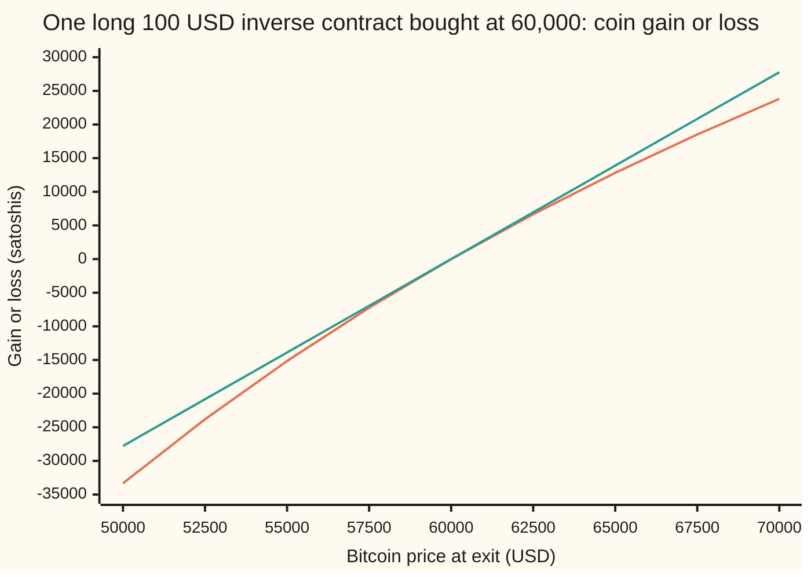

# Inverse contracts: futures and options paid in bitcoin on a dollar price, and the convexity that comes with it

[Syllabus](../../../SYLLABUS.md) → [Financial mathematics](../README.md) → [Digital assets - perpetuals, inverse contracts and AMMs](../README.md#s54) → Inverse contracts

---

## General Overview

Bitcoin trades at 60,000 US dollars. Many crypto exchanges take margin (the deposit that backs a position) in bitcoin, not dollars, and pay every gain and loss in bitcoin too. Their contracts are still quoted in dollars. One contract is worth 100 USD.

A trader buys one such contract at 60,000. The price rises to 61,000. The exchange pays the trader 100(1/60,000 − 1/61,000) = 0.0000273224 BTC. At 61,000 that coin is worth 1.6667 USD, exactly what a dollar contract on 100/60,000 of a coin would pay. Had the price fallen to 59,000 instead, the trader would lose 0.0000282486 BTC. The loss is bigger than the gain, for the same 1,000-dollar move.

That asymmetry is the whole subject. The contract is a fixed number of dollars, 100, counted in coins. The coin price of 100 dollars is 100/P at a bitcoin price P, and 100/P is a curved function of P. Contracts built like this are called **inverse** contracts: the payoff uses one over the price.

Options work the same way. A **coin-settled call** pays its gain in bitcoin, divided by the bitcoin price on expiry day. An at-the-money call on one coin, three months, 80% volatility, with dollars earning 5% and bitcoin 0%, costs 0.163822 BTC. That is the ordinary currency-option price, 9,829.31 USD, divided by spot, with bitcoin playing the foreign currency.

**An inverse contract pays a fixed dollar amount counted in coins, so its coin payoff follows the convex curve 100/P, and any coin payoff is priced by counting in coins: a coin-settled option is the Garman-Kohlhagen price, with bitcoin as the foreign currency, divided by spot.**

**What kind of fact this is:** the payoff shapes are definitions and their convexity is a theorem, proved in Why it works; the option price is a model, Garman-Kohlhagen's steady-volatility assumption, and inside it a theorem.

### The picture: one contract, curved in coins

The exit price runs left to right. The coin gain or loss on one long contract, bought at 60,000, runs up the side. It is measured in **satoshis**: one satoshi is 0.00000001 BTC, a hundred-millionth of a coin.



Orange: the inverse contract. Green: a straight line with the same slope at 60,000. The orange curve sits below the green line on both sides. A fall to 50,000 costs 33,333 satoshis; a rise to 70,000 gains only 23,810.

---

## The formula

```math
\Pi = Q\left(\frac{1}{F_0} - \frac{1}{F_1}\right)\ \text{BTC}, \qquad c = \frac{C}{S} = e^{-r_f T}N(d_1) - \frac{K}{S}\,e^{-r_d T}N(d_2)\ \text{BTC}
```

**Read it aloud:** a long inverse contract gains the coin value of its dollars at entry minus their coin value at exit. A coin-settled call costs the dollar Garman-Kohlhagen price divided by spot: one discounted coin weighted by its chance counted in coins, minus the strike's dollars counted in coins, weighted by their chance counted in dollars.

The helpers are the ones from [Garman-Kohlhagen](../21-FX%20vanilla%20options%20-%20Garman-Kohlhagen%20and%20the%20desk%20conventions/01-garman-kohlhagen.md), with dollars as the domestic currency and bitcoin as the foreign one:

```math
d_1 = \frac{\ln(S/K) + (r_d - r_f + \tfrac12\sigma^2)\,T}{\sigma\sqrt{T}}, \qquad d_2 = d_1 - \sigma\sqrt{T}
```

| Symbol | Plain meaning | In our example | Push it up and the answer… |
| --- | --- | --- | --- |
| $`Q`$ | the contract's face value, in dollars | 100 USD | the coin gain grows in proportion |
| $`F_0`$, $`F_1`$, $`P`$ | the contract's price when bought and when closed, USD per BTC; $`P`$, any bitcoin price | 60,000 and 61,000; $`P`$ = 60,000 for the bend | $`F_0`$ up: the long gains less; $`F_1`$ up: the long gains more, but by less and less; $`P`$ up: 100 dollars cost fewer coins |
| $`\Pi`$, $`X_T`$ | the long's gain in coins (the short gets minus this); any payoff counted in coins on expiry day | 0.0000273224 BTC | — |
| $`S`$, $`S_t`$, $`S_T`$ | bitcoin's spot price today, at a later moment, and on expiry day | 60,000 USD today | the coin call costs more |
| $`K`$ | the option's strike, USD per BTC | 60,000 | the coin call costs less |
| $`T`$, $`t`$ | time to expiry, in years; $`t`$ is any moment before it | 0.25, three months | the coin call costs more |
| $`r_d`$, $`r_f`$ | what dollars earn, and what bitcoin earns when lent, continuously compounded ($`r`$ and $`q`$ on [Perpetual futures](01-perpetual-futures-and-the-funding-rate.md)) | 5% and 0% | $`r_d`$ up: the call costs more; $`r_f`$ up: it costs less |
| $`\sigma`$ | volatility: the yearly wobble of bitcoin's log price | 80% | the coin call costs more, and the curve's effect on averages grows |
| $`F`$ | the forward: the fair price today for delivery at $`T`$, $`S\,e^{(r_d - r_f)T}`$ | 60,754.71 | — |
| $`C`$, $`c`$ | the call's price in dollars per coin, and in coins per coin | 9,829.31 USD and 0.163822 BTC | — |
| $`N(x)`$, $`Z`$, $`d_1`$, $`d_2`$ | the bell-curve area left of $`x`$; $`Z`$, a standard bell-curve draw; the forward's distance above the strike in wobble units, plus and minus half a unit | 0.231250 and −0.168750 | — |
| $`E[\cdot]`$, $`E^{\mathrm{BTC}}[\cdot]`$ | an average over expiry-day outcomes with the dollar world's odds, and with the coin world's odds | — | — |

### When it holds

- **The exchange pays exactly the contract formula, in coins.** Real exchanges settle against an index price (an average of several spot markets), charge fees and may close a position early when margin runs out. Then the realised coin gain differs from $`\Pi`$.
- **Rates are constant.** Then the fair inverse future price is the ordinary forward $`F`$. If rates move at random, daily settlement in coins adds a small correction, as daily margining does for ordinary futures.
- **Bitcoin's log price wanders with one steady volatility.** Real coin options show a smile (a different volatility at each strike). Desks keep the formula as a quoting language and feed it each strike's volatility.
- **The premium is paid in coins at today's spot.** If it is paid in dollars instead, the price is $`C`$ in dollars and the hedge is the plain delta, 0.591440 BTC, not 0.427618 (Step 5).
- **European exercise.** The option is used on the expiry date only.

---

## Why it works

### Step 0: a fixed number of dollars, counted in coins

At price $`P`$, one dollar costs $`1/P`$ BTC. So the contract's 100 dollars are worth $`100/P`$ BTC. When bitcoin rises, the same 100 dollars cost fewer coins. That one fraction carries the whole card.

The function $`1/P`$ is curved, and curved upward: **convex**. A convex function lies above every straight line that touches it. So a contract whose coin value is $`Q/P`$ cannot move in a straight line with the price.

### Step 1: the coin payoff

The long agrees at $`F_0`$ that the contract's 100 dollars are worth $`Q/F_0`$ coins. At the close they are worth $`Q/F_1`$ coins. The exchange pays the difference:

```math
\Pi = \frac{Q}{F_0} - \frac{Q}{F_1}.
```

For the example: $`100/60{,}000 - 100/61{,}000 = 1/36{,}600`$ BTC exactly, 0.0000273224 BTC. The long is in effect short dollars: it gains coins when a dollar becomes cheaper in coins.

### Step 2: in dollars the contract is straight

Convert the coin gain to dollars at the closing price:

```math
\Pi\,F_1 = Q\left(\frac{F_1}{F_0} - 1\right).
```

That is a straight line in $`F_1`$. It is exactly what a dollar-settled contract on $`Q/F_0`$ coins pays: here $`100 \times (61{,}000/60{,}000 - 1) = 1.6667`$ USD. So a trader who counts in dollars and converts each gain at once sees an ordinary linear contract. The curve lives in the coin count.

### Step 3: in coins the contract is curved

The long holds minus $`Q/P`$, so its coin gain is **concave** in the price: it bends down. The short holds plus $`Q/P`$, so its coin gain is convex. The bend, from calculus:

```math
\frac{d^2}{dP^2}\,\frac{Q}{P} = \frac{2Q}{P^3} > 0.
```

At $`P = 60{,}000`$ that is $`0.925926 \times 10^{-12}`$ BTC per dollar squared. The code also measures it by differences over 1,000 dollars and gets $`0.926183 \times 10^{-12}`$. The effect in plain numbers:

- Up 1,000 dollars: the long gains 0.0000273224 BTC.
- Down 1,000 dollars: the long loses 0.0000282486 BTC.
- A straight line with the same starting slope says 0.0000277778 BTC either way.
- An equal move up and down nets −0.0000009262 BTC for the long.

The short side's convexity has a famous use. Hold 1 BTC and short 600 contracts at 60,000. The coin count becomes $`1 - 600\,\Pi = 60{,}000/F_1`$. At 40,000 that is 1.5 BTC, at 80,000 it is 0.75 BTC, and both are worth 60,000.00 USD. The coin holder has made a **synthetic dollar**: a coin balance that keeps a fixed dollar value.

### Step 4: a coin payoff is priced by counting in coins

A payoff in coins needs a price in coins. [Changing the unit of account](../05-Black-Scholes%20from%20the%20Ground%20Up/05-change-of-numeraire-in-pricing.md) gives the rule. Price in dollars, then divide by today's spot. Or, equivalently, average the coin payoff with the **coin world's** odds and discount at the coin rate:

```math
\text{price in BTC} = \frac{e^{-r_d T}\,E[X_T\,S_T]}{S} = e^{-r_f T}\,E^{\mathrm{BTC}}[X_T].
```

Here $`X_T`$ is the payoff in coins. The coin world's odds are the dollar world's odds multiplied by the tilt $`S_T/F`$, the factor by which a coin outgrew the dollar bank account. Prices that end high count for more.

The tilt moves bitcoin's log drift up by $`\sigma^2`$, from $`r_d - r_f - \tfrac12\sigma^2`$ to $`r_d - r_f + \tfrac12\sigma^2`$. Under those odds the average of $`1/S_T`$ is exactly $`1/F`$. So, with constant rates, an inverse future that settles once at $`T`$ has the fair price $`F`$ = 60,754.71, the same as an ordinary future.

The dollar world gives a different average, by Jensen's inequality (the average of a convex function exceeds the function of the average):

```math
E\!\left[\frac{1}{S_T}\right] = \frac{e^{\sigma^2 T}}{F}, \qquad E^{\mathrm{BTC}}\!\left[\frac{1}{S_T}\right] = \frac{1}{F}.
```

At 80% volatility over three months, $`e^{\sigma^2 T} = e^{0.16}`$ = 1.173511. That gap is not a charge for the curve: the fair price above is the plain forward. It is what the dollar world's odds add to the average of $`1/S_T`$, so pricing a coin payoff with those odds goes wrong. Step 3's curve is where the gap comes from.

<details>
<summary>Detailed proof: the two averages of 1/S_T</summary>

In the dollar world, with $`Z`$ a standard bell-curve draw,

$`\displaystyle S_T = S\exp\!\big((r_d - r_f - \tfrac12\sigma^2)T + \sigma\sqrt{T}\,Z\big).`$

So $`1/S_T`$ is $`1/S`$ times $`\exp(-(r_d - r_f - \tfrac12\sigma^2)T - \sigma\sqrt{T}\,Z)`$. For any number $`a`$, the average of $`e^{aZ}`$ is $`e^{a^2/2}`$, which adds $`\tfrac12\sigma^2 T`$:

$`\displaystyle E\!\left[\frac{1}{S_T}\right] = \frac{1}{S}\,e^{-(r_d - r_f)T + \sigma^2 T} = \frac{e^{\sigma^2 T}}{F}.`$

In the coin world the drift is $`r_d - r_f + \tfrac12\sigma^2`$ instead, so the exponent is $`-(r_d - r_f)T - \tfrac12\sigma^2 T + \tfrac12\sigma^2 T`$ and the average is $`1/F`$.

Why that drift: in the coin world every coin-valued holding must grow at $`r_f`$. A dollar deposit is worth $`e^{r_d t}/S_t`$ coins. For it to grow at $`r_f`$ on average, $`E^{\mathrm{BTC}}[1/S_T] = e^{-(r_d - r_f)T}/S = 1/F`$, which forces the drift above. The code checks both averages by Simpson's rule, with no formula inside. $`\blacksquare`$

</details>

### Step 5: a coin-settled call is Garman-Kohlhagen divided by spot

The coin-settled call on one coin pays, in coins,

```math
X_T = \frac{(S_T - K)^+}{S_T},
```

where $`(x)^+`$ means $`\max(x, 0)`$: the gain if positive, zero otherwise. Multiply by $`S_T`$ and the payoff in dollars is $`(S_T - K)^+`$, the ordinary call. Its dollar price is the Garman-Kohlhagen $`C`$, with dollars domestic and bitcoin foreign. Step 4 then says the coin price is $`C/S`$.

This is the "percent of foreign notional" quote from [One option, two currencies](../21-FX%20vanilla%20options%20-%20Garman-Kohlhagen%20and%20the%20desk%20conventions/02-premium-currency-and-foreign-domestic-symmetry.md): bitcoin is the foreign currency and the premium is paid in it. Dividing the formula by $`S`$ term by term gives

```math
c = e^{-r_f T}N(d_1) - \frac{K}{S}\,e^{-r_d T}N(d_2).
```

The first term is one coin, discounted at the coin rate, weighted by the chance of exercise counted in coins. The second is the strike's dollars, counted in coins at today's spot, weighted by the chance counted in dollars.

One consequence for hedging. A trader who pays the premium in coins has already given up $`c`$ coins. So the option adds $`e^{-r_f T}N(d_1) - c`$ coins of exposure, not $`e^{-r_f T}N(d_1)`$. Here that is 0.591440 − 0.163822 = 0.427618 BTC, which equals the cash half counted in coins. Currency desks call this the premium-adjusted delta ([Four deltas for one option](../21-FX%20vanilla%20options%20-%20Garman-Kohlhagen%20and%20the%20desk%20conventions/04-fx-delta-conventions.md)).

---

## Worked numbers, by hand

The inverse future: 100 USD a contract, bought at 60,000.

| Step | Arithmetic | Value |
| --- | --- | --- |
| coin gain, up to 61,000 | $`100/60{,}000 - 100/61{,}000`$ | 0.0000273224 BTC (1/36,600) |
| in dollars at 61,000 | $`0.0000273224 \times 61{,}000`$ | 1.6667 USD |
| coin loss, down to 59,000 | $`100/60{,}000 - 100/59{,}000`$ | −0.0000282486 BTC (−1/35,400) |
| straight-line guess | $`100 \times 1{,}000 / 60{,}000^2`$ | 0.0000277778 BTC |
| up plus down | $`0.0000273224 - 0.0000282486`$ | **−0.0000009262 BTC** |

The coin-settled call: one coin, strike 60,000, three months, 80% volatility, dollars 5%, bitcoin 0%.

| Step | Arithmetic | Value |
| --- | --- | --- |
| forward $`F`$ | $`60{,}000 \times e^{0.05 \times 0.25}`$ | 60,754.71 |
| $`d_1`$ | $`(0 + (0.05 + 0.32) \times 0.25)/(0.80 \times 0.5)`$ | 0.231250 |
| $`d_2`$ | $`0.231250 - 0.40`$ | −0.168750 |
| $`N(d_1)`$, $`N(d_2)`$ | bell-curve areas | 0.591440, 0.432997 |
| share half | $`60{,}000 \times 1 \times 0.591440`$ | 35,486.38 USD |
| cash half | $`60{,}000 \times 0.987578 \times 0.432997`$ | 25,657.07 USD |
| dollar call $`C`$ | $`35{,}486.38 - 25{,}657.07`$ | 9,829.31 USD |
| **coin call $`c`$** | $`9{,}829.31 / 60{,}000`$, or $`0.591440 - 0.427618`$ | **0.163822 BTC** |

A long contract gains fewer coins on a rise than it loses on an equal fall, and the at-the-money call costs 0.163822 BTC.

### What breaks if you drop a piece

| Mistake | Comes out at | What went wrong |
| --- | --- | --- |
| Treat the coin gain as a straight line | ±0.0000277778 BTC | Too much on the rise, too little on the fall; the true numbers are 0.0000273224 and −0.0000282486 |
| Average the coin payoff of the call with the dollar world's odds, discount at 5% | 0.101696 BTC (right: 0.163822) | Coin payoffs need coin odds; the dollar odds underweight the high prices where the call pays |
| Price the inverse future as $`1/E[1/S_T]`$ in the dollar world | 51,771.75 (right: 60,754.71) | Jensen's gap $`e^{\sigma^2 T}`$ = 1.173511 was taken as a price |
| Hedge the coin call with $`N(d_1)`$ coins | 0.591440 BTC (right: 0.427618) | The premium, paid in coins, already removed 0.163822 BTC of exposure |

---

## Code, from first principles, and it actually runs

The scripts reach each answer by at least two independent roads. The coin gain is computed in floating point and in exact fractions. The curvature comes from the formula $`2Q/P^3`$ and from differences. The coin call is priced three ways: Garman-Kohlhagen divided by spot, the coin payoff averaged with coin odds by Simpson's rule (no $`d_1`$, $`d_2`$ or $`N`$ in that road), and a 2,000-step coin-flip tree in dollars divided by spot. The net delta comes from the formula and from nudging spot by one dollar. Both averages of $`1/S_T`$ are integrated and compared with their closed forms. The bell-curve area is a series in both languages.

### Python

```python
# Inverse contracts -- the check behind the card.  Standard library only.
# Every number on the card is printed here.  The bell-curve area is its own
# series, the integrals are Simpson's rule written out, the tree is a loop, and
# the coin P&L is also done in exact fractions, so no rounding can hide in it.
from fractions import Fraction
from math import exp, log, pi, sqrt

def phi(x): return exp(-0.5 * x * x) / sqrt(2.0 * pi)    # bell-curve height

def N(x):   # bell-curve area left of x: 1/2 + phi(x)(x + x^3/3 + x^5/15 + ...)
    term, total, k = x, x, 1
    while abs(term) > 1e-17 * max(1.0, abs(total)):
        k += 2
        term *= x * x / k
        total += term
    return 0.5 + phi(x) * total

def simpson(f, a=-10.0, b=10.0, n=4000):                  # area under f, a to b
    h = (b - a) / n
    s = f(a) + f(b) + sum((4 if i % 2 else 2) * f(a + i * h) for i in range(1, n))
    return s * h / 3

def line(label, v, fmt=".6f"): print(f"{label:<44} {v:>16{fmt}}")
def row(label, vals, fmt=".0f"): print(f"{label:<22}" + "".join(f"{v:>8{fmt}}" for v in vals))

# ---- the inverse future: 100 USD a contract, paid in bitcoin ----
Q, F0 = 100.0, 60000.0
def coin_pnl(F1): return Q * (1 / F0 - 1 / F1)            # BTC to a long, per contract
up, down = coin_pnl(61000.0), coin_pnl(59000.0)
exact_up = 100 * (Fraction(1, 60000) - Fraction(1, 61000))
exact_down = 100 * (Fraction(1, 60000) - Fraction(1, 59000))
tangent = Q * 1000.0 / F0 ** 2                            # coin delta at entry x 1000
line("coin P&L, 60000 -> 61000 (BTC)", up, ".10f")
print(f"{'same, in exact fractions (BTC)':<44} {str(exact_up):>16}")
line("its dollar value at 61000 (USD)", up * 61000.0, ".4f")
line("same, linear 100*(61000/60000 - 1) (USD)", Q * (61000.0 / 60000.0 - 1), ".4f")
line("coin P&L, 60000 -> 59000 (BTC)", down, ".10f")
print(f"{'same, in exact fractions (BTC)':<44} {str(exact_down):>16}")
line("straight-line guess, 1000 either way (BTC)", tangent, ".10f")
line("up move plus down move (BTC)", up + down, ".10f")
assert exact_up == Fraction(1, 36600)
assert abs(up - float(exact_up)) < 1e-18
assert abs(down - float(exact_down)) < 1e-18
assert down + up < 0                                      # concave for the long
assert abs(up * 61000.0 - Q / 60.0) < 1e-12                          # linear in dollars
h = 1000.0
fd = -(coin_pnl(F0 + h) + coin_pnl(F0 - h) - 2 * coin_pnl(F0)) / h ** 2   # curvature of 100/P
line("curvature of 100/P, by differences (x1e12)", fd * 1e12, ".6f")
line("curvature of 100/P, 2Q/P^3 (x1e12)", 2 * Q / F0 ** 3 * 1e12, ".6f")
assert abs(fd - 2 * Q / F0 ** 3) < 1e-3 * fd
for F1 in (40000.0, 60000.0, 80000.0):                    # 1 BTC + short 600 contracts
    coins = 1.0 - 600 * coin_pnl(F1)
    print(f"synthetic dollar at {F1:>7.0f}: holds {coins:.6f} BTC worth {coins * F1:>10.2f} USD")
    assert abs(coins * F1 - 60000.0) < 1e-6

# ---- the coin-settled call: 1 BTC, strike 60000, 3 months, 80% vol ----
S, K, rd, rf, vol, T = 60000.0, 60000.0, 0.05, 0.0, 0.80, 0.25
v = vol * sqrt(T)
F = S * exp((rd - rf) * T)
d1 = (log(S / K) + (rd - rf + 0.5 * vol * vol) * T) / v
d2 = d1 - v
C = S * exp(-rf * T) * N(d1) - K * exp(-rd * T) * N(d2)   # Garman-Kohlhagen, USD
c = C / S                                                 # the same call, in BTC
line("forward F (USD)", F, ".2f")
line("d1", d1); line("d2", d2); line("N(d1)", N(d1)); line("N(d2)", N(d2))
line("discount exp(-rd T)", exp(-rd * T))
line("share half, S exp(-rf T) N(d1) (USD)", S * exp(-rf * T) * N(d1), ".2f")
line("cash half, K exp(-rd T) N(d2) (USD)", K * exp(-rd * T) * N(d2), ".2f")
line("cash half counted in coin, / S (BTC)", K * exp(-rd * T) * N(d2) / S)
line("road 1: Garman-Kohlhagen call (USD)", C, ".2f")
line("road 1: coin-settled call, C/S (BTC)", c)
def ST(z, drift): return S * exp(drift * T + v * z)
btc_world = rd - rf + 0.5 * vol * vol                     # drift when counting in coin
usd_world = rd - rf - 0.5 * vol * vol                     # drift when counting in dollars
kink = lambda drift: (log(K / S) - drift * T) / v           # where S_T crosses K
c2 = exp(-rf * T) * simpson(lambda z: (1 - K / ST(z, btc_world)) * phi(z), kink(btc_world))
line("road 2: coin payoff averaged in coin (BTC)", c2)
steps = 2000                                              # road 3: coin-flip tree in dollars
dt = T / steps
u = exp(vol * sqrt(dt)); dn = 1 / u
p = (exp((rd - rf) * dt) - dn) / (u - dn)
vals = [max(S * u ** j * dn ** (steps - j) - K, 0.0) for j in range(steps + 1)]
for n in range(steps, 0, -1):
    vals = [exp(-rd * dt) * (p * vals[j + 1] + (1 - p) * vals[j]) for j in range(n)]
c3 = vals[0] / S
line("road 3: dollar tree, then / S (BTC)", c3)
assert abs(c2 - c) < 1e-9
assert abs(c3 - c) < 5e-5
wrong = exp(-rd * T) * simpson(lambda z: (1 - K / ST(z, usd_world)) * phi(z), kink(usd_world))
line("wrong: coin payoff averaged in dollars (BTC)", wrong)
delta_usd = exp(-rf * T) * N(d1)
line("delta of the dollar call (BTC)", delta_usd)
line("delta net of the coin premium (BTC)", delta_usd - c)
def coin_call(s):                                         # C/S at any spot, for nudging
    a = (log(s / K) + btc_world * T) / v
    return exp(-rf * T) * N(a) - K / s * exp(-rd * T) * N(a - v)
nudged = S * (coin_call(S + 1.0) - coin_call(S - 1.0)) / 2.0
line("same, S x slope of the coin price (BTC)", nudged)
assert abs(nudged - (delta_usd - c)) < 1e-7

# ---- the trap: average 1/S_T in the wrong world ----
inv_usd = simpson(lambda z: phi(z) / ST(z, usd_world))
inv_btc = simpson(lambda z: phi(z) / ST(z, btc_world))
line("F x average of 1/S_T, dollar world", F * inv_usd)
line("F x average of 1/S_T, coin world", F * inv_btc)
line("exp(sigma^2 T), the Jensen factor", exp(vol * vol * T))
line("fair inverse future price, coin world (USD)", 1 / inv_btc, ".2f")
line("wrong inverse future price, dollar world", 1 / inv_usd, ".2f")
assert abs(F * inv_usd - exp(vol * vol * T)) < 1e-9
assert abs(F * inv_btc - 1) < 1e-9

# ---- try changing ----
def gk_coin(K_, vol_, T_):                                # coin-settled call in BTC
    a = (log(S / K_) + (rd - rf + 0.5 * vol_ * vol_) * T_) / (vol_ * sqrt(T_))
    return exp(-rf * T_) * N(a) - K_ / S * exp(-rd * T_) * N(a - vol_ * sqrt(T_))
assert abs(gk_coin(K, vol, T) - c) < 1e-15
line("try: vol 40%, coin-settled call (BTC)", gk_coin(K, 0.40, T))
line("try: strike 70000, coin-settled call (BTC)", gk_coin(70000.0, vol, T))
for F1 in (40000.0, 80000.0):
    line(f"try: 1 BTC + short 300 at {F1:.0f} (USD)", (1.0 - 300 * coin_pnl(F1)) * F1, ".2f")
line("try: 1 year, Jensen factor", exp(vol * vol * 1.0))
line("try: 1 year, wrong inverse future price", S * exp((rd - rf) * 1.0) / exp(vol * vol * 1.0), ".2f")

# ---- chart: coin P&L of one long contract, in satoshis (1e-8 BTC) ----
xs = [50000.0 + 2500.0 * i for i in range(9)]
row("chart, exit price", xs)
row("chart, inverse (sat)", [coin_pnl(x) * 1e8 for x in xs])
row("chart, straight (sat)", [Q * (x - F0) / F0 ** 2 * 1e8 for x in xs])
print("ALL CHECKS PASS")
```

**Ran 2026-11-23 on macOS, Python 3.14.10, standard library only. All checks passed. Output, pasted from the run:**

```
coin P&L, 60000 -> 61000 (BTC)                   0.0000273224
same, in exact fractions (BTC)                        1/36600
its dollar value at 61000 (USD)                        1.6667
same, linear 100*(61000/60000 - 1) (USD)               1.6667
coin P&L, 60000 -> 59000 (BTC)                  -0.0000282486
same, in exact fractions (BTC)                       -1/35400
straight-line guess, 1000 either way (BTC)       0.0000277778
up move plus down move (BTC)                    -0.0000009262
curvature of 100/P, by differences (x1e12)           0.926183
curvature of 100/P, 2Q/P^3 (x1e12)                   0.925926
synthetic dollar at   40000: holds 1.500000 BTC worth   60000.00 USD
synthetic dollar at   60000: holds 1.000000 BTC worth   60000.00 USD
synthetic dollar at   80000: holds 0.750000 BTC worth   60000.00 USD
forward F (USD)                                      60754.71
d1                                                   0.231250
d2                                                  -0.168750
N(d1)                                                0.591440
N(d2)                                                0.432997
discount exp(-rd T)                                  0.987578
share half, S exp(-rf T) N(d1) (USD)                 35486.38
cash half, K exp(-rd T) N(d2) (USD)                  25657.07
cash half counted in coin, / S (BTC)                 0.427618
road 1: Garman-Kohlhagen call (USD)                   9829.31
road 1: coin-settled call, C/S (BTC)                 0.163822
road 2: coin payoff averaged in coin (BTC)           0.163822
road 3: dollar tree, then / S (BTC)                  0.163802
wrong: coin payoff averaged in dollars (BTC)         0.101696
delta of the dollar call (BTC)                       0.591440
delta net of the coin premium (BTC)                  0.427618
same, S x slope of the coin price (BTC)              0.427618
F x average of 1/S_T, dollar world                   1.173511
F x average of 1/S_T, coin world                     1.000000
exp(sigma^2 T), the Jensen factor                    1.173511
fair inverse future price, coin world (USD)          60754.71
wrong inverse future price, dollar world             51771.75
try: vol 40%, coin-settled call (BTC)                0.085526
try: strike 70000, coin-settled call (BTC)           0.104917
try: 1 BTC + short 300 at 40000 (USD)                50000.00
try: 1 BTC + short 300 at 80000 (USD)                70000.00
try: 1 year, Jensen factor                           1.896481
try: 1 year, wrong inverse future price              33259.64
chart, exit price        50000   52500   55000   57500   60000   62500   65000   67500   70000
chart, inverse (sat)    -33333  -23810  -15152   -7246       0    6667   12821   18519   23810
chart, straight (sat)   -27778  -20833  -13889   -6944       0    6944   13889   20833   27778
ALL CHECKS PASS
```

All three roads agree on 0.163822 BTC; the tree is two hundred-thousandths low, which is its step size showing. The exact fractions confirm the floating-point coin gains.

### Rust

```rust
// Inverse contracts -- the same check as the Python script, in Rust.
// Standard library only, no crates.  The bell-curve area is its own series, the
// integrals are Simpson's rule, the tree is a loop, and the coin P&L is also done
// in exact whole-number fractions.
// Compile: rustc --edition 2021 -O inverse_futures_and_coin_margined_options_check.rs

fn phi(x: f64) -> f64 { (-0.5 * x * x).exp() / (2.0 * std::f64::consts::PI).sqrt() }

fn n_cdf(x: f64) -> f64 { // 1/2 + phi(x)(x + x^3/3 + x^5/15 + ...)
    let (mut term, mut total, mut k) = (x, x, 1.0);
    while term.abs() > 1e-17 * total.abs().max(1.0) {
        k += 2.0;
        term *= x * x / k;
        total += term;
    }
    0.5 + phi(x) * total
}

fn simpson(f: &dyn Fn(f64) -> f64, a: f64, b: f64, n: usize) -> f64 {
    let h = (b - a) / n as f64;
    let mut s = f(a) + f(b);
    for i in 1..n {
        s += if i % 2 == 1 { 4.0 } else { 2.0 } * f(a + i as f64 * h);
    }
    s * h / 3.0
}

fn gcd(a: i128, b: i128) -> i128 { if b == 0 { a.abs() } else { gcd(b, a % b) } }

// 100 * (1/a - 1/b) as a reduced fraction (numerator, denominator)
fn exact_pnl(a: i128, b: i128) -> (i128, i128) {
    let (num, den) = (100 * (b - a), a * b);
    let g = gcd(num, den);
    (num / g, den / g)
}

fn line(label: &str, v: f64, dp: usize) { println!("{:<44} {:>16.*}", label, dp, v); }
fn row(label: &str, vals: &[f64]) {
    let cells: String = vals.iter().map(|v| format!("{:>8.0}", v)).collect();
    println!("{:<22}{}", label, cells);
}

fn main() {
    // ---- the inverse future: 100 USD a contract, paid in bitcoin ----
    let (q, f0) = (100.0_f64, 60000.0_f64);
    let coin_pnl = |f1: f64| q * (1.0 / f0 - 1.0 / f1); // BTC to a long, per contract
    let (up, down) = (coin_pnl(61000.0), coin_pnl(59000.0));
    let (eu, ed) = (exact_pnl(60000, 61000), exact_pnl(60000, 59000));
    let tangent = q * 1000.0 / (f0 * f0); // coin delta at entry x 1000
    line("coin P&L, 60000 -> 61000 (BTC)", up, 10);
    println!("{:<44} {:>16}", "same, in exact fractions (BTC)", format!("{}/{}", eu.0, eu.1));
    line("its dollar value at 61000 (USD)", up * 61000.0, 4);
    line("same, linear 100*(61000/60000 - 1) (USD)", q * (61000.0 / 60000.0 - 1.0), 4);
    line("coin P&L, 60000 -> 59000 (BTC)", down, 10);
    println!("{:<44} {:>16}", "same, in exact fractions (BTC)", format!("{}/{}", ed.0, ed.1));
    line("straight-line guess, 1000 either way (BTC)", tangent, 10);
    line("up move plus down move (BTC)", up + down, 10);
    assert!(eu == (1, 36600));
    assert!((up - 1.0 / 36600.0).abs() < 1e-18);
    assert!((down - ed.0 as f64 / ed.1 as f64).abs() < 1e-18);
    assert!(down + up < 0.0); // concave for the long
    assert!((up * 61000.0 - q / 60.0).abs() < 1e-12); // linear in dollars
    let h = 1000.0;
    let fd = -(coin_pnl(f0 + h) + coin_pnl(f0 - h) - 2.0 * coin_pnl(f0)) / (h * h);
    line("curvature of 100/P, by differences (x1e12)", fd * 1e12, 6);
    line("curvature of 100/P, 2Q/P^3 (x1e12)", 2.0 * q / f0.powi(3) * 1e12, 6);
    assert!((fd - 2.0 * q / f0.powi(3)).abs() < 1e-3 * fd);
    for f1 in [40000.0, 60000.0, 80000.0] { // 1 BTC + short 600 contracts
        let coins = 1.0 - 600.0 * coin_pnl(f1);
        println!("synthetic dollar at {:>7.0}: holds {:.6} BTC worth {:>10.2} USD", f1, coins, coins * f1);
        assert!((coins * f1 - 60000.0).abs() < 1e-6);
    }

    // ---- the coin-settled call: 1 BTC, strike 60000, 3 months, 80% vol ----
    let (s, k, rd, rf, vol, t) = (60000.0_f64, 60000.0_f64, 0.05_f64, 0.0_f64, 0.80_f64, 0.25_f64);
    let v = vol * t.sqrt();
    let fwd = s * ((rd - rf) * t).exp();
    let d1 = ((s / k).ln() + (rd - rf + 0.5 * vol * vol) * t) / v;
    let d2 = d1 - v;
    let call = s * (-rf * t).exp() * n_cdf(d1) - k * (-rd * t).exp() * n_cdf(d2);
    let c = call / s;
    line("forward F (USD)", fwd, 2);
    line("d1", d1, 6); line("d2", d2, 6); line("N(d1)", n_cdf(d1), 6); line("N(d2)", n_cdf(d2), 6);
    line("discount exp(-rd T)", (-rd * t).exp(), 6);
    line("share half, S exp(-rf T) N(d1) (USD)", s * (-rf * t).exp() * n_cdf(d1), 2);
    line("cash half, K exp(-rd T) N(d2) (USD)", k * (-rd * t).exp() * n_cdf(d2), 2);
    line("cash half counted in coin, / S (BTC)", k * (-rd * t).exp() * n_cdf(d2) / s, 6);
    line("road 1: Garman-Kohlhagen call (USD)", call, 2);
    line("road 1: coin-settled call, C/S (BTC)", c, 6);
    let st = |z: f64, drift: f64| s * (drift * t + v * z).exp();
    let btc_world = rd - rf + 0.5 * vol * vol; // drift when counting in coin
    let usd_world = rd - rf - 0.5 * vol * vol; // drift when counting in dollars
    let kink = |drift: f64| ((k / s).ln() - drift * t) / v; // where S_T crosses K
    let c2 = (-rf * t).exp() * simpson(&|z| (1.0 - k / st(z, btc_world)) * phi(z), kink(btc_world), 10.0, 4000);
    line("road 2: coin payoff averaged in coin (BTC)", c2, 6);
    let steps = 2000usize; // road 3: coin-flip tree in dollars
    let dt = t / steps as f64;
    let u = (vol * dt.sqrt()).exp();
    let dn = 1.0 / u;
    let p = (((rd - rf) * dt).exp() - dn) / (u - dn);
    let mut vals: Vec<f64> = (0..=steps)
        .map(|j| (s * u.powi(j as i32) * dn.powi((steps - j) as i32) - k).max(0.0)).collect();
    for n in (1..=steps).rev() {
        vals = (0..n).map(|j| (-rd * dt).exp() * (p * vals[j + 1] + (1.0 - p) * vals[j])).collect();
    }
    let c3 = vals[0] / s;
    line("road 3: dollar tree, then / S (BTC)", c3, 6);
    assert!((c2 - c).abs() < 1e-9);
    assert!((c3 - c).abs() < 5e-5);
    let wrong = (-rd * t).exp() * simpson(&|z| (1.0 - k / st(z, usd_world)) * phi(z), kink(usd_world), 10.0, 4000);
    line("wrong: coin payoff averaged in dollars (BTC)", wrong, 6);
    let delta_usd = (-rf * t).exp() * n_cdf(d1);
    line("delta of the dollar call (BTC)", delta_usd, 6);
    line("delta net of the coin premium (BTC)", delta_usd - c, 6);
    let coin_call = |x: f64| {
        let a = ((x / k).ln() + btc_world * t) / v;
        (-rf * t).exp() * n_cdf(a) - k / x * (-rd * t).exp() * n_cdf(a - v)
    };
    let nudged = s * (coin_call(s + 1.0) - coin_call(s - 1.0)) / 2.0;
    line("same, S x slope of the coin price (BTC)", nudged, 6);
    assert!((nudged - (delta_usd - c)).abs() < 1e-7);

    // ---- the trap: average 1/S_T in the wrong world ----
    let inv_usd = simpson(&|z| phi(z) / st(z, usd_world), -10.0, 10.0, 4000);
    let inv_btc = simpson(&|z| phi(z) / st(z, btc_world), -10.0, 10.0, 4000);
    line("F x average of 1/S_T, dollar world", fwd * inv_usd, 6);
    line("F x average of 1/S_T, coin world", fwd * inv_btc, 6);
    line("exp(sigma^2 T), the Jensen factor", (vol * vol * t).exp(), 6);
    line("fair inverse future price, coin world (USD)", 1.0 / inv_btc, 2);
    line("wrong inverse future price, dollar world", 1.0 / inv_usd, 2);
    assert!((fwd * inv_usd - (vol * vol * t).exp()).abs() < 1e-9);
    assert!((fwd * inv_btc - 1.0).abs() < 1e-9);

    // ---- try changing ----
    let gk_coin = |k_: f64, vol_: f64, t_: f64| {
        let a = ((s / k_).ln() + (rd - rf + 0.5 * vol_ * vol_) * t_) / (vol_ * t_.sqrt());
        (-rf * t_).exp() * n_cdf(a) - k_ / s * (-rd * t_).exp() * n_cdf(a - vol_ * t_.sqrt())
    };
    assert!((gk_coin(k, vol, t) - c).abs() < 1e-15);
    line("try: vol 40%, coin-settled call (BTC)", gk_coin(k, 0.40, t), 6);
    line("try: strike 70000, coin-settled call (BTC)", gk_coin(70000.0, vol, t), 6);
    for f1 in [40000.0, 80000.0] {
        line(&format!("try: 1 BTC + short 300 at {:.0} (USD)", f1), (1.0 - 300.0 * coin_pnl(f1)) * f1, 2);
    }
    line("try: 1 year, Jensen factor", (vol * vol).exp(), 6);
    line("try: 1 year, wrong inverse future price", s * (rd - rf).exp() / (vol * vol).exp(), 2);

    // ---- chart: coin P&L of one long contract, in satoshis (1e-8 BTC) ----
    let xs: Vec<f64> = (0..9).map(|i| 50000.0 + 2500.0 * i as f64).collect();
    row("chart, exit price", &xs);
    row("chart, inverse (sat)", &xs.iter().map(|&x| coin_pnl(x) * 1e8).collect::<Vec<_>>());
    row("chart, straight (sat)", &xs.iter().map(|&x| q * (x - f0) / (f0 * f0) * 1e8).collect::<Vec<_>>());
    println!("ALL CHECKS PASS");
}
```

**Ran 2026-11-23 on macOS, rustc 1.98.1, no crates. All checks passed. Output, pasted from the run:**

```
coin P&L, 60000 -> 61000 (BTC)                   0.0000273224
same, in exact fractions (BTC)                        1/36600
its dollar value at 61000 (USD)                        1.6667
same, linear 100*(61000/60000 - 1) (USD)               1.6667
coin P&L, 60000 -> 59000 (BTC)                  -0.0000282486
same, in exact fractions (BTC)                       -1/35400
straight-line guess, 1000 either way (BTC)       0.0000277778
up move plus down move (BTC)                    -0.0000009262
curvature of 100/P, by differences (x1e12)           0.926183
curvature of 100/P, 2Q/P^3 (x1e12)                   0.925926
synthetic dollar at   40000: holds 1.500000 BTC worth   60000.00 USD
synthetic dollar at   60000: holds 1.000000 BTC worth   60000.00 USD
synthetic dollar at   80000: holds 0.750000 BTC worth   60000.00 USD
forward F (USD)                                      60754.71
d1                                                   0.231250
d2                                                  -0.168750
N(d1)                                                0.591440
N(d2)                                                0.432997
discount exp(-rd T)                                  0.987578
share half, S exp(-rf T) N(d1) (USD)                 35486.38
cash half, K exp(-rd T) N(d2) (USD)                  25657.07
cash half counted in coin, / S (BTC)                 0.427618
road 1: Garman-Kohlhagen call (USD)                   9829.31
road 1: coin-settled call, C/S (BTC)                 0.163822
road 2: coin payoff averaged in coin (BTC)           0.163822
road 3: dollar tree, then / S (BTC)                  0.163802
wrong: coin payoff averaged in dollars (BTC)         0.101696
delta of the dollar call (BTC)                       0.591440
delta net of the coin premium (BTC)                  0.427618
same, S x slope of the coin price (BTC)              0.427618
F x average of 1/S_T, dollar world                   1.173511
F x average of 1/S_T, coin world                     1.000000
exp(sigma^2 T), the Jensen factor                    1.173511
fair inverse future price, coin world (USD)          60754.71
wrong inverse future price, dollar world             51771.75
try: vol 40%, coin-settled call (BTC)                0.085526
try: strike 70000, coin-settled call (BTC)           0.104917
try: 1 BTC + short 300 at 40000 (USD)                50000.00
try: 1 BTC + short 300 at 80000 (USD)                70000.00
try: 1 year, Jensen factor                           1.896481
try: 1 year, wrong inverse future price              33259.64
chart, exit price        50000   52500   55000   57500   60000   62500   65000   67500   70000
chart, inverse (sat)    -33333  -23810  -15152   -7246       0    6667   12821   18519   23810
chart, straight (sat)   -27778  -20833  -13889   -6944       0    6944   13889   20833   27778
ALL CHECKS PASS
```

The two outputs are identical line for line.

### Lean

Lean proves the card's three facts for every positive price, face value and volatility, and its whole-number examples.

- Take a face value $`Q`$ above zero. Then the coin value $`Q/P`$ is strictly convex in the price $`P`$, over all positive prices.
- Under the same condition, the long's coin gain $`\Pi`$ bends down. It is strictly concave in $`F_1`$ over positive prices, for any $`F_0`$.
- Take positive prices $`F_0`$ and $`F_1`$. Then $`\Pi\,F_1 = Q(F_1/F_0 - 1)`$: in dollars the contract is a straight line.
- Take a positive $`S_T`$. Then the coin call's payoff $`(S_T - K)^+/S_T`$, times $`S_T`$, is the ordinary call payoff $`(S_T - K)^+`$.
- Take positive $`S`$, $`\sigma`$ and $`T`$, and the dollar world's drift $`r_d - r_f - \tfrac12\sigma^2`$. Then $`E[1/S_T] = e^{\sigma^2 T}/F`$, Jensen's gap.
- Take the coin world's drift $`r_d - r_f + \tfrac12\sigma^2`$ instead. Then $`E^{\mathrm{BTC}}[1/S_T] = 1/F`$ exactly.
- The coin gains land exactly: 1/36,600 BTC up to 61,000, and −1/35,400 BTC down to 59,000.
- The gain up to 61,000 is worth exactly 5/3 USD, and an equal move up and down nets a coin loss.
- The straight-line guess, 1/36,000 BTC, sits strictly between the true gain and the true loss.
- The synthetic dollar holds 1.5 BTC at 40,000 and 0.75 BTC at 80,000, both worth exactly 60,000 USD.

The option prices, the deltas, the decimals and the chart's points are left to the Python and Rust checks.

```lean
-- Inverse contracts: the coin value Q/P of a fixed dollar amount is strictly convex in the bitcoin price, the coin gain is linear once counted in dollars, and the two averages of 1/S_T are exp(σ²T)/F and 1/F.
import Mathlib.Analysis.Convex.SpecificFunctions.Deriv
import Mathlib.Probability.Distributions.Gaussian.Real

open MeasureTheory ProbabilityTheory

/-- Helper: the standard bell-curve average of `exp (c z)` is `exp (c² / 2)`. -/
theorem gauss_exp_integral (c : ℝ) :
    (∫ z, Real.exp (c * z) ∂(gaussianReal 0 1)) = Real.exp (c ^ 2 / 2) := by
  have h := congrFun (mgf_id_gaussianReal (μ := 0) (v := 1)) c
  simp only [mgf, id] at h
  rw [h]
  congr 1
  push_cast
  ring

#print axioms gauss_exp_integral

/-- An inverse contract is a fixed number of dollars `Q > 0` counted in coins. At a bitcoin
price `P > 0` it is worth `Q / P` coins, and that coin value is strictly convex in the price.
So the long's coin gain `Q / F₀ - Q / F₁` is strictly concave in the closing price `F₁`:
it gains fewer coins on a rise than it loses on an equal fall. -/
theorem inverse_contract_coin_value_strictly_convex (Q : ℝ) (hQ : 0 < Q) :
    StrictConvexOn ℝ (Set.Ioi 0) (fun P : ℝ => Q / P) ∧
      ∀ F₀ : ℝ, StrictConcaveOn ℝ (Set.Ioi 0) (fun F₁ : ℝ => Q / F₀ - Q / F₁) := by
  have hc : StrictConvexOn ℝ (Set.Ioi 0) (fun P : ℝ => Q / P) := by
    have h := strictConvexOn_zpow (m := -1) (by decide) (by decide)
    refine ⟨h.1, fun x hx y hy hxy a b ha hb hab => ?_⟩
    have := h.2 hx hy hxy ha hb hab
    simp only [zpow_neg, zpow_one, smul_eq_mul] at this ⊢
    simp only [div_eq_mul_inv]
    nlinarith [mul_lt_mul_of_pos_left this hQ]
  refine ⟨hc, fun F₀ => ?_⟩
  have h2 : StrictConcaveOn ℝ (Set.Ioi 0) (-(fun P : ℝ => Q / P)) := hc.neg
  have h3 := h2.add_const (Q / F₀)
  convert h3 using 1
  funext x
  simp only [Pi.neg_apply, Pi.add_apply]
  ring

/-- Counted in dollars at the closing price, the long's coin gain is the straight line
`Q (F₁ / F₀ - 1)`. And the coin-settled call's coin payoff `(S_T - K)^+ / S_T`, converted to
dollars at `S_T`, is the ordinary call payoff `(S_T - K)^+`. -/
theorem inverse_gain_in_dollars_is_linear (Q F₀ F₁ S_T K : ℝ) (h₀ : 0 < F₀) (h₁ : 0 < F₁)
    (hS : 0 < S_T) :
    (Q / F₀ - Q / F₁) * F₁ = Q * (F₁ / F₀ - 1) ∧
      max (S_T - K) 0 / S_T * S_T = max (S_T - K) 0 := by
  refine ⟨?_, ?_⟩
  · field_simp
  · field_simp

/-- The two averages of `1 / S_T` when bitcoin's log price has one steady volatility `σ`
and rates are constant. With `Z` a standard bell-curve draw, the dollar world has
`S_T = S exp((r_d - r_f - σ²/2) T + σ √T Z)` and the coin world has drift
`r_d - r_f + σ²/2`. With the forward `F = S exp((r_d - r_f) T)`:
the dollar-world average of `1 / S_T` is `exp(σ² T) / F` (Jensen's gap),
and the coin-world average is exactly `1 / F`. -/
theorem average_of_inverse_price_dollar_and_coin_world (S σ T r_d r_f : ℝ) (hS : 0 < S)
    (hσ : 0 < σ) (hT : 0 < T) :
    (∫ z, (S * Real.exp ((r_d - r_f - σ ^ 2 / 2) * T + σ * Real.sqrt T * z))⁻¹
        ∂(gaussianReal 0 1)) = Real.exp (σ ^ 2 * T) / (S * Real.exp ((r_d - r_f) * T)) ∧
      (∫ z, (S * Real.exp ((r_d - r_f + σ ^ 2 / 2) * T + σ * Real.sqrt T * z))⁻¹
        ∂(gaussianReal 0 1)) = 1 / (S * Real.exp ((r_d - r_f) * T)) := by
  have key : ∀ a : ℝ, (∫ z, (S * Real.exp (a + σ * Real.sqrt T * z))⁻¹ ∂(gaussianReal 0 1))
      = S⁻¹ * Real.exp (-a) * Real.exp ((σ * Real.sqrt T) ^ 2 / 2) := by
    intro a
    have hf : (fun z => (S * Real.exp (a + σ * Real.sqrt T * z))⁻¹)
        = fun z => S⁻¹ * Real.exp (-a) * Real.exp ((-(σ * Real.sqrt T)) * z) := by
      funext z
      rw [mul_inv, ← Real.exp_neg, mul_assoc S⁻¹ (Real.exp (-a)), ← Real.exp_add]
      congr 2
      ring
    rw [hf, integral_const_mul, gauss_exp_integral, neg_sq]
  have hsq : (σ * Real.sqrt T) ^ 2 = σ ^ 2 * T := by
    rw [mul_pow, Real.sq_sqrt hT.le]
  have hr : ∀ u v : ℝ, Real.exp u / (S * Real.exp v) = S⁻¹ * Real.exp (u - v) := by
    intro u v
    rw [Real.exp_sub]
    field_simp
  refine ⟨?_, ?_⟩
  · rw [key, hsq, hr, mul_assoc, ← Real.exp_add]
    congr 2
    ring
  · rw [key, hsq, ← Real.exp_zero, hr, mul_assoc, ← Real.exp_add]
    congr 2
    ring

-- The card's whole-number examples: 100 USD a contract, bought at 60,000.
-- Up to 61,000: the long gains exactly 1/36,600 BTC.
example : (100 : ℚ) / 60000 - 100 / 61000 = 1 / 36600 := by norm_num
-- Its dollar value at 61,000 is 100 × (61,000/60,000 − 1) = 5/3 USD.
example : ((100 : ℚ) / 60000 - 100 / 61000) * 61000 = 100 * (61000 / 60000 - 1) := by norm_num
example : (100 : ℚ) * (61000 / 60000 - 1) = 5 / 3 := by norm_num
-- Down to 59,000: the long loses exactly 1/35,400 BTC.
example : (100 : ℚ) / 60000 - 100 / 59000 = -1 / 35400 := by norm_num
-- An equal move up and down nets a coin loss for the long.
example : ((100 : ℚ) / 60000 - 100 / 61000) + (100 / 60000 - 100 / 59000) < 0 := by norm_num
-- The straight-line guess 100 × 1,000 / 60,000² = 1/36,000 BTC sits between the two.
example : (1 : ℚ) / 36600 < 100 * 1000 / 60000 ^ 2 ∧
    (100 : ℚ) * 1000 / 60000 ^ 2 < 1 / 35400 := by norm_num
-- Synthetic dollar: 1 BTC and short 600 contracts at 60,000 hold 60,000/F₁ coins.
example : (1 : ℚ) - 600 * (100 / 60000 - 100 / 40000) = 3 / 2 := by norm_num
example : (1 : ℚ) - 600 * (100 / 60000 - 100 / 80000) = 3 / 4 := by norm_num
example : ((1 : ℚ) - 600 * (100 / 60000 - 100 / 40000)) * 40000 = 60000 := by norm_num
example : ((1 : ℚ) - 600 * (100 / 60000 - 100 / 80000)) * 80000 = 60000 := by norm_num

#print axioms inverse_contract_coin_value_strictly_convex
#print axioms inverse_gain_in_dollars_is_linear
#print axioms average_of_inverse_price_dollar_and_coin_world
```

**Checked 2026-11-23 on macOS, Lean 4.36.0-rc2, Mathlib v4.36.0-rc2. Every proof is complete and uses only Lean's standard axioms. Output, pasted from the run:**

```
'gauss_exp_integral' depends on axioms: [propext, Classical.choice, Quot.sound]
'inverse_contract_coin_value_strictly_convex' depends on axioms: [propext, Classical.choice, Quot.sound]
'inverse_gain_in_dollars_is_linear' depends on axioms: [propext, Classical.choice, Quot.sound]
'average_of_inverse_price_dollar_and_coin_world' depends on axioms: [propext, Classical.choice, Quot.sound]
```

> [!TIP]
> **Try changing**
> Guess first, then run it.
> - **Halve the volatility.** Use 0.40 in the `gk_coin` line. Guess first: does the coin call fall by half? No: it falls from 0.163822 to **0.085526 BTC**, a little more than half the old price.
> - **Move the strike out.** Use 70,000 in the `gk_coin` line. Guess first. The coin call drops to **0.104917 BTC**: bitcoin must climb 10,000 dollars before it pays.
> - **Hedge half the coin.** Short 300 contracts against 1 BTC, not 600. Guess first. At 40,000 the holding is worth **50,000.00 USD**; at 80,000, **70,000.00 USD**. Half the coin's price risk is left.
> - **Stretch to one year.** Guess first. Jensen's factor becomes **1.896481**, and the dollar-world mistake prices the inverse future at **33,259.64** instead of the forward.

---

## The usual mistake

> [!warning]
> **Averaging a coin payoff with dollar odds.** An inverse contract or a coin-settled option pays in coins. Its fair value comes from averaging with the coin world's odds, or from pricing in dollars and dividing by spot. Averaging the coin payoff with the dollar world's odds gives 0.101696 BTC for a call worth 0.163822 BTC, and 51,771.75 for an inverse future worth 60,754.71.
>
> Smaller traps:
> - **Assuming the gain is symmetric.** A long inverse contract loses 0.0000282486 BTC on a 1,000-dollar fall but gains 0.0000273224 BTC on a 1,000-dollar rise. Position sizes set for a straight line are too big on the downside.
> - **Forgetting the margin moves too.** Coin margin backing a long position loses dollar value exactly when the position loses. A long with coin margin is exposed to bitcoin twice.
> - **Hedging with the dollar delta.** A coin-paid premium already carries coin exposure. The hedge is 0.427618 BTC, not 0.591440.
> - **Calling the dollar value curved.** Converted at the closing price, the long's gain is straight: 1.6667 USD for 1,000 dollars up. The curve is in the coin count, not in the dollar value.

---

## Where you meet it in real life

- **Coin-margined futures.** Exchanges that hold margin in bitcoin quote their futures in dollars and settle each contract as $`\Pi`$. A trader's account balance in coins follows the curve on this card.
- **Inverse perpetuals.** The same payoff without an expiry date, kept near spot by funding ([Perpetual futures](01-perpetual-futures-and-the-funding-rate.md)). The funding is also paid in coins.
- **Miners' hedges.** A miner earns coins and pays bills in dollars. Holding coins and shorting inverse contracts fixes the dollar value of the coins: Step 3's synthetic dollar.
- **Coin-settled options.** The largest bitcoin options markets quote premiums in BTC and pay exercise in BTC. Their quotes are this card's $`c`$, and their deltas are the premium-adjusted ones.
- **Linear contracts as the alternative.** Exchanges also list contracts margined and settled in dollar stablecoins (coins pegged to the dollar). Those are straight in the price, with no inverse curve.

> **Say it back**
> An inverse contract is a fixed dollar amount, counted in coins. Its coin gain is $`Q/F_0 - Q/F_1`$, which bends because $`1/P`$ is convex: a long gains less on a rise than it loses on an equal fall. Converted to dollars at the close, the gain is a straight line, so the curve lives in the coin count. Coin payoffs are priced by counting in coins, which is pricing in dollars and dividing by spot. A coin-settled call is therefore Garman-Kohlhagen with bitcoin as the foreign currency, divided by spot: 0.163822 BTC here.

---

## What this builds on

- [Perpetual futures](01-perpetual-futures-and-the-funding-rate.md): the dollar rate and coin yield, the basis, and the perpetual that comes in an inverse version too.
- [Changing the unit of account](../05-Black-Scholes%20from%20the%20Ground%20Up/05-change-of-numeraire-in-pricing.md): pricing in any traded unit by tilting the odds, which is how coin payoffs get coin odds.
- [Garman-Kohlhagen](../21-FX%20vanilla%20options%20-%20Garman-Kohlhagen%20and%20the%20desk%20conventions/01-garman-kohlhagen.md): the currency-option formula; bitcoin takes the foreign currency's place.
- [One option, two currencies](../21-FX%20vanilla%20options%20-%20Garman-Kohlhagen%20and%20the%20desk%20conventions/02-premium-currency-and-foreign-domestic-symmetry.md): the payoff identity $`(S_T - K)^+/S_T`$ and the premium quoted as a percentage of the foreign notional.

## Where this goes next

- [Automated market makers](03-amm-constant-product-and-loss-versus-rebalancing.md): a pool that trades by formula. Its value is curved in price too, concave like the long inverse contract's coin count, so it loses steadily to volatility.

The question this card leaves open: when bitcoin's volatility and the dollar rate are both random, how large is the correction between an inverse future settled daily in coins and the forward?

---

## Sources

Verified 2026-11-23: every link below resolves to the publisher's page.

- Garman, Mark B., and Steven W. Kohlhagen. "Foreign Currency Option Values." *Journal of International Money and Finance* 2, no. 3 (1983): 231–237. [doi:10.1016/S0261-5606(83)80001-1](https://doi.org/10.1016/S0261-5606(83)80001-1). The currency-option formula used as road 1, with bitcoin as the foreign currency.
- Geman, Hélyette, Nicole El Karoui, and Jean-Charles Rochet. "Changes of Numéraire, Changes of Probability Measure and Option Pricing." *Journal of Applied Probability* 32, no. 2 (1995): 443–458. [doi:10.2307/3215299](https://doi.org/10.2307/3215299). The change of unit behind Step 4's coin odds.
- Alexander, Carol, Ding Chen, and Arben Imeraj. "Crypto Quanto and Inverse Options." *Mathematical Finance* 33, no. 4 (2023): 1005–1043. [doi:10.1111/mafi.12410](https://doi.org/10.1111/mafi.12410). Inverse options on bitcoin priced and hedged in coin terms.
