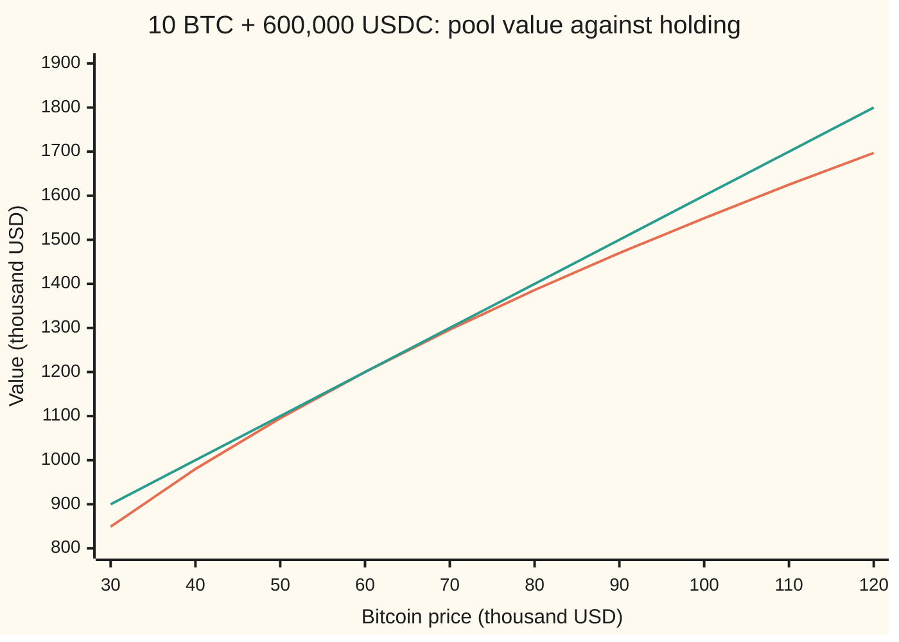
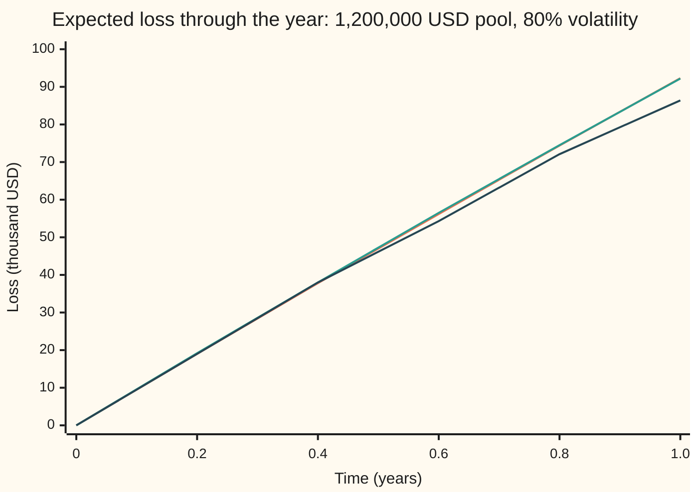

# Automated market makers: the constant-product pool as a short-gamma position, and the loss to rebalancers it pays all the time

[Syllabus](../../../SYLLABUS.md) → [Financial mathematics](../README.md) → [Digital assets - perpetuals, inverse contracts and AMMs](../README.md#s54) → Automated market makers

---

## General Overview

A trading pool on a blockchain (a public ledger kept by a network of computers) holds 10 BTC (bitcoins) and 600,000 USDC (a token kept at one US dollar). Anyone may swap one coin for the other against it. There is no order book (a list of buyers' and sellers' standing offers) and no dealer. A fixed rule sets the price: the product of the two balances must stay at 6,000,000. A program that quotes prices by such a rule is an **automated market maker** (AMM). The people who deposit the coins are **liquidity providers** (LPs).

The pool's price is the ratio of its balances, 600,000 / 10 = 60,000 USD per BTC. When Bitcoin rises to 66,000 on other exchanges, the pool is cheap. An **arbitrageur** (a trader who buys where a thing is cheap and sells where it is dear) buys 0.4654 BTC from the pool for 29,285 USDC, until the pool's price is 66,000 too. The pool now holds 9.5346 BTC and 629,285 USDC, worth 1,258,571. Had the LPs kept their coins in a wallet, they would have 1,260,000. The gap, 1,429 (0.113%), is called **impermanent loss**.

That name says the loss goes away when the price comes back, and measured against the wallet it does: impermanent loss depends only on where the price ends. A second measure counts every move. Each time the price moves, the pool sells to the arbitrageur at a stale price, and a trader who rebalanced at market prices would have kept the difference. That steady leak is **loss-versus-rebalancing** (LVR). It is what an LP pays who hedges away Bitcoin's price risk, and it never comes back. Bitcoin's volatility (the yearly size of its random moves) is 80%, and its square, 0.64, is the variance. The leak runs at 0.64 / 8 = 8% of the pool's value a year: 96,000 USD on this pool.

**A constant-product pool always holds less of a coin as its price rises, so its value is a concave curve in the price, like a seller of options; it collects no option premium for that, and pays the bend to arbitrageurs at one eighth of the variance times the pool's value a year.**

**What kind of fact this is:** the holdings, the value curve and impermanent loss are theorems, proved on this card from the pool's rule and the assumption that arbitrage keeps its price at the market price. The LVR rate is a theorem inside a model, [Prices as geometric Brownian motion](../05-Black-Scholes%20from%20the%20Ground%20Up/01-geometric-brownian-motion-for-prices.md), with no trading fees; the model is an assumption, not a law.

### The picture: the pool against the wallet



Orange: the pool's value, $`2\sqrt{kP}`$. Green: the wallet's value, 10 BTC plus 600,000 USD. The straight line touches the curve at 60,000 and lies above it everywhere else. At 30,000 the pool is worth 849 thousand against 900; at 120,000, 1,697 against 1,800. A move either way leaves the pool behind.

---

## The formula

Notation first. The pool holds $`x`$ BTC and $`y`$ USDC. Its rule keeps $`x\,y = k`$. Its price is $`y/x`$, the USDC per BTC. Arbitrage pushes that price to the market price $`P`$. Solve the two equations $`x\,y = k`$ and $`y/x = P`$ for the holdings:

```math
x(P) = \sqrt{k/P}, \qquad y(P) = \sqrt{kP}, \qquad V(P) = x\,P + y = 2\sqrt{kP}
```

**Read it aloud:** the pool's coins scale with one over the square root of the price, its dollars with the square root, and its value is twice the square root of the constant times the price.

Against holding the starting coins, $`H(P) = x_0 P + y_0`$, the ratio depends only on the price move $`R = P/P_0`$:

```math
1 - \frac{V(P)}{H(P)} = 1 - \frac{2\sqrt{R}}{1+R}
```

**Read it aloud:** impermanent loss is one minus twice the root of the price ratio over one plus the ratio.

The bend is the pool's gamma (the change in its coin holdings per dollar of price, see [Gamma](../09-The%20Greeks%2C%20one%20each/02-gamma.md)). It is negative:

```math
\Gamma = V''(P) = -\frac{x}{2P}, \qquad \mathrm{LVR\ rate} = \tfrac12\,\lvert\Gamma\rvert\,\sigma^2 P^2 = \frac{\sigma^2}{8}\,V
```

**Read it aloud:** the loss to rebalancers per year is half the size of the gamma times the variance times the price squared, which comes to one eighth of the variance times the pool's value.

| Symbol | Plain meaning | In our example | Push it up and the answer… |
| --- | --- | --- | --- |
| $`x`$, $`x_0`$ | BTC in the pool; at the start | 9.5346; 10 | (set by $`P`$) |
| $`y`$, $`y_0`$ | USDC in the pool; at the start | 629,285; 600,000 | (set by $`P`$) |
| $`k`$ | the pool's constant, $`x\,y`$; its size | 6,000,000 | value and LVR in dollars grow like $`\sqrt{k}`$ |
| $`P`$, $`P_0`$ | Bitcoin's market price; at the start, in USD | 66,000; 60,000 | the pool holds fewer BTC |
| $`R`$ | the price ratio $`P/P_0`$ | 1.1 | impermanent loss grows on either side of 1 |
| $`V(P)`$, $`H(P)`$ | the pool's value at price $`P`$; the value of holding the starting coins | 1,258,571; 1,260,000 | (solved for; benchmark) |
| $`d`$ | BTC the arbitrageur buys from the pool | 0.4654 | past the best trade, the profit falls |
| $`\Gamma`$ | gamma: the change in the pool's BTC per dollar of price | $`-8.3333\times10^{-5}`$ per USD at 60,000 | a deeper bend, more loss |
| $`\sigma`$ | volatility: the yearly size of Bitcoin's random moves; $`\sigma^2`$ is the variance | 80% | LVR grows with the square |
| $`\mathrm{LVR}`$ | loss-versus-rebalancing: what a market-price rebalancer gains over the pool | 96,000 USD a year | (solved for) |
| $`Z`$, $`\mathrm{E}[\cdot]`$ | a standard bell-curve draw (mean 0, spread 1); the average over all draws | (random); $`\mathrm{E}[(\sqrt{R}-1)^2]`$ over a day is $`4.38308129\times10^{-4}`$ | (none) |
| $`\delta t`$, $`T`$ | one arbitrage step, in years; the horizon | 1/365; 1 year | the expected loss per year does not change with $`\delta t`$ |

### When it holds

- **Arbitrage keeps the pool's price at the market price.** Real pools charge a fee, often 0.30%, so arbitrage stops inside a band around the market price. The loss is smaller, and the fee income partly pays for it.
- **The price moves continuously.** A jump costs $`\tfrac12 V(\sqrt{R}-1)^2`$ at once: 102,944 for a doubling, against 263.01 a day at the smooth rate.
- **The volatility is known and steady.** The loss scales with the variance actually delivered. At 120% volatility it is 18% a year, not 8%.
- **The pool spreads its coins over all prices.** Pools that concentrate liquidity in a price range bend more sharply inside it, and pay more LVR per dollar deposited.
- **The benchmark trades for free at market prices.** LVR measures the pool against an ideal rebalancer with no costs, not against a real one.

---

## Why it works

### Step 0: the pool sells what is rising and buys what is falling

Every arbitrage trade against the pool takes the coin that has become dear on the market. When Bitcoin rises, the pool ends with fewer BTC; when it falls, with more. Holding less of what goes up and more of what goes down is a concave position. A delta-hedged option seller has the same shape, and [Theta pays for gamma](../09-The%20Greeks%2C%20one%20each/10-theta-pays-for-gamma-hedged-pnl.md) prices it. The pool has the shape but no premium.

### Step 1: holdings and value from the rule

Arbitrage stops when the pool's price $`y/x`$ equals $`P`$. Multiply $`x\,y = k`$ by $`y/x = P`$: $`y^2 = kP`$. Divide them: $`x^2 = k/P`$. So $`x = \sqrt{k/P}`$ and $`y = \sqrt{kP}`$. Each side of the pool holds the same value, $`xP = y = \sqrt{kP}`$, and the total is $`V = 2\sqrt{kP}`$.

The arbitrageur reaches this state by choice, not by rule. Buying $`d`$ BTC costs $`k/(x_0 - d) - y_0`$ USDC, and the profit $`dP - \big(k/(x_0-d) - y_0\big)`$ is largest exactly when the pool's new price $`k/(x_0-d)^2`$ equals $`P`$. The check finds that best trade by search and lands on the same 9.5346 BTC.

### Step 2: the pool always trails holding

The wallet line $`H(P) = x_0P + y_0`$ is the sum of two positive numbers, $`x_0P`$ and $`y_0`$, whose product is $`kP`$. The arithmetic-geometric mean inequality (the average of two positive numbers is at least the square root of their product) gives

```math
x_0 P + y_0 \;\ge\; 2\sqrt{x_0 P \cdot y_0} = 2\sqrt{kP} = V(P)
```

Equality holds only when $`x_0 P = y_0`$, which is at $`P = P_0`$. Divide $`V`$ by $`H`$ and write $`x_0 P_0 = y_0`$ to get the ratio form $`2\sqrt{R}/(1+R)`$. It depends on the size of the move, not its direction: a halving and a doubling both cost 5.72%.

### Step 3: delta and gamma

Differentiate $`V = 2\sqrt{k}\,P^{1/2}`$. The slope is $`V' = \sqrt{k}\,P^{-1/2} = x`$: the pool's delta is its coin holding, 10 BTC at 60,000. The bend is $`V'' = -\tfrac12\sqrt{k}\,P^{-3/2} = -x/(2P)`$. At 60,000 that is $`-10/120{,}000 = -8.3333\times10^{-5}`$ BTC per dollar.

A negative gamma means **short gamma**: like an option seller, the pool loses on large moves either way, measured against a position with the same delta.

### Step 4: the loss over one step

Take the benchmark: a rebalancer who starts each step holding the pool's $`x`$ BTC and trades at market prices. Over a step from $`P`$ to $`RP`$, the rebalancer gains $`x(RP - P)`$. The pool gains $`V(RP) - V(P)`$. The difference, with $`xP = V/2`$, is

```math
\text{loss over one step} = \tfrac12 V\,\big(\sqrt{R} - 1\big)^2
```

It is never negative, and it is paid on every step, up or down. On the move from 60,000 to 66,000 it is $`600{,}000 \times (\sqrt{1.1}-1)^2 = 1{,}429`$: exactly the arbitrageur's profit.

<details>
<summary>The algebra of the one-step loss</summary>

With $`xP = V/2`$ and $`V(RP) = \sqrt{R}\,V`$:

$`\displaystyle x(RP - P) - \big(V(RP) - V(P)\big) = \tfrac12 V (R - 1) - V(\sqrt{R} - 1) = \tfrac12 V\big(R - 2\sqrt{R} + 1\big) = \tfrac12 V\big(\sqrt{R}-1\big)^2.`$

</details>

### Step 5: average the step over random moves

Under geometric Brownian motion with no drift, one step's ratio is $`R = e^{-\sigma^2\delta t/2 + \sigma\sqrt{\delta t}\,Z}`$, where $`Z`$ is a standard bell-curve draw. Its average is 1, and the average of $`\sqrt{R}`$ is $`e^{-\sigma^2\delta t/8}`$. So

```math
\mathrm{E}\big[(\sqrt{R}-1)^2\big] = 2\big(1 - e^{-\sigma^2\delta t/8}\big) \approx \tfrac14\sigma^2\,\delta t
```

Multiply by $`V/2`$: the expected loss over a step is $`\tfrac18\sigma^2 V\,\delta t`$. That is the rate on the card, $`\sigma^2/8`$ of the pool's value per year.

The same number comes from the gamma: $`\tfrac12\lvert\Gamma\rvert\sigma^2P^2 = \tfrac12\cdot\tfrac{x}{2P}\cdot\sigma^2P^2 = \tfrac14\sigma^2\,xP = \tfrac18\sigma^2 V`$. It is the option seller's rent from [Theta pays for gamma](../09-The%20Greeks%2C%20one%20each/10-theta-pays-for-gamma-hedged-pnl.md), paid with no theta coming in.

<details>
<summary>Why the average of the square root is that exponential</summary>

For a bell-curve draw $`Z`$ and any number $`a`$, $`\mathrm{E}[e^{aZ}] = e^{a^2/2}`$. Here $`\sqrt{R} = e^{-\sigma^2\delta t/4 + \tfrac12\sigma\sqrt{\delta t}\,Z}`$, so

$`\displaystyle \mathrm{E}[\sqrt{R}] = e^{-\sigma^2\delta t/4}\,e^{\sigma^2\delta t/8} = e^{-\sigma^2\delta t/8}.`$

Then $`\mathrm{E}[(\sqrt{R}-1)^2] = \mathrm{E}[R] - 2\,\mathrm{E}[\sqrt{R}] + 1 = 2\big(1 - e^{-\sigma^2\delta t/8}\big)`$.

</details>

### Step 6: a year of steps

The expected step loss is $`V(1 - e^{-\sigma^2\delta t/8})`$. The pool's expected value itself shrinks by the factor $`e^{-\sigma^2\delta t/8}`$ each step, because $`V`$ is proportional to $`\sqrt{P}`$. Add the steps of a year and the sum telescopes (each term cancels part of the next):

```math
\mathrm{E}[\mathrm{LVR\ over}\ T] = V_0\big(1 - e^{-\sigma^2 T/8}\big)
```

It does not depend on the step size $`\delta t`$. On this pool it is 92,260, a little under the 96,000 that the starting rate gives, because the pool's expected value falls through the year.

---

## Worked numbers, by hand

| Step | Arithmetic | Value |
| --- | --- | --- |
| Pool constant | $`10 \times 600{,}000`$ | 6,000,000 |
| BTC after the move | $`\sqrt{6{,}000{,}000 / 66{,}000}`$ | 9.5346 |
| USDC after the move | $`\sqrt{6{,}000{,}000 \times 66{,}000}`$ | 629,285 |
| Pool value | $`2 \times 629{,}285`$ | 1,258,571 |
| Held value | $`10 \times 66{,}000 + 600{,}000`$ | 1,260,000 |
| Impermanent loss | $`1{,}260{,}000 - 1{,}258{,}571`$ | 1,429 = 0.113% |
| Arbitrageur's trade | buys 0.4654 BTC for 29,285 USDC, average price 62,929 | profit 1,429 |
| Gamma at 60,000 | $`-10 / (2 \times 60{,}000)`$ | $`-8.3333\times10^{-5}`$ per USD |
| LVR rate | $`0.80^2 / 8`$ | 8.00% a year |
| LVR in dollars | $`0.08 \times 1{,}200{,}000`$ | **96,000 USD a year, 263.01 a day** |

At 80% volatility the LPs hand arbitrageurs 263.01 USD a day on a 1,200,000 USD pool, before any fee income.

### What breaks if you drop a piece

| Mistake | Comes out at | What went wrong |
| --- | --- | --- |
| Using the option seller's $`\tfrac12\sigma^2`$ on the pool's value | 384,000 a year | the half belongs with $`\lvert\Gamma\rvert P^2`$, and $`\lvert\Gamma\rvert P^2 = V/4`$, not $`V`$ |
| Charging $`\tfrac14\sigma^2`$ on the whole pool | 192,000 a year | $`\tfrac14\sigma^2`$ applies to the BTC half, $`xP = V/2`$ |
| Using $`\sigma/8`$ instead of $`\sigma^2/8`$ | 120,000 a year | the loss scales with the variance, not the volatility |

---

## The loss that does not come back

### One round trip traced

Bitcoin goes from 60,000 to 66,000 and back to 60,000. Arbitrage resets the pool on each leg.

| Leg | Pool's trade | Rebalancer's trade | LVR on the leg |
| --- | --- | --- | --- |
| 60,000 → 66,000 | sells 0.4654 BTC for 29,285 | sells 0.4654 BTC at 66,000 | 1,429 |
| 66,000 → 60,000 | buys 0.4654 BTC for 29,285 | buys 0.4654 BTC at 60,000 | 1,363 |
| End | back to 10 BTC and 600,000 USDC | same coins, plus cash | **2,792** |

At the end the pool and the wallet are both worth 1,200,000: impermanent loss is 0, and an LP who did not hedge has lost nothing against holding. The rebalancer, holding the same coins at every moment, is 2,792 richer. The pool traded at its own stale prices both ways; the rebalancer traded at market prices. An LP who hedged, by shorting the pool's BTC holding on each leg, is down exactly those 2,792, and the price's return does not refund them.

### One force at a time: volatility

The loss scales with the square of the volatility. Yearly LVR on the 1,200,000 pool:

```
sigma  40%  |#####                         24,000   ( 2% a year)
sigma  80%  |####################          96,000   ( 8% a year)
sigma 120%  |############################################# 216,000   (18% a year)
```

Doubling the volatility quadruples the loss.

### One force at a time: how often arbitrage acts

Daily steps or weekly steps, the expected yearly loss is the same, 92,260. Weekly steps make each loss bigger and the steps fewer, and the two effects cancel exactly (Step 6). One day's expected loss, by Simpson's rule (a numerical integral from parabola-shaped slices) over the bell curve, is 262.98, against the starting rate's 263.01.

### Both together: a simulated year

The check simulates 2,000 years of Bitcoin at 80% volatility and resets the pool by arbitrage at every step. It adds up the rebalancer's gain over the pool.

| Steps | Mean LVR over the year | Standard error (likely size of the mean's random error) | Formula $`V_0(1 - e^{-\sigma^2 T/8})`$ |
| --- | --- | --- | --- |
| Daily, 365 | 92,155 | 503 | 92,260 |
| Weekly, 52 | 92,635 | 677 | 92,260 |

Both runs land within one standard error of the formula.

The daily run also tracks the impermanent loss of an LP who does not hedge. Its average at the year's end is 86,447, standard error 3,450, within two standard errors of the same 92,260: on average, impermanent loss over a year equals LVR. The two differ path by path. LVR builds up step by step and only grows; impermanent loss is set by where the price ends, so it swings far more (standard error 3,450 against 503).



Orange: the formula $`V_0(1 - e^{-\sigma^2 T/8})`$, with the horizon $`T`$ running from 0 to 1 year. Green: the simulated mean LVR, daily steps. Dark blue: the simulated mean impermanent loss of an LP who does not hedge. The three lie close together; the impermanent-loss line is the noisiest.

---

## Code, from first principles, and it actually runs

The code builds the pool, moves the price and prices the loss. It takes four independent roads. Road 1 is the closed forms. Road 2 finds the arbitrageur's best trade by ternary search (narrowing an interval by thirds) on the profit, never using a square root of $`k/P`$. Road 3 takes gamma by finite differences (slopes from prices one dollar apart) and the day's expected loss by Simpson's rule over the bell curve. Road 4 simulates 2,000 years of daily and weekly arbitrage with a hand-written random generator, the same in both languages, so the outputs agree digit for digit. The daily run also records LVR and impermanent loss at each fifth of the year, for the chart.

### Python

```python
# Constant-product pool and loss-versus-rebalancing: the check behind the card.
# Standard library only. Roads: closed forms; the arbitrageur's best trade found
# by ternary search; gamma by finite differences; the daily loss by Simpson's
# rule over the bell curve; a simulated year of daily arbitrage.
import math

x0, y0, P0, sig = 10.0, 600000.0, 60000.0, 0.80
k = x0 * y0
V = lambda P: 2 * math.sqrt(k * P)            # pool value once arbitrage sets its price to P
H = lambda P: x0 * P + y0                     # value of simply holding the deposit
def lvr_step(v, R): return v / 2 * (math.sqrt(R) - 1) ** 2   # one jump of ratio R
print(f"pool: k = {k:.0f}, price {P0:.0f}, value {V(P0):.0f}")

# ---- road 1 against road 2: holdings after the move to 66,000 ----
P1 = 66000.0
x1, y1 = math.sqrt(k / P1), math.sqrt(k * P1)
profit = lambda d: d * P1 - (k / (x0 - d) - y0)   # arbitrageur buys d BTC, pays the pool
lo, hi = 0.0, x0 - 1e-9
for _ in range(200):
    a, b = lo + (hi - lo) / 3, hi - (hi - lo) / 3
    if profit(a) < profit(b): lo = a
    else: hi = b
d = (lo + hi) / 2
print(f"after 66000: formula x = {x1:.4f} BTC, y = {y1:.0f} USDC")
print(f"after 66000: arbitrage search x = {x0 - d:.4f} BTC, pays {k / (x0 - d) - y0:.0f} USDC for {d:.4f} BTC")
print(f"arbitrageur's average price {(k / (x0 - d) - y0) / d:.0f}, profit {profit(d):.0f}")
assert abs((x0 - d) - x1) < 1e-6 and abs(profit(d) - lvr_step(V(P0), P1 / P0)) < 1e-6
v1, h1 = V(P1), H(P1)
print(f"pool value {v1:.0f}, held {h1:.0f}, loss {h1 - v1:.0f} = {100 * (1 - v1 / h1):.3f}%")
R = P1 / P0
assert abs((1 - v1 / h1) - (1 - 2 * math.sqrt(R) / (1 + R))) < 1e-12   # ratio form
assert abs(v1 - (x1 * P1 + y1)) < 1e-6 and v1 < h1                        # AM-GM

# ---- delta and gamma: derivative formulas against finite differences ----
h = 1.0
dfd = (V(P0 + h) - V(P0 - h)) / (2 * h)
gfd = (V(P0 + h) - 2 * V(P0) + V(P0 - h)) / h ** 2
g = -x0 / (2 * P0)
print(f"delta {dfd:.6f} BTC (holdings {x0:.6f}); gamma {gfd:.4e} per USD (formula {g:.4e})")
assert abs(dfd - x0) < 1e-6 and abs(gfd - g) < 1e-8
rent = 0.5 * abs(g) * sig ** 2 * P0 ** 2
print(f"rent 1/2|gamma|sigma^2 P^2 = {rent:.0f} USD a year = {100 * rent / V(P0):.2f}% of value, {rent / 365:.2f} a day")
assert abs(rent / V(P0) - sig ** 2 / 8) < 1e-12
for s in (0.4, 0.8, 1.2):
    print(f"sigma {s:.0%}: LVR rate {100 * s * s / 8:.2f}% a year = {s * s / 8 * V(P0):.0f} USD")
print(f"fee break-even at 0.30%: volume {rent / 0.003:.0f} a year, {rent / 0.003 / 365:.0f} a day")

# ---- one day's expected loss: Simpson's rule over the bell curve ----
dt = 1 / 365
f = lambda z: (math.sqrt(math.exp(-sig**2 * dt / 2 + sig * math.sqrt(dt) * z)) - 1) ** 2 \
    * math.exp(-z * z / 2) / math.sqrt(2 * math.pi)
n, A = 4000, 10.0
w = 2 * A / n
q = sum((1 if i in (0, n) else 4 if i % 2 else 2) * f(-A + i * w) for i in range(n + 1)) * w / 3
print(f"day: Simpson E[(sqrtR-1)^2] = {q:.8e}, exact {2 * (1 - math.exp(-sig**2 * dt / 8)):.8e}, sigma^2 dt/4 = {sig**2 * dt / 4:.8e}")
assert abs(q - 2 * (1 - math.exp(-sig**2 * dt / 8))) < 1e-12
print(f"day one expected LVR {V(P0) / 2 * q:.2f} USD")
exact = V(P0) * (1 - math.exp(-sig ** 2 / 8))
print(f"one year expected LVR {exact:.0f} (rate times starting value {sig**2 / 8 * V(P0):.0f})")

# ---- round trip 60,000 -> 66,000 -> 60,000 ----
up, dn = lvr_step(V(P0), R), lvr_step(V(P1), P0 / P1)
print(f"round trip: up {up:.0f}, down {dn:.0f}, LVR {up + dn:.0f}; held-vs-pool loss at the end {H(P0) - V(P0):.0f}")
reb = (x0 - x1) * P1 - (x0 - x1) * P0            # rebalancer sells at 66,000, buys back at 60,000
assert abs(reb - (up + dn)) < 1e-6

# ---- simulated year: arbitrage every step, zero drift ----
st = [88172645463325252]
def unif():
    s = st[0]; s ^= (s << 13) & 0xFFFFFFFFFFFFFFFF; s ^= s >> 7; s ^= (s << 17) & 0xFFFFFFFFFFFFFFFF
    st[0] = s; return ((s >> 11) + 0.5) / 9007199254740992.0
def year(steps, paths, marks=1):   # mean LVR and s.e.; mean LVR and IL at `marks` even times; IL s.e.
    tot, tot2, il2 = 0.0, 0.0, 0.0
    lv, il = [0.0] * marks, [0.0] * marks
    e, every = sig * math.sqrt(1 / steps), steps // marks
    for _ in range(paths):
        p, loss = P0, 0.0
        for i in range(1, steps + 1):
            z = math.sqrt(-2 * math.log(unif())) * math.cos(2 * math.pi * unif())
            pn = p * math.exp(-e * e / 2 + e * z)
            loss += math.sqrt(k / p) * (pn - p) - (V(pn) - V(p))   # rebalancer minus pool
            p = pn
            if i % every == 0:                                     # IL: held minus pool, unhedged
                lv[i // every - 1] += loss / paths; il[i // every - 1] += (H(p) - V(p)) / paths
        tot += loss; tot2 += loss * loss; il2 += (H(p) - V(p)) ** 2
    m = tot / paths
    return m, math.sqrt((tot2 / paths - m * m) / paths), lv, il, math.sqrt((il2 / paths - il[-1] ** 2) / paths)
m, se, lv, il, seil = year(365, 2000, 5)
print(f"simulated year, daily: mean LVR {m:.0f} (s.e. {se:.0f}), exact {exact:.0f}")
print(f"simulated year, daily: mean impermanent loss at the end {il[-1]:.0f} (s.e. {seil:.0f})")
assert abs(m - exact) < 4 * se
assert abs(il[-1] - exact) < 4 * seil                      # unhedged LP: on average IL equals LVR
mw, sew = year(52, 2000)[:2]
print(f"simulated year, weekly: mean LVR {mw:.0f} (s.e. {sew:.0f})")
assert abs(mw - exact) < 4 * sew

# ---- what breaks, try changing, chart ----
print(f"breaks: sigma^2/2 -> {sig**2 / 2 * V(P0):.0f}; sigma^2/4 -> {sig**2 / 4 * V(P0):.0f}; sigma/8 -> {sig / 8 * V(P0):.0f}")
print(f"try: jump to 120000: IL {100 * (1 - V(120000) / H(120000)):.2f}%, one-jump LVR {lvr_step(V(P0), 2):.0f}")
print(f"try: jump to 30000: IL {100 * (1 - V(30000) / H(30000)):.2f}%, one-jump LVR {lvr_step(V(P0), 0.5):.0f}")
ps = range(30000, 120001, 10000)
print("chart pool (thousand USD):", ", ".join(f"{V(p) / 1000:.0f}" for p in ps))
print("chart held (thousand USD):", ", ".join(f"{H(p) / 1000:.0f}" for p in ps))
form = [V(P0) * (1 - math.exp(-sig ** 2 * (j + 1) / 5 / 8)) for j in range(5)]
for name, ys in (("formula", form), ("mean LVR", lv), ("mean IL", il)):  # year in fifths
    print(f"chart {name} (thousand USD): 0.0, " + ", ".join(f"{y / 1000:.1f}" for y in ys))
print("ALL CHECKS PASS")
```

**Ran 2026-11-23 on macOS, Python 3.14.10, standard library only. All checks passed. Output, pasted from the run:**

```
pool: k = 6000000, price 60000, value 1200000
after 66000: formula x = 9.5346 BTC, y = 629285 USDC
after 66000: arbitrage search x = 9.5346 BTC, pays 29285 USDC for 0.4654 BTC
arbitrageur's average price 62929, profit 1429
pool value 1258571, held 1260000, loss 1429 = 0.113%
delta 10.000000 BTC (holdings 10.000000); gamma -8.3333e-05 per USD (formula -8.3333e-05)
rent 1/2|gamma|sigma^2 P^2 = 96000 USD a year = 8.00% of value, 263.01 a day
sigma 40%: LVR rate 2.00% a year = 24000 USD
sigma 80%: LVR rate 8.00% a year = 96000 USD
sigma 120%: LVR rate 18.00% a year = 216000 USD
fee break-even at 0.30%: volume 32000000 a year, 87671 a day
day: Simpson E[(sqrtR-1)^2] = 4.38308129e-04, exact 4.38308129e-04, sigma^2 dt/4 = 4.38356164e-04
day one expected LVR 262.98 USD
one year expected LVR 92260 (rate times starting value 96000)
round trip: up 1429, down 1363, LVR 2792; held-vs-pool loss at the end 0
simulated year, daily: mean LVR 92155 (s.e. 503), exact 92260
simulated year, daily: mean impermanent loss at the end 86447 (s.e. 3450)
simulated year, weekly: mean LVR 92635 (s.e. 677)
breaks: sigma^2/2 -> 384000; sigma^2/4 -> 192000; sigma/8 -> 120000
try: jump to 120000: IL 5.72%, one-jump LVR 102944
try: jump to 30000: IL 5.72%, one-jump LVR 51472
chart pool (thousand USD): 849, 980, 1095, 1200, 1296, 1386, 1470, 1549, 1625, 1697
chart held (thousand USD): 900, 1000, 1100, 1200, 1300, 1400, 1500, 1600, 1700, 1800
chart formula (thousand USD): 0.0, 19.0, 37.8, 56.2, 74.4, 92.3
chart mean LVR (thousand USD): 0.0, 19.2, 38.0, 56.5, 74.5, 92.2
chart mean IL (thousand USD): 0.0, 19.0, 38.0, 54.3, 72.1, 86.4
ALL CHECKS PASS
```

### Rust

```rust
// Constant-product pool and loss-versus-rebalancing: the check behind the card.
// std only. Roads: closed forms; the arbitrageur's best trade found by ternary
// search; gamma by finite differences; the daily loss by Simpson's rule over the
// bell curve; a simulated year of daily arbitrage. Output matches the Python.
const X0: f64 = 10.0;
const Y0: f64 = 600000.0;
const P0: f64 = 60000.0;
const SIG: f64 = 0.80;
const K: f64 = X0 * Y0;
const MASK: u64 = 0xFFFFFFFFFFFFFFFF;

fn v(p: f64) -> f64 { 2.0 * (K * p).sqrt() } // pool value once arbitrage sets its price to p
fn hold(p: f64) -> f64 { X0 * p + Y0 } // value of simply holding the deposit
fn lvr_step(val: f64, r: f64) -> f64 { val / 2.0 * (r.sqrt() - 1.0).powi(2) } // one jump of ratio r
fn sci(x: f64, d: usize) -> String { // Python-style 1.2345e-05
    let s = format!("{:.*e}", d, x);
    let (m, e) = s.split_once('e').unwrap();
    let e: i32 = e.parse().unwrap();
    format!("{}e{}{:02}", m, if e < 0 { '-' } else { '+' }, e.abs())
}

struct Rng(u64);
impl Rng {
    fn unif(&mut self) -> f64 {
        let mut s = self.0;
        s ^= (s << 13) & MASK; s ^= s >> 7; s ^= (s << 17) & MASK;
        self.0 = s;
        ((s >> 11) as f64 + 0.5) / 9007199254740992.0
    }
}

// mean LVR and s.e.; mean LVR and IL at `marks` even times; IL s.e.
fn year(rng: &mut Rng, steps: usize, paths: usize, marks: usize) -> (f64, f64, Vec<f64>, Vec<f64>, f64) {
    let (mut tot, mut tot2, mut il2) = (0.0, 0.0, 0.0);
    let (mut lv, mut il) = (vec![0.0; marks], vec![0.0; marks]);
    let (e, every) = (SIG * (1.0 / steps as f64).sqrt(), steps / marks);
    let n = paths as f64;
    for _ in 0..paths {
        let (mut p, mut loss) = (P0, 0.0);
        for i in 1..=steps {
            let u1 = rng.unif();
            let u2 = rng.unif();
            let z = (-2.0 * u1.ln()).sqrt() * (2.0 * std::f64::consts::PI * u2).cos();
            let pn = p * (-e * e / 2.0 + e * z).exp();
            loss += (K / p).sqrt() * (pn - p) - (v(pn) - v(p)); // rebalancer minus pool
            p = pn;
            if i % every == 0 { // IL: held minus pool, unhedged
                lv[i / every - 1] += loss / n;
                il[i / every - 1] += (hold(p) - v(p)) / n;
            }
        }
        tot += loss;
        tot2 += loss * loss;
        il2 += (hold(p) - v(p)) * (hold(p) - v(p));
    }
    let (m, mi) = (tot / n, il[marks - 1]);
    (m, ((tot2 / n - m * m) / n).sqrt(), lv, il, ((il2 / n - mi * mi) / n).sqrt())
}

fn main() {
    println!("pool: k = {:.0}, price {:.0}, value {:.0}", K, P0, v(P0));

    // ---- road 1 against road 2: holdings after the move to 66,000 ----
    let p1 = 66000.0;
    let (x1, y1) = ((K / p1).sqrt(), (K * p1).sqrt());
    let profit = |d: f64| d * p1 - (K / (X0 - d) - Y0); // arbitrageur buys d BTC, pays the pool
    let (mut lo, mut hi) = (0.0, X0 - 1e-9);
    for _ in 0..200 {
        let a = lo + (hi - lo) / 3.0;
        let b = hi - (hi - lo) / 3.0;
        if profit(a) < profit(b) { lo = a } else { hi = b }
    }
    let d = (lo + hi) / 2.0;
    let paid = K / (X0 - d) - Y0;
    println!("after 66000: formula x = {:.4} BTC, y = {:.0} USDC", x1, y1);
    println!("after 66000: arbitrage search x = {:.4} BTC, pays {:.0} USDC for {:.4} BTC", X0 - d, paid, d);
    println!("arbitrageur's average price {:.0}, profit {:.0}", paid / d, profit(d));
    assert!((X0 - d - x1).abs() < 1e-6 && (profit(d) - lvr_step(v(P0), p1 / P0)).abs() < 1e-6);
    let (v1, h1) = (v(p1), hold(p1));
    println!("pool value {:.0}, held {:.0}, loss {:.0} = {:.3}%", v1, h1, h1 - v1, 100.0 * (1.0 - v1 / h1));
    let r = p1 / P0;
    assert!(((1.0 - v1 / h1) - (1.0 - 2.0 * r.sqrt() / (1.0 + r))).abs() < 1e-12); // ratio form
    assert!((v1 - (x1 * p1 + y1)).abs() < 1e-6 && v1 < h1); // AM-GM

    // ---- delta and gamma: derivative formulas against finite differences ----
    let h = 1.0;
    let dfd = (v(P0 + h) - v(P0 - h)) / (2.0 * h);
    let gfd = (v(P0 + h) - 2.0 * v(P0) + v(P0 - h)) / (h * h);
    let g = -X0 / (2.0 * P0);
    println!("delta {:.6} BTC (holdings {:.6}); gamma {} per USD (formula {})", dfd, X0, sci(gfd, 4), sci(g, 4));
    assert!((dfd - X0).abs() < 1e-6 && (gfd - g).abs() < 1e-8);
    let rent = 0.5 * g.abs() * SIG * SIG * P0 * P0;
    println!("rent 1/2|gamma|sigma^2 P^2 = {:.0} USD a year = {:.2}% of value, {:.2} a day", rent, 100.0 * rent / v(P0), rent / 365.0);
    assert!((rent / v(P0) - SIG * SIG / 8.0).abs() < 1e-12);
    for s in [0.4f64, 0.8, 1.2] {
        println!("sigma {:.0}%: LVR rate {:.2}% a year = {:.0} USD", 100.0 * s, 100.0 * s * s / 8.0, s * s / 8.0 * v(P0));
    }
    println!("fee break-even at 0.30%: volume {:.0} a year, {:.0} a day", rent / 0.003, rent / 0.003 / 365.0);

    // ---- one day's expected loss: Simpson's rule over the bell curve ----
    let dt = 1.0 / 365.0;
    let f = |z: f64| ((-SIG * SIG * dt / 2.0 + SIG * dt.sqrt() * z).exp().sqrt() - 1.0).powi(2)
        * (-z * z / 2.0).exp() / (2.0 * std::f64::consts::PI).sqrt();
    let (n, a) = (4000usize, 10.0);
    let w = 2.0 * a / n as f64;
    let mut q = 0.0;
    for i in 0..=n {
        let c = if i == 0 || i == n { 1.0 } else if i % 2 == 1 { 4.0 } else { 2.0 };
        q += c * f(-a + i as f64 * w);
    }
    q *= w / 3.0;
    let qx = 2.0 * (1.0 - (-SIG * SIG * dt / 8.0).exp());
    println!("day: Simpson E[(sqrtR-1)^2] = {}, exact {}, sigma^2 dt/4 = {}", sci(q, 8), sci(qx, 8), sci(SIG * SIG * dt / 4.0, 8));
    assert!((q - qx).abs() < 1e-12);
    println!("day one expected LVR {:.2} USD", v(P0) / 2.0 * q);
    let exact = v(P0) * (1.0 - (-SIG * SIG / 8.0).exp());
    println!("one year expected LVR {:.0} (rate times starting value {:.0})", exact, SIG * SIG / 8.0 * v(P0));

    // ---- round trip 60,000 -> 66,000 -> 60,000 ----
    let (up, dn) = (lvr_step(v(P0), r), lvr_step(v(p1), P0 / p1));
    println!("round trip: up {:.0}, down {:.0}, LVR {:.0}; held-vs-pool loss at the end {:.0}", up, dn, up + dn, hold(P0) - v(P0));
    let reb = (X0 - x1) * p1 - (X0 - x1) * P0; // rebalancer sells at 66,000, buys back at 60,000
    assert!((reb - (up + dn)).abs() < 1e-6);

    // ---- simulated year: arbitrage every step, zero drift ----
    let mut rng = Rng(88172645463325252);
    let (m, se, lv, il, seil) = year(&mut rng, 365, 2000, 5);
    println!("simulated year, daily: mean LVR {:.0} (s.e. {:.0}), exact {:.0}", m, se, exact);
    println!("simulated year, daily: mean impermanent loss at the end {:.0} (s.e. {:.0})", il[4], seil);
    assert!((m - exact).abs() < 4.0 * se);
    assert!((il[4] - exact).abs() < 4.0 * seil); // unhedged LP: on average IL equals LVR
    let (mw, sew, _, _, _) = year(&mut rng, 52, 2000, 1);
    println!("simulated year, weekly: mean LVR {:.0} (s.e. {:.0})", mw, sew);
    assert!((mw - exact).abs() < 4.0 * sew);

    // ---- what breaks, try changing, chart ----
    let v0 = v(P0);
    println!("breaks: sigma^2/2 -> {:.0}; sigma^2/4 -> {:.0}; sigma/8 -> {:.0}", SIG * SIG / 2.0 * v0, SIG * SIG / 4.0 * v0, SIG / 8.0 * v0);
    println!("try: jump to 120000: IL {:.2}%, one-jump LVR {:.0}", 100.0 * (1.0 - v(120000.0) / hold(120000.0)), lvr_step(v0, 2.0));
    println!("try: jump to 30000: IL {:.2}%, one-jump LVR {:.0}", 100.0 * (1.0 - v(30000.0) / hold(30000.0)), lvr_step(v0, 0.5));
    let ps: Vec<f64> = (3..=12).map(|i| i as f64 * 10000.0).collect();
    let pool: Vec<String> = ps.iter().map(|&p| format!("{:.0}", v(p) / 1000.0)).collect();
    let held: Vec<String> = ps.iter().map(|&p| format!("{:.0}", hold(p) / 1000.0)).collect();
    println!("chart pool (thousand USD): {}", pool.join(", "));
    println!("chart held (thousand USD): {}", held.join(", "));
    let form: Vec<f64> = (0..5).map(|j| v0 * (1.0 - (-SIG * SIG * (j + 1) as f64 / 5.0 / 8.0).exp())).collect();
    for (name, ys) in [("formula", &form), ("mean LVR", &lv), ("mean IL", &il)] { // year in fifths
        let cells: Vec<String> = ys.iter().map(|y| format!("{:.1}", y / 1000.0)).collect();
        println!("chart {} (thousand USD): 0.0, {}", name, cells.join(", "));
    }
    println!("ALL CHECKS PASS");
}
```

**Ran 2026-11-23 on macOS, rustc 1.98.1, no crates. All checks passed. Output, pasted from the run:**

```
pool: k = 6000000, price 60000, value 1200000
after 66000: formula x = 9.5346 BTC, y = 629285 USDC
after 66000: arbitrage search x = 9.5346 BTC, pays 29285 USDC for 0.4654 BTC
arbitrageur's average price 62929, profit 1429
pool value 1258571, held 1260000, loss 1429 = 0.113%
delta 10.000000 BTC (holdings 10.000000); gamma -8.3333e-05 per USD (formula -8.3333e-05)
rent 1/2|gamma|sigma^2 P^2 = 96000 USD a year = 8.00% of value, 263.01 a day
sigma 40%: LVR rate 2.00% a year = 24000 USD
sigma 80%: LVR rate 8.00% a year = 96000 USD
sigma 120%: LVR rate 18.00% a year = 216000 USD
fee break-even at 0.30%: volume 32000000 a year, 87671 a day
day: Simpson E[(sqrtR-1)^2] = 4.38308129e-04, exact 4.38308129e-04, sigma^2 dt/4 = 4.38356164e-04
day one expected LVR 262.98 USD
one year expected LVR 92260 (rate times starting value 96000)
round trip: up 1429, down 1363, LVR 2792; held-vs-pool loss at the end 0
simulated year, daily: mean LVR 92155 (s.e. 503), exact 92260
simulated year, daily: mean impermanent loss at the end 86447 (s.e. 3450)
simulated year, weekly: mean LVR 92635 (s.e. 677)
breaks: sigma^2/2 -> 384000; sigma^2/4 -> 192000; sigma/8 -> 120000
try: jump to 120000: IL 5.72%, one-jump LVR 102944
try: jump to 30000: IL 5.72%, one-jump LVR 51472
chart pool (thousand USD): 849, 980, 1095, 1200, 1296, 1386, 1470, 1549, 1625, 1697
chart held (thousand USD): 900, 1000, 1100, 1200, 1300, 1400, 1500, 1600, 1700, 1800
chart formula (thousand USD): 0.0, 19.0, 37.8, 56.2, 74.4, 92.3
chart mean LVR (thousand USD): 0.0, 19.2, 38.0, 56.5, 74.5, 92.2
chart mean IL (thousand USD): 0.0, 19.0, 38.0, 54.3, 72.1, 86.4
ALL CHECKS PASS
```

### Lean

Lean proves the pool's holdings, value curve, gamma and losses for any positive balances, and the average step loss under geometric Brownian motion.

- Take a pool with $`x > 0`$ BTC, $`y > 0`$ USDC, $`xy = k`$ and $`y/x = P`$. Then $`x = \sqrt{k/P}`$, $`y = \sqrt{kP}`$ and $`V = xP + y = 2\sqrt{kP}`$.
- Take the same pool. Then the coin holding $`\sqrt{k/p}`$ falls as the price $`p`$ rises, and the value $`2\sqrt{kp}`$ is strictly concave.
- Take the same pool. Then its delta $`V'(P)`$ is its coin holding $`x`$, and its gamma $`V''(P)`$ is $`-x/(2P)`$, below zero.
- Take the same pool and any volatility $`\sigma`$. Then the rent $`\tfrac12\lvert\Gamma\rvert\sigma^2P^2`$ is $`\tfrac{\sigma^2}{8}V`$.
- Take positive deposits $`x_0`$ BTC and $`y_0`$ USDC, so $`P_0 = y_0/x_0`$, and a price $`P > 0`$. Then the pool's value $`2\sqrt{x_0y_0P}`$ is at most the held value $`H(P)`$, equal only at $`P = P_0`$.
- Take the same deposit and $`R = P/P_0`$. Then the impermanent loss as a share of $`H(P)`$ is $`1 - 2\sqrt{R}/(1+R)`$.
- Take $`k`$, $`P`$ and $`R`$ positive. Then over a step from $`P`$ to $`RP`$, the rebalancer beats the pool by $`\tfrac12 V(\sqrt{R}-1)^2`$.
- Take $`R = e^{-\sigma^2\delta t/2 + \sigma\sqrt{\delta t}\,Z}`$, with $`Z`$ a standard bell-curve draw and $`\delta t \ge 0`$. Then $`\mathrm{E}[(\sqrt{R}-1)^2] = 2(1 - e^{-\sigma^2\delta t/8})`$ exactly.
- Take the pool of 10 BTC and 600,000 USDC at 60,000. Then $`k`$ is 6,000,000, the value 1,200,000, and LVR at 80% volatility 96,000 a year.

The decimal numbers after the move to 66,000, the year-long loss and the simulations are left to the Python and Rust checks.

```lean
-- Automated market makers: a constant-product pool held at the market price has holdings √(k/P) and √(kP), a concave value 2√(kP) below the held line, gamma −x/(2P), and loses ½V(√R − 1)² per move, which averages to the rate σ²/8 of its value.
import Mathlib.Analysis.SpecialFunctions.Sqrt
import Mathlib.Analysis.SpecialFunctions.Pow.Deriv
import Mathlib.Analysis.Convex.SpecificFunctions.Pow
import Mathlib.Probability.Distributions.Gaussian.Real

open Real MeasureTheory ProbabilityTheory Set

/-- The integral of `exp (t z)` against the standard normal law is `exp (t² / 2)`. -/
theorem gauss_exp_integral (t : ℝ) :
    ∫ z, exp (t * z) ∂(gaussianReal 0 1) = exp (t ^ 2 / 2) := by
  have h := congrFun (mgf_id_gaussianReal (μ := 0) (v := 1)) t
  simp only [mgf, id] at h
  rw [h]; congr 1; push_cast; ring

#print axioms gauss_exp_integral

/-- The constant-product pool as a short-gamma position. A pool holds `x > 0` coins and
`y > 0` dollars with `x * y = k`, and arbitrage keeps its price `y / x` at the market
price `P`. Then the holdings are `x = √(k/P)` and `y = √(kP)`, the value is
`x P + y = 2√(kP)`, and the coin holding falls as the price rises. The value curve
`V(p) = 2√(kp)` is strictly concave, its slope at `P` (the delta) is the coin holding `x`,
its second derivative (the gamma) is `-x / (2P)`, which is negative, and the
option seller's rent `½ |Γ| σ² P²` equals `σ²/8` of the pool's value. -/
theorem constant_product_pool_short_gamma_lvr_rate (k P σ x y : ℝ) (hx : 0 < x) (hy : 0 < y)
    (hrule : x * y = k) (hprice : y / x = P) :
    x = √(k / P) ∧ y = √(k * P) ∧ x * P + y = 2 * √(k * P) ∧
    StrictAntiOn (fun p : ℝ => √(k / p)) (Ioi 0) ∧
    StrictConcaveOn ℝ (Ioi 0) (fun p : ℝ => 2 * √(k * p)) ∧
    HasDerivAt (fun p : ℝ => 2 * √(k * p)) x P ∧
    deriv (deriv (fun p : ℝ => 2 * √(k * p))) P = -x / (2 * P) ∧
    -x / (2 * P) < 0 ∧
    1 / 2 * |-x / (2 * P)| * σ ^ 2 * P ^ 2 = σ ^ 2 / 8 * (x * P + y) := by
  have hP : 0 < P := hprice ▸ div_pos hy hx
  have hyx : y = P * x := by rw [← hprice]; field_simp
  have hk : k = P * x ^ 2 := by rw [← hrule, hyx]; ring
  have hkpos : 0 < k := by rw [hk]; positivity
  have h1 : x = √(k / P) := by
    rw [hk, show P * x ^ 2 / P = x ^ 2 by field_simp, sqrt_sq hx.le]
  have h2 : y = √(k * P) := by
    rw [show k * P = y ^ 2 by rw [hk, hyx]; ring, sqrt_sq hy.le]
  have h3 : x * P + y = 2 * √(k * P) := by rw [← h2, hyx]; ring
  have hD : ∀ p : ℝ, 0 < p → HasDerivAt (fun p : ℝ => 2 * √(k * p)) (k / √(k * p)) p := by
    intro p hp
    have hne : k * p ≠ 0 := (mul_pos hkpos hp).ne'
    have hsq : 0 < √(k * p) := sqrt_pos.mpr (mul_pos hkpos hp)
    have := (((hasDerivAt_id p).const_mul k).sqrt hne).const_mul 2
    refine this.congr_deriv ?_
    simp only [id, mul_one]
    field_simp
  refine ⟨h1, h2, h3, ?_, ?_, ?_, ?_, ?_, ?_⟩
  · intro a ha b hb hab
    simp only
    exact sqrt_lt_sqrt (div_nonneg hkpos.le hb.le) (div_lt_div_of_pos_left hkpos ha hab)
  · obtain ⟨-, hc⟩ := strictConcaveOn_sqrt.subset Ioi_subset_Ici_self (convex_Ioi (0 : ℝ))
    refine ⟨convex_Ioi 0, fun a ha b hb hab s t hs ht hst => ?_⟩
    have := hc ha hb hab hs ht hst
    have hkk : 0 < √k := sqrt_pos.mpr hkpos
    simp only [smul_eq_mul] at this ⊢
    rw [sqrt_mul hkpos.le, sqrt_mul hkpos.le, sqrt_mul hkpos.le]
    nlinarith [mul_lt_mul_of_pos_left this hkk]
  · refine (hD P hP).congr_deriv ?_
    rw [← h2, div_eq_iff hy.ne', hrule]
  · have hev : deriv (fun p : ℝ => 2 * √(k * p)) =ᶠ[nhds P] fun p => k / √(k * p) := by
      filter_upwards [Ioi_mem_nhds hP] with p hp
      exact (hD p hp).deriv
    rw [hev.deriv_eq]
    have hne : k * P ≠ 0 := (mul_pos hkpos hP).ne'
    have hd : HasDerivAt (fun p : ℝ => k / √(k * p)) _ P := ((hasDerivAt_const P k).div (((hasDerivAt_id P).const_mul k).sqrt hne)
      (sqrt_pos.mpr (mul_pos hkpos hP)).ne')
    rw [hd.deriv]
    simp only [id, mul_one, zero_mul, zero_sub]
    rw [← h2]
    rw [hk, hyx]
    field_simp
  · exact div_neg_of_neg_of_pos (neg_neg_of_pos hx) (by positivity)
  · rw [abs_of_neg (div_neg_of_neg_of_pos (neg_neg_of_pos hx) (by positivity)), hyx]
    field_simp
    ring

/-- Impermanent loss. A pool deposited as `x₀ > 0` coins and `y₀ > 0` dollars at the
price `P₀ = y₀ / x₀` is worth `2√(x₀ y₀ P)` at a market price `P > 0`, never more than
the held value `x₀ P + y₀`, with equality only at `P = P₀`. The loss as a share of the
held value depends only on the price ratio `R = P / P₀`: it is `1 - 2√R / (1 + R)`. -/
theorem constant_product_pool_trails_holding (x₀ y₀ P₀ P : ℝ) (hx₀ : 0 < x₀) (hy₀ : 0 < y₀)
    (hP₀ : y₀ / x₀ = P₀) (hP : 0 < P) :
    2 * √(x₀ * y₀ * P) ≤ x₀ * P + y₀ ∧
    (2 * √(x₀ * y₀ * P) = x₀ * P + y₀ ↔ P = P₀) ∧
    1 - 2 * √(x₀ * y₀ * P) / (x₀ * P + y₀) = 1 - 2 * √(P / P₀) / (1 + P / P₀) := by
  have hxP : 0 < x₀ * P := mul_pos hx₀ hP
  set u := √(x₀ * P) with hu
  set v := √y₀ with hv
  have hu2 : u ^ 2 = x₀ * P := sq_sqrt hxP.le
  have hv2 : v ^ 2 = y₀ := sq_sqrt hy₀.le
  have hu0 : 0 < u := sqrt_pos.mpr hxP
  have hv0 : 0 < v := sqrt_pos.mpr hy₀
  have hs : √(x₀ * y₀ * P) = u * v := by
    rw [hu, hv, ← sqrt_mul hxP.le]; congr 1; ring
  rw [hs]
  refine ⟨?_, ?_, ?_⟩
  · nlinarith [sq_nonneg (u - v)]
  · constructor
    · intro h
      have huv : u = v := by nlinarith [sq_nonneg (u - v)]
      rw [← hP₀, eq_div_iff hx₀.ne', mul_comm, ← hu2, ← hv2, huv]
    · intro h
      have : x₀ * P = y₀ := by rw [h, ← hP₀]; field_simp
      have huv : u = v := by rw [hu, hv, this]
      rw [← hu2, ← hv2, huv]; ring
  · have hr : P / P₀ = x₀ * P / y₀ := by rw [← hP₀]; field_simp
    rw [hr, sqrt_div hxP.le, ← hu, ← hv]
    congr 1
    rw [← hu2, ← hv2]
    field_simp
    ring

/-- Loss-versus-rebalancing over one step, and its average. A rebalancer who holds the
pool's `√(k/P)` coins while the price moves from `P` to `R P` beats the pool, worth
`V(p) = 2√(kp)`, by exactly `½ V(P) (√R - 1)²`. When the step's ratio is
`R = exp(-σ² δt / 2 + σ √δt Z)` with `Z` a standard normal draw (geometric Brownian
motion with no drift over a step of `δt ≥ 0` years), the average of `(√R - 1)²` is
`2 (1 - exp(-σ² δt / 8))`, so the expected step loss is `V (1 - exp(-σ² δt / 8))`. -/
theorem lvr_one_step_loss_and_its_average (k P R σ δt : ℝ) (hk : 0 < k) (hP : 0 < P)
    (hR : 0 < R) (hδt : 0 ≤ δt) :
    √(k / P) * (R * P - P) - (2 * √(k * (R * P)) - 2 * √(k * P)) =
      1 / 2 * (2 * √(k * P)) * (√R - 1) ^ 2 ∧
    ∫ z, (√(exp (-(σ ^ 2 * δt) / 2 + σ * √δt * z)) - 1) ^ 2 ∂(gaussianReal 0 1) =
      2 * (1 - exp (-(σ ^ 2 * δt) / 8)) := by
  refine ⟨?_, ?_⟩
  · have hs : √(k * (R * P)) = √(k * P) * √R := by
      rw [show k * (R * P) = (k * P) * R by ring, sqrt_mul (by positivity)]
    have hq : √(k / P) = √(k * P) / P := by
      rw [eq_div_iff hP.ne', show k * P = k / P * P ^ 2 by field_simp,
        sqrt_mul (div_nonneg hk.le hP.le), sqrt_sq hP.le]
    have hR2 : √R ^ 2 = R := sq_sqrt hR.le
    rw [hs, hq]
    field_simp
    nlinarith [hR2]
  · set a := -(σ ^ 2 * δt) / 2
    set b := σ * √δt
    have hpt : ∀ z : ℝ, (√(exp (a + b * z)) - 1) ^ 2 =
        exp a * exp (b * z) - 2 * exp (a / 2) * exp (b / 2 * z) + 1 := by
      intro z
      rw [← exp_half]
      have h1 : exp ((a + b * z) / 2) ^ 2 = exp a * exp (b * z) := by
        rw [← exp_add, sq, ← exp_add]; congr 1; ring
      have h2 : exp ((a + b * z) / 2) = exp (a / 2) * exp (b / 2 * z) := by
        rw [← exp_add]; congr 1; ring
      rw [sub_sq, h1, h2]; ring
    simp_rw [hpt]
    have i1 : Integrable (fun z => exp a * exp (b * z)) (gaussianReal 0 1) :=
      (integrable_exp_mul_gaussianReal b).const_mul _
    have i2 : Integrable (fun z => 2 * exp (a / 2) * exp (b / 2 * z)) (gaussianReal 0 1) :=
      (integrable_exp_mul_gaussianReal (b / 2)).const_mul _
    have i3 : Integrable (fun z => exp a * exp (b * z) - 2 * exp (a / 2) * exp (b / 2 * z))
        (gaussianReal 0 1) := i1.sub i2
    rw [integral_add i3 (integrable_const _), integral_sub i1 i2,
      integral_const_mul, integral_const_mul, gauss_exp_integral, gauss_exp_integral]
    simp only [integral_const, probReal_univ, smul_eq_mul, one_mul]
    have hb2 : b ^ 2 = σ ^ 2 * δt := by
      simp only [b]; rw [mul_pow, sq_sqrt hδt]
    rw [mul_assoc 2, ← exp_add, ← exp_add, div_pow, hb2]
    simp only [a]
    have e1 : -(σ ^ 2 * δt) / 2 + σ ^ 2 * δt / 2 = 0 := by ring
    have e2 : -(σ ^ 2 * δt) / 2 / 2 + σ ^ 2 * δt / 2 ^ 2 / 2 = -(σ ^ 2 * δt) / 8 := by ring
    rw [e1, e2, exp_zero]; ring

-- The pool's constant: 10 BTC times 600,000 USDC is 6,000,000.
example : 10 * 600000 = 6000000 := by decide

-- At 60,000 the pool holds √(6,000,000 × 60,000) = 600,000 USDC, so it is worth 1,200,000,
-- the same as the wallet: 10 × 60,000 + 600,000.
example : 600000 ^ 2 = 6000000 * 60000 ∧ 2 * 600000 = 1200000 ∧
    10 * 60000 + 600000 = 1200000 := by decide

-- Held value after the move to 66,000, and the chart's wallet line at 30,000 and 120,000.
example : 10 * 66000 + 600000 = 1260000 ∧ 10 * 30000 + 600000 = 900000 ∧
    10 * 120000 + 600000 = 1800000 := by decide

-- Gamma at 60,000: -10 / (2 × 60,000) = -1/12,000 BTC per dollar.
example : -(10 : ℚ) / (2 * 60000) = -1 / 12000 := by norm_num

-- LVR rate at 80% volatility: 0.64 / 8 = 8% a year, 96,000 USD on the 1,200,000 pool,
-- and the gamma rent ½ |Γ| σ² P² gives the same 96,000.
example : (80 / 100 : ℚ) ^ 2 / 8 = 8 / 100 ∧ (80 / 100 : ℚ) ^ 2 / 8 * 1200000 = 96000 := by
  norm_num
example : (1 / 2 : ℚ) * (1 / 12000) * (80 / 100) ^ 2 * 60000 ^ 2 = 96000 := by norm_num

-- At 40% and 120% volatility: 24,000 and 216,000 USD a year.
example : (40 / 100 : ℚ) ^ 2 / 8 * 1200000 = 24000 ∧
    (120 / 100 : ℚ) ^ 2 / 8 * 1200000 = 216000 := by norm_num

-- What breaks: σ²/2 gives 384,000, σ²/4 gives 192,000, σ/8 gives 120,000.
example : (80 / 100 : ℚ) ^ 2 / 2 * 1200000 = 384000 ∧
    (80 / 100 : ℚ) ^ 2 / 4 * 1200000 = 192000 ∧ (80 / 100 : ℚ) / 8 * 1200000 = 120000 := by
  norm_num

-- Fee break-even at 0.30%: 96,000 / 0.003 = 32,000,000 USD of volume a year.
example : (96000 : ℚ) / (3 / 1000) = 32000000 := by norm_num

#print axioms constant_product_pool_short_gamma_lvr_rate
#print axioms constant_product_pool_trails_holding
#print axioms lvr_one_step_loss_and_its_average
```

**Checked 2026-11-23 on macOS, Lean 4.36.0-rc2, Mathlib v4.36.0-rc2. Every proof is complete and uses only Lean's standard axioms. Output, pasted from the run:**

```
'gauss_exp_integral' depends on axioms: [propext, Classical.choice, Quot.sound]
'constant_product_pool_short_gamma_lvr_rate' depends on axioms: [propext, Classical.choice, Quot.sound]
'constant_product_pool_trails_holding' depends on axioms: [propext, Classical.choice, Quot.sound]
'lvr_one_step_loss_and_its_average' depends on axioms: [propext, Classical.choice, Quot.sound]
```

> [!TIP]
> **Try changing**
> Guess first, then run.
> - **Let Bitcoin double in one jump.** Guess the loss on the whole pool. Answer: impermanent loss 5.72%, and the one-jump LVR is `lvr_step(V(P0), 2)` = 102,944.
> - **Let it halve instead.** Guess: the same loss? Answer: the impermanent loss is the same 5.72%, but the one-jump LVR is 51,472. Over one jump the rebalancer has not traded yet, so LVR is the gap to the wallet: the same 5.72%, of a held value half as large, 900,000 against 1,800,000.
> - **Set `sig = 0.40`.** Guess the new rate. Answer: it falls from 8% to 2%, 24,000 a year: half the volatility, a quarter of the loss.
> - **Step weekly.** Call `year(52, 2000)`. Guess: bigger steps, bigger loss? Answer: 92,635 with standard error 677, the same 92,260 within noise.

---

## The usual mistake

> [!warning]
> **Judging an LP's cost without naming the benchmark.** Impermanent loss measures the pool against holding the deposit. It depends on today's price alone, so it vanishes whenever the price returns: that is what an LP who does not hedge sees. LVR measures the pool against a rebalancer trading at market prices. It is paid on every move and never refunded: that is what an LP who hedges Bitcoin's price risk pays. After the round trip 60,000 → 66,000 → 60,000 the impermanent loss is 0, but the hedged LP is down 2,792. Over a year the two are equal on average, 92,260 here, but LVR only grows while impermanent loss follows the price. A hedged LP's fees must cover LVR, 8% a year at 80% volatility.
>
> Four smaller traps:
> - **Using the option seller's half-variance on the pool's value.** That gives 384,000 a year; the pool's gamma carries an extra quarter, so the rate is $`\sigma^2/8`$, 96,000.
> - **Reading the pool's price as the market price.** The pool's quote is the ratio of balances. Until arbitrage acts it is stale, and the stale gap is what the pool pays.
> - **Thinking a move one way is worse than the other.** Impermanent loss is the same 5.72% for a doubling and a halving. Only the dollar amount differs.
> - **Expecting more frequent arbitrage to reduce the loss.** Without fees the expected loss is 92,260 a year whether arbitrage acts daily or weekly.

---

## Where you meet it in real life

- **Decentralised exchanges.** The constant-product rule runs some of the largest pools of Bitcoin, Ether and dollar tokens on public blockchains. A 0.30% fee is a common tier.
- **The LP's decision.** At 80% volatility the pool must earn 8% a year in fees to break even with a rebalancer. At a 0.30% fee that needs 32,000,000 USD of trading a year, 87,671 a day, on this pool.
- **Hedging an LP position.** An LP who wants no view on Bitcoin can short the pool's BTC holding with [Perpetual futures](01-perpetual-futures-and-the-funding-rate.md), adjusting as the holding changes. What is left is the short-gamma bleed, the LVR. A coin-margined version uses [Inverse contracts](02-inverse-futures-and-coin-margined-options.md).
- **Arbitrage and block building.** The arbitrageurs who reset pools after each price move collect the LVR. Competition for that profit shapes who orders transactions on a blockchain.
- **Pool design.** Dynamic fees that rise with volatility, and auctions for the right to trade first, are proposals to win back part of the LVR for LPs.

> **Say it back**
> A constant-product pool keeps the product of its balances fixed, so arbitrage sets its holdings to $`\sqrt{k/P}`$ coins and $`\sqrt{kP}`$ dollars, worth $`2\sqrt{kP}`$. That value sits below the wallet line on both sides, which is impermanent loss: 1,429 when Bitcoin goes from 60,000 to 66,000. The curve is concave, so the pool is short gamma, like an option seller with no premium. Against a rebalancer trading at market prices it loses half the value times $`(\sqrt{R}-1)^2`$ on every move, which averages to one eighth of the variance times the value a year. At 80% volatility that is 96,000 a year on a 1,200,000 USD pool, and it does not come back when the price does.

---

## What this builds on

- [Payoffs](../03-Contracts%20and%20No-Arbitrage/01-payoffs-and-positions.md): drawing a position's value against the price, as the pool's curve is drawn here.
- [Gamma](../09-The%20Greeks%2C%20one%20each/02-gamma.md): the bend of a value curve, negative for the pool.
- [Theta pays for gamma](../09-The%20Greeks%2C%20one%20each/10-theta-pays-for-gamma-hedged-pnl.md): the rent $`\tfrac12\lvert\Gamma\rvert\sigma^2P^2`$ that a short-gamma book pays, here with nothing paid in.
- [Prices as geometric Brownian motion](../05-Black-Scholes%20from%20the%20Ground%20Up/01-geometric-brownian-motion-for-prices.md): the price model behind Step 5 and the simulation.

## Where this goes next

- Trading fees against LVR (no card yet): how a fee band around the market price cuts the loss and brings in income, and the volatility at which the two balance.
- Concentrated liquidity (no card yet): pools whose coins sit in one price range, with a sharper bend and more LVR per dollar inside it.

The open question is what fee, or what auction for the first trade, lets a pool pay its LPs as much as the arbitrageurs now take.

---

## Sources

Verified 2026-11-23: every link below resolves to the publisher's page.

- Milionis, Jason, Ciamac C. Moallemi, Tim Roughgarden, and Anthony Lee Zhang. "Automated Market Making and Loss-Versus-Rebalancing." arXiv:2208.06046 (2022). [doi:10.48550/arXiv.2208.06046](https://doi.org/10.48550/arXiv.2208.06046). Defines LVR and derives the rate $`\sigma^2/8`$ for the constant-product pool.
- Angeris, Guillermo, and Tarun Chitra. "Improved Price Oracles: Constant Function Market Makers." *Proceedings of the 2nd ACM Conference on Advances in Financial Technologies* (2020): 80–91. [doi:10.1145/3419614.3423251](https://doi.org/10.1145/3419614.3423251). The general rule-based pool and why arbitrage keeps its price at the market price.
