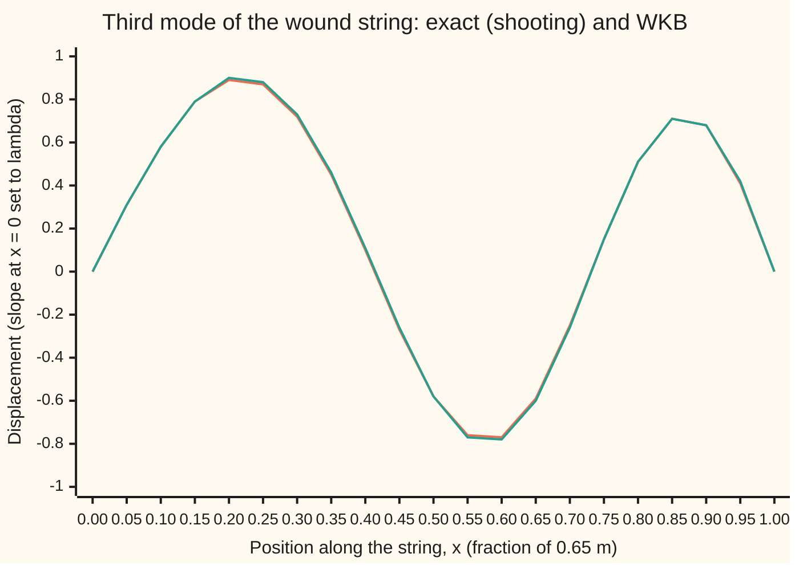

# WKB: when the coefficient drifts slowly, the wave keeps its local wavelength

[Syllabus](../../../SYLLABUS.md) → [Engineering mathematics](../README.md) → [Units and Modelling](../README.md#s01) → WKB

---

## General Overview

A string designer wants a bass string 0.65 m long that is wound more heavily towards one end. Its mass per metre rises smoothly from the light end to four times as much at the heavy end. The tension is the same everywhere. At the light end a wave travels at 143.0 m/s. The designer wants to know the pitch of each mode before the string is made.

A uniform string has a clean answer: the length holds a whole number of half wavelengths. This string has no single wavelength. Waves are long and fast at the light end, short and slow at the heavy end. The equation for its modes has a coefficient that changes along the string, and no formula in sines and cosines solves it.

The WKB method gets a formula anyway. The mass changes slowly compared with one wavelength, so each short piece of string behaves like a uniform string with its own **local wavelength**. Add up the phase piece by piece, and ask for a whole number of half waves. That gives the first mode at 73.33 Hz. The exact answer is 72.14 Hz. The gap is 28.37 cents (a cent is one hundredth of a semitone), and it shrinks for every higher mode: 1.45 cents by the fifth.

**When the coefficient of a wave equation changes slowly over one wavelength, the solution is a wave whose phase is the running total of the local wave number and whose amplitude falls as the fourth root of that coefficient; asking the phase to fit the ends gives the eigenvalues, and the approximation fails where the coefficient changes suddenly or passes through zero (a turning point).**

**What kind of fact this is:** a method: an approximation that gets better as the eigenvalue grows. Its error law is derived in outline in Why it works and measured by the code. The name comes from Wentzel, Kramers and Brillouin, who used it in 1926; Jeffreys published it in 1925, and Liouville and Green had the formula in 1837, which is why it is also called the Liouville-Green approximation.

### The picture: the third mode, exact and WKB



Orange: the exact third mode, found by shooting. Green: the WKB formula. The two rows printed by the code differ by at most 0.01. Both show the two effects of the heavy end: the half waves get shorter towards it, and lower (on the chart, 0.89 near the light end and 0.71 near the heavy end).

---

## The formula

Set-up. The string's mass per metre is $`\rho(x) = \rho_0\, q(x)`$, where $`x`$ is the position as a fraction of the length $`L`$ and $`q(x)`$ is the mass per metre divided by its light-end value $`\rho_0`$. A mode vibrates as $`y(x)\cos\omega t`$, at angular frequency $`\omega`$ in rad/s. The wave equation with tension $`T`$ then gives the mode equation

```math
y'' + \lambda^2 q(x)\, y = 0, \qquad y(0) = y(1) = 0, \qquad \lambda = \frac{\omega L}{c_0},\quad c_0 = \sqrt{T/\rho_0}.
```

The prime is the derivative in $`x`$. The eigenvalue $`\lambda`$ is the dimensionless frequency, and a mode's pitch is $`f = \lambda c_0/(2\pi L)`$ in Hz. For the wound string, $`q(x) = (1 + x)^2`$. This is a Sturm-Liouville problem ([Sturm-Liouville](../../08-Differential%20equations%20and%20dynamics/07-Series%20Solutions%20and%20Boundary%20Problems/09-sturm-liouville-and-orthogonality.md)) with weight $`q`$, so its eigenvalues are real and its modes are orthogonal under that weight. In Sturm-Liouville's notation the eigenvalue is $`\lambda^2`$; this card, like most WKB texts, calls $`\lambda`$ itself the eigenvalue.

The WKB solution and the eigenvalue rule:

```math
y(x) \approx q(x)^{-1/4} \sin\!\big(\lambda S(x)\big), \qquad S(x) = \int_0^x \sqrt{q(\xi)}\,d\xi, \qquad \lambda_n \approx \frac{n\pi}{S(1)} .
```

**Read it aloud:** the mode is a sine whose phase is lambda times the running total of root q, with an amplitude that falls as one over the fourth root of q; the n-th eigenvalue is n pi divided by the total of root q along the string.

For the wound string, $`S(1) = \int_0^1 (1 + x)\,dx = 1.5`$, so $`\lambda_1 \approx \pi/1.5 = 2.094395`$, and the pitch is 2.094395 × 35.0141 Hz = 73.33 Hz.

| Symbol | Plain meaning | In our example | Push it up and the answer… |
| --- | --- | --- | --- |
| $`x`$, $`t`$, $`\xi`$, $`\tau`$ | position as a fraction of the length; time in $`\cos\omega t`$; the integration variable in $`S(x)`$; in the Bessel solution, $`\tau = 1 + x`$ | $`x`$ from 0 to 1 | — |
| $`y`$ | the mode's shape: sideways displacement, scaled so the slope at $`x = 0`$ is $`\lambda`$ | 0.89 at $`x`$ = 0.20, mode 3 chart | — |
| $`\lambda`$, $`\lambda_n`$, $`n`$ | dimensionless frequency; its n-th value; the mode number | $`\lambda_1`$ = 2.060355 exact | a higher pitch |
| $`q(x)`$ | mass per metre over its light-end value; in the turning-point model, $`1 - x`$ | $`(1 + x)^2`$, 1 to 4 | lower eigenvalues |
| $`S(x)`$, $`S(1)`$ | the phase integral: running total of $`\sqrt{q}`$ | $`S(1)`$ = 1.500000 | lower eigenvalues |
| $`k`$ | local wave number $`\lambda\sqrt{q}`$, radians of phase per unit of $`x`$; local wavelength $`2\pi/k`$ | $`k`$ = 2λ at the heavy end | shorter local waves |
| $`A`$, $`\varphi`$ | amplitude and phase in the trial solution $`A e^{i\lambda\varphi}`$ | $`A = q^{-1/4}`$, $`\varphi = S`$ | — |
| $`r`$ | slowness ratio $`q'/(\lambda q^{3/2})`$: how fast the wavelength drifts, per radian of phase | 0.971 for mode 1, 0.191 for mode 5 | WKB gets worse |
| $`s`$, $`u`$, $`Q`$ | in Step 3: the phase variable, the rescaled mode $`y\,q^{1/4}`$, and the term WKB drops | mean of $`Q`$ is −3/16 | — |
| $`L`$, $`c_0`$, $`f`$ | string length; wave speed at the light end; pitch | 0.65 m; 143.0 m/s; $`f = 35.0141\,\lambda`$ Hz | — |
| $`\rho`$, $`\rho_0`$, $`T`$, $`\omega`$ | mass per metre, its light-end value, tension, angular frequency | ratio $`\rho/\rho_0`$ from 1 to 4 | — |
| $`J_{\pm 1/4}`$, $`x_t`$, $`a_n`$, $`\mathrm{Ai}`$, $`z`$ | Bessel functions of order ±1/4; a turning point; the n-th zero of the Airy function Ai, written as a positive number; the rescaled position in Airy's equation | $`a_1`$ = 2.338107410 | — |

### When it holds

- **The coefficient changes slowly over one wavelength.** The slowness ratio $`r`$ should be small: at 0.191 (mode 5) the pitch is 1.45 cents sharp. At 0.971 (mode 1) it is 28.37 cents sharp: outside the nominal range, but not useless.
- **No sudden jumps.** A string of two uniform halves, mass ratio 4, has the same $`S(1) = 1.5`$ and the same WKB eigenvalues. Its true first eigenvalue is 1.910633, and the error stays at 0.183762 at every mode the joint affects (Step 4).
- **The coefficient stays positive.** Where $`q`$ passes through zero (a turning point), the local wavelength and the amplitude factor become infinite. Without the correction of Step 5, the error stays above 1.1 at every mode.
- **Large eigenvalue.** The eigenvalue error falls like $`1/n`$: $`n`$ times the error rises from 0.034040 to 0.043797 by mode 5 and approaches 0.044762.
- **A real string adds its own physics.** Bending stiffness and the winding's own stiffness raise the higher modes. This card's model has tension and mass only.

---

## Why it works

### Step 0: a short piece of a slowly changing string looks uniform

On a uniform string with $`q`$ constant, the mode is $`\sin(\lambda\sqrt{q}\,x)`$: phase grows at the steady rate $`k = \lambda\sqrt{q}`$. If $`q`$ changes little over one wavelength, each short stretch still looks uniform. The phase then grows at the local rate, and the total phase is the running sum of $`k`$, which is $`\lambda S(x)`$. A large $`\lambda`$ means many wavelengths fit inside any stretch where $`q`$ changes noticeably. That is the small quantity: $`1/\lambda`$.

The amplitude changes too. A wave travelling along a string carries power. With no reflection, the same power must pass every point. The power is proportional to $`\sqrt{\rho}\,A^2`$, so $`A^2\sqrt{q}`$ is constant and $`A`$ goes as $`q^{-1/4}`$. Where the string is heavy, the wave is lower.

### Step 1: the trial wave, sorted by powers of λ

Try $`y = A(x)\,e^{i\lambda\varphi(x)}`$, with a slowly changing amplitude $`A`$ and phase $`\varphi`$. Put it into $`y'' + \lambda^2 q y = 0`$ and divide by the exponential:

```math
\lambda^2 \big(q - \varphi'^2\big) A + i\lambda \big(2A'\varphi' + A\varphi''\big) + A'' = 0 .
```

Each power of $`\lambda`$ must vanish on its own when $`\lambda`$ is large:

1. **The $`\lambda^2`$ terms (the eikonal equation):** $`\varphi'^2 = q`$, so $`\varphi = S(x)`$. The local wave number is $`\lambda\sqrt{q}`$, as Step 0 guessed.
2. **The $`\lambda`$ terms (the transport equation):** $`2A'\varphi' + A\varphi'' = 0`$, which is $`(A^2\varphi')' = 0`$. So $`A^2\sqrt{q}`$ is constant, the power argument of Step 0.
3. **The leftover $`A''`$:** it has no $`\lambda`$ in front, so it is smaller than the kept terms by a factor of about $`1/\lambda^2`$. WKB drops it. Everything WKB gets wrong comes from this term.

### Step 2: fit the ends, and the eigenvalues fall out

The real and imaginary parts of the trial wave are both solutions. The sine part vanishes at $`x = 0`$, so it already meets the left end condition:

```math
y(x) = q(x)^{-1/4}\sin\!\big(\lambda S(x)\big).
```

The right end needs $`\sin(\lambda S(1)) = 0`$, so $`\lambda S(1) = n\pi`$. In words: the string holds a whole number of half waves, each measured in its own local wavelength. For the wound string this gives $`\lambda_n \approx n\pi/1.5`$.

The rule is the uniform-string rule with the length replaced by the **phase length** $`S(1)`$. Neither the light-end speed alone ($`\lambda_1 = \pi`$, 110.00 Hz) nor the heavy-end speed alone ($`\pi/2`$, 55.00 Hz) is close; the integral averages $`\sqrt{q}`$, which is proportional to one over the local wave speed, along the whole string.

### Step 3: the size of the error, and a better formula

There is an exact change of variables that shows the dropped term. Measure position by phase, $`s = S(x)`$, and write $`y = q^{-1/4} u`$. The equation becomes

```math
\frac{d^2 u}{ds^2} + \big(\lambda^2 - Q\big)\,u = 0, \qquad Q = -q^{-3/4}\,\frac{d^2}{dx^2}\big(q^{-1/4}\big).
```

WKB is this equation with $`Q`$ set to zero: a uniform string of length $`S(1)`$. Putting $`Q`$ back as a small disturbance shifts each $`\lambda^2`$ by the average of $`Q`$ along the phase length. The shift is fixed the way [Regular perturbation](05-regular-perturbation.md) fixes a frequency: the first correction must have no part that pushes the mode at its own frequency (fold below). For the wound string the average is −3/16:

```math
\lambda_n^2 \approx \Big(\frac{n\pi}{1.5}\Big)^2 - \frac{3}{16}, \qquad \lambda_n^{\mathrm{WKB}} - \lambda_n \approx \frac{9}{64\, n\pi}.
```

The corrected value for mode 1 is 2.049144, 9.45 cents flat; by mode 3 it is within 0.22 cents. And the second formula says $`n`$ times the WKB error tends to $`9/(64\pi)`$ = 0.044762. The code measures 0.034040, 0.040322, 0.042404, 0.043320, 0.043797 for modes 1 to 5.

<details>
<summary>Detailed derivation: the exact change of variables and the value of Q</summary>

Write $`g = q^{-1/4}`$, so that $`ds/dx = \sqrt{q} = g^{-2}`$. With $`y = g\,u(s)`$:

$`\displaystyle y' = g'u + g\,u_s\,g^{-2} = g'u + g^{-1}u_s, \qquad y'' = g''u + g'g^{-2}u_s - g^{-2}g'u_s + g^{-3}u_{ss} = g''u + g^{-3}u_{ss}.`$

Put this into $`y'' + \lambda^2 q y = 0`$ with $`q = g^{-4}`$, then multiply by $`g^3`$:

$`\displaystyle u_{ss} + \big(\lambda^2 + g^3 g''\big)u = 0, \qquad Q = -g^3 g''.`$

Nothing has been dropped: this is exact. For $`q = (1 + x)^2`$, $`g = (1 + x)^{-1/2}`$ and $`g'' = \tfrac34 (1 + x)^{-5/2}`$, so $`Q = -\tfrac34 (1 + x)^{-4}`$.

With $`Q = 0`$ the modes are $`\sin(n\pi s/S)`$ with $`\lambda^2 = (n\pi/S)^2`$. Now let $`u`$ be that sine plus a small correction, and $`\lambda^2`$ be $`(n\pi/S)^2`$ plus a small shift. Keep the first-order terms, multiply the equation by $`\sin(n\pi s/S)`$ and integrate from 0 to $`S`$. The correction's terms drop out (integrate by parts twice; the correction and the sine both vanish at the ends). What is left says the shift times $`\int_0^S \sin^2(n\pi s/S)\,ds`$, which is $`S/2`$, equals $`\int_0^S Q\sin^2(n\pi s/S)\,ds`$: the part of the push in step with the mode must cancel, the solvability idea of [Regular perturbation](05-regular-perturbation.md). So, to first order, a small $`Q`$ moves $`\lambda^2`$ by the weighted average $`\tfrac{2}{S}\int_0^S Q \sin^2(n\pi s/S)\,ds`$. The $`\sin^2`$ is one half plus an oscillating part, and the oscillating part averages out as $`n`$ grows, leaving the plain mean of $`Q`$:

$`\displaystyle \bar Q = \frac{1}{S}\int_0^S Q\,ds = \frac{1}{1.5}\int_0^1 -\tfrac34 (1 + x)^{-4}(1 + x)\,dx = \frac{1}{1.5}\cdot\Big(-\tfrac34\Big)\cdot\tfrac38 = -\frac{3}{16}.`$

So $`\lambda_n^2 \approx (n\pi/S)^2 - 3/16`$. Taking the square root, $`\lambda_n \approx n\pi/S - (3/16)\,S/(2n\pi)`$, and with $`S = 1.5`$ the WKB overshoot is $`9/(64 n\pi)`$. The error of WKB in $`\lambda`$ is therefore of order $`1/\lambda`$, and of the corrected formula of order $`1/\lambda^3`$ once the oscillating part is negligible.

</details>

### Step 4: the slowness test, and a jump that breaks it

The dropped term $`A''`$ compared with the kept $`\lambda^2 q A`$ is of the size of $`r^2`$, where $`r = q'/(\lambda q^{3/2})`$ is the slowness ratio: twice the fractional change in the local wavelength per radian of phase. For the wound string at the light end, $`r = 2/\lambda`$: 0.971 for mode 1 and 0.191 for mode 5.

A jump in $`q`$ makes $`r`$ infinite at one point. On the two-halves string, part of each wave reflects at the joint. The mode is $`\sin\lambda x`$ on the light half and a multiple of $`\sin 2\lambda(1 - x)`$ on the heavy half, where the wave number is twice as large. Matching their height and slope at the joint, $`x = 1/2`$, gives $`2\tan(\lambda/2) + \tan\lambda = 0`$, so $`\tan(\lambda/2)`$ is $`\sqrt{2}`$, $`-\sqrt{2}`$ or 0. The first root is $`2\arctan\sqrt{2}`$ = 1.910633; the others are whole multiples of $`2\pi`$, alone or plus or minus 1.910633. WKB says 2.094395. Its values $`2n\pi/3`$ miss these by exactly $`2\pi/3 - 2\arctan\sqrt{2}`$ = 0.183762, up or down, for modes 1, 2, 4 and 5, and the pattern repeats every three modes, with no trend to zero. Mode 3 is exact because the joint sits at one of its nodes, where the string does not move, so the jump has no effect. Raising $`n`$ does not help, because the jump is sudden at every wavelength.

### Step 5: turning points, in outline

Where $`q`$ passes through zero at a point $`x_t`$, the wave stops being a wave. Beyond it $`q`$ is negative and the solution decays instead of oscillating. At $`x_t`$ the local wavelength is infinite, so $`r`$ is infinite, and the WKB amplitude $`q^{-1/4}`$ is infinite too.

Close to $`x_t`$, $`q`$ is nearly a straight line, $`q \approx q'(x_t)(x - x_t)`$. Rescaling $`x`$ turns the equation into **Airy's equation** $`u'' = z\,u`$, met in [Series solutions](../../08-Differential%20equations%20and%20dynamics/07-Series%20Solutions%20and%20Boundary%20Problems/01-power-series-at-an-ordinary-point.md). Its solution that decays on the far side is the Airy function $`\mathrm{Ai}(z)`$, a standard function tabulated in the NIST handbook. Far from $`x_t`$ on the oscillating side, Ai looks like a WKB wave with its phase shifted by $`\pi/4`$. Matching the two (not derived here) gives the **connection rule**: with a fixed end at $`x = 0`$ and a turning point at $`x_t`$,

```math
\lambda_n \int_0^{x_t} \sqrt{q(x)}\,dx \approx \Big(n - \frac14\Big)\pi .
```

The model problem is $`y'' + \lambda^2(1 - x)\,y = 0`$ with $`y(0) = 0`$ and $`y`$ decaying past $`x_t = 1`$. Its exact eigenvalues are $`\lambda_n = a_n^{3/2}`$, where $`a_n`$ are the Airy zeros: $`\lambda_1`$ = 3.575170. The phase length is 2/3, so:

- the connection rule gives $`1.5\pi \times 0.75`$ = 3.534292, error −0.0409, falling to −0.0120 by mode 3;
- treating the turning point as a fixed end gives $`1.5\pi`$ = 4.712389, error +1.1372, and +1.1661 by mode 3. It never shrinks.

The shape fails as well. With both curves started at slope $`\lambda`$, the exact mode never exceeds 1.1681 anywhere. The WKB formula reaches 2.2413 at $`x = 0.99`$ and 7.0711 at $`x = 0.9999`$.

---

## Worked numbers, by hand

| Step | Arithmetic | Value |
| --- | --- | --- |
| phase length | $`\int_0^1 (1 + x)\,dx = 1 + \tfrac12`$ | 1.500000 |
| WKB eigenvalue, mode 1 | π / 1.5 | 2.094395 |
| Hz per unit of λ | 143.0 / (2π × 0.65) | 35.0141 Hz |
| WKB pitch, mode 1 | 2.094395 × 35.0141 | **73.33 Hz** |
| exact (shooting and Bessel agree) | 2.060355 × 35.0141 | 72.14 Hz |
| WKB error in cents | 1200 × log2(2.094395 / 2.060355) | +28.37 cents |
| corrected eigenvalue | √(2.094395² − 3/16) | 2.049144, −9.45 cents |
| WKB pitch, mode 3 | 6.283185 × 35.0141 | 220.00 Hz, exact 219.51 Hz |
| amplitude, mode 5, last peak over first | largest $`\lvert y\rvert`$ in the last lobe over that in the first, on the WKB curve and on the shooting curve | WKB 0.7694, exact 0.7700 |

The wound string's fundamental will sound at about 72.14 Hz. WKB says 73.33 Hz, and by the fifth mode its error is down to 1.45 cents, below what a tuner reading to the nearest few cents shows.

The full table, printed by the code:

| Mode n | WKB nπ/1.5 | exact | WKB error | n × error | WKB cents | corrected cents | slowness r |
| ---: | ---: | ---: | ---: | ---: | ---: | ---: | ---: |
| 1 | 2.094395 | 2.060355 | 0.034040 | 0.034040 | +28.37 | −9.45 | 0.971 |
| 2 | 4.188790 | 4.168629 | 0.020161 | 0.040322 | +8.35 | −0.95 | 0.480 |
| 3 | 6.283185 | 6.269051 | 0.014135 | 0.042404 | +3.90 | −0.22 | 0.319 |
| 4 | 8.377580 | 8.366750 | 0.010830 | 0.043320 | +2.24 | −0.08 | 0.239 |
| 5 | 10.471976 | 10.463216 | 0.008759 | 0.043797 | +1.45 | −0.03 | 0.191 |

### What breaks if you drop a piece

| Mistake | Comes out at | What went wrong |
| --- | --- | --- |
| Drop the amplitude factor $`q^{-1/4}`$ | mode 5 peaks all equal, ratio 1.0000; exact 0.7700 | the eigenvalue survives, but the shape loses the power balance |
| Use one end's wave speed | λ₁ = 3.1416 (110.00 Hz) or 1.5708 (55.00 Hz); exact 2.060355 (72.14 Hz) | the phase must be summed along the whole string |
| WKB across a sudden jump | 2.094395 against 1.910633; error ±0.183762 at every affected mode | a jump reflects waves; the slowness ratio is infinite there |
| Turning point treated as a fixed end | 4.712389 against 3.575170; error +1.1661 still at mode 3 | the Airy connection adds a phase of π/4, so the rule is n − 1/4 |

The code prints all of them.

---

## Code, from first principles, and it actually runs

The script takes the wound string's eigenvalues by three independent roads: the WKB rule, with the phase integral done by Simpson's rule; RK4 (fourth-order Runge–Kutta) shooting with bisection on λ ([Shooting](../../08-Differential%20equations%20and%20dynamics/07-Series%20Solutions%20and%20Boundary%20Problems/06-the-shooting-method.md)); and the exact solution $`\sqrt{\tau}\,J_{\pm 1/4}(\lambda \tau^2/2)`$ with $`\tau = 1 + x`$, with the Bessel series summed by hand (a change of variable turns the mode equation into [Bessel's equation](../../08-Differential%20equations%20and%20dynamics/07-Series%20Solutions%20and%20Boundary%20Problems/03-bessels-equation-and-the-drum.md) of order 1/4). It then measures the mode shapes, solves the two-halves string by its closed form and by shooting, and finds the Airy zeros by integrating Airy's equation backwards from z = 8, where the decaying solution is the only one that survives. The first Airy zero is checked against the NIST table.

### Python

```python
# WKB approximation -- the check behind the card.  Standard library only.
# A string whose mass per length grows as (1 + x)^2 obeys y'' + lam^2 (1 + x)^2 y = 0
# on [0, 1] with y(0) = y(1) = 0.  Its eigenvalues lam_n are found three ways: the WKB
# rule lam * S = n pi, RK4 shooting, and the exact Bessel-function solution.  Then two
# places where WKB fails: a sudden jump in mass, and a turning point (Airy).
from math import pi, sqrt, sin, log2, atan

def q_str(x): return (1.0 + x) ** 2                 # mass per length over its light-end value

def simpson(f, a, b, n=1000):                        # phase integral S = integral of sqrt(q)
    h = (b - a) / n
    return h / 3 * sum((1 if i in (0, n) else 4 if i % 2 else 2) * f(a + i * h) for i in range(n + 1))

def shoot(lam, q, n=2000, every=0):                  # RK4 on y'' = -lam^2 q y, y(0) = 0, y'(0) = lam
    h, y, v, out = 1.0 / n, 0.0, lam, [0.0]
    def f(x, y, v): return v, -lam * lam * q(x) * y
    for i in range(n):
        x = i * h
        k1 = f(x, y, v)
        k2 = f(x + h / 2, y + h / 2 * k1[0], v + h / 2 * k1[1])
        k3 = f(x + h / 2, y + h / 2 * k2[0], v + h / 2 * k2[1])
        k4 = f(x + h, y + h * k3[0], v + h * k3[1])
        y += h / 6 * (k1[0] + 2 * k2[0] + 2 * k3[0] + k4[0])
        v += h / 6 * (k1[1] + 2 * k2[1] + 2 * k3[1] + k4[1])
        if every and (i + 1) % every == 0: out.append(y)
    return out if every else y

def bisect(g, a, b):                                 # one sign change inside [a, b]
    ga = g(a)
    for _ in range(60):
        m = 0.5 * (a + b)
        gm = g(m)
        if (gm < 0) == (ga < 0): a, ga = m, gm
        else: b = m
    return 0.5 * (a + b)

def J(nu, z):                                        # Bessel series, without its constant factor
    t, s = (z / 2) ** nu, 0.0
    for m in range(80):
        s += t
        t *= -(z / 2) ** 2 / ((m + 1) * (m + 1 + nu))
    return s

def bessel(lam):                                     # y = sqrt(t) [A J(1/4, lam t^2/2) + B J(-1/4, .)], t = 1 + x
    return J(0.25, lam / 2) * J(-0.25, 2 * lam) - J(-0.25, lam / 2) * J(0.25, 2 * lam)

def peaks(ys):                                       # largest |y| in each lobe
    out, cur = [], 0.0
    for a, b in zip(ys, ys[1:]):
        if a != 0 and (a < 0) != (b < 0): out.append(cur); cur = 0.0
        cur = max(cur, abs(b))
    return out + [cur]

S = simpson(lambda x: sqrt(q_str(x)), 0.0, 1.0)
L, c0 = 0.65, 2 * 0.65 * 110.0                       # metres; light-end wave speed, m/s
hz = c0 / (2 * pi * L)                               # f = lam c0 / (2 pi L)
print("string: y'' + lam^2 (1 + x)^2 y = 0 on [0, 1], y(0) = y(1) = 0")
print(f"phase integral S by Simpson {S:.6f}   L {L:.2f} m   c0 {c0:.1f} m/s   f = lam x {hz:.4f} Hz")
print(" n   WKB nπ/S  shooting    Bessel  corrected  WKB err  n x err  WKB ¢  corr ¢  slowness")
rows = []
for n in range(1, 6):
    w = n * pi / S
    ex = bisect(lambda l: shoot(l, q_str), w - 1, w + 1)
    bs = bisect(bessel, w - 1, w + 1)
    co = sqrt(w * w - 3 / 16)                        # first correction: lam^2 = (n pi/S)^2 + mean of Q
    rows.append((w, ex, bs, co))
    print(f"{n:2d} {w:10.6f} {ex:9.6f} {bs:9.6f} {co:10.6f} {w - ex:8.6f} {n * (w - ex):8.6f} "
          f"{1200 * log2(w / ex):+6.2f} {1200 * log2(co / ex):+7.2f} {2 / ex:9.3f}")
print(f"limit of n x err, 9/(64 pi) = {9 / (64 * pi):.6f}")
print("frequency, Hz: " + "   ".join(f"n={n} WKB {r[0] * hz:.2f} exact {r[1] * hz:.2f}" for n, r in enumerate(rows[:3], 1)))
grid = [i / 2000 for i in range(2001)]
pe = peaks(shoot(rows[4][1], q_str, every=1)[:-1])
pw = peaks([q_str(x) ** -0.25 * sin(rows[4][0] * (x + x * x / 2)) for x in grid][:-1])
pn = peaks([sin(rows[4][0] * (x + x * x / 2)) for x in grid][:-1])
print(f"mode 5, last lobe peak / first lobe peak: exact {pe[-1] / pe[0]:.4f}   WKB {pw[-1] / pw[0]:.4f}   "
      f"no q^(-1/4) {pn[-1] / pn[0]:.4f}")
print(f"mistake, light-end speed only, lam_1 = pi {pi:.4f} ({pi * hz:.2f} Hz); heavy end only pi/2 {pi / 2:.4f} ({pi / 2 * hz:.2f} Hz)")

def g_step(l): return 2 * sin(l / 2) * (1 - 2 * sin(l / 2) ** 2) + (1 - 2 * sin(l / 4) ** 2) * sin(l)
def q_step(x): return 1.0 if x < 0.5 else 4.0        # two uniform halves, mass ratio 4
print("jump: two uniform halves, mass ratio 4 (2 tan(lam/2) + tan(lam) = 0); WKB still n pi/1.5")
print(" n     exact  shooting       WKB   WKB err")
step = []
for n in range(1, 6):
    w = n * pi / 1.5
    ex, sh = bisect(g_step, w - 1, w + 1), bisect(lambda l: shoot(l, q_step), w - 1, w + 1)
    step.append((ex, sh, w))
    print(f"{n:2d} {ex:9.6f} {sh:9.6f} {w:9.6f} {w - ex:+9.6f}")
print(f"first jump eigenvalue 2 atan(sqrt 2) = {2 * atan(sqrt(2)):.6f}")

h, z, u, v, zeros, big, slope = 1e-4, 8.0, 1e-6, -sqrt(8.0) * 1e-6, [], 0.0, 0.0
def fa(z, u, v): return v, z * u                     # Airy: u'' = z u, integrated from z = 8 down
for i in range(round(14 / h)):
    k1 = fa(z, u, v)
    k2 = fa(z - h / 2, u - h / 2 * k1[0], v - h / 2 * k1[1])
    k3 = fa(z - h / 2, u - h / 2 * k2[0], v - h / 2 * k2[1])
    k4 = fa(z - h, u - h * k3[0], v - h * k3[1])
    un = u - h / 6 * (k1[0] + 2 * k2[0] + 2 * k3[0] + k4[0])
    v -= h / 6 * (k1[1] + 2 * k2[1] + 2 * k3[1] + k4[1])
    if not zeros: big = max(big, abs(un))
    if (un < 0) != (u < 0):
        zeros.append(-(z - h * u / (u - un)))
        if len(zeros) == 1: slope = v
    u, z = un, z - h
print("turning point: y'' + lam^2 (1 - x) y = 0, y(0) = 0, y decays past x = 1; exact lam = a^(3/2)")
print(" n  Airy zero a  exact lam  (n - 1/4) rule  error   naive n rule  error")
tp = []
for n, a in enumerate(zeros[:3], 1):
    ex, co, nv = a ** 1.5, 1.5 * pi * (n - 0.25), 1.5 * pi * n
    tp.append((a, ex, co, nv))
    print(f"{n:2d} {a:12.9f} {ex:10.6f} {co:15.6f} {co - ex:+.4f} {nv:14.6f} {nv - ex:+.4f}")
lam1, co1 = tp[0][1], tp[0][2]
wk = [(1 - x) ** -0.25 * sin(co1 * 2 / 3 * (1 - (1 - x) ** 1.5)) for x in (0.99, 0.9999)]
print(f"mode 1, both with slope lam at x = 0: exact largest |y| {lam1 ** (1 / 3) * big / abs(slope):.4f}   "
      f"WKB at x = 0.99 {wk[0]:.4f}, at x = 0.9999 {wk[1]:.4f}")
xs = [0.05 * k for k in range(21)]
ce = shoot(rows[2][1], q_str, every=100)
cw = [q_str(x) ** -0.25 * sin(rows[2][0] * (x + x * x / 2)) for x in xs]
print("chart, x          " + " ".join(f"{x:5.2f}" for x in xs))
print("chart, exact n=3  " + " ".join(f"{y:5.2f}" for y in ce))
print("chart, WKB n=3    " + " ".join(f"{y:5.2f}" for y in cw))

assert abs(S - 1.5) < 1e-9, "Simpson must land on the integral of (1 + x), 1.5"
assert all(abs(r[1] - r[2]) < 1e-7 for r in rows), "shooting and the Bessel solution must agree"
assert rows[4][0] - rows[4][1] < (rows[0][0] - rows[0][1]) / 3, "WKB error must fall as n grows"
assert abs(5 * (rows[4][0] - rows[4][1]) - 9 / (64 * pi)) < 0.002, "n x error must approach 9/(64 pi)"
assert all(abs(r[3] - r[1]) < (r[0] - r[1]) / 4 for r in rows[2:]), "the correction must beat plain WKB from n = 3"
assert abs(pe[-1] / pe[0] - pw[-1] / pw[0]) < 0.01, "q^(-1/4) must predict the lobe heights"
assert max(abs(a - b) for a, b in zip(ce, cw)) < 0.02, "WKB mode 3 must trace the exact mode"
assert all(abs(s[0] - s[1]) < 1e-3 for s in step) and abs(step[0][0] - 2 * atan(sqrt(2))) < 1e-9, "jump: two roads"
assert min(abs(s[2] - s[0]) for s in step if abs(s[2] - s[0]) > 1e-6) > 0.18, "jump: WKB error does not fall"
assert abs(tp[0][0] - 2.338107410) < 1e-6, "first Airy zero, DLMF table 9.9.1"
assert all(abs(t[3] - t[1]) > 1.1 and abs(t[2] - t[1]) < 0.05 for t in tp), "turning point needs the 1/4"
print("ALL CHECKS PASS")
```

**Ran 2026-11-23 on macOS, Python 3.14.10, standard library only. All checks passed. Output, pasted from the run:**

```
string: y'' + lam^2 (1 + x)^2 y = 0 on [0, 1], y(0) = y(1) = 0
phase integral S by Simpson 1.500000   L 0.65 m   c0 143.0 m/s   f = lam x 35.0141 Hz
 n   WKB nπ/S  shooting    Bessel  corrected  WKB err  n x err  WKB ¢  corr ¢  slowness
 1   2.094395  2.060355  2.060355   2.049144 0.034040 0.034040 +28.37   -9.45     0.971
 2   4.188790  4.168629  4.168629   4.166349 0.020161 0.040322  +8.35   -0.95     0.480
 3   6.283185  6.269051  6.269051   6.268247 0.014135 0.042404  +3.90   -0.22     0.319
 4   8.377580  8.366750  8.366750   8.366382 0.010830 0.043320  +2.24   -0.08     0.239
 5  10.471976 10.463216 10.463216  10.463019 0.008759 0.043797  +1.45   -0.03     0.191
limit of n x err, 9/(64 pi) = 0.044762
frequency, Hz: n=1 WKB 73.33 exact 72.14   n=2 WKB 146.67 exact 145.96   n=3 WKB 220.00 exact 219.51
mode 5, last lobe peak / first lobe peak: exact 0.7700   WKB 0.7694   no q^(-1/4) 1.0000
mistake, light-end speed only, lam_1 = pi 3.1416 (110.00 Hz); heavy end only pi/2 1.5708 (55.00 Hz)
jump: two uniform halves, mass ratio 4 (2 tan(lam/2) + tan(lam) = 0); WKB still n pi/1.5
 n     exact  shooting       WKB   WKB err
 1  1.910633  1.910474  2.094395 +0.183762
 2  4.372552  4.372188  4.188790 -0.183762
 3  6.283185  6.283185  6.283185 +0.000000
 4  8.193819  8.193136  8.377580 +0.183762
 5 10.655737 10.654850 10.471976 -0.183762
first jump eigenvalue 2 atan(sqrt 2) = 1.910633
turning point: y'' + lam^2 (1 - x) y = 0, y(0) = 0, y decays past x = 1; exact lam = a^(3/2)
 n  Airy zero a  exact lam  (n - 1/4) rule  error   naive n rule  error
 1  2.338107410   3.575170        3.534292 -0.0409       4.712389 +1.1372
 2  4.087949444   8.265293        8.246681 -0.0186       9.424778 +1.1595
 3  5.520559828  12.971036       12.959070 -0.0120      14.137167 +1.1661
mode 1, both with slope lam at x = 0: exact largest |y| 1.1681   WKB at x = 0.99 2.2413, at x = 0.9999 7.0711
chart, x           0.00  0.05  0.10  0.15  0.20  0.25  0.30  0.35  0.40  0.45  0.50  0.55  0.60  0.65  0.70  0.75  0.80  0.85  0.90  0.95  1.00
chart, exact n=3   0.00  0.31  0.58  0.79  0.89  0.87  0.72  0.45  0.10 -0.27 -0.58 -0.76 -0.77 -0.59 -0.25  0.15  0.51  0.71  0.68  0.41 -0.00
chart, WKB n=3     0.00  0.31  0.58  0.79  0.90  0.88  0.73  0.46  0.11 -0.26 -0.58 -0.77 -0.78 -0.60 -0.26  0.15  0.51  0.71  0.68  0.42  0.00
ALL CHECKS PASS
```

The jump row's shooting column differs from the closed form in the fourth decimal because the RK4 steps meet the jump at a step boundary; the closed form is exact, and the assert allows 0.001.

### Rust

Same numbers, same labels, built with `rustc --edition 2021 -O`.

```rust
// WKB approximation -- the same check as the Python, in Rust, std only.
// A string whose mass per length grows as (1 + x)^2 obeys y'' + lam^2 (1 + x)^2 y = 0
// on [0, 1] with y(0) = y(1) = 0.  Its eigenvalues lam_n are found three ways: the WKB
// rule lam * S = n pi, RK4 shooting, and the exact Bessel-function solution.  Then two
// places where WKB fails: a sudden jump in mass, and a turning point (Airy).
use std::f64::consts::PI;

fn q_str(x: f64) -> f64 { (1.0 + x).powi(2) }       // mass per length over its light-end value
fn q_step(x: f64) -> f64 { if x < 0.5 { 1.0 } else { 4.0 } } // two uniform halves, mass ratio 4

fn simpson(f: &dyn Fn(f64) -> f64, a: f64, b: f64, n: usize) -> f64 { // phase integral S
    let h = (b - a) / n as f64;
    let mut s = 0.0;
    for i in 0..=n {
        let w = if i == 0 || i == n { 1.0 } else if i % 2 == 1 { 4.0 } else { 2.0 };
        s += w * f(a + i as f64 * h);
    }
    h / 3.0 * s
}

// RK4 on y'' = -lam^2 q y, y(0) = 0, y'(0) = lam; returns y(1), or y every `every` steps
fn shoot(lam: f64, q: &dyn Fn(f64) -> f64, n: usize, every: usize) -> (f64, Vec<f64>) {
    let (h, mut y, mut v, mut out) = (1.0 / n as f64, 0.0, lam, vec![0.0]);
    let f = |x: f64, y: f64, v: f64| (v, -lam * lam * q(x) * y);
    for i in 0..n {
        let x = i as f64 * h;
        let k1 = f(x, y, v);
        let k2 = f(x + h / 2.0, y + h / 2.0 * k1.0, v + h / 2.0 * k1.1);
        let k3 = f(x + h / 2.0, y + h / 2.0 * k2.0, v + h / 2.0 * k2.1);
        let k4 = f(x + h, y + h * k3.0, v + h * k3.1);
        y += h / 6.0 * (k1.0 + 2.0 * k2.0 + 2.0 * k3.0 + k4.0);
        v += h / 6.0 * (k1.1 + 2.0 * k2.1 + 2.0 * k3.1 + k4.1);
        if every > 0 && (i + 1) % every == 0 { out.push(y) }
    }
    (y, out)
}

fn bisect(g: &dyn Fn(f64) -> f64, mut a: f64, mut b: f64) -> f64 { // one sign change inside [a, b]
    let mut ga = g(a);
    for _ in 0..60 {
        let m = 0.5 * (a + b);
        let gm = g(m);
        if (gm < 0.0) == (ga < 0.0) { a = m; ga = gm } else { b = m }
    }
    0.5 * (a + b)
}

fn bj(nu: f64, z: f64) -> f64 {                     // Bessel series, without its constant factor
    let (mut t, mut s) = ((z / 2.0).powf(nu), 0.0);
    for m in 0..80 {
        s += t;
        t *= -(z / 2.0).powi(2) / ((m + 1) as f64 * ((m + 1) as f64 + nu));
    }
    s
}

fn bessel(lam: f64) -> f64 {                        // y = sqrt(t) [A J(1/4, lam t^2/2) + B J(-1/4, .)]
    bj(0.25, lam / 2.0) * bj(-0.25, 2.0 * lam) - bj(-0.25, lam / 2.0) * bj(0.25, 2.0 * lam)
}

fn peaks(ys: &[f64]) -> Vec<f64> {                  // largest |y| in each lobe
    let (mut out, mut cur) = (vec![], 0.0f64);
    for w in ys.windows(2) {
        if w[0] != 0.0 && (w[0] < 0.0) != (w[1] < 0.0) { out.push(cur); cur = 0.0 }
        cur = cur.max(w[1].abs());
    }
    out.push(cur);
    out
}

fn g_step(l: f64) -> f64 { 2.0 * (l / 2.0).sin() * (1.0 - 2.0 * (l / 2.0).sin().powi(2)) + (1.0 - 2.0 * (l / 4.0).sin().powi(2)) * l.sin() }
fn row(lab: &str, v: &[f64]) -> String { format!("{}{}", lab, v.iter().map(|y| format!(" {:5.2}", y)).collect::<String>()) }

fn main() {
    let s = simpson(&|x| q_str(x).sqrt(), 0.0, 1.0, 1000);
    let (l, c0) = (0.65, 2.0 * 0.65 * 110.0);       // metres; light-end wave speed, m/s
    let hz = c0 / (2.0 * PI * l);                   // f = lam c0 / (2 pi L)
    println!("string: y'' + lam^2 (1 + x)^2 y = 0 on [0, 1], y(0) = y(1) = 0");
    println!("phase integral S by Simpson {:.6}   L {:.2} m   c0 {:.1} m/s   f = lam x {:.4} Hz", s, l, c0, hz);
    println!(" n   WKB nπ/S  shooting    Bessel  corrected  WKB err  n x err  WKB ¢  corr ¢  slowness");
    let mut rows = vec![];
    for n in 1..=5 {
        let w = n as f64 * PI / s;
        let ex = bisect(&|x| shoot(x, &q_str, 2000, 0).0, w - 1.0, w + 1.0);
        let bs = bisect(&bessel, w - 1.0, w + 1.0);
        let co = (w * w - 3.0 / 16.0).sqrt();       // first correction: lam^2 = (n pi/S)^2 + mean of Q
        rows.push((w, ex, bs, co));
        println!("{:2} {:10.6} {:9.6} {:9.6} {:10.6} {:8.6} {:8.6} {:+6.2} {:+7.2} {:9.3}", n, w, ex, bs, co, w - ex,
                 n as f64 * (w - ex), 1200.0 * (w / ex).log2(), 1200.0 * (co / ex).log2(), 2.0 / ex);
    }
    println!("limit of n x err, 9/(64 pi) = {:.6}", 9.0 / (64.0 * PI));
    let fr: Vec<String> = rows[..3].iter().enumerate()
        .map(|(i, r)| format!("n={} WKB {:.2} exact {:.2}", i + 1, r.0 * hz, r.1 * hz)).collect();
    println!("frequency, Hz: {}", fr.join("   "));
    let grid: Vec<f64> = (0..=2000).map(|i| i as f64 / 2000.0).collect();
    let w5 = rows[4].0;
    let e5 = shoot(rows[4].1, &q_str, 2000, 1).1;
    let pe = peaks(&e5[..2000]);
    let wk5: Vec<f64> = grid.iter().map(|&x| q_str(x).powf(-0.25) * (w5 * (x + x * x / 2.0)).sin()).collect();
    let nq5: Vec<f64> = grid.iter().map(|&x| (w5 * (x + x * x / 2.0)).sin()).collect();
    let (pw, pn) = (peaks(&wk5[..2000]), peaks(&nq5[..2000]));
    let r = |p: &Vec<f64>| p[p.len() - 1] / p[0];
    println!("mode 5, last lobe peak / first lobe peak: exact {:.4}   WKB {:.4}   no q^(-1/4) {:.4}", r(&pe), r(&pw), r(&pn));
    println!("mistake, light-end speed only, lam_1 = pi {:.4} ({:.2} Hz); heavy end only pi/2 {:.4} ({:.2} Hz)", PI, PI * hz, PI / 2.0, PI / 2.0 * hz);

    println!("jump: two uniform halves, mass ratio 4 (2 tan(lam/2) + tan(lam) = 0); WKB still n pi/1.5");
    println!(" n     exact  shooting       WKB   WKB err");
    let mut step = vec![];
    for n in 1..=5 {
        let w = n as f64 * PI / 1.5;
        let (ex, sh) = (bisect(&g_step, w - 1.0, w + 1.0), bisect(&|x| shoot(x, &q_step, 2000, 0).0, w - 1.0, w + 1.0));
        step.push((ex, sh, w));
        println!("{:2} {:9.6} {:9.6} {:9.6} {:+9.6}", n, ex, sh, w, w - ex);
    }
    println!("first jump eigenvalue 2 atan(sqrt 2) = {:.6}", 2.0 * 2f64.sqrt().atan());

    let fa = |z: f64, u: f64, v: f64| (v, z * u);   // Airy: u'' = z u, integrated from z = 8 down
    let (h, mut z, mut u) = (1e-4f64, 8.0f64, 1e-6f64);
    let mut v = -(8.0f64).sqrt() * 1e-6;
    let (mut zeros, mut big, mut slope) = (vec![], 0.0f64, 0.0);
    for _ in 0..(14.0 / h).round() as usize {
        let k1 = fa(z, u, v);
        let k2 = fa(z - h / 2.0, u - h / 2.0 * k1.0, v - h / 2.0 * k1.1);
        let k3 = fa(z - h / 2.0, u - h / 2.0 * k2.0, v - h / 2.0 * k2.1);
        let k4 = fa(z - h, u - h * k3.0, v - h * k3.1);
        let un = u - h / 6.0 * (k1.0 + 2.0 * k2.0 + 2.0 * k3.0 + k4.0);
        v -= h / 6.0 * (k1.1 + 2.0 * k2.1 + 2.0 * k3.1 + k4.1);
        if zeros.is_empty() { big = big.max(un.abs()) }
        if (un < 0.0) != (u < 0.0) {
            zeros.push(-(z - h * u / (u - un)));
            if zeros.len() == 1 { slope = v }
        }
        u = un;
        z -= h;
    }
    println!("turning point: y'' + lam^2 (1 - x) y = 0, y(0) = 0, y decays past x = 1; exact lam = a^(3/2)");
    println!(" n  Airy zero a  exact lam  (n - 1/4) rule  error   naive n rule  error");
    let mut tp = vec![];
    for (i, &a) in zeros[..3].iter().enumerate() {
        let n = (i + 1) as f64;
        let (ex, co, nv) = (a.powf(1.5), 1.5 * PI * (n - 0.25), 1.5 * PI * n);
        tp.push((a, ex, co, nv));
        println!("{:2} {:12.9} {:10.6} {:15.6} {:+.4} {:14.6} {:+.4}", i + 1, a, ex, co, co - ex, nv, nv - ex);
    }
    let (lam1, co1) = (tp[0].1, tp[0].2);
    let wk: Vec<f64> = [0.99, 0.9999].iter().map(|&x: &f64| (1.0 - x).powf(-0.25) * (co1 * 2.0 / 3.0 * (1.0 - (1.0 - x).powf(1.5))).sin()).collect();
    println!("mode 1, both with slope lam at x = 0: exact largest |y| {:.4}   WKB at x = 0.99 {:.4}, at x = 0.9999 {:.4}",
             lam1.powf(1.0 / 3.0) * big / slope.abs(), wk[0], wk[1]);
    let xs: Vec<f64> = (0..21).map(|k| 0.05 * k as f64).collect();
    let ce = shoot(rows[2].1, &q_str, 2000, 100).1;
    let cw: Vec<f64> = xs.iter().map(|&x| q_str(x).powf(-0.25) * (rows[2].0 * (x + x * x / 2.0)).sin()).collect();
    println!("{}", row("chart, x         ", &xs));
    println!("{}", row("chart, exact n=3 ", &ce));
    println!("{}", row("chart, WKB n=3   ", &cw));

    assert!((s - 1.5).abs() < 1e-9, "Simpson must land on the integral of (1 + x), 1.5");
    assert!(rows.iter().all(|r| (r.1 - r.2).abs() < 1e-7), "shooting and the Bessel solution must agree");
    assert!(rows[4].0 - rows[4].1 < (rows[0].0 - rows[0].1) / 3.0, "WKB error must fall as n grows");
    assert!((5.0 * (rows[4].0 - rows[4].1) - 9.0 / (64.0 * PI)).abs() < 0.002, "n x error must approach 9/(64 pi)");
    assert!(rows[2..].iter().all(|t| (t.3 - t.1).abs() < (t.0 - t.1) / 4.0), "the correction must beat plain WKB from n = 3");
    assert!((r(&pe) - r(&pw)).abs() < 0.01, "q^(-1/4) must predict the lobe heights");
    assert!(ce.iter().zip(&cw).map(|(a, b)| (a - b).abs()).fold(0.0, f64::max) < 0.02, "WKB mode 3 must trace the exact mode");
    assert!(step.iter().all(|t| (t.0 - t.1).abs() < 1e-3) && (step[0].0 - 2.0 * 2f64.sqrt().atan()).abs() < 1e-9, "jump: two roads");
    assert!(step.iter().map(|t| (t.2 - t.0).abs()).filter(|&d| d > 1e-6).fold(f64::MAX, f64::min) > 0.18, "jump: WKB error does not fall");
    assert!((tp[0].0 - 2.338107410).abs() < 1e-6, "first Airy zero, DLMF table 9.9.1");
    assert!(tp.iter().all(|t| (t.3 - t.1).abs() > 1.1 && (t.2 - t.1).abs() < 0.05), "turning point needs the 1/4");
    println!("ALL CHECKS PASS");
}
```

**Ran 2026-11-23 on macOS, rustc 1.98.1, no crates. All checks passed. Output, pasted from the run:**

```
string: y'' + lam^2 (1 + x)^2 y = 0 on [0, 1], y(0) = y(1) = 0
phase integral S by Simpson 1.500000   L 0.65 m   c0 143.0 m/s   f = lam x 35.0141 Hz
 n   WKB nπ/S  shooting    Bessel  corrected  WKB err  n x err  WKB ¢  corr ¢  slowness
 1   2.094395  2.060355  2.060355   2.049144 0.034040 0.034040 +28.37   -9.45     0.971
 2   4.188790  4.168629  4.168629   4.166349 0.020161 0.040322  +8.35   -0.95     0.480
 3   6.283185  6.269051  6.269051   6.268247 0.014135 0.042404  +3.90   -0.22     0.319
 4   8.377580  8.366750  8.366750   8.366382 0.010830 0.043320  +2.24   -0.08     0.239
 5  10.471976 10.463216 10.463216  10.463019 0.008759 0.043797  +1.45   -0.03     0.191
limit of n x err, 9/(64 pi) = 0.044762
frequency, Hz: n=1 WKB 73.33 exact 72.14   n=2 WKB 146.67 exact 145.96   n=3 WKB 220.00 exact 219.51
mode 5, last lobe peak / first lobe peak: exact 0.7700   WKB 0.7694   no q^(-1/4) 1.0000
mistake, light-end speed only, lam_1 = pi 3.1416 (110.00 Hz); heavy end only pi/2 1.5708 (55.00 Hz)
jump: two uniform halves, mass ratio 4 (2 tan(lam/2) + tan(lam) = 0); WKB still n pi/1.5
 n     exact  shooting       WKB   WKB err
 1  1.910633  1.910474  2.094395 +0.183762
 2  4.372552  4.372188  4.188790 -0.183762
 3  6.283185  6.283185  6.283185 +0.000000
 4  8.193819  8.193136  8.377580 +0.183762
 5 10.655737 10.654850 10.471976 -0.183762
first jump eigenvalue 2 atan(sqrt 2) = 1.910633
turning point: y'' + lam^2 (1 - x) y = 0, y(0) = 0, y decays past x = 1; exact lam = a^(3/2)
 n  Airy zero a  exact lam  (n - 1/4) rule  error   naive n rule  error
 1  2.338107410   3.575170        3.534292 -0.0409       4.712389 +1.1372
 2  4.087949444   8.265293        8.246681 -0.0186       9.424778 +1.1595
 3  5.520559828  12.971036       12.959070 -0.0120      14.137167 +1.1661
mode 1, both with slope lam at x = 0: exact largest |y| 1.1681   WKB at x = 0.99 2.2413, at x = 0.9999 7.0711
chart, x           0.00  0.05  0.10  0.15  0.20  0.25  0.30  0.35  0.40  0.45  0.50  0.55  0.60  0.65  0.70  0.75  0.80  0.85  0.90  0.95  1.00
chart, exact n=3   0.00  0.31  0.58  0.79  0.89  0.87  0.72  0.45  0.10 -0.27 -0.58 -0.76 -0.77 -0.59 -0.25  0.15  0.51  0.71  0.68  0.41 -0.00
chart, WKB n=3     0.00  0.31  0.58  0.79  0.90  0.88  0.73  0.46  0.11 -0.26 -0.58 -0.77 -0.78 -0.60 -0.26  0.15  0.51  0.71  0.68  0.42  0.00
ALL CHECKS PASS
```

The two outputs match line for line.

### Lean

Lean proves the algebra behind Steps 1 and 2 for any positive $`q`$ with two continuous derivatives, and checks the wound string's numbers.

- Suppose $`q`$ is continuous. Then $`S' = \sqrt{q}`$, so the phase solves the eikonal equation of Step 1.
- Suppose $`q`$ has two continuous derivatives and stays positive on the string and a little beyond. Take $`y = q^{-1/4}\sin(\lambda S)`$.
- Then $`y'' + \lambda^2 q y = \big(\tfrac{5}{16}(q'/q)^2 - \tfrac14 q''/q\big)\,y`$ exactly. This leftover is Step 1's $`A''`$ times $`\sin(\lambda S)`$, with no $`\lambda`$ in front.
- Suppose also $`\lambda > 0`$. Then $`y(0) = 0`$, and $`y(1) = 0`$ exactly when $`\lambda = n\pi/S(1)`$ for a whole number $`n \ge 1`$.
- Take the wound string, $`q = (1 + x)^2`$. Then its phase length is $`S(1) = 3/2`$, so WKB gives $`\lambda_n \approx n\pi/1.5`$.
- Take $`Q = -\tfrac34 (1 + x)^{-4}`$ from Step 3. Then the mean of $`Q`$ along the phase length is $`-3/16`$.
- Lean also checks the hand arithmetic behind 3/8, the overshoot 9/64 and the 3/4 in $`Q`$.

The size of the error, the corrected eigenvalues, the jump, the turning point and the shooting numbers are left to the Python and Rust checks.

```lean
-- WKB: the WKB wave q^(-1/4) sin(λ S) solves y'' + λ² q y = 0 exactly up to the dropped term ((5/16)(q'/q)² − (1/4) q''/q) y, it fits both fixed ends exactly when λ S(1) = nπ, and the wound string has phase length 3/2 and mean dropped term −3/16.
import Mathlib.Analysis.SpecialFunctions.Pow.Deriv
import Mathlib.Analysis.SpecialFunctions.Trigonometric.Deriv
import Mathlib.Analysis.SpecialFunctions.Sqrt
import Mathlib.Analysis.SpecialFunctions.Integrals.Basic
import Mathlib.MeasureTheory.Integral.IntervalIntegral.FundThmCalculus
import Mathlib.Tactic.NormNum

open Real

/-! The mode equation is `y'' + λ² q(x) y = 0` on `[0, 1]` with `y(0) = y(1) = 0`; `λ` is written
`lam`. The card's conditions "no sudden jumps" and "the coefficient stays positive" are taken as:
`q` is twice continuously differentiable and positive on an open interval `(a, b)` that contains
`[0, 1]`. The phase integral is `S(x) = ∫₀ˣ √q`, and the WKB wave is `y = q^(-1/4) sin(λ S)`.
"Slowly changing" and "large eigenvalue" are what make the dropped term small; they are not
needed for the exact statements below, and the size of the error itself stays numeric. -/

lemma wkb_phase_hasDerivAt (q : ℝ → ℝ) (a b : ℝ) (ha : a < 0) (hb : 1 < b)
    (hc : ContinuousOn q (Set.Ioo a b)) (x : ℝ) (hx : x ∈ Set.Ioo a b) :
    HasDerivAt (fun x => ∫ t in (0 : ℝ)..x, √(q t)) (√(q x)) x := by
  have hc' : ContinuousOn (fun t => √(q t)) (Set.Ioo a b) := hc.sqrt
  apply intervalIntegral.integral_hasDerivAt_right
  · apply (hc'.mono _).intervalIntegrable
    intro t ht
    rw [Set.mem_uIcc] at ht
    constructor <;> rcases ht with ⟨h1, h2⟩ | ⟨h1, h2⟩ <;> linarith [hx.1, hx.2]
  · exact hc'.stronglyMeasurableAtFilter isOpen_Ioo x hx
  · exact hc'.continuousAt (isOpen_Ioo.mem_nhds hx)

#print axioms wkb_phase_hasDerivAt

/-- Steps 1 and 3, the WKB wave and the term it drops. Let `q` be twice continuously
differentiable and positive on an open interval `(a, b)` containing `[0, 1]`. Put
`S(x) = ∫₀ˣ √q(t) dt` (the phase integral) and `y(x) = q(x)^(-1/4) sin(λ S(x))` (the WKB wave:
phase from the eikonal equation `S'² = q`, amplitude from the transport equation, `A²√q`
constant). Then on `(a, b)` the WKB wave solves the mode equation exactly except for one
leftover term: `y'' + λ² q y = ((5/16)(q'/q)² − (1/4) q''/q) y`. The leftover has no `λ` in
front, so beside the kept term `λ² q y` it is of the size of the slowness ratio squared,
`r² = (q'/(λ q^(3/2)))²`: everything WKB gets wrong comes from it. -/
theorem wkb_wave_solves_up_to_dropped_term (q : ℝ → ℝ) (a b lam : ℝ)
    (ha : a < 0) (hb : 1 < b)
    (hq : ContDiffOn ℝ 2 q (Set.Ioo a b))
    (hpos : ∀ x ∈ Set.Ioo a b, 0 < q x)
    (S y : ℝ → ℝ)
    (hS : S = fun x => ∫ t in (0 : ℝ)..x, √(q t))
    (hy : y = fun x => q x ^ (-(1 / 4 : ℝ)) * sin (lam * S x)) :
    ∀ x ∈ Set.Ioo a b,
      deriv (deriv y) x + lam ^ 2 * q x * y x =
        (5 / 16 * (deriv q x / q x) ^ 2 - 1 / 4 * deriv (deriv q) x / q x) * y x := by
  intro x hx
  have hopen : IsOpen (Set.Ioo a b) := isOpen_Ioo
  have h11 : ContDiffOn ℝ (1 + 1) q (Set.Ioo a b) := by rw [one_add_one_eq_two]; exact hq
  obtain ⟨hdq, -, hdq2⟩ := (contDiffOn_succ_iff_deriv_of_isOpen hopen).1 h11
  have hdq2' : DifferentiableOn ℝ (deriv q) (Set.Ioo a b) := hdq2.differentiableOn one_ne_zero
  have hSd : ∀ t ∈ Set.Ioo a b, HasDerivAt S (√(q t)) t := by
    intro t ht
    rw [hS]
    exact wkb_phase_hasDerivAt q a b ha hb hdq.continuousOn t ht
  have hy1 : ∀ t ∈ Set.Ioo a b, HasDerivAt y (q t ^ (-(1/4:ℝ)) *
      (-(1/4) * deriv q t / q t * sin (lam * S t) + lam * √(q t) * cos (lam * S t))) t := by
    intro t ht
    have hqt := hpos t ht
    have h1 : HasDerivAt q (deriv q t) t :=
      ((hdq t ht).differentiableAt (hopen.mem_nhds ht)).hasDerivAt
    have hg := h1.rpow_const (p := -(1/4:ℝ)) (Or.inl hqt.ne')
    have := hg.mul (((hSd t ht).const_mul lam).sin)
    rw [hy]
    convert this using 1
    rw [Real.rpow_sub_one hqt.ne']
    field_simp
  have hev : deriv y =ᶠ[nhds x] (fun t => q t ^ (-(1/4:ℝ)) *
      (-(1/4) * deriv q t / q t * sin (lam * S t) + lam * √(q t) * cos (lam * S t))) :=
    Filter.eventually_of_mem (hopen.mem_nhds hx) (fun t ht => (hy1 t ht).deriv)
  rw [hev.deriv_eq]
  have hqx := hpos x hx
  have h1 : HasDerivAt q (deriv q x) x :=
    ((hdq x hx).differentiableAt (hopen.mem_nhds hx)).hasDerivAt
  have h2 : HasDerivAt (deriv q) (deriv (deriv q) x) x :=
    ((hdq2' x hx).differentiableAt (hopen.mem_nhds hx)).hasDerivAt
  have hG := h1.rpow_const (p := -(1/4:ℝ)) (Or.inl hqx.ne')
  have hA := ((h2.const_mul (-(1/4:ℝ))).div h1 hqx.ne').mul (((hSd x hx).const_mul lam).sin)
  have hB := ((h1.sqrt hqx.ne').const_mul lam).mul (((hSd x hx).const_mul lam).cos)
  have hall : HasDerivAt (fun t => q t ^ (-(1/4:ℝ)) *
      (-(1/4) * deriv q t / q t * sin (lam * S t) + lam * √(q t) * cos (lam * S t))) _ x :=
    hG.mul (hA.add hB)
  rw [hall.deriv, hy]
  simp only [Pi.div_apply]
  rw [Real.rpow_sub_one hqx.ne']
  have hr : √(q x) * √(q x) = q x := Real.mul_self_sqrt hqx.le
  have hr0 : √(q x) ≠ 0 := (Real.sqrt_pos.2 hqx).ne'
  generalize q x ^ (-(1/4:ℝ)) = G
  generalize √(q x) = r at hr hr0 ⊢
  generalize q x = Q at hr hqx ⊢
  subst hr
  field_simp
  ring

/-- Step 2, the eigenvalue rule. With `q` as above and `λ > 0`, the WKB wave
`y = q^(-1/4) sin(λ S)` always vanishes at the left end, and it vanishes at the right end
exactly when the string holds a whole number of half waves in its phase length:
`y(1) = 0` if and only if `λ = nπ / S(1)` for some mode number `n ≥ 1`. -/
theorem wkb_eigenvalue_rule (q : ℝ → ℝ) (a b lam : ℝ)
    (ha : a < 0) (hb : 1 < b)
    (hq : ContDiffOn ℝ 2 q (Set.Ioo a b))
    (hpos : ∀ x ∈ Set.Ioo a b, 0 < q x)
    (hlam : 0 < lam)
    (S y : ℝ → ℝ)
    (hS : S = fun x => ∫ t in (0 : ℝ)..x, √(q t))
    (hy : y = fun x => q x ^ (-(1 / 4 : ℝ)) * sin (lam * S x)) :
    y 0 = 0 ∧ (y 1 = 0 ↔ ∃ n : ℕ, 0 < n ∧ lam = n * π / S 1) := by
  have hS1 : 0 < S 1 := by
    rw [hS]
    have hc : ContinuousOn (fun t => √(q t)) (Set.Ioo a b) := hq.continuousOn.sqrt
    apply intervalIntegral.intervalIntegral_pos_of_pos_on
    · apply (hc.mono _).intervalIntegrable
      intro t ht
      rw [Set.uIcc_of_le zero_le_one] at ht
      exact ⟨by linarith [ht.1], by linarith [ht.2]⟩
    · intro t ht
      exact Real.sqrt_pos.2 (hpos t ⟨by linarith [ht.1], by linarith [ht.2]⟩)
    · norm_num
  have hq1 : 0 < q 1 ^ (-(1/4:ℝ)) := Real.rpow_pos_of_pos (hpos 1 ⟨by linarith, hb⟩) _
  refine ⟨?_, ?_⟩
  · rw [hy, hS]
    simp
  · rw [hy]
    simp only
    rw [mul_eq_zero, or_iff_right hq1.ne', Real.sin_eq_zero_iff]
    constructor
    · rintro ⟨k, hk⟩
      have hprod : 0 < (k : ℝ) * π := by rw [hk]; exact mul_pos hlam hS1
      have hkpos : 0 < (k : ℝ) := by
        by_contra h
        push Not at h
        nlinarith [pi_pos]
      have hk0 : 0 < k := by exact_mod_cast hkpos
      refine ⟨k.toNat, by omega, ?_⟩
      have hcast : ((k.toNat : ℕ) : ℝ) = (k : ℝ) := by exact_mod_cast Int.toNat_of_nonneg hk0.le
      rw [hcast, hk]
      field_simp
    · rintro ⟨n, -, hn⟩
      refine ⟨n, ?_⟩
      rw [hn]
      push_cast
      field_simp

/-- The wound string, `q(x) = (1 + x)²`. Its phase length is `S(1) = ∫₀¹ (1 + x) dx = 3/2`, so
WKB gives `λ_n ≈ nπ/1.5`. Its dropped term, written in the phase variable, is
`Q = −(3/4)(1 + x)^(-4)`, and its mean along the phase length,
`(1/S(1)) ∫₀¹ Q(x) √q(x) dx`, is `−3/16`: the first correction `λ_n² ≈ (nπ/1.5)² − 3/16`. -/
theorem wound_string_phase_length_and_mean_dropped_term :
    (∫ x in (0 : ℝ)..1, √((1 + x) ^ 2)) = 3 / 2 ∧
      1 / (3 / 2 : ℝ) * (∫ x in (0 : ℝ)..1, -(3 / 4) / (1 + x) ^ 4 * √((1 + x) ^ 2)) = -3 / 16 := by
  have hpos : ∀ x ∈ Set.uIcc (0:ℝ) 1, 0 < 1 + x := by
    intro x hx
    rw [Set.uIcc_of_le zero_le_one] at hx
    linarith [hx.1]
  have hcong : Set.EqOn (fun x : ℝ => √((1 + x) ^ 2)) (fun x => 1 + x) (Set.uIcc 0 1) := by
    intro x hx
    exact Real.sqrt_sq (hpos x hx).le
  have hcong2 : Set.EqOn (fun x : ℝ => -(3 / 4) / (1 + x) ^ 4 * √((1 + x) ^ 2))
      (fun x => -(3 / 4) / (1 + x) ^ 3) (Set.uIcc 0 1) := by
    intro x hx
    have h := hpos x hx
    simp only
    rw [Real.sqrt_sq h.le]
    field_simp
  constructor
  · rw [intervalIntegral.integral_congr hcong]
    rw [intervalIntegral.integral_add intervalIntegrable_const intervalIntegral.intervalIntegrable_id]
    simp
    norm_num
  · rw [intervalIntegral.integral_congr hcong2]
    have hderiv : ∀ x ∈ Set.uIcc (0:ℝ) 1,
        HasDerivAt (fun x : ℝ => 3 / 8 * ((1 + x) ^ 2)⁻¹) (-(3 / 4) / (1 + x) ^ 3) x := by
      intro x hx
      have h := hpos x hx
      have h1 : HasDerivAt (fun y : ℝ => 3 / 8 * ((1 + y) ^ 2)⁻¹) _ x :=
        ((((hasDerivAt_id x).const_add 1).pow 2).inv
          (by simp only [Pi.pow_apply, id]; positivity)).const_mul (3 / 8 : ℝ)
      convert h1 using 1
      simp only [Pi.pow_apply, id]
      field_simp
      ring
    have hint : IntervalIntegrable (fun x : ℝ => -(3 / 4) / (1 + x) ^ 3) MeasureTheory.volume 0 1 := by
      apply ContinuousOn.intervalIntegrable
      apply ContinuousOn.div continuousOn_const (by fun_prop)
      intro x hx
      exact (pow_pos (hpos x hx) 3).ne'
    rw [intervalIntegral.integral_eq_sub_of_hasDerivAt hderiv hint]
    norm_num

-- Phase length of the wound string by hand: ∫₀¹ (1 + x) dx = 1 + 1/2 = 3/2.
example : (1 : ℚ) + 1 / 2 = 3 / 2 := by norm_num
-- Mean of Q: (1/1.5) · (−3/4) · (3/8) = −3/16, with ∫₀¹ (1 + x)^(-3) dx = 1/2 − 1/8 = 3/8.
example : (1 : ℚ) / 2 - 1 / 8 = 3 / 8 ∧ 1 / (3 / 2 : ℚ) * (-3 / 4) * (3 / 8) = -3 / 16 := by norm_num
-- The WKB overshoot: λ ≈ nπ/S − (3/16) S/(2nπ), and (3/16) · 1.5 / 2 = 9/64, so the error is 9/(64 nπ).
example : (3 / 16 : ℚ) * (3 / 2) / 2 = 9 / 64 := by norm_num
-- The residual coefficient for q = (1 + x)²: (5/16)·4 − (1/4)·2 = 3/4, so g''/g = (3/4)/(1 + x)²,
-- and Q = −q^(-1) · g''/g = −(3/4)(1 + x)^(-4).
example : (5 / 16 : ℚ) * 4 - 1 / 4 * 2 = 3 / 4 := by norm_num

#print axioms wkb_wave_solves_up_to_dropped_term
#print axioms wkb_eigenvalue_rule
#print axioms wound_string_phase_length_and_mean_dropped_term
```

**Checked 2026-11-23 on macOS, Lean 4.36.0-rc2, Mathlib v4.36.0-rc2. Every proof is complete and uses only Lean's standard axioms. Output, pasted from the run:**

```
'wkb_phase_hasDerivAt' depends on axioms: [propext, Classical.choice, Quot.sound]
'wkb_wave_solves_up_to_dropped_term' depends on axioms: [propext, Classical.choice, Quot.sound]
'wkb_eigenvalue_rule' depends on axioms: [propext, Classical.choice, Quot.sound]
'wound_string_phase_length_and_mean_dropped_term' depends on axioms: [propext, Classical.choice, Quot.sound]
```

> [!TIP]
> **Try changing**
> Guess first, then run it.
> - **A lighter winding.** Change `q_str` to `(1.0 + 0.5 * x) ** 2` and the three `x + x * x / 2` phases to `x + x * x / 4`. Guess first: the slowness ratio halves, so the cents errors shrink (the slowness column still prints 2/λ, and the corrected column still uses −3/16; both belong to the old string). The Simpson assert fails, because the phase length is now 1.25, not 1.5.
> - **Flip the correction's sign.** Change `- 3 / 16` to `+ 3 / 16`. Guess first: the corrected column moves away from the exact one, and the assert on the correction stops the run.
> - **Forget the quarter at the turning point.** Change `n - 0.25` to `n - 0.5`, the rule for two turning points. Guess first: the error is now about the size of π/4 times 1.5, and the turning-point assert fails.
> - **Higher modes.** Change the first `range(1, 6)` to `range(1, 9)`. Guess first: n × error keeps climbing towards 0.044762. But the Bessel column drifts from the shooting one at mode 7, because its series loses digits to cancellation at large arguments, and the agreement assert stops the run.

---

## The usual mistake

> [!warning]
> **Using WKB through a turning point as if it were a fixed end.** At a turning point the wave does not stop dead; it leaks a short way into the region beyond and comes back with its phase shifted by π/4. The plain rule gives 4.712389 for the model problem's first eigenvalue, against an exact 3.575170, and the error stays above 1.1 however high the mode. The rule with n − 1/4 gives 3.534292.
>
> - **Expecting WKB to work across a sudden change.** On the two-halves string WKB is off by 0.183762 at mode 5 just as at mode 1. Slow change is the method's only assumption.
> - **Using one end's wave speed.** The phase adds up the local wave number, which goes as √q, along the whole string. The wave speed at one end gives 110.00 Hz or 55.00 Hz for a mode at 72.14 Hz.
> - **Dropping the amplitude factor.** The eigenvalue is unchanged, so the mistake hides. The shape is wrong: equal peaks (ratio 1.0000) where the true heavy-end peak is 0.7700 of the light-end one.
> - **Trusting mode 1 to the cent.** The low modes are where WKB is weakest: 28.37 cents at mode 1. Use the corrected formula there, or shoot.

---

## Where you meet it in real life

- **Horns and brass bores.** The bore of a brass instrument changes gradually along much of its length. Its sound waves obey Webster's horn equation, which a change of variable turns into a mode equation like this card's, with a coefficient that changes along the tube. A phase-integral estimate gives a quick first value for the resonance frequencies, which measurement then refines.
- **Radio waves and the ionosphere.** The refractive index of the upper atmosphere falls with height; where it reaches zero the wave turns back. That is a turning point, and the reflection height and delay come from the WKB phase integral.
- **Ocean waves on a sloping beach.** As the water shallows, waves shorten and grow. The amplitude law from Step 0, with the water depth in place of the string's mass, predicts the growth until breaking.
- **Quantum energy levels.** The equation for a particle has the same form, with $`q`$ proportional to energy minus potential energy. The turning points are where the particle would stop, and the connection rule gives the energy levels.
- **Optical fibres and waveguides.** A graded-index fibre bends light back towards its centre; the number of guided modes is counted with the same rule.

> **Say it back**
> When the coefficient of a wave equation changes slowly over one wavelength, each short stretch behaves as if it were uniform. The phase is then the running total of the local wave number, and the amplitude falls as the fourth root of the coefficient, because the wave's power is conserved. Fitting a whole number of half waves into the phase length gives the eigenvalues: 73.33 Hz for the wound string's fundamental, against an exact 72.14 Hz, with the error falling like 1/n. The method fails at a sudden jump, which reflects waves, and at a turning point, where the coefficient passes zero; there the Airy function adds a quarter to the rule.

---

## What this builds on

- [Boundary layers](06-boundary-layers-and-singular-perturbation.md): a small number on the highest derivative. Here it is $`1/\lambda^2`$, but the solution changes fast everywhere, not only in a thin layer, so WKB replaces inner and outer solutions with a phase and an amplitude.
- [Regular perturbation](05-regular-perturbation.md): powers of a small number, matched one at a time. Step 1 sorts by powers of λ the same way, and Step 3's correction is a first-order perturbation.
- [Sturm-Liouville](../../08-Differential%20equations%20and%20dynamics/07-Series%20Solutions%20and%20Boundary%20Problems/09-sturm-liouville-and-orthogonality.md): the string's mode equation is in this form with weight q, so its eigenvalues are real and its modes orthogonal.
- [Shooting](../../08-Differential%20equations%20and%20dynamics/07-Series%20Solutions%20and%20Boundary%20Problems/06-the-shooting-method.md): the method behind the exact eigenvalues the code checks WKB against.

## Where this goes next

- [Multiple scales](09-method-of-multiple-scales.md): the next card on this shelf. It handles slow drift in time rather than space, such as an oscillator whose amplitude changes over many cycles, with a different worked example.
- [Schrodinger's equation](../09-Quantum%20Mechanics%20in%20Outline/03-schrodinger-equation-and-the-particle-in-a-box.md): the same mode equation for a particle, where q is energy minus potential energy and the eigenvalues are energy levels.
- [The quantum oscillator](../09-Quantum%20Mechanics%20in%20Outline/04-quantum-harmonic-oscillator.md): a well with two turning points, where the connection rule becomes n + 1/2 counting from zero and happens to give the exact levels.
- [Tunnelling](../09-Quantum%20Mechanics%20in%20Outline/09-quantum-tunnelling.md): beyond a turning point the WKB wave becomes a decaying exponential, and its exponent gives the chance of a particle passing through a thick barrier.

This card says the error falls like 1/n but checks the constant only on one string; how the connection rule and the error behave when two turning points sit close together, so that no stretch between them is slowly varying, is left open.

---

## Sources

Verified 2026-11-23: every link below resolves to the publisher's page.

- Bender, Carl M., and Steven A. Orszag. *Advanced Mathematical Methods for Scientists and Engineers I*. Springer, 1999. [Chapter 10, "WKB Theory"](https://doi.org/10.1007/978-1-4757-3069-2_10). The eikonal and transport equations, eigenvalue estimates, turning points and the Airy connection rule.
- Holmes, Mark H. *Introduction to Perturbation Methods*, 2nd ed. Springer, Texts in Applied Mathematics, 2013. [Chapter 4, "The WKB and Related Methods"](https://doi.org/10.1007/978-1-4614-5477-9_4). WKB for eigenvalue problems, the slowly varying assumption and its failure at turning points.
- NIST Digital Library of Mathematical Functions, §2.7, "Differential Equations". [DLMF 2.7](https://dlmf.nist.gov/2.7). The Liouville–Green (WKBJ) approximation and the exact change of variables used in Step 3.
- NIST Digital Library of Mathematical Functions, §9.9, "Zeros" of the Airy functions. [DLMF 9.9](https://dlmf.nist.gov/9.9). Table 9.9.1 gives the first zero of Ai as −2.3381074105, which the checks assert.
