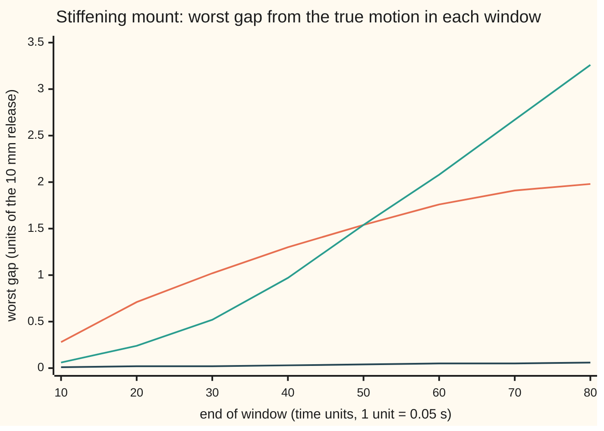
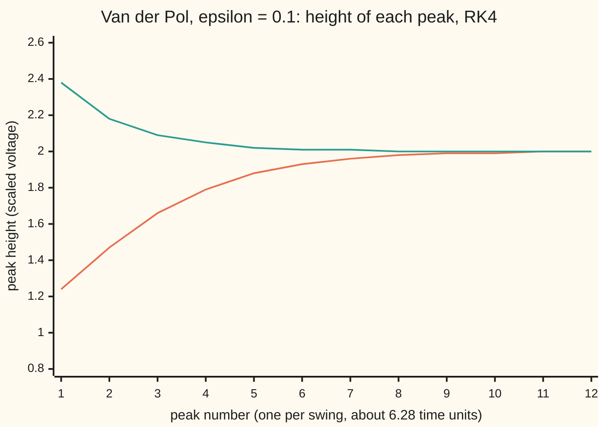

# Multiple scales: a slow clock beside the fast one kills the secular terms

[Syllabus](../../../SYLLABUS.md) → [Engineering mathematics](../README.md) → [Units and Modelling](../README.md#s01) → Multiple scales

---

## General Overview

A 2 kg instrument sits on a rubber mount. For small motions the mount acts as a spring of 800 N/m, so the instrument rings at 20 rad/s, or 3.1831 Hz. Rubber stiffens as it squeezes, though. Model the stiffening as an extra cubic force of 800,000 N/m³ times the cube of the displacement. Pull the instrument 10 mm down and let go. The engineer wants to know the ringing frequency now, because the mount must not ring at the same frequency as a nearby motor.

At 10 mm the cubic force is a tenth of the linear one. That tenth is the small number. [Regular perturbation](05-regular-perturbation.md) (writing the answer as the easy answer plus small corrections) gives a first correction that grows like time multiplied by a sine. Within a few seconds it predicts a swing more than three times the release. The real instrument never swings wider than 10 mm, because no energy enters.

The method of multiple scales fixes this. It gives the motion two clocks. A fast clock counts the swings. A slow clock counts how the swing's size and timing drift over many swings. Choosing the slow drift to cancel the growing term gives the answer: the mount rings at 1.0375 times its small-motion frequency, 3.3025 Hz, a period of 0.30280 s. A Runge-Kutta run of the full law gives 0.30303 s.

**When a small effect acts in step with the motion it disturbs, its effect builds up over many cycles; giving the amplitude and phase their own slow time, and choosing their drift so that nothing builds up, turns that growth into a steady change of frequency or a slow change of amplitude.**

**What kind of fact this is:** a method. Its answers are approximations whose error stays small for times up to about one over the small number, and longer here. The code measures the error against Runge-Kutta stepping and an exact period.

### The picture: how far each answer strays from the true motion



Orange: the small-motion answer, a cosine at the old frequency, which drifts out of step. Green: the plain two-term expansion, whose growing term runs away. Dark blue: the two-timing answer, a cosine at 1.0375 times the old frequency, still within 0.06 of the release after 80 time units.

---

## The formula

Reminders. The small number is $`\varepsilon`$ (epsilon), and $`O(\varepsilon)`$, read "order epsilon", means a quantity no bigger than a fixed multiple of $`\varepsilon`$ ([Regular perturbation](05-regular-perturbation.md)). A prime means a rate of change in time.

Measure the displacement in units of the 10 mm release, and time in units of $`1/\omega_0`$, 0.05 s ([Nondimensionalisation](03-scaling-and-nondimensionalisation.md)). The mount's law becomes the Duffing equation (a spring with a cubic force added):

```math
x'' + x + \varepsilon x^3 = 0, \qquad x(0) = 1,\; x'(0) = 0, \qquad \varepsilon = \frac{k_3 A^2}{k} = 0.1.
```

Bring in a slow time $`T = \varepsilon t`$ beside the fast time $`t`$. Two-timing gives

```math
x(t) = a\cos\big(t + \varphi(T)\big) + O(\varepsilon), \qquad \frac{d\varphi}{dT} = \frac{3a^2}{8}, \qquad \omega = 1 + \frac{3\varepsilon a^2}{8}.
```

**Read it aloud:** the mount swings as a cosine of fixed size, and its phase creeps ahead at three-eighths of the size squared per unit of slow time, so the frequency rises by three-eighths of epsilon times the size squared.

The same steps applied to the van der Pol oscillator $`x'' - \varepsilon(1 - x^2)x' + x = 0`$ give an amplitude that moves and a phase that does not:

```math
\frac{da}{dT} = \frac{a}{2}\Big(1 - \frac{a^2}{4}\Big), \qquad a(T) = \frac{2}{\sqrt{1 + \big(4/a_0^2 - 1\big)e^{-T}}}.
```

**Read it aloud:** the swing grows when its size is below 2 and shrinks when it is above 2, so every start settles at size 2.

| Symbol | Plain meaning | In our example | Push it up and the answer… |
| --- | --- | --- | --- |
| $`m`$, $`k`$, $`k_3`$ | mass; linear stiffness; cubic stiffness | 2 kg; 800 N/m; 800,000 N/m³ | $`k_3`$ up: frequency rises faster with amplitude |
| $`A`$ | release displacement | 10 mm | $`\varepsilon`$ grows as its square |
| $`\omega_0`$ | small-motion frequency, $`\sqrt{k/m}`$ | 20 rad/s = 3.1831 Hz | everything faster |
| $`x`$ | displacement in units of $`A`$ (van der Pol: a scaled voltage) | starts at 1 | — |
| $`t`$ | fast time, in units of $`1/\omega_0`$ | 1 unit = 0.05 s | — |
| $`\varepsilon`$, $`\mu`$ | the small number: cubic force over linear force at the release; for van der Pol, the strength, written $`\mu`$ in Limit cycles | 0.1 | correction grows; past about 1 the method is 4.16% off |
| $`T`$ | slow time, $`\varepsilon t`$ | 1 at $`t`$ = 10 | — |
| $`a`$, $`a_0`$ | amplitude (size of the swing), a function of $`T`$; its starting value | 1 (Duffing); 1 and 3 (van der Pol) | Duffing: frequency up as $`a^2`$ |
| $`\varphi`$, $`\theta`$ | phase, a function of $`T`$; the full angle $`\theta = t + \varphi`$ | $`\varphi`$ = 0 at the start | — |
| $`\omega`$, $`P`$ | frequency (two-timing estimate) in units of $`\omega_0`$; period, $`2\pi/\omega`$ | 1.0375, so 20.75 rad/s; 6.0561 units = 0.30280 s | $`P`$ falls as $`\omega`$ rises |
| $`K`$, $`\beta`$, $`\psi`$ | the complete elliptic integral of the first kind, a standard tabulated function; its parameter $`\beta = \varepsilon/(2(1 + \varepsilon))`$; the angle it integrates over | exact period $`4K(\beta)/\sqrt{1 + \varepsilon}`$ = 6.0607 units | $`\beta`$ up: $`K`$ up |
| $`h`$ | the disturbing force in $`x'' + x = \varepsilon h`$ (Step 4) | Duffing $`-x^3`$; van der Pol $`(1 - x^2)x'`$ | bigger push, faster drift |
| $`X_0`$, $`X_1`$ | leading answer and its first correction, each a function of both times | $`X_0 = a\cos\theta`$ | — |

### When it holds

- **$`\varepsilon`$ small.** At $`\varepsilon`$ = 0.1 the two-timing period is 0.0755% short of the exact one. At $`\varepsilon`$ = 1, a 31.6 mm release, it is 4.16% short; at 3 (54.8 mm), 16.03% short. That is outside the range.
- **The easy problem oscillates at one frequency.** The method removes the parts of the push that land on that frequency. If the easy problem had two frequencies in a whole-number ratio, more terms resonate and more slow equations are needed.
- **Times up to order $`1/\varepsilon`$.** The leading answer is guaranteed for that long, here 10 time units. The Duffing gap stays at 0.06 out to 80 units because its phase error grows only like $`\varepsilon^2 t`$. Over times of order $`1/\varepsilon^2`$ a second slow time is needed.
- **The model.** A rigid mass, a cubic spring, no damping, no outside push. The force is measured from the loaded rest position and is the same up and down. Under the instrument's weight a real mount is stiffer in compression than in extension, which adds a squared term this law leaves out and changes the shift. Real rubber also absorbs energy, so a real swing shrinks; the van der Pol half of the card shows how the slow time handles an amplitude that changes.

---

## Why it works

### Step 0: a push in step with the swing builds up, so steer it into the slow drift

A child on a swing gets higher when the pushes land in time with the swing. In the correction equation, part of the cubic force lands exactly at the swing's own frequency. That part is resonance (a push in step with the natural motion, which builds up). The plain expansion answers it with a term that grows with time.

The real motion has no growth. What it has is a slight change of frequency, and over many swings that looks like a growing phase error. So let the amplitude and phase drift slowly, and choose the drift so that no resonant push is left.

### Step 1: find the secular term

Put $`x = x_0 + \varepsilon x_1`$ into the Duffing law and match powers, as in [Regular perturbation](05-regular-perturbation.md). The rung with no $`\varepsilon`$ gives $`x_0 = \cos t`$. The rung with one $`\varepsilon`$ uses $`\cos^3 t = \tfrac34\cos t + \tfrac14\cos 3t`$:

```math
x_1'' + x_1 = -\tfrac34\cos t - \tfrac14\cos 3t, \qquad x_1 = \frac{\cos 3t - \cos t}{32} - \frac{3}{8}\,t\sin t.
```

The term $`t\sin t`$ is called **secular** (from the Latin for "lasting an age": it grows over long times). By $`t`$ = 10 its size $`\tfrac38\varepsilon t`$ is 0.375 of the swing, and the ordering "correction much smaller than answer" has failed. In the window $`t`$ = 70 to 80 the plain expansion reaches 3.0629 while the true peak stays at 1.

### Step 2: two clocks

This is the slow clock of [Two-timing and averaging](../../08-Differential%20equations%20and%20dynamics/13-Rhythms%20and%20Synchronisation/01-two-timing-and-averaging.md), which derives it for this spring and for van der Pol; here it is run on the mount. Treat $`x`$ as a function of two times, the fast $`t`$ and the slow $`T = \varepsilon t`$, as if they were independent. A change in real time moves both clocks, so by the chain rule

```math
\frac{d}{dt} = \frac{\partial}{\partial t} + \varepsilon\frac{\partial}{\partial T}, \qquad \frac{d^2}{dt^2} = \frac{\partial^2}{\partial t^2} + 2\varepsilon\frac{\partial^2}{\partial t\,\partial T} + \varepsilon^2\frac{\partial^2}{\partial T^2}.
```

Here $`\partial/\partial t`$ is a partial derivative: the rate of change in $`t`$ with $`T`$ held fixed. Write $`x = X_0(t, T) + \varepsilon X_1(t, T)`$. The rung with no $`\varepsilon`$ is $`\partial_{tt}X_0 + X_0 = 0`$ again. Its answer is a cosine, but the constants of integration may now depend on the slow time:

```math
X_0 = a(T)\cos\theta, \qquad \theta = t + \varphi(T).
```

### Step 3: the solvability condition

The rung with one $`\varepsilon`$ picks up the cross term from the second derivative:

```math
\partial_{tt}X_1 + X_1 = -2\,\partial_t\partial_T X_0 - X_0^3 = 2a'\sin\theta + 2a\varphi'\cos\theta - \tfrac34 a^3\cos\theta - \tfrac14 a^3\cos 3\theta.
```

Here $`a'`$ and $`\varphi'`$ are rates in slow time. The left side is the same oscillator as before. Any $`\sin\theta`$ or $`\cos\theta`$ on the right would push it at resonance and make $`X_1`$ grow like $`t`$. Set both to zero. This is the **solvability condition**: the condition under which the correction stays bounded.

- $`\sin\theta`$: $`2a' = 0`$, so the amplitude stays at 1. Energy is conserved, as it must be.
- $`\cos\theta`$: $`2a\varphi' = \tfrac34 a^3`$, so $`\varphi' = \tfrac38 a^2`$.

With $`a`$ = 1 the phase grows as $`\tfrac38 T = \tfrac38\varepsilon t`$. So $`\theta = (1 + \tfrac38\varepsilon)t`$: the frequency is 1.0375. What remains on the right, the $`\cos 3\theta`$ term, gives a bounded ripple of size $`\varepsilon/32`$.

### Step 4: the same answer by averaging

The two conditions say: over one swing, the part of the disturbing force in step with the swing must be balanced by the slow drift. For any law $`x'' + x = \varepsilon h(x, x')`$ the same steps give

```math
\frac{da}{dT} = -\frac{1}{2\pi}\int_0^{2\pi} h\,\sin\theta\,d\theta, \qquad a\frac{d\varphi}{dT} = -\frac{1}{2\pi}\int_0^{2\pi} h\,\cos\theta\,d\theta,
```

with $`h`$ taken at $`x = a\cos\theta`$, $`x' = -a\sin\theta`$. The code does these integrals by quadrature (adding up the function at 64 evenly spaced angles), with no trigonometric identities. For the Duffing force $`h = -x^3`$ at $`a`$ = 1 it gets 0.375000, the 3/8 of Step 3.

The Lindstedt-Poincaré method of [Regular perturbation](05-regular-perturbation.md) reaches the same frequency by stretching the time axis. It works for motions that repeat exactly. Two-timing also handles an amplitude that changes, which is the next step.

### Step 5: van der Pol settles at amplitude 2

The van der Pol oscillator pumps energy in while $`x`$ is small and drains it while $`x`$ is large ([Limit cycles](../../08-Differential%20equations%20and%20dynamics/06-Nonlinear%20Dynamics%20in%20the%20Plane/08-limit-cycles-and-van-der-pol.md) found its loop numerically; its strength $`\mu`$ there is this card's $`\varepsilon`$, set there to 1). Its disturbing force is $`h = (1 - x^2)x'`$. [Two-timing and averaging](../../08-Differential%20equations%20and%20dynamics/13-Rhythms%20and%20Synchronisation/01-two-timing-and-averaging.md) runs Steps 2 and 3 on it: the $`\sin\theta`$ part gives $`a' = \tfrac{a}{2}(1 - \tfrac{a^2}{4})`$, the $`\cos\theta`$ part gives $`\varphi' = 0`$, and a change of variable solves the amplitude equation in the closed form of The formula.

The growth rate is positive below 2 and negative above it, so 2 is the one amplitude that stays put. Here quadrature and bisection (repeated halving of an interval that holds the zero) on the averaged growth rate find it at 2.000000, with no algebra. From $`a_0`$ = 1 the closed form reaches 1.9 at $`t`$ = 33.24 time units.



Orange: started at 1. Green: started at 3. The slow-amplitude formula, read at each peak time, matches both lines to two decimals; the worst gap over all 24 peaks is 0.0018.

---

## Worked numbers, by hand

| Step | Arithmetic | Value |
| --- | --- | --- |
| small-motion frequency | $`\sqrt{800/2}`$ | 20.0000 rad/s = 3.1831 Hz |
| the small number | 800,000 × 0.010² / 800 | 0.1000 |
| frequency correction | 3 × 0.1 / 8 | 0.037500 |
| two-timing frequency | (1 + 0.0375) × 20 rad/s | 20.7500 rad/s = 3.3025 Hz |
| period in time units | 2π / 1.0375 | 6.0561 |
| period in seconds | 6.0561 × 0.05 s | **0.30280 s** |
| exact, for comparison | AGM and RK4 agree | 6.0607 units = 0.30303 s |
| gap | (6.0607 − 6.0561) / 6.0607, with the periods unrounded | 0.0755% |

The mount rings at 3.3025 Hz from a 10 mm release, not 3.1831 Hz: 3.75% higher. A motor running near 3.3 Hz would sit closer to the mount's real frequency than the linear model says.

For van der Pol from $`a_0`$ = 1 with $`\varepsilon`$ = 0.1: the growth rate at $`a`$ = 1 is $`\tfrac12 - \tfrac18`$ = 0.375000, the amplitude reaches 1.9 at $`t`$ = 33.24 time units, and it settles at 2. RK4 finds the settled peak at 2.0001.

### What breaks if you drop a piece

| Mistake | Comes out at | What went wrong |
| --- | --- | --- |
| plain expansion, no slow time | 3.0629 times the release in $`t`$ = 70 to 80 | the secular term $`\tfrac38\varepsilon t\sin t`$ grows without bound |
| 3/4 in place of 3/8 | period 5.8448 units = 0.29224 s | the cross term carries a factor 2: $`2a\varphi' = \tfrac34 a^3`$ |
| frequency kept at 1 | period 6.2832 units = 0.31416 s, 3.67% long | the stiffening is ignored, so the phase drifts out of step |
| two-timing at $`\varepsilon`$ = 1 | period 4.5696 against 4.7680 exact, 4.16% short | $`\varepsilon`$ is not small |

---

## Code, from first principles, and it actually runs

The code takes four roads. Road one is the two-timing formulas. Road two steps the full laws with RK4 (Runge-Kutta four, a stepping rule that samples the slope four times per step) and finds every peak by bisecting the step where the speed changes sign. Road three is an exact Duffing period with no series in it. Energy conservation gives it as $`4K(\beta)/\sqrt{1 + \varepsilon}`$ with $`\beta = \varepsilon/(2(1 + \varepsilon))`$, where $`K(\beta)`$, the complete elliptic integral of the first kind, is the integral of $`1/\sqrt{1 - \beta\sin^2\psi}`$ over the angle $`\psi`$ from 0 to $`\pi/2`$. The code evaluates $`K(\beta)`$ as $`\pi/(2\,\mathrm{AGM}(1, \sqrt{1 - \beta}))`$, using Gauss's arithmetic-geometric mean, AGM (average two numbers both ways, arithmetic and geometric, and repeat until they agree). Road four redoes the solvability averages by quadrature and finds the van der Pol amplitude by bisection. It also measures the plain expansion's failure, checks that the period error shrinks about fourfold when $`\varepsilon`$ halves, and prints both charts.

### Python

```python
# Multiple scales -- the check behind the card.  Standard library only.
# A 2 kg instrument on a stiffening rubber mount, x'' + x + eps x^3 = 0 (Duffing),
# then the oscillator x'' - eps (1 - x^2) x' + x = 0 (van der Pol).  Roads: the
# two-timing formulas, RK4 stepping, an exact period by Gauss's AGM, and the
# solvability averages done again by numerical quadrature.
from math import pi, sin, cos, sqrt, exp, log

MASS, K, K3, A = 2.0, 800.0, 8.0e5, 0.010   # kg, N/m, N/m^3, release in m
W0 = sqrt(K / MASS)                          # natural frequency, rad/s
EPS = K3 * A * A / K                         # the small number: cubic over linear force
H = 0.001                                    # RK4 step, in time units 1/W0

def duffing(e):
    return lambda x, v: (v, -x - e * x ** 3)

def vdp(e):
    return lambda x, v: (v, e * (1.0 - x * x) * v - x)

def rk4(f, x, v, h):                         # one RK4 step of x' = v, v' = g(x, v)
    a1, b1 = f(x, v)
    a2, b2 = f(x + 0.5 * h * a1, v + 0.5 * h * b1)
    a3, b3 = f(x + 0.5 * h * a2, v + 0.5 * h * b2)
    a4, b4 = f(x + h * a3, v + h * b3)
    return x + h * (a1 + 2 * a2 + 2 * a3 + a4) / 6.0, v + h * (b1 + 2 * b2 + 2 * b3 + b4) / 6.0

def peaks(f, x, v, tmax):                    # (time, height) of every maximum of x
    out, n = [], 0
    while n * H < tmax:
        x2, v2 = rk4(f, x, v, H)
        if v > 0.0 >= v2:                    # bisect the step to land on v = 0
            lo, hi = 0.0, H
            for _ in range(50):
                mid = 0.5 * (lo + hi)
                if rk4(f, x, v, mid)[1] > 0.0:
                    lo = mid
                else:
                    hi = mid
            out.append((n * H + lo, rk4(f, x, v, lo)[0]))
        x, v, n = x2, v2, n + 1
    return out

def agm(p, q):
    for _ in range(30):
        p, q = 0.5 * (p + q), sqrt(p * q)
    return p

def exact_period(e):                         # Duffing from x = 1 at rest, by elliptic K and AGM
    m = e / (2.0 * (1.0 + e))
    return 4.0 * (pi / (2.0 * agm(1.0, sqrt(1.0 - m)))) / sqrt(1.0 + e)

def tt_period(e):                            # two-timing: omega = 1 + 3 eps / 8
    return 2.0 * pi / (1.0 + 3.0 * e / 8.0)

def average(h, a, part):                     # (1/2pi) integral of h(a cos th, -a sin th) times sin or cos
    n, s = 64, 0.0
    for k in range(n):
        th = 2.0 * pi * (k + 0.5) / n
        s += h(a * cos(th), -a * sin(th)) * (sin(th) if part == "sin" else cos(th))
    return s / n

def plain(t, e):                             # regular expansion, two terms: grows like t sin t
    return cos(t) + e * ((cos(3 * t) - cos(t)) / 32.0 - 3.0 * t * sin(t) / 8.0)

def amp(t, a0, e):                           # van der Pol slow amplitude, solved exactly
    return 2.0 / sqrt(1.0 + (4.0 / (a0 * a0) - 1.0) * exp(-e * t))

T0 = 1.0 / W0
print(f"mount: m = {MASS:.1f} kg, k = {K:.0f} N/m, k3 = {K3:.0f} N/m^3, release A = {A * 1000:.1f} mm")
print(f"w0 = sqrt(k/m) = {W0:.4f} rad/s = {W0 / (2 * pi):.4f} Hz; time unit 1/w0 = {T0:.4f} s")
print(f"eps = k3 A^2 / k = {EPS:.4f}")
w = 1.0 + 3.0 * EPS / 8.0
pk = peaks(duffing(EPS), 1.0, 0.0, 61.0)
t_rk, t_ex, t_tt = pk[9][0] / 10.0, exact_period(EPS), tt_period(EPS)
print(f"two-timing: 3 eps/8 = {3 * EPS / 8:.6f}; omega = {w:.6f}, times w0 = {w * W0:.4f} rad/s")
print(f"two-timing: period {t_tt:.4f} units = {t_tt * T0:.5f} s; f = {w * W0 / (2 * pi):.4f} Hz")
print(f"exact, by AGM: period {t_ex:.4f} units = {t_ex * T0:.5f} s")
print(f"RK4, 10 peaks: period {t_rk:.4f} units; lowest peak {min(p[1] for p in pk):.6f}, highest {max(p[1] for p in pk):.6f}")
err1, err2 = (t_ex - tt_period(EPS)) / t_ex, (exact_period(EPS / 2) - tt_period(EPS / 2)) / exact_period(EPS / 2)
print(f"two-timing period short by {err1 * 100:.4f}% at eps = 0.1, {err2 * 100:.4f}% at eps = 0.05; ratio {err1 / err2:.2f}")
c38 = -average(lambda x, v: -x ** 3, 1.0, "cos")
print(f"quadrature: Duffing phase drift per unit slow time at a = 1: {c38:.6f} (3/8 = {3 / 8:.6f})")
g = lambda a: average(lambda x, v: (1.0 - x * x) * v, a, "sin") * -1.0
print(f"quadrature: van der Pol growth at a = 1: {g(1.0):.6f} (a/2 - a^3/8 = {0.5 - 1 / 8:.6f})")
lo, hi = 1.0, 3.0
for _ in range(60):
    mid = 0.5 * (lo + hi)
    lo, hi = (mid, hi) if g(mid) > 0.0 else (lo, mid)
print(f"quadrature + bisection: growth is zero at a = {lo:.6f}")

f, x, v, gaps = duffing(EPS), 1.0, 0.0, []
for blk in range(8):                         # worst gap from RK4 in each 10-unit window
    worst = [0.0, 0.0, 0.0]
    for k in range(10000):
        x, v = rk4(f, x, v, H)
        t = blk * 10.0 + (k + 1) * H
        for j, y in enumerate((cos(t), plain(t, EPS), cos(w * t))):
            worst[j] = max(worst[j], abs(y - x))
    gaps.append(worst)
print("chart, window ends at t   " + " ".join(f"{10 * (i + 1):5d}" for i in range(8)))
for j, lab in enumerate(("fixed frequency 1  ", "plain expansion    ", "two-timing         ")):
    print("chart, gap " + lab + " " + " ".join(f"{gp[j]:5.2f}" for gp in gaps))
print(f"plain expansion reaches {max(abs(plain(70 + k * 0.001, EPS)) for k in range(10001)):.4f} in t = 70..80; true peak stays 1")

up, down = peaks(vdp(EPS), 1.0, 0.0, 76.0)[:12], peaks(vdp(EPS), 3.0, 0.0, 76.0)[:12]
print("chart, peak number        " + " ".join(f"{i + 1:5d}" for i in range(12)))
print("chart, peak time from 1   " + " ".join(f"{p[0]:5.1f}" for p in up))
for lab, ps, a0 in (("RK4 from 1    ", up, 1.0), ("formula from 1", up, 1.0), ("RK4 from 3    ", down, 3.0), ("formula from 3", down, 3.0)):
    print("chart, " + lab + "     " + " ".join(f"{(p[1] if 'RK4' in lab else amp(p[0], a0, EPS)):5.2f}" for p in ps))
vgap = max(abs(p[1] - amp(p[0], a0, EPS)) for ps, a0 in ((up, 1.0), (down, 3.0)) for p in ps)
print(f"worst gap, RK4 peak vs slow amplitude, both starts: {vgap:.4f}")
t19 = log(3.0 / (4.0 / 1.9 ** 2 - 1.0)) / EPS
print(f"from a = 1, the amplitude reaches 1.9 at t = {t19:.2f} units")
late = peaks(vdp(EPS), 1.0, 0.0, 300.0)
lp = (late[-1][0] - late[-11][0]) / 10.0
print(f"settled: peak {late[-1][1]:.4f}; period {lp:.4f} (2 pi = {2 * pi:.4f}, 2 pi (1 + eps^2/16) = {2 * pi * (1 + EPS * EPS / 16):.4f})")

for e in (1.0, 3.0):
    print(f"beyond: eps = {e:.0f} (release {sqrt(e * K / K3) * 1000:.1f} mm): two-timing period {tt_period(e):.4f}, exact {exact_period(e):.4f}, short by {(1 - tt_period(e) / exact_period(e)) * 100:.2f}%")
print(f"wrong: 3/4 for 3/8        period {2 * pi / (1 + 3 * EPS / 4):.4f} units = {2 * pi / (1 + 3 * EPS / 4) * T0:.5f} s")
print(f"wrong: frequency kept 1   period {2 * pi:.4f} units = {2 * pi * T0:.5f} s, {(2 * pi / t_ex - 1) * 100:.2f}% long")

assert abs(t_rk - t_ex) < 1e-6, "RK4 period must match the AGM period"
assert abs(c38 - 3.0 / 8.0) < 1e-12, "quadrature must give the 3/8 drift coefficient"
assert abs(lo - 2.0) < 1e-9, "van der Pol growth must vanish at amplitude 2"
assert 3.5 < err1 / err2 < 4.5, "two-timing period error must shrink like eps^2"
assert gaps[-1][2] < 0.1 and gaps[-1][1] > 2.0, "two-timing must hold where the plain expansion fails"
assert vgap < 0.05, "slow amplitude must track the RK4 peaks of van der Pol"
assert abs(late[-1][1] - 2.0) < 0.01, "van der Pol must settle at amplitude 2"
print("ALL CHECKS PASS")
```

**Ran 2026-11-23 on macOS, Python 3.14.10, standard library only. All checks passed. Output, pasted from the run:**

```
mount: m = 2.0 kg, k = 800 N/m, k3 = 800000 N/m^3, release A = 10.0 mm
w0 = sqrt(k/m) = 20.0000 rad/s = 3.1831 Hz; time unit 1/w0 = 0.0500 s
eps = k3 A^2 / k = 0.1000
two-timing: 3 eps/8 = 0.037500; omega = 1.037500, times w0 = 20.7500 rad/s
two-timing: period 6.0561 units = 0.30280 s; f = 3.3025 Hz
exact, by AGM: period 6.0607 units = 0.30303 s
RK4, 10 peaks: period 6.0607 units; lowest peak 1.000000, highest 1.000000
two-timing period short by 0.0755% at eps = 0.1, 0.0197% at eps = 0.05; ratio 3.84
quadrature: Duffing phase drift per unit slow time at a = 1: 0.375000 (3/8 = 0.375000)
quadrature: van der Pol growth at a = 1: 0.375000 (a/2 - a^3/8 = 0.375000)
quadrature + bisection: growth is zero at a = 2.000000
chart, window ends at t      10    20    30    40    50    60    70    80
chart, gap fixed frequency 1    0.28  0.71  1.02  1.30  1.54  1.76  1.91  1.98
chart, gap plain expansion      0.06  0.24  0.52  0.97  1.54  2.08  2.67  3.26
chart, gap two-timing           0.01  0.02  0.02  0.03  0.04  0.05  0.05  0.06
plain expansion reaches 3.0629 in t = 70..80; true peak stays 1
chart, peak number            1     2     3     4     5     6     7     8     9    10    11    12
chart, peak time from 1     6.3  12.5  18.8  25.1  31.4  37.6  43.9  50.2  56.5  62.8  69.1  75.4
chart, RK4 from 1          1.24  1.47  1.66  1.79  1.88  1.93  1.96  1.98  1.99  1.99  2.00  2.00
chart, formula from 1      1.24  1.47  1.66  1.79  1.88  1.93  1.96  1.98  1.99  1.99  2.00  2.00
chart, RK4 from 3          2.38  2.18  2.09  2.05  2.02  2.01  2.01  2.00  2.00  2.00  2.00  2.00
chart, formula from 3      2.38  2.18  2.09  2.05  2.02  2.01  2.01  2.00  2.00  2.00  2.00  2.00
worst gap, RK4 peak vs slow amplitude, both starts: 0.0018
from a = 1, the amplitude reaches 1.9 at t = 33.24 units
settled: peak 2.0001; period 6.2871 (2 pi = 6.2832, 2 pi (1 + eps^2/16) = 6.2871)
beyond: eps = 1 (release 31.6 mm): two-timing period 4.5696, exact 4.7680, short by 4.16%
beyond: eps = 3 (release 54.8 mm): two-timing period 2.9568, exact 3.5211, short by 16.03%
wrong: 3/4 for 3/8        period 5.8448 units = 0.29224 s
wrong: frequency kept 1   period 6.2832 units = 0.31416 s, 3.67% long
ALL CHECKS PASS
```

### Rust

Same numbers, same labels, built with `rustc --edition 2021 -O`.

```rust
// Multiple scales -- the same check as the Python, in Rust.  No crates.
// A 2 kg instrument on a stiffening rubber mount, x'' + x + eps x^3 = 0 (Duffing),
// then the oscillator x'' - eps (1 - x^2) x' + x = 0 (van der Pol).  Roads: the
// two-timing formulas, RK4 stepping, an exact period by Gauss's AGM, and the
// solvability averages done again by numerical quadrature.
use std::f64::consts::PI;

const MASS: f64 = 2.0;                       // kg
const K: f64 = 800.0;                        // N/m
const K3: f64 = 8.0e5;                       // N/m^3
const A: f64 = 0.010;                        // release, m
const H: f64 = 0.001;                        // RK4 step, in time units 1/w0

fn duffing(e: f64) -> impl Fn(f64, f64) -> (f64, f64) { move |x, v| (v, -x - e * x * x * x) }
fn vdp(e: f64) -> impl Fn(f64, f64) -> (f64, f64) { move |x, v| (v, e * (1.0 - x * x) * v - x) }

fn rk4(f: &impl Fn(f64, f64) -> (f64, f64), x: f64, v: f64, h: f64) -> (f64, f64) {
    let (a1, b1) = f(x, v);
    let (a2, b2) = f(x + 0.5 * h * a1, v + 0.5 * h * b1);
    let (a3, b3) = f(x + 0.5 * h * a2, v + 0.5 * h * b2);
    let (a4, b4) = f(x + h * a3, v + h * b3);
    (x + h * (a1 + 2.0 * a2 + 2.0 * a3 + a4) / 6.0, v + h * (b1 + 2.0 * b2 + 2.0 * b3 + b4) / 6.0)
}

fn peaks(f: &impl Fn(f64, f64) -> (f64, f64), mut x: f64, mut v: f64, tmax: f64) -> Vec<(f64, f64)> {
    let (mut out, mut n) = (Vec::new(), 0usize);
    while (n as f64) * H < tmax {
        let (x2, v2) = rk4(f, x, v, H);
        if v > 0.0 && 0.0 >= v2 {            // bisect the step to land on v = 0
            let (mut lo, mut hi) = (0.0, H);
            for _ in 0..50 {
                let mid = 0.5 * (lo + hi);
                if rk4(f, x, v, mid).1 > 0.0 { lo = mid } else { hi = mid }
            }
            out.push((n as f64 * H + lo, rk4(f, x, v, lo).0));
        }
        x = x2;
        v = v2;
        n += 1;
    }
    out
}

fn agm(mut p: f64, mut q: f64) -> f64 {
    for _ in 0..30 {
        let (np, nq) = (0.5 * (p + q), (p * q).sqrt());
        p = np;
        q = nq;
    }
    p
}

fn exact_period(e: f64) -> f64 {             // Duffing from x = 1 at rest, by elliptic K and AGM
    let m = e / (2.0 * (1.0 + e));
    4.0 * (PI / (2.0 * agm(1.0, (1.0 - m).sqrt()))) / (1.0 + e).sqrt()
}

fn tt_period(e: f64) -> f64 { 2.0 * PI / (1.0 + 3.0 * e / 8.0) }  // two-timing: omega = 1 + 3 eps / 8

fn average(h: impl Fn(f64, f64) -> f64, a: f64, sin_part: bool) -> f64 {
    let (n, mut s) = (64, 0.0);
    for k in 0..n {
        let th = 2.0 * PI * (k as f64 + 0.5) / n as f64;
        s += h(a * th.cos(), -a * th.sin()) * if sin_part { th.sin() } else { th.cos() };
    }
    s / n as f64
}

fn plain(t: f64, e: f64) -> f64 {            // regular expansion, two terms: grows like t sin t
    t.cos() + e * (((3.0 * t).cos() - t.cos()) / 32.0 - 3.0 * t * t.sin() / 8.0)
}

fn amp(t: f64, a0: f64, e: f64) -> f64 {     // van der Pol slow amplitude, solved exactly
    2.0 / (1.0 + (4.0 / (a0 * a0) - 1.0) * (-e * t).exp()).sqrt()
}

fn join<T>(v: &[T], f: impl Fn(&T) -> String) -> String { v.iter().map(f).collect::<Vec<_>>().join(" ") }

fn main() {
    let w0 = (K / MASS).sqrt();
    let eps = K3 * A * A / K;
    let t0 = 1.0 / w0;
    println!("mount: m = {:.1} kg, k = {:.0} N/m, k3 = {:.0} N/m^3, release A = {:.1} mm", MASS, K, K3, A * 1000.0);
    println!("w0 = sqrt(k/m) = {:.4} rad/s = {:.4} Hz; time unit 1/w0 = {:.4} s", w0, w0 / (2.0 * PI), t0);
    println!("eps = k3 A^2 / k = {:.4}", eps);
    let w = 1.0 + 3.0 * eps / 8.0;
    let pk = peaks(&duffing(eps), 1.0, 0.0, 61.0);
    let (t_rk, t_ex, t_tt) = (pk[9].0 / 10.0, exact_period(eps), tt_period(eps));
    println!("two-timing: 3 eps/8 = {:.6}; omega = {:.6}, times w0 = {:.4} rad/s", 3.0 * eps / 8.0, w, w * w0);
    println!("two-timing: period {:.4} units = {:.5} s; f = {:.4} Hz", t_tt, t_tt * t0, w * w0 / (2.0 * PI));
    println!("exact, by AGM: period {:.4} units = {:.5} s", t_ex, t_ex * t0);
    let (lo_p, hi_p) = pk.iter().fold((f64::MAX, f64::MIN), |(a, b), p| (a.min(p.1), b.max(p.1)));
    println!("RK4, 10 peaks: period {:.4} units; lowest peak {:.6}, highest {:.6}", t_rk, lo_p, hi_p);
    let err1 = (t_ex - tt_period(eps)) / t_ex;
    let err2 = (exact_period(eps / 2.0) - tt_period(eps / 2.0)) / exact_period(eps / 2.0);
    println!("two-timing period short by {:.4}% at eps = 0.1, {:.4}% at eps = 0.05; ratio {:.2}", err1 * 100.0, err2 * 100.0, err1 / err2);
    let c38 = -average(|x, _v| -x * x * x, 1.0, false);
    println!("quadrature: Duffing phase drift per unit slow time at a = 1: {:.6} (3/8 = {:.6})", c38, 3.0 / 8.0);
    let g = |a: f64| average(|x, v| (1.0 - x * x) * v, a, true) * -1.0;
    println!("quadrature: van der Pol growth at a = 1: {:.6} (a/2 - a^3/8 = {:.6})", g(1.0), 0.5 - 1.0 / 8.0);
    let (mut lo, mut hi) = (1.0, 3.0);
    for _ in 0..60 {
        let mid = 0.5 * (lo + hi);
        if g(mid) > 0.0 { lo = mid } else { hi = mid }
    }
    println!("quadrature + bisection: growth is zero at a = {:.6}", lo);

    let f = duffing(eps);
    let (mut x, mut v, mut gaps) = (1.0, 0.0, Vec::new());
    for blk in 0..8 {                        // worst gap from RK4 in each 10-unit window
        let mut worst = [0.0f64; 3];
        for k in 0..10000 {
            (x, v) = rk4(&f, x, v, H);
            let t = blk as f64 * 10.0 + (k + 1) as f64 * H;
            for (j, y) in [t.cos(), plain(t, eps), (w * t).cos()].iter().enumerate() {
                worst[j] = worst[j].max((y - x).abs());
            }
        }
        gaps.push(worst);
    }
    println!("chart, window ends at t   {}", join(&(1..=8).collect::<Vec<_>>(), |i| format!("{:5}", 10 * i)));
    for (j, lab) in ["fixed frequency 1  ", "plain expansion    ", "two-timing         "].iter().enumerate() {
        println!("chart, gap {} {}", lab, join(&gaps, |gp| format!("{:5.2}", gp[j])));
    }
    let pmax = (0..=10000).map(|k| plain(70.0 + k as f64 * 0.001, eps).abs()).fold(0.0, f64::max);
    println!("plain expansion reaches {:.4} in t = 70..80; true peak stays 1", pmax);

    let up: Vec<_> = peaks(&vdp(eps), 1.0, 0.0, 76.0).into_iter().take(12).collect();
    let down: Vec<_> = peaks(&vdp(eps), 3.0, 0.0, 76.0).into_iter().take(12).collect();
    println!("chart, peak number        {}", join(&(1..=12).collect::<Vec<_>>(), |i| format!("{:5}", i)));
    println!("chart, peak time from 1   {}", join(&up, |p| format!("{:5.1}", p.0)));
    for (lab, ps, a0) in [("RK4 from 1    ", &up, 1.0), ("formula from 1", &up, 1.0), ("RK4 from 3    ", &down, 3.0), ("formula from 3", &down, 3.0)] {
        let rk = lab.starts_with("RK4");
        println!("chart, {}     {}", lab, join(ps, |p| format!("{:5.2}", if rk { p.1 } else { amp(p.0, a0, eps) })));
    }
    let vgap = [(&up, 1.0), (&down, 3.0)].iter()
        .flat_map(|(ps, a0)| ps.iter().map(move |p| (p.1 - amp(p.0, *a0, eps)).abs())).fold(0.0, f64::max);
    println!("worst gap, RK4 peak vs slow amplitude, both starts: {:.4}", vgap);
    let t19 = (3.0 / (4.0 / (1.9f64 * 1.9) - 1.0)).ln() / eps;
    println!("from a = 1, the amplitude reaches 1.9 at t = {:.2} units", t19);
    let late = peaks(&vdp(eps), 1.0, 0.0, 300.0);
    let nl = late.len();
    let lp = (late[nl - 1].0 - late[nl - 11].0) / 10.0;
    println!("settled: peak {:.4}; period {:.4} (2 pi = {:.4}, 2 pi (1 + eps^2/16) = {:.4})", late[nl - 1].1, lp, 2.0 * PI, 2.0 * PI * (1.0 + eps * eps / 16.0));

    for e in [1.0, 3.0] {
        println!("beyond: eps = {:.0} (release {:.1} mm): two-timing period {:.4}, exact {:.4}, short by {:.2}%", e, (e * K / K3).sqrt() * 1000.0, tt_period(e), exact_period(e), (1.0 - tt_period(e) / exact_period(e)) * 100.0);
    }
    let p34 = 2.0 * PI / (1.0 + 3.0 * eps / 4.0);
    println!("wrong: 3/4 for 3/8        period {:.4} units = {:.5} s", p34, p34 * t0);
    println!("wrong: frequency kept 1   period {:.4} units = {:.5} s, {:.2}% long", 2.0 * PI, 2.0 * PI * t0, (2.0 * PI / t_ex - 1.0) * 100.0);

    assert!((t_rk - t_ex).abs() < 1e-6, "RK4 period must match the AGM period");
    assert!((c38 - 3.0 / 8.0).abs() < 1e-12, "quadrature must give the 3/8 drift coefficient");
    assert!((lo - 2.0).abs() < 1e-9, "van der Pol growth must vanish at amplitude 2");
    assert!(3.5 < err1 / err2 && err1 / err2 < 4.5, "two-timing period error must shrink like eps^2");
    assert!(gaps[7][2] < 0.1 && gaps[7][1] > 2.0, "two-timing must hold where the plain expansion fails");
    assert!(vgap < 0.05, "slow amplitude must track the RK4 peaks of van der Pol");
    assert!((late[nl - 1].1 - 2.0).abs() < 0.01, "van der Pol must settle at amplitude 2");
    println!("ALL CHECKS PASS");
}
```

**Ran 2026-11-23 on macOS, rustc 1.98.1, no crates. All checks passed. Output, pasted from the run:**

```
mount: m = 2.0 kg, k = 800 N/m, k3 = 800000 N/m^3, release A = 10.0 mm
w0 = sqrt(k/m) = 20.0000 rad/s = 3.1831 Hz; time unit 1/w0 = 0.0500 s
eps = k3 A^2 / k = 0.1000
two-timing: 3 eps/8 = 0.037500; omega = 1.037500, times w0 = 20.7500 rad/s
two-timing: period 6.0561 units = 0.30280 s; f = 3.3025 Hz
exact, by AGM: period 6.0607 units = 0.30303 s
RK4, 10 peaks: period 6.0607 units; lowest peak 1.000000, highest 1.000000
two-timing period short by 0.0755% at eps = 0.1, 0.0197% at eps = 0.05; ratio 3.84
quadrature: Duffing phase drift per unit slow time at a = 1: 0.375000 (3/8 = 0.375000)
quadrature: van der Pol growth at a = 1: 0.375000 (a/2 - a^3/8 = 0.375000)
quadrature + bisection: growth is zero at a = 2.000000
chart, window ends at t      10    20    30    40    50    60    70    80
chart, gap fixed frequency 1    0.28  0.71  1.02  1.30  1.54  1.76  1.91  1.98
chart, gap plain expansion      0.06  0.24  0.52  0.97  1.54  2.08  2.67  3.26
chart, gap two-timing           0.01  0.02  0.02  0.03  0.04  0.05  0.05  0.06
plain expansion reaches 3.0629 in t = 70..80; true peak stays 1
chart, peak number            1     2     3     4     5     6     7     8     9    10    11    12
chart, peak time from 1     6.3  12.5  18.8  25.1  31.4  37.6  43.9  50.2  56.5  62.8  69.1  75.4
chart, RK4 from 1          1.24  1.47  1.66  1.79  1.88  1.93  1.96  1.98  1.99  1.99  2.00  2.00
chart, formula from 1      1.24  1.47  1.66  1.79  1.88  1.93  1.96  1.98  1.99  1.99  2.00  2.00
chart, RK4 from 3          2.38  2.18  2.09  2.05  2.02  2.01  2.01  2.00  2.00  2.00  2.00  2.00
chart, formula from 3      2.38  2.18  2.09  2.05  2.02  2.01  2.01  2.00  2.00  2.00  2.00  2.00
worst gap, RK4 peak vs slow amplitude, both starts: 0.0018
from a = 1, the amplitude reaches 1.9 at t = 33.24 units
settled: peak 2.0001; period 6.2871 (2 pi = 6.2832, 2 pi (1 + eps^2/16) = 6.2871)
beyond: eps = 1 (release 31.6 mm): two-timing period 4.5696, exact 4.7680, short by 4.16%
beyond: eps = 3 (release 54.8 mm): two-timing period 2.9568, exact 3.5211, short by 16.03%
wrong: 3/4 for 3/8        period 5.8448 units = 0.29224 s
wrong: frequency kept 1   period 6.2832 units = 0.31416 s, 3.67% long
ALL CHECKS PASS
```

The two outputs match line for line.

### Lean

Lean proves the key facts of Steps 1, 3 and 5, for every amplitude and start, and checks the worked numbers.

- Take the Step 3 right side with any amplitude $`a \ne 0`$. Then its $`\sin\theta`$ and $`\cos\theta`$ parts vanish exactly when $`a' = 0`$ and $`\varphi' = 3a^2/8`$.
- Take the plain correction $`x_1`$ of Step 1. Then it solves its equation with $`x_1(0) = 0`$ and $`x_1'(0) = 0`$, and grows without bound.
- Take any van der Pol start $`a_0 > 0`$. Then the closed form starts at $`a_0`$, solves the amplitude equation for $`T \ge 0`$, and tends to 2.
- The small number is 1/10, and the small-motion frequency is 20 rad/s.
- The two-timing frequency is 83/80 of it, which is 20.75 rad/s.
- The van der Pol growth rate is 3/8 at $`a = 1`$ and zero at $`a = 2`$.

The two-timing derivation, the accuracy over times of order $`1/\varepsilon`$, and all simulated numbers are left to the Python and Rust checks.

```lean
-- Multiple scales: the solvability condition fixes the Duffing phase drift at 3a²/8, the plain expansion's correction grows without bound, and the van der Pol slow amplitude settles at 2.
import Mathlib.Analysis.SpecialFunctions.Integrals.Basic
import Mathlib.Analysis.SpecialFunctions.Trigonometric.Deriv
import Mathlib.Analysis.SpecialFunctions.Sqrt
import Mathlib.Analysis.SpecialFunctions.Exp

open Real Filter Topology

theorem duffing_sin_integral (a da dφ : ℝ) :
    (∫ θ in (0 : ℝ)..2 * π,
        (2 * da * sin θ + 2 * a * dφ * cos θ - (a * cos θ) ^ 3) * sin θ) = 2 * π * da := by
  have hd : ∀ x ∈ Set.uIcc (0 : ℝ) (2 * π), HasDerivAt
      (fun θ => 2 * da * (θ / 2 - sin θ * cos θ / 2) + a * dφ * sin θ ^ 2 + a ^ 3 * cos θ ^ 4 / 4)
      ((2 * da * sin x + 2 * a * dφ * cos x - (a * cos x) ^ 3) * sin x) x := by
    intro x _
    have h1 := ((((hasDerivAt_id x).div_const 2).sub
      (((hasDerivAt_sin x).mul (hasDerivAt_cos x)).div_const 2)).const_mul (2 * da))
    have h2 := ((hasDerivAt_sin x).pow 2).const_mul (a * dφ)
    have h3 := (((hasDerivAt_cos x).pow 4).const_mul (a ^ 3)).div_const 4
    have h := (h1.add h2).add h3
    convert h using 1
    · funext θ; simp only [id, Pi.add_apply, Pi.sub_apply, Pi.mul_apply, Pi.pow_apply]
    · linear_combination da * sin_sq_add_cos_sq x
  rw [intervalIntegral.integral_eq_sub_of_hasDerivAt hd
    (Continuous.intervalIntegrable (by fun_prop) _ _)]
  simp [sin_two_pi, cos_two_pi]
  ring

#print axioms duffing_sin_integral

theorem duffing_cos_integral (a da dφ : ℝ) :
    (∫ θ in (0 : ℝ)..2 * π,
        (2 * da * sin θ + 2 * a * dφ * cos θ - (a * cos θ) ^ 3) * cos θ) =
      2 * π * a * dφ - 3 * π * a ^ 3 / 4 := by
  have hd : ∀ x ∈ Set.uIcc (0 : ℝ) (2 * π), HasDerivAt
      (fun θ => da * sin θ ^ 2 + 2 * a * dφ * (θ / 2 + sin θ * cos θ / 2)
        - a ^ 3 * (3 * θ / 8 + 3 * sin θ * cos θ / 8 + cos θ ^ 3 * sin θ / 4))
      ((2 * da * sin x + 2 * a * dφ * cos x - (a * cos x) ^ 3) * cos x) x := by
    intro x _
    have h1 := ((hasDerivAt_sin x).pow 2).const_mul da
    have h2 := (((hasDerivAt_id x).div_const 2).add
        (((hasDerivAt_sin x).mul (hasDerivAt_cos x)).div_const 2)).const_mul (2 * a * dφ)
    have h3 := (((((hasDerivAt_id x).const_mul 3).div_const 8).add
        ((((hasDerivAt_sin x).const_mul 3).mul (hasDerivAt_cos x)).div_const 8)).add
        ((((hasDerivAt_cos x).pow 3).mul (hasDerivAt_sin x)).div_const 4)).const_mul (a ^ 3)
    have h := (h1.add h2).sub h3
    convert h using 1
    · funext θ; simp only [id, Pi.add_apply, Pi.sub_apply, Pi.mul_apply, Pi.pow_apply]
    · simp only [Nat.cast_ofNat, Nat.reduceSub, pow_one, Pi.pow_apply]
      linear_combination (a * dφ + a ^ 3 * (-3 / 8 - 3 * cos x ^ 2 / 4)) * sin_sq_add_cos_sq x
  rw [intervalIntegral.integral_eq_sub_of_hasDerivAt hd
    (Continuous.intervalIntegrable (by fun_prop) _ _)]
  simp [sin_two_pi, cos_two_pi]
  ring

#print axioms duffing_cos_integral

/-- The solvability condition for the Duffing spring `x'' + x + ε x³ = 0`. On the rung with one `ε`,
two-timing leaves the right side `2 a' sin θ + 2 a φ' cos θ - (a cos θ)³`, where `a'` and `φ'` are the
slow-time rates of the amplitude and the phase. Its parts in step with the swing (its `sin θ` and
`cos θ` components over one swing) both vanish exactly when the amplitude does not drift, `a' = 0`,
and the phase creeps ahead at `φ' = 3a²/8`; so the frequency is `1 + 3εa²/8`. -/
theorem duffing_solvability_condition (a da dφ : ℝ) (ha : a ≠ 0) :
    ((∫ θ in (0 : ℝ)..2 * π,
        (2 * da * sin θ + 2 * a * dφ * cos θ - (a * cos θ) ^ 3) * sin θ) = 0 ∧
      (∫ θ in (0 : ℝ)..2 * π,
        (2 * da * sin θ + 2 * a * dφ * cos θ - (a * cos θ) ^ 3) * cos θ) = 0) ↔
      (da = 0 ∧ dφ = 3 * a ^ 2 / 8) := by
  rw [duffing_sin_integral, duffing_cos_integral]
  have hπ : π ≠ 0 := pi_ne_zero
  constructor
  · rintro ⟨h1, h2⟩
    refine ⟨?_, ?_⟩
    · rcases mul_eq_zero.mp h1 with h | h
      · exact absurd (by linarith : π = 0) hπ
      · exact h
    · have h3 : (π * a) * (2 * dφ - 3 * a ^ 2 / 4) = 0 := by linear_combination h2
      rcases mul_eq_zero.mp h3 with h | h
      · exact absurd h (mul_ne_zero hπ ha)
      · linarith
  · rintro ⟨h1, h2⟩
    subst h1 h2
    constructor <;> ring

/-- The plain expansion fails. Its first correction
`x₁(t) = (cos 3t - cos t)/32 - (3/8) t sin t` solves `x₁'' + x₁ = -(3/4) cos t - (1/4) cos 3t`
with `x₁(0) = 0` and `x₁'(0) = 0`, and the secular term `t sin t` makes it grow without bound. -/
theorem plain_expansion_correction_is_secular :
    let x₁ : ℝ → ℝ := fun t => (cos (3 * t) - cos t) / 32 - 3 / 8 * t * sin t
    (∀ t, deriv (deriv x₁) t + x₁ t = -(3 / 4) * cos t - (1 / 4) * cos (3 * t)) ∧
      x₁ 0 = 0 ∧ deriv x₁ 0 = 0 ∧ ¬ ∃ C : ℝ, ∀ t, |x₁ t| ≤ C := by
  intro x₁
  have hx : ∀ t, HasDerivAt x₁
      ((-3 * sin (3 * t) + sin t) / 32 - 3 / 8 * sin t - 3 / 8 * t * cos t) t := by
    intro t
    have h := (((((hasDerivAt_id t).const_mul 3).cos).sub (hasDerivAt_cos t)).div_const 32).sub
      (((hasDerivAt_id t).const_mul (3 / 8)).mul (hasDerivAt_sin t))
    convert h using 1
    · rfl
    · simp only [id]; ring
  have hd : deriv x₁ = fun t =>
      (-3 * sin (3 * t) + sin t) / 32 - 3 / 8 * sin t - 3 / 8 * t * cos t := by
    funext t; exact (hx t).deriv
  have hx2 : ∀ t, HasDerivAt (deriv x₁)
      ((-9 * cos (3 * t) + cos t) / 32 - 3 / 4 * cos t + 3 / 8 * t * sin t) t := by
    intro t
    rw [hd]
    have h := ((((((hasDerivAt_id t).const_mul 3).sin).const_mul (-3)).add (hasDerivAt_sin t)).div_const 32).sub
      ((hasDerivAt_sin t).const_mul (3 / 8)) |>.sub
      (((hasDerivAt_id t).const_mul (3 / 8)).mul (hasDerivAt_cos t))
    convert h using 1
    · rfl
    · simp only [id]; ring
  refine ⟨?_, ?_, ?_, ?_⟩
  · intro t
    rw [(hx2 t).deriv]
    simp only [x₁]
    ring
  · simp [x₁]
  · rw [hd]; simp
  · rintro ⟨C, hC⟩
    obtain ⟨n, hn⟩ := exists_nat_gt |C|
    set t : ℝ := π / 2 + n * (2 * π) with ht
    have hs : sin t = 1 := by rw [ht, sin_add_nat_mul_two_pi, sin_pi_div_two]
    have hc1 : |cos (3 * t) - cos t| ≤ 2 := by
      rw [abs_le]; constructor <;>
        nlinarith [neg_one_le_cos (3 * t), cos_le_one (3 * t), neg_one_le_cos t, cos_le_one t]
    have hC' := hC t
    simp only [x₁, hs, mul_one] at hC'
    have hpi := two_le_pi
    have hn0 : (0 : ℝ) ≤ n := Nat.cast_nonneg n
    have htn : t ≥ 1 + 4 * n := by rw [ht]; nlinarith
    have hCabs := le_abs_self C
    have h1 := abs_le.mp hC'
    rw [abs_le] at hc1
    nlinarith [h1.1, h1.2, hc1.1, hc1.2]

/-- The van der Pol slow amplitude. From any starting size `a₀ > 0`,
`a(T) = 2 / √(1 + (4/a₀² - 1) e^(-T))` starts at `a₀`, solves `da/dT = (a/2)(1 - a²/4)` for all
slow times `T ≥ 0`, and settles at amplitude 2. -/
theorem van_der_pol_amplitude_settles_at_two (a₀ : ℝ) (h₀ : 0 < a₀) :
    let amp : ℝ → ℝ := fun T => 2 / √(1 + (4 / a₀ ^ 2 - 1) * exp (-T))
    amp 0 = a₀ ∧
      (∀ T, 0 ≤ T → HasDerivAt amp (amp T / 2 * (1 - amp T ^ 2 / 4)) T) ∧
      Tendsto amp atTop (𝓝 2) := by
  intro amp
  have ha2 : 0 < a₀ ^ 2 := by positivity
  refine ⟨?_, ?_, ?_⟩
  · simp only [amp, neg_zero, exp_zero, mul_one]
    rw [show 1 + (4 / a₀ ^ 2 - 1) = (2 / a₀) ^ 2 by field_simp; ring,
      sqrt_sq (by positivity)]
    field_simp
  · intro T hT
    set c : ℝ := 4 / a₀ ^ 2 - 1 with hc
    have he : exp (-T) ≤ 1 := by rw [exp_le_one_iff]; linarith
    have he0 : 0 < exp (-T) := exp_pos _
    have hq : 0 < 1 + c * exp (-T) := by
      have : 1 + c * exp (-T) = (1 - exp (-T)) + 4 / a₀ ^ 2 * exp (-T) := by rw [hc]; ring
      rw [this]
      have : 0 < 4 / a₀ ^ 2 * exp (-T) := by positivity
      linarith
    have hqd : HasDerivAt (fun T => 1 + c * exp (-T)) (c * (exp (-T) * -1)) T :=
      ((((hasDerivAt_neg T).exp)).const_mul c).const_add 1
    have hs := hqd.sqrt hq.ne'
    have hsp : 0 < √(1 + c * exp (-T)) := sqrt_pos.mpr hq
    have h := (hasDerivAt_const T (2 : ℝ)).div hs hsp.ne'
    convert h using 1
    have hss : √(1 + c * exp (-T)) ^ 2 = 1 + c * exp (-T) := sq_sqrt hq.le
    rw [show amp T = 2 / √(1 + c * exp (-T)) from rfl]
    set s := √(1 + c * exp (-T))
    clear_value s c
    field_simp
    linear_combination 4 * hss
  · set c : ℝ := 4 / a₀ ^ 2 - 1 with hc
    have h1 : Tendsto (fun T => 1 + c * exp (-T)) atTop (𝓝 1) := by
      simpa using (tendsto_exp_neg_atTop_nhds_zero.const_mul c).const_add 1
    have h2 : Tendsto (fun T => √(1 + c * exp (-T))) atTop (𝓝 1) := by
      have := (continuous_sqrt.tendsto 1).comp h1
      rw [sqrt_one] at this
      exact this
    have h3 := (tendsto_const_nhds (x := (2 : ℝ))).div h2 one_ne_zero
    rw [div_one] at h3
    exact h3

-- The small number: k₃ A² / k with k₃ = 800,000 N/m³, A = 10 mm = 1/100 m, k = 800 N/m.
example : (800000 : ℚ) * (1 / 100) ^ 2 / 800 = 1 / 10 := by norm_num
-- Small-motion frequency: 20² = k/m = 800/2, so ω₀ = 20 rad/s.
example : (20 : ℚ) ^ 2 = 800 / 2 := by norm_num
-- Two-timing frequency: 1 + 3ε/8 at ε = 1/10 is 83/80 (1.0375), and 83/80 × 20 rad/s = 83/4 rad/s (20.75).
example : (1 : ℚ) + 3 * (1 / 10) / 8 = 83 / 80 := by norm_num
example : (83 : ℚ) / 80 * 20 = 83 / 4 := by norm_num
-- Van der Pol growth rate at a = 1 is 1/2 - 1/8 = 3/8; at a = 2 it is zero.
example : (1 : ℚ) / 2 * (1 - 1 ^ 2 / 4) = 3 / 8 := by norm_num
example : (2 : ℚ) / 2 * (1 - 2 ^ 2 / 4) = 0 := by norm_num

#print axioms duffing_solvability_condition
#print axioms plain_expansion_correction_is_secular
#print axioms van_der_pol_amplitude_settles_at_two
```

**Checked 2026-11-23 on macOS, Lean 4.36.0-rc2, Mathlib v4.36.0-rc2. Every proof is complete and uses only Lean's standard axioms. Output, pasted from the run:**

```
'duffing_sin_integral' depends on axioms: [propext, Classical.choice, Quot.sound]
'duffing_cos_integral' depends on axioms: [propext, Classical.choice, Quot.sound]
'duffing_solvability_condition' depends on axioms: [propext, Classical.choice, Quot.sound]
'plain_expansion_correction_is_secular' depends on axioms: [propext, Classical.choice, Quot.sound]
'van_der_pol_amplitude_settles_at_two' depends on axioms: [propext, Classical.choice, Quot.sound]
```

> [!TIP]
> **Try changing**
> Guess first, then run it.
> - **Quarter the small number in the error test.** In the line that sets `err1, err2`, change the three `EPS / 2` to `EPS / 4`. Guess first: an error of order $`\varepsilon^2`$ should shrink about sixteenfold. The ratio prints 15.04 (the label still says 0.05), and the fourth assert, which expects about 4, stops the run.
> - **Spoil the 3/8.** In the line that sets `w`, change `8.0` to `7.0`. The two-timing cosine runs fast, its gap passes 0.1 by $`t`$ = 80, and the fifth assert stops the run.
> - **Weaken the drain.** In `vdp`, change `1.0 - x * x` to `1.0 - 0.9 * x * x`. RK4 now settles above 2 (the averaged growth vanishes at $`2/\sqrt{0.9}`$), the formula still says 2, and the sixth assert stops the run.
> - **Push $`\varepsilon`$ out of range.** In the first settings line, change the release `0.010` to `0.0316`, that is 31.6 mm. Guess first: how far off is the two-timing period now? It prints $`\varepsilon`$ = 0.9986 and a period 4.1531% short; halving $`\varepsilon`$ now shrinks the error by 2.96, not 4, and the fourth assert stops the run. Van der Pol settles at 2.0086, the loop Limit cycles found at $`\mu`$ = 1.

---

## The usual mistake

> [!warning]
> **Trusting a plain expansion over many cycles.** The plain expansion is right for a swing or two. Its correction contains $`\tfrac38\varepsilon t\sin t`$, which is already 0.375 of the answer at $`t = 1/\varepsilon`$ and passes the answer itself at $`t = 8/(3\varepsilon)`$. By $`t`$ = 70 to 80 it reports 3.0629 times the release for a mount that never exceeds 1. The fix is a slow time, with the amplitude and phase chosen so that nothing resonant is left.
>
> - **Dropping the factor 2.** The cross term is $`2\,\partial_t\partial_T X_0`$. Forgetting the 2 gives 3/4 in place of 3/8 and a period of 5.8448 units, 0.29224 s.
> - **Keeping the linear frequency.** The linear model puts the period at 6.2832 units, 3.67% long, and the error in phase grows every swing.
> - **Using it where $`\varepsilon`$ is not small.** At $`\varepsilon`$ = 1 the two-timing period is 4.16% short; at 3, 16.03% short.
> - **Expecting a first-order frequency shift from van der Pol.** At first order its phase does not drift. The real settled period is 6.2871 against $`2\pi`$ = 6.2832: the shift is of order $`\varepsilon^2`$, matching $`2\pi(1 + \varepsilon^2/16)`$.

---

## Where you meet it in real life

- **Micro-machined resonators.** The tiny vibrating beams in timing chips and motion sensors stiffen at large swings. Designers use the Duffing frequency shift, $`3\varepsilon a^2/8`$, to set the largest drive before the frequency moves too far.
- **Machine and vehicle mounts.** Rubber mounts and bump stops stiffen as they compress. The two-timing frequency tells an engineer how the mount's resonance moves with the size of the shake.
- **Electronic oscillators.** A transistor or valve oscillator grows from noise and then levels off. The slow amplitude equation of van der Pol explains why it settles at one size, whatever the start.
- **Wind-tunnel models on springs.** Some engineering models of vortex shedding (the alternating swirls behind a bluff body) treat the wake as a van der Pol oscillator. Two-timing then gives the size of the vibration a scale model settles into, the number to compare with the tunnel measurement ([Similarity](04-similarity-and-model-testing.md)).
- **Planetary orbits.** Small pulls from other planets make orbits drift slowly. Plain expansions there grow the same secular terms, which is where the name and the first fixes came from.

> **Say it back**
> A plain perturbation expansion of an oscillator can contain a term that grows with time, because part of the small force pushes in step with the swing. Multiple scales gives the amplitude and phase a slow time of their own. Choosing their slow drift so that nothing resonant is left removes the growing term. For the stiffening mount the phase drifts, so the frequency rises by 3ε/8, to 3.3025 Hz, period 0.30280 s against 0.30303 s by RK4. For van der Pol the amplitude drifts instead, and every start settles at 2.

---

## What this builds on

- [Regular perturbation](05-regular-perturbation.md): expanding in a small number, the rungs of linear problems, and the first sight of a secular term.
- [Two-timing and averaging](../../08-Differential%20equations%20and%20dynamics/13-Rhythms%20and%20Synchronisation/01-two-timing-and-averaging.md): the slow clock, the solvability step and the van der Pol amplitude equation, derived there on the same two oscillators; this card puts them in SI units on a mount and measures where they fail.
- [Nondimensionalisation](03-scaling-and-nondimensionalisation.md): choosing the length and time units that turn the mount's law into one with a single small number.
- [Limit cycles](../../08-Differential%20equations%20and%20dynamics/06-Nonlinear%20Dynamics%20in%20the%20Plane/08-limit-cycles-and-van-der-pol.md): the van der Pol loop, found there numerically at a strong push; this card derives its amplitude, 2, for a weak one.
- [Runge-Kutta four](../../08-Differential%20equations%20and%20dynamics/05-Numerical%20Evolution/04-runge-kutta-four.md): the stepping rule that gives the true motion every approximation here is judged against.

## Where this goes next

- [Vibration modes](../07-Mechanics%20and%20Structures/06-vibration-modes-and-resonance.md): the linear frequencies of a structure, the easy problem whose frequencies a stiffening structure shifts in the way this card computes.
- [Orbits](../07-Mechanics%20and%20Structures/09-orbital-mechanics-and-the-kepler-problem.md): Kepler's orbits, the easy problem behind the slow orbital drifts where secular terms were first met.

This card leaves the mount unforced; when a motor shakes it near its own frequency, the same slow-time method gives an amplitude that can jump between two values, and that forced response is the next question.

---

## Sources

Verified 2026-11-23: every link below resolves to the publisher's page.

- Bender, Carl M., and Steven A. Orszag. *Advanced Mathematical Methods for Scientists and Engineers I*. Springer, 1999. [doi:10.1007/978-1-4757-3069-2](https://doi.org/10.1007/978-1-4757-3069-2). Chapter 11, multiple-scale analysis: secular terms, two-timing for the Duffing and van der Pol oscillators.
- Strogatz, Steven H. *Nonlinear Dynamics and Chaos*, 2nd ed. CRC Press, 2018. [doi:10.1201/9780429492563](https://doi.org/10.1201/9780429492563). Section 7.6, weakly nonlinear oscillators: two-timing and averaging at an introductory level.
- Holmes, Mark H. *Introduction to Perturbation Methods*, 2nd ed. Springer, 2013. [doi:10.1007/978-1-4614-5477-9](https://doi.org/10.1007/978-1-4614-5477-9). Chapter 3, multiple scales, including when a second slow time is needed.
- Kevorkian, J., and J. D. Cole. *Multiple Scale and Singular Perturbation Methods*. Springer, 1996. [doi:10.1007/978-1-4612-3968-0](https://doi.org/10.1007/978-1-4612-3968-0). The method in full, with the error estimates over times of order one over epsilon.
