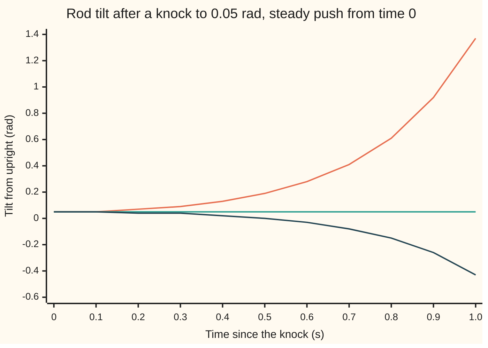

# State space: a list of internal numbers that steps forward, pushed by the input

[Syllabus](../../../SYLLABUS.md) → [Engineering mathematics](../README.md) → [State Space and Optimal Control](../README.md#s04) → State space

---

## General Overview

A cart runs on a straight rail. On top of it a rod 0.613125 m long stands upright on a hinge, like a broom balanced on a palm. A motor drives the cart, and its driver sets the cart's acceleration directly. A knock leaves the rod leaning 0.05 rad (2.864789°) and momentarily still. With the motor off it falls. The straight-line model built on this card says 0.188110 rad after half a second and 1.37 rad after one; the second figure is far past the few tenths of a radian where that model holds.

The engineer's question: **what steady push stands the rod back up in half a second, and where is everything at that moment?** Pushing the cart is the only way to move the rod, so the answer must cover both.

State space answers it by keeping a short list of numbers that together say everything about the rig right now: the cart's position, the cart's speed, the rod's tilt and the rod's tilt rate. That list is the **state**. Its rule of motion is one line: each number's rate of change is a fixed blend of the four numbers plus a share of the push. The solution has two parts: the start carried forward by the rig alone, plus every past push carried forward from the moment it acted.

For the knocked rod, the answer is a steady push of **0.668076 m/s²**. At 0.5 s the tilt is exactly zero and the cart has moved 0.083510 m at 0.334038 m/s. But the rod is still turning, at −0.262607 rad/s, and will fall the other way. The state shows this at once, because it carries the rate as well as the tilt. Balancing needs feedback, built on later cards from this same model.

**Write the plant as a list of state numbers whose rates are a matrix times the list plus a matrix times the input; then the state at any time is the matrix exponential applied to the start, plus every past input pushed forward by the same exponential and added up.**

**What kind of fact this is:** the solution formula is a theorem, proved on this card in Why it works. The cart-and-rod equations are a model: a straight-line version of the rod's true physics, good for small tilts, with its range tested in When it holds.

### The picture: the rod's tilt under three pushes



All three lines are the straight-line model of this card, which holds for a few tenths of a radian (When it holds); past that the true rod departs from them. Orange: motor off; the tilt grows like e^(4t). Green: a steady 0.4905 m/s², which holds the rod at its 0.05 rad lean, like a sprinter leaning into a start. Dark blue: the steady 0.668076 m/s² that brings the rod upright at 0.5 s; it carries on through zero and reaches −0.43 rad at 1 s.

---

## The formula

Notation first, in words. This card introduces four letters that the rest of the wing uses freely. The **state** $x$ is the list of internal numbers, a column vector. The **input** $u$ is what we command, here the cart's acceleration. The **output** $y$ is what a sensor reads, here the tilt from the encoder at the hinge. The four matrices $A$, $B$, $C$, $D$ say how they connect. A prime means rate of change with time.

$$x' = A\,x + B\,u, \qquad y = C\,x + D\,u$$

$$x(t) = e^{At}\,x(0) + \int_0^t e^{A(t-\tau)}\,B\,u(\tau)\,d\tau$$

**Read it aloud:** the state's rate is $A$ times the state plus $B$ times the input, and the sensor reads $C$ times the state plus $D$ times the input; the state at time $t$ is the start carried forward $t$ seconds, plus each earlier moment's input carried forward the $t - \tau$ seconds since it acted.

For the cart and rod, with the state $x = (p, v, \theta, \omega)$:

$$A = \begin{pmatrix} 0 & 1 & 0 & 0 \\ 0 & 0 & 0 & 0 \\ 0 & 0 & 0 & 1 \\ 0 & 0 & g/l & 0 \end{pmatrix}, \quad B = \begin{pmatrix} 0 \\ 1 \\ 0 \\ -1/l \end{pmatrix}, \quad C = \begin{pmatrix} 0 & 0 & 1 & 0 \end{pmatrix}, \quad D = 0$$

Row by row: position changes at the speed; speed changes at the commanded acceleration; tilt changes at the tilt rate; tilt rate changes by gravity tipping the rod further, $(g/l)\,\theta$, minus the push, which slides the hinge out from under the rod and tips it the other way, $u/l$.

The matrix exponential $e^{At}$ is the power series $I + At + (At)^2/2! + \cdots$, which carries any start forward $t$ seconds; [The matrix exponential](../../08-Differential%20equations%20and%20dynamics/04-Systems%20and%20the%20Matrix%20Exponential/04-the-matrix-exponential.md) defines and computes it. This card uses it.

| Symbol | Plain meaning | In our example | Push it up and the answer… |
| --- | --- | --- | --- |
| $x$, $x(0)$ | the state: the list that says everything about the rig now; its value at the start | $x(0) = (0, 0, 0.05, 0)$ | a bigger lean needs a bigger push, in proportion |
| $p$, $v$ | cart position along the rail, m; cart speed, m/s | 0.083510 m and 0.334038 m/s at 0.5 s | — |
| $\theta$, $\omega$ | rod tilt from upright, rad (theta); tilt rate, rad/s (omega) | 0.05 rad at the start; 0 and −0.262607 rad/s at 0.5 s | — |
| $u$ | input: the cart's commanded acceleration, m/s² | 0.668076 m/s², steady | the rod comes back sooner, and overshoots harder |
| $y$ | output: what the encoder reads, the tilt, rad | 0 at 0.5 s | — |
| $A$ | the rate matrix: how the state drives its own rates | entries 1, 1 and $g/l$ = 16 per s² | — |
| $B$ | the input matrix: where the push enters | $(0, 1, 0, -1/l)$, with $1/l$ = 1.630989 per m | — |
| $C$, $D$ | output matrices: which blend of state and input the sensor sees | $C$ picks the tilt; $D = 0$ | — |
| $g$, $l$ | gravity, 9.81 m/s²: the standard acceleration of gravity in NIST's CODATA tables, rounded to three figures; rod length, to its mass at the tip | 0.613125 m | longer $l$: slower fall, but each m/s² tips the rod less, so more push is needed |
| $t$, $\tau$, $\sigma$ | time now, s; an earlier moment when some input acted; a stretch of time inside an integral | $t$ = 0.5 s | — |
| $e^{At}$, $I$ | the matrix that carries a state forward $t$ seconds; the identity matrix | tilt entry 3.762196 at 0.5 s | — |
| $\Phi$, $\Gamma$, $\Delta t$, $k$; $G(s)$, $X$, $U$ | one clock tick: $\Phi = e^{A\Delta t}$, $\Gamma$ the input's effect over a tick, $\Delta t$ the tick, $k$ the tick number; the transfer function at rate $s$ per s, and the transforms of $x$ and $u$ | $\Delta t$ = 0.01 s; $G(5) = -0.181221$ rad per m/s² | — |

The rod's growth rate, $\sqrt{g/l} = \sqrt{16}$ = 4 per s, appears everywhere below. It is the rate at which an unwatched lean grows.

### When it holds

- **Small tilts.** The true rod obeys $l\,\theta'' = g\sin\theta - u\cos\theta$; the model replaces $\sin\theta$ by $\theta$ and $\cos\theta$ by 1. From 0.05 rad, the true rod given the 0.668076 m/s² push ends at 0.000147 rad instead of 0: the model is fine. Start at 0.5 rad (28.647890°) and the model's push, 6.680761 m/s², leaves the true rod at 0.153185 rad (8.776869°). Outside a few tenths of a radian the straight-line model is wrong; [Linearisation](02-linearisation-about-an-equilibrium.md) says how far it can be trusted.
- **Fixed matrices.** $A$ and $B$ must not change with time. A rod that telescopes mid-run, or a cart that picks up a load, needs a transition matrix that depends on both $t$ and $\tau$, not $e^{A(t-\tau)}$.
- **The input is what the motor delivers.** The model assumes the driver produces the commanded acceleration at once and without limit. A drive that lags needs one more state, its current; a drive that saturates is no longer linear, which is where [Predictive control](10-model-predictive-control.md) comes in.
- **The list is complete.** Four numbers are enough only if nothing else stores energy or drags: a flexing rod, a springy belt or hinge friction each change the model.
- **$D = 0$ is a fact about this sensor.** The encoder sees the tilt, not the push. An accelerometer on the cart would read $u$ directly and have $D \neq 0$.

---

## Why it works

### Step 0: memory lives in the state, and pieces add

A law of motion like "acceleration equals force over mass" needs two facts about the present, where the cart is and how fast it moves, before it can say anything about the future. Put both facts in the list, and the law becomes first order: each number's rate depends only on the list now and the push now. That is what makes the list a state. Nothing about the past matters except through it.

Then linearity does the rest. The response to a start plus a push is the response to the start alone plus the response to the push alone. And a push spread over time is a sum of tiny pushes, each one a small change of state at its own moment, which the rig then carries forward like any other start.

### Step 1: build A and B from the physics

The cart is simple: $p' = v$ and $v' = u$, because the driver sets the acceleration.

The rod is a mass at the end of a light stick of length $l$. Sit in the cart's frame. Gravity pulls the mass down, and the cart's acceleration $u$ feels like a force pushing it backwards. Taking the turning parts of both about the hinge gives $l\,\theta'' = g\sin\theta - u\cos\theta$. Near upright, $\sin\theta \approx \theta$ and $\cos\theta \approx 1$, so

$$\theta' = \omega, \qquad \omega' = \frac{g}{l}\,\theta - \frac{1}{l}\,u .$$

Stack the four equations and read off the coefficients: those of the state go in $A$, those of $u$ in $B$. The encoder reads $\theta$, so $C = (0, 0, 1, 0)$ and $D = 0$.

### Step 2: the rig alone, carried forward by e^(At)

With $u = 0$, the solution is $x(t) = e^{At}x(0)$, because the series for $e^{At}$ has derivative $A\,e^{At}$ and starts at $I$. For this $A$ the series sums in closed form. The cart's block is $\begin{pmatrix} 0 & 1 \\ 0 & 0 \end{pmatrix}$, whose square is zero, so the series stops: $\begin{pmatrix} 1 & t \\ 0 & 1 \end{pmatrix}$.

The rod's block squares to $g/l$ times the identity, so the even powers build $\cosh$ and the odd powers build $\sinh$. These are the hyperbolic cosine and sine, $\cosh 4t = (e^{4t} + e^{-4t})/2$ and $\sinh 4t = (e^{4t} - e^{-4t})/2$: the even and odd halves of the series for $e^{4t}$.

$$e^{At}\big|_{\text{rod}} = \begin{pmatrix} \cosh 4t & \tfrac14 \sinh 4t \\ 4\sinh 4t & \cosh 4t \end{pmatrix}$$

At $t$ = 0.5 s the entries are 3.762196, 0.906715 and 14.507442. The lean 0.05 rad becomes 0.188110 rad, turning at 0.725372 rad/s.

### Step 3: add every past input, each carried forward

Multiply $x' - Ax = Bu$ by $e^{-At}$. The left side is then exactly the derivative of $e^{-At}x$, by the product rule. Integrate from 0 to $t$ and multiply back by $e^{At}$:

$$x(t) = e^{At}x(0) + \int_0^t e^{A(t-\tau)}\,B\,u(\tau)\,d\tau .$$

The push at moment $\tau$ enters as the small change $B\,u(\tau)\,d\tau$ and is then carried forward by $e^{A(t-\tau)}$, the same machine that carries the start. [Forced systems](../../08-Differential%20equations%20and%20dynamics/04-Systems%20and%20the%20Matrix%20Exponential/06-forced-systems-and-variation-of-constants.md) proves this in full; the integral is a convolution, a running sum of past inputs each weighted by how long ago it acted, as in [Linear and time-invariant](../02-Linear%20Systems%20and%20Transforms/01-linear-time-invariant-systems-and-convolution.md).

### Step 4: a steady push, done by hand

For a steady $u$ the integral is $\int_0^t e^{A\sigma}\,d\sigma\;B\,u$. The cart's part gives the school formulas, $u t^2/2$ and $u t$. The rod's part integrates $\sinh$ and $\cosh$:

$$\theta_{\text{push}}(t) = -\frac{u}{l}\cdot\frac{\cosh 4t - 1}{16}, \qquad \omega_{\text{push}}(t) = -\frac{u}{l}\cdot\frac{\sinh 4t}{4} .$$

The tilt at time $t$ is $0.05\cosh 4t + \theta_{\text{push}}(t)$. Set it to zero and solve for $u$:

$$u = \frac{0.05\; g\, \cosh 4t}{\cosh 4t - 1} .$$

As $t$ grows, the fraction tends to 1 and $u$ tends to $0.05\,g$ = 0.4905 m/s², the push that only holds the lean.

### Step 5: the transfer function falls out

The Laplace transform turns a signal in time into a function of a rate $s$, and turns a rate of change into multiplication by $s$. Take it of $x' = Ax + Bu$ from rest: $sX = AX + BU$, so $X = (sI - A)^{-1}BU$ and

$$G(s) = C\,(sI - A)^{-1}B + D = \frac{-1/l}{s^2 - 16} .$$

This is the transfer function of [Transfer functions](../02-Linear%20Systems%20and%20Transforms/02-impulse-response-and-transfer-functions.md), from push to tilt. Its poles, ±4 per s, are eigenvalues of $A$ (the growth rates of $A$'s separate modes), and the one at +4 is the falling rod ([Poles and zeros](../02-Linear%20Systems%20and%20Transforms/03-poles-zeros-and-stability.md)). But $A$ has four eigenvalues, 4, 0, 0 and −4. The two at zero belong to the cart, which this $C$ never sees. State space keeps them; the transfer function drops them. At $s = 5$ both routes give −0.181221.

### Step 6: stepping forward one tick at a time

A computer updates the state on a clock. If the push is held flat over each tick of $\Delta t$, Step 3 over one tick gives an exact update with no approximation:

$$x_{k+1} = \Phi\,x_k + \Gamma\,u_k, \qquad \Phi = e^{A\Delta t}, \quad \Gamma = \int_0^{\Delta t} e^{A\sigma}\,d\sigma\;B .$$

At 100 Hz the tilt row of $\Phi$ is (1.000800, 0.010003), and $\Gamma$ puts 0.010000 m/s of speed and −0.000082 rad of tilt into each tick per 1 m/s². Fifty such steps land on the same state as the integral. This is the list of numbers that steps forward, pushed by the input, of the title. [Discretising a design](../02-Linear%20Systems%20and%20Transforms/09-zero-order-hold-and-tustin-discretisation.md) treats the held input in detail.

---

## Worked numbers, by hand

The rod starts at 0.05 rad, still; the cart starts still at 0. Find the steady push that zeroes the tilt at $t$ = 0.5 s.

| Step | Arithmetic | Value |
| --- | --- | --- |
| rod growth rate | $\sqrt{9.81 / 0.613125} = \sqrt{16}$ | 4 per s |
| rod entries of $e^{At}$ at 0.5 s | $\cosh 2$, $\tfrac14\sinh 2$, $4\sinh 2$ | 3.762196, 0.906715, 14.507442 |
| free tilt | 0.05 × 3.762196 | 0.188110 rad |
| free tilt rate | 0.05 × 14.507442 | 0.725372 rad/s |
| tilt per 1 m/s² of push | −(1.630989 / 16) × (3.762196 − 1) | −0.281569 rad |
| tilt rate per 1 m/s² | −1.630989 × 0.906715 | −1.478842 rad/s |
| push | 0.188110 / 0.281569 | **0.668076 m/s²** |
| cart position | 0.668076 × 0.5² / 2 | 0.083510 m |
| cart speed | 0.668076 × 0.5 | 0.334038 m/s |
| tilt rate at 0.5 s | 0.725372 − 0.668076 × 1.478842 | −0.262607 rad/s |

So a steady push of 0.668 m/s² stands the rod up in half a second while the cart travels 0.0835 m. The rod arrives turning at −0.263 rad/s, so it does not stay up.

### What breaks if you drop a piece

Each row is a slip in the method, with the tilt it predicts at 0.5 s under the 0.668076 m/s² push. The right answer is 0 rad.

| Mistake | Comes out at | What went wrong |
| --- | --- | --- |
| Drop the integral: only $e^{At}x(0)$ | 0.188110 rad | The push never enters; this is the motor-off answer |
| Deliver all 0.5 s of push as one kick at time 0, $e^{At}B\,u\,t$ | −0.305880 rad | Early pushes get the full 0.5 s to grow; each push must be carried forward only from its own moment |
| Exponentiate each entry of $At$ separately | 0.050000 rad | $e^{At}$ is a series of matrix powers, not $e$ of each entry; the rod never falls |
| Flip the sign of $B$'s rod entry | 0.376220 rad | The push tips the rod the wrong way and doubles the fall |
| Use the straight-line model from a 0.5 rad lean | 0.153185 rad left on the true rod | Outside small tilts, $\sin\theta \neq \theta$ |

---

## How it moves: the fall and the push, side by side

The puzzle: the push is steady, yet the tilt comes back slowly at first and fast at the end. The table splits the tilt into the rig's own part and the push's part.

| Time (s) | Free part (rad) | Push part (rad) | Tilt (rad) |
| --- | --- | --- | --- |
| 0.1 | 0.054054 | −0.005521 | 0.048532 |
| 0.2 | 0.066872 | −0.022980 | 0.043892 |
| 0.3 | 0.090533 | −0.055207 | 0.035326 |
| 0.4 | 0.128873 | −0.107428 | 0.021445 |
| 0.5 | 0.188110 | −0.188110 | 0.000000 |

The free part alone, the lean growing on its own:

```
t = 0.1 s  ███████████                              0.054054
t = 0.2 s  █████████████                            0.066872
t = 0.3 s  ██████████████████                       0.090533
t = 0.4 s  ██████████████████████████               0.128873
t = 0.5 s  ██████████████████████████████████████   0.188110
```

The push part alone, sign dropped:

```
t = 0.1 s  █                                        0.005521
t = 0.2 s  █████                                    0.022980
t = 0.3 s  ███████████                              0.055207
t = 0.4 s  ██████████████████████                   0.107428
t = 0.5 s  ██████████████████████████████████████   0.188110
```

The push part grows faster than the fall, because each bit of push is itself carried forward by $e^{A(t-\tau)}$: early pushes grow along with the lean they fight. The parts cancel at 0.5 s. The overview chart shows the sum and what follows: the push part keeps winning, and the rod falls the other way.

---

## Code, from first principles, and it actually runs

The script builds $A$, $B$, $C$, $D$ for the cart and rod and finds the state at 0.5 s by **four independent roads**: the closed form with $\cosh$ and $\sinh$ from Steps 2 and 4; the matrix exponential summed as a 60-term series with the convolution integral done by Simpson's rule over 200 slices; 50 exact clock ticks of $\Phi$ and $\Gamma$; and a plain RK4 integrator with 1 ms steps. RK4 is the classical fourth-order Runge–Kutta method, a standard way to step equations forward numerically. All four agree to $10^{-9}$. It also checks $G(5)$ by solving $(sI - A)z = B$ by elimination against the formula, and runs the true rod, with $\sin$ and $\cos$, to test the model's range, twice: at 1 ms and at 0.5 ms steps, which must agree to $10^{-6}$ rad.

### Python

```python
# State space: cart and pendulum, x' = Ax + Bu, y = Cx + Du.  Standard library only.
# Every number on the card is printed here.  Four roads to the state at 0.5 s:
# closed form (cosh, sinh), series e^(At) plus Simpson's rule, exact 100 Hz steps, RK4.
from math import cosh, sinh, sin, cos, exp, pi
g, l = 9.81, 0.613125                     # gravity m/s^2, rod length m
a, c = g / l, 1 / l                       # 16 per s^2, and 1.631 rad per m
w = a ** 0.5                              # 4 per s: the falling rod's growth rate
A = [[0, 1, 0, 0], [0, 0, 0, 0], [0, 0, 0, 1], [0, 0, a, 0]]   # state (p, v, theta, omega)
B = [0, 1, 0, -c]                         # input u: cart acceleration, m/s^2
C, D = [0, 0, 1, 0], 0                    # the encoder reads the tilt only
x0, T = [0, 0, 0.05, 0], 0.5              # start tilted 0.05 rad; read at 0.5 s
def mm(X, Y): return [[sum(X[i][k] * Y[k][j] for k in range(4)) for j in range(4)] for i in range(4)]
def mv(X, v): return [sum(X[i][k] * v[k] for k in range(4)) for i in range(4)]
def add(*vs): return [sum(z) for z in zip(*vs)]
def scale(s, v): return [s * z for z in v]
def series(t, shift=0):                   # shift 0: e^(At); shift 1: integral of e^(As) ds, 0..t
    S = [[(t if shift else 1.0) * (i == j) for j in range(4)] for i in range(4)]
    term = [r[:] for r in S]
    for k in range(1, 60):
        term = [[z * t / (k + shift) for z in r] for r in mm(term, A)]
        S = [[S[i][j] + term[i][j] for j in range(4)] for i in range(4)]
    return S
def closed(t, x, u, sign=1):              # road 1: e^(At) by blocks, convolution done by hand
    ch, sh = cosh(w * t), sinh(w * t)
    free = [x[0] + t * x[1], x[1], ch * x[2] + sh / w * x[3], w * sh * x[2] + ch * x[3]]
    forced = [u * t * t / 2, u * t, -sign * c * u * (ch - 1) / a, -sign * c * u * sh / w]
    return free, forced
def simpson(t, x, u, n=200):              # road 2: the formula itself, integral by Simpson's rule
    h, acc = t / n, [0.0] * 4
    for i in range(n + 1):
        w = 1 if i in (0, n) else (4 if i % 2 else 2)
        acc = add(acc, scale(w * h / 3 * u, mv(series(t - i * h), B)))
    return add(mv(series(t), x), acc)
def stepped(t, x, u, dt=0.01):            # road 3: exact 100 Hz steps, x_{k+1} = Phi x_k + Gam u
    Phi, Gam = series(dt), mv(series(dt, 1), B)
    for _ in range(round(t / dt)): x = add(mv(Phi, x), scale(u, Gam))
    return x
def rk4(f, t, x, dt=0.001):               # road 4: a plain numerical integrator
    for _ in range(round(t / dt)):
        k1 = f(x); k2 = f(add(x, scale(dt / 2, k1))); k3 = f(add(x, scale(dt / 2, k2))); k4 = f(add(x, scale(dt, k3)))
        x = add(x, scale(dt / 6, add(k1, scale(2, k2), scale(2, k3), k4)))
    return x
lin = lambda u: (lambda x: add(mv(A, x), scale(u, B)))
nonlin = lambda u: (lambda x: [x[1], u, x[3], (g * sin(x[2]) - u * cos(x[2])) / l])
def solve(M, b):                          # Gaussian elimination, for G(s) = C (sI - A)^-1 B + D
    M = [r[:] + [b[i]] for i, r in enumerate(M)]
    for i in range(4):
        p = max(range(i, 4), key=lambda r: abs(M[r][i])); M[i], M[p] = M[p], M[i]
        for r in range(4):
            if r != i: M[r] = [M[r][j] - M[r][i] / M[i][i] * M[i][j] for j in range(5)]
    return [M[i][4] / M[i][i] for i in range(4)]
def push_for(t, th0, rod=l):              # constant push that brings the tilt to 0 at time t
    ch = cosh(t * (g / rod) ** 0.5)
    return th0 * g * ch / (ch - 1)
def row(name, v): print(f"{name:<38}" + "".join(f"{z if abs(z) > 5e-7 else 0.0:>11.6f}" for z in v))
E = series(T)
row("g/l, 1/l, rate; degrees 0.05, 0.5 rad", [a, c, w, 0.05 * 180 / pi, 0.5 * 180 / pi])
row("e^(At) at 0.5 s, tilt rows", E[2][2:] + E[3][2:])
row("  closed form cosh, sinh/4, 4 sinh", [cosh(2), sinh(2) / 4, 4 * sinh(2)])
free, per = closed(T, x0, 1.0)
row("free part (p, v, tilt, rate)", free)
row("forced part per 1 m/s^2", per)
u = -free[2] / per[2]
row("push u that zeroes tilt at 0.5 s", [u, push_for(T, 0.05)])
r1 = add(*closed(T, x0, u)); r2 = simpson(T, x0, u); r3 = stepped(T, x0, u); r4 = rk4(lin(u), T, x0)
for name, r in [("1 closed form", r1), ("2 series + Simpson", r2), ("3 exact 100 Hz steps", r3), ("4 RK4, 1 ms", r4)]:
    row(name, r)
for r in (r2, r3, r4): assert max(abs(p - q) for p, q in zip(r, r1)) < 1e-9
assert abs(u - push_for(T, 0.05)) < 1e-12
y = sum(ci * xi for ci, xi in zip(C, r1)) + D * u
Phi, Gam = series(0.01), mv(series(0.01, 1), B)
row("encoder y at 0.5 s; hold push g*tilt", [y, a * 0.05 / c])
row("one 0.01 s step: Phi tilt row, Gamma", Phi[2][2:] + [Gam[1], Gam[2]])
s = 5.0
Gs = sum(ci * xi for ci, xi in zip(C, solve([[s * (i == j) - A[i][j] for j in range(4)] for i in range(4)], B))) + D
row("G(5): by (sI-A)^-1, by -c/(s^2-16)", [Gs, -c / (s * s - 16)])
assert abs(Gs + c / (s * s - 16)) < 1e-12
nl = rk4(nonlin(u), T, x0)
row("nonlinear rod, same push, 0.5 s", nl)
big = rk4(nonlin(push_for(T, 0.5)), T, [0, 0, 0.5, 0])
row("start 0.5 rad: linear push, rod tilt", [push_for(T, 0.5), big[2], big[2] * 180 / pi])
assert abs(nl[2]) < 0.001 and big[2] > 0.1           # second road for both: the same runs at half the step
assert abs(rk4(nonlin(u), T, x0, 0.0005)[2] - nl[2]) < 1e-6 and abs(rk4(nonlin(push_for(T, 0.5)), T, [0, 0, 0.5, 0], 0.0005)[2] - big[2]) < 1e-6
# ---- what breaks ----
f2, p2 = closed(T, x0, u, sign=-1)
lump = mv(E, scale(u * T, B))             # all 0.5 s of push delivered as one kick at t = 0
ew = [[exp(A[i][j] * T) for j in range(4)] for i in range(4)]
row("wrong: no convolution term", [free[2]])
row("wrong: whole push as a kick at 0", [free[2] + lump[2]])
row("wrong: e^(a_ij t) entry by entry", [mv(ew, x0)[2]])
row("wrong: B sign flipped", [f2[2] + p2[2]])
assert abs(free[2] + lump[2] - r2[2]) > 0.1 and abs(f2[2] + p2[2] - r4[2]) > 0.1
# ---- how it moves, and the chart ----
for tt in [0.1, 0.2, 0.3, 0.4, 0.5]:
    fr, fo = closed(tt, x0, u)
    row(f"t={tt:.1f}: free, forced, total tilt", [fr[2], fo[2], fr[2] + fo[2]])
grid = [k / 10 for k in range(11)]
for name, uu in [("chart, motor off", 0.0), ("chart, hold push", a * 0.05 / c), ("chart, push u", u)]:
    print(name.ljust(17) + "".join(f"{add(*closed(tt, x0, uu))[2]:7.2f}" for tt in grid))
# ---- try changing ----
row("try: tilt 0.1; by 0.25 s; by 1 s", [push_for(T, 0.1), push_for(0.25, 0.05), push_for(1.0, 0.05)])
row("try: rod 1.2 m", [push_for(T, 0.05, 1.2)])
print("ALL CHECKS PASS")
```

**Ran 2026-11-11 on macOS, Python 3.14.10, standard library only. All checks passed. Output, pasted from the run:**

```
g/l, 1/l, rate; degrees 0.05, 0.5 rad   16.000000   1.630989   4.000000   2.864789  28.647890
e^(At) at 0.5 s, tilt rows               3.762196   0.906715  14.507442   3.762196
  closed form cosh, sinh/4, 4 sinh       3.762196   0.906715  14.507442
free part (p, v, tilt, rate)             0.000000   0.000000   0.188110   0.725372
forced part per 1 m/s^2                  0.125000   0.500000  -0.281569  -1.478842
push u that zeroes tilt at 0.5 s         0.668076   0.668076
1 closed form                            0.083510   0.334038   0.000000  -0.262607
2 series + Simpson                       0.083510   0.334038   0.000000  -0.262607
3 exact 100 Hz steps                     0.083510   0.334038   0.000000  -0.262607
4 RK4, 1 ms                              0.083510   0.334038   0.000000  -0.262607
encoder y at 0.5 s; hold push g*tilt     0.000000   0.490500
one 0.01 s step: Phi tilt row, Gamma     1.000800   0.010003   0.010000  -0.000082
G(5): by (sI-A)^-1, by -c/(s^2-16)      -0.181221  -0.181221
nonlinear rod, same push, 0.5 s          0.083510   0.334038   0.000147  -0.261925
start 0.5 rad: linear push, rod tilt     6.680761   0.153185   8.776869
wrong: no convolution term               0.188110
wrong: whole push as a kick at 0        -0.305880
wrong: e^(a_ij t) entry by entry         0.050000
wrong: B sign flipped                    0.376220
t=0.1: free, forced, total tilt          0.054054  -0.005521   0.048532
t=0.2: free, forced, total tilt          0.066872  -0.022980   0.043892
t=0.3: free, forced, total tilt          0.090533  -0.055207   0.035326
t=0.4: free, forced, total tilt          0.128873  -0.107428   0.021445
t=0.5: free, forced, total tilt          0.188110  -0.188110   0.000000
chart, motor off    0.05   0.05   0.07   0.09   0.13   0.19   0.28   0.41   0.61   0.92   1.37
chart, hold push    0.05   0.05   0.05   0.05   0.05   0.05   0.05   0.05   0.05   0.05   0.05
chart, push u       0.05   0.05   0.04   0.04   0.02   0.00  -0.03  -0.08  -0.15  -0.26  -0.43
try: tilt 0.1; by 0.25 s; by 1 s         1.336152   1.393681   0.509144
try: rod 1.2 m                           0.896472
ALL CHECKS PASS
```

### Rust

```rust
// State space: cart and pendulum, x' = Ax + Bu, y = Cx + Du.  std only, no crates.
// Every number on the card is printed here.  Four roads to the state at 0.5 s:
// closed form (cosh, sinh), series e^(At) plus Simpson's rule, exact 100 Hz steps, RK4.
type V = [f64; 4];
type M = [[f64; 4]; 4];
const G: f64 = 9.81; // gravity, m/s^2
const L: f64 = 0.613125; // rod length, m
const C: V = [0.0, 0.0, 1.0, 0.0]; // the encoder reads the tilt only
const D: f64 = 0.0;
const T: f64 = 0.5; // read the state at 0.5 s

fn a() -> f64 { G / L } // 16 per s^2
fn c() -> f64 { 1.0 / L } // 1.631 rad per m
fn w() -> f64 { a().sqrt() } // 4 per s: the falling rod's growth rate
fn am() -> M { [[0.0, 1.0, 0.0, 0.0], [0.0; 4], [0.0, 0.0, 0.0, 1.0], [0.0, 0.0, a(), 0.0]] }
fn bv() -> V { [0.0, 1.0, 0.0, -c()] } // input u: cart acceleration, m/s^2
fn mm(x: &M, y: &M) -> M {
    let mut r = [[0.0; 4]; 4];
    for i in 0..4 { for j in 0..4 { for k in 0..4 { r[i][j] += x[i][k] * y[k][j]; } } }
    r
}
fn mv(x: &M, v: &V) -> V {
    let mut r = [0.0; 4];
    for i in 0..4 { for k in 0..4 { r[i] += x[i][k] * v[k]; } }
    r
}
fn add(p: &V, q: &V) -> V { [p[0] + q[0], p[1] + q[1], p[2] + q[2], p[3] + q[3]] }
fn scale(s: f64, v: &V) -> V { [s * v[0], s * v[1], s * v[2], s * v[3]] }
// shift 0: e^(At); shift 1: integral of e^(As) ds from 0 to t
fn series(t: f64, shift: usize) -> M {
    let d = if shift == 1 { t } else { 1.0 };
    let mut s = [[0.0; 4]; 4];
    for i in 0..4 { s[i][i] = d; }
    let mut term = s;
    for k in 1..60 {
        term = mm(&term, &am());
        for i in 0..4 { for j in 0..4 { term[i][j] *= t / (k + shift) as f64; s[i][j] += term[i][j]; } }
    }
    s
}
// road 1: e^(At) by blocks, convolution done by hand; returns (free, forced)
fn closed(t: f64, x: &V, u: f64, sign: f64) -> (V, V) {
    let (ch, sh) = ((w() * t).cosh(), (w() * t).sinh());
    let free = [x[0] + t * x[1], x[1], ch * x[2] + sh / w() * x[3], w() * sh * x[2] + ch * x[3]];
    let forced = [u * t * t / 2.0, u * t, -sign * c() * u * (ch - 1.0) / a(), -sign * c() * u * sh / w()];
    (free, forced)
}
// road 2: the formula itself, integral by Simpson's rule
fn simpson(t: f64, x: &V, u: f64) -> V {
    let n = 200;
    let h = t / n as f64;
    let mut acc = [0.0; 4];
    for i in 0..=n {
        let wt = if i == 0 || i == n { 1.0 } else if i % 2 == 1 { 4.0 } else { 2.0 };
        acc = add(&acc, &scale(wt * h / 3.0 * u, &mv(&series(t - i as f64 * h, 0), &bv())));
    }
    add(&mv(&series(t, 0), x), &acc)
}
// road 3: exact 100 Hz steps, x_{k+1} = Phi x_k + Gam u
fn stepped(t: f64, x0: &V, u: f64) -> V {
    let dt = 0.01;
    let (phi, gam) = (series(dt, 0), mv(&series(dt, 1), &bv()));
    let mut x = *x0;
    for _ in 0..(t / dt).round() as usize { x = add(&mv(&phi, &x), &scale(u, &gam)); }
    x
}
fn f_lin(x: &V, u: f64) -> V { add(&mv(&am(), x), &scale(u, &bv())) }
fn f_non(x: &V, u: f64) -> V { [x[1], u, x[3], (G * x[2].sin() - u * x[2].cos()) / L] }
// road 4: a plain numerical integrator
fn rk4(f: fn(&V, f64) -> V, u: f64, t: f64, x0: &V, dt: f64) -> V {
    let mut x = *x0;
    for _ in 0..(t / dt).round() as usize {
        let k1 = f(&x, u);
        let k2 = f(&add(&x, &scale(dt / 2.0, &k1)), u);
        let k3 = f(&add(&x, &scale(dt / 2.0, &k2)), u);
        let k4 = f(&add(&x, &scale(dt, &k3)), u);
        let sum = add(&add(&k1, &scale(2.0, &k2)), &add(&scale(2.0, &k3), &k4));
        x = add(&x, &scale(dt / 6.0, &sum));
    }
    x
}
// Gaussian elimination, for G(s) = C (sI - A)^-1 B + D
fn solve(m0: &M, b: &V) -> V {
    let mut m = [[0.0; 5]; 4];
    for i in 0..4 { for j in 0..4 { m[i][j] = m0[i][j]; } m[i][4] = b[i]; }
    for i in 0..4 {
        let mut p = i;
        for r in i..4 { if m[r][i].abs() > m[p][i].abs() { p = r; } }
        m.swap(i, p);
        for r in 0..4 {
            if r != i { let f = m[r][i] / m[i][i]; for j in 0..5 { m[r][j] -= f * m[i][j]; } }
        }
    }
    [m[0][4] / m[0][0], m[1][4] / m[1][1], m[2][4] / m[2][2], m[3][4] / m[3][3]]
}
// constant push that brings the tilt to 0 at time t
fn push_for(t: f64, th0: f64, rod: f64) -> f64 {
    let ch = (t * (G / rod).sqrt()).cosh();
    th0 * G * ch / (ch - 1.0)
}
fn row(name: &str, v: &[f64]) {
    let mut s = format!("{:<38}", name);
    for &z in v { s += &format!("{:>11.6}", if z.abs() > 5e-7 { z } else { 0.0 }); }
    println!("{}", s);
}
fn dot(p: &V, q: &V) -> f64 { (0..4).map(|i| p[i] * q[i]).sum() }

fn main() {
    let x0: V = [0.0, 0.0, 0.05, 0.0];
    let e = series(T, 0);
    row("g/l, 1/l, rate; degrees 0.05, 0.5 rad", &[a(), c(), w(), 0.05f64.to_degrees(), 0.5f64.to_degrees()]);
    row("e^(At) at 0.5 s, tilt rows", &[e[2][2], e[2][3], e[3][2], e[3][3]]);
    row("  closed form cosh, sinh/4, 4 sinh", &[2f64.cosh(), 2f64.sinh() / 4.0, 4.0 * 2f64.sinh()]);
    let (free, per) = closed(T, &x0, 1.0, 1.0);
    row("free part (p, v, tilt, rate)", &free);
    row("forced part per 1 m/s^2", &per);
    let u = -free[2] / per[2];
    row("push u that zeroes tilt at 0.5 s", &[u, push_for(T, 0.05, L)]);
    let (fr, fo) = closed(T, &x0, u, 1.0);
    let r1 = add(&fr, &fo);
    let (r2, r3, r4) = (simpson(T, &x0, u), stepped(T, &x0, u), rk4(f_lin, u, T, &x0, 0.001));
    for (name, r) in [("1 closed form", r1), ("2 series + Simpson", r2), ("3 exact 100 Hz steps", r3), ("4 RK4, 1 ms", r4)] {
        row(name, &r);
    }
    for r in [r2, r3, r4] { assert!((0..4).all(|i| (r[i] - r1[i]).abs() < 1e-9)); }
    assert!((u - push_for(T, 0.05, L)).abs() < 1e-12);
    let y = dot(&C, &r1) + D * u;
    let (phi, gam) = (series(0.01, 0), mv(&series(0.01, 1), &bv()));
    row("encoder y at 0.5 s; hold push g*tilt", &[y, a() * 0.05 / c()]);
    row("one 0.01 s step: Phi tilt row, Gamma", &[phi[2][2], phi[2][3], gam[1], gam[2]]);
    let s = 5.0;
    let mut sia = [[0.0; 4]; 4];
    for i in 0..4 { for j in 0..4 { sia[i][j] = if i == j { s } else { 0.0 } - am()[i][j]; } }
    let gs = dot(&C, &solve(&sia, &bv())) + D;
    row("G(5): by (sI-A)^-1, by -c/(s^2-16)", &[gs, -c() / (s * s - 16.0)]);
    assert!((gs + c() / (s * s - 16.0)).abs() < 1e-12);
    let nl = rk4(f_non, u, T, &x0, 0.001);
    row("nonlinear rod, same push, 0.5 s", &nl);
    let big = rk4(f_non, push_for(T, 0.5, L), T, &[0.0, 0.0, 0.5, 0.0], 0.001);
    row("start 0.5 rad: linear push, rod tilt", &[push_for(T, 0.5, L), big[2], big[2].to_degrees()]);
    assert!(nl[2].abs() < 0.001 && big[2] > 0.1); // second road for both: the same runs at half the step
    assert!((rk4(f_non, u, T, &x0, 0.0005)[2] - nl[2]).abs() < 1e-6 && (rk4(f_non, push_for(T, 0.5, L), T, &[0.0, 0.0, 0.5, 0.0], 0.0005)[2] - big[2]).abs() < 1e-6);
    // ---- what breaks ----
    let (f2, p2) = closed(T, &x0, u, -1.0);
    let lump = mv(&e, &scale(u * T, &bv())); // all 0.5 s of push delivered as one kick at t = 0
    let mut ew = [[0.0; 4]; 4];
    for i in 0..4 { for j in 0..4 { ew[i][j] = (am()[i][j] * T).exp(); } }
    row("wrong: no convolution term", &[free[2]]);
    row("wrong: whole push as a kick at 0", &[free[2] + lump[2]]);
    row("wrong: e^(a_ij t) entry by entry", &[mv(&ew, &x0)[2]]);
    row("wrong: B sign flipped", &[f2[2] + p2[2]]);
    assert!((free[2] + lump[2] - r2[2]).abs() > 0.1 && (f2[2] + p2[2] - r4[2]).abs() > 0.1);
    // ---- how it moves, and the chart ----
    for tt in [0.1, 0.2, 0.3, 0.4, 0.5] {
        let (fr, fo) = closed(tt, &x0, u, 1.0);
        row(&format!("t={:.1}: free, forced, total tilt", tt), &[fr[2], fo[2], fr[2] + fo[2]]);
    }
    for (name, uu) in [("chart, motor off", 0.0), ("chart, hold push", a() * 0.05 / c()), ("chart, push u", u)] {
        let mut line = format!("{:<17}", name);
        for k in 0..11 {
            let (fr, fo) = closed(k as f64 / 10.0, &x0, uu, 1.0);
            line += &format!("{:>7.2}", fr[2] + fo[2]);
        }
        println!("{}", line);
    }
    // ---- try changing ----
    row("try: tilt 0.1; by 0.25 s; by 1 s", &[push_for(T, 0.1, L), push_for(0.25, 0.05, L), push_for(1.0, 0.05, L)]);
    row("try: rod 1.2 m", &[push_for(T, 0.05, 1.2)]);
    println!("ALL CHECKS PASS");
}
```

**Ran 2026-11-11 on macOS, rustc 1.98.1, no crates. All checks passed. Output, pasted from the run:**

```
g/l, 1/l, rate; degrees 0.05, 0.5 rad   16.000000   1.630989   4.000000   2.864789  28.647890
e^(At) at 0.5 s, tilt rows               3.762196   0.906715  14.507442   3.762196
  closed form cosh, sinh/4, 4 sinh       3.762196   0.906715  14.507442
free part (p, v, tilt, rate)             0.000000   0.000000   0.188110   0.725372
forced part per 1 m/s^2                  0.125000   0.500000  -0.281569  -1.478842
push u that zeroes tilt at 0.5 s         0.668076   0.668076
1 closed form                            0.083510   0.334038   0.000000  -0.262607
2 series + Simpson                       0.083510   0.334038   0.000000  -0.262607
3 exact 100 Hz steps                     0.083510   0.334038   0.000000  -0.262607
4 RK4, 1 ms                              0.083510   0.334038   0.000000  -0.262607
encoder y at 0.5 s; hold push g*tilt     0.000000   0.490500
one 0.01 s step: Phi tilt row, Gamma     1.000800   0.010003   0.010000  -0.000082
G(5): by (sI-A)^-1, by -c/(s^2-16)      -0.181221  -0.181221
nonlinear rod, same push, 0.5 s          0.083510   0.334038   0.000147  -0.261925
start 0.5 rad: linear push, rod tilt     6.680761   0.153185   8.776869
wrong: no convolution term               0.188110
wrong: whole push as a kick at 0        -0.305880
wrong: e^(a_ij t) entry by entry         0.050000
wrong: B sign flipped                    0.376220
t=0.1: free, forced, total tilt          0.054054  -0.005521   0.048532
t=0.2: free, forced, total tilt          0.066872  -0.022980   0.043892
t=0.3: free, forced, total tilt          0.090533  -0.055207   0.035326
t=0.4: free, forced, total tilt          0.128873  -0.107428   0.021445
t=0.5: free, forced, total tilt          0.188110  -0.188110   0.000000
chart, motor off    0.05   0.05   0.07   0.09   0.13   0.19   0.28   0.41   0.61   0.92   1.37
chart, hold push    0.05   0.05   0.05   0.05   0.05   0.05   0.05   0.05   0.05   0.05   0.05
chart, push u       0.05   0.05   0.04   0.04   0.02   0.00  -0.03  -0.08  -0.15  -0.26  -0.43
try: tilt 0.1; by 0.25 s; by 1 s         1.336152   1.393681   0.509144
try: rod 1.2 m                           0.896472
ALL CHECKS PASS
```

The two outputs are identical, line for line.

### Lean

Lean proves the solution formula for any fixed $A$ and $B$, and the cart and rod's $e^{At}$ and transfer function.

- Take fixed matrices $A$ and $B$, a continuous input $u$, and a state obeying $x' = Ax + Bu$. Then at every time $t$, $x(t)$ equals the solution formula above.
- Take gravity $g > 0$ and rod length $l > 0$. Then the cart and rod's $e^{At}$ is the $\cosh$ and $\sinh$ matrix of Step 2, with rate $\sqrt{g/l}$.
- Take the same $g$ and $l$, and a rate $s$ with $s \neq 0$ and $s^2 \neq g/l$. Then $G(s) = C(sI - A)^{-1}B + D = (-1/l)/(s^2 - g/l)$.
- $g/l$ = 9.81 / 0.613125 is exactly 16, and $\sqrt{16}$ = 4 per s.
- The cart's block squares to zero, and the rod's block squares to 16 times the identity.
- The push that only holds the lean is 0.05 × 9.81 = 0.4905 m/s².
- Per 1 m/s² of push over 0.5 s, the cart moves 0.125 m and gains 0.5 m/s.

The decimals, the push that stands the rod up, the true rod and the clock tick are left to the Python and Rust checks.

```lean
-- State space: for constant matrices A and B and a continuous input u, every solution of x' = Ax + Bu satisfies x(t) = e^(At)x(0) + ∫₀ᵗ e^(A(t−τ)) B u(τ) dτ; for the cart and rod, e^(At) is the cosh and sinh matrix and the push-to-tilt transfer function is (−1/l)/(s² − g/l).
import Mathlib.Analysis.Normed.Algebra.MatrixExponential
import Mathlib.Analysis.SpecialFunctions.Exponential
import Mathlib.Analysis.SpecialFunctions.Trigonometric.DerivHyp
import Mathlib.Analysis.SpecialFunctions.Pow.Real
import Mathlib.Analysis.Calculus.Deriv.Pi
import Mathlib.MeasureTheory.Integral.IntervalIntegral.Basic
import Mathlib.LinearAlgebra.Matrix.NonsingularInverse
import Mathlib.Analysis.Matrix.Normed
import Mathlib.Analysis.Calculus.Deriv.Prod
import Mathlib.MeasureTheory.Integral.IntervalIntegral.FundThmCalculus
import Mathlib.Tactic

open Matrix

/-! The state `x t` is a vector in `Fin n → ℝ`, the input `u t` a vector in `Fin m → ℝ`.
The rate matrix `A` (n × n) and the input matrix `B` (n × m) are constant real matrices,
and `M *ᵥ v` is the matrix `M` applied to the vector `v`. The matrix `e^(At)` is Mathlib's
matrix exponential `NormedSpace.exp (t • A)`, the series `I + At + (At)²/2! + ⋯`.
The rule of motion `x' = Ax + Bu` is `∀ t, HasDerivAt x (A *ᵥ x t + B *ᵥ u t) t`. The input
is taken continuous, so the integral of past inputs is an ordinary integral. -/

set_option backward.isDefEq.respectTransparency false in
theorem exp_smul_entry_hasDerivAt {n : ℕ} (A : Matrix (Fin n) (Fin n) ℝ) (r : ℝ) (i j : Fin n) :
    HasDerivAt (fun r : ℝ => NormedSpace.exp (r • A) i j)
      ((NormedSpace.exp (r • A) * A) i j) r := by
  open scoped Matrix.Norms.Operator in
  have h := hasDerivAt_exp_smul_const (𝕂 := ℝ) A r
  open scoped Matrix.Norms.Operator in
  let L : Matrix (Fin n) (Fin n) ℝ →L[ℝ] ℝ :=
    LinearMap.toContinuousLinearMap (Matrix.entryLinearMap ℝ ℝ i j)
  open scoped Matrix.Norms.Operator in
  exact L.hasFDerivAt.comp_hasDerivAt r h


theorem exp_smul_continuous {n : ℕ} (A : Matrix (Fin n) (Fin n) ℝ) :
    Continuous (fun r : ℝ => NormedSpace.exp (r • A)) :=
  continuous_pi fun i => continuous_pi fun j =>
    continuous_iff_continuousAt.2 fun r => (exp_smul_entry_hasDerivAt A r i j).continuousAt

theorem variation_of_constants {n : ℕ} (A : Matrix (Fin n) (Fin n) ℝ) (f : ℝ → Fin n → ℝ)
    (hf : Continuous f) (x : ℝ → Fin n → ℝ)
    (hx : ∀ s, HasDerivAt x (A *ᵥ x s + f s) s) (t : ℝ) :
    x t = NormedSpace.exp (t • A) *ᵥ x 0 +
      ∫ τ in (0 : ℝ)..t, NormedSpace.exp ((t - τ) • A) *ᵥ f τ := by
  have hz : ∀ s, HasDerivAt (fun s => NormedSpace.exp ((t - s) • A) *ᵥ x s)
      (NormedSpace.exp ((t - s) • A) *ᵥ f s) s := by
    intro s
    rw [hasDerivAt_pi]
    intro i
    have hE : ∀ j, HasDerivAt (fun s => NormedSpace.exp ((t - s) • A) i j)
        ((NormedSpace.exp ((t - s) • A) * A) i j * (-1)) s := fun j =>
      (exp_smul_entry_hasDerivAt A (t - s) i j).comp s ((hasDerivAt_id s).const_sub t)
    have hX : ∀ j, HasDerivAt (fun s => x s j) ((A *ᵥ x s + f s) j) s := fun j =>
      (hasDerivAt_pi.1 (hx s)) j
    have hsum : HasDerivAt (fun s => ∑ j, NormedSpace.exp ((t - s) • A) i j * x s j)
        (∑ j, ((NormedSpace.exp ((t - s) • A) * A) i j * (-1) * x s j +
          NormedSpace.exp ((t - s) • A) i j * (A *ᵥ x s + f s) j)) s :=
      HasDerivAt.fun_sum (u := Finset.univ) (fun j _ => (hE j).mul (hX j))
    refine hsum.congr_deriv ?_
    have key : -((NormedSpace.exp ((t - s) • A) * A) *ᵥ x s) +
        NormedSpace.exp ((t - s) • A) *ᵥ (A *ᵥ x s + f s) =
        NormedSpace.exp ((t - s) • A) *ᵥ f s := by
      rw [mulVec_add, ← mulVec_mulVec]; abel
    rw [← key]
    simp only [Pi.add_apply, Pi.neg_apply, mulVec, dotProduct, ← Finset.sum_neg_distrib,
      ← Finset.sum_add_distrib]
    exact Finset.sum_congr rfl fun j _ => by ring
  have hcont : Continuous (fun s => NormedSpace.exp ((t - s) • A) *ᵥ f s) :=
    Continuous.matrix_mulVec ((exp_smul_continuous A).comp (continuous_const.sub continuous_id)) hf
  have hftc := intervalIntegral.integral_eq_sub_of_hasDerivAt (a := 0) (b := t)
    (fun s _ => hz s) (hcont.intervalIntegrable _ _)
  rw [hftc]
  simp [NormedSpace.exp_zero]


theorem cart_rod_exp_of_rate (w t : ℝ) (hw : w ≠ 0) :
    NormedSpace.exp (t • !![0, 1, 0, 0;
                             0, 0, 0, 0;
                             0, 0, 0, 1;
                             0, 0, w * w, 0]) =
      !![1, t, 0, 0;
         0, 1, 0, 0;
         0, 0, Real.cosh (w * t), Real.sinh (w * t) / w;
         0, 0, w * Real.sinh (w * t), Real.cosh (w * t)] := by
  set A : Matrix (Fin 4) (Fin 4) ℝ := !![0, 1, 0, 0; 0, 0, 0, 0; 0, 0, 0, 1; 0, 0, w * w, 0] with hA
  set G : ℝ → Matrix (Fin 4) (Fin 4) ℝ := fun s => !![1, s, 0, 0;
         0, 1, 0, 0;
         0, 0, Real.cosh (w * s), Real.sinh (w * s) / w;
         0, 0, w * Real.sinh (w * s), Real.cosh (w * s)] with hG
  show NormedSpace.exp (t • A) = G t
  have hc : ∀ s, HasDerivAt (fun s => Real.cosh (w * s)) (Real.sinh (w * s) * w) s := fun s => by
    simpa using ((hasDerivAt_id s).const_mul w).cosh
  have hs : ∀ s, HasDerivAt (fun s => Real.sinh (w * s)) (Real.cosh (w * s) * w) s := fun s => by
    simpa using ((hasDerivAt_id s).const_mul w).sinh
  ext i j
  have hcol := variation_of_constants A (fun _ => 0) continuous_const (fun s k => G s k j) (by
    intro s
    rw [hasDerivAt_pi]
    intro k
    fin_cases j <;> fin_cases k <;> simp [hG, hA, mulVec, dotProduct]
    · exact hasDerivAt_const s 1
    · exact hasDerivAt_const s 0
    · exact hasDerivAt_const s 0
    · exact hasDerivAt_const s 0
    · exact hasDerivAt_id s
    · exact hasDerivAt_const s 1
    · exact hasDerivAt_const s 0
    · exact hasDerivAt_const s 0
    · exact hasDerivAt_const s 0
    · exact hasDerivAt_const s 0
    · exact (hc s).congr_deriv (by ring)
    · exact ((hs s).const_mul w).congr_deriv (by ring)
    · exact hasDerivAt_const s 0
    · exact hasDerivAt_const s 0
    · exact ((hs s).div_const w).congr_deriv (by field_simp)
    · exact (hc s).congr_deriv (by field_simp)) t
  simp only [mulVec_zero, intervalIntegral.integral_zero, add_zero] at hcol
  rw [show G t i j = (fun k => G t k j) i from rfl, hcol]
  fin_cases i <;> fin_cases j <;> simp [hG, mulVec, dotProduct, Fin.sum_univ_four]

#print axioms exp_smul_entry_hasDerivAt
#print axioms exp_smul_continuous
#print axioms variation_of_constants
#print axioms cart_rod_exp_of_rate

/-- **The state is the start carried forward plus every past input carried forward.** Let the
rate matrix `A` and the input matrix `B` be fixed (they do not change with time), and let the
input `u` be continuous. If the state `x` obeys `x' = Ax + Bu`, then at every time `t` the
state is `x(t) = e^(At) x(0) + ∫₀ᵗ e^(A(t−τ)) B u(τ) dτ`. -/
theorem state_is_start_carried_forward_plus_past_inputs
    {n m : ℕ} (A : Matrix (Fin n) (Fin n) ℝ) (B : Matrix (Fin n) (Fin m) ℝ)
    (u : ℝ → Fin m → ℝ) (hu : Continuous u) (x : ℝ → Fin n → ℝ)
    (hx : ∀ t, HasDerivAt x (A *ᵥ x t + B *ᵥ u t) t) :
    ∀ t, x t = NormedSpace.exp (t • A) *ᵥ x 0 +
      ∫ τ in (0 : ℝ)..t, NormedSpace.exp ((t - τ) • A) *ᵥ (B *ᵥ u τ) := by
  intro t
  exact variation_of_constants A (fun τ => B *ᵥ u τ)
    (Continuous.matrix_mulVec continuous_const hu) x hx t

/-- **The cart and rod's `e^(At)` in closed form** (Step 2). With gravity `g > 0`, rod length
`l > 0`, state `(p, v, θ, ω)` and `A` the card's rate matrix, write `w = √(g/l)` for the rod's
growth rate. The cart's block carries forward as `[[1, t], [0, 1]]` and the rod's block as
`[[cosh wt, (1/w) sinh wt], [w sinh wt, cosh wt]]`. -/
theorem cart_and_rod_matrix_exponential (g l t : ℝ) (hg : 0 < g) (hl : 0 < l) :
    NormedSpace.exp (t • !![0, 1, 0, 0;
                             0, 0, 0, 0;
                             0, 0, 0, 1;
                             0, 0, g / l, 0]) =
      !![1, t, 0, 0;
         0, 1, 0, 0;
         0, 0, Real.cosh (Real.sqrt (g / l) * t), Real.sinh (Real.sqrt (g / l) * t) / Real.sqrt (g / l);
         0, 0, Real.sqrt (g / l) * Real.sinh (Real.sqrt (g / l) * t), Real.cosh (Real.sqrt (g / l) * t)] := by
  have hw : Real.sqrt (g / l) ≠ 0 := (Real.sqrt_pos.2 (div_pos hg hl)).ne'
  have h := cart_rod_exp_of_rate (Real.sqrt (g / l)) t hw
  rwa [Real.mul_self_sqrt (div_pos hg hl).le] at h

/-- **The transfer function falls out** (Step 5). For the cart and rod, with `g > 0`, `l > 0`,
`B = (0, 1, 0, −1/l)`, `C = (0, 0, 1, 0)` and `D = 0`, at any rate `s` where `sI − A` is
invertible (`s ≠ 0` and `s² ≠ g/l`), `G(s) = C (sI − A)⁻¹ B + D = (−1/l)/(s² − g/l)`. -/
theorem cart_and_rod_transfer_function (g l s : ℝ) (hg : 0 < g) (hl : 0 < l)
    (hs0 : s ≠ 0) (hs : s ^ 2 ≠ g / l) :
    (![0, 0, 1, 0] : Fin 4 → ℝ) ⬝ᵥ
        ((s • (1 : Matrix (Fin 4) (Fin 4) ℝ) - !![0, 1, 0, 0;
                                                  0, 0, 0, 0;
                                                  0, 0, 0, 1;
                                                  0, 0, g / l, 0])⁻¹ *ᵥ ![0, 1, 0, -1 / l]) + 0 =
      (-1 / l) / (s ^ 2 - g / l) := by
  set k := g / l with hkdef
  have hk : s ^ 2 - k ≠ 0 := sub_ne_zero.2 hs
  have hl0 : l ≠ 0 := hl.ne'
  have hinv : (s • (1 : Matrix (Fin 4) (Fin 4) ℝ) - !![0, 1, 0, 0;
                                                  0, 0, 0, 0;
                                                  0, 0, 0, 1;
                                                  0, 0, k, 0])⁻¹ =
      !![1 / s, 1 / s ^ 2, 0, 0;
         0, 1 / s, 0, 0;
         0, 0, s / (s ^ 2 - k), 1 / (s ^ 2 - k);
         0, 0, k / (s ^ 2 - k), s / (s ^ 2 - k)] := by
    apply Matrix.inv_eq_left_inv
    ext i j
    fin_cases i <;> fin_cases j <;>
      simp [Matrix.mul_apply, Fin.sum_univ_four, Matrix.one_apply] <;> field_simp <;> ring
  rw [hinv]
  simp [mulVec, dotProduct, Fin.sum_univ_four]
  field_simp

/-! The card's exact checks. -/

-- g/l = 9.81 / 0.613125 = 16 per s², exactly.
example : ((981 / 100 : ℚ)) / (613125 / 1000000) = 16 := by norm_num
-- The rod's growth rate: √16 = 4 per s.
example : Real.sqrt 16 = 4 := by
  rw [show (16 : ℝ) = 4 ^ 2 by norm_num]; exact Real.sqrt_sq (by norm_num)
-- The cart's block squares to zero, so its series stops after two terms.
example : (!![0, 1; 0, 0] : Matrix (Fin 2) (Fin 2) ℤ) * !![0, 1; 0, 0] = 0 := by decide
-- The rod's block squares to g/l = 16 times the identity.
example : (!![0, 1; 16, 0] : Matrix (Fin 2) (Fin 2) ℤ) * !![0, 1; 16, 0] = 16 • 1 := by decide
-- The steady push that only holds the lean: 0.05 g = 0.05 × 9.81 = 0.4905 m/s².
example : (5 / 100 : ℚ) * (981 / 100) = 4905 / 10000 := by norm_num
-- Per 1 m/s² of push over 0.5 s the cart moves 0.5²/2 = 0.125 m and gains 0.5 m/s.
example : (1 : ℚ) * (1 / 2) ^ 2 / 2 = 1 / 8 ∧ (1 : ℚ) * (1 / 2) = 1 / 2 := by norm_num

#print axioms state_is_start_carried_forward_plus_past_inputs
#print axioms cart_and_rod_matrix_exponential
#print axioms cart_and_rod_transfer_function
```

**Checked 2026-11-14 on macOS, Lean 4.36.0-rc2, Mathlib v4.36.0-rc2. Every proof is complete and uses only Lean's standard axioms. Output, pasted from the run:**

```
'exp_smul_entry_hasDerivAt' depends on axioms: [propext, Classical.choice, Quot.sound]
'exp_smul_continuous' depends on axioms: [propext, Classical.choice, Quot.sound]
'variation_of_constants' depends on axioms: [propext, Classical.choice, Quot.sound]
'cart_rod_exp_of_rate' depends on axioms: [propext, Classical.choice, Quot.sound]
'state_is_start_carried_forward_plus_past_inputs' depends on axioms: [propext, Classical.choice, Quot.sound]
'cart_and_rod_matrix_exponential' depends on axioms: [propext, Classical.choice, Quot.sound]
'cart_and_rod_transfer_function' depends on axioms: [propext, Classical.choice, Quot.sound]
```

> [!TIP]
> **Try changing**
> - Guess first: knock the rod twice as far, 0.1 rad (`push_for(T, 0.1)`). The push doubles exactly, to **1.336152 m/s²**. The model is linear, so twice the lean needs twice the push.
> - Guess first: demand the rod upright by 0.25 s instead of 0.5 s (`push_for(0.25, 0.05)`). The push more than doubles, to **1.393681 m/s²**: a push's effect on the tilt builds up slowly at first, so a shorter deadline gets much less out of each m/s².
> - Guess first: allow a full second (`push_for(1.0, 0.05)`). The push drops to **0.509144 m/s²**, close to the 0.4905 m/s² that merely holds the lean. With time, a push only slightly above the hold wins.
> - Guess first: a longer rod, 1.2 m (`push_for(T, 0.05, 1.2)`). It falls more slowly, yet needs more push, **0.896472 m/s²**: the push tips a long rod back as slowly as gravity tips it over, and the deadline is fixed.

---

## The usual mistake

> [!warning]
> **Reading the sensor as the state.** The encoder reads 0 at 0.5 s, and the rod looks balanced. It is not: the state also holds the rate, −0.262607 rad/s, and the cart's speed, 0.334038 m/s. Keep the push on and the tilt is −0.43 rad at 1 s. The output $y = Cx$ is a window on the state, not the state. Whether the hidden numbers can be worked out from the readings is a real question, answered on [Can you steer every state, and can you see every state](03-controllability-and-observability.md).
>
> Smaller traps:
> - **Treating the input as a new start.** One kick at time 0 in place of 0.5 s of push predicts −0.305880 rad instead of 0.
> - **Taking $e$ of each entry.** That predicts 0.050000 rad, a rod that never falls.
> - **Getting a sign in $B$ backwards.** Pushing the cart right tips the rod left; flipped, the model predicts 0.376220 rad.
> - **Trusting the model at large tilts.** From 0.5 rad the model's push leaves the true rod at 0.153185 rad.

---

## Where you meet it in real life

- **Self-balancing scooters.** The rider is the rod and the wheels are the cart; the controller runs a state model like this one many times a second.
- **Rockets on the way up.** A rocket steered by swivelling its engine is an inverted pendulum balanced on its thrust; its state holds attitude and attitude rate.
- **Aircraft autopilots.** Pitch, pitch rate, airspeed and climb angle are the state of an airliner's up-and-down motion; the elevator is the input.
- **Control software.** Engineering packages store a plant as its four matrices and simulate it with the tick update of Step 6.

> **Say it back**
> A state is a list of numbers that says everything about a system now: for the cart and rod, position, speed, tilt and tilt rate. Its rule is $x' = Ax + Bu$, and the sensor reads $y = Cx + Du$. The state at a later time is the start carried forward by $e^{At}$, plus every past input carried forward from the moment it acted. A steady push of 0.668076 m/s² brings a 0.05 rad lean upright in half a second, but the rod arrives still turning, which only the full state shows. Held flat over a clock tick, the same formula gives an exact step, $x_{k+1} = \Phi x_k + \Gamma u_k$.

---

## What this builds on

- [Transfer functions](../02-Linear%20Systems%20and%20Transforms/02-impulse-response-and-transfer-functions.md): the ratio $G(s)$, here recovered as $C(sI - A)^{-1}B + D$.
- [Poles and zeros](../02-Linear%20Systems%20and%20Transforms/03-poles-zeros-and-stability.md): poles as the rates of a system's modes; here they are the eigenvalues of $A$, including the falling rod at +4 per s.
- [The matrix exponential](../../08-Differential%20equations%20and%20dynamics/04-Systems%20and%20the%20Matrix%20Exponential/04-the-matrix-exponential.md): $e^{At}$ as a series, and why it carries a state forward.
- [Forced systems](../../08-Differential%20equations%20and%20dynamics/04-Systems%20and%20the%20Matrix%20Exponential/06-forced-systems-and-variation-of-constants.md): the proof that the forced response is the start carried forward plus the convolution integral.

## Where this goes next

- [Linearisation](02-linearisation-about-an-equilibrium.md): where $A$ and $B$ come from for a nonlinear plant, and how far from upright they can be trusted.
- [Stability of a state-space model](05-hurwitz-schur-and-lyapunov-stability.md): reading from $A$'s eigenvalues, or from a Lyapunov equation, whether every start dies away.
- [Pole placement](04-pole-placement-and-observers.md): feeding the measured state back into the push to move the falling pole at +4 to where it should be.
- [The Kalman filter](07-kalman-filter.md): estimating the hidden rate from the noisy encoder, using this model to predict each tick.

This card commands the push in advance and cannot keep the rod up; how to choose the push from the state as it is measured, moment by moment, is the question it leaves open.

---

## Sources

Verified 2026-11-11: every link below resolves to the publisher's page.

- Kalman, R. E. "Mathematical Description of Linear Dynamical Systems." *Journal of the Society for Industrial and Applied Mathematics, Series A: Control* 1, no. 2 (1963): 152–192. [doi:10.1137/0301010](https://doi.org/10.1137/0301010). The state, input and output form, the transition matrix, and how a transfer function can hide states.
- Moler, Cleve, and Charles Van Loan. "Nineteen Dubious Ways to Compute the Exponential of a Matrix, Twenty-Five Years Later." *SIAM Review* 45, no. 1 (2003): 3–49. [doi:10.1137/S00361445024180](https://doi.org/10.1137/S00361445024180). The series used in the code, the other ways of computing $e^{At}$, and when each is safe.
- Åström, Karl Johan, and Richard M. Murray. *Feedback Systems: An Introduction for Scientists and Engineers*, 2nd ed. Princeton University Press, 2021. [Publisher's page](https://press.princeton.edu/books/hardcover/9780691193984/feedback-systems). State-space models, the convolution solution, and the inverted pendulum on a cart.
- National Institute of Standards and Technology. "CODATA Value: standard acceleration of gravity." [NIST page](https://physics.nist.gov/cgi-bin/cuu/Value?gn). The exact standard value of $g$ that this card rounds to 9.81 m/s².
