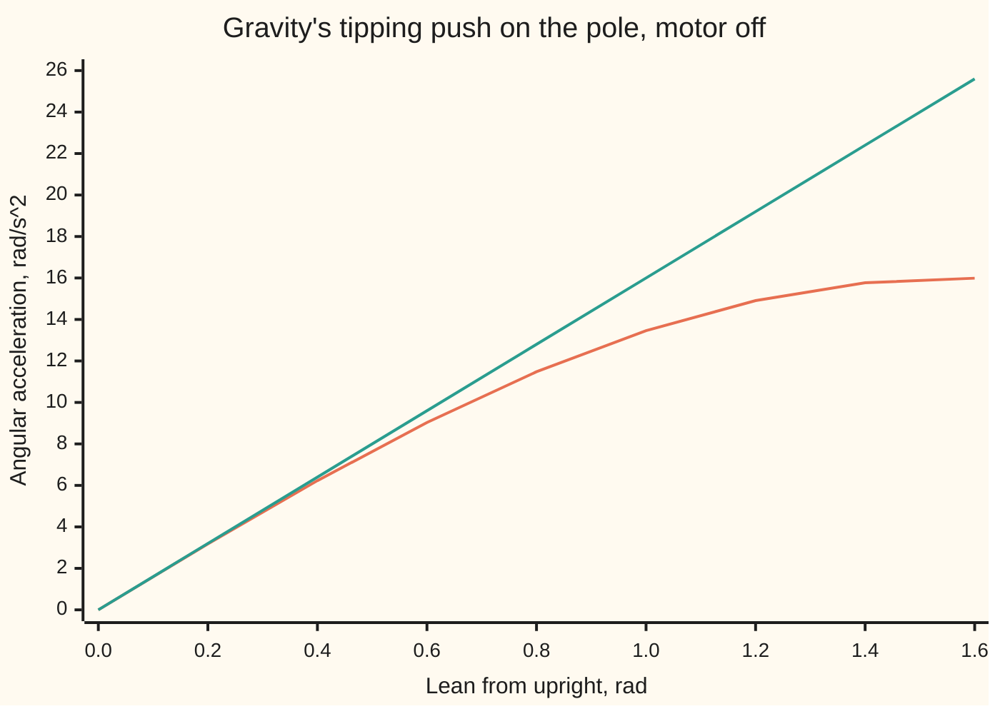
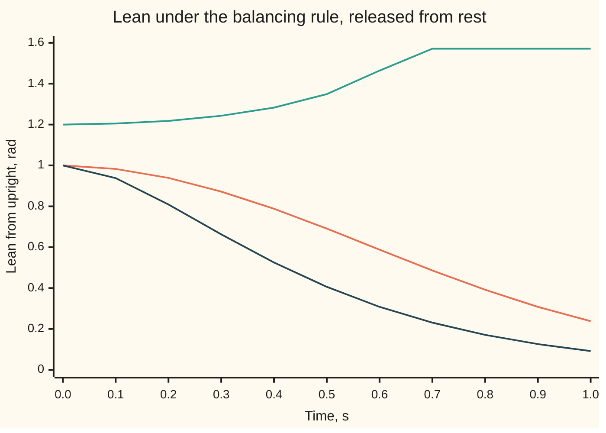

# Linearisation: near a chosen operating point a curved model becomes a straight one

[Syllabus](../../../SYLLABUS.md) → [Engineering mathematics](../README.md) → [State Space and Optimal Control](../README.md#s04) → Linearisation

---

## General Overview

A cart on a rail carries a pole balanced upright on a hinge. The pole acts like a weight 0.613125 m above the hinge. The motor sets the cart's acceleration. Lean the pole by an angle θ (theta) and gravity tips it further, at 16 sin θ radians per second squared (16 is gravity, 9.81 m/s², divided by the 0.613125 m). Accelerate the cart and the hinge is dragged out from under the pole, tipping it back by the push times cos θ, divided by the pole's length.

Sine and cosine make this model **curved** (nonlinear: doubling the lean does not double the push). Almost every tool on this shelf, from steering tests to the Kalman filter, wants a **straight** (linear) model instead: rates that are a fixed matrix times the state plus a fixed matrix times the input. Near upright the curve is almost straight. sin θ is almost θ, and cos θ is almost 1. So near upright the pole obeys θ'' = 16θ − 1.631u, where u is the cart's acceleration in m/s².

How near is near? At a lean of 0.1 rad the straight model is off by 0.17% in gravity's push and 0.50% in the motor's. At 0.5 rad it is off by 4.11% and 12.24%. A balancing rule designed on the straight model claims to stand the pole up from any lean. On the true pole it works from any lean up to 1.1656 rad (66.8°) and loses it beyond.

**Pick a state and an input that hold the plant still, measure everything as an offset from that point, and keep only the first-order slopes: the offsets' rates become A times the state offset plus B times the input offset, the readings' offsets become C and D times them, and what is thrown away shrinks faster than the offsets.**

**What kind of fact this is:** a method. Its error bound is Taylor's theorem, shown in Why it works. That the straight model's stable-or-unstable verdict is also the truth's, near the point, is a theorem (Lyapunov's indirect method). The [Linearisation](../../08-Differential%20equations%20and%20dynamics/06-Nonlinear%20Dynamics%20in%20the%20Plane/02-linearisation-and-the-jacobian.md) card of the differential-equations wing proves the attracting case and states the saddle case, with its proof in the sources.

### The picture: gravity's push and its straight-line stand-in



Orange is the true push, 16 sin θ. Green is the straight model, 16θ. They agree to two figures out to 0.2 rad and part steadily after.

---

## The formula

Notation first, in words. The state $x$ is the list of numbers the model carries, the input $u$ is what the controller sets, and the output $y$ is what the sensors read ([State space](01-state-space-models-and-the-matrix-exponential.md)). A curved plant is any rule

$$x' = f(x, u), \qquad y = h(x, u)$$

where a prime means a rate per second. An **operating point** is a pair $(x_e, u_e)$ (e for equilibrium) that holds the plant still: $f(x_e, u_e) = 0$. Measure everything as an offset from it, written with δ (delta): $\delta x = x - x_e$, $\delta u = u - u_e$, $\delta y = y - h(x_e, u_e)$. Then, near the point,

$$\delta x' \approx A\,\delta x + B\,\delta u, \qquad \delta y \approx C\,\delta x + D\,\delta u$$

$$A = \frac{\partial f}{\partial x}, \quad B = \frac{\partial f}{\partial u}, \quad C = \frac{\partial h}{\partial x}, \quad D = \frac{\partial h}{\partial u}, \quad \text{all taken at } (x_e, u_e)$$

Each of A, B, C, D is a **Jacobian**: a table of slopes, one row per rate or reading and one column per state or input, entry (i, j) being how fast the i-th rate changes when only the j-th variable moves ([Partial derivatives](../../06-Calculus%20and%20analysis/07-Several%20Variables/01-partial-derivatives.md)).

**Read it aloud:** near a point where the plant can rest, the offsets' rates are the slopes times the offsets, and the readings' offsets are the slopes of the sensors times the offsets.

For the cart and pole the state is cart position $p$, cart speed $v$, lean $\theta$ from upright and lean rate $\omega$ (omega). The input $u$ is the cart's acceleration. With gravity $g$ and length $l$:

$$f = \begin{pmatrix} v \\ u \\ \omega \\ (g\sin\theta - u\cos\theta)/l \end{pmatrix}, \qquad h = \begin{pmatrix} \theta \\ p + l\sin\theta \end{pmatrix}$$

The first reading is the encoder at the hinge. The second is where the pole's tip is along the rail, as a camera would see it.

| Symbol | Plain meaning | In our example | Push it up and the answer… |
| --- | --- | --- | --- |
| $x$; $p$, $v$, $\theta$, $\omega$ | state: cart position (m), speed (m/s), lean (rad), lean rate (rad/s) | upright: all 0 | far from 0, the straight model drifts from the truth |
| $u$ | input: the cart's acceleration | 0 m/s² upright; 3.0346 m/s² to hold a 0.3 rad lean | a bigger held push holds a bigger lean |
| $y$ | outputs: encoder angle; tip position | θ; p + l sin θ | — |
| $f$, $h$, $r$ | the curved rules for the rates and the readings; $r$ is the leftover the straight model drops | above; $r$ is about $\theta^3/6$ times 16 upright | — |
| $x_e$, $u_e$, $\theta_e$ | the operating point: a state and input where every rate is 0; $\theta_e$ is its lean | upright with $u_e = 0$; or lean 0.3 rad with $u_e = 3.0346$ | — |
| $\delta x$, $\delta u$, $\delta y$ | offsets from the operating point | a 0.01 rad lean | larger leftover, growing like the offset cubed here |
| $A$ | slopes of the rates against the state | entry (4, 3): 16 per s² | a faster-falling pole |
| $B$ | slopes of the rates against the input | (0, 1, 0, −1.631) | more steering per m/s² of push |
| $C$, $D$ | slopes of the readings against state and input | C rows (0, 0, 1, 0) and (1, 0, 0.613, 0); D = 0 | — |
| $g$, $l$ | gravity (NIST CODATA standard gravity, rounded); pole length | 9.81 m/s²; 0.613125 m, so g/l = 16 per s² | longer pole: slower fall |
| $\lambda$ | eigenvalue of A: the growth rate of one special motion | 0, 0, +4 and −4 per s | positive real part: that motion grows |

### When it holds

- **The rules are smooth at the point.** A motor that saturates, or a cart that sticks on its rail, has a kink there: the slope on one side differs from the other, and no single B fits.
- **The point really is a rest.** Take slopes at a lean of 0.3 rad with the motor off and the constant term, 4.7283 rad/s², is left over. It swamps every slope.
- **The offsets stay small.** At 0.5 rad the straight model is 12.24% wrong about the motor's grip. A rule designed on it loses the pole from leans beyond 1.1656 rad.
- **The verdict needs the right eigenvalues.** "Dies away" carries over to the truth only when every eigenvalue of A has negative real part. "Grows" carries over when any one has positive real part. With some on the line (real part zero) and none to the right, the straight model cannot decide. Upright, the +4 settles it despite the cart's double zero: the true pole falls too.

---

## Why it works

### Step 0: zoom in on a smooth curve and it is its tangent line

[Linearisation](../../08-Differential%20equations%20and%20dynamics/06-Nonlinear%20Dynamics%20in%20the%20Plane/02-linearisation-and-the-jacobian.md) in the differential-equations wing does this for a system with no input: at a rest, the rates are the Jacobian times the offset, plus a leftover that shrinks faster. This card adds three things an engineer needs: an input, a set of readings, and a rest that the input has to hold.

### Step 1: expand in the state and the input together

Taylor's first-order statement in several variables ([Hessian](../../06-Calculus%20and%20analysis/07-Several%20Variables/05-hessian-and-second-order-approximation.md)) treats the input as one more variable:

$$f(x_e + \delta x,\, u_e + \delta u) = f(x_e, u_e) + A\,\delta x + B\,\delta u + r$$

The leftover $r$ is set by the second slopes (the Hessian of each rate). It shrinks like the offsets squared, or faster.

The first term is zero, because the point is a rest. The rates of the true state are the rates of the offsets, since $x_e$ is fixed. That leaves $\delta x' = A\,\delta x + B\,\delta u + r$. Drop $r$ and the model is straight.

The readings expand the same way, but $h(x_e, u_e)$ is not zero: the encoder reads 0.3 rad at a 0.3 rad lean. So the reading's offset, $\delta y$, is what the straight model predicts.

### Step 2: the slopes at upright

Only the fourth rate, $(g\sin\theta - u\cos\theta)/l$, is curved. Its slope against θ is $(g\cos\theta + u\sin\theta)/l$; against $u$ it is $-\cos\theta/l$. At upright, θ = 0 and u = 0, so these are g/l = 16 and −1/l = −1.631. The other rates are already straight: $p' = v$ gives a 1 in row 1, column 2, and so on.

$$A = \begin{pmatrix} 0&1&0&0 \\ 0&0&0&0 \\ 0&0&0&1 \\ 0&0&16&0 \end{pmatrix}, \quad B = \begin{pmatrix} 0 \\ 1 \\ 0 \\ -1.631 \end{pmatrix}, \quad C = \begin{pmatrix} 0&0&1&0 \\ 1&0&0.613&0 \end{pmatrix}, \quad D = 0$$

The tip reading's slope against θ is $l\cos\theta$: tilt the pole a little and its tip moves sideways by about the length times the tilt.

### Step 3: a rest that has to be held

Now ask the pole to lean forward at a steady 0.3 rad (17.19°), like a rider leaning into a sprint. The lean holds when gravity's tip equals the motor's tip-back: $g\sin\theta_e = u_e\cos\theta_e$, so $u_e = g\tan\theta_e = 3.0346$ m/s². The cart must keep accelerating at that rate. Its speed keeps growing, so the full four-number state never rests: $f(x_e, u_e)$ is not zero, since its speed row is 3.0346 m/s². This is an equilibrium of the lean and its rate only, $(\theta, \omega)$. The cart's two rows, $p' = v$ and $v' = u$, are straight already, so offsets of $p$ and $v$ measured from the cart's steadily accelerating path obey them exactly; the four-state A, B and C at the lean, which the code prints, describe offsets from that moving path. The cart's position is left to an outer loop.

The slopes there are different:

- against θ: $(g\cos\theta_e + u_e\sin\theta_e)/l = 16/\cos 0.3 = 16.7480$ per s²;
- against u: $-\cos\theta_e/l = -1.5581$ rad per m.

There is a plain reason. Inside the accelerating cart, gravity and the push add up to a tilted, stronger gravity of $\sqrt{g^2 + u_e^2} = 10.2686$ m/s², and the pole is balancing along it. Divide by the length and the 16.7480 comes back. The pole now falls faster, by $\sqrt{16.7480} = 4.0924$ per s instead of 4, and the motor grips it 4.47% less.

The offsets matter here. The straight model is $\delta\theta'' = 16.7480\,\delta\theta - 1.5581\,\delta u$, where $\delta u$ is the push *on top of* the 3.0346 m/s² already being spent.

### Step 4: the leftover shrinks faster than the offset

At upright the second slope of sin θ is −sin 0 = 0, so the leftover starts at the cube: $\theta - \sin\theta$ is about $\theta^3/6$. Halve the starting lean and the error between true and straight halves three times, a factor of 8. The code lets the pole fall for 0.5 s from 0.02 rad and from 0.01 rad. The errors are 11.872 and 1.484 microradians, a ratio of 8.00.

At the held lean the ratio is 8.00 too, 13.380 against 1.673. Seen along the tilted gravity, the pole is upright again, so its leftover is also a cube.

### Step 5: what the straight model is allowed to decide

Upright, the eigenvalues of A are 0, 0, +4 and −4 per s. The +4 is the pole falling: once a fall is under way, the lean doubles every ln 2/4 = 0.1733 s. Lyapunov's indirect method says this verdict is the truth's, near the point: one eigenvalue with positive real part makes the true rest unstable too, whatever the zeros do ([Stability of a state-space model](05-hurwitz-schur-and-lyapunov-stability.md)). It says nothing about *how near*. That has to be measured, and the next section does.

---

## Worked numbers, by hand

| Step | Arithmetic | Value |
| --- | --- | --- |
| rest at upright | rates v, u, ω, (9.81 sin 0 − 0)/l | all 0 with v = ω = u = 0, θ = 0 |
| gravity's slope | 9.81 cos 0 / 0.613125 | 16 per s² |
| motor's slope | −cos 0 / 0.613125 | −1.631 rad per m |
| falling rate | square root of 16 | 4 per s, doubling in 0.1733 s |
| held lean 0.3 rad | 9.81 × tan 0.3 | u_e = 3.0346 m/s² |
| tilted gravity | square root of (9.81² + 3.0346²) | 10.2686 m/s² |
| slope at the lean | 10.2686 / 0.613125 | 16.7480 per s² |
| motor's slope at the lean | −cos 0.3 / 0.613125 | −1.5581 rad per m |
| model upright | | **θ'' = 16θ − 1.631u; y = θ** |
| model at the lean | | **δθ'' = 16.7480 δθ − 1.5581 δu** |

Upright, once a fall is under way the lean doubles every 0.1733 s unless the motor answers it, and each 1 m/s² of push gives the motor 1.631 rad/s² of grip on the pole.

### What breaks if you drop a piece

| Mistake | Comes out at | What went wrong |
| --- | --- | --- |
| Using θ and u, not offsets, in the lean model | the held pole "accelerates" at 0.2961 rad/s² | the straight model is about offsets; at the held point it must give 0 |
| Using the upright model at the 0.3 rad lean | falls at 16 per s², motor −1.631 | truly 16.7480 and −1.5581: the motor is 4.47% weaker than the model thinks |
| Taking slopes at 0.3 rad with the motor off | a leftover constant of 4.7283 rad/s² | not a rest, so the constant term does not vanish |
| Trusting the straight model at a 1.2 rad lean | "caught", as from any lean | the true pole hits the deck by 0.7 s |

The code prints all four.

---

## The model is only good near the point it was taken at

A balancing rule from [Pole placement](04-pole-placement-and-observers.md) sets $u = l\,(32\theta + 8\omega)$. On the straight model it turns $\theta'' = 16\theta - u/l$ into $\theta'' = -16\theta - 8\omega$: both eigenvalues at −4 per s, so every lean dies away. How does it do on the true pole?

### One story: four releases, straight against true

| Release | Straight model says | True pole does |
| --- | --- | --- |
| 1 mrad, motor off, after 1 s | 27.3082 mrad | 27.3078 mrad |
| 0.05 rad, motor off, time to reach 0.5 rad | 0.7483 s | 0.7498 s |
| 0.3 rad, rule on, lean after 1 s | 0.02747 rad | 0.02893 rad |
| 1.2 rad, rule on | stands back up | falls flat by 0.7 s |

The 1 mrad start agrees to four figures, the 0.05 rad start to two. A 0.3 rad start agrees in shape but settles more slowly. A 1.2 rad start is lost.

### Force one: gravity, weaker than the model thinks

Gravity's true push, in rad/s², is 16 sin θ. The straight model says 16θ, always a little too strong.

```
lean 0.3 rad  █████████                             4.728
lean 0.6 rad  ██████████████████                    9.034
lean 0.9 rad  █████████████████████████            12.533
lean 1.2 rad  ██████████████████████████████       14.913
```

### Force two: the motor, losing grip as the pole tips

The rule's true push on the lean, with the pole momentarily still, is $32\theta\cos\theta$: the cart pushes harder as the lean grows, but the cosine shrinks its grip. Between 0.9 and 1.2 rad the shrinking grip takes over.

```
lean 0.3 rad  ██████████████████                    9.171
lean 0.6 rad  ████████████████████████████████     15.846
lean 0.9 rad  ████████████████████████████████████ 17.902
lean 1.2 rad  ████████████████████████████         13.915
```

At 1.2 rad gravity's 14.913 beats the rule's 13.915. The two are equal where $16\sin\theta = 32\theta\cos\theta$, that is $\tan\theta = 2\theta$, at 1.1656 rad. Released from rest beyond that lean, the pole is lost.

### Both forces in one picture



Orange: the true pole from 1.0 rad, caught but slower than promised. Green: the true pole from 1.2 rad, lying on the deck (1.571 rad, 90°) by 0.7 s. Dark: the straight model from 1.0 rad, which would say the same about 1.2 rad.

---

## Code, from first principles, and it actually runs

The code builds the curved model, then takes its slopes **two independent ways**: written out by hand (road 1) and by nudging each variable by a millionth and differencing the curved model (road 2). Road 3 steps both the curved and the straight model forward with Runge–Kutta 4 ([Runge-Kutta four](../../08-Differential%20equations%20and%20dynamics/05-Numerical%20Evolution/04-runge-kutta-four.md)) and checks the straight run against its closed form, 1 mrad times cosh 4t, with t the time in seconds. The largest lean the rule catches is found twice: by bisecting on simulated releases, and by solving tan θ = 2θ. Five asserts tie the roads together.

### Python

```python
# Linearisation about an equilibrium -- the check behind the card.  Standard library only.
# Road 1: the slopes (Jacobians) written out by hand.  Road 2: the same slopes by nudging
# the curved model.  Road 3: the curved model stepped by RK4 against the straight one.
from math import sin, cos, tan, sqrt, cosh, acosh, log, exp, pi

G, L = 9.81, 0.613125                      # gravity m/s^2; pole length m, so G/L = 16 per s^2

def f(x, u):                               # curved model: state (p, v, th, w), input u = cart accel
    p, v, th, w = x
    return [v, u, w, (G * sin(th) - u * cos(th)) / L]

def h(x):                                  # outputs: encoder angle; tip position p + L sin th
    return [x[2], x[0] + L * sin(x[2])]

def by_hand(te):                           # Road 1, at lean te held by ue = G tan te
    ue = G * tan(te)
    A = [[0, 1, 0, 0], [0, 0, 0, 0], [0, 0, 0, 1], [0, 0, (G * cos(te) + ue * sin(te)) / L, 0]]
    return ue, A, [0, 1, 0, -cos(te) / L], [[0, 0, 1, 0], [1, 0, L * cos(te), 0]]

def by_nudge(te, e=1e-6):                  # Road 2: central differences, one variable at a time
    xe, ue = [0.0, 0.0, te, 0.0], G * tan(te)
    A = [[0.0] * 4 for _ in range(4)]; C = [[0.0] * 4 for _ in range(2)]
    for j in range(4):
        xp, xm = xe[:], xe[:]; xp[j] += e; xm[j] -= e
        for i in range(4): A[i][j] = (f(xp, ue)[i] - f(xm, ue)[i]) / (2 * e)
        for i in range(2): C[i][j] = (h(xp)[i] - h(xm)[i]) / (2 * e)
    B = [(a - b) / (2 * e) for a, b in zip(f(xe, ue + e), f(xe, ue - e))]
    return A, B, C

def gap(P, Q): return max(abs(a - b) for a, b in zip(sum(P, []), sum(Q, [])))

def rk4(rate, y, dt, n):                   # lean loop only: y = (th, w)
    for _ in range(n):
        k1 = rate(y); k2 = rate([a + dt / 2 * b for a, b in zip(y, k1)])
        k3 = rate([a + dt / 2 * b for a, b in zip(y, k2)]); k4 = rate([a + dt * b for a, b in zip(y, k3)])
        y = [a + dt / 6 * (b + 2 * c + 2 * d + e) for a, b, c, d, e in zip(y, k1, k2, k3, k4)]
    return y

def curved(u): return lambda y: [y[1], (G * sin(y[0]) - u(y) * cos(y[0])) / L]
def straight(a, b, u): return lambda y: [y[1], a * y[0] + b * u(y)]
off = lambda y: 0.0
K1, K2 = 32.0, 8.0                         # balancing rule u = L (32 th + 8 w), poles -4, -4
rule = lambda y: L * (K1 * y[0] + K2 * y[1])
fmt = lambda v: " ".join("%.3f" % x for x in v)

# ---- the upright operating point ----
ue, A, B, C = by_hand(0.0)
An, Bn, Cn = by_nudge(0.0)
print("equilibrium: rates at upright, u = 0:", fmt(f([0, 0, 0, 0], 0.0)))
print("A row 4 by hand", fmt(A[3]), "| by nudging", fmt(An[3]))
print("B by hand", fmt(B), "| by nudging", fmt(Bn))
print("C by hand", fmt(C[0]), "/", fmt(C[1]), "| D = 0")
print("eigenvalues 0, 0, +-%.4f per s; doubling ln2/4 = %.4f s" % (sqrt(A[3][2]), log(2) / sqrt(A[3][2])))
assert gap(A, An) < 1e-6 and gap([B], [Bn]) < 1e-6 and gap(C, Cn) < 1e-6

# ---- the leaning operating point, held by a steady push ----
te = 0.3
ue, Al, Bl, Cl = by_hand(te)
Aln, Bln, Cln = by_nudge(te)
print("lean %.1f rad (%.2f deg): ue = %.4f m/s^2; lean rates there" % (te, te * 180 / pi, ue), fmt(f([0, 0, te, 0], ue)[2:]))
print("lean: a = %.4f per s^2 (16/cos 0.3 = %.4f), b = %.4f, C tip row %s, growth %.4f per s"
      % (Al[3][2], 16 / cos(te), Bl[3], fmt(Cl[1]), sqrt(Al[3][2])))
assert gap(Al, Aln) < 1e-6 and abs(Bl[3] - Bln[3]) < 1e-6 and abs(Al[3][2] - 16 / cos(te)) < 1e-9 and gap(Cl, Cln) < 1e-6
print("tilted gravity sqrt(g^2 + ue^2) = %.4f m/s^2, over L = %.4f per s^2" % (sqrt(G * G + ue * ue), sqrt(G * G + ue * ue) / L))
for t in (0.1, 0.5):
    print("straight model off at %.1f rad: gravity term %.2f%%, motor term %.2f%%" % (t, 100 * (1 - sin(t) / t), 100 * (1 - cos(t))))

# ---- road 3: let go with the motor off; straight versus curved ----
lin = rk4(straight(16.0, 0.0, off), [0.001, 0.0], 0.001, 1000)[0]
tru = rk4(curved(off), [0.001, 0.0], 0.001, 1000)[0]
print("from 1 mrad, at 1 s: cosh %.4f mrad, straight RK4 %.4f, curved RK4 %.4f" % (cosh(4), 1000 * lin, 1000 * tru))
assert abs(lin - 0.001 * cosh(4)) < 1e-9

def reach(rate, y, target, dt=1e-4):       # time for the lean to reach target
    t = 0.0
    while y[0] < target: y = rk4(rate, y, dt, 1); t += dt
    return t
tl, tc = acosh(10) / 4, reach(curved(off), [0.05, 0.0], 0.5)
print("from 0.05 rad to 0.5 rad: straight acosh(10)/4 = %.4f s, curved %.4f s" % (tl, tc))

def err(a, b, u0, d, at):                  # curved minus straight, deviation d at the start
    yc = rk4(curved(lambda y: u0), [te0 + d, 0.0], 0.001, int(at / 0.001))
    ys = rk4(straight(a, b, lambda y: 0.0), [d, 0.0], 0.001, int(at / 0.001))
    return abs(yc[0] - te0 - ys[0])
te0 = 0.0; e1, e2 = err(16.0, B[3], 0.0, 0.02, 0.5), err(16.0, B[3], 0.0, 0.01, 0.5)
te0 = te;  g1, g2 = err(Al[3][2], Bl[3], ue, 0.02, 0.5), err(Al[3][2], Bl[3], ue, 0.01, 0.5)
print("error at 0.5 s in microrad, start 0.02 vs 0.01 rad: upright %.3f %.3f ratio %.2f | lean %.3f %.3f ratio %.2f"
      % (1e6 * e1, 1e6 * e2, e1 / e2, 1e6 * g1, 1e6 * g2, g1 / g2))
assert 7.5 < e1 / e2 < 8.5 and 7.5 < g1 / g2 < 8.5      # leftover is cubic at both points

# ---- the balancing rule designed on the straight model, run on the curved one ----
def caught(t0):
    y = [t0, 0.0]
    for _ in range(1000):
        y = rk4(curved(rule), y, 0.005, 1)
        if abs(y[0]) > pi / 2: return False
    return abs(y[0]) < 0.01
lo, hi = 0.5, 1.5
for _ in range(30): lo, hi = ((lo + hi) / 2, hi) if caught((lo + hi) / 2) else (lo, (lo + hi) / 2)
a, b = 0.5, 1.5                            # independent road: where 16 sin th = 32 th cos th
for _ in range(60): a, b = ((a + b) / 2, b) if tan((a + b) / 2) < 2 * (a + b) / 2 else (a, (a + b) / 2)
print("largest lean caught: by simulation %.4f rad (%.1f deg), root of tan th = 2 th %.4f rad" % (lo, lo * 180 / pi, a))
assert abs(lo - a) < 1e-3
s = rk4(curved(rule), [0.3, 0.0], 0.005, 200)[0]
print("from 0.3 rad at 1 s: straight 0.3(1+4t)e^-4t = %.5f rad, curved %.5f rad" % (0.3 * 5 * exp(-4), s))

print("bars, th 0.3 0.6 0.9 1.2: gravity 16 sin th", fmt([16 * sin(t) for t in (0.3, 0.6, 0.9, 1.2)]),
      "| rule 32 th cos th", fmt([32 * t * cos(t) for t in (0.3, 0.6, 0.9, 1.2)]))
# ---- what breaks ----
print("wrong: absolute th, u in the lean model: rate at the held point %.4f rad/s^2" % (Al[3][2] * te + Bl[3] * ue))
print("wrong: upright model used at the lean: a %.4f vs %.4f, b %.4f vs %.4f" % (A[3][2], Al[3][2], B[3], Bl[3]))
print("wrong: motor grip at the lean is %.2f%% weaker; lean in degrees: B entry x %.2f = %.2f, eigenvalues still +-%.4f"
      % (100 * (1 - Bl[3] / B[3]), 180 / pi, B[3] * 180 / pi, sqrt(A[3][2])))
print("wrong: slopes taken at 0.3 rad with u = 0, not a rest: lean rate %.4f rad/s^2" % (16 * sin(te)))

# ---- try changing ----
print("try: L = 1.0 m: growth %.4f per s, doubling %.4f s" % (sqrt(G / 1.0), log(2) / sqrt(G / 1.0)))
print("try: lean 0.6 rad: ue %.4f m/s^2, a %.4f, b %.4f" % (G * tan(0.6), 16 / cos(0.6), -cos(0.6) / L))
a, b = 0.5, 1.55
for _ in range(60): a, b = ((a + b) / 2, b) if tan((a + b) / 2) < 4 * (a + b) / 2 else (a, (a + b) / 2)
print("try: gains doubled (64, 16): largest lean caught %.4f rad (%.1f deg)" % (a, a * 180 / pi))

# ---- chart points ----
print("chart, th rad:        ", " ".join("%.1f" % (k / 10) for k in range(0, 17, 2)))
print("chart, 16 sin th:     ", " ".join("%.2f" % (16 * sin(k / 10)) for k in range(0, 17, 2)))
print("chart, 16 th:         ", " ".join("%.2f" % (16 * k / 10) for k in range(0, 17, 2)))
for t0 in (1.0, 1.2):
    y, row = [t0, 0.0], ["%.3f" % t0]
    for _ in range(10): y = rk4(curved(rule), y, 0.005, 20); row.append("%.3f" % min(y[0], pi / 2))
    print("chart, curved from %.1f:" % t0, " ".join(row))
print("chart, straight 1.0:  ", " ".join("%.3f" % ((1 + 0.4 * k) * exp(-0.4 * k)) for k in range(11)))
print("ALL CHECKS PASS")
```

**Ran 2026-11-11 on macOS, Python 3.14.10, standard library only. All checks passed. Output, pasted from the run:**

```
equilibrium: rates at upright, u = 0: 0.000 0.000 0.000 0.000
A row 4 by hand 0.000 0.000 16.000 0.000 | by nudging 0.000 0.000 16.000 0.000
B by hand 0.000 1.000 0.000 -1.631 | by nudging 0.000 1.000 0.000 -1.631
C by hand 0.000 0.000 1.000 0.000 / 1.000 0.000 0.613 0.000 | D = 0
eigenvalues 0, 0, +-4.0000 per s; doubling ln2/4 = 0.1733 s
lean 0.3 rad (17.19 deg): ue = 3.0346 m/s^2; lean rates there 0.000 0.000
lean: a = 16.7480 per s^2 (16/cos 0.3 = 16.7480), b = -1.5581, C tip row 1.000 0.000 0.586 0.000, growth 4.0924 per s
tilted gravity sqrt(g^2 + ue^2) = 10.2686 m/s^2, over L = 16.7480 per s^2
straight model off at 0.1 rad: gravity term 0.17%, motor term 0.50%
straight model off at 0.5 rad: gravity term 4.11%, motor term 12.24%
from 1 mrad, at 1 s: cosh 27.3082 mrad, straight RK4 27.3082, curved RK4 27.3078
from 0.05 rad to 0.5 rad: straight acosh(10)/4 = 0.7483 s, curved 0.7498 s
error at 0.5 s in microrad, start 0.02 vs 0.01 rad: upright 11.872 1.484 ratio 8.00 | lean 13.380 1.673 ratio 8.00
largest lean caught: by simulation 1.1656 rad (66.8 deg), root of tan th = 2 th 1.1656 rad
from 0.3 rad at 1 s: straight 0.3(1+4t)e^-4t = 0.02747 rad, curved 0.02893 rad
bars, th 0.3 0.6 0.9 1.2: gravity 16 sin th 4.728 9.034 12.533 14.913 | rule 32 th cos th 9.171 15.846 17.902 13.915
wrong: absolute th, u in the lean model: rate at the held point 0.2961 rad/s^2
wrong: upright model used at the lean: a 16.0000 vs 16.7480, b -1.6310 vs -1.5581
wrong: motor grip at the lean is 4.47% weaker; lean in degrees: B entry x 57.30 = -93.45, eigenvalues still +-4.0000
wrong: slopes taken at 0.3 rad with u = 0, not a rest: lean rate 4.7283 rad/s^2
try: L = 1.0 m: growth 3.1321 per s, doubling 0.2213 s
try: lean 0.6 rad: ue 6.7114 m/s^2, a 19.3861, b -1.3461
try: gains doubled (64, 16): largest lean caught 1.3932 rad (79.8 deg)
chart, th rad:         0.0 0.2 0.4 0.6 0.8 1.0 1.2 1.4 1.6
chart, 16 sin th:      0.00 3.18 6.23 9.03 11.48 13.46 14.91 15.77 15.99
chart, 16 th:          0.00 3.20 6.40 9.60 12.80 16.00 19.20 22.40 25.60
chart, curved from 1.0: 1.000 0.983 0.939 0.872 0.788 0.691 0.588 0.486 0.392 0.308 0.238
chart, curved from 1.2: 1.200 1.205 1.218 1.243 1.283 1.349 1.464 1.571 1.571 1.571 1.571
chart, straight 1.0:   1.000 0.938 0.809 0.663 0.525 0.406 0.308 0.231 0.171 0.126 0.092
ALL CHECKS PASS
```

### Rust

```rust
// Linearisation about an equilibrium -- the check behind the card.  std only, no crates.
// Road 1: the slopes (Jacobians) written out by hand.  Road 2: the same slopes by nudging
// the curved model.  Road 3: the curved model stepped by RK4 against the straight one.
use std::f64::consts::PI;
const G: f64 = 9.81;
const L: f64 = 0.613125; // gravity m/s^2; pole length m, so G/L = 16 per s^2

fn f(x: &[f64; 4], u: f64) -> [f64; 4] { // curved model: state (p, v, th, w), input u = cart accel
    [x[1], u, x[3], (G * x[2].sin() - u * x[2].cos()) / L]
}
fn h(x: &[f64; 4]) -> [f64; 2] { [x[2], x[0] + L * x[2].sin()] } // encoder angle; tip position

type M4 = [[f64; 4]; 4];
type M2 = [[f64; 4]; 2];
fn by_hand(te: f64) -> (f64, M4, [f64; 4], M2) { // Road 1, at lean te held by ue = G tan te
    let ue = G * te.tan();
    let mut a = [[0.0; 4]; 4];
    a[0][1] = 1.0; a[2][3] = 1.0; a[3][2] = (G * te.cos() + ue * te.sin()) / L;
    (ue, a, [0.0, 1.0, 0.0, -te.cos() / L], [[0.0, 0.0, 1.0, 0.0], [1.0, 0.0, L * te.cos(), 0.0]])
}
fn by_nudge(te: f64) -> (M4, [f64; 4], M2) { // Road 2: central differences
    let e = 1e-6;
    let (xe, ue) = ([0.0, 0.0, te, 0.0], G * te.tan());
    let (mut a, mut c) = ([[0.0; 4]; 4], [[0.0; 4]; 2]);
    for j in 0..4 {
        let (mut xp, mut xm) = (xe, xe);
        xp[j] += e; xm[j] -= e;
        for i in 0..4 { a[i][j] = (f(&xp, ue)[i] - f(&xm, ue)[i]) / (2.0 * e); }
        for i in 0..2 { c[i][j] = (h(&xp)[i] - h(&xm)[i]) / (2.0 * e); }
    }
    let (fp, fm) = (f(&xe, ue + e), f(&xe, ue - e));
    let mut b = [0.0; 4];
    for i in 0..4 { b[i] = (fp[i] - fm[i]) / (2.0 * e); }
    (a, b, c)
}
fn gap(p: &[[f64; 4]], q: &[[f64; 4]]) -> f64 {
    let mut g: f64 = 0.0;
    for (r, s) in p.iter().zip(q) { for k in 0..4 { g = g.max((r[k] - s[k]).abs()); } }
    g
}
fn fmt(v: &[f64]) -> String { v.iter().map(|x| format!("{:.3}", x)).collect::<Vec<_>>().join(" ") }

fn rk4(rate: &dyn Fn([f64; 2]) -> [f64; 2], mut y: [f64; 2], dt: f64, n: usize) -> [f64; 2] {
    let add = |y: [f64; 2], k: [f64; 2], s: f64| [y[0] + s * k[0], y[1] + s * k[1]];
    for _ in 0..n {
        let k1 = rate(y); let k2 = rate(add(y, k1, dt / 2.0));
        let k3 = rate(add(y, k2, dt / 2.0)); let k4 = rate(add(y, k3, dt));
        for i in 0..2 { y[i] += dt / 6.0 * (k1[i] + 2.0 * k2[i] + 2.0 * k3[i] + k4[i]); }
    }
    y
}
fn curved(u: impl Fn([f64; 2]) -> f64) -> impl Fn([f64; 2]) -> [f64; 2] {
    move |y| [y[1], (G * y[0].sin() - u(y) * y[0].cos()) / L]
}
fn straight(a: f64) -> impl Fn([f64; 2]) -> [f64; 2] { move |y| [y[1], a * y[0]] } // input held at ue
fn rule(y: [f64; 2]) -> f64 { L * (32.0 * y[0] + 8.0 * y[1]) } // u = L (32 th + 8 w), poles -4, -4
fn root(k: f64, hi: f64) -> f64 { // where tan th = k th
    let (mut a, mut b) = (0.5, hi);
    for _ in 0..60 { let m = (a + b) / 2.0; if m.tan() < k * m { a = m } else { b = m } }
    a
}

fn main() {
    // ---- the upright operating point ----
    let (_, a, b, c) = by_hand(0.0);
    let (an, bn, cn) = by_nudge(0.0);
    println!("equilibrium: rates at upright, u = 0: {}", fmt(&f(&[0.0; 4], 0.0)));
    println!("A row 4 by hand {} | by nudging {}", fmt(&a[3]), fmt(&an[3]));
    println!("B by hand {} | by nudging {}", fmt(&b), fmt(&bn));
    println!("C by hand {} / {} | D = 0", fmt(&c[0]), fmt(&c[1]));
    println!("eigenvalues 0, 0, +-{:.4} per s; doubling ln2/4 = {:.4} s", a[3][2].sqrt(), 2f64.ln() / a[3][2].sqrt());
    assert!(gap(&a, &an) < 1e-6 && gap(&[b], &[bn]) < 1e-6 && gap(&c, &cn) < 1e-6);

    // ---- the leaning operating point, held by a steady push ----
    let te = 0.3;
    let (ue, al, bl, cl) = by_hand(te);
    let (aln, bln, cln) = by_nudge(te);
    println!("lean {:.1} rad ({:.2} deg): ue = {:.4} m/s^2; lean rates there {}", te, te * 180.0 / PI, ue, fmt(&f(&[0.0, 0.0, te, 0.0], ue)[2..]));
    println!("lean: a = {:.4} per s^2 (16/cos 0.3 = {:.4}), b = {:.4}, C tip row {}, growth {:.4} per s",
             al[3][2], 16.0 / te.cos(), bl[3], fmt(&cl[1]), al[3][2].sqrt());
    assert!(gap(&al, &aln) < 1e-6 && (bl[3] - bln[3]).abs() < 1e-6 && (al[3][2] - 16.0 / te.cos()).abs() < 1e-9 && gap(&cl, &cln) < 1e-6);
    let gt = (G * G + ue * ue).sqrt();
    println!("tilted gravity sqrt(g^2 + ue^2) = {:.4} m/s^2, over L = {:.4} per s^2", gt, gt / L);
    for t in [0.1f64, 0.5] {
        println!("straight model off at {:.1} rad: gravity term {:.2}%, motor term {:.2}%", t, 100.0 * (1.0 - t.sin() / t), 100.0 * (1.0 - t.cos()));
    }

    // ---- road 3: let go with the motor off; straight versus curved ----
    let off = |_: [f64; 2]| 0.0;
    let lin = rk4(&straight(16.0), [0.001, 0.0], 0.001, 1000)[0];
    let tru = rk4(&curved(off), [0.001, 0.0], 0.001, 1000)[0];
    println!("from 1 mrad, at 1 s: cosh {:.4} mrad, straight RK4 {:.4}, curved RK4 {:.4}", 4f64.cosh(), 1000.0 * lin, 1000.0 * tru);
    assert!((lin - 0.001 * 4f64.cosh()).abs() < 1e-9);
    let (mut y, mut tc) = ([0.05, 0.0], 0.0);
    while y[0] < 0.5 { y = rk4(&curved(off), y, 1e-4, 1); tc += 1e-4; }
    println!("from 0.05 rad to 0.5 rad: straight acosh(10)/4 = {:.4} s, curved {:.4} s", 10f64.acosh() / 4.0, tc);

    let err = |te0: f64, a: f64, u0: f64, d: f64| { // curved minus straight at 0.5 s
        let yc = rk4(&curved(move |_| u0), [te0 + d, 0.0], 0.001, 500);
        let ys = rk4(&straight(a), [d, 0.0], 0.001, 500);
        (yc[0] - te0 - ys[0]).abs()
    };
    let (e1, e2) = (err(0.0, 16.0, 0.0, 0.02), err(0.0, 16.0, 0.0, 0.01));
    let (g1, g2) = (err(te, al[3][2], ue, 0.02), err(te, al[3][2], ue, 0.01));
    println!("error at 0.5 s in microrad, start 0.02 vs 0.01 rad: upright {:.3} {:.3} ratio {:.2} | lean {:.3} {:.3} ratio {:.2}",
             1e6 * e1, 1e6 * e2, e1 / e2, 1e6 * g1, 1e6 * g2, g1 / g2);
    assert!(7.5 < e1 / e2 && e1 / e2 < 8.5 && 7.5 < g1 / g2 && g1 / g2 < 8.5); // leftover is cubic at both points

    // ---- the balancing rule designed on the straight model, run on the curved one ----
    let caught = |t0: f64| {
        let mut y = [t0, 0.0];
        for _ in 0..1000 { y = rk4(&curved(rule), y, 0.005, 1); if y[0].abs() > PI / 2.0 { return false; } }
        y[0].abs() < 0.01
    };
    let (mut lo, mut hi) = (0.5, 1.5);
    for _ in 0..30 { let m = (lo + hi) / 2.0; if caught(m) { lo = m } else { hi = m } }
    let r2 = root(2.0, 1.5); // independent road: where 16 sin th = 32 th cos th
    println!("largest lean caught: by simulation {:.4} rad ({:.1} deg), root of tan th = 2 th {:.4} rad", lo, lo * 180.0 / PI, r2);
    assert!((lo - r2).abs() < 1e-3);
    let s = rk4(&curved(rule), [0.3, 0.0], 0.005, 200)[0];
    println!("from 0.3 rad at 1 s: straight 0.3(1+4t)e^-4t = {:.5} rad, curved {:.5} rad", 0.3 * 5.0 * (-4f64).exp(), s);

    let ts = [0.3f64, 0.6, 0.9, 1.2];
    println!("bars, th 0.3 0.6 0.9 1.2: gravity 16 sin th {} | rule 32 th cos th {}",
             fmt(&ts.map(|t| 16.0 * t.sin())), fmt(&ts.map(|t| 32.0 * t * t.cos())));
    // ---- what breaks ----
    println!("wrong: absolute th, u in the lean model: rate at the held point {:.4} rad/s^2", al[3][2] * te + bl[3] * ue);
    println!("wrong: upright model used at the lean: a {:.4} vs {:.4}, b {:.4} vs {:.4}", a[3][2], al[3][2], b[3], bl[3]);
    println!("wrong: motor grip at the lean is {:.2}% weaker; lean in degrees: B entry x {:.2} = {:.2}, eigenvalues still +-{:.4}",
             100.0 * (1.0 - bl[3] / b[3]), 180.0 / PI, b[3] * 180.0 / PI, a[3][2].sqrt());
    println!("wrong: slopes taken at 0.3 rad with u = 0, not a rest: lean rate {:.4} rad/s^2", 16.0 * te.sin());

    // ---- try changing ----
    println!("try: L = 1.0 m: growth {:.4} per s, doubling {:.4} s", G.sqrt(), 2f64.ln() / G.sqrt());
    println!("try: lean 0.6 rad: ue {:.4} m/s^2, a {:.4}, b {:.4}", G * 0.6f64.tan(), 16.0 / 0.6f64.cos(), -0.6f64.cos() / L);
    let r4 = root(4.0, 1.55);
    println!("try: gains doubled (64, 16): largest lean caught {:.4} rad ({:.1} deg)", r4, r4 * 180.0 / PI);

    // ---- chart points ----
    let ks: Vec<f64> = (0..17).step_by(2).map(|k| k as f64 / 10.0).collect();
    println!("chart, th rad:         {}", ks.iter().map(|t| format!("{:.1}", t)).collect::<Vec<_>>().join(" "));
    println!("chart, 16 sin th:      {}", ks.iter().map(|t| format!("{:.2}", 16.0 * t.sin())).collect::<Vec<_>>().join(" "));
    println!("chart, 16 th:          {}", ks.iter().map(|t| format!("{:.2}", 16.0 * t)).collect::<Vec<_>>().join(" "));
    for t0 in [1.0, 1.2] {
        let (mut y, mut row) = ([t0, 0.0], vec![format!("{:.3}", t0)]);
        for _ in 0..10 { y = rk4(&curved(rule), y, 0.005, 20); row.push(format!("{:.3}", y[0].min(PI / 2.0))); }
        println!("chart, curved from {:.1}: {}", t0, row.join(" "));
    }
    let st: Vec<String> = (0..11).map(|k| { let t = 0.4 * k as f64; format!("{:.3}", (1.0 + t) * (-t).exp()) }).collect();
    println!("chart, straight 1.0:   {}", st.join(" "));
    println!("ALL CHECKS PASS");
}
```

**Ran 2026-11-11 on macOS, rustc 1.98.1, no crates. All checks passed. Output, pasted from the run:**

```
equilibrium: rates at upright, u = 0: 0.000 0.000 0.000 0.000
A row 4 by hand 0.000 0.000 16.000 0.000 | by nudging 0.000 0.000 16.000 0.000
B by hand 0.000 1.000 0.000 -1.631 | by nudging 0.000 1.000 0.000 -1.631
C by hand 0.000 0.000 1.000 0.000 / 1.000 0.000 0.613 0.000 | D = 0
eigenvalues 0, 0, +-4.0000 per s; doubling ln2/4 = 0.1733 s
lean 0.3 rad (17.19 deg): ue = 3.0346 m/s^2; lean rates there 0.000 0.000
lean: a = 16.7480 per s^2 (16/cos 0.3 = 16.7480), b = -1.5581, C tip row 1.000 0.000 0.586 0.000, growth 4.0924 per s
tilted gravity sqrt(g^2 + ue^2) = 10.2686 m/s^2, over L = 16.7480 per s^2
straight model off at 0.1 rad: gravity term 0.17%, motor term 0.50%
straight model off at 0.5 rad: gravity term 4.11%, motor term 12.24%
from 1 mrad, at 1 s: cosh 27.3082 mrad, straight RK4 27.3082, curved RK4 27.3078
from 0.05 rad to 0.5 rad: straight acosh(10)/4 = 0.7483 s, curved 0.7498 s
error at 0.5 s in microrad, start 0.02 vs 0.01 rad: upright 11.872 1.484 ratio 8.00 | lean 13.380 1.673 ratio 8.00
largest lean caught: by simulation 1.1656 rad (66.8 deg), root of tan th = 2 th 1.1656 rad
from 0.3 rad at 1 s: straight 0.3(1+4t)e^-4t = 0.02747 rad, curved 0.02893 rad
bars, th 0.3 0.6 0.9 1.2: gravity 16 sin th 4.728 9.034 12.533 14.913 | rule 32 th cos th 9.171 15.846 17.902 13.915
wrong: absolute th, u in the lean model: rate at the held point 0.2961 rad/s^2
wrong: upright model used at the lean: a 16.0000 vs 16.7480, b -1.6310 vs -1.5581
wrong: motor grip at the lean is 4.47% weaker; lean in degrees: B entry x 57.30 = -93.45, eigenvalues still +-4.0000
wrong: slopes taken at 0.3 rad with u = 0, not a rest: lean rate 4.7283 rad/s^2
try: L = 1.0 m: growth 3.1321 per s, doubling 0.2213 s
try: lean 0.6 rad: ue 6.7114 m/s^2, a 19.3861, b -1.3461
try: gains doubled (64, 16): largest lean caught 1.3932 rad (79.8 deg)
chart, th rad:         0.0 0.2 0.4 0.6 0.8 1.0 1.2 1.4 1.6
chart, 16 sin th:      0.00 3.18 6.23 9.03 11.48 13.46 14.91 15.77 15.99
chart, 16 th:          0.00 3.20 6.40 9.60 12.80 16.00 19.20 22.40 25.60
chart, curved from 1.0: 1.000 0.983 0.939 0.872 0.788 0.691 0.588 0.486 0.392 0.308 0.238
chart, curved from 1.2: 1.200 1.205 1.218 1.243 1.283 1.349 1.464 1.571 1.571 1.571 1.571
chart, straight 1.0:   1.000 0.938 0.809 0.663 0.525 0.406 0.308 0.231 0.171 0.126 0.092
ALL CHECKS PASS
```

> [!TIP]
> **Try changing**
> - Guess first: a 1.0 m pole instead of 0.613125 m. Does it fall faster or slower? The script's `try: L = 1.0 m` line works it out (editing `L` itself trips the asserts, which hold the 16 per s² of this pole). Answer: slower, growth 3.1321 per s, doubling every 0.2213 s.
> - Guess first: hold a 0.6 rad lean instead of 0.3. Set `te = 0.6`. Answer: the cart must accelerate at 6.7114 m/s², the pole falls at 19.3861 per s², and the motor's slope drops to −1.3461.
> - Guess first: double the rule's gains to 64 and 16. The script's `try: gains doubled` line works it out from tan θ = 4θ. Answer: the largest lean caught grows to 1.3932 rad (79.8°), but never reaches 90°, because the cosine still goes to zero there.

---

## The usual mistake

> [!warning]
> **Forgetting that the straight model is about offsets.** A, B, C and D act on δx, δu and δy, not on x, u and y. At upright the two coincide, because the operating point is all zeros, so the mistake hides. At a held lean of 0.3 rad, plug the true lean and the true push into $16.7480\,\theta - 1.5581\,u$ and the held pole appears to accelerate at 0.2961 rad/s². A controller built on that adds the held 3.0346 m/s² twice, or not at all.
>
> Smaller traps:
> - **Reusing the upright model at another operating point.** At the 0.3 rad lean it says 16 and −1.631; the truth is 16.7480 and −1.5581. The motor is 4.47% weaker than the model thinks.
> - **Linearising where the plant cannot rest.** At 0.3 rad with the motor off, a 4.7283 rad/s² constant is left over and the slopes describe nothing.
> - **Dropping the cosine on the input.** cos θ falls off faster than sin θ bends: at 0.5 rad the motor term is 12.24% off while gravity is 4.11% off. The input slope goes wrong first.
> - **Changing units without changing B and C.** Measure the lean in degrees but keep B's last entry at −1.631, and the model's motor is 57.30 times too weak: in degrees the entry is −93.45. The eigenvalues, +4 and −4 per s, do not move: a change of units is a change of coordinates, and a change of coordinates leaves the eigenvalues alone.

---

## Where you meet it in real life

- **Self-balancing scooters and robots.** The upright model of this card, with the person or chassis as the pole, is what the balancing loop is designed on. Leaning forward to accelerate is the held operating point of Step 3.
- **Aircraft trim.** An airliner in level cruise is held by a steady thrust and elevator angle. Its flight-control laws are designed on a straight model taken at that trim, and re-taken at each speed and altitude, a practice called gain scheduling.
- **Rockets on a gimbal.** A launcher balancing on its thrust is an inverted pendulum. Its attitude loop is linearised at points along the climb, as dynamic pressure and mass change.
- **Chemical reactors and power grids.** A reactor running at a set temperature, or a grid at 50 Hz with a given load, is linearised there to tune its controllers. Large upsets move it off the point and the tuning stops being trustworthy.
- **Filters on a curved plant.** The extended Kalman filter takes the slopes again at every step, around the latest estimate instead of a fixed rest.

> **Say it back**
> A curved model can be made straight near any point where it can rest. Choose that state and the input that holds it, measure every variable as an offset from there, and keep only the first slopes: A and B for the rates, C and D for the readings. For the cart and pole at upright this gives θ'' = 16θ − 1.631u. Holding a lean needs a steady push, and changes the slopes. The straight model's verdict is right near the point, but how near must be checked: a rule that the straight model says catches every lean loses the true pole beyond 1.1656 rad.

---

## What this builds on

- [State space](01-state-space-models-and-the-matrix-exponential.md): the form x' = Ax + Bu, y = Cx + Du that this card produces, and how to solve it.
- [Linearisation](../../08-Differential%20equations%20and%20dynamics/06-Nonlinear%20Dynamics%20in%20the%20Plane/02-linearisation-and-the-jacobian.md): the Jacobian at a rest with no input, and the theorem that its eigenvalues decide stability near a hyperbolic rest.
- [Hessian](../../06-Calculus%20and%20analysis/07-Several%20Variables/05-hessian-and-second-order-approximation.md): the second-order term, which sizes the leftover this card throws away.

## Where this goes next

- [Can you steer every state, and can you see every state](03-controllability-and-observability.md): the first questions asked of A, B and C. Here, does one cart push reach the lean, and does one encoder see the cart?
- [Filtering a nonlinear plant](08-extended-kalman-filter-and-nonlinear-estimation.md): linearisation repeated at every tick, around a moving estimate instead of a fixed rest.
- [Equations of motion of a vehicle](../07-Mechanics%20and%20Structures/05-vehicle-equations-of-motion.md): a full vehicle model whose trim points are linearised exactly as on this card.

The question left open: the straight model says nothing about the size of the region where it can be trusted, and finding that region, here the 1.1656 rad, takes the curved model every time.

---

## Sources

Verified 2026-11-11: every link below resolves to the publisher's page.

- Åström, Karl Johan, and Richard M. Murray. *Feedback Systems: An Introduction for Scientists and Engineers*, 2nd ed. Princeton University Press, 2021. [Publisher page](https://press.princeton.edu/books/hardcover/9780691193984/feedback-systems). Linearisation around an equilibrium point with inputs and outputs, and the balance system used throughout.
- Lyapunov, A. M. "The General Problem of the Stability of Motion." English translation. *International Journal of Control* 55, no. 3 (1992). [doi:10.1080/00207179208934253](https://doi.org/10.1080/00207179208934253). The indirect method: the linear model's eigenvalues decide stability near a rest.
- Hartman, Philip. "A Lemma in the Theory of Structural Stability of Differential Equations." *Proceedings of the American Mathematical Society* 11 (1960): 610–620. [doi:10.1090/S0002-9939-1960-0121542-7](https://doi.org/10.1090/S0002-9939-1960-0121542-7). Near a rest with no eigenvalue on the imaginary axis, the curved paths are the straight ones, bent.
- Åström, Karl Johan, and Katsuhisa Furuta. "Swinging Up a Pendulum by Energy Control." *Automatica* 36, no. 2 (2000): 287–295. [doi:10.1016/S0005-1098(99)00140-5](https://doi.org/10.1016/S0005-1098(99)00140-5). What to do far from upright, where the straight model fails: an energy-based rule brings the pendulum near enough for the linear one to take over.
