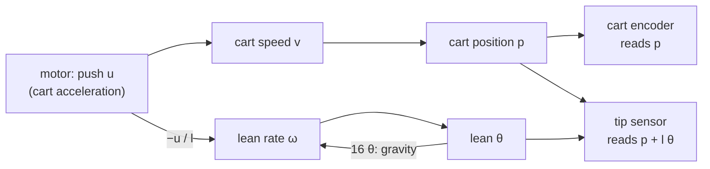
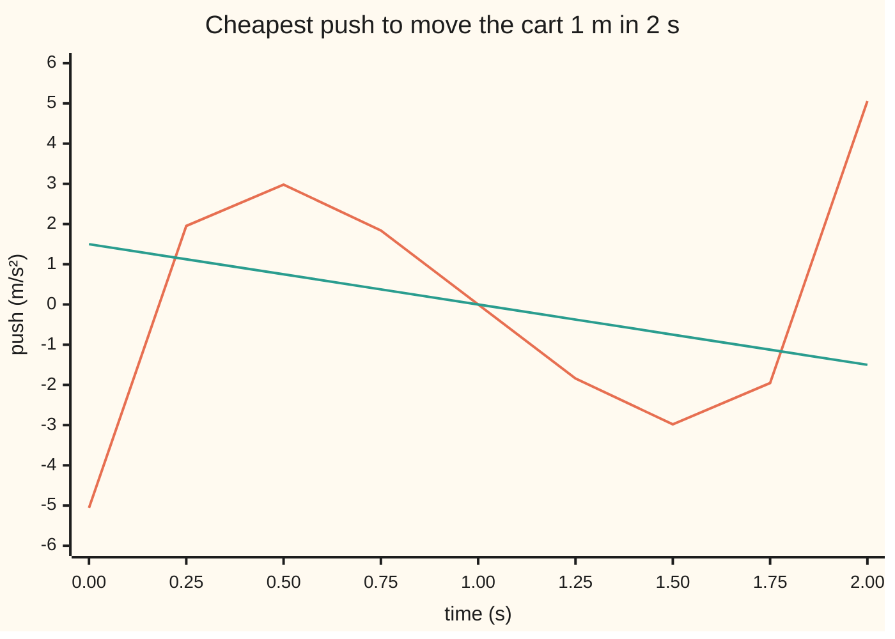

# Can you steer every state, and can you see every state

[Syllabus](../../../SYLLABUS.md) → [Engineering mathematics](../README.md) → [State Space and Optimal Control](../README.md#s04) → Can you steer every state, and can you see every state

---

## General Overview

A cart runs on a rail. A rod 0.613125 m long stands upright on a hinge on top of it. The motor sets the cart's acceleration, and one encoder (a counter on the wheel shaft) reports where the cart is. Earlier cards read the rod's lean with an encoder at the hinge, the pivot encoder; this card asks what one encoder on the wheel shaft, the cart encoder, can see. The model carries four numbers: cart position, cart speed, the rod's lean and how fast the lean is changing.

Before designing any controller, an engineer asks two questions. **Can the one motor steer all four numbers?** Yes. **Can the cart encoder alone see all four?** No. Stand the rod upright, or tip it 0.05 rad (a few degrees) and let go. Half a second later the leaning rod is at 0.1881 rad and falling, and the encoder reads 0.0000 m in both runs. No filter, however clever, can tell the two apart.

The reason is the motor. It forces the cart to the commanded acceleration whatever the rod does, so the rod never pushes the cart off course, and the encoder never hears about it. A sensor on the rod's tip, reading the tip's sideways position, sees all four numbers.

Two tests give these answers. A **rank test** says yes or no. A **Gramian** (an integral that adds up everything the motor or the sensor can do over a time window) says how hard. Moving the cart 1 m in 2 s, with the rod upright and still at both ends, costs 6.63 times the push effort of moving a bare cart.

**Stack the directions the motor can push and see if they fill all four state directions; stack the directions the sensor can read and see if they fill them too; the Gramians then price each direction, and the second test is the first one run on the transposed matrices.**

**What kind of fact this is:** theorems. The rank tests and the Gramian's price are proved on this card in Why it works; the mode-by-mode test of Step 4 is stated, and proved in the 1970 paper on it listed in Sources. The cart's numbers come from a linear model, which holds only for small leans.

### The picture: where the rod's motion can and cannot reach



Arrows from the motor reach all four boxes, so the motor at least touches every state; a picture cannot say whether it can steer them independently, and the rank test below decides that. No arrow leads from the rod (θ, ω) to the cart encoder, so the encoder is blind to the rod. The tip sensor has an arrow from both halves.

---

## The formula

The state $x$ is the list of four numbers ([State space](01-state-space-models-and-the-matrix-exponential.md)): cart position $p$, cart speed $v$, lean $\theta$ (theta) and lean rate $\omega$ (omega). Near upright ([Linearisation](02-linearisation-about-an-equilibrium.md)) the model is $x' = Ax + Bu$ with the reading $y = Cx$: here $p'' = u$ and $\theta'' = 16\,\theta - u/l$. A raised $\top$ turns a column into a row (the transpose). With $n = 4$ states:

$$\mathcal{C} = \big[\,B \;\; AB \;\; A^2B \;\; A^3B\,\big], \qquad \mathcal{O} = \begin{bmatrix} C \\ CA \\ CA^2 \\ CA^3 \end{bmatrix}, \qquad \text{steerable} \iff \operatorname{rank}\mathcal{C} = n, \quad \text{seeable} \iff \operatorname{rank}\mathcal{O} = n$$

$$W_c(T) = \int_0^T e^{At}BB^\top e^{A^\top t}\,dt, \qquad E = x_f^\top W_c(T)^{-1}x_f, \qquad W_o(T) = \int_0^T e^{A^\top t}C^\top C\,e^{At}\,dt = W_c(T)\big|_{A \to A^\top,\; B \to C^\top}$$

**Read it aloud:** the motor can steer every state when its push directions, and what the plant does to them, fill all four directions; the sensor can see every state when its reading and its rates of change do; the cheapest push to a target state costs that state against the inverse Gramian, and the seeing Gramian is the steering Gramian of the transposed plant.

The words for these are **controllable** (steerable) and **observable** (seeable). The rank of a matrix is how many independent directions its columns span ([Rank and nullity](../../03-Algebra/05-Solving%20Systems/05-rank-nullity.md)).

| Symbol | Plain meaning | In our example | Push it up and the answer… |
| --- | --- | --- | --- |
| $x$; $p, v, \theta, \omega$; $x_f$, $x_0$ | state: cart position (m), speed (m/s), lean (rad), lean rate (rad/s); $x_f$ the target state, $x_0$ the starting state | $x_f = (1, 0, 0, 0)$: cart 1 m along, rod upright and still | price grows as its square |
| $u$, $E$; $u_0$, $\delta$ | push: commanded cart acceleration (m/s²); $E$ the least total of $u^2$ over the window, in m²/s³; $u_0$ the cheapest push, $\delta$ any change to it | $E$ = 9.950 for the 1 m move in 2 s | — |
| $y$, $C$ | the sensor's reading; the row that picks it out of $x$ | cart encoder $C = (1, 0, 0, 0)$; tip sensor $(1, 0, l, 0)$ | — |
| $A$, $B$, $I$ | how the state drifts; how the push enters; the identity matrix | `B = (0, 1, 0, −1.6310)` | — |
| $16$, $l$, $g$ | gravity over rod length, per s²; rod length; gravity 9.81 m/s² (NIST CODATA standard gravity, rounded) | 16; 0.613125 m | the 1 m move gets cheaper: gravity does more of the leaning |
| $n$ | number of states | 4 | one more column and row to fill |
| $\mathcal{C}$, $\mathcal{O}$ | controllability matrix (push directions); observability matrix (reading directions) | rank 4; rank 2 from the cart encoder | — |
| $W_c(T)$, $W_o(T)$ | steering and seeing Gramians over a window of $T$ seconds | $W_c$ smallest eigenvalue 4.231e-3 at $T$ = 2 s | bigger means cheaper to steer, easier to see |
| $T$, $t$ | window length, s; time, s | $T$ = 2 s steering, 0.5 s watching | longer windows are cheaper |
| $\lambda$ | an eigenvalue of $A$, one natural motion of the plant | 0, 0, +4, −4 per s | — |
| $w$, $\mu$ | a direction in the state (a row of weights on $p, v, \theta, \omega$); an eigenvalue of $W_c$, the price factor of one direction | hardest direction mostly lean; $\mu$ from 4.231e-3 to 7.849e5 | bigger $\mu$, cheaper direction |
| $s$, $G(s)$ | Laplace variable; transfer function from push to reading | cart encoder $G(s) = 1/s^2$ | — |

### When it holds

- **The model is linear.** The tests are about $x' = Ax + Bu$, which holds near upright. Ask for the 1 m move in 1 s and the cheapest plan leans the rod 0.7475 rad (42.8°), where sin θ is already 9.1% below θ: the plan no longer describes the real rod.
- **The motor sets acceleration.** A stiff servo hides the rod from the cart. Drive a light cart by force instead (a 1 kg cart, a 0.1 kg weight at the rod's tip) and the rod pushes back: a 0.05 rad lean moves the cart −8.74 mm in 0.5 s, and the cart encoder's rank becomes 4.
- **A, B, C stay fixed.** With matrices that change in time, the rank test can miss things; the Gramian, computed with the true transition, still answers.
- **The push is unlimited.** Rank 4 means some push gets there, not that the motor can deliver it. The Gramian's price says how large the push must be.
- **Exact arithmetic, or a tolerance.** On a computer a rank is decided by a cut-off. A sensor 1 cm up the rod has rank 4, but its weakest seeing direction is 8.833e-10: rank 4 in theory, nearly blind in practice.

---

## Why it works

### Step 0: everything the motor does is built from B, AB, A²B, …

Start at rest and give a short kick. The state jumps along $B$. Then the plant carries that jump along: after time $t$ it is $e^{At}B = B + tAB + \tfrac{t^2}{2}A^2B + \dots$ ([The matrix exponential](../../08-Differential%20equations%20and%20dynamics/04-Systems%20and%20the%20Matrix%20Exponential/04-the-matrix-exponential.md)). Any push is a string of kicks, so every state the motor reaches is a mix of $B, AB, A^2B, \dots$. If those cannot fill four directions, some direction is out of reach forever.

### Step 1: four columns are enough

The Cayley–Hamilton theorem says $A$ satisfies its own characteristic polynomial. Here that polynomial is $s^2(s^2 - 16)$, so $A^4 = 16A^2$ and $A^4B = 16A^2B$. Every higher power folds back onto the first four, so $\mathcal{C} = [B\;AB\;A^2B\;A^3B]$ holds every direction the motor will ever reach. If its rank is below 4, a row $w^\top$ with $w^\top\mathcal{C} = 0$ exists, and $w^\top x(t) = 0$ for every push: that combination of states can never be moved.

### Step 2: if the rank is 4, the Gramian gives the cheapest push

Try the push $u(t) = B^\top e^{A^\top(T-t)}\,W_c(T)^{-1}x_f$. The response to a push from rest is $x(T) = \int_0^T e^{A(T-t)}B\,u(t)\,dt$ ([Forced systems](../../08-Differential%20equations%20and%20dynamics/04-Systems%20and%20the%20Matrix%20Exponential/06-forced-systems-and-variation-of-constants.md)). Substituting, the integral becomes $W_c(T)$ times $W_c(T)^{-1}x_f$, which is $x_f$. The push lands exactly.

It needs $W_c(T)$ to be invertible. For any direction $w$, $w^\top W_c w = \int_0^T (w^\top e^{At}B)^2\,dt$. That is zero only if $w^\top e^{At}B = 0$ for all $t$, which (taking derivatives at 0) means $w^\top A^kB = 0$ for every $k$, which rank 4 forbids. So rank 4 makes $W_c$ positive definite, and invertible.

<details>
<summary>Detailed proof: no other push that lands at x_f is cheaper</summary>

Let $u_0$ be the push above and $u = u_0 + \delta$ any other push that also lands at $x_f$. Both land, so $\int_0^T e^{A(T-t)}B\,\delta(t)\,dt = 0$. Now
$\int u_0\delta\,dt = \int (W_c^{-1}x_f)^\top e^{A(T-t)}B\,\delta\,dt = (W_c^{-1}x_f)^\top \cdot 0 = 0$.
So $\int u^2 = \int u_0^2 + 2\int u_0\delta + \int\delta^2 = \int u_0^2 + \int \delta^2 \ge \int u_0^2$. The cheapest cost is
$\int u_0^2\,dt = x_f^\top W_c^{-1}\Big(\int e^{A(T-t)}BB^\top e^{A^\top(T-t)}dt\Big)W_c^{-1}x_f = x_f^\top W_c^{-1}x_f$.

</details>

The eigenvalues of $W_c$ (its stretch factors, since $W_c$ is symmetric, [The singular value decomposition](../../03-Algebra/07-Eigenvalues%20and%20Symmetric%20Matrices/06-singular-value-decomposition.md)) price the directions. A target along the eigenvector with eigenvalue $\mu$ costs $1/\mu$ per unit squared. The smallest eigenvalue marks the hardest direction.

### Step 3: seeing is steering, transposed

With no push, the reading is $y(t) = Ce^{At}x_0$, where $x_0$ is the starting state. A start $x_0$ is invisible when $y(t) = 0$ for all $t$. Taking derivatives at 0, that means $Cx_0 = CAx_0 = CA^2x_0 = \dots = 0$, so $x_0$ lies in the null space of $\mathcal{O}$ (the directions it sends to zero). By rank and nullity, the invisible directions number $4 - \operatorname{rank}\mathcal{O}$. The energy the sensor collects is $\int y^2\,dt = x_0^\top W_o(T)x_0$.

Now transpose. The rows $C, CA, CA^2, CA^3$ are the columns $C^\top, A^\top C^\top, (A^\top)^2C^\top, (A^\top)^3C^\top$ laid on their sides. So $\mathcal{O}$ for $(A, C)$ is $\mathcal{C}$ for $(A^\top, C^\top)$, transposed, and $W_o$ for $(A, C)$ is $W_c$ for $(A^\top, C^\top)$. This is **duality**: every fact about steering is a fact about seeing, run on the transposed plant. The code uses it once: it computes $\mathcal{O}$ and $W_o$ with the steering functions, fed $A^\top$ and $C^\top$.

### Step 4: mode by mode, and which failures matter

The PBH test (named from the initials of the three people who found it) checks one natural motion at a time. A motion with eigenvalue $\lambda$ is invisible exactly when $\big[\begin{smallmatrix}\lambda I - A \\ C\end{smallmatrix}\big]$ has rank below 4, and unsteerable exactly when $[\lambda I - A \;\; B]$ does. For the cart encoder the motions at +4 and −4 fail: those are the rod falling away and the rod's motion that dies out by itself.

A blind motion is harmless if it dies out by itself. A plant whose unseen motions all decay is called **detectable**; one whose unsteerable motions all decay is **stabilisable**. The cart encoder misses the motion at +4, which grows. So the cart encoder alone is not even detectable: no estimator fed only by it can track the rod, and no controller fed only by it can balance the rod.

---

## Worked numbers, by hand

| Step | Arithmetic | Value |
| --- | --- | --- |
| 1. Push direction | $B$: speed up by 1, lean rate down by $1/l = 1/0.613125$ | `(0, 1, 0, −1.6310)` |
| 2. Carried once | $AB$: speed becomes position, lean rate becomes lean | `(1, 0, −1.6310, 0)` |
| 3. Carried twice | $A^2B$: gravity turns lean into lean rate, times 16 | `(0, 0, 0, −26.0958)` |
| 4. Carried three times | $A^3B$ | `(0, 0, −26.0958, 0)` |
| 5. Rank of $\mathcal{C}$ | column 4 is lean alone, column 3 lean rate alone; subtract them out of columns 1 and 2, leaving speed alone and position alone | **4: controllable** |
| 6. Cart encoder rows | $C = (1,0,0,0)$, $CA = (0,1,0,0)$, $CA^2 = CA^3 = 0$ | **rank 2: blind to the rod** |
| 7. Tip sensor rows | $(1,0,l,0)$, $(0,1,0,l)$, $(0,0,16l,0)$, $(0,0,0,16l)$ with $16l = g$ = 9.81 | **rank 4: sees everything** |
| 8. Bare cart Gramian, 2 s | entries $\int t^2 = 8/3$, $\int t = 2$, $\int 1 = 2$; determinant 16/3 − 4 = 4/3 | `[[2.6667, 2], [2, 2]]` |
| 9. Bare cart price | top-left of the inverse: 2 ÷ (4/3), the same as $12/T^3$ | 1.500 |
| 10. Rod's lean entry of $W_c$ | $\tfrac{1}{16 l^2}\big(\sinh(16)/16 - 1\big)$ = 0.16626 × 277690 | 46168.1149 |
| 11. Rod and cart price | top-left of $W_c(2)^{-1}$, by elimination in the code | **9.950 m²/s³** |

The rod makes the same 1 m move cost 6.63 times as much push, because the motor must first pull back to lean the rod forward, carry it, then catch it.

The cheapest push, from the code, opens with a pull of −5.059 m/s², drives forward around 2.980 m/s², brakes around −2.980 m/s², and ends with a hard push of 5.059 m/s² that stands the rod back up. The rod leans at most 0.1763 rad (10.1°), where sin θ is only 0.5% below θ, so the linear model holds.



Orange: cart carrying the upright rod (price 9.950). Green: bare cart (price 1.500), a straight ramp from push to brake.

The price list. $W_c(2)$ has eigenvalues 4.231e-3, 1.899e-1, 2.461e0 and 7.849e5. The largest belongs to the rod already falling, with lean rate four times the lean: gravity does that work for free. The smallest, the hardest direction, is mostly lean (0.938) with a lean rate of −0.234 against it and a little cart motion. Reaching the 0.05 rad lean alone in 2 s costs 0.5203; setting the cart moving at 1 m/s costs 10.9444.

Seeing, over a 0.5 s window. From the cart encoder, $W_o$ has eigenvalues 0, 0, 9.792e-3 and 5.319e-1: two directions return no signal at all, and the 0.05 rad lean gives an output energy of 0. From the tip sensor every eigenvalue is positive (smallest 2.787e-6), and the same lean returns 1.838e-3 m²·s.

### What breaks if you drop a piece

| Mistake | Comes out at | What went wrong |
| --- | --- | --- |
| Trust the cart encoder's transfer function | $G(1)$ = 1.0000, exactly $1/s^2$: poles at 0 and 0 only | the zeros at ±4 cancel the rod's poles; the falling motion is hidden, not gone. The tip sensor's $G(1)$ = 1.0667 = $-16/(s^2(s^2-16))$ keeps all four |
| Use the pivot encoder alone | cart 0.2000 m off after 2 s at 0.1 m/s, reading unchanged | rank 2 again; its blind motions sit at eigenvalue 0, so a drifting cart never shows, and the plant is not detectable |
| Ask the linear model for 1 m in 1 s | price 554.747 (46.23 times the bare cart), peak lean 0.7475 rad | outside the small-angle range: sin θ is 9.1% below θ at the peak |
| Let the window run to infinity | lean entry of $W_c$: 4.617e4 at 2 s, 4.103e11 at 4 s | the plant is unstable, so the infinite Gramian does not exist; use a finite window |

---

## Code, from first principles, and it actually runs

The scripts build every tool they use: a matrix exponential (scale down, Taylor series, square back), Gaussian elimination, Jacobi's rotation method for the eigenvalues of a symmetric matrix, and Simpson's rule. They reach the answers by **three independent roads**. Ranks come from elimination and again from counting nonzero singular values, and both must match the hand counts of Worked numbers. The Gramian's price comes from inverting the Gramian, and again from flying the cheapest push through the plant with a Runge–Kutta (RK4) integrator, which must land on the target and spend exactly that price. Closed forms by hand check the rest: the rod's lean $0.05\cosh 4t$, the Gramian's lean entry, the bare cart's $12/T^3$, both transfer functions, and the tip sensor's output energy. Observability is computed through duality, and row $CA^3$ is checked directly from $A$.

### Python

```python
# Can you steer every state, and can you see every state -- the check behind the card.
# Standard library only. Cart on a rail, motor sets its acceleration u (m/s^2), rod upright on a hinge.
# State x = (p cart m, v cart m/s, th lean rad, om lean rate rad/s): p'' = u, th'' = 16 th - u/l.
import math

L, G = 0.613125, 9.81
a, c = G / L, 1 / L                                      # a = g/l = 16 per s^2, c = 1/l per m
A = [[0, 1, 0, 0], [0, 0, 0, 0], [0, 0, 0, 1], [0, 0, a, 0]]
B = [0, 1, 0, -c]
CART, PIVOT, TIP = [1, 0, 0, 0], [0, 0, 1, 0], [1, 0, L, 0]  # tip sensor reads p + l th
LEAN = [0, 0, 0.05, 0]
def f(x, d=4): return f"{0.0 if abs(x) < 0.5 * 10 ** -d else x:.{d}f}"
def sci(x):
    if abs(x) < 1e-15: return "0"
    e = math.floor(math.log10(abs(x))); return f"{x / 10 ** e:.3f}e{e}"
def mm(X, Y): return [[sum(X[i][k] * Y[k][j] for k in range(len(Y))) for j in range(len(Y[0]))] for i in range(len(X))]
def tr(X): return [list(r) for r in zip(*X)]
def mv(X, v): return [sum(r[j] * v[j] for j in range(len(v))) for r in X]
def dot(u, v): return sum(p * q for p, q in zip(u, v))
def eye(n): return [[float(i == j) for j in range(n)] for i in range(n)]
def expm(X, t):                                          # e^(Xt): scale down by 256, Taylor series, square 8 times
    E = eye(len(X)); P = eye(len(X)); Y = [[v * t / 256 for v in r] for r in X]
    for k in range(1, 20):
        P = [[v / k for v in r] for r in mm(P, Y)]; E = [[e + p for e, p in zip(r, q)] for r, q in zip(E, P)]
    for _ in range(8): E = mm(E, E)
    return E
def rank(M, tol=1e-9):                                   # road 1 to a rank: Gaussian elimination
    M = [r[:] for r in M]; r = 0
    for j in range(len(M[0])):
        if r == len(M): break
        p = max(range(r, len(M)), key=lambda i: abs(M[i][j]))
        if abs(M[p][j]) < tol: continue
        M[r], M[p] = M[p], M[r]
        for i in range(len(M)):
            if i != r: M[i] = [x - M[i][j] / M[r][j] * y for x, y in zip(M[i], M[r])]
        r += 1
    return r
def jacobi(S):                                           # eigenvalues (ascending) and eigenvectors of symmetric S
    n = len(S); S = [r[:] for r in S]; V = eye(n)
    for _ in range(40):
        for p in range(n):
            for q in range(p + 1, n):
                if S[p][q] == 0: continue
                t = 0.5 * math.atan2(2 * S[p][q], S[q][q] - S[p][p]); co, si = math.cos(t), math.sin(t)
                for k in range(n): S[k][p], S[k][q] = co * S[k][p] - si * S[k][q], si * S[k][p] + co * S[k][q]
                for k in range(n): S[p][k], S[q][k] = co * S[p][k] - si * S[q][k], si * S[p][k] + co * S[q][k]
                for k in range(n): V[k][p], V[k][q] = co * V[k][p] - si * V[k][q], si * V[k][p] + co * V[k][q]
    o = sorted(range(n), key=lambda i: S[i][i]); return [S[i][i] for i in o], [[V[k][i] for k in range(n)] for i in o]
def svrank(M): return sum(1 for s in jacobi(mm(tr(M), M))[0] if s > 1e-9)   # road 2: count nonzero singular values
def ctrb(A, B):                                          # columns B, AB, A^2 B, A^3 B
    cols = [B[:]]
    for _ in range(len(A) - 1): cols.append(mv(A, cols[-1]))
    return tr(cols)
def obsv(A, C): return tr(ctrb(tr(A), C))                # duality: rows C, CA, CA^2, CA^3
def gram(A, B, T, N=400):                                # integral of e^(At) B B^T e^(A^T t), Simpson's rule
    n, h = len(A), T / N; E1, E = expm(A, T / N), eye(len(A)); W = [[0.0] * n for _ in range(n)]
    for k in range(N + 1):
        w, v = (1 if k in (0, N) else 4 if k % 2 else 2) * h / 3, mv(E, B)
        W = [[W[i][j] + w * v[i] * v[j] for j in range(n)] for i in range(n)]; E = mm(E, E1)
    return W
def solve(M, b):
    n = len(M); M = [r[:] + [b[i]] for i, r in enumerate(M)]
    for i in range(n):
        p = max(range(i, n), key=lambda r: abs(M[r][i])); M[i], M[p] = M[p], M[i]
        for r in range(n):
            if r != i: M[r] = [x - M[r][i] / M[i][i] * y for x, y in zip(M[r], M[i])]
    return [M[i][n] / M[i][i] for i in range(n)]
def quad(x, W): return dot(x, mv(W, x))
def push(t, eta, T):                                     # u(t) = B^T e^(A^T (T-t)) eta, written out for this A
    s = T - t; return eta[0] * s + eta[1] - c * eta[2] * math.sinh(4 * s) / 4 - c * eta[3] * math.cosh(4 * s)
def fly(T, N=4000):                                      # road 2: fly the cheapest push through the plant with RK4
    eta, h, x, E, peak = solve(gram(A, B, T), [1, 0, 0, 0]), T / N, [0.0] * 4, 0.0, 0.0
    fx = lambda x, u: [x[1], u, x[3], a * x[2] - c * u]
    for k in range(N):
        u0, u1, u2 = push(k * h, eta, T), push(k * h + h / 2, eta, T), push(k * h + h, eta, T)
        k1 = fx(x, u0); k2 = fx([p + h / 2 * q for p, q in zip(x, k1)], u1)
        k3 = fx([p + h / 2 * q for p, q in zip(x, k2)], u1); k4 = fx([p + h * q for p, q in zip(x, k3)], u2)
        x = [p + h / 6 * (q + 2 * r + 2 * s + w) for p, q, r, s, w in zip(x, k1, k2, k3, k4)]
        E += h / 6 * (u0 * u0 + 4 * u1 * u1 + u2 * u2); peak = max(peak, abs(x[2]))
    return x, E, peak, eta
# ---- 1. the two rank tests ----
Cm = ctrb(A, B); print("columns B, AB, A2B, A3B:", " | ".join(" ".join(f(v) for v in col) for col in tr(Cm)))
print("controllability rank", rank(Cm), "by elimination,", svrank(Cm), "by singular values")
assert rank(Cm) == svrank(Cm) == 4 and abs(Cm[3][2] + a * c) < 1e-12
for name, C, k in (("cart encoder", CART, 2), ("pivot encoder", PIVOT, 2), ("tip sensor", TIP, 4)):   # k: rank by hand
    O = obsv(A, C); r3 = mm(mm(mm([C], A), A), A)[0]           # C A^3 as row times A, not from the dual
    assert max(abs(O[3][j] - r3[j]) for j in range(4)) < 1e-12 and rank(O) == svrank(O) == k
    print(f"{name}: observability rank {rank(O)}; rows", " | ".join(" ".join(f(v, 2) for v in r) for r in O))
# ---- 2. what the cart encoder cannot see: rod upright vs rod leaning 0.05 rad, no push ----
for t in (0.25, 0.5):
    x1, x2 = mv(expm(A, t), [0, 0, 0, 0]), mv(expm(A, t), LEAN)
    print(f"t {t} s: encoder {f(x1[0])} m and {f(x2[0])} m; lean {f(x1[2])} and {f(x2[2])} rad")
    assert x1[0] == x2[0] == 0 and abs(x2[2] - 0.05 * math.cosh(4 * t)) < 1e-12
# ---- 3. PBH, mode by mode: eigenvalues 0, 0, +4, -4 ----
for lam in (0, 4, -4):
    M = [[lam * (i == j) - A[i][j] for j in range(4)] for i in range(4)]
    ro = [rank(M + [C]) for C in (CART, PIVOT, TIP)]
    print(f"PBH at {lam}: steer rank {rank([r + [b] for r, b in zip(M, B)])}; see rank cart {ro[0]}, pivot {ro[1]}, tip {ro[2]}")
    assert ro[0] == (4 if lam == 0 else 3) and ro[1] == (3 if lam == 0 else 4) and ro[2] == 4
# ---- 4. transfer functions: the cart encoder's hides the +4 pole ----
for s in (1.0, 2.0):
    R = solve([[s * (i == j) - A[i][j] for j in range(4)] for i in range(4)], B); gc, gt = R[0], R[0] + L * R[2]
    print(f"G at s = {s:.0f}: cart {f(gc)}, 1/s^2 = {f(1 / s ** 2)}; tip {f(gt)}, -16/(s^2(s^2-16)) = {f(-16 / (s * s * (s * s - 16)))}")
    assert abs(gc - 1 / s ** 2) < 1e-12 and abs(gt + a / (s * s * (s * s - a))) < 1e-12
# ---- 5. controllability Gramian: the price of moving the cart 1 m, rod upright and still at both ends ----
T = 2.0; W = gram(A, B, T)
print("Wc(2 s) diagonal", " ".join(f(W[i][i]) for i in range(4)), "; p-v entry", f(W[0][1]), "; lean entry", f(c * c / 16, 5), "x", f(math.sinh(8 * T) / 16 - T / 2, 0))
assert abs(W[2][2] - c * c / 16 * (math.sinh(8 * T) / 16 - T / 2)) < 1e-6 * W[2][2]
bare = [[0, 1], [0, 0]]
for t_ in (2.0, 1.0, 3.0):
    e_rod, e_bare = solve(gram(A, B, t_), [1, 0, 0, 0])[0], solve(gram(bare, [0, 1], t_), [1, 0])[0]
    print(f"1 m in {t_:.0f} s: price {f(e_rod, 3)} with rod, {f(e_bare, 3)} bare cart (12/T^3 = {f(12 / t_ ** 3, 3)}), ratio {f(e_rod / e_bare, 2)}")
    assert abs(e_bare - 12 / t_ ** 3) < 1e-9
for t_ in (2.0, 1.0):
    x, E, peak, eta = fly(t_)
    print(f"flown {t_:.0f} s: lands", " ".join(f(v) for v in x), f"; energy {f(E, 3)}; peak lean {f(peak)} rad = {f(math.degrees(peak), 1)} deg; sin off by {f(100 * (1 - math.sin(peak) / peak), 1)}%")
    assert abs(x[0] - 1) < 1e-4 and max(abs(v) for v in x[1:]) < 1e-3 and abs(E - eta[0]) < 1e-4 * eta[0]
eta = solve(W, [1, 0, 0, 0])
print("chart t:", " ".join(f(k * 0.25, 2) for k in range(9)))
print("chart push with rod:", " ".join(f(push(k * 0.25, eta, T), 3) for k in range(9)))
print("chart push bare cart:", " ".join(f(6 / T ** 2 * (1 - 2 * k * 0.25 / T), 3) for k in range(9)))
for st in (LEAN, [0, 1, 0, 0]): print("price to reach", " ".join(f(v, 2) for v in st), "in 2 s:", f(dot(st, solve(W, st))))
ev, vec = jacobi(W); print("Wc eigenvalues", " ".join(sci(e) for e in ev), "; hardest", " ".join(f(v, 3) for v in vec[0]))
assert abs(dot(vec[0], mv(W, vec[0])) - ev[0]) < 1e-9 and abs(sum(ev) - sum(W[i][i] for i in range(4))) < 1e-6
S = [1, 1, 180 / math.pi, 180 / math.pi]; evd, vecd = jacobi([[S[i] * W[i][j] * S[j] for j in range(4)] for i in range(4)])
print("same, angles in degrees: smallest", sci(evd[0]), "; hardest", " ".join(f(v, 3) for v in vecd[0]))
# ---- 6. observability Gramian by duality: Wo(A, C) = Wc(A^T, C^T), window 0.5 s ----
To = 0.5
for name, C in (("cart encoder", CART), ("tip sensor", TIP), ("sensor 1 cm up the rod", [1, 0, 0.01, 0])):
    Wo = gram(tr(A), C, To); print(f"Wo(0.5 s) {name}: eigenvalues", " ".join(sci(v) for v in jacobi(Wo)[0]), "; lean 0.05 rad gives", sci(quad(LEAN, Wo)), "m^2 s")
direct = L * L * 0.0025 * (math.sinh(8 * To) / 16 + To / 2)  # integral of (l 0.05 cosh 4t)^2, by hand
assert abs(quad(LEAN, gram(tr(A), TIP, To)) - direct) < 1e-9 and quad(LEAN, gram(tr(A), CART, To)) < 1e-15
# ---- 7. outside the model, and what breaks ----
xp = mv(expm(A, 2), [0, 0.1, 0, 0]); print(f"pivot encoder, cart drifting 0.1 m/s: after 2 s cart {f(xp[0])} m off, lean still {f(xp[2])} rad")
M_, m_ = 1.0, 0.1; Af = [[0, 1, 0, 0], [0, 0, -m_ * G / M_, 0], [0, 0, 0, 1], [0, 0, (M_ + m_) * G / (M_ * L), 0]]
wf = math.sqrt(Af[3][2]); pf = mv(expm(Af, 0.5), LEAN)[0]
print(f"force-driven 1 kg cart, 0.1 kg bob: cart-encoder rank {rank(obsv(Af, CART))}; lean 0.05 rad moves cart {f(1000 * pf, 2)} mm in 0.5 s")
assert abs(pf + m_ * G / M_ * 0.05 * (math.cosh(wf * 0.5) - 1) / wf ** 2) < 1e-12
print("Wc lean-lean entry: T = 2 s", sci(W[2][2]), "; T = 4 s", sci(gram(A, B, 4.0)[2][2]))
print("ALL CHECKS PASS")
```

**Ran 2026-11-11 on macOS, Python 3.14.10, standard library only. All checks passed. Output, pasted from the run:**

```
columns B, AB, A2B, A3B: 0.0000 1.0000 0.0000 -1.6310 | 1.0000 0.0000 -1.6310 0.0000 | 0.0000 0.0000 0.0000 -26.0958 | 0.0000 0.0000 -26.0958 0.0000
controllability rank 4 by elimination, 4 by singular values
cart encoder: observability rank 2; rows 1.00 0.00 0.00 0.00 | 0.00 1.00 0.00 0.00 | 0.00 0.00 0.00 0.00 | 0.00 0.00 0.00 0.00
pivot encoder: observability rank 2; rows 0.00 0.00 1.00 0.00 | 0.00 0.00 0.00 1.00 | 0.00 0.00 16.00 0.00 | 0.00 0.00 0.00 16.00
tip sensor: observability rank 4; rows 1.00 0.00 0.61 0.00 | 0.00 1.00 0.00 0.61 | 0.00 0.00 9.81 0.00 | 0.00 0.00 0.00 9.81
t 0.25 s: encoder 0.0000 m and 0.0000 m; lean 0.0000 and 0.0772 rad
t 0.5 s: encoder 0.0000 m and 0.0000 m; lean 0.0000 and 0.1881 rad
PBH at 0: steer rank 4; see rank cart 4, pivot 3, tip 4
PBH at 4: steer rank 4; see rank cart 3, pivot 4, tip 4
PBH at -4: steer rank 4; see rank cart 3, pivot 4, tip 4
G at s = 1: cart 1.0000, 1/s^2 = 1.0000; tip 1.0667, -16/(s^2(s^2-16)) = 1.0667
G at s = 2: cart 0.2500, 1/s^2 = 0.2500; tip 0.3333, -16/(s^2(s^2-16)) = 0.3333
Wc(2 s) diagonal 2.6667 2.0000 46168.1149 738695.1588 ; p-v entry 2.0000 ; lean entry 0.16626 x 277690
1 m in 2 s: price 9.950 with rod, 1.500 bare cart (12/T^3 = 1.500), ratio 6.63
1 m in 1 s: price 554.747 with rod, 12.000 bare cart (12/T^3 = 12.000), ratio 46.23
1 m in 3 s: price 1.455 with rod, 0.444 bare cart (12/T^3 = 0.444), ratio 3.27
flown 2 s: lands 1.0000 0.0000 0.0000 -0.0001 ; energy 9.950; peak lean 0.1763 rad = 10.1 deg; sin off by 0.5%
flown 1 s: lands 1.0000 0.0000 0.0000 0.0000 ; energy 554.747; peak lean 0.7475 rad = 42.8 deg; sin off by 9.1%
chart t: 0.00 0.25 0.50 0.75 1.00 1.25 1.50 1.75 2.00
chart push with rod: -5.059 1.953 2.980 1.841 0.000 -1.841 -2.980 -1.953 5.059
chart push bare cart: 1.500 1.125 0.750 0.375 0.000 -0.375 -0.750 -1.125 -1.500
price to reach 0.00 0.00 0.05 0.00 in 2 s: 0.5203
price to reach 0.00 1.00 0.00 0.00 in 2 s: 10.9444
Wc eigenvalues 4.231e-3 1.899e-1 2.461e0 7.849e5 ; hardest 0.171 -0.192 0.938 -0.234
same, angles in degrees: smallest 4.888e-2 ; hardest 0.688 -0.724 0.048 -0.012
Wo(0.5 s) cart encoder: eigenvalues 0 0 9.792e-3 5.319e-1 ; lean 0.05 rad gives 0 m^2 s
Wo(0.5 s) tip sensor: eigenvalues 2.787e-6 1.063e-3 5.626e-2 1.254e0 ; lean 0.05 rad gives 1.838e-3 m^2 s
Wo(0.5 s) sensor 1 cm up the rod: eigenvalues 8.833e-10 3.204e-6 9.819e-3 5.320e-1 ; lean 0.05 rad gives 4.889e-7 m^2 s
pivot encoder, cart drifting 0.1 m/s: after 2 s cart 0.2000 m off, lean still 0.0000 rad
force-driven 1 kg cart, 0.1 kg bob: cart-encoder rank 4; lean 0.05 rad moves cart -8.74 mm in 0.5 s
Wc lean-lean entry: T = 2 s 4.617e4 ; T = 4 s 4.103e11
ALL CHECKS PASS
```

### Rust

```rust
// Can you steer every state, and can you see every state -- the check behind the card.
// std only. Cart on a rail, motor sets its acceleration u (m/s^2), rod upright on a hinge.
// State x = (p cart m, v cart m/s, th lean rad, om lean rate rad/s): p'' = u, th'' = 16 th - u/l.
type M = Vec<Vec<f64>>;
const L: f64 = 0.613125;
const G: f64 = 9.81;
fn f(x: f64, d: usize) -> String { let y = if x.abs() < 0.5 * 10f64.powi(-(d as i32)) { 0.0 } else { x }; format!("{:.*}", d, y) }
fn sci(x: f64) -> String {
    if x.abs() < 1e-15 { return "0".to_string(); }
    let e = x.abs().log10().floor(); format!("{:.3}e{}", x / 10f64.powf(e), e as i32)
}
fn mm(x: &M, y: &M) -> M { (0..x.len()).map(|i| (0..y[0].len()).map(|j| (0..y.len()).map(|k| x[i][k] * y[k][j]).sum()).collect()).collect() }
fn tr(x: &M) -> M { (0..x[0].len()).map(|j| x.iter().map(|r| r[j]).collect()).collect() }
fn mv(x: &M, v: &[f64]) -> Vec<f64> { x.iter().map(|r| r.iter().zip(v).map(|(a, b)| a * b).sum()).collect() }
fn dot(u: &[f64], v: &[f64]) -> f64 { u.iter().zip(v).map(|(a, b)| a * b).sum() }
fn eye(n: usize) -> M { (0..n).map(|i| (0..n).map(|j| if i == j { 1.0 } else { 0.0 }).collect()).collect() }
fn m(r: &[&[f64]]) -> M { r.iter().map(|x| x.to_vec()).collect() }
fn expm(x: &M, t: f64) -> M { // e^(Xt): scale down by 256, Taylor series, square 8 times
    let n = x.len(); let mut e = eye(n); let mut p = eye(n);
    let y: M = x.iter().map(|r| r.iter().map(|v| v * t / 256.0).collect()).collect();
    for k in 1..20 { p = mm(&p, &y).iter().map(|r| r.iter().map(|v| v / k as f64).collect()).collect();
        for i in 0..n { for j in 0..n { e[i][j] += p[i][j]; } } }
    for _ in 0..8 { e = mm(&e, &e); }
    e
}
fn rank(m0: &M) -> usize { // road 1 to a rank: Gaussian elimination
    let mut a = m0.clone(); let mut r = 0;
    for j in 0..a[0].len() {
        if r == a.len() { break; }
        let mut p = r; for i in r..a.len() { if a[i][j].abs() > a[p][j].abs() { p = i; } }
        if a[p][j].abs() < 1e-9 { continue; }
        a.swap(r, p);
        for i in 0..a.len() { if i != r { let q = a[i][j] / a[r][j]; let ar = a[r].clone(); for (x, y) in a[i].iter_mut().zip(&ar) { *x -= q * y; } } }
        r += 1;
    }
    r
}
fn jacobi(s0: &M) -> (Vec<f64>, M) { // eigenvalues (ascending) and eigenvectors of symmetric S
    let n = s0.len(); let mut s = s0.clone(); let mut v = eye(n);
    for _ in 0..40 { for p in 0..n { for q in p + 1..n {
        if s[p][q] == 0.0 { continue; }
        let t = 0.5 * (2.0 * s[p][q]).atan2(s[q][q] - s[p][p]); let (co, si) = (t.cos(), t.sin());
        for k in 0..n { let (a, b) = (s[k][p], s[k][q]); s[k][p] = co * a - si * b; s[k][q] = si * a + co * b; }
        for k in 0..n { let (a, b) = (s[p][k], s[q][k]); s[p][k] = co * a - si * b; s[q][k] = si * a + co * b; }
        for k in 0..n { let (a, b) = (v[k][p], v[k][q]); v[k][p] = co * a - si * b; v[k][q] = si * a + co * b; }
    } } }
    let mut o: Vec<usize> = (0..n).collect(); o.sort_by(|&i, &j| s[i][i].partial_cmp(&s[j][j]).unwrap());
    (o.iter().map(|&i| s[i][i]).collect(), o.iter().map(|&i| (0..n).map(|k| v[k][i]).collect()).collect())
}
fn svrank(x: &M) -> usize { jacobi(&mm(&tr(x), x)).0.iter().filter(|&&s| s > 1e-9).count() } // road 2: nonzero singular values
fn ctrb(a: &M, b: &[f64]) -> M { let mut cols = vec![b.to_vec()]; for _ in 1..a.len() { let n = mv(a, cols.last().unwrap()); cols.push(n); } tr(&cols) }
fn obsv(a: &M, c: &[f64]) -> M { tr(&ctrb(&tr(a), c)) } // duality: rows C, CA, CA^2, CA^3
fn gram(a: &M, b: &[f64], t: f64) -> M { // integral of e^(At) B B^T e^(A^T t), Simpson's rule
    let (n, nn) = (a.len(), 400); let h = t / nn as f64; let e1 = expm(a, h); let mut e = eye(n); let mut w = vec![vec![0.0; n]; n];
    for k in 0..=nn {
        let wt = (if k == 0 || k == nn { 1.0 } else if k % 2 == 1 { 4.0 } else { 2.0 }) * h / 3.0; let v = mv(&e, b);
        for i in 0..n { for j in 0..n { w[i][j] += wt * v[i] * v[j]; } } e = mm(&e, &e1);
    }
    w
}
fn solve(m0: &M, b: &[f64]) -> Vec<f64> {
    let n = m0.len(); let mut a: M = m0.iter().zip(b).map(|(r, &x)| { let mut r = r.clone(); r.push(x); r }).collect();
    for i in 0..n {
        let mut p = i; for r in i..n { if a[r][i].abs() > a[p][i].abs() { p = r; } } a.swap(i, p);
        for r in 0..n { if r != i { let q = a[r][i] / a[i][i]; let ai = a[i].clone(); for (x, y) in a[r].iter_mut().zip(&ai) { *x -= q * y; } } }
    }
    (0..n).map(|i| a[i][n] / a[i][i]).collect()
}
fn quad(x: &[f64], w: &M) -> f64 { dot(x, &mv(w, x)) }
fn plant() -> (M, Vec<f64>) { (m(&[&[0., 1., 0., 0.], &[0., 0., 0., 0.], &[0., 0., 0., 1.], &[0., 0., G / L, 0.]]), vec![0., 1., 0., -1.0 / L]) }
fn push(t: f64, eta: &[f64], tt: f64) -> f64 { // u(t) = B^T e^(A^T (T-t)) eta, written out for this A
    let (s, c) = (tt - t, 1.0 / L); eta[0] * s + eta[1] - c * eta[2] * (4.0 * s).sinh() / 4.0 - c * eta[3] * (4.0 * s).cosh()
}
fn fly(tt: f64) -> (Vec<f64>, f64, f64, Vec<f64>) { // road 2: fly the cheapest push through the plant with RK4
    let (a, b) = plant(); let eta = solve(&gram(&a, &b, tt), &[1., 0., 0., 0.]); let nn = 4000; let h = tt / nn as f64;
    let (aa, c) = (G / L, 1.0 / L); let fx = |x: &[f64], u: f64| vec![x[1], u, x[3], aa * x[2] - c * u];
    let ad = |x: &[f64], k: &[f64], s: f64| -> Vec<f64> { x.iter().zip(k).map(|(p, q)| p + s * q).collect() };
    let (mut x, mut e, mut peak) = (vec![0.0; 4], 0.0, 0.0f64);
    for k in 0..nn {
        let t = k as f64 * h; let (u0, u1, u2) = (push(t, &eta, tt), push(t + h / 2.0, &eta, tt), push(t + h, &eta, tt));
        let k1 = fx(&x, u0); let k2 = fx(&ad(&x, &k1, h / 2.0), u1); let k3 = fx(&ad(&x, &k2, h / 2.0), u1); let k4 = fx(&ad(&x, &k3, h), u2);
        x = (0..4).map(|i| x[i] + h / 6.0 * (k1[i] + 2.0 * k2[i] + 2.0 * k3[i] + k4[i])).collect();
        e += h / 6.0 * (u0 * u0 + 4.0 * u1 * u1 + u2 * u2); peak = peak.max(x[2].abs());
    }
    (x, e, peak, eta)
}
fn row(v: &[f64], d: usize) -> String { v.iter().map(|&x| f(x, d)).collect::<Vec<_>>().join(" ") }
fn rows(o: &M, d: usize) -> String { o.iter().map(|r| row(r, d)).collect::<Vec<_>>().join(" | ") }
fn main() {
    let (a, b) = plant(); let (aa, c) = (G / L, 1.0 / L); let at = tr(&a);
    let (cart, pivot, tip, lean) = ([1., 0., 0., 0.], [0., 0., 1., 0.], [1., 0., L, 0.], [0., 0., 0.05, 0.]);
    // ---- 1. the two rank tests ----
    let cm = ctrb(&a, &b); println!("columns B, AB, A2B, A3B: {}", rows(&tr(&cm), 4));
    println!("controllability rank {} by elimination, {} by singular values", rank(&cm), svrank(&cm));
    assert!(rank(&cm) == 4 && svrank(&cm) == 4 && (cm[3][2] + aa * c).abs() < 1e-12);
    for (name, cc, k) in [("cart encoder", cart, 2), ("pivot encoder", pivot, 2), ("tip sensor", tip, 4)] { // k: rank by hand
        let o = obsv(&a, &cc); let r3 = mm(&mm(&mm(&vec![cc.to_vec()], &a), &a), &a)[0].clone(); // C A^3 as row times A, not from the dual
        assert!((0..4).all(|j| (o[3][j] - r3[j]).abs() < 1e-12) && rank(&o) == svrank(&o) && rank(&o) == k);
        println!("{}: observability rank {}; rows {}", name, rank(&o), rows(&o, 2));
    }
    // ---- 2. what the cart encoder cannot see: rod upright vs rod leaning 0.05 rad, no push ----
    for t in [0.25, 0.5] {
        let (x1, x2) = (mv(&expm(&a, t), &[0.; 4]), mv(&expm(&a, t), &lean));
        println!("t {} s: encoder {} m and {} m; lean {} and {} rad", t, f(x1[0], 4), f(x2[0], 4), f(x1[2], 4), f(x2[2], 4));
        assert!(x1[0] == 0.0 && x2[0] == 0.0 && (x2[2] - 0.05 * (4.0 * t).cosh()).abs() < 1e-12);
    }
    // ---- 3. PBH, mode by mode: eigenvalues 0, 0, +4, -4 ----
    for lam in [0i32, 4, -4] {
        let mm0: M = (0..4).map(|i| (0..4).map(|j| if i == j { lam as f64 } else { 0.0 } - a[i][j]).collect()).collect();
        let ro: Vec<usize> = [cart, pivot, tip].iter().map(|cc| { let mut x = mm0.clone(); x.push(cc.to_vec()); rank(&x) }).collect();
        let st: M = mm0.iter().zip(&b).map(|(r, &x)| { let mut r = r.clone(); r.push(x); r }).collect();
        println!("PBH at {}: steer rank {}; see rank cart {}, pivot {}, tip {}", lam, rank(&st), ro[0], ro[1], ro[2]);
        assert!(ro[0] == if lam == 0 { 4 } else { 3 } && ro[1] == if lam == 0 { 3 } else { 4 } && ro[2] == 4);
    }
    // ---- 4. transfer functions: the cart encoder's hides the +4 pole ----
    for s in [1.0f64, 2.0] {
        let r = solve(&(0..4).map(|i| (0..4).map(|j| if i == j { s } else { 0.0 } - a[i][j]).collect()).collect(), &b); let (gc, gt) = (r[0], r[0] + L * r[2]);
        println!("G at s = {:.0}: cart {}, 1/s^2 = {}; tip {}, -16/(s^2(s^2-16)) = {}", s, f(gc, 4), f(1.0 / (s * s), 4), f(gt, 4), f(-16.0 / (s * s * (s * s - 16.0)), 4));
        assert!((gc - 1.0 / (s * s)).abs() < 1e-12 && (gt + aa / (s * s * (s * s - aa))).abs() < 1e-12);
    }
    // ---- 5. controllability Gramian: the price of moving the cart 1 m, rod upright and still at both ends ----
    let tt = 2.0; let w = gram(&a, &b, tt);
    println!("Wc(2 s) diagonal {} ; p-v entry {} ; lean entry {} x {}", row(&(0..4).map(|i| w[i][i]).collect::<Vec<_>>(), 4), f(w[0][1], 4), f(c * c / 16.0, 5), f((8.0 * tt).sinh() / 16.0 - tt / 2.0, 0));
    assert!((w[2][2] - c * c / 16.0 * ((8.0 * tt).sinh() / 16.0 - tt / 2.0)).abs() < 1e-6 * w[2][2]);
    let bare = m(&[&[0., 1.], &[0., 0.]]);
    for t in [2.0f64, 1.0, 3.0] {
        let (er, eb) = (solve(&gram(&a, &b, t), &[1., 0., 0., 0.])[0], solve(&gram(&bare, &[0., 1.], t), &[1., 0.])[0]);
        println!("1 m in {:.0} s: price {} with rod, {} bare cart (12/T^3 = {}), ratio {}", t, f(er, 3), f(eb, 3), f(12.0 / t.powi(3), 3), f(er / eb, 2));
        assert!((eb - 12.0 / t.powi(3)).abs() < 1e-9);
    }
    for t in [2.0f64, 1.0] {
        let (x, e, peak, eta) = fly(t);
        println!("flown {:.0} s: lands {} ; energy {}; peak lean {} rad = {} deg; sin off by {}%", t, row(&x, 4), f(e, 3), f(peak, 4), f(peak.to_degrees(), 1), f(100.0 * (1.0 - peak.sin() / peak), 1));
        assert!((x[0] - 1.0).abs() < 1e-4 && x[1..].iter().all(|v| v.abs() < 1e-3) && (e - eta[0]).abs() < 1e-4 * eta[0]);
    }
    let eta = solve(&w, &[1., 0., 0., 0.]);
    println!("chart t: {}", row(&(0..9).map(|k| k as f64 * 0.25).collect::<Vec<_>>(), 2));
    println!("chart push with rod: {}", row(&(0..9).map(|k| push(k as f64 * 0.25, &eta, tt)).collect::<Vec<_>>(), 3));
    println!("chart push bare cart: {}", row(&(0..9).map(|k| 6.0 / (tt * tt) * (1.0 - 2.0 * k as f64 * 0.25 / tt)).collect::<Vec<_>>(), 3));
    for st in [lean, [0., 1., 0., 0.]] { println!("price to reach {} in 2 s: {}", row(&st, 2), f(dot(&st, &solve(&w, &st)), 4)); }
    let (ev, vec) = jacobi(&w);
    println!("Wc eigenvalues {} ; hardest {}", ev.iter().map(|&e| sci(e)).collect::<Vec<_>>().join(" "), row(&vec[0], 3));
    assert!((quad(&vec[0], &w) - ev[0]).abs() < 1e-9 && (ev.iter().sum::<f64>() - (0..4).map(|i| w[i][i]).sum::<f64>()).abs() < 1e-6);
    let sc = [1.0, 1.0, 180.0 / std::f64::consts::PI, 180.0 / std::f64::consts::PI];
    let (evd, vecd) = jacobi(&(0..4).map(|i| (0..4).map(|j| sc[i] * w[i][j] * sc[j]).collect()).collect());
    println!("same, angles in degrees: smallest {} ; hardest {}", sci(evd[0]), row(&vecd[0], 3));
    // ---- 6. observability Gramian by duality: Wo(A, C) = Wc(A^T, C^T), window 0.5 s ----
    let to = 0.5;
    for (name, cc) in [("cart encoder", cart), ("tip sensor", tip), ("sensor 1 cm up the rod", [1., 0., 0.01, 0.])] {
        let wo = gram(&at, &cc, to);
        println!("Wo(0.5 s) {}: eigenvalues {} ; lean 0.05 rad gives {} m^2 s", name, jacobi(&wo).0.iter().map(|&e| sci(e)).collect::<Vec<_>>().join(" "), sci(quad(&lean, &wo)));
    }
    let direct = L * L * 0.0025 * ((8.0 * to).sinh() / 16.0 + to / 2.0); // integral of (l 0.05 cosh 4t)^2, by hand
    assert!((quad(&lean, &gram(&at, &tip, to)) - direct).abs() < 1e-9 && quad(&lean, &gram(&at, &cart, to)) < 1e-15);
    // ---- 7. outside the model, and what breaks ----
    let xp = mv(&expm(&a, 2.0), &[0., 0.1, 0., 0.]);
    println!("pivot encoder, cart drifting 0.1 m/s: after 2 s cart {} m off, lean still {} rad", f(xp[0], 4), f(xp[2], 4));
    let (bm, sm) = (1.0, 0.1); let af = m(&[&[0., 1., 0., 0.], &[0., 0., -sm * G / bm, 0.], &[0., 0., 0., 1.], &[0., 0., (bm + sm) * G / (bm * L), 0.]]);
    let wf = af[3][2].sqrt(); let pf = mv(&expm(&af, 0.5), &lean)[0];
    println!("force-driven 1 kg cart, 0.1 kg bob: cart-encoder rank {}; lean 0.05 rad moves cart {} mm in 0.5 s", rank(&obsv(&af, &cart)), f(1000.0 * pf, 2));
    assert!((pf + sm * G / bm * 0.05 * ((wf * 0.5).cosh() - 1.0) / (wf * wf)).abs() < 1e-12);
    println!("Wc lean-lean entry: T = 2 s {} ; T = 4 s {}", sci(w[2][2]), sci(gram(&a, &b, 4.0)[2][2]));
    println!("ALL CHECKS PASS");
}
```

**Ran 2026-11-11 on macOS, rustc 1.98.1, no crates. All checks passed. Output, pasted from the run:**

```
columns B, AB, A2B, A3B: 0.0000 1.0000 0.0000 -1.6310 | 1.0000 0.0000 -1.6310 0.0000 | 0.0000 0.0000 0.0000 -26.0958 | 0.0000 0.0000 -26.0958 0.0000
controllability rank 4 by elimination, 4 by singular values
cart encoder: observability rank 2; rows 1.00 0.00 0.00 0.00 | 0.00 1.00 0.00 0.00 | 0.00 0.00 0.00 0.00 | 0.00 0.00 0.00 0.00
pivot encoder: observability rank 2; rows 0.00 0.00 1.00 0.00 | 0.00 0.00 0.00 1.00 | 0.00 0.00 16.00 0.00 | 0.00 0.00 0.00 16.00
tip sensor: observability rank 4; rows 1.00 0.00 0.61 0.00 | 0.00 1.00 0.00 0.61 | 0.00 0.00 9.81 0.00 | 0.00 0.00 0.00 9.81
t 0.25 s: encoder 0.0000 m and 0.0000 m; lean 0.0000 and 0.0772 rad
t 0.5 s: encoder 0.0000 m and 0.0000 m; lean 0.0000 and 0.1881 rad
PBH at 0: steer rank 4; see rank cart 4, pivot 3, tip 4
PBH at 4: steer rank 4; see rank cart 3, pivot 4, tip 4
PBH at -4: steer rank 4; see rank cart 3, pivot 4, tip 4
G at s = 1: cart 1.0000, 1/s^2 = 1.0000; tip 1.0667, -16/(s^2(s^2-16)) = 1.0667
G at s = 2: cart 0.2500, 1/s^2 = 0.2500; tip 0.3333, -16/(s^2(s^2-16)) = 0.3333
Wc(2 s) diagonal 2.6667 2.0000 46168.1149 738695.1588 ; p-v entry 2.0000 ; lean entry 0.16626 x 277690
1 m in 2 s: price 9.950 with rod, 1.500 bare cart (12/T^3 = 1.500), ratio 6.63
1 m in 1 s: price 554.747 with rod, 12.000 bare cart (12/T^3 = 12.000), ratio 46.23
1 m in 3 s: price 1.455 with rod, 0.444 bare cart (12/T^3 = 0.444), ratio 3.27
flown 2 s: lands 1.0000 0.0000 0.0000 -0.0001 ; energy 9.950; peak lean 0.1763 rad = 10.1 deg; sin off by 0.5%
flown 1 s: lands 1.0000 0.0000 0.0000 0.0000 ; energy 554.747; peak lean 0.7475 rad = 42.8 deg; sin off by 9.1%
chart t: 0.00 0.25 0.50 0.75 1.00 1.25 1.50 1.75 2.00
chart push with rod: -5.059 1.953 2.980 1.841 0.000 -1.841 -2.980 -1.953 5.059
chart push bare cart: 1.500 1.125 0.750 0.375 0.000 -0.375 -0.750 -1.125 -1.500
price to reach 0.00 0.00 0.05 0.00 in 2 s: 0.5203
price to reach 0.00 1.00 0.00 0.00 in 2 s: 10.9444
Wc eigenvalues 4.231e-3 1.899e-1 2.461e0 7.849e5 ; hardest 0.171 -0.192 0.938 -0.234
same, angles in degrees: smallest 4.888e-2 ; hardest 0.688 -0.724 0.048 -0.012
Wo(0.5 s) cart encoder: eigenvalues 0 0 9.792e-3 5.319e-1 ; lean 0.05 rad gives 0 m^2 s
Wo(0.5 s) tip sensor: eigenvalues 2.787e-6 1.063e-3 5.626e-2 1.254e0 ; lean 0.05 rad gives 1.838e-3 m^2 s
Wo(0.5 s) sensor 1 cm up the rod: eigenvalues 8.833e-10 3.204e-6 9.819e-3 5.320e-1 ; lean 0.05 rad gives 4.889e-7 m^2 s
pivot encoder, cart drifting 0.1 m/s: after 2 s cart 0.2000 m off, lean still 0.0000 rad
force-driven 1 kg cart, 0.1 kg bob: cart-encoder rank 4; lean 0.05 rad moves cart -8.74 mm in 0.5 s
Wc lean-lean entry: T = 2 s 4.617e4 ; T = 4 s 4.103e11
ALL CHECKS PASS
```

> [!TIP]
> **Try changing**
> - Guess first: does allowing 3 s instead of 2 s close the gap with the bare cart? Change the window in section 5. The rod's price drops to 1.455 against 0.444, a ratio of 3.27 instead of 6.63. More time lets gravity do more of the work.
> - Guess first: does a sensor only 1 cm up the rod see the rod? Its rank is 4, so in theory yes. But its weakest seeing direction is 8.833e-10, and the 0.05 rad lean returns 4.889e-7 m²·s against 1.838e-3 at the tip: real encoder noise swamps it.
> - Guess first: does a lighter, force-driven cart help the cart encoder? Yes: with a 1 kg cart and a 0.1 kg weight at the rod's tip the rank is 4, and a 0.05 rad lean moves the cart −8.74 mm in 0.5 s.
> - Guess first: does the hardest direction depend on units? Measure angles in degrees. The smallest eigenvalue becomes 4.888e-2 and the hardest direction swings to mostly cart: 0.688 position, −0.724 speed.

---

## The usual mistake

> [!warning]
> **Reading the transfer function and believing it shows every state.** From push to cart encoder the transfer function is $1/s^2$, the same as a bare cart: $G(1)$ = 1.0000 and $G(2)$ = 0.2500. The rod's falling pole at +4 is cancelled by a zero and vanishes from the formula. It has not left the plant. Any controller fed only by the cart encoder lets the rod fall, at 0.1881 rad half a second after a 0.05 rad tip, while the encoder reads 0.0000 m.
>
> Smaller traps:
> - **"It sees the rod, so it sees enough."** The pivot encoder sees the rod but not the cart: rank 2, and a cart drifting at 0.1 m/s ends 0.2000 m off after 2 s with no change in the reading.
> - **Treating rank 4 as "easy".** Rank is yes or no. The sensor 1 cm up the rod passes with rank 4 and a weakest direction of 8.833e-10. The Gramian is the honest measure.
> - **Comparing Gramian eigenvalues across mixed units.** Switch angles from radians to degrees and the smallest eigenvalue moves from 4.231e-3 to 4.888e-2 and points somewhere else. Scale each state by a size that matters before comparing.
> - **Using the infinite-window Gramian on an unstable plant.** Its lean entry is 4.617e4 at 2 s and 4.103e11 at 4 s: no limit exists.

---

## Where you meet it in real life

- **Self-balancing scooters and robots.** Wheel encoders alone cannot see the body's tilt when the wheel motors run under tight speed control, the cart encoder's blindness on this card. These machines carry a gyroscope and an accelerometer on the body for that reason.
- **Spacecraft with a failed reaction wheel.** A satellite turns itself with spinning wheels. When one of three fails, the rank test on the linearised model with the two left comes up short: no ordinary fixed-gain controller can hold all three axes, so engineers switch to slower nonlinear manoeuvres or to thrusters.
- **Power grids.** Operators place phasor measurement units (sensors that time-stamp voltage and current) so that the grid's state is observable: every bus voltage can be worked out from the readings. Placement is chosen so that losing one sensor keeps the rank full.
- **Model reduction.** Large models of aircraft structures or circuits are trimmed by dropping states that are both hard to steer and hard to see, judged by the two Gramians together.

> **Say it back**
> A state is steerable when the push directions B, AB, A²B, A³B fill all four directions, and seeable when the rows C, CA, CA², CA³ do. The cart's one motor passes the first test, but the cart encoder alone fails the second: it cannot see the rod at all, because the motor holds the cart to its commanded acceleration. The steering Gramian prices each target, and moving the cart 1 m in 2 s with the rod upright costs 9.950, 6.63 times a bare cart. Seeing is steering on the transposed plant, so the same functions answer both. A blind motion that grows, like the rod's fall at +4, rules out any estimator.

---

## What this builds on

- [Linearisation](02-linearisation-about-an-equilibrium.md): the straight model $p'' = u$, $\theta'' = 16\theta - u/l$ that both tests are run on.
- [Rank and nullity](../../03-Algebra/05-Solving%20Systems/05-rank-nullity.md): rank counts the directions kept, nullity the directions lost; here nullity is the number of states a sensor cannot see.
- [The singular value decomposition](../../03-Algebra/07-Eigenvalues%20and%20Symmetric%20Matrices/06-singular-value-decomposition.md): the stretch factors that turn a yes-or-no rank into a price per direction, and the second road to every rank in the code.

## Where this goes next

- [Pole placement](04-pole-placement-and-observers.md): controllability is exactly what lets a gain put the closed-loop poles anywhere, and observability is what lets an observer rebuild the unseen states.
- [The Kalman filter](07-kalman-filter.md): an estimator whose error stays bounded only for a detectable plant. It tracks only the rod's lean and lean rate, which the pivot encoder sees fully and the cart encoder not at all.

The rank tests ask whether a state can be seen at all; how well it can be seen through a noisy encoder, and what estimate is best, is the question this card leaves open.

---

## Sources

Verified 2026-11-11: every link below resolves to the publisher's page.

- Kalman, R. E. "On the General Theory of Control Systems." *IFAC Proceedings Volumes* 1, no. 1 (1960): 491–502. [doi:10.1016/S1474-6670(17)70094-8](https://doi.org/10.1016/S1474-6670(17)70094-8). Controllability and observability defined, with the duality between them.
- Kalman, R. E. "Mathematical Description of Linear Dynamical Systems." *Journal of the Society for Industrial and Applied Mathematics, Series A: Control* 1, no. 2 (1963): 152–192. [doi:10.1137/0301010](https://doi.org/10.1137/0301010). The rank tests, and how a transfer function keeps only the part that is both steerable and seeable.
- Gilbert, E. G. "Controllability and Observability in Multivariable Control Systems." *Journal of the Society for Industrial and Applied Mathematics, Series A: Control* 1, no. 2 (1963): 128–151. [doi:10.1137/0301009](https://doi.org/10.1137/0301009). Mode-by-mode tests for several inputs and outputs.
- Hautus, M. L. J. "Stabilization, Controllability and Observability of Linear Autonomous Systems." *Indagationes Mathematicae (Proceedings)* 73 (1970): 448–455. [doi:10.1016/S1385-7258(70)80049-X](https://doi.org/10.1016/S1385-7258(70)80049-X). The eigenvalue-by-eigenvalue test of Step 4, and stabilisability.
- Åström, K. J., and R. M. Murray. *Feedback Systems: An Introduction for Scientists and Engineers*, 2nd ed. Princeton University Press, 2021. [Publisher page](https://press.princeton.edu/books/hardcover/9780691193984/feedback-systems). Reachability, observability and the balance system worked as an engineering example.
