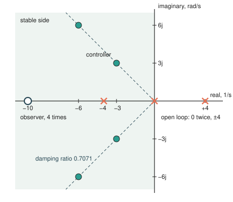
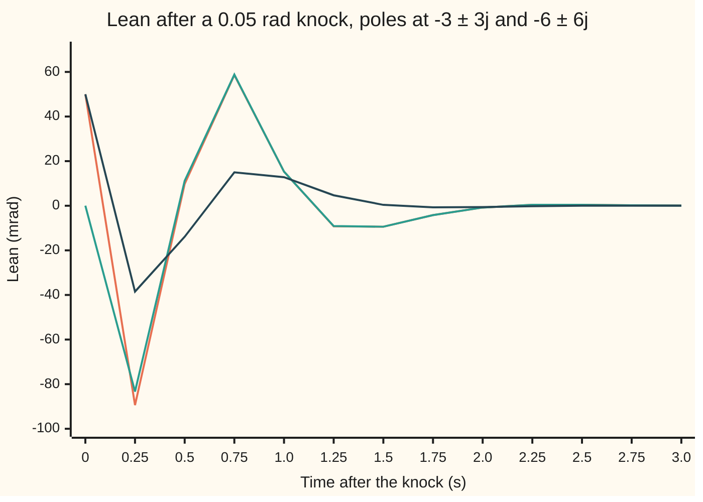

# Pole placement: if you can steer it, you can choose its response speeds

[Syllabus](../../../SYLLABUS.md) → [Engineering mathematics](../README.md) → [State Space and Optimal Control](../README.md#s04) → Pole placement

---

## General Overview

A cart on a rail carries a rod 0.613125 m long, balanced upright on a hinge. The motor sets the cart's acceleration. A knock tips the rod 0.05 rad (2.864789°). The job: get the rod back inside 1 mrad of upright and the cart back inside 1 cm of home, all within **two seconds**. A mrad is a thousandth of a radian, so 1 mrad is 2% of the knock.

Left alone, the rod falls. Its motion has four natural rates, the open-loop poles: 0 and 0 for the cart, which rolls wherever it is sent, and +4 and −4 per second for the rod. The +4 is the fall: a lean that grows by itself.

Pole placement fixes this with four gains. The motor's push is minus a weighted sum of the four state numbers (the cart's position and speed, the rod's lean and lean rate). Four free weights let you set all four rates of the closed loop (the cart and rod with the controller switched on) to any values you like.

Here they go to −3 ± 3j and −6 ± 6j (j is the square root of −1, as engineers write it; the rest of the library writes i). With the true state fed back, the rod settles in 1.443 s and the cart in 0.668 s. The motor's hardest push is 7.940 m/s², at the first instant.

The catch is that the push needs all four numbers, and two of them, the cart's speed and the rod's lean rate, have no sensor. An **observer** supplies them: a copy of the model that runs inside the controller, fed the same pushes. It is nudged toward the two readings it does get: the cart's position from the motor's shaft count, and the lean from the pivot encoder.

Each reading alone is blind to half the state ([Can you steer every state, and can you see every state](03-controllability-and-observability.md)); together they see all four. The observer's errors die at rates chosen by the same recipe, turned on its side.

Put the two together, with the observer starting out knowing nothing, and the rod settles in 1.977 s and the cart in 1.177 s. Inside two seconds.

**If every state can be steered, a gain on the full state puts the closed-loop poles anywhere you choose; if every state can be seen, an observer's error poles can be put anywhere too; and joining the two gives a loop whose poles are exactly both sets.**

**What kind of fact this is:** three theorems, proved on this card in Why it works for one motor: the pole placement theorem, observer design by duality, and the separation of the poles. The settling times are simulations of the straight-line model about upright, and the card shows where that model stops being true.

### The picture: where the poles start and where they are put

<p align="center"></p>

Crosses: the open loop, with the falling rod at +4 on the wrong side. Filled dots: the four controller poles, all on the dashed line of damping ratio 0.7071 (how strongly a pole pair's swing is damped: the size of the real part over the pole's distance from 0). Open circle: the observer's four poles, all at −10, well to the left of the controller's, so the estimate settles before the loop needs it. Drawn to scale, 25 pixels per 1/s on both axes.

---

## The formula

The state is $x = (p, v, \theta, \omega)$: cart position, cart speed, lean and lean rate ([State space](01-state-space-models-and-the-matrix-exponential.md)). A prime marks the rate of change, so $x'$ is how fast $x$ moves. Near upright the plant is $x' = Ax + Bu$, with $p'' = u$ and $\theta'' = 16\,\theta - c\,u$ ([Linearisation](02-linearisation-about-an-equilibrium.md)). The readings are $y = Cx$, the cart position and the lean. The controller and the observer are

$$u = -K\hat x, \qquad \hat x' = A\hat x + Bu + L\,(y - C\hat x),$$

with the gains chosen so that

$$\det(sI - A + BK) = \Delta_c(s), \qquad \det(sI - A + LC) = \Delta_o(s),$$

and for one motor the controller gain has a closed form, Ackermann's formula:

$$K = \begin{pmatrix} 0 & 0 & 0 & 1 \end{pmatrix} \mathcal{C}^{-1}\,\Delta_c(A), \qquad \mathcal{C} = \begin{pmatrix} B & AB & A^2B & A^3B \end{pmatrix}.$$

Here $\det$ is the determinant, and $\Delta_c(A)$ means the chosen polynomial with the matrix $A$ put in place of $s$. The observer gain $L$ is the same formula applied to $A^\top$ and $C^\top$ (the transposes), then transposed back. The joined loop's polynomial is $\Delta_c(s)\,\Delta_o(s)$.

**Read it aloud:** push by minus a gain times the estimated state; run a copy of the model and correct it by a gain times the reading's surprise; pick both gains so that the two characteristic polynomials come out as the ones you wrote down.

| Symbol | Plain meaning | In our example | Push it up and the answer… |
| --- | --- | --- | --- |
| $x$, $\hat x$, $e$ | the state $(p, v, \theta, \omega)$ in m, m/s, rad, rad/s; the observer's estimate of it; the estimation error $e = x - \hat x$ | start $x = (0, 0, 0.05, 0)$, $\hat x = 0$ | — |
| $u$ | push: the cart acceleration the motor commands, m/s² | peak 7.940 m/s² with the state known, 7.070 with the observer | — |
| $A$, $B$, $I$, $\bar A$ | how the state drifts; how the push enters, `B = (0, 1, 0, −c)`; the identity matrix; $\bar A = A - BK$, the closed loop | $A$ holds the 16 | — |
| $16$, $l$, $c$ | gravity over rod length, $g/l$ with $g = 9.81$ m/s² (NIST CODATA standard gravity, rounded), per s²; rod length; $c = 1/l$, per m | 16; 0.613125 m; 1.630989 per m | a shorter rod falls faster |
| $y$, $C$ | the readings; $C$ picks out the cart position and the lean | two readings, no speeds | — |
| $K$, $k_1 \ldots k_4$, $k_\theta$, $k_\omega$ | controller gain, one number per state, in 1/s², 1/s, m/s² per rad, m/s² per rad/s; $k_\theta$, $k_\omega$ the two gains when the rod is balanced alone | −81, −40.5, −158.799, −35.868; 32 per s² and 8 per s | harder pushes |
| $L$, $\ell_1$, $\ell_2$ | observer gain, a 4 × 2 table; $\ell_1$, $\ell_2$ its two entries for one reading | cart (20, 100), rod (20, 116) | faster estimate, more noise let through |
| $s$, $j$ | the Laplace variable; a pole is a value of $s$; $j = \sqrt{-1}$ | −3 ± 3j, −6 ± 6j | — |
| $\Delta_c$, $a_3 \ldots a_0$ | the chosen controller polynomial $s^4 + a_3 s^3 + a_2 s^2 + a_1 s + a_0$ | 18, 162, 648, 1296 | — |
| $\Delta_o$ | the chosen observer polynomial | $(s + 10)^4$ | — |
| $\mathcal{C}$ | the controllability matrix: what the push reaches in one, two, three and four integrations | invertible | — |

### When it holds

- **Every state steerable.** The proof needs $\mathcal{C}$ invertible ([Can you steer every state, and can you see every state](03-controllability-and-observability.md)). A pole the push cannot reach stays where it is, whatever $K$ is.
- **Every state seen.** The observer needs the readings to reveal every state. Read the lean alone and the cart's estimate can only count its own pushes. Bump the cart to 0.1 m/s and the observer never notices: after 10 s the cart is 1.0000 m from home and still rolling at 0.1000 m/s, while the controller believes it is parked.
- **The model is the plant.** Separation is exact only when the observer's copy matches the real thing. With the controller and observer built for 0.613125 m, the joined loop stays stable for a real rod from 0.3005 m to 0.7635 m. A rod 10% long still balances, but the rod takes 3.610 s to settle instead of 1.977 s.
- **Small angles and an unlimited motor.** The model is straight-line about upright, and pole placement never asks what the push costs. Doubling every pole's speed asks for a push of 60.086 m/s².
- **Poles in mirror pairs.** Gains are real numbers, so a complex pole must come with its mirror image: −3 + 3j needs −3 − 3j.

---

## Why it works

### Step 0: four gains, four coefficients

The closed loop's rates are the roots of its characteristic polynomial ([The characteristic equation](../../08-Differential%20equations%20and%20dynamics/03-Oscillators%20-%20Second-Order%20Linear%20Equations/02-the-characteristic-equation.md)), which are the eigenvalues of $A - BK$ ([Eigenvalues and eigenvectors](../../03-Algebra/07-Eigenvalues%20and%20Symmetric%20Matrices/02-eigenvalues-and-eigenvectors.md)). A four-state loop has a polynomial with four free coefficients below the leading $s^4$. Each coefficient turns out to be a straight-line function of the four gains. Four unknowns, four straight-line equations: if the equations are independent, there is exactly one gain for any polynomial you ask for. "Independent" is precisely "every state steerable".

### Step 1: the rod alone, by hand

Ignore the cart for a moment. The rod obeys $\theta'' = 16\,\theta - u/l$. Push by $u = l\,(k_\theta\,\theta + k_\omega\,\omega)$ and the rod obeys $\theta'' = (16 - k_\theta)\,\theta - k_\omega\,\omega$, whose polynomial is $s^2 + k_\omega s + (k_\theta - 16)$. Each gain sets one coefficient. Ask for $(s + 4)^2 = s^2 + 8s + 16$ and you need $k_\omega = 8$ and $k_\theta = 32$: the push $u = 19.6200\,\theta + 4.9050\,\omega$ in m/s². That is the balancing rule that [The Kalman filter](07-kalman-filter.md) feeds its estimates into.

### Step 2: the whole cart, by matching coefficients

Now all four. Push by $u = -(k_1 p + k_2 v + k_3 \theta + k_4 \omega)$. Write each motion as an exponential at rate $s$: the cart gives $s^2 p = u$, the rod $(s^2 - 16)\,\theta = -c\,u$. Put both into the push, clear the fractions by multiplying through by $s^2(s^2 - 16)$, and the loop's polynomial comes out as

$$s^4 + (k_2 - c\,k_4)\,s^3 + (k_1 - 16 - c\,k_3)\,s^2 - 16\,k_2\,s - 16\,k_1.$$

Every coefficient is a straight-line function of the gains, as Step 0 promised. Match it against the chosen $s^4 + a_3 s^3 + a_2 s^2 + a_1 s + a_0$ and read off the gains from the bottom up:

$$k_1 = -\frac{a_0}{16}, \quad k_2 = -\frac{a_1}{16}, \quad k_3 = \frac{k_1 - 16 - a_2}{c}, \quad k_4 = \frac{k_2 - a_3}{c}.$$

All four gains come out negative. A negative cart gain looks backwards: the cart sits right of home and the push is to the right. It is not. To bring the cart left, the rod must first lean left, and the only way to lean it left is to drive the cart right underneath it. The cart moves away from home before it comes back.

### Step 3: why any steerable plant works

Matching coefficients worked because this plant's algebra was easy. Ackermann's formula does the same job for any one-motor plant whose $\mathcal{C}$ is invertible, and the checks confirm it gives the same four gains to every printed digit.

<details>
<summary>Detailed proof: Ackermann's formula places the poles</summary>

Write $\bar A = A - BK$ for the closed loop. Then $A = \bar A + BK$, and by induction

$$A^k = \bar A^k + \sum_{i=0}^{k-1} A^i B\,K\,\bar A^{\,k-1-i}.$$

(For $k = 2$: $A^2 = A\bar A + ABK = \bar A^2 + BK\bar A + ABK$.)

Suppose $K$ places the poles, so $\Delta_c$ is the characteristic polynomial of $\bar A$. Form $\Delta_c(A) = A^4 + a_3 A^3 + a_2 A^2 + a_1 A + a_0 I$ and substitute the expansion. The $\bar A$ powers add up to $\Delta_c(\bar A)$, which is zero: every matrix satisfies its own characteristic polynomial (the Cayley–Hamilton theorem). What remains is a sum of terms $A^i B$ times a row, that is $\mathcal{C}$ times a stack of four rows. The row multiplying $A^3B$ comes only from the $A^4$ term with $i = 3$, and it is $K$ itself. So $K$ is the last row of $\mathcal{C}^{-1}\Delta_c(A)$, which is the formula.

That shows any placing gain must equal the formula. To see that one exists, change coordinates into the companion form, by an invertible matrix built from $\mathcal{C}$ (it exists exactly when $\mathcal{C}$ is invertible). In the companion form, $B$ is $(0, 0, 0, 1)$ and the last row of $A$ holds the open-loop coefficients with their signs flipped. There the push only touches the last row, and $A - BK$ has last row equal to minus (open-loop coefficients plus $K$). Any target polynomial is then one subtraction away. With several motors the same theorem holds but the gain is no longer unique (Wonham, 1967).

</details>

### Step 4: the observer, by turning the problem on its side

The observer's copy obeys $\hat x' = A\hat x + Bu + L(y - C\hat x)$. Subtract it from the real plant $x' = Ax + Bu$ and the push cancels:

$$e' = (A - LC)\,e.$$

The error dies at the eigenvalues of $A - LC$. A matrix and its transpose have the same eigenvalues, and $(A - LC)^\top = A^\top - C^\top L^\top$. That is a controller problem: plant $A^\top$, "push" entering through $C^\top$, "gain" $L^\top$. Solve it with Step 2 or Step 3 and transpose the answer. This is **duality**. Its condition, the dual plant being steerable, is word for word the original plant being seeable.

Here $A$ splits into a cart block and a rod block, and each reading sees one block, so each gets its own two-number gain. For the rod, $A - LC$ is `[[−ℓ1, 1], [16 − ℓ2, 0]]`, with polynomial $s^2 + \ell_1 s + (\ell_2 - 16)$. For the cart it is $s^2 + \ell_1 s + \ell_2$. Ask for $(s + 10)^2 = s^2 + 20s + 100$ from each: the cart needs $(20, 100)$ and the rod $(20, 116)$. The 16 extra on the rod is the observer cancelling the rod's own fall.

### Step 5: separation, the joined loop keeps both sets of poles

Feed the estimate to the controller: $x' = Ax - BK\hat x$. Replace $\hat x$ by $x - e$:

$$\begin{pmatrix} x \\ e \end{pmatrix}' = \begin{pmatrix} A - BK & BK \\ 0 & A - LC \end{pmatrix}\begin{pmatrix} x \\ e \end{pmatrix}.$$

The bottom-left block is zero: the error ignores the state, because the observer sees the same push the plant does. The determinant of a block-triangular matrix is the product of the diagonal blocks' determinants, so the eight poles are the controller's four plus the observer's four. You can design the two halves apart. The checks build the joined 8 × 8 matrix in the original coordinates, compute its polynomial without knowing this argument, and get the product, coefficient for coefficient.

---

## Worked numbers, by hand

The target: settle in two seconds. A pole pair with real part −3 per s dies away roughly as $e^{-3t}$. So settling time is set by the distance of the slowest poles from the imaginary axis ([Step response specs](../02-Linear%20Systems%20and%20Transforms/07-step-response-specifications.md)). Real part −3 settles the rod in 1.443 s with the state known, which leaves room for the observer to catch up. The faster pair sits twice as far out on the same damping line.

| Step | Arithmetic | Value |
| --- | --- | --- |
| slow pair, $(s + 3)^2 + 9$ | $s^2 + 6s + 18$ | — |
| fast pair, $(s + 6)^2 + 36$ | $s^2 + 12s + 72$ | — |
| $\Delta_c$, the product | $s^4 + (6 + 12)s^3 + (72 + 72 + 18)s^2 + (432 + 216)s + 1296$ | 18, 162, 648, 1296 |
| $c$ | $16 / 9.81$ | 1.630989 per m |
| $k_1 = -a_0/16$ | $-1296/16$ | −81 |
| $k_2 = -a_1/16$ | $-648/16$ | −40.5 |
| $k_3 = (k_1 - 16 - a_2)/c$ | $-259 \times 0.613125$ | −158.799 |
| $k_4 = (k_2 - a_3)/c$ | $-58.5 \times 0.613125$ | −35.868 |
| first push, $u = -k_3 \times 0.05$ | $158.799 \times 0.05$ | 7.940 m/s² |
| observer, cart $(\ell_1, \ell_2)$ | $(s+10)^2$: $20$, $100$ | (20, 100) |
| observer, rod $(\ell_1, \ell_2)$ | $20$, $100 + 16$ | (20, 116) |
| joined, $s^7$ coefficient | $18 + 40$ | 58 |
| **settling, observer in the loop** | simulated | **rod 1.977 s, cart 1.177 s** |

The rod is inside 1 mrad of upright and the cart inside 1 cm of home 1.977 s after the knock. With the state known, the times are 1.443 s and 0.668 s. The observer's catch-up costs the difference, which is what the margin was for.

### The joined run, traced



Orange: the true lean with the observer in the loop. Green: the observer's estimate of it. Dark blue: the lean with the state known exactly.

The estimate starts at 0 while the rod is at 50.0 mrad, so for the first instants the motor barely pushes. By 0.25 s the estimate (−83.3 mrad) has nearly caught the rod (−89.4 mrad). But the late start has cost a deeper swing than the −38.5 mrad of the exact loop.

Even that exact loop swings past upright by most of the knock, with every controller pole on the 0.7071 damping line. The poles fix how fast each motion dies, not the shape of the response. To bring the cart home, the controller must lean the rod back the other way, past upright.

From 1.0 s on, estimate and truth lie on top of each other, and the loop rides the controller's poles home.

### What breaks if you drop a piece

| Mistake | Comes out at | What went wrong |
| --- | --- | --- |
| Push with $u = +Kx$, sign flipped | a pole at +26.362 per s: the rod falls faster than with no control at all | the gain was solved for $A - BK$; flipping the sign builds $A + BK$ |
| Design with $B = (0, 1, 0, +c)$ | poles at +2.186 and +102.413 per s on the real cart | the model said pushing right tips the rod right; it tips it left, so every gain is aimed wrong |
| Observer reads the lean only | cart bumped to 0.1 m/s: 1.0000 m from home after 10 s, still rolling at 0.1000 m/s | the cart is not observable from the lean; its error poles stay at 0 and 0 whatever $L$ is |
| Observer slower than the controller, all at −1 | rod settles in 2.540 s, cart in 3.936 s | the loop can be no faster than its slowest pole; now the estimate is the bottleneck |

---

## Code, from first principles, and it actually runs

The scripts build the cart from its rod length and reach the design by **four independent roads**:

- Road 1 is the hand formula of Step 2.
- Road 2 is Ackermann's formula, with its own matrix inverse by Gaussian elimination; the two gains must agree.
- Road 3 recomputes the closed loop's polynomial from the matrix $A - BK$ by the Faddeev–LeVerrier recursion, which never sees how the gain was found. It finds the roots by Durand–Kerner, which refines all roots at once. It also builds the joined 8 × 8 loop and checks that its polynomial is the product of the two designs.
- Road 4 simulates the loop with RK4 ([Runge-Kutta four](../../08-Differential%20equations%20and%20dynamics/05-Numerical%20Evolution/04-runge-kutta-four.md)) in 1 ms steps and measures settling. It then repeats the two main runs in 0.5 ms steps, which must give the same settling times to 2 ms.

Stability under a wrong rod length comes from Routh's test ([Routh-Hurwitz](../03-Feedback%20Control/04-routh-hurwitz-criterion.md)) and bisection. The Durand–Kerner roots then confirm each edge: the largest real part changes sign within 0.5 mm of it.

### Python

```python
# Pole placement and an observer for the cart and pendulum -- the check behind the card.
# Standard library only.  State x = (p, v, theta, w): cart position m, cart speed m/s, lean rad,
# lean rate rad/s.  Input u = cart acceleration the motor commands, m/s^2.
# Near upright: p'' = u and theta'' = 16 theta - c u, with c = 1/l = 16/9.81 per m.
def plant(l):
    return ([[0.0, 1, 0, 0], [0, 0, 0, 0], [0, 0, 0, 1], [0, 0, 9.81 / l, 0]], [0.0, 1, 0, -1 / l])
L0 = 9.81 / 16                                    # model rod length, 0.613125 m
A, B = plant(L0); c = 1 / L0
def mm(X, Y): return [[sum(X[i][k] * Y[k][j] for k in range(len(Y))) for j in range(len(Y[0]))] for i in range(len(X))]
def tr(X): return [list(r) for r in zip(*X)]
def eye(n): return [[float(i == j) for j in range(n)] for i in range(n)]
def poly(roots):                                  # coefficients of (s - r1)(s - r2)..., highest power first
    p = [1 + 0j]
    for r in roots: p = [a - r * b for a, b in zip(p + [0], [0] + p)]
    return [z.real for z in p]
def charpoly(M):                                  # Faddeev-LeVerrier: det(sI - M), never sees the gain's formula
    n, Mk, cf = len(M), [[0.0] * len(M) for _ in M], [1.0]
    for k in range(1, n + 1):
        Mk = mm(M, [[Mk[i][j] + (cf[-1] if i == j else 0) for j in range(n)] for i in range(n)])
        cf.append(-sum(Mk[i][i] for i in range(n)) / k)
    return cf
def roots(cf):                                    # Durand-Kerner: all roots of a polynomial at once
    n, z = len(cf) - 1, [(0.4 + 0.9j) ** k for k in range(len(cf) - 1)]
    for _ in range(500):
        for i in range(n):
            num = sum(a * z[i] ** (n - k) for k, a in enumerate(cf)); den = 1
            for j in range(n):
                if j != i: den *= z[i] - z[j]
            z[i] -= num / den
    return sorted(z, key=lambda w: (round(w.real, 6), w.imag))
def stable(cf):                                   # Routh's first column all positive
    r0, r1 = cf[0::2], cf[1::2] + [0.0] * (len(cf[0::2]) - len(cf[1::2]))
    while any(abs(v) > 0 for v in r1):
        if r1[0] <= 0 or r0[0] <= 0: return False
        r0, r1 = r1, [r0[i + 1] - r0[0] * r1[i + 1] / r1[0] for i in range(len(r1) - 1)] + [0.0]
    return r0[0] > 0
def ackermann(A, b, target):                      # K = (last row of Ctrb^-1) * target(A), Ctrb = [b, Ab, ...]
    n, cols, v = len(A), [], [[x] for x in b]
    for _ in A: cols.append([r[0] for r in v]); v = mm(A, v)
    M = [cols[j][:] + [float(j == n - 1)] for j in range(n)]          # solve Ctrb^T q = e_n
    for i in range(n):
        piv = max(range(i, n), key=lambda r: abs(M[r][i])); M[i], M[piv] = M[piv], M[i]
        for r in range(n):
            if r != i: f = M[r][i] / M[i][i]; M[r] = [a - f * b2 for a, b2 in zip(M[r], M[i])]
    q, P = [[M[i][n] / M[i][i] for i in range(n)]], [[0.0] * n for _ in A]
    for a in target: P = [[x + a * y for x, y in zip(rp, re)] for rp, re in zip(mm(P, A), eye(n))]
    return mm(q, P)[0]
def hand_K(t):                                    # match s^4 + (k2 - c k4)s^3 + (k1 - 16 - c k3)s^2 - 16k2 s - 16k1
    k1, k2 = -t[4] / 16, -t[3] / 16
    return [k1, k2, (k1 - 16 - t[2]) / c, (k2 - t[1]) / c]
def joined(K, Lg, Cm, l=L0):                      # 8 states: true x, estimate xh; xh' = A xh + B u + L(y - C xh)
    At, Bt = plant(l); LC = mm(Lg, Cm)
    top = [At[i] + [-Bt[i] * K[j] for j in range(4)] for i in range(4)]
    return top + [LC[i] + [A[i][j] - B[i] * K[j] - LC[i][j] for j in range(4)] for i in range(4)]
def simulate(M, z, T, K=None, h=0.001):           # RK4; returns samples every 0.25 s, settling times, peak push
    f = lambda z: [sum(a * b for a, b in zip(r, z)) for r in M]
    out, ts, tp, umax = [], 0.0, 0.0, 0.0
    for i in range(int(round(T / h))):
        if i % 250 == 0: out.append(z[:])
        if abs(z[2]) > 0.001: ts = i * h         # lean outside 2% of the 0.05 rad knock
        if abs(z[0]) > 0.01: tp = i * h          # cart more than 1 cm from home
        if K: umax = max(umax, abs(sum(k * x for k, x in zip(K, z[-4:]))))
        k1 = f(z); k2 = f([a + h / 2 * b for a, b in zip(z, k1)]); k3 = f([a + h / 2 * b for a, b in zip(z, k2)])
        k4 = f([a + h * b for a, b in zip(z, k3)]); z = [a + h / 6 * (b + 2 * d + 2 * e + g) for a, b, d, e, g in zip(z, k1, k2, k3, k4)]
    return out, ts, tp, umax, z
def show(name, v, d=3): print(f"{name:<38}" + "  ".join(f"{x:9.{d}f}" for x in v))
def cl(K, Ap=A, Bp=B): return [[Ap[i][j] - Bp[i] * K[j] for j in range(4)] for i in range(4)]
def blocks(t_cart, t_pend):                       # observer by duality: Ackermann on (A^T, C^T), transposed back
    lc = ackermann(tr([[0.0, 1], [0, 0]]), [1.0, 0], poly(t_cart))
    lp = ackermann(tr([[0.0, 1], [16, 0]]), [1.0, 0], poly(t_pend))
    return [[lc[0], 0], [lc[1], 0], [0, lp[0]], [0, lp[1]]]
C2 = [[1.0, 0, 0, 0], [0, 0, 1.0, 0]]            # two readings: cart position (motor count), lean (pivot encoder)

# ---- road 1 and 2: the gain by matching coefficients and by Ackermann's formula ----
ctrl = [-3 + 3j, -3 - 3j, -6 + 6j, -6 - 6j]; obs = [-10, -10]
target = poly(ctrl); K = hand_K(target); K_ack = ackermann(A, B, target)
show("model rod l m, c 1/m, knock deg", [L0, c, 0.05 * 180 / 3.141592653589793], 6)
show("hand: k1 - 16 - a2, k2 - a3", [K[0] - 16 - target[2], K[1] - target[1]], 4)
show("target polynomial s^4..s^0", target, 4); show("K by matching coefficients", K); show("K by Ackermann", K_ack)
show("charpoly of A - BK", charpoly(cl(K)), 4)
for z in roots(charpoly(cl(K))): print(f"  closed-loop pole  {z.real:8.4f} {z.imag:+8.4f}j")
k2s = [(16 + 16) * L0, 8 * L0]                     # rod alone, poles -4, -4: u = l (32 theta + 8 w)
show("rod alone, poles -4,-4: l*32, l*8", k2s, 4)
# ---- the observer, by duality, and by hand: cart s^2 + l1 s + l2, rod s^2 + l1 s + (l2 - 16) ----
Lg = blocks(obs, obs); show("L, cart rows", [Lg[0][0], Lg[1][0]], 4); show("L, rod rows", [Lg[2][1], Lg[3][1]], 4)
ho = poly(obs); hand_L = [ho[1], ho[2], ho[1], ho[2] + 16]; show("L by hand: cart l1 l2, rod l1 l2", hand_L, 4)
show("charpoly of A - LC", charpoly([[A[i][j] - mm(Lg, C2)[i][j] for j in range(4)] for i in range(4)]), 4)
# ---- road 3: separation, the joined loop's polynomial is the product of the two ----
J8 = joined(K, Lg, C2); prod = poly(ctrl + obs * 2)
show("joined charpoly, s^8..s^4", charpoly(J8)[:5], 2); show("joined charpoly, s^3..s^0", charpoly(J8)[5:], 2)
show("controller x observer, s^8..s^4", prod[:5], 2); show("controller x observer, s^3..s^0", prod[5:], 2)
# ---- road 4: simulate; knock of 0.05 rad, estimate starts at zero ----
x0 = [0.0, 0, 0.05, 0]
sf, tsf, tpf, uf, _ = simulate(cl(K), x0, 4.0, K)
sj, tsj, tpj, uj, _ = simulate(J8, x0 + [0.0] * 4, 4.0, K)
show("state fed back: rod, cart, push", [tsf, tpf, uf]); show("observer in loop: rod, cart, push", [tsj, tpj, uj])
print("chart, t s      " + " ".join(f"{0.25 * i:6.2f}" for i in range(13)))
print("chart, lean mrad" + " ".join(f"{1000 * z[2]:6.1f}" for z in sj[:13]))
print("chart, estimate " + " ".join(f"{1000 * z[6]:6.1f}" for z in sj[:13]))
print("chart, exact x  " + " ".join(f"{1000 * z[2]:6.1f}" for z in sf[:13]))
# ---- what breaks ----
show("sign flipped u = +Kx, poles real", [z.real for z in roots(charpoly(cl([-k for k in K])))])
Kw = ackermann(A, [0.0, 1, 0, c], target); show("designed with +c, real poles", [z.real for z in roots(charpoly(cl(Kw)))])
L1 = [[0.0, 0], [0, 0], [0, Lg[2][1]], [0, Lg[3][1]]]   # angle only: the cart estimate just counts its own pushes
show("angle only: charpoly A - LC", [x if abs(x) > 1e-9 else 0.0 for x in charpoly([[A[i][j] - mm(L1, C2)[i][j] for j in range(4)] for i in range(4)])], 2)
_, _, _, _, zb = simulate(joined(K, L1, C2), [0.0, 0.1, 0, 0] + [0.0] * 4, 10.0)
_, _, _, _, zg = simulate(J8, [0.0, 0.1, 0, 0] + [0.0] * 4, 10.0)
show("cart bumped 0.1 m/s: p, v at 10 s", [zb[0], zb[1], zg[0], zg[1]], 4)
_, tss, tps, us, _ = simulate(joined(K, blocks([-1, -1], [-1, -1]), C2), x0 + [0.0] * 4, 12.0, K)
show("observer poles at -1: rod, cart, push", [tss, tps, us])
# ---- honesty: the real rod is not the model rod ----
def edge(lo, hi):                                 # bisection on the true rod length, model fixed
    for _ in range(60):
        mid = (lo + hi) / 2
        if stable(charpoly(joined(K, Lg, C2, mid))) == stable(charpoly(joined(K, Lg, C2, lo))): lo = mid
        else: hi = mid
    return lo
lmin, lmax = edge(L0, 0.05), edge(L0, 50.0); mr = lambda l: max(z.real for z in roots(charpoly(joined(K, Lg, C2, l))))
_, tsl, tpl, ul, _ = simulate(joined(K, Lg, C2, 1.1 * L0), x0 + [0.0] * 4, 10.0, K)
show("stable for true rod, m: from, to", [lmin, lmax], 4); show("true rod 10% long: rod, cart, push", [tsl, tpl, ul])
# ---- try changing ----
K2 = hand_K(poly([2 * z for z in ctrl])); s2 = simulate(cl(K2), x0, 4.0, K2)
show("try: controller twice as fast", [s2[1], s2[2], s2[3]])
s3 = simulate(joined(K, blocks([-40, -40], [-40, -40]), C2), x0 + [0.0] * 4, 4.0, K)
show("try: observer at -40: rod, cart, push", [s3[1], s3[2], s3[3]]); show("  its L, rod rows", blocks([-40, -40], [-40, -40])[3], 1)
K4 = hand_K(poly([z / 2 for z in ctrl])); s4 = simulate(cl(K4), x0, 8.0, K4)
show("try: controller half as fast", [s4[1], s4[2], s4[3]])
px = lambda z: f"({30 + 25 * (z.real + 11):.0f}, {200 - 25 * z.imag:.0f})"   # SVG: 25 px per 1/s, re -11 at x = 30
print(f"figure, 25 px per 1/s, damping {3 / abs(ctrl[0]):.4f}, open loop 0 0 {A[3][2] ** 0.5:.0f} {-A[3][2] ** 0.5:.0f}; in px: controller "
      + " ".join(px(z) for z in ctrl) + ", observer " + px(complex(obs[0])) + ", open loop " + " ".join(px(complex(r)) for r in (0, 4, -4)))

assert max(abs(a - b) for a, b in zip(K, K_ack)) < 1e-9, "matching coefficients vs Ackermann"
assert max(abs(a - b) for a, b in zip(charpoly(cl(K)), target)) < 1e-8, "Faddeev-LeVerrier finds the chosen poles"
assert max(abs(a - b) / max(1, abs(b)) for a, b in zip(charpoly(J8), prod)) < 1e-9, "separation: product polynomial"
assert max(abs(a - b) for a, b in zip(hand_L, [Lg[0][0], Lg[1][0], Lg[2][1], Lg[3][1]])) < 1e-9, "duality vs hand"
hs = [simulate(M, z, 4.0, K, 0.0005)[1:3] for M, z in ((cl(K), x0), (J8, x0 + [0.0] * 4))]
assert tsj < 2.0 and tpj < 2.0 and tsf < tsj and max(abs(a - b) for a, b in zip(hs[0] + hs[1], (tsf, tpf, tsj, tpj))) < 2e-3, "settles inside 2 s, observer costs time, same at half the step"
assert abs(zb[0] - 0.1 * 10) < 1e-9 and abs(zb[1] - 0.1) < 1e-6 and abs(zg[0]) < 1e-3, "angle-only observer never sees the bump"
assert not stable(charpoly(cl(Kw))) and mr(lmin + 5e-4) < 0 < mr(lmin - 5e-4) and mr(lmax - 5e-4) < 0 < mr(lmax + 5e-4) and tsl < 10, "wrong sign fails; Routh edges match the roots"
print("ALL CHECKS PASS")
```

**Ran 2026-11-11 on macOS, Python 3.14.10, standard library only. All checks passed. Output, pasted from the run:**

```
model rod l m, c 1/m, knock deg        0.613125   1.630989   2.864789
hand: k1 - 16 - a2, k2 - a3           -259.0000   -58.5000
target polynomial s^4..s^0               1.0000    18.0000   162.0000   648.0000  1296.0000
K by matching coefficients              -81.000    -40.500   -158.799    -35.868
K by Ackermann                          -81.000    -40.500   -158.799    -35.868
charpoly of A - BK                       1.0000    18.0000   162.0000   648.0000  1296.0000
  closed-loop pole   -6.0000  -6.0000j
  closed-loop pole   -6.0000  +6.0000j
  closed-loop pole   -3.0000  -3.0000j
  closed-loop pole   -3.0000  +3.0000j
rod alone, poles -4,-4: l*32, l*8       19.6200     4.9050
L, cart rows                            20.0000   100.0000
L, rod rows                             20.0000   116.0000
L by hand: cart l1 l2, rod l1 l2        20.0000   100.0000    20.0000   116.0000
charpoly of A - LC                       1.0000    40.0000   600.0000  4000.0000  10000.0000
joined charpoly, s^8..s^4                  1.00      58.00    1482.00   21928.00  206416.00
joined charpoly, s^3..s^0             1268640.00  4989600.00  11664000.00  12960000.00
controller x observer, s^8..s^4            1.00      58.00    1482.00   21928.00  206416.00
controller x observer, s^3..s^0       1268640.00  4989600.00  11664000.00  12960000.00
state fed back: rod, cart, push           1.443      0.668      7.940
observer in loop: rod, cart, push         1.977      1.177      7.070
chart, t s        0.00   0.25   0.50   0.75   1.00   1.25   1.50   1.75   2.00   2.25   2.50   2.75   3.00
chart, lean mrad  50.0  -89.4    9.8   58.6   15.3   -9.2   -9.4   -4.2   -0.8    0.4    0.4    0.2    0.1
chart, estimate    0.0  -83.3   11.2   58.8   15.3   -9.1   -9.4   -4.2   -0.8    0.4    0.4    0.2    0.1
chart, exact x    50.0  -38.5  -13.9   15.0   12.8    4.7    0.4   -0.7   -0.6   -0.2   -0.0    0.0    0.0
sign flipped u = +Kx, poles real         -5.054     -1.654     -1.654     26.362
designed with +c, real poles             -4.231     -1.368      2.186    102.413
angle only: charpoly A - LC                1.00      20.00     100.00       0.00       0.00
cart bumped 0.1 m/s: p, v at 10 s        1.0000     0.1000    -0.0000     0.0000
observer poles at -1: rod, cart, push     2.540      3.936      1.825
stable for true rod, m: from, to         0.3005     0.7635
true rod 10% long: rod, cart, push        3.610      2.023      7.106
try: controller twice as fast             1.071      0.605     60.086
try: observer at -40: rod, cart, push     1.744      0.955     26.275
  its L, rod rows                           0.0     1616.0
try: controller half as fast              2.868      1.737      1.887
figure, 25 px per 1/s, damping 0.7071, open loop 0 0 4 -4; in px: controller (230, 125) (230, 275) (155, 50) (155, 350), observer (55, 200), open loop (305, 200) (405, 200) (205, 200)
ALL CHECKS PASS
```

### Rust

```rust
// Pole placement and an observer for the cart and pendulum -- the check behind the card.
// std only.  State x = (p, v, theta, w): cart position m, cart speed m/s, lean rad, lean rate rad/s.
// Input u = cart acceleration the motor commands, m/s^2.  p'' = u, theta'' = 16 theta - c u, c = 1/l.
type M = Vec<Vec<f64>>;
#[derive(Clone, Copy)]
struct C64 { re: f64, im: f64 }
fn cx(re: f64, im: f64) -> C64 { C64 { re, im } }
fn add(a: C64, b: C64) -> C64 { cx(a.re + b.re, a.im + b.im) }
fn sub(a: C64, b: C64) -> C64 { cx(a.re - b.re, a.im - b.im) }
fn mul(a: C64, b: C64) -> C64 { cx(a.re * b.re - a.im * b.im, a.re * b.im + a.im * b.re) }
fn div(a: C64, b: C64) -> C64 { let d = b.re * b.re + b.im * b.im; cx((a.re * b.re + a.im * b.im) / d, (a.im * b.re - a.re * b.im) / d) }
fn powi(z: C64, k: usize) -> C64 { let mut r = cx(1.0, 0.0); for _ in 0..k { r = mul(r, z); } r }
fn plant(l: f64) -> (M, Vec<f64>) {
    (vec![vec![0.0, 1.0, 0.0, 0.0], vec![0.0; 4], vec![0.0, 0.0, 0.0, 1.0], vec![0.0, 0.0, 9.81 / l, 0.0]], vec![0.0, 1.0, 0.0, -1.0 / l])
}
fn mm(x: &M, y: &M) -> M {
    (0..x.len()).map(|i| (0..y[0].len()).map(|j| (0..y.len()).fold(0.0, |s, k| s + x[i][k] * y[k][j])).collect()).collect()
}
fn tr(x: &M) -> M { (0..x[0].len()).map(|j| x.iter().map(|r| r[j]).collect()).collect() }
fn poly(roots: &[C64]) -> Vec<f64> {          // coefficients of (s - r1)(s - r2)..., highest power first
    let mut p = vec![cx(1.0, 0.0)];
    for &r in roots {
        let n = p.len(); let mut q = vec![cx(0.0, 0.0); n + 1];
        for i in 0..=n { let a = if i < n { p[i] } else { cx(0.0, 0.0) }; let b = if i > 0 { p[i - 1] } else { cx(0.0, 0.0) }; q[i] = sub(a, mul(r, b)); }
        p = q;
    }
    p.iter().map(|z| z.re).collect()
}
fn charpoly(m: &M) -> Vec<f64> {              // Faddeev-LeVerrier: det(sI - M)
    let n = m.len(); let mut mk = vec![vec![0.0; n]; n]; let mut cf = vec![1.0];
    for k in 1..=n {
        let last = cf[cf.len() - 1];
        let shifted: M = (0..n).map(|i| (0..n).map(|j| mk[i][j] + if i == j { last } else { 0.0 }).collect()).collect();
        mk = mm(m, &shifted);
        cf.push(-(0..n).fold(0.0, |s, i| s + mk[i][i]) / k as f64);
    }
    cf
}
fn roots(cf: &[f64]) -> Vec<C64> {           // Durand-Kerner
    let n = cf.len() - 1; let mut z: Vec<C64> = (0..n).map(|k| powi(cx(0.4, 0.9), k)).collect();
    for _ in 0..500 { for i in 0..n {
        let mut num = cx(0.0, 0.0); for (k, &a) in cf.iter().enumerate() { num = add(num, mul(cx(a, 0.0), powi(z[i], n - k))); }
        let mut den = cx(1.0, 0.0); for j in 0..n { if j != i { den = mul(den, sub(z[i], z[j])); } }
        z[i] = sub(z[i], div(num, den));
    } }
    let key = |w: &C64| ((w.re * 1e6).round() / 1e6, w.im);
    z.sort_by(|a, b| key(a).partial_cmp(&key(b)).unwrap()); z
}
fn stable(cf: &[f64]) -> bool {               // Routh's first column all positive
    let mut r0: Vec<f64> = cf.iter().step_by(2).cloned().collect();
    let mut r1: Vec<f64> = cf.iter().skip(1).step_by(2).cloned().collect();
    while r1.len() < r0.len() { r1.push(0.0); }
    while r1.iter().any(|v| v.abs() > 0.0) {
        if r1[0] <= 0.0 || r0[0] <= 0.0 { return false; }
        let mut nx: Vec<f64> = (0..r1.len() - 1).map(|i| r0[i + 1] - r0[0] * r1[i + 1] / r1[0]).collect(); nx.push(0.0);
        r0 = r1; r1 = nx;
    }
    r0[0] > 0.0
}
fn ackermann(a: &M, b: &[f64], target: &[f64]) -> Vec<f64> {   // last row of Ctrb^-1, times target(A)
    let n = a.len(); let mut cols: M = vec![]; let mut v: M = b.iter().map(|&x| vec![x]).collect();
    for _ in 0..n { cols.push(v.iter().map(|r| r[0]).collect()); v = mm(a, &v); }
    let mut m: M = (0..n).map(|j| { let mut r = cols[j].clone(); r.push(if j == n - 1 { 1.0 } else { 0.0 }); r }).collect();
    for i in 0..n {
        let mut piv = i; for r in i..n { if m[r][i].abs() > m[piv][i].abs() { piv = r; } } m.swap(i, piv);
        for r in 0..n { if r != i { let f = m[r][i] / m[i][i]; let mi = m[i].clone(); for (x, y) in m[r].iter_mut().zip(mi) { *x -= f * y; } } }
    }
    let q = vec![(0..n).map(|i| m[i][n] / m[i][i]).collect::<Vec<f64>>()]; let mut p = vec![vec![0.0; n]; n];
    for &t in target { let pa = mm(&p, a); p = (0..n).map(|i| (0..n).map(|j| pa[i][j] + t * if i == j { 1.0 } else { 0.0 }).collect()).collect(); }
    mm(&q, &p)[0].clone()
}
fn hand_k(t: &[f64], c: f64) -> Vec<f64> { let (k1, k2) = (-t[4] / 16.0, -t[3] / 16.0); vec![k1, k2, (k1 - 16.0 - t[2]) / c, (k2 - t[1]) / c] }
fn joined(k: &[f64], lg: &M, cm: &M, l: f64, a: &M, b: &[f64]) -> M {   // true x, estimate xh
    let (at, bt) = plant(l); let lc = mm(lg, cm); let mut out = vec![];
    for i in 0..4 { let mut r = at[i].clone(); for j in 0..4 { r.push(-bt[i] * k[j]); } out.push(r); }
    for i in 0..4 { let mut r = lc[i].clone(); for j in 0..4 { r.push(a[i][j] - b[i] * k[j] - lc[i][j]); } out.push(r); }
    out
}
struct Run { out: M, ts: f64, tp: f64, umax: f64, z: Vec<f64> }
fn simulate(m: &M, z0: &[f64], t: f64, k: Option<&[f64]>) -> Run { simulate_h(m, z0, t, k, 0.001) }
fn simulate_h(m: &M, z0: &[f64], t: f64, k: Option<&[f64]>, h: f64) -> Run {
    let f = |z: &Vec<f64>| -> Vec<f64> { m.iter().map(|r| r.iter().zip(z).fold(0.0, |s, (a, b)| s + a * b)).collect() };
    let (mut out, mut ts, mut tp, mut umax, mut z) = (vec![], 0.0, 0.0, 0.0f64, z0.to_vec());
    for i in 0..((t / h).round() as usize) {
        if i % 250 == 0 { out.push(z.clone()); }
        if z[2].abs() > 0.001 { ts = i as f64 * h; }
        if z[0].abs() > 0.01 { tp = i as f64 * h; }
        if let Some(k) = k { let n = z.len(); umax = umax.max(k.iter().zip(&z[n - 4..]).fold(0.0, |s, (a, b)| s + a * b).abs()); }
        let k1 = f(&z); let k2 = f(&z.iter().zip(&k1).map(|(a, b)| a + h / 2.0 * b).collect());
        let k3 = f(&z.iter().zip(&k2).map(|(a, b)| a + h / 2.0 * b).collect()); let k4 = f(&z.iter().zip(&k3).map(|(a, b)| a + h * b).collect());
        z = (0..z.len()).map(|i| z[i] + h / 6.0 * (k1[i] + 2.0 * k2[i] + 2.0 * k3[i] + k4[i])).collect();
    }
    Run { out, ts, tp, umax, z }
}
fn show(name: &str, v: &[f64], d: usize) { let s: Vec<String> = v.iter().map(|x| format!("{:9.*}", d, x)).collect(); println!("{:<38}{}", name, s.join("  ")); }
fn cl(k: &[f64], a: &M, b: &[f64]) -> M { (0..4).map(|i| (0..4).map(|j| a[i][j] - b[i] * k[j]).collect()).collect() }
fn blocks(o: &[C64]) -> M {                  // observer by duality: Ackermann on (A^T, C^T), transposed back
    let lc = ackermann(&tr(&vec![vec![0.0, 1.0], vec![0.0, 0.0]]), &[1.0, 0.0], &poly(o));
    let lp = ackermann(&tr(&vec![vec![0.0, 1.0], vec![16.0, 0.0]]), &[1.0, 0.0], &poly(o));
    vec![vec![lc[0], 0.0], vec![lc[1], 0.0], vec![0.0, lp[0]], vec![0.0, lp[1]]]
}
fn minus(a: &M, b: &M) -> M { (0..a.len()).map(|i| (0..a[0].len()).map(|j| a[i][j] - b[i][j]).collect()).collect() }
fn main() {
    let l0 = 9.81 / 16.0; let (a, b) = plant(l0); let c = 1.0 / l0;
    let c2: M = vec![vec![1.0, 0.0, 0.0, 0.0], vec![0.0, 0.0, 1.0, 0.0]];   // cart position, lean
    let ctrl = [cx(-3.0, 3.0), cx(-3.0, -3.0), cx(-6.0, 6.0), cx(-6.0, -6.0)]; let obs = [cx(-10.0, 0.0), cx(-10.0, 0.0)];
    let target = poly(&ctrl); let k = hand_k(&target, c); let k_ack = ackermann(&a, &b, &target);
    show("model rod l m, c 1/m, knock deg", &[l0, c, 0.05 * 180.0 / 3.141592653589793], 6);
    show("hand: k1 - 16 - a2, k2 - a3", &[k[0] - 16.0 - target[2], k[1] - target[1]], 4);
    show("target polynomial s^4..s^0", &target, 4); show("K by matching coefficients", &k, 3); show("K by Ackermann", &k_ack, 3);
    show("charpoly of A - BK", &charpoly(&cl(&k, &a, &b)), 4);
    for z in roots(&charpoly(&cl(&k, &a, &b))) { println!("  closed-loop pole  {:8.4} {:+8.4}j", z.re, z.im); }
    show("rod alone, poles -4,-4: l*32, l*8", &[(16.0 + 16.0) * l0, 8.0 * l0], 4);
    let lg = blocks(&obs); show("L, cart rows", &[lg[0][0], lg[1][0]], 4); show("L, rod rows", &[lg[2][1], lg[3][1]], 4);
    let ho = poly(&obs); let hand_l = [ho[1], ho[2], ho[1], ho[2] + 16.0]; show("L by hand: cart l1 l2, rod l1 l2", &hand_l, 4);
    show("charpoly of A - LC", &charpoly(&minus(&a, &mm(&lg, &c2))), 4);
    let j8 = joined(&k, &lg, &c2, l0, &a, &b); let all: Vec<C64> = ctrl.iter().chain(obs.iter()).chain(obs.iter()).cloned().collect();
    let prod = poly(&all); let cj = charpoly(&j8);
    show("joined charpoly, s^8..s^4", &cj[..5], 2); show("joined charpoly, s^3..s^0", &cj[5..], 2);
    show("controller x observer, s^8..s^4", &prod[..5], 2); show("controller x observer, s^3..s^0", &prod[5..], 2);
    let x0 = [0.0, 0.0, 0.05, 0.0]; let x08 = [0.0, 0.0, 0.05, 0.0, 0.0, 0.0, 0.0, 0.0];
    let sf = simulate(&cl(&k, &a, &b), &x0, 4.0, Some(&k)); let sj = simulate(&j8, &x08, 4.0, Some(&k));
    show("state fed back: rod, cart, push", &[sf.ts, sf.tp, sf.umax], 3); show("observer in loop: rod, cart, push", &[sj.ts, sj.tp, sj.umax], 3);
    let row = |name: &str, v: Vec<String>| println!("{}{}", name, v.join(" "));
    row("chart, t s      ", (0..13).map(|i| format!("{:6.2}", 0.25 * i as f64)).collect());
    row("chart, lean mrad", sj.out[..13].iter().map(|z| format!("{:6.1}", 1000.0 * z[2])).collect());
    row("chart, estimate ", sj.out[..13].iter().map(|z| format!("{:6.1}", 1000.0 * z[6])).collect());
    row("chart, exact x  ", sf.out[..13].iter().map(|z| format!("{:6.1}", 1000.0 * z[2])).collect());
    let neg: Vec<f64> = k.iter().map(|x| -x).collect();
    show("sign flipped u = +Kx, poles real", &roots(&charpoly(&cl(&neg, &a, &b))).iter().map(|z| z.re).collect::<Vec<_>>(), 3);
    let kw = ackermann(&a, &[0.0, 1.0, 0.0, c], &target);
    show("designed with +c, real poles", &roots(&charpoly(&cl(&kw, &a, &b))).iter().map(|z| z.re).collect::<Vec<_>>(), 3);
    let l1: M = vec![vec![0.0, 0.0], vec![0.0, 0.0], vec![0.0, lg[2][1]], vec![0.0, lg[3][1]]];   // angle only
    let cpa: Vec<f64> = charpoly(&minus(&a, &mm(&l1, &c2))).iter().map(|&x| if x.abs() > 1e-9 { x } else { 0.0 }).collect();
    show("angle only: charpoly A - LC", &cpa, 2);
    let bump = [0.0, 0.1, 0.0, 0.0, 0.0, 0.0, 0.0, 0.0];
    let zb = simulate(&joined(&k, &l1, &c2, l0, &a, &b), &bump, 10.0, None).z; let zg = simulate(&j8, &bump, 10.0, None).z;
    show("cart bumped 0.1 m/s: p, v at 10 s", &[zb[0], zb[1], zg[0], zg[1]], 4);
    let s1 = simulate(&joined(&k, &blocks(&[cx(-1.0, 0.0), cx(-1.0, 0.0)]), &c2, l0, &a, &b), &x08, 12.0, Some(&k));
    show("observer poles at -1: rod, cart, push", &[s1.ts, s1.tp, s1.umax], 3);
    let st = |l: f64| stable(&charpoly(&joined(&k, &lg, &c2, l, &a, &b)));
    let edge = |mut lo: f64, mut hi: f64| { for _ in 0..60 { let mid = (lo + hi) / 2.0; if st(mid) == st(lo) { lo = mid; } else { hi = mid; } } lo };
    let (lmin, lmax) = (edge(l0, 0.05), edge(l0, 50.0)); let mr = |l: f64| roots(&charpoly(&joined(&k, &lg, &c2, l, &a, &b))).iter().fold(f64::MIN, |m, z| m.max(z.re));
    let sl = simulate(&joined(&k, &lg, &c2, 1.1 * l0, &a, &b), &x08, 10.0, Some(&k));
    show("stable for true rod, m: from, to", &[lmin, lmax], 4); show("true rod 10% long: rod, cart, push", &[sl.ts, sl.tp, sl.umax], 3);
    let k2 = hand_k(&poly(&ctrl.iter().map(|z| mul(cx(2.0, 0.0), *z)).collect::<Vec<_>>()), c); let s2 = simulate(&cl(&k2, &a, &b), &x0, 4.0, Some(&k2));
    show("try: controller twice as fast", &[s2.ts, s2.tp, s2.umax], 3);
    let l40 = blocks(&[cx(-40.0, 0.0), cx(-40.0, 0.0)]); let s3 = simulate(&joined(&k, &l40, &c2, l0, &a, &b), &x08, 4.0, Some(&k));
    show("try: observer at -40: rod, cart, push", &[s3.ts, s3.tp, s3.umax], 3); show("  its L, rod rows", &l40[3], 1);
    let k4 = hand_k(&poly(&ctrl.iter().map(|z| cx(z.re / 2.0, z.im / 2.0)).collect::<Vec<_>>()), c); let s4 = simulate(&cl(&k4, &a, &b), &x0, 8.0, Some(&k4));
    show("try: controller half as fast", &[s4.ts, s4.tp, s4.umax], 3);
    let px = |z: C64| format!("({:.0}, {:.0})", 30.0 + 25.0 * (z.re + 11.0), 200.0 - 25.0 * z.im);
    println!("figure, 25 px per 1/s, damping {:.4}, open loop 0 0 {:.0} {:.0}; in px: controller {}, observer {}, open loop {}",
             3.0 / (ctrl[0].re * ctrl[0].re + ctrl[0].im * ctrl[0].im).sqrt(), a[3][2].sqrt(), -a[3][2].sqrt(), ctrl.iter().map(|z| px(*z)).collect::<Vec<_>>().join(" "), px(obs[0]),
             [0.0, 4.0, -4.0].iter().map(|r| px(cx(*r, 0.0))).collect::<Vec<_>>().join(" "));

    assert!(k.iter().zip(&k_ack).all(|(x, y)| (x - y).abs() < 1e-9), "matching coefficients vs Ackermann");
    assert!(charpoly(&cl(&k, &a, &b)).iter().zip(&target).all(|(x, y)| (x - y).abs() < 1e-8), "Faddeev-LeVerrier finds the chosen poles");
    assert!(cj.iter().zip(&prod).all(|(x, y)| (x - y).abs() / y.abs().max(1.0) < 1e-9), "separation: product polynomial");
    assert!(hand_l.iter().zip([lg[0][0], lg[1][0], lg[2][1], lg[3][1]]).all(|(x, y)| (x - y).abs() < 1e-9), "duality vs hand");
    let hs: Vec<f64> = [(cl(&k, &a, &b), x0.to_vec()), (j8.clone(), x08.to_vec())].iter().flat_map(|(m, z)| { let r = simulate_h(m, z, 4.0, Some(&k), 0.0005); [r.ts, r.tp] }).collect();
    assert!(sj.ts < 2.0 && sj.tp < 2.0 && sf.ts < sj.ts && hs.iter().zip([sf.ts, sf.tp, sj.ts, sj.tp]).all(|(x, y)| (x - y).abs() < 2e-3), "settles inside 2 s, observer costs time, same at half the step");
    assert!((zb[0] - 0.1 * 10.0).abs() < 1e-9 && (zb[1] - 0.1).abs() < 1e-6 && zg[0].abs() < 1e-3, "angle-only observer never sees the bump");
    assert!(!stable(&charpoly(&cl(&kw, &a, &b))) && mr(lmin + 5e-4) < 0.0 && 0.0 < mr(lmin - 5e-4) && mr(lmax - 5e-4) < 0.0 && 0.0 < mr(lmax + 5e-4) && sl.ts < 10.0, "wrong sign fails; Routh edges match the roots");
    println!("ALL CHECKS PASS");
}
```

**Ran 2026-11-11 on macOS, rustc 1.98.1, no crates. All checks passed. Output, pasted from the run:**

```
model rod l m, c 1/m, knock deg        0.613125   1.630989   2.864789
hand: k1 - 16 - a2, k2 - a3           -259.0000   -58.5000
target polynomial s^4..s^0               1.0000    18.0000   162.0000   648.0000  1296.0000
K by matching coefficients              -81.000    -40.500   -158.799    -35.868
K by Ackermann                          -81.000    -40.500   -158.799    -35.868
charpoly of A - BK                       1.0000    18.0000   162.0000   648.0000  1296.0000
  closed-loop pole   -6.0000  -6.0000j
  closed-loop pole   -6.0000  +6.0000j
  closed-loop pole   -3.0000  -3.0000j
  closed-loop pole   -3.0000  +3.0000j
rod alone, poles -4,-4: l*32, l*8       19.6200     4.9050
L, cart rows                            20.0000   100.0000
L, rod rows                             20.0000   116.0000
L by hand: cart l1 l2, rod l1 l2        20.0000   100.0000    20.0000   116.0000
charpoly of A - LC                       1.0000    40.0000   600.0000  4000.0000  10000.0000
joined charpoly, s^8..s^4                  1.00      58.00    1482.00   21928.00  206416.00
joined charpoly, s^3..s^0             1268640.00  4989600.00  11664000.00  12960000.00
controller x observer, s^8..s^4            1.00      58.00    1482.00   21928.00  206416.00
controller x observer, s^3..s^0       1268640.00  4989600.00  11664000.00  12960000.00
state fed back: rod, cart, push           1.443      0.668      7.940
observer in loop: rod, cart, push         1.977      1.177      7.070
chart, t s        0.00   0.25   0.50   0.75   1.00   1.25   1.50   1.75   2.00   2.25   2.50   2.75   3.00
chart, lean mrad  50.0  -89.4    9.8   58.6   15.3   -9.2   -9.4   -4.2   -0.8    0.4    0.4    0.2    0.1
chart, estimate    0.0  -83.3   11.2   58.8   15.3   -9.1   -9.4   -4.2   -0.8    0.4    0.4    0.2    0.1
chart, exact x    50.0  -38.5  -13.9   15.0   12.8    4.7    0.4   -0.7   -0.6   -0.2   -0.0    0.0    0.0
sign flipped u = +Kx, poles real         -5.054     -1.654     -1.654     26.362
designed with +c, real poles             -4.231     -1.368      2.186    102.413
angle only: charpoly A - LC                1.00      20.00     100.00       0.00       0.00
cart bumped 0.1 m/s: p, v at 10 s        1.0000     0.1000    -0.0000     0.0000
observer poles at -1: rod, cart, push     2.540      3.936      1.825
stable for true rod, m: from, to         0.3005     0.7635
true rod 10% long: rod, cart, push        3.610      2.023      7.106
try: controller twice as fast             1.071      0.605     60.086
try: observer at -40: rod, cart, push     1.744      0.955     26.275
  its L, rod rows                           0.0     1616.0
try: controller half as fast              2.868      1.737      1.887
figure, 25 px per 1/s, damping 0.7071, open loop 0 0 4 -4; in px: controller (230, 125) (230, 275) (155, 50) (155, 350), observer (55, 200), open loop (305, 200) (405, 200) (205, 200)
ALL CHECKS PASS
```

### Lean

Lean proves the card's three theorems for any number of states, the first two with one motor or one reading.

- Suppose the plant has one motor and every state is steerable. Take any chosen polynomial with real coefficients, shaped like $\Delta_c$. Then exactly one gain $K$ makes it the characteristic polynomial of $A - BK$. Real coefficients mean complex poles come in mirror pairs.
- Suppose the plant has one reading $y = Cx$ and every state is seen. Take any chosen polynomial with real coefficients, shaped like $\Delta_o$. Then some observer gain $L$ makes it the characteristic polynomial of $A - LC$. The card's cart has two readings, split in Step 4 into two one-reading blocks.
- Take any plant, with any number of motors and readings, and any gains $K$ and $L$. Then the joined loop, built from $x$ and $\hat x$, has the controller's polynomial times the observer's.
- Lean also redoes the card's whole-number hand arithmetic, from $\Delta_c$ to the two observer blocks and the 58.

The decimal gains, the settling times, the pushes and the rod-length limits are left to the Python and Rust checks.

```lean
-- Pole placement: a one-motor plant that can be steered has exactly one state-feedback gain giving any chosen characteristic polynomial, a one-reading plant that can be seen has an observer gain giving any chosen error polynomial, and the joined controller-observer loop has the product of the two polynomials.
import Mathlib.LinearAlgebra.Matrix.Charpoly.Coeff
import Mathlib.LinearAlgebra.Matrix.SchurComplement
import Mathlib.LinearAlgebra.Matrix.Nondegenerate
import Mathlib.Data.Real.Basic
import Mathlib.Tactic.Ring

open Polynomial Matrix

/-! The plant is `x' = A x + B u` with `n` states and one motor: `A` is `n × n` and the push
enters through the column `B`. A full-state gain is a row `K`, and the push `u = -K x` gives the
closed loop `A - B K`, where `B K` is the column-times-row matrix `Matrix.vecMulVec B K`.
Its poles are the roots of its characteristic polynomial `det (s I - (A - B K))`, Mathlib's
`Matrix.charpoly`. Choosing the poles in mirror pairs is the same as choosing a monic polynomial
of degree `n` with real coefficients. -/

/-- The controllability matrix `(B, A B, A² B, …, A^(n-1) B)`: column `j` is `A^j B`. -/
def controllabilityMatrix {n : ℕ} (A : Matrix (Fin n) (Fin n) ℝ) (B : Fin n → ℝ) :
    Matrix (Fin n) (Fin n) ℝ :=
  Matrix.of fun i j => (A ^ (j : ℕ) *ᵥ B) i

/-- The observability matrix for one reading `y = C x`: row `i` is `C A^i`. -/
def observabilityMatrix {n : ℕ} (A : Matrix (Fin n) (Fin n) ℝ) (C : Fin n → ℝ) :
    Matrix (Fin n) (Fin n) ℝ :=
  Matrix.of fun i j => (C ᵥ* A ^ (i : ℕ)) j

theorem adjvec_coeff_rec {n : ℕ} (A : Matrix (Fin n) (Fin n) ℝ) (B : Fin n → ℝ) (k : ℕ) :
    (fun i => ((adjugate (charmatrix A) *ᵥ (fun i => C (B i))) i).coeff k)
      = A *ᵥ (fun i => ((adjugate (charmatrix A) *ᵥ (fun i => C (B i))) i).coeff (k + 1))
        + (A.charpoly.coeff (k + 1)) • B := by
  set v := adjugate (charmatrix A) *ᵥ (fun i => C (B i)) with hv
  have h : charmatrix A *ᵥ v = A.charpoly • (fun i => C (B i)) := by
    rw [hv, mulVec_mulVec, mul_adjugate, smul_mulVec, one_mulVec]
    rfl
  funext i
  have hi := congrArg (fun p : ℝ[X] => p.coeff (k + 1)) (congrFun h i)
  simp only [mulVec, dotProduct, charmatrix_apply, diagonal_apply, sub_mul, ite_mul, zero_mul,
    Finset.sum_sub_distrib, Finset.sum_ite_eq, Finset.mem_univ, ite_true, Pi.smul_apply,
    smul_eq_mul, coeff_sub, coeff_X_mul, finsetSum_coeff, coeff_C_mul, coeff_mul_C] at hi
  simp only [mulVec, dotProduct, Pi.add_apply, Pi.smul_apply, smul_eq_mul]
  linarith

#print axioms adjvec_coeff_rec

theorem det_add_vecMulVec_adj {R : Type*} [CommRing R] [IsDomain R] {n : ℕ}
    (M : Matrix (Fin n) (Fin n) R) (hM : M.det ≠ 0) (u w : Fin n → R) :
    (M + vecMulVec u w).det = M.det + w ⬝ᵥ (adjugate M *ᵥ u) := by
  rcases Nat.eq_zero_or_pos n with rfl | hn
  · simp [dotProduct]
  have key : (M + vecMulVec u w) * adjugate M
      = Matrix.scalar (Fin n) M.det - vecMulVec (-u) (w ᵥ* adjugate M) := by
    rw [Matrix.add_mul, mul_adjugate, vecMulVec_mul]
    ext i j
    simp [vecMulVec_apply, Matrix.scalar_apply, Matrix.smul_one_eq_diagonal]
  have h2 := congrArg Matrix.det key
  rw [det_mul, det_adjugate, ← eval_charpoly, charpoly_vecMulVec] at h2
  simp only [Fintype.card_fin, eval_sub, eval_pow, eval_X, eval_smul, smul_eq_mul] at h2
  have hpow : M.det ^ n = M.det * M.det ^ (n - 1) := by
    rw [← pow_succ']; congr 1; omega
  have hdot : (-u) ⬝ᵥ (w ᵥ* adjugate M) = -(w ⬝ᵥ (adjugate M *ᵥ u)) := by
    rw [neg_dotProduct, dotProduct_comm, ← dotProduct_mulVec]
  rw [hpow, hdot] at h2
  have hne : M.det ^ (n - 1) ≠ 0 := pow_ne_zero _ hM
  apply mul_right_cancel₀ hne
  rw [h2]; ring

#print axioms det_add_vecMulVec_adj

theorem charmatrix_sub_vecMulVec {n : ℕ} (A : Matrix (Fin n) (Fin n) ℝ) (B K : Fin n → ℝ) :
    charmatrix (A - vecMulVec B K)
      = charmatrix A + vecMulVec (fun i => C (B i)) (fun i => C (K i)) := by
  ext i j
  simp [charmatrix_apply, vecMulVec_apply]
  ring

#print axioms charmatrix_sub_vecMulVec

theorem charpoly_sub_vecMulVec {n : ℕ} (A : Matrix (Fin n) (Fin n) ℝ) (B K : Fin n → ℝ) :
    (A - vecMulVec B K).charpoly
      = A.charpoly + (fun i => C (K i)) ⬝ᵥ (adjugate (charmatrix A) *ᵥ (fun i => C (B i))) := by
  rw [charpoly, charmatrix_sub_vecMulVec, det_add_vecMulVec_adj]
  · rfl
  · exact (charpoly_monic A).ne_zero

#print axioms charpoly_sub_vecMulVec

theorem adjvec_coeff_eq_zero {n : ℕ} (A : Matrix (Fin n) (Fin n) ℝ) (B : Fin n → ℝ) (k : ℕ)
    (hk : n ≤ k) :
    (fun i => ((adjugate (charmatrix A) *ᵥ (fun i => C (B i))) i).coeff k) = 0 := by
  set v := adjugate (charmatrix A) *ᵥ (fun i => C (B i)) with hv
  set N := (Finset.univ.sup fun i => (v i).natDegree) + 1
  have hN : ∀ m, N ≤ m → (fun i => (v i).coeff m) = 0 := by
    intro m hm
    funext i
    apply coeff_eq_zero_of_natDegree_lt
    have : (v i).natDegree ≤ Finset.univ.sup fun i => (v i).natDegree :=
      Finset.le_sup (f := fun i => (v i).natDegree) (Finset.mem_univ i)
    omega
  have hstep : ∀ m, n ≤ m → (fun i => (v i).coeff m) = A *ᵥ (fun i => (v i).coeff (m + 1)) := by
    intro m hm
    rw [adjvec_coeff_rec A B m]
    have : A.charpoly.coeff (m + 1) = 0 := by
      apply coeff_eq_zero_of_natDegree_lt
      rw [charpoly_natDegree_eq_dim, Fintype.card_fin]
      omega
    rw [this, zero_smul, add_zero]
  have hiter : ∀ d m, n ≤ m →
      (fun i => (v i).coeff m) = (A ^ d) *ᵥ (fun i => (v i).coeff (m + d)) := by
    intro d
    induction d with
    | zero => intro m _; simp
    | succ d ih =>
      intro m hm
      rw [ih m hm, hstep (m + d) (by omega), mulVec_mulVec, ← pow_succ, Nat.add_assoc]
  rw [hiter N k hk, hN (k + N) (by omega), mulVec_zero]

#print axioms adjvec_coeff_eq_zero

theorem adjvec_coeff_top {n : ℕ} (A : Matrix (Fin n) (Fin n) ℝ) (B : Fin n → ℝ) (hn : 0 < n) :
    (fun i => ((adjugate (charmatrix A) *ᵥ (fun i => C (B i))) i).coeff (n - 1)) = B := by
  rw [adjvec_coeff_rec A B (n - 1), Nat.sub_add_cancel hn, adjvec_coeff_eq_zero A B n le_rfl,
    mulVec_zero, zero_add]
  have : A.charpoly.coeff n = 1 := by
    have h := (charpoly_monic A).coeff_natDegree
    rwa [charpoly_natDegree_eq_dim, Fintype.card_fin] at h
  rw [this, one_smul]

#print axioms adjvec_coeff_top

theorem adjvec_coeff_injective {n : ℕ} (A : Matrix (Fin n) (Fin n) ℝ) (B : Fin n → ℝ)
    (hctrb : IsUnit (controllabilityMatrix A B).det) (K : Fin n → ℝ)
    (h : ∀ k < n, K ⬝ᵥ (fun i => ((adjugate (charmatrix A) *ᵥ (fun i => C (B i))) i).coeff k)
      = 0) : K = 0 := by
  rcases Nat.eq_zero_or_pos n with rfl | hn
  · funext i; exact Fin.elim0 i
  set v := adjugate (charmatrix A) *ᵥ (fun i => C (B i)) with hv
  have claim : ∀ i k, i ≤ k → k < n →
      K ⬝ᵥ (A ^ i *ᵥ (fun j => (v j).coeff k)) = 0 := by
    intro i
    induction i with
    | zero => intro k _ hk; simpa using h k hk
    | succ i ih =>
      intro k hik hk
      obtain ⟨k', rfl⟩ : ∃ k', k = k' + 1 := ⟨k - 1, by omega⟩
      have e1 := ih k' (by omega) (by omega)
      have e2 := ih (n - 1) (by omega) (by omega)
      rw [adjvec_coeff_top A B hn] at e2
      rw [adjvec_coeff_rec A B k', mulVec_add, mulVec_mulVec, ← pow_succ, mulVec_smul,
        dotProduct_add, dotProduct_smul, e2, smul_zero, add_zero] at e1
      exact e1
  apply eq_zero_of_vecMul_eq_zero hctrb.ne_zero
  funext j
  have := claim j (n - 1) (by omega) (by omega)
  rw [adjvec_coeff_top A B hn] at this
  simpa [vecMul, controllabilityMatrix, dotProduct] using this

#print axioms adjvec_coeff_injective

/-- The pole placement theorem, for one motor (Steps 0, 2 and 3). If every state is steerable
(the controllability matrix is invertible), then for every chosen monic real polynomial of
degree `n` there is exactly one gain `K` that makes it the characteristic polynomial of the
closed loop `A - B K`: the closed-loop poles go anywhere you choose (complex ones in mirror
pairs), and the gain that puts them there is unique. -/
theorem pole_placement_unique_gain {n : ℕ} (A : Matrix (Fin n) (Fin n) ℝ) (B : Fin n → ℝ)
    (hctrb : IsUnit (controllabilityMatrix A B).det)
    (p : ℝ[X]) (hmonic : p.Monic) (hdeg : p.natDegree = n) :
    ∃! K : Fin n → ℝ, (A - Matrix.vecMulVec B K).charpoly = p := by
  set v := adjugate (charmatrix A) *ᵥ (fun i => C (B i)) with hv
  have hcoeff : ∀ (K : Fin n → ℝ) k,
      ((A - vecMulVec B K).charpoly).coeff k
        = A.charpoly.coeff k + K ⬝ᵥ (fun i => (v i).coeff k) := by
    intro K k
    rw [charpoly_sub_vecMulVec, coeff_add]
    simp [dotProduct, finsetSum_coeff, coeff_C_mul, v]
  set V : Matrix (Fin n) (Fin n) ℝ := Matrix.of fun i k => (v i).coeff (k : ℕ) with hVdef
  have hV : ∀ (K : Fin n → ℝ) (k : Fin n), (K ᵥ* V) k = K ⬝ᵥ (fun i => (v i).coeff k) := by
    intro K k; rfl
  have hinj : Function.Injective (Matrix.vecMulLinear V) := by
    intro K₁ K₂ hK
    have h0 : K₁ - K₂ = 0 := by
      apply adjvec_coeff_injective A B hctrb
      intro k hk
      have := congrFun hK ⟨k, hk⟩
      simp only [vecMulLinear_apply, hV] at this
      rw [sub_dotProduct, this, sub_self]
    exact sub_eq_zero.mp h0
  obtain ⟨K, hK⟩ := LinearMap.injective_iff_surjective.mp hinj
    (fun k : Fin n => (p - A.charpoly).coeff k)
  have hdegA : A.charpoly.natDegree = n := by
    rw [charpoly_natDegree_eq_dim, Fintype.card_fin]
  have hKp : (A - Matrix.vecMulVec B K).charpoly = p := by
    ext k
    rw [hcoeff]
    by_cases hk : k < n
    · have := congrFun hK ⟨k, hk⟩
      simp only [vecMulLinear_apply, hV, coeff_sub] at this
      rw [this]; ring
    · rw [adjvec_coeff_eq_zero A B k (by omega), dotProduct_zero, add_zero]
      rcases Nat.lt_or_ge n k with hk' | hk'
      · rw [coeff_eq_zero_of_natDegree_lt (by omega), coeff_eq_zero_of_natDegree_lt (by omega)]
      · have hkn : k = n := by omega
        subst hkn
        have h1 := (charpoly_monic A).coeff_natDegree
        have h2 := hmonic.coeff_natDegree
        rw [hdegA] at h1
        rw [hdeg] at h2
        rw [h1, h2]
  refine ⟨K, hKp, ?_⟩
  intro K' hK'
  have h0 : K' - K = 0 := by
    apply adjvec_coeff_injective A B hctrb
    intro k _
    have e : ((A - vecMulVec B K').charpoly).coeff k = ((A - vecMulVec B K).charpoly).coeff k := by
      rw [hK', hKp]
    rw [hcoeff, hcoeff] at e
    rw [sub_dotProduct]
    linarith
  exact sub_eq_zero.mp h0

/-- Observer design by duality (Step 4), for one reading `y = C x`. If every state is seen
(the observability matrix is invertible), then for every chosen monic real polynomial of
degree `n` there is an observer gain `L` (a column) making it the characteristic polynomial of
the error dynamics `e' = (A - L C) e`: the observer's error poles go anywhere you choose. -/
theorem observer_poles_anywhere {n : ℕ} (A : Matrix (Fin n) (Fin n) ℝ) (C : Fin n → ℝ)
    (hobsv : IsUnit (observabilityMatrix A C).det)
    (p : ℝ[X]) (hmonic : p.Monic) (hdeg : p.natDegree = n) :
    ∃ L : Fin n → ℝ, (A - Matrix.vecMulVec L C).charpoly = p := by
  have hT : controllabilityMatrix Aᵀ C = (observabilityMatrix A C)ᵀ := by
    ext i j
    simp [controllabilityMatrix, observabilityMatrix, ← transpose_pow, mulVec_transpose]
  have hc : IsUnit (controllabilityMatrix Aᵀ C).det := by
    rwa [hT, det_transpose]
  obtain ⟨L, hL, -⟩ := pole_placement_unique_gain Aᵀ C hc p hmonic hdeg
  refine ⟨L, ?_⟩
  rw [← charpoly_transpose, transpose_sub, transpose_vecMulVec]
  exact hL

/-- Separation (Step 5). Any plant `x' = A x + B u` with readings `y = C x` (any number of
motors and readings), driven by `u = -K x̂` from the observer
`x̂' = A x̂ + B u + L (y - C x̂)`, is the joined loop
`(x, x̂)' = [[A, -B K], [L C, A - B K - L C]] (x, x̂)` in the original coordinates.
Its characteristic polynomial is exactly the controller's times the observer's, so its poles
are exactly both sets. -/
theorem separation_joined_loop_charpoly {n m q : ℕ} (A : Matrix (Fin n) (Fin n) ℝ)
    (B : Matrix (Fin n) (Fin m) ℝ) (C : Matrix (Fin q) (Fin n) ℝ)
    (K : Matrix (Fin m) (Fin n) ℝ) (L : Matrix (Fin n) (Fin q) ℝ) :
    (Matrix.fromBlocks A (-(B * K)) (L * C) (A - B * K - L * C)).charpoly
      = (A - B * K).charpoly * (A - L * C).charpoly := by
  set T : Matrix (Fin n ⊕ Fin n) (Fin n ⊕ Fin n) ℝ := fromBlocks 1 0 1 (-1) with hTdef
  set M := Matrix.fromBlocks A (-(B * K)) (L * C) (A - B * K - L * C)
  have hT : T * T = 1 := by
    rw [hTdef, fromBlocks_multiply, ← fromBlocks_one]
    congr 1 <;> simp
  have hN : T * M * T = fromBlocks (A - B * K) (B * K) 0 (A - L * C) := by
    simp only [M, hTdef, fromBlocks_multiply]
    congr 1 <;> simp <;> abel
  have : M.charpoly = (T * M * T).charpoly := by
    rw [Matrix.mul_assoc, charpoly_mul_comm, Matrix.mul_assoc, hT, Matrix.mul_one]
  rw [this, hN, charpoly_fromBlocks_zero₂₁]

/-! The card's whole-number worked numbers, exactly. -/

-- Open loop: the cart gives s² and the rod s² − 16, so the poles are 0, 0, +4 and −4.
example : ((X : ℤ[X]) ^ 2 * (X ^ 2 - 16)) = X ^ 2 * (X - 4) * (X + 4) := by ring
-- Slow pair −3 ± 3j: (s + 3)² + 9 = s² + 6s + 18.
example : ((X + 3 : ℤ[X]) ^ 2 + 9) = X ^ 2 + 6 * X + 18 := by ring
-- Fast pair −6 ± 6j: (s + 6)² + 36 = s² + 12s + 72.
example : ((X + 6 : ℤ[X]) ^ 2 + 36) = X ^ 2 + 12 * X + 72 := by ring
-- Δc, the product: coefficients 18, 162, 648, 1296.
example : ((X ^ 2 + 6 * X + 18 : ℤ[X]) * (X ^ 2 + 12 * X + 72))
    = X ^ 4 + 18 * X ^ 3 + 162 * X ^ 2 + 648 * X + 1296 := by ring
-- k₁ = −a₀/16 = −81 and k₂ = −a₁/16 = −40.5 = −81/2.
example : -(1296 : ℚ) / 16 = -81 := by norm_num
example : -(648 : ℚ) / 16 = -81 / 2 := by norm_num
-- k₃ and k₄ before dividing by c: k₁ − 16 − a₂ = −259 and k₂ − a₃ = −58.5 = −117/2.
example : (-81 : ℚ) - 16 - 162 = -259 := by norm_num
example : (-81 / 2 : ℚ) - 18 = -117 / 2 := by norm_num
-- The rod alone with k_θ = 32, k_ω = 8: θ'' = (16 − 32) θ − 8 ω has polynomial (s + 4)².
example : (!![0, 1; 16 - 32, -8] : Matrix (Fin 2) (Fin 2) ℤ).charpoly = (X + 4) ^ 2 := by
  rw [charpoly_fin_two]
  simp [Matrix.trace_fin_two, Matrix.det_fin_two]
  ring
-- Observer, cart: A − L C = [[−20, 1], [−100, 0]] with (ℓ₁, ℓ₂) = (20, 100) gives (s + 10)².
example : (!![0 - 20, 1; 0 - 100, 0] : Matrix (Fin 2) (Fin 2) ℤ).charpoly = (X + 10) ^ 2 := by
  rw [charpoly_fin_two]
  simp [Matrix.trace_fin_two, Matrix.det_fin_two]
  ring
-- Observer, rod: A − L C = [[−20, 1], [16 − 116, 0]] with (ℓ₁, ℓ₂) = (20, 116) gives (s + 10)².
example : (!![0 - 20, 1; 16 - 116, 0] : Matrix (Fin 2) (Fin 2) ℤ).charpoly = (X + 10) ^ 2 := by
  rw [charpoly_fin_two]
  simp [Matrix.trace_fin_two, Matrix.det_fin_two]
  ring
-- Joined loop: (s + 10)⁴ has s³ coefficient 40, so the s⁷ coefficient is 18 + 40 = 58.
example : ((X + 10 : ℤ[X]) ^ 4) = X ^ 4 + 40 * X ^ 3 + 600 * X ^ 2 + 4000 * X + 10000 := by ring
example : (18 : ℤ) + 40 = 58 := by norm_num

#print axioms pole_placement_unique_gain
#print axioms observer_poles_anywhere
#print axioms separation_joined_loop_charpoly
```

**Checked 2026-11-14 on macOS, Lean 4.36.0-rc2, Mathlib v4.36.0-rc2. Every proof is complete and uses only Lean's standard axioms. Output, pasted from the run:**

```
'adjvec_coeff_rec' depends on axioms: [propext, Classical.choice, Quot.sound]
'det_add_vecMulVec_adj' depends on axioms: [propext, Classical.choice, Quot.sound]
'charmatrix_sub_vecMulVec' depends on axioms: [propext, Classical.choice, Quot.sound]
'charpoly_sub_vecMulVec' depends on axioms: [propext, Classical.choice, Quot.sound]
'adjvec_coeff_eq_zero' depends on axioms: [propext, Classical.choice, Quot.sound]
'adjvec_coeff_top' depends on axioms: [propext, Classical.choice, Quot.sound]
'adjvec_coeff_injective' depends on axioms: [propext, Classical.choice, Quot.sound]
'pole_placement_unique_gain' depends on axioms: [propext, Classical.choice, Quot.sound]
'observer_poles_anywhere' depends on axioms: [propext, Classical.choice, Quot.sound]
'separation_joined_loop_charpoly' depends on axioms: [propext, Classical.choice, Quot.sound]
```

> [!TIP]
> **Try changing**
> - Guess first: double every controller pole, to −6 ± 6j and −12 ± 12j. Change `ctrl` to `[2 * z for z in ctrl]`. The rod settles in 1.071 s, but the motor must push 60.086 m/s². Speed is cheap to ask for and expensive to deliver.
> - Guess first: halve them instead. The peak push falls to 1.887 m/s², and the rod takes 2.868 s, past the two-second target.
> - Guess first: make the observer four times faster, all poles at −40. Change `obs = [-40, -40]`. The joined rod settles in 1.744 s, but the rod's observer gain is 1616 instead of 116, and it multiplies every flicker of encoder noise. The peak push climbs to 26.275 m/s².
> - Guess first: how wrong can the rod length be? Change the `1.1 * L0` in the model-error run. Anything from 0.3005 m to 0.7635 m still balances; at 10% long the cart takes 2.023 s and the rod 3.610 s.

---

## The usual mistake

> [!warning]
> **Pushing the poles far left and calling the job done.** The theorem says you *can* put the poles anywhere. It says nothing about the push that costs. Every step left multiplies the gains, the first push and the noise the motor sees: doubling the poles' speed took the push from 7.940 m/s² to 60.086 m/s². A motor that saturates is no longer the linear loop the poles describe. Pole placement chooses speed; [The LQR](06-linear-quadratic-regulator.md) chooses it by pricing the push.
>
> Smaller traps:
> - **A sign flip.** $u = -Kx$, not $+Kx$: flipped, a pole sits at +26.362 per s.
> - **The wrong sign on the rod's input.** Pushing the cart right tips the rod left. Design as if it tipped right and the real loop has a pole at +102.413 per s.
> - **An observer that cannot see.** With the lean alone, a 0.1 m/s bump leaves the cart 1.0000 m away after 10 s, unnoticed.
> - **An observer slower than the controller.** At −1 the estimate drags the loop: the cart takes 3.936 s.

---

## Where you meet it in real life

- **Self-balancing robots and scooters.** The same inverted pendulum, on wheels instead of a rail.
- **Teaching labs.** The cart and pendulum on a rail is a standard first experiment in state-space control.
- **Motor drives without a speed sensor.** An observer estimates speed from the measured current and the motor's model.
- **Process plants.** Concentrations inside a reactor are rarely measured; an observer estimates them from temperatures and flows.
- **Any controller built from a model.** Step 5 is why the feedback and the estimator are designed separately and expected to work together, provided the model is right.

> **Say it back**
> Feed back every state with one gain each, and the closed loop's polynomial has coefficients that are straight-line functions of those gains. If every state can be steered, you can solve for the gains that give any polynomial, so you choose every response speed. The states you cannot measure come from an observer, a copy of the model corrected by the readings; its error speeds are chosen by the same recipe applied to the transposed plant, which works when every state can be seen. Joined, the loop's poles are exactly the controller's plus the observer's. None of this says what the push costs or what happens when the model is wrong.

---

## What this builds on

- [Can you steer every state, and can you see every state](03-controllability-and-observability.md): the two tests, steerable and seeable, that are this card's two hypotheses. Here they become "the gain exists" and "the observer exists".
- [Eigenvalues and eigenvectors](../../03-Algebra/07-Eigenvalues%20and%20Symmetric%20Matrices/02-eigenvalues-and-eigenvectors.md): the poles of $x' = (A - BK)x$ are the eigenvalues of $A - BK$, roots of $\det(sI - A + BK)$.
- [The characteristic equation](../../08-Differential%20equations%20and%20dynamics/03-Oscillators%20-%20Second-Order%20Linear%20Equations/02-the-characteristic-equation.md): guess an exponential and a differential equation becomes a polynomial, whose roots are the rates. Step 2 does exactly that with four states.

## Where this goes next

- [The LQR](06-linear-quadratic-regulator.md): chooses where the poles go by pricing error against push, instead of naming them.
- [The Kalman filter](07-kalman-filter.md): chooses the observer's gain by weighing the noise in the model against the noise in the readings, instead of naming its poles.

Pole placement answers "can I make it this fast?" but leaves open the question an engineer cares about next: which speeds are worth the push and the noise they cost.

---

## Sources

Verified 2026-11-11: every link below resolves to the publisher's page.

- Luenberger, David G. "Observing the State of a Linear System." *IEEE Transactions on Military Electronics* 8, no. 2 (1964): 74–80. [doi:10.1109/TME.1964.4323124](https://doi.org/10.1109/TME.1964.4323124). The observer: a model copy whose error dies at rates the designer chooses.
- Luenberger, David G. "An Introduction to Observers." *IEEE Transactions on Automatic Control* 16, no. 6 (1971): 596–602. [doi:10.1109/TAC.1971.1099826](https://doi.org/10.1109/TAC.1971.1099826). The survey: duality, and the separation of controller and observer poles.
- Wonham, W. Murray. "On Pole Assignment in Multi-Input Controllable Linear Systems." *IEEE Transactions on Automatic Control* 12, no. 6 (1967): 660–665. [doi:10.1109/TAC.1967.1098739](https://doi.org/10.1109/TAC.1967.1098739). The pole placement theorem: controllable if and only if every pole set can be assigned, for any number of inputs.
- Ackermann, Jürgen. "Der Entwurf linearer Regelungssysteme im Zustandsraum." *Regelungstechnik* 20 (1972): 297–300. [doi:10.1524/auto.1972.20.112.297](https://doi.org/10.1524/auto.1972.20.112.297). The closed-form gain for one input used as road 2.
- Åström, Karl Johan, and Richard M. Murray. *Feedback Systems: An Introduction for Scientists and Engineers*, 2nd ed. Princeton University Press, 2021. [Publisher page](https://press.princeton.edu/books/hardcover/9780691193984/feedback-systems). The chapters on state feedback and output feedback: pole placement, observers and separation worked on physical examples.
