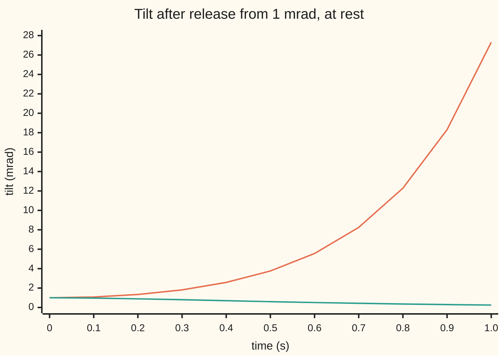
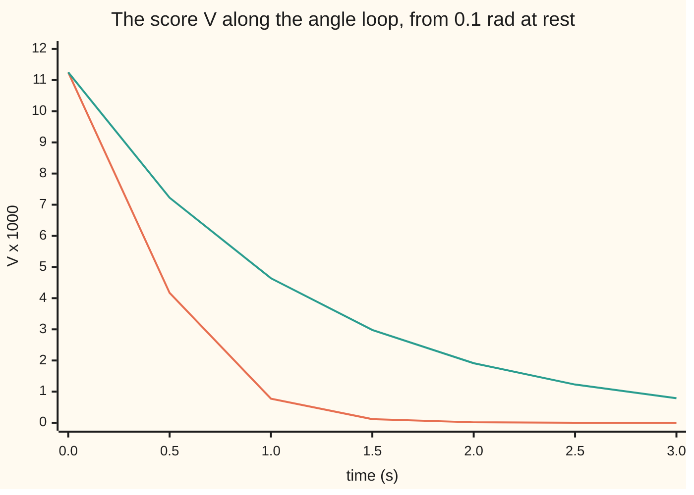

# Stability of a state-space model: eigenvalue tests and the energy that certifies them

[Syllabus](../../../SYLLABUS.md) → [Engineering mathematics](../README.md) → [State Space and Optimal Control](../README.md#s04) → Stability of a state-space model

---

## General Overview

A cart carries a pole 0.613125 m long, balanced upright on a hinge. Gravity, 9.81 m/s² (standard gravity, rounded), divided by the pole length is 9.81 / 0.613125 = 16 per second squared. Tilt the pole 1 mrad (a thousandth of a radian: a 1 mm offset seen from 1 m away) and let go. With the motor off, one second later the tilt is 27.31 mrad, and it keeps growing.

The cart's model is four numbers that step forward together: cart position, cart speed, tilt and tilt rate ([State space](01-state-space-models-and-the-matrix-exponential.md)). Its rate matrix A has four eigenvalues (the growth rates of its four special motions): 4, 0, 0 and −4 per second. The one at plus four is the falling pole: its motion doubles every 0.1733 s.

This card asks three questions of any such model. Does every motion die away? Does it still die away when a computer only looks every h seconds? And can one energy-like score, found from a linear equation, prove the answer without simulating the motion? The first is the **Hurwitz test**: every eigenvalue has negative real part, so it lies in the left half-plane. The second is the **Schur test**: every eigenvalue of the one-step matrix has size below 1, so it lies inside the unit circle. The third is the **Lyapunov equation**, whose answer is that score: a positive definite matrix P, which scores every state above zero except rest.

**A linear model settles exactly when every eigenvalue of A lies in the left half-plane, its sampled version settles exactly when every eigenvalue of the step matrix lies inside the unit circle, and either fact is certified by a positive definite matrix P solving a linear equation.**

**What kind of fact this is:** a theorem, proved on this card in Why it works; the curved-model version (Lyapunov's indirect method) is a theorem whose proof is sketched there.

### The picture: the pole with the motor off, and with feedback on



Orange: motor off, the eigenvalue at plus four wins. Green: the angle feedback used below moves the two tilt eigenvalues to −2 and −4, and the tilt is 0.25 mrad at 1 s.

---

## The formula

Notation first. The model is x' = Ax: x is the state (the list of four numbers) and A the rate matrix. Sampled every h seconds it becomes x_{k+1} = A_d x_k, with step matrix A_d = e^(Ah), the matrix exponential. The transpose x^T is x written as a row, so x^T P x is a single number. A matrix P is **positive definite**, written P > 0, when x^T P x is positive for every x except 0 ([Quadratic forms](../../03-Algebra/07-Eigenvalues%20and%20Symmetric%20Matrices/05-quadratic-forms-and-positive-definite.md)). Q is any chosen positive definite matrix; this card takes Q = I, the identity.

$$\text{Hurwitz: } \operatorname{Re}\lambda_i(A) < 0 \text{ for all } i, \qquad \text{Schur: } |\lambda_i(A_d)| < 1 \text{ for all } i$$

$$A^{\mathsf T}P + PA = -Q \;\;\text{has a solution } P > 0 \iff A \text{ is Hurwitz}, \qquad A_d^{\mathsf T}PA_d - P = -Q \;\;\text{has one} \iff A_d \text{ is Schur}$$

**Read it aloud:** every growth rate is negative, or every one-step multiplier is smaller than one in size; and that happens exactly when a bowl-shaped score x^T P x exists that every motion slides down at rate x^T Q x.

The score is V(x) = x^T P x. Along a motion its rate is V' = x^T(A^T P + PA)x = −x^T Q x, negative everywhere except at rest, x = 0. That is a Lyapunov function, exactly as on [Lyapunov functions](../../08-Differential%20equations%20and%20dynamics/06-Nonlinear%20Dynamics%20in%20the%20Plane/04-lyapunov-functions.md), except that here it is found by solving a linear equation rather than by search.

| Symbol | Plain meaning | In our example | Push it up and the answer… |
| --- | --- | --- | --- |
| $x$, $x_k$ | the state: cart position m, cart speed m/s, tilt rad, tilt rate rad/s; at sample k | tilt 0.1 rad, the rest zero | V grows as its square |
| $t$, $k$ | time in s; sample count | 0 to 3 s | modes shrink or grow |
| $A$, $A_{cl}$, $B$ | rate matrix of x' = Ax; with feedback; input column | open eigenvalues 4, 0, 0, −4 per s | — |
| $\lambda_i$, $\bar\lambda$, $v$, $v^*$, $s$ | eigenvalues (growth rates, per s) and the complex conjugate of λ; an eigenvector and its conjugate transpose; the variable of det(sI − A) | +4: the falling pole | any real part past 0 fails Hurwitz |
| $g/l$ | gravity over pole length, per s^2 | 9.81 / 0.613125 = 16 | the tilt eigenvalue √(g/l) grows |
| $u$ | input: cart acceleration, m/s^2 | 14.715 θ + 3.679 ω | — |
| $\theta$, $\omega$ | tilt, rad, and tilt rate, rad/s | angle loop ω' = −8θ − 6ω | — |
| $h$, $z$ | sampling interval, s; a one-step multiplier e^(λh) | 0.01 s; z = 1.040811 | past 0.4024 s the digital loop fails |
| $A_d$, $M$ | one-step matrix: e^(Ah) for the open cart; M with held feedback; its radius is the largest eigenvalue size | radius 1.040811; 0.9796 | radius past 1 fails Schur |
| $Q$, $I$ | chosen positive definite rate of loss; the identity | Q = I | P scales with it |
| $P$, $p_{11}$, $p_{12}$, $p_{22}$, $\lambda_{max}$ | the certificate and its entries; its largest eigenvalue | 1.125, 0.0625, 0.09375; 1.1288 | — |
| $V$, $V'$ | the score x^T P x and its rate, −x^T Q x | 0.011250 and −0.010000 at θ = 0.1 rad | V' more negative: faster settling |

### When it holds

- **Constant A.** A matrix whose entries change in time can have negative frozen eigenvalues at every instant and still grow; the Lyapunov route then needs a P(t).
- **Q positive definite.** With Q = 0 the equation has the useless answer P = 0. With Q only positive semidefinite, x^T Q x is never negative but can be 0 for some x ≠ 0. The test still works if every motion shows up in x^T Q x: the pair is observable ([Can you steer every state, and can you see every state](03-controllability-and-observability.md)).
- **No two eigenvalues summing to zero.** The equation's linear map has eigenvalues λ_i + λ_j. The open pole has 4 and −4, so its equation has no unique answer: the solver's determinant is 0.0000.
- **Strictly inside the boundary.** Re λ = 0 is not a pass. The cart's double 0 lets a 0.1 m/s nudge carry it 1.0000 m in 10 s, and further every second after.
- **Linear model.** On the curved pendulum the same P works only near upright. From 0.9 rad V falls at every step; from 1.0 rad it does not, and the pole goes over.

---

## Why it works

### Step 0: every motion is a mix of modes e^(λt), so the eigenvalues decide

When A has a full set of eigenvectors, any start splits into eigenvector parts, and the part along eigenvalue λ is multiplied by e^(λt) ([The matrix exponential](../../08-Differential%20equations%20and%20dynamics/04-Systems%20and%20the%20Matrix%20Exponential/04-the-matrix-exponential.md)). Its size is e^(Re λ · t). So all motions decay exactly when every real part is negative. A repeated eigenvalue without enough eigenvectors adds factors t, t^2, …, which a negative exponential still beats, but which break a zero real part: the cart's t.

Simulating shows it. The tilt from rest is 1 mrad · cosh(4t), and ln(θ(3)/θ(2)) = 4.0000 per s, the top eigenvalue.

### Step 1: sampling maps the left half-plane onto the inside of the unit circle

Over one step of h seconds the mode e^(λt) is multiplied by z = e^(λh), with size e^(Re λ · h). That is below 1 exactly when Re λ < 0. At h = 0.01 s the open cart's step matrix has eigenvalues 1.040811, 1.000000, 1.000000 and 0.960789, and e^(4h) = 1.040811. The Schur test reads the same verdict as the Hurwitz test, as long as any feedback acts continuously, so A already includes it; a command held between samples changes that.

With feedback computed only at the samples, that link breaks. The motor holds each command flat for h seconds ([Discretising a design](../02-Linear%20Systems%20and%20Transforms/09-zero-order-hold-and-tustin-discretisation.md)), so the step matrix M is not e^(A_cl h) and must be tested on its own.

For the angle loop, M is the open tilt pair's step `[[cosh 4h, sinh 4h / 4], [4 sinh 4h, cosh 4h]]` plus what the held push −(24θ + 6ω) adds over h seconds: M = `[[cosh 4h − 1.5 (cosh 4h − 1), sinh 4h / 4 − 0.375 (cosh 4h − 1)], [−2 sinh 4h, cosh 4h − 1.5 sinh 4h]]`. At h = 0.01 s that is `[[0.9996, 0.0097], [-0.0800, 0.9408]]`.

A 2×2 matrix is Schur exactly when |det| < 1 and |trace| < 1 + det, the two-dimensional case of Jury's test ([The z-transform](../02-Linear%20Systems%20and%20Transforms/08-z-transform-and-discrete-time-systems.md) has the unit circle).

### Step 2: the score's rate is a quadratic form in A^T P + PA

Take V(x) = x^T P x with P symmetric. Along x' = Ax, the product rule gives V' = x'^T P x + x^T P x' = x^T(A^T P + P A)x. Asking for V' = −x^T Q x is asking for A^T P + PA = −Q. Unknowns: the entries of P. Equations: the entries of that matrix. It is linear.

### Step 3: if A is Hurwitz, an answer exists, is unique, and is positive definite

Set P = ∫ e^(A^T t) Q e^(At) dt from 0 to ∞. The integrand decays like e^(2 · max Re λ · t), so the integral is finite. For any x ≠ 0, x^T P x = ∫ (e^(At)x)^T Q (e^(At)x) dt > 0, since e^(At)x is never 0: P > 0.

The product rule shows A^T e^(A^T t) Q e^(At) + e^(A^T t) Q e^(At) A is the integrand's derivative, so A^T P + PA = [e^(A^T t) Q e^(At)] from 0 to ∞ = 0 − Q.

Uniqueness: the map P ↦ A^T P + PA has eigenvalues λ_i + λ_j, none zero when every real part is negative.

The integral is the physical reading: P adds up x^T Q x over the whole future motion. So x^T P x is the total loss still to come from state x.

### Step 4: if some P > 0 answers it, A is Hurwitz

Let Av = λv with v ≠ 0, complex if needed, v* its conjugate transpose and λ̄ the complex conjugate of λ. Then v*(A^T P + PA)v = (λ̄ + λ) v*Pv = 2 Re λ · v*Pv. The left side is −v*Qv < 0 and v*Pv > 0, so Re λ < 0. One positive definite solution proves every eigenvalue stable, without computing one.

<details>
<summary>Detailed proof: the sampled equation, term by term</summary>

For x_{k+1} = M x_k and V = x^T P x, the one-step change is V(x_{k+1}) − V(x_k) = x_k^T (M^T P M − P) x_k. Setting it to −x_k^T Q x_k gives M^T P M − P = −Q. If every |λ_i(M)| < 1, the series P = Σ_{k≥0} (M^T)^k Q M^k converges, each term is positive semidefinite and the first is Q > 0, so P > 0; substituting, M^T P M − P = Σ_{k≥1} − Σ_{k≥0} = −Q. The linear map P ↦ M^T P M − P has eigenvalues λ_i λ_j − 1, none zero, so the answer is unique. Conversely, with Mv = λv, v*(M^T P M − P)v = (|λ|^2 − 1) v*Pv = −v*Qv < 0, so |λ| < 1. For small h, M ≈ I + hA, and the series is a Riemann sum of the integral of Step 3 with step h: h P_d ≈ P.

</details>

### Step 5: the angle loop by hand

Feed back u = 0.613125 (24θ + 6ω) = 14.715 θ + 3.679 ω. The motor term in ω' is −u/0.613125 = −24θ − 6ω, so ω' = 16θ − 24θ − 6ω = −8θ − 6ω. The tilt pair has A = `[[0, 1], [-8, -6]]`: trace −6, determinant 8, eigenvalues −2 and −4 ([Trace and determinant](../../08-Differential%20equations%20and%20dynamics/04-Systems%20and%20the%20Matrix%20Exponential/05-classifying-equilibria-by-trace-and-determinant.md)). Write P = `[[p11, p12], [p12, p22]]` and Q = I. The three distinct entries of A^T P + PA = −I read:

- top left: −16 p12 = −1, so p12 = 0.0625;
- bottom right: 2 p12 − 12 p22 = −1, so p22 = 1.125 / 12 = 0.09375;
- off the diagonal: p11 − 8 p22 − 6 p12 = 0, so p11 = 0.75 + 0.375 = 1.125.

Leading minors 1.125 and 1.125 × 0.09375 − 0.0625^2 = 0.1015625 are both positive, so P > 0 (Sylvester's test), and the loop is certified.

### Step 6: the certificate also bounds the speed

Since x^T x ≥ V / λ_max(P), with λ_max(P) = 1.1288 its largest eigenvalue, V' = −x^T x ≤ −V / 1.1288. So V falls at least as fast as e^(−0.8859 t).



Orange: V along the true motion. Green: the guaranteed ceiling 11.250 e^(−0.8859 t). The true fall is faster; the ceiling is what P promises without simulating the motion.

### Step 7: the curved pendulum borrows the verdict near upright

The real pendulum obeys ω' = 16 sin θ − (24θ + 6ω) cos θ. Near upright this is the linear loop plus terms of size θ^2 and smaller ([Linearisation](02-linearisation-about-an-equilibrium.md)). Then V' = −x^T x + (terms of size |x|^3), which is negative once |x| is small enough.

So a Hurwitz linearisation makes the upright rest point locally asymptotically stable: motions that start close enough settle back to it. This is Lyapunov's indirect method. An eigenvalue with positive real part, like the open pole's +4, makes the rest point unstable; a real part of 0 leaves the curved terms to decide.

The theorem promises "near" without saying how near. The run finds the same P working from 0.9 rad and failing from 1.0 rad.

---

## Worked numbers, by hand

| Step | Arithmetic | Value |
| --- | --- | --- |
| open loop | det(sI − A) = s^2 (s^2 − 16) | eigenvalues 4, 0, 0, −4 |
| Hurwitz test | largest real part 4 > 0 | fails |
| doubling time | ln 2 / 4 | 0.1733 s |
| sampled, h = 0.01 s | e^(4 × 0.01) | 1.040811 > 1: Schur fails |
| angle loop | trace −6, det 8; (−6 ± √(36 − 32)) / 2 | −2, −4: Hurwitz passes |
| p12 | 1 / 16 | 0.0625 |
| p22 | (1 + 2 × 0.0625) / 12 | 0.09375 |
| p11 | 8 × 0.09375 + 6 × 0.0625 | 1.125 |
| minors | 1.125; 0.10546875 − 0.00390625 | 1.125, 0.1015625 |
| score at 0.1 rad | 1.125 × 0.1^2 | V = 0.011250, V' = −0.010000 |
| step matrix M, h = 0.01 s | Step 1's formula with 4h = 0.04 | `[[0.9996, 0.0097], [-0.0800, 0.9408]]` |
| digital loop, h = 0.01 s | trace 1.9404, det 0.9412: 0.9412 < 1 and 1.9404 < 1 + 0.9412 | **Schur passes, radius 0.9796** |

The motor-off pole fails both tests through one eigenvalue, +4. With angle feedback the continuous loop, its 100-samples-per-second version and the certificate P all agree that the pole settles. They certify the pole only: the angle feedback leaves the cart's double eigenvalue 0 in place, so the cart drifts while the pole settles. The full loop in the code, with a gain from [Pole placement](04-pole-placement-and-observers.md), settles both. The second Jury condition passes by a hair, which is what a step this short looks like: both multipliers sit just inside 1.

### What breaks if you drop a piece

| Mistake | Comes out at | What went wrong |
| --- | --- | --- |
| Solve the Lyapunov equation for the open angle loop | no solution: determinant 0.0000 | eigenvalues 4 and −4 sum to zero; there is no certificate for an unstable loop |
| Rate gain with the wrong sign, ω' = −8θ + 6ω | P11 = −1.125000, P22 = −0.093750 | eigenvalues 4 and 2; P exists but is not positive definite, so it certifies nothing |
| Sample the same feedback every 0.5 s | radius 2.1945; Jury fails (trace −2.0592, det −0.2970) | the continuous loop passes, but held commands go stale; the edge is h = 0.4024 s |
| Apply the half-plane test to the step matrix | radius 0.9796, real part > 0: "unstable" | the sampled test is the unit circle, not the half-plane |

---

## Code, from first principles, and it actually runs

The scripts build every tool they use: a matrix exponential (halve the time, Taylor series, square back), Gaussian elimination, the characteristic polynomial by the Faddeev–LeVerrier recursion and its roots by Durand–Kerner, which refines all roots at once. They take four independent roads:

- The eigenvalues come from the polynomial's roots and again from simulated growth.
- P comes from a linear solve, from the hand formula and from Simpson's rule on the integral of Step 3.
- The digital loop's radius comes from trace and determinant and again from the growth of M^k x.
- Positive definiteness comes from leading minors and from Cholesky's factorisation, which exists only for P > 0.

The full four-state loop, with a gain placing the eigenvalues at −1, −2, −3 and −4 ([Pole placement](04-pole-placement-and-observers.md)), is certified the same way, beyond hand reach.

### Python

```python
# Stability of a state-space model, the check behind the card.  Standard library only (math).  Cart and
# pendulum upright, pole 0.613125 m so g/l = 9.81 / 0.613125 = 16 per s^2; x = (cart p m, speed v m/s, tilt th rad, rate w rad/s),
# u = cart acceleration m/s^2.  Roads: polynomial roots vs simulated growth; Lyapunov P by solve, hand formula
# and integral; sampled loop by trace and determinant vs powers; positive definite by minors vs Cholesky.
from math import log, sqrt, sin, cos, cosh, sinh, prod
def mm(X, Y): return [[sum(X[i][k] * Y[k][j] for k in range(len(Y))) for j in range(len(Y[0]))] for i in range(len(X))]
tr, eye = lambda X: [list(r) for r in zip(*X)], lambda n: [[float(i == j) for j in range(n)] for i in range(n)]
def add(X, Y, c=1.0): return [[a + c * b for a, b in zip(r, s)] for r, s in zip(X, Y)]
f = lambda x, d=4: f"{round(x, d) + 0.0:.{d}f}"; fl = lambda xs, d=4: " ".join(f(x, d) for x in xs)
def expm(X, t):                                    # e^(Xt): shrink t by halving, Taylor, square back up
    s = 0
    while max(abs(a) for r in X for a in r) * abs(t) / 2 ** s > 0.1: s += 1
    Y, E, T = [[a * t / 2 ** s for a in r] for r in X], eye(len(X)), eye(len(X))
    for k in range(1, 16): T = [[a / k for a in r] for r in mm(T, Y)]; E = add(E, T)
    for _ in range(s): E = mm(E, E)
    return E
def solve(M, y):                                   # Gaussian elimination with row swaps; (x, det)
    n, M, det = len(M), [r[:] + [b] for r, b in zip(M, y)], 1.0
    for c in range(n):
        p = max(range(c, n), key=lambda i: abs(M[i][c]))
        if abs(M[p][c]) < 1e-12: return None, 0.0
        if p != c: M[c], M[p], det = M[p], M[c], -det
        det *= M[c][c]
        for i in range(c + 1, n): M[i] = [a - M[i][c] / M[c][c] * b for a, b in zip(M[i], M[c])]
    x = [0.0] * n
    for i in reversed(range(n)): x[i] = (M[i][n] - sum(M[i][j] * x[j] for j in range(i + 1, n))) / M[i][i]
    return x, det
def lyap(A, Q, disc=False):                        # A'P + PA = -Q, or sampled A'PA - P = -Q
    n = len(A); ix = [(i, j) for i in range(n) for j in range(n)]
    if disc: M = [[A[k][i] * A[l][j] - (i == k and j == l) for k, l in ix] for i, j in ix]
    else: M = [[A[k][i] * (l == j) + (i == k) * A[l][j] for k, l in ix] for i, j in ix]
    x, det = solve(M, [-Q[i][j] for i, j in ix])
    return (None if x is None else [x[i * n:(i + 1) * n] for i in range(n)]), det
def lyap_int(A, T, N):                             # Simpson's rule on e^(A't) I e^(At) over 0..T
    h = T / N; E1, E, S = expm(A, h), eye(len(A)), [[0.0] * len(A) for _ in A]
    for k in range(N + 1):
        S = add(S, mm(tr(E), E), (1 if k in (0, N) else 4 if k % 2 else 2) * h / 3); E = mm(E, E1)
    return S
def charpoly(A):                                   # Faddeev-LeVerrier: det(sI - A), highest power first
    n, c, M = len(A), [1.0], [[0.0] * len(A) for _ in A]
    for k in range(1, n + 1):
        M = add(mm(A, M), eye(n), c[-1]); AM = mm(A, M); c.append(-sum(AM[i][i] for i in range(n)) / k)
    return c
def roots(c):                                      # Durand-Kerner: all roots at once, complex
    n = len(c) - 1; z = [(0.4 + 0.9j) ** k for k in range(n)]
    for _ in range(3000):
        for i in range(n):
            z[i] -= sum(a * z[i] ** (n - k) for k, a in enumerate(c)) / prod(z[i] - z[j] for j in range(n) if j != i)
    return sorted(z, key=lambda w: -w.real)
def minors(P): return [solve([r[:k] for r in P[:k]], [0.0] * k)[1] for k in range(1, len(P) + 1)]
def cholesky_ok(P):                                # P = L L' exists with positive pivots iff P > 0
    n = len(P); L = [[0.0] * n for _ in range(n)]
    for i in range(n):
        for j in range(i + 1):
            s = P[i][j] - sum(L[i][k] * L[j][k] for k in range(j))
            if i == j and s <= 0: return False
            L[i][j] = sqrt(s) if i == j else s / L[j][j]
    return True
A = [[0, 1, 0, 0], [0, 0, 0, 0], [0, 0, 0, 1], [0, 0, 16, 0]]; c = charpoly(A); lam = roots(c)
print("open loop: det(sI - A) coefficients", fl(c, 1), "| eigenvalues", fl([z.real for z in lam]))
th = lambda t: expm(A, t)[2][2]                    # tilt in mrad, released at 1 mrad from rest
print(f"tilt from 1 mrad: at 1 s {f(th(1), 2)} mrad; growth ln(th(3)/th(2)) = {f(log(th(3) / th(2)))} per s;"
      f" doubling {f(log(2) / 4)} s; cart nudged to 0.1 m/s is at {f(0.1 * expm(A, 10)[0][1])} m after 10 s")
h = 0.01; zd = roots(charpoly(expm(A, h)))
print(f"sampled every {h} s: eigenvalues of e^(Ah)", fl([z.real for z in zd], 6), f"| e^(4h) = {f(2.718281828459045 ** (4 * h), 6)}")
Ac = [[0, 1], [-8, -6]]; t2, d2 = Ac[0][0] + Ac[1][1], Ac[0][0] * Ac[1][1] - Ac[0][1] * Ac[1][0]  # angle loop
print(f"angle loop: trace {f(t2, 1)} det {f(d2, 1)} eigenvalues {f((t2 + sqrt(t2 * t2 - 4 * d2)) / 2, 1)}"
      f" {f((t2 - sqrt(t2 * t2 - 4 * d2)) / 2, 1)}; feedback u = {f(24 * 0.613125, 3)} th + {f(6 * 0.613125, 3)} w")
P, det = lyap(Ac, eye(2)); Pi = lyap_int(Ac, 20, 4000); cc, dd = 8, 6   # hand: the three entry equations
hand = [cc * (1 + 1 / cc) / (2 * dd) + dd / (2 * cc), 1 / (2 * cc), (1 + 1 / cc) / (2 * dd)]
print("P11 P12 P22: solve", fl([P[0][0], P[0][1], P[1][1]], 6), "| hand", fl(hand, 6), "| integral", fl([Pi[0][0], Pi[0][1], Pi[1][1]], 6))
print("P leading minors", fl(minors(P), 7), "| Cholesky", cholesky_ok(P))
V = lambda s: P[0][0] * s[0] ** 2 + 2 * P[0][1] * s[0] * s[1] + P[1][1] * s[1] ** 2
x0 = [0.1, 0.0]; lmax = (P[0][0] + P[1][1] + sqrt((P[0][0] - P[1][1]) ** 2 + 4 * P[0][1] ** 2)) / 2
Vd = 2 * sum(x0[i] * P[i][j] * sum(Ac[j][k] * x0[k] for k in range(2)) for i in range(2) for j in range(2))
print(f"from th = 0.1 rad: V = {f(V(x0), 6)}, V' = 2 x'PAx = {f(Vd, 6)}; largest eigenvalue of P {f(lmax)},"
      f" so V falls at least as e^(-{f(1 / lmax)} t)")
traj = lambda t: [sum(expm(Ac, t)[i][j] * x0[j] for j in range(2)) for i in range(2)]
print("chart, t s:       ", fl([0.5 * k for k in range(7)], 1))
print("chart, V x 1000:  ", fl([1000 * V(traj(0.5 * k)) for k in range(7)], 3))
print("chart, bound x1000", fl([1000 * V(x0) * 2.718281828459045 ** (-0.5 * k / lmax) for k in range(7)], 3))
print("chart, tilt mrad open  ", fl([th(0.1 * k) for k in range(11)], 2))
print("chart, tilt mrad closed", fl([10 * traj(0.1 * k)[0] for k in range(11)], 2))
def Mdig(h):                                       # held input: one e^() of the plant with its input column
    G = expm([[0, 1, 0], [16, 0, -1], [0, 0, 0]], h)   # top-left e^(Ah), right column the push held h s
    return [[G[i][j] + G[i][2] * (24, 6)[j] for j in range(2)] for i in range(2)]
def rho(M):                                        # spectral radius of a 2x2 from trace and determinant
    t, d = M[0][0] + M[1][1], M[0][0] * M[1][1] - M[0][1] * M[1][0]; r = (t * t - 4 * d + 0j) ** 0.5
    return max(abs((t + r) / 2), abs((t - r) / 2)), t, d
def rho_pow(M, k=2000):                             # the same number from steps: growth of |M^j x| over j = k..2k
    x, s = [1.0, 1.0], 0.0
    for j in range(2 * k):
        x = [M[0][0] * x[0] + M[0][1] * x[1], M[1][0] * x[0] + M[1][1] * x[1]]; n = sqrt(x[0] ** 2 + x[1] ** 2)
        s, x = s + (log(n) if j >= k else 0.0), [x[0] / n, x[1] / n]
    return 2.718281828459045 ** (s / k)
for hh in (0.01, 0.2, 0.5):
    r, t, d = rho(Mdig(hh))
    print(f"digital angle loop, h = {hh} s: M {fl(sum(Mdig(hh), []))}; trace {f(t)} det {f(d)}; Jury |det| < 1 and |trace| < 1 + det:"
          f" {abs(d) < 1 and abs(t) < 1 + d}; radius {f(r)}, by powers {f(rho_pow(Mdig(hh)))}")
lo, hi = 0.2, 0.5
for _ in range(60): lo, hi = ((lo + hi) / 2, hi) if rho(Mdig((lo + hi) / 2))[0] < 1 else (lo, (lo + hi) / 2)
print(f"slowest safe sampling: h = {f(lo)} s, {f(1 / lo, 2)} samples per s")
Pd, _ = lyap(Mdig(0.01), eye(2), disc=True); S, Mk = eye(2), eye(2); M1 = Mdig(0.01)
for _ in range(3000): Mk = mm(Mk, M1); S = add(S, mm(tr(Mk), Mk))
print("sampled P x h, solve", fl([0.01 * Pd[0][0], 0.01 * Pd[0][1], 0.01 * Pd[1][1]]), "| by the series", fl([0.01 * S[0][0], 0.01 * S[0][1], 0.01 * S[1][1]]))
fn = lambda s: [s[1], 16 * sin(s[0]) - (24 * s[0] + 6 * s[1]) * cos(s[0])]
def falls(th0, h=0.001):                           # RK4 on the curved pendulum for 5 s: V always falling? top tilt
    s, v, ok, top = [th0, 0.0], V([th0, 0.0]), True, th0
    for _ in range(5000):
        k1 = fn(s); k2 = fn([a + h / 2 * b for a, b in zip(s, k1)]); k3 = fn([a + h / 2 * b for a, b in zip(s, k2)])
        k4 = fn([a + h * b for a, b in zip(s, k3)]); s = [a + h / 6 * (p + 2 * q + 2 * r + w) for a, p, q, r, w in zip(s, k1, k2, k3, k4)]
        ok, v, top = ok and V(s) < v, V(s), max(top, abs(s[0]))
    return ok, top, s[0]
for th0 in (0.3, 0.9, 1.0): r = falls(th0); print(f"curved pendulum from {th0} rad: V falls at every step {r[0]}; largest tilt {f(r[1])}, tilt at 5 s {f(r[2])} rad")
K = [-1.5, -3.125, -52.5 * 0.613125, -13.125 * 0.613125]; Bv = [0, 1, 0, -1 / 0.613125]
Acl = [[A[i][j] - Bv[i] * K[j] for j in range(4)] for i in range(4)]
cl = charpoly(Acl); P4, _ = lyap(Acl, eye(4)); P4i = lyap_int(Acl, 40, 8000)
print("full loop: coefficients", fl(cl, 4), "| eigenvalues", fl([z.real for z in roots(cl)]))
print("full loop P minors", fl(minors(P4), 3), "| Cholesky", cholesky_ok(P4),
      "| solve vs integral, largest gap", f(max(abs(P4[i][j] - P4i[i][j]) for i in range(4) for j in range(4)), 7))
Po, do = lyap([[0, 1], [16, 0]], eye(2)); Pf, _ = lyap([[0, 1], [-8, 6]], eye(2))
print(f"wrong: Lyapunov on the open angle loop: solution {Po}, system determinant {f(do)}")
print("wrong: rate gain sign flipped, eigenvalues", fl([z.real for z in roots(charpoly([[0, 1], [-8, 6]]))], 1),
      "P", fl([Pf[0][0], Pf[0][1], Pf[1][1]], 6))
print(f"wrong: half-plane test on the sampled loop's {f(rho(M1)[0])}: real part > 0; try: pole 0.24525 m:"
      f" eigenvalue {f(sqrt(9.81 / 0.24525))}, doubling {f(log(2) / sqrt(9.81 / 0.24525))} s")
Pq, _ = lyap(Ac, [[10, 0], [0, 1]]); print("try: Q = diag(10, 1): P", fl([Pq[0][0], Pq[0][1], Pq[1][1]], 6), "minors", fl(minors(Pq), 6))
assert max(abs(z.real - e) for z, e in zip(lam, (4, 0, 0, -4))) < 1e-6         # roots of s^4 - 16 s^2
assert abs(log(th(3) / th(2)) - lam[0].real) < 1e-6                              # simulated growth = top eigenvalue
assert abs(max(abs(z) for z in zd) - 2.718281828459045 ** (4 * h)) < 1e-9        # sampling maps lambda to e^(lambda h)
assert max(abs(a - b) for a, b in zip([P[0][0], P[0][1], P[1][1]], hand)) < 1e-12  # solve = hand formula
assert max(abs(P[i][j] - Pi[i][j]) for i in range(2) for j in range(2)) < 1e-8     # solve = integral
assert max(abs(P4[i][j] - P4i[i][j]) for i in range(4) for j in range(4)) < 1e-6 and cholesky_ok(P4)
assert all(abs(rho(Mdig(x))[0] - rho_pow(Mdig(x))) < 1e-6 for x in (0.01, 0.2, 0.5))  # trace-det = powers
assert abs(1 + sum(rho(Mdig(lo))[1:])) < 1e-9                                  # edge: Jury's 1 + trace + det = 0
assert max(abs(Pd[i][j] - S[i][j]) for i in range(2) for j in range(2)) < 1e-6   # sampled P: solve = series
ch, sh = cosh(2), sinh(2)                          # closed form at h = 0.5: e^(Ah) by cosh and sinh, push by integrating
assert max(abs(Mdig(0.5)[i][j] - ([[ch, sh / 4], [4 * sh, ch]][i][j] - [(ch - 1) / 16, sh / 4][i] * (24, 6)[j])) for i in range(2) for j in range(2)) < 1e-9
assert Po is None and not cholesky_ok(Pf); assert falls(0.9)[0] and not falls(1.0)[0]  # no certificate; P is local
print("ALL CHECKS PASS")
```

**Ran 2026-11-11 on macOS, Python 3.14.10, standard library only. All checks passed. Output, pasted from the run:**

```
open loop: det(sI - A) coefficients 1.0 0.0 -16.0 0.0 0.0 | eigenvalues 4.0000 0.0000 0.0000 -4.0000
tilt from 1 mrad: at 1 s 27.31 mrad; growth ln(th(3)/th(2)) = 4.0000 per s; doubling 0.1733 s; cart nudged to 0.1 m/s is at 1.0000 m after 10 s
sampled every 0.01 s: eigenvalues of e^(Ah) 1.040811 1.000000 1.000000 0.960789 | e^(4h) = 1.040811
angle loop: trace -6.0 det 8.0 eigenvalues -2.0 -4.0; feedback u = 14.715 th + 3.679 w
P11 P12 P22: solve 1.125000 0.062500 0.093750 | hand 1.125000 0.062500 0.093750 | integral 1.125000 0.062500 0.093750
P leading minors 1.1250000 0.1015625 | Cholesky True
from th = 0.1 rad: V = 0.011250, V' = 2 x'PAx = -0.010000; largest eigenvalue of P 1.1288, so V falls at least as e^(-0.8859 t)
chart, t s:        0.0 0.5 1.0 1.5 2.0 2.5 3.0
chart, V x 1000:   11.250 4.169 0.774 0.117 0.016 0.002 0.000
chart, bound x1000 11.250 7.224 4.639 2.979 1.913 1.228 0.789
chart, tilt mrad open   1.00 1.08 1.34 1.81 2.58 3.76 5.56 8.25 12.29 18.31 27.31
chart, tilt mrad closed 1.00 0.97 0.89 0.80 0.70 0.60 0.51 0.43 0.36 0.30 0.25
digital angle loop, h = 0.01 s: M 0.9996 0.0097 -0.0800 0.9408; trace 1.9404 det 0.9412; Jury |det| < 1 and |trace| < 1 + det: True; radius 0.9796, by powers 0.9796
digital angle loop, h = 0.2 s: M 0.8313 0.0955 -1.7762 0.0053; trace 0.8366 det 0.1740; Jury |det| < 1 and |trace| < 1 + det: True; radius 0.4493, by powers 0.4493
digital angle loop, h = 0.5 s: M -0.3811 -0.1291 -7.2537 -1.6781; trace -2.0592 det -0.2970; Jury |det| < 1 and |trace| < 1 + det: False; radius 2.1945, by powers 2.1945
slowest safe sampling: h = 0.4024 s, 2.49 samples per s
sampled P x h, solve 1.1356 0.0607 0.0976 | by the series 1.1356 0.0607 0.0976
curved pendulum from 0.3 rad: V falls at every step True; largest tilt 0.3000, tilt at 5 s 0.0000 rad
curved pendulum from 0.9 rad: V falls at every step True; largest tilt 0.9000, tilt at 5 s 0.0004 rad
curved pendulum from 1.0 rad: V falls at every step False; largest tilt 6.9359, tilt at 5 s -0.5395 rad
full loop: coefficients 1.0000 10.0000 35.0000 50.0000 24.0000 | eigenvalues -1.0000 -2.0000 -3.0000 -4.0000
full loop P minors 1.818 1.577 4.349 0.389 | Cholesky True | solve vs integral, largest gap 0.0000004
wrong: Lyapunov on the open angle loop: solution None, system determinant 0.0000
wrong: rate gain sign flipped, eigenvalues 4.0 2.0 P -1.125000 0.062500 -0.093750
wrong: half-plane test on the sampled loop's 0.9796: real part > 0; try: pole 0.24525 m: eigenvalue 6.3246, doubling 0.1096 s
try: Q = diag(10, 1): P 5.250000 0.625000 0.187500 minors 5.250000 0.593750
ALL CHECKS PASS
```

### Rust

```rust
// Stability of a state-space model, the check behind the card.  std only.  Cart and pendulum upright,
// pole 0.613125 m so g/l = 9.81 / 0.613125 = 16 per s^2; x = (cart p m, speed v m/s, tilt th rad, rate w rad/s), u = cart
// acceleration m/s^2.  Roads: polynomial roots vs simulated growth; Lyapunov P by solve, hand formula and
// integral; sampled loop by trace and determinant vs powers; positive definite by minors vs Cholesky.
type M = Vec<Vec<f64>>;
fn mm(x: &M, y: &M) -> M { (0..x.len()).map(|i| (0..y[0].len()).map(|j| (0..y.len()).map(|k| x[i][k] * y[k][j]).sum()).collect()).collect() }
fn tr(x: &M) -> M { (0..x[0].len()).map(|j| (0..x.len()).map(|i| x[i][j]).collect()).collect() }
fn eye(n: usize) -> M { (0..n).map(|i| (0..n).map(|j| if i == j { 1.0 } else { 0.0 }).collect()).collect() }
fn add(x: &M, y: &M, c: f64) -> M { x.iter().zip(y).map(|(r, s)| r.iter().zip(s).map(|(a, b)| a + c * b).collect()).collect() }
fn m(rows: &[&[f64]]) -> M { rows.iter().map(|r| r.to_vec()).collect() }
fn f(x: f64, d: usize) -> String { let s = format!("{:.*}", d, x); if s.trim_start_matches('-').chars().all(|c| c == '0' || c == '.') { s.trim_start_matches('-').to_string() } else { s } }
fn fl(xs: &[f64], d: usize) -> String { xs.iter().map(|&x| f(x, d)).collect::<Vec<_>>().join(" ") }
fn tf(b: bool) -> &'static str { if b { "True" } else { "False" } }
fn expm(x: &M, t: f64) -> M {                         // e^(Xt): shrink t by halving, Taylor, square back up
    let mx = x.iter().flatten().fold(0.0f64, |a, b| a.max(b.abs()));
    let mut s = 0; while mx * t.abs() / 2f64.powi(s) > 0.1 { s += 1; }
    let y: M = x.iter().map(|r| r.iter().map(|a| a * t / 2f64.powi(s)).collect()).collect();
    let (mut e, mut tt) = (eye(x.len()), eye(x.len()));
    for k in 1..16 { tt = mm(&tt, &y).iter().map(|r| r.iter().map(|a| a / k as f64).collect()).collect(); e = add(&e, &tt, 1.0); }
    for _ in 0..s { e = mm(&e, &e); }
    e
}
fn solve(a: &M, y: &[f64]) -> (Option<Vec<f64>>, f64) {   // Gaussian elimination with row swaps; (x, det)
    let n = a.len(); let mut a: M = a.iter().zip(y).map(|(r, b)| { let mut r = r.clone(); r.push(*b); r }).collect(); let mut det = 1.0;
    for c in 0..n {
        let p = (c..n).fold(c, |p, i| if a[i][c].abs() > a[p][c].abs() { i } else { p });
        if a[p][c].abs() < 1e-12 { return (None, 0.0); }
        if p != c { a.swap(c, p); det = -det; }
        det *= a[c][c];
        for i in c + 1..n { let q = a[i][c] / a[c][c]; for j in 0..=n { a[i][j] -= q * a[c][j]; } }
    }
    let mut x = vec![0.0; n];
    for i in (0..n).rev() { x[i] = (a[i][n] - (i + 1..n).map(|j| a[i][j] * x[j]).sum::<f64>()) / a[i][i]; }
    (Some(x), det)
}
fn lyap(a: &M, q: &M, disc: bool) -> (Option<M>, f64) {  // A'P + PA = -Q, or sampled A'PA - P = -Q
    let n = a.len(); let ix: Vec<(usize, usize)> = (0..n * n).map(|t| (t / n, t % n)).collect();
    let d = |b: bool| if b { 1.0 } else { 0.0 };
    let mat: M = ix.iter().map(|&(i, j)| ix.iter().map(|&(k, l)| if disc { a[k][i] * a[l][j] - d(i == k && j == l) }
        else { a[k][i] * d(l == j) + d(i == k) * a[l][j] }).collect()).collect();
    let (x, det) = solve(&mat, &ix.iter().map(|&(i, j)| -q[i][j]).collect::<Vec<_>>());
    (x.map(|x| (0..n).map(|i| x[i * n..(i + 1) * n].to_vec()).collect()), det)
}
fn lyap_int(a: &M, t: f64, n: usize) -> M {            // Simpson's rule on e^(A't) I e^(At) over 0..T
    let h = t / n as f64; let e1 = expm(a, h); let mut e = eye(a.len()); let mut s = vec![vec![0.0; a.len()]; a.len()];
    for k in 0..=n { let w = if k == 0 || k == n { 1.0 } else if k % 2 == 1 { 4.0 } else { 2.0 }; s = add(&s, &mm(&tr(&e), &e), w * h / 3.0); e = mm(&e, &e1); }
    s
}
fn charpoly(a: &M) -> Vec<f64> {                       // Faddeev-LeVerrier: det(sI - A), highest power first
    let n = a.len(); let mut c = vec![1.0]; let mut mk = vec![vec![0.0; n]; n];
    for k in 1..=n { mk = add(&mm(a, &mk), &eye(n), *c.last().unwrap()); let am = mm(a, &mk); c.push(-(0..n).map(|i| am[i][i]).sum::<f64>() / k as f64); }
    c
}
#[derive(Clone, Copy)] struct C(f64, f64);
fn cm(a: C, b: C) -> C { C(a.0 * b.0 - a.1 * b.1, a.0 * b.1 + a.1 * b.0) }
fn cd(a: C, b: C) -> C { let d = b.0 * b.0 + b.1 * b.1; C((a.0 * b.0 + a.1 * b.1) / d, (a.1 * b.0 - a.0 * b.1) / d) }
fn roots(c: &[f64]) -> Vec<C> {                        // Durand-Kerner: all roots at once, complex
    let n = c.len() - 1; let mut z: Vec<C> = Vec::new(); let mut p = C(1.0, 0.0);
    for _ in 0..n { z.push(p); p = cm(p, C(0.4, 0.9)); }
    for _ in 0..3000 { for i in 0..n {
        let num = c.iter().fold(C(0.0, 0.0), |acc, &a| { let t = cm(acc, z[i]); C(t.0 + a, t.1) });
        let den = (0..n).filter(|&j| j != i).fold(C(1.0, 0.0), |acc, j| cm(acc, C(z[i].0 - z[j].0, z[i].1 - z[j].1)));
        let q = cd(num, den); z[i] = C(z[i].0 - q.0, z[i].1 - q.1);
    } }
    z.sort_by(|a, b| b.0.partial_cmp(&a.0).unwrap()); z
}
fn re(z: &[C]) -> Vec<f64> { z.iter().map(|w| w.0).collect() }
fn minors(p: &M) -> Vec<f64> { (1..=p.len()).map(|k| solve(&p[..k].iter().map(|r| r[..k].to_vec()).collect(), &vec![0.0; k]).1).collect() }
fn cholesky_ok(p: &M) -> bool {                        // P = L L' exists with positive pivots iff P > 0
    let n = p.len(); let mut l = vec![vec![0.0; n]; n];
    for i in 0..n { for j in 0..=i {
        let s = p[i][j] - (0..j).map(|k| l[i][k] * l[j][k]).sum::<f64>();
        if i == j && s <= 0.0 { return false; }
        l[i][j] = if i == j { s.sqrt() } else { s / l[j][j] };
    } }
    true
}
fn mdig(h: f64) -> M {                                 // held input: one e^() of the plant with its input column
    let g = expm(&m(&[&[0.0, 1.0, 0.0], &[16.0, 0.0, -1.0], &[0.0, 0.0, 0.0]]), h);
    (0..2).map(|i| (0..2).map(|j| g[i][j] + g[i][2] * [24.0, 6.0][j]).collect()).collect()
}
fn rho(a: &M) -> (f64, f64, f64) {                     // spectral radius of a 2x2 from trace and determinant
    let (t, d) = (a[0][0] + a[1][1], a[0][0] * a[1][1] - a[0][1] * a[1][0]); let disc = t * t - 4.0 * d;
    let r = if disc >= 0.0 { ((t + disc.sqrt()) / 2.0).abs().max(((t - disc.sqrt()) / 2.0).abs()) } else { d.sqrt() };
    (r, t, d)
}
fn rho_pow(a: &M, k: usize) -> f64 {                   // the same number from steps: growth of |M^j x| over j = k..2k
    let (mut x, mut s) = ([1.0f64, 1.0], 0.0);
    for j in 0..2 * k {
        let y = [a[0][0] * x[0] + a[0][1] * x[1], a[1][0] * x[0] + a[1][1] * x[1]]; let n = (y[0] * y[0] + y[1] * y[1]).sqrt();
        if j >= k { s += n.ln(); } x = [y[0] / n, y[1] / n];
    }
    2.718281828459045f64.powf(s / k as f64)
}
fn gap(a: &M, b: &M) -> f64 { a.iter().flatten().zip(b.iter().flatten()).fold(0.0, |g, (x, y)| g.max((x - y).abs())) }
fn main() {
    let a = m(&[&[0.0, 1.0, 0.0, 0.0], &[0.0; 4], &[0.0, 0.0, 0.0, 1.0], &[0.0, 0.0, 16.0, 0.0]]); let c = charpoly(&a); let lam = roots(&c);
    println!("open loop: det(sI - A) coefficients {} | eigenvalues {}", fl(&c, 1), fl(&re(&lam), 4));
    let th = |t: f64| expm(&a, t)[2][2];               // tilt in mrad, released at 1 mrad from rest
    println!("tilt from 1 mrad: at 1 s {} mrad; growth ln(th(3)/th(2)) = {} per s; doubling {} s; cart nudged to 0.1 m/s is at {} m after 10 s",
        f(th(1.0), 2), f((th(3.0) / th(2.0)).ln(), 4), f(2f64.ln() / 4.0, 4), f(0.1 * expm(&a, 10.0)[0][1], 4));
    let h = 0.01; let zd = roots(&charpoly(&expm(&a, h)));
    println!("sampled every 0.01 s: eigenvalues of e^(Ah) {} | e^(4h) = {}", fl(&re(&zd), 6), f(2.718281828459045f64.powf(4.0 * h), 6));
    let ac = m(&[&[0.0, 1.0], &[-8.0, -6.0]]); let (t2, d2) = (ac[0][0] + ac[1][1], ac[0][0] * ac[1][1] - ac[0][1] * ac[1][0]);
    println!("angle loop: trace {} det {} eigenvalues {} {}; feedback u = {} th + {} w", f(t2, 1), f(d2, 1), f((t2 + (t2 * t2 - 4.0 * d2).sqrt()) / 2.0, 1),
        f((t2 - (t2 * t2 - 4.0 * d2).sqrt()) / 2.0, 1), f(24.0 * 0.613125, 3), f(6.0 * 0.613125, 3));
    let p = lyap(&ac, &eye(2), false).0.unwrap(); let pi = lyap_int(&ac, 20.0, 4000); let (cc, dd) = (8.0, 6.0);  // hand: the three entry equations
    let hand = [cc * (1.0 + 1.0 / cc) / (2.0 * dd) + dd / (2.0 * cc), 1.0 / (2.0 * cc), (1.0 + 1.0 / cc) / (2.0 * dd)];
    println!("P11 P12 P22: solve {} | hand {} | integral {}", fl(&[p[0][0], p[0][1], p[1][1]], 6), fl(&hand, 6), fl(&[pi[0][0], pi[0][1], pi[1][1]], 6));
    println!("P leading minors {} | Cholesky {}", fl(&minors(&p), 7), tf(cholesky_ok(&p)));
    let v = |s: [f64; 2]| p[0][0] * s[0] * s[0] + 2.0 * p[0][1] * s[0] * s[1] + p[1][1] * s[1] * s[1];
    let x0 = [0.1, 0.0]; let lmax = (p[0][0] + p[1][1] + ((p[0][0] - p[1][1]).powi(2) + 4.0 * p[0][1] * p[0][1]).sqrt()) / 2.0;
    let vd: f64 = 2.0 * (0..2).map(|i| (0..2).map(|j| x0[i] * p[i][j] * (0..2).map(|k| ac[j][k] * x0[k]).sum::<f64>()).sum::<f64>()).sum::<f64>();
    println!("from th = 0.1 rad: V = {}, V' = 2 x'PAx = {}; largest eigenvalue of P {}, so V falls at least as e^(-{} t)", f(v(x0), 6), f(vd, 6), f(lmax, 4), f(1.0 / lmax, 4));
    let traj = |t: f64| { let e = expm(&ac, t); [e[0][0] * x0[0] + e[0][1] * x0[1], e[1][0] * x0[0] + e[1][1] * x0[1]] };
    let ks: Vec<f64> = (0..7).map(|k| 0.5 * k as f64).collect(); let ts: Vec<f64> = (0..11).map(|k| 0.1 * k as f64).collect();
    println!("chart, t s:        {}", fl(&ks, 1));
    println!("chart, V x 1000:   {}", fl(&ks.iter().map(|&t| 1000.0 * v(traj(t))).collect::<Vec<_>>(), 3));
    println!("chart, bound x1000 {}", fl(&ks.iter().map(|&t| 1000.0 * v(x0) * 2.718281828459045f64.powf(-t / lmax)).collect::<Vec<_>>(), 3));
    println!("chart, tilt mrad open   {}", fl(&ts.iter().map(|&t| th(t)).collect::<Vec<_>>(), 2));
    println!("chart, tilt mrad closed {}", fl(&ts.iter().map(|&t| 10.0 * traj(t)[0]).collect::<Vec<_>>(), 2));
    for (hh, lab) in [(0.01, "0.01"), (0.2, "0.2"), (0.5, "0.5")] {
        let (r, t, d) = rho(&mdig(hh));
        println!("digital angle loop, h = {} s: M {}; trace {} det {}; Jury |det| < 1 and |trace| < 1 + det: {}; radius {}, by powers {}",
            lab, fl(&mdig(hh).concat(), 4), f(t, 4), f(d, 4), tf(d.abs() < 1.0 && t.abs() < 1.0 + d), f(r, 4), f(rho_pow(&mdig(hh), 2000), 4));
    }
    let (mut lo, mut hi) = (0.2, 0.5);
    for _ in 0..60 { let mid = (lo + hi) / 2.0; if rho(&mdig(mid)).0 < 1.0 { lo = mid; } else { hi = mid; } }
    println!("slowest safe sampling: h = {} s, {} samples per s", f(lo, 4), f(1.0 / lo, 2));
    let m1 = mdig(0.01); let pd = lyap(&m1, &eye(2), true).0.unwrap(); let (mut s, mut mk) = (eye(2), eye(2));
    for _ in 0..3000 { mk = mm(&mk, &m1); s = add(&s, &mm(&tr(&mk), &mk), 1.0); }
    println!("sampled P x h, solve {} | by the series {}", fl(&[0.01 * pd[0][0], 0.01 * pd[0][1], 0.01 * pd[1][1]], 4), fl(&[0.01 * s[0][0], 0.01 * s[0][1], 0.01 * s[1][1]], 4));
    let fnl = |s: [f64; 2]| [s[1], 16.0 * s[0].sin() - (24.0 * s[0] + 6.0 * s[1]) * s[0].cos()];
    let falls = |th0: f64| {                           // RK4 on the curved pendulum for 5 s: V always falling? top tilt
        let (mut s, h) = ([th0, 0.0], 0.001); let (mut vv, mut ok, mut top) = (v(s), true, th0);
        for _ in 0..5000 {
            let k1 = fnl(s); let k2 = fnl([s[0] + h / 2.0 * k1[0], s[1] + h / 2.0 * k1[1]]); let k3 = fnl([s[0] + h / 2.0 * k2[0], s[1] + h / 2.0 * k2[1]]);
            let k4 = fnl([s[0] + h * k3[0], s[1] + h * k3[1]]); s = [0, 1].map(|i| s[i] + h / 6.0 * (k1[i] + 2.0 * k2[i] + 2.0 * k3[i] + k4[i]));
            ok = ok && v(s) < vv; vv = v(s); top = top.max(s[0].abs());
        }
        (ok, top, s[0])
    };
    for (th0, lab) in [(0.3, "0.3"), (0.9, "0.9"), (1.0, "1.0")] { let r = falls(th0); println!("curved pendulum from {} rad: V falls at every step {}; largest tilt {}, tilt at 5 s {} rad", lab, tf(r.0), f(r.1, 4), f(r.2, 4)); }
    let k = [-1.5, -3.125, -52.5 * 0.613125, -13.125 * 0.613125]; let bv = [0.0, 1.0, 0.0, -1.0 / 0.613125];
    let acl: M = (0..4).map(|i| (0..4).map(|j| a[i][j] - bv[i] * k[j]).collect()).collect();
    let cl = charpoly(&acl); let p4 = lyap(&acl, &eye(4), false).0.unwrap(); let p4i = lyap_int(&acl, 40.0, 8000);
    println!("full loop: coefficients {} | eigenvalues {}", fl(&cl, 4), fl(&re(&roots(&cl)), 4));
    println!("full loop P minors {} | Cholesky {} | solve vs integral, largest gap {}", fl(&minors(&p4), 3), tf(cholesky_ok(&p4)), f(gap(&p4, &p4i), 7));
    let (po, dopen) = lyap(&m(&[&[0.0, 1.0], &[16.0, 0.0]]), &eye(2), false); let flip = m(&[&[0.0, 1.0], &[-8.0, 6.0]]); let pf = lyap(&flip, &eye(2), false).0.unwrap();
    println!("wrong: Lyapunov on the open angle loop: solution {}, system determinant {}", if po.is_none() { "None" } else { "found" }, f(dopen, 4));
    println!("wrong: rate gain sign flipped, eigenvalues {} P {}", fl(&re(&roots(&charpoly(&flip))), 1), fl(&[pf[0][0], pf[0][1], pf[1][1]], 6));
    println!("wrong: half-plane test on the sampled loop's {}: real part > 0; try: pole 0.24525 m: eigenvalue {}, doubling {} s",
        f(rho(&m1).0, 4), f((9.81f64 / 0.24525).sqrt(), 4), f(2f64.ln() / (9.81f64 / 0.24525).sqrt(), 4));
    let pq = lyap(&ac, &m(&[&[10.0, 0.0], &[0.0, 1.0]]), false).0.unwrap();
    println!("try: Q = diag(10, 1): P {} minors {}", fl(&[pq[0][0], pq[0][1], pq[1][1]], 6), fl(&minors(&pq), 6));
    assert!(lam.iter().zip([4.0, 0.0, 0.0, -4.0]).all(|(z, e)| (z.0 - e).abs() < 1e-6));       // roots of s^4 - 16 s^2
    assert!(((th(3.0) / th(2.0)).ln() - lam[0].0).abs() < 1e-6);                                 // simulated growth = top eigenvalue
    assert!((zd.iter().map(|z| (z.0 * z.0 + z.1 * z.1).sqrt()).fold(0.0, f64::max) - 2.718281828459045f64.powf(4.0 * h)).abs() < 1e-9);
    assert!([p[0][0], p[0][1], p[1][1]].iter().zip(hand).all(|(a, b)| (a - b).abs() < 1e-12)); // solve = hand formula
    assert!(gap(&p, &pi) < 1e-8);                                                                // solve = integral
    assert!(gap(&p4, &p4i) < 1e-6 && cholesky_ok(&p4));
    assert!([0.01, 0.2, 0.5].iter().all(|&x| (rho(&mdig(x)).0 - rho_pow(&mdig(x), 2000)).abs() < 1e-6)); // trace-det = powers
    let (_, t9, d9) = rho(&mdig(lo)); assert!((1.0 + t9 + d9).abs() < 1e-9); assert!(gap(&pd, &s) < 1e-6);   // Jury edge; solve = series
    let (ch, sh) = (2f64.cosh(), 2f64.sinh());        // closed form at h = 0.5: e^(Ah) by cosh and sinh, push by integrating
    let cf = m(&[&[ch - (ch - 1.0) / 16.0 * 24.0, sh / 4.0 - (ch - 1.0) / 16.0 * 6.0], &[4.0 * sh - sh / 4.0 * 24.0, ch - sh / 4.0 * 6.0]]);
    assert!(gap(&mdig(0.5), &cf) < 1e-9);
    assert!(po.is_none() && !cholesky_ok(&pf));                                                  // no certificate when unstable
    assert!(falls(0.9).0 && !falls(1.0).0);                                                      // the linear certificate is local
    println!("ALL CHECKS PASS");
}
```

**Ran 2026-11-11 on macOS, rustc 1.98.1, no crates. All checks passed. Output, pasted from the run:**

```
open loop: det(sI - A) coefficients 1.0 0.0 -16.0 0.0 0.0 | eigenvalues 4.0000 0.0000 0.0000 -4.0000
tilt from 1 mrad: at 1 s 27.31 mrad; growth ln(th(3)/th(2)) = 4.0000 per s; doubling 0.1733 s; cart nudged to 0.1 m/s is at 1.0000 m after 10 s
sampled every 0.01 s: eigenvalues of e^(Ah) 1.040811 1.000000 1.000000 0.960789 | e^(4h) = 1.040811
angle loop: trace -6.0 det 8.0 eigenvalues -2.0 -4.0; feedback u = 14.715 th + 3.679 w
P11 P12 P22: solve 1.125000 0.062500 0.093750 | hand 1.125000 0.062500 0.093750 | integral 1.125000 0.062500 0.093750
P leading minors 1.1250000 0.1015625 | Cholesky True
from th = 0.1 rad: V = 0.011250, V' = 2 x'PAx = -0.010000; largest eigenvalue of P 1.1288, so V falls at least as e^(-0.8859 t)
chart, t s:        0.0 0.5 1.0 1.5 2.0 2.5 3.0
chart, V x 1000:   11.250 4.169 0.774 0.117 0.016 0.002 0.000
chart, bound x1000 11.250 7.224 4.639 2.979 1.913 1.228 0.789
chart, tilt mrad open   1.00 1.08 1.34 1.81 2.58 3.76 5.56 8.25 12.29 18.31 27.31
chart, tilt mrad closed 1.00 0.97 0.89 0.80 0.70 0.60 0.51 0.43 0.36 0.30 0.25
digital angle loop, h = 0.01 s: M 0.9996 0.0097 -0.0800 0.9408; trace 1.9404 det 0.9412; Jury |det| < 1 and |trace| < 1 + det: True; radius 0.9796, by powers 0.9796
digital angle loop, h = 0.2 s: M 0.8313 0.0955 -1.7762 0.0053; trace 0.8366 det 0.1740; Jury |det| < 1 and |trace| < 1 + det: True; radius 0.4493, by powers 0.4493
digital angle loop, h = 0.5 s: M -0.3811 -0.1291 -7.2537 -1.6781; trace -2.0592 det -0.2970; Jury |det| < 1 and |trace| < 1 + det: False; radius 2.1945, by powers 2.1945
slowest safe sampling: h = 0.4024 s, 2.49 samples per s
sampled P x h, solve 1.1356 0.0607 0.0976 | by the series 1.1356 0.0607 0.0976
curved pendulum from 0.3 rad: V falls at every step True; largest tilt 0.3000, tilt at 5 s 0.0000 rad
curved pendulum from 0.9 rad: V falls at every step True; largest tilt 0.9000, tilt at 5 s 0.0004 rad
curved pendulum from 1.0 rad: V falls at every step False; largest tilt 6.9359, tilt at 5 s -0.5395 rad
full loop: coefficients 1.0000 10.0000 35.0000 50.0000 24.0000 | eigenvalues -1.0000 -2.0000 -3.0000 -4.0000
full loop P minors 1.818 1.577 4.349 0.389 | Cholesky True | solve vs integral, largest gap 0.0000004
wrong: Lyapunov on the open angle loop: solution None, system determinant 0.0000
wrong: rate gain sign flipped, eigenvalues 4.0 2.0 P -1.125000 0.062500 -0.093750
wrong: half-plane test on the sampled loop's 0.9796: real part > 0; try: pole 0.24525 m: eigenvalue 6.3246, doubling 0.1096 s
try: Q = diag(10, 1): P 5.250000 0.625000 0.187500 minors 5.250000 0.593750
ALL CHECKS PASS
```

The roads agree to six decimals for P in both loops (the four-state gap is 0.0000004, Simpson's error). The sampled certificate times h, 1.1356, 0.0607, 0.0976, sits close to P: the sum of Step 4's fold approaching the integral. The full loop's characteristic polynomial s^4 + 10s^3 + 35s^2 + 50s + 24 has roots −1 to −4, and its P has leading minors 1.818, 1.577, 4.349 and 0.389, all positive.

### Lean

Lean proves the three tests for every constant real matrix of any size, and checks the card's worked numbers exactly.

- Take any positive definite Q. Then A^T P + PA = −Q has a solution P > 0 exactly when A is Hurwitz.
- Take any positive definite Q. Then A_d^T PA_d − P = −Q has a solution P > 0 exactly when A_d is Schur.
- Take x' = Ax with A constant. Then every motion dies away to rest exactly when A is Hurwitz.
- Take the open tilt pair. Then its trace is 0 and its determinant −16, so its eigenvalues 4 and −4 sum to zero.
- Take the angle loop. Then its trace is −6, its determinant 8, and its eigenvalues −2 and −4.
- Take Q = I on the angle loop. Then P with entries 1.125, 0.0625 and 0.09375 solves the equation.
- Its leading minors are 1.125 and 0.1015625, both positive.
- Take tilt 0.1 rad, the rest zero. Then V = 0.011250 and V' = −0.010000.
- Take the rate gain with the wrong sign. Then P with entries −1.125, 0.0625 and −0.09375 solves the equation, and the eigenvalues are 4 and 2.
- The full loop's characteristic polynomial has roots −1, −2, −3 and −4.
- Take Q = diag(10, 1) on the angle loop. Then P has entries 5.25, 0.625 and 0.1875.

The sampled and digital loops, the four-state P, the speed bound and the curved pendulum are left to the Python and Rust checks.

```lean
-- Stability of a state-space model: a constant linear model is Hurwitz exactly when its Lyapunov equation has a positive definite solution and exactly when every motion settles, and a step matrix is Schur exactly when its sampled Lyapunov equation has one.
import Mathlib.Analysis.Normed.Algebra.MatrixExponential
import Mathlib.LinearAlgebra.Matrix.PosDef
import Mathlib.LinearAlgebra.Matrix.Charpoly.Eigs
import Mathlib

open Matrix Filter Topology

/-! ### Helper lemmas -/

lemma lyap_mem_spectrum_iff {n : Type*} [Fintype n] [DecidableEq n]
    (M : Matrix n n ℂ) (μ : ℂ) :
    μ ∈ spectrum ℂ M ↔ ∃ v : n → ℂ, v ≠ 0 ∧ M *ᵥ v = μ • v := by
  rw [← Matrix.spectrum_toLin', ← Module.End.hasEigenvalue_iff_mem_spectrum]
  constructor
  · intro h
    obtain ⟨v, hv⟩ := h.exists_hasEigenvector
    refine ⟨v, (Module.End.hasEigenvector_iff.mp hv).2, ?_⟩
    simpa [Matrix.toLin'_apply] using hv.apply_eq_smul
  · rintro ⟨v, hv0, hv⟩
    exact Module.End.hasEigenvalue_of_hasEigenvector
      (Module.End.hasEigenvector_iff.mpr ⟨Module.End.mem_eigenspace_iff.mpr
        (by simpa [Matrix.toLin'_apply] using hv), hv0⟩)

#print axioms lyap_mem_spectrum_iff

lemma lyap_re_quad_pos {n : Type*} [Fintype n] (P : Matrix n n ℝ) (hP : P.PosDef)
    (v : n → ℂ) (hv : v ≠ 0) : 0 < (star v ⬝ᵥ (P.map Complex.ofReal *ᵥ v)).re := by
  set a : n → ℝ := fun i => (v i).re
  set b : n → ℝ := fun i => (v i).im
  have key : (star v ⬝ᵥ (P.map Complex.ofReal *ᵥ v)).re = a ⬝ᵥ (P *ᵥ a) + b ⬝ᵥ (P *ᵥ b) := by
    simp only [dotProduct, mulVec, Complex.re_sum, Pi.star_apply, Complex.star_def,
      Complex.mul_re, Complex.conj_re, Complex.conj_im, Complex.im_sum, map_apply,
      Complex.im_ofReal_mul, a, b]
    rw [← Finset.sum_add_distrib]
    refine Finset.sum_congr rfl fun i _ => ?_
    rw [Finset.mul_sum, Finset.mul_sum, Finset.mul_sum, Finset.mul_sum, ← Finset.sum_sub_distrib,
      ← Finset.sum_add_distrib]
    refine Finset.sum_congr rfl fun j _ => ?_
    simp only [Complex.ofReal_re, Complex.ofReal_im]
    ring
  rw [key]
  have hpa := hP.posSemidef.dotProduct_mulVec_nonneg a
  have hpb := hP.posSemidef.dotProduct_mulVec_nonneg b
  simp only [star_trivial] at hpa hpb
  by_cases ha : a = 0
  · have hb : b ≠ 0 := by
      intro hb; apply hv; funext i
      apply Complex.ext
      · simpa [a] using congrFun ha i
      · simpa [b] using congrFun hb i
    have := hP.dotProduct_mulVec_pos hb
    simp only [star_trivial] at this
    linarith
  · have := hP.dotProduct_mulVec_pos ha
    simp only [star_trivial] at this
    linarith

#print axioms lyap_re_quad_pos

/-- `star (M *ᵥ v) = star v ᵥ* Mᵀ` for the complexification of a real matrix. -/
lemma lyap_star_mulVec_real {n : Type*} [Fintype n] (M : Matrix n n ℝ) (v : n → ℂ) :
    star (M.map Complex.ofReal *ᵥ v) = star v ᵥ* (M.map Complex.ofReal)ᵀ := by
  rw [star_mulVec]
  congr 1
  ext i j
  simp [conjTranspose_apply]

#print axioms lyap_star_mulVec_real

lemma lyap_map_mul {n : Type*} [Fintype n] (M N : Matrix n n ℝ) :
    (M * N).map Complex.ofReal = M.map Complex.ofReal * N.map Complex.ofReal :=
  Matrix.map_mul (f := Complex.ofRealHom)

#print axioms lyap_map_mul

lemma lyap_cont_forward {n : Type*} [Fintype n] [DecidableEq n]
    (A Q P : Matrix n n ℝ) (hQ : Q.PosDef) (hP : P.PosDef) (h : Aᵀ * P + P * A = -Q) :
    ∀ μ ∈ spectrum ℂ (A.map Complex.ofReal), μ.re < 0 := by
  intro μ hμ
  obtain ⟨v, hv0, hv⟩ := (lyap_mem_spectrum_iff _ μ).1 hμ
  have hc : (A.map Complex.ofReal)ᵀ * P.map Complex.ofReal + P.map Complex.ofReal * A.map Complex.ofReal
      = -Q.map Complex.ofReal := by
    have := congrArg (fun M => M.map Complex.ofReal) h
    simpa [Matrix.map_add, lyap_map_mul, Matrix.map_neg, Matrix.transpose_map] using this
  have hp := lyap_re_quad_pos P hP v hv0
  have hq := lyap_re_quad_pos Q hQ v hv0
  set p := star v ⬝ᵥ (P.map Complex.ofReal *ᵥ v)
  have hquad : star v ⬝ᵥ (((A.map Complex.ofReal)ᵀ * P.map Complex.ofReal
      + P.map Complex.ofReal * A.map Complex.ofReal) *ᵥ v) = (star μ + μ) * p := by
    rw [add_mulVec, dotProduct_add, ← mulVec_mulVec, ← mulVec_mulVec, hv, mulVec_smul,
      dotProduct_smul, dotProduct_mulVec, ← lyap_star_mulVec_real, hv, star_smul, smul_dotProduct]
    simp [p, add_mul]
  rw [hc, neg_mulVec, dotProduct_neg] at hquad
  have hre := congrArg Complex.re hquad
  rw [Complex.neg_re, Complex.star_def, Complex.mul_re, Complex.add_re, Complex.add_im,
    Complex.conj_re, Complex.conj_im] at hre
  simp only [neg_add_cancel, zero_mul, sub_zero] at hre
  by_contra hcon
  push Not at hcon
  nlinarith [mul_nonneg hcon hp.le]

#print axioms lyap_cont_forward

lemma lyap_disc_forward {n : Type*} [Fintype n] [DecidableEq n]
    (Ad Q P : Matrix n n ℝ) (hQ : Q.PosDef) (hP : P.PosDef) (h : Adᵀ * P * Ad - P = -Q) :
    ∀ μ ∈ spectrum ℂ (Ad.map Complex.ofReal), ‖μ‖ < 1 := by
  intro μ hμ
  obtain ⟨v, hv0, hv⟩ := (lyap_mem_spectrum_iff _ μ).1 hμ
  have hc : (Ad.map Complex.ofReal)ᵀ * P.map Complex.ofReal * Ad.map Complex.ofReal
      - P.map Complex.ofReal = -Q.map Complex.ofReal := by
    have := congrArg (fun M => M.map Complex.ofReal) h
    simpa [Matrix.map_sub, lyap_map_mul, Matrix.map_neg, Matrix.transpose_map] using this
  have hp := lyap_re_quad_pos P hP v hv0
  have hq := lyap_re_quad_pos Q hQ v hv0
  set p := star v ⬝ᵥ (P.map Complex.ofReal *ᵥ v)
  have hquad : star v ⬝ᵥ (((Ad.map Complex.ofReal)ᵀ * P.map Complex.ofReal * Ad.map Complex.ofReal
      - P.map Complex.ofReal) *ᵥ v) = (star μ * μ - 1) * p := by
    rw [sub_mulVec, dotProduct_sub, ← mulVec_mulVec, ← mulVec_mulVec, hv, mulVec_smul,
      dotProduct_mulVec, ← lyap_star_mulVec_real, hv, star_smul, smul_dotProduct, dotProduct_smul]
    simp [p, sub_mul, mul_assoc]
  rw [hc, neg_mulVec, dotProduct_neg] at hquad
  have hns : star μ * μ = ((Complex.normSq μ : ℝ) : ℂ) := by
    rw [Complex.normSq_eq_conj_mul_self]; rfl
  rw [hns] at hquad
  have hre := congrArg Complex.re hquad
  rw [Complex.neg_re, Complex.mul_re, Complex.sub_re, Complex.sub_im, Complex.ofReal_re,
    Complex.ofReal_im, Complex.one_re, Complex.one_im] at hre
  simp only [sub_zero, zero_mul] at hre
  have hlt : Complex.normSq μ < 1 := by
    by_contra hcon
    push Not at hcon
    nlinarith [mul_nonneg (sub_nonneg.2 hcon) hp.le]
  rw [Complex.normSq_eq_norm_sq] at hlt
  nlinarith [norm_nonneg μ]

#print axioms lyap_disc_forward

lemma lyap_map_pow {n : Type*} [Fintype n] [DecidableEq n] (M : Matrix n n ℝ) (k : ℕ) :
    (M ^ k).map Complex.ofReal = (M.map Complex.ofReal) ^ k :=
  map_pow (Complex.ofRealHom.mapMatrix) M k

#print axioms lyap_map_pow

open scoped Matrix.Norms.Operator in
lemma lyap_norm_map {n : Type*} [Fintype n] (M : Matrix n n ℝ) :
    ‖M.map Complex.ofReal‖ = ‖M‖ := by
  simp [linfty_opNorm_def]

#print axioms lyap_norm_map

open scoped Matrix.Norms.Operator in
lemma lyap_schur_pow_bound {n : Type*} [Fintype n] [DecidableEq n] (M : Matrix n n ℝ)
    (hM : ∀ μ ∈ spectrum ℂ (M.map Complex.ofReal), ‖μ‖ < 1) :
    ∃ C > 0, ∃ r : ℝ, 0 < r ∧ r < 1 ∧ ∀ k : ℕ, ‖M ^ k‖ ≤ C * r ^ k := by
  rcases isEmpty_or_nonempty n with hn | hn
  · refine ⟨1, one_pos, 1/2, by norm_num, by norm_num, fun k => ?_⟩
    rw [Subsingleton.elim (M ^ k) 0, norm_zero]; positivity
  · have hsr : spectralRadius ℂ (M.map Complex.ofReal) < 1 := by
      have := spectrum.spectralRadius_lt_of_forall_lt (M.map Complex.ofReal) (r := 1)
        (fun z hz => by
          have := hM z hz
          rw [← NNReal.coe_lt_coe, coe_nnnorm]; simpa using this)
      simpa using this
    rw [spectrum.spectralRadius_eq_gelfandRadius] at hsr
    have hg : gelfandRadius (M.map Complex.ofReal) < 1 := by
      rwa [ENNReal.ofReal_lt_one] at hsr
    have heq : gelfandRadius M = gelfandRadius (M.map Complex.ofReal) := by
      apply gelfandRadius_eq_of_norm_pow_eq
      intro k
      rw [← lyap_map_pow, lyap_norm_map]
    rw [← heq] at hg
    have h0 := gelfandRadius_nonneg M
    obtain ⟨C, hC, hb⟩ := norm_pow_le_mul_pow_of_gelfandRadius_lt M
      (r := (gelfandRadius M + 1) / 2) (by linarith)
    exact ⟨C, hC, (gelfandRadius M + 1) / 2, by linarith, by linarith, hb⟩

#print axioms lyap_schur_pow_bound

open scoped Matrix.Norms.Operator in
lemma lyap_disc_backward {n : Type*} [Fintype n] [DecidableEq n]
    (Ad Q : Matrix n n ℝ) (hQ : Q.PosDef)
    (hS : ∀ μ ∈ spectrum ℂ (Ad.map Complex.ofReal), ‖μ‖ < 1) :
    ∃ P : Matrix n n ℝ, P.PosDef ∧ Adᵀ * P * Ad - P = -Q := by
  obtain ⟨C₁, hC₁, r₁, hr₁0, hr₁1, h₁⟩ := lyap_schur_pow_bound Ad hS
  have hST : ∀ μ ∈ spectrum ℂ (Adᵀ.map Complex.ofReal), ‖μ‖ < 1 := by
    intro μ hμ; rw [Matrix.transpose_map, Matrix.spectrum_transpose] at hμ; exact hS μ hμ
  obtain ⟨C₂, hC₂, r₂, hr₂0, hr₂1, h₂⟩ := lyap_schur_pow_bound Adᵀ hST
  set f : ℕ → Matrix n n ℝ := fun k => (Adᵀ) ^ k * Q * Ad ^ k with hf
  have hsum : Summable f := by
    refine Summable.of_norm_bounded (g := fun k => C₂ * ‖Q‖ * C₁ * (r₂ * r₁) ^ k) ?_ ?_
    · exact (summable_geometric_of_lt_one (by positivity) (by nlinarith)).mul_left _
    · intro k
      calc ‖f k‖ ≤ ‖Adᵀ ^ k‖ * ‖Q‖ * ‖Ad ^ k‖ := by
            simp only [f]
            exact (norm_mul_le _ _).trans (by gcongr; exact norm_mul_le _ _)
        _ ≤ (C₂ * r₂ ^ k) * ‖Q‖ * (C₁ * r₁ ^ k) := by
            gcongr
            · exact h₂ k
            · exact h₁ k
        _ = _ := by rw [mul_pow]; ring
  set P := ∑' k, f k with hPdef
  have hf0 : f 0 = Q := by simp [f]
  have hshift : Adᵀ * P * Ad = ∑' k, f (k + 1) := by
    rw [hPdef, ← hsum.tsum_mul_left, ← (hsum.mul_left Adᵀ).tsum_mul_right]
    congr 1; funext k; simp only [f]; rw [pow_succ', pow_succ]; simp [Matrix.mul_assoc]
  have hP : P = Q + ∑' k, f (k + 1) := by rw [hPdef, hsum.tsum_eq_zero_add, hf0]
  have hfC : ∀ k, f k = (Ad ^ k)ᴴ * Q * Ad ^ k := by
    intro k; simp [f, conjTranspose_eq_transpose_of_trivial, transpose_pow]
  refine ⟨P, ?_, ?_⟩
  · refine PosDef.of_dotProduct_mulVec_pos ?_ ?_
    · show Pᴴ = P
      rw [hPdef, Matrix.conjTranspose_tsum]
      refine tsum_congr fun k => ?_
      rw [hfC k]
      exact isHermitian_conjTranspose_mul_mul (Ad ^ k) hQ.1
    · intro x hx
      let L : Matrix n n ℝ →+ ℝ := AddMonoidHom.mk' (fun M => star x ⬝ᵥ (M *ᵥ x))
        (by intro a b; simp [add_mulVec, dotProduct_add])
      have hL : Continuous L := by
        show Continuous fun M : Matrix n n ℝ => star x ⬝ᵥ (M *ᵥ x)
        fun_prop
      have hs := hsum.hasSum.map L hL
      have hle := le_hasSum hs 0 (fun j _ => by
        show 0 ≤ star x ⬝ᵥ (f j *ᵥ x)
        rw [hfC j]
        exact (hQ.posSemidef.conjTranspose_mul_mul_same (Ad ^ j)).dotProduct_mulVec_nonneg x)
      have hpos : 0 < star x ⬝ᵥ (f 0 *ᵥ x) := by rw [hf0]; exact hQ.dotProduct_mulVec_pos hx
      exact lt_of_lt_of_le hpos hle
  · rw [hshift, hP]; abel

#print axioms lyap_disc_backward

lemma lyap_cayley_schur (μ : ℂ) (hμ : μ + 1 ≠ 0) (h : ((μ - 1) / (μ + 1)).re < 0) : ‖μ‖ < 1 := by
  rw [Complex.div_re] at h
  have hn : 0 < Complex.normSq (μ + 1) := Complex.normSq_pos.2 hμ
  rw [← add_div] at h
  have h2 : (μ - 1).re * (μ + 1).re + (μ - 1).im * (μ + 1).im < 0 := by
    by_contra hc; push Not at hc
    have := div_nonneg hc hn.le; linarith
  simp only [Complex.sub_re, Complex.add_re, Complex.one_re, Complex.sub_im, Complex.add_im,
    Complex.one_im, sub_zero, add_zero] at h2
  have hsq : ‖μ‖ ^ 2 < 1 := by
    rw [← Complex.normSq_eq_norm_sq, Complex.normSq_apply]; nlinarith
  nlinarith [norm_nonneg μ]

#print axioms lyap_cayley_schur

lemma lyap_cont_backward {n : Type*} [Fintype n] [DecidableEq n]
    (A Q : Matrix n n ℝ) (hQ : Q.PosDef)
    (hH : ∀ μ ∈ spectrum ℂ (A.map Complex.ofReal), μ.re < 0) :
    ∃ P : Matrix n n ℝ, P.PosDef ∧ Aᵀ * P + P * A = -Q := by
  set B : Matrix n n ℝ := 1 - A with hBdef
  have hBmap : B.map Complex.ofReal = 1 - A.map Complex.ofReal := by
    simp [B, Matrix.map_sub, Matrix.map_one]
  have hB : IsUnit B.det := by
    rw [isUnit_iff_ne_zero]
    intro hdet
    have h1 : (1 : ℂ) ∈ spectrum ℂ (A.map Complex.ofReal) := by
      rw [spectrum.mem_iff, Matrix.isUnit_iff_isUnit_det, map_one, ← hBmap, isUnit_iff_ne_zero]
      intro h
      apply h
      have := RingHom.map_det Complex.ofRealHom B
      rw [hdet, map_zero] at this
      exact this.symm
    have := hH 1 h1
    norm_num at this
  set C : Matrix n n ℝ := B⁻¹ with hCdef
  have hCB : C * B = 1 := nonsing_inv_mul B hB
  have hBC : B * C = 1 := mul_nonsing_inv B hB
  set Ad : Matrix n n ℝ := (1 + A) * C with hAddef
  have hAdB : Ad * B = 1 + A := by rw [hAddef, Matrix.mul_assoc, hCB, Matrix.mul_one]
  have hcomm : B * (1 + A) = (1 + A) * B := by rw [hBdef]; noncomm_ring
  have hBAd : B * Ad = 1 + A := by
    rw [hAddef, ← Matrix.mul_assoc, hcomm, Matrix.mul_assoc, hBC, Matrix.mul_one]
  -- the Cayley transform is Schur
  have hS : ∀ μ ∈ spectrum ℂ (Ad.map Complex.ofReal), ‖μ‖ < 1 := by
    intro μ hμ
    obtain ⟨v, hv0, hv⟩ := (lyap_mem_spectrum_iff _ μ).1 hμ
    have hm : (1 - A.map Complex.ofReal) * Ad.map Complex.ofReal = 1 + A.map Complex.ofReal := by
      rw [← hBmap, ← lyap_map_mul, hBAd]; simp [Matrix.map_add, Matrix.map_one]
    have hv2 : ((1 - A.map Complex.ofReal) * Ad.map Complex.ofReal) *ᵥ v
        = (1 + A.map Complex.ofReal) *ᵥ v := by rw [hm]
    rw [← mulVec_mulVec, hv, mulVec_smul, sub_mulVec, add_mulVec, one_mulVec] at hv2
    -- hv2 : μ • (v - Ac v) = v + Ac v
    have hev : (μ + 1) • (A.map Complex.ofReal *ᵥ v) = (μ - 1) • v := by
      rw [smul_sub] at hv2
      have key : (μ + 1) • (A.map Complex.ofReal *ᵥ v) - (μ - 1) • v
          = -(μ • v - μ • (A.map Complex.ofReal *ᵥ v) - (v + A.map Complex.ofReal *ᵥ v)) := by
        rw [add_smul, sub_smul, one_smul, one_smul]; abel
      rw [hv2, sub_self, neg_zero] at key
      exact sub_eq_zero.1 key
    have hμ1 : μ + 1 ≠ 0 := by
      intro h0
      rw [h0, zero_smul] at hev
      have : μ - 1 = -2 := by linear_combination h0
      rw [this] at hev
      apply hv0
      have := congrArg (fun w => (-1/2 : ℂ) • w) hev
      simp only [smul_zero, smul_smul] at this
      norm_num at this
      exact this.symm
    have hlam : (μ - 1) / (μ + 1) ∈ spectrum ℂ (A.map Complex.ofReal) := by
      rw [lyap_mem_spectrum_iff]
      refine ⟨v, hv0, ?_⟩
      have := congrArg (fun w => (μ + 1)⁻¹ • w) hev
      simp only [smul_smul, inv_mul_cancel₀ hμ1, one_smul] at this
      rw [this, div_eq_inv_mul]
    exact lyap_cayley_schur μ hμ1 (hH _ hlam)
  have hCinj : Function.Injective C.mulVec := by
    intro x y hxy
    have := congrArg (fun w => B *ᵥ w) hxy
    simpa [mulVec_mulVec, hBC] using this
  have hQ' : ((2 : ℝ) • (Cᵀ * Q * C)).PosDef := by
    have := hQ.conjTranspose_mul_mul_same hCinj
    rw [conjTranspose_eq_transpose_of_trivial] at this
    exact this.smul (by norm_num)
  obtain ⟨P, hP, hPeq⟩ := lyap_disc_backward Ad _ hQ' hS
  refine ⟨P, hP, ?_⟩
  have e1 : Bᵀ * (Adᵀ * P * Ad - P) * B = (2 : ℝ) • (Aᵀ * P + P * A) := by
    have gen : ∀ X Y Z : Matrix n n ℝ,
        Yᵀ * (Xᵀ * Z * X - Z) * Y = (X * Y)ᵀ * Z * (X * Y) - Yᵀ * Z * Y := by
      intro X Y Z; rw [transpose_mul]; simp only [Matrix.mul_sub, Matrix.sub_mul, Matrix.mul_assoc]
    rw [gen, hAdB, hBdef, transpose_add, transpose_sub, transpose_one, two_smul]
    noncomm_ring
  have e2 : Bᵀ * (-((2 : ℝ) • (Cᵀ * Q * C))) * B = (2 : ℝ) • (-Q) := by
    have : Bᵀ * (Cᵀ * Q * C) * B = (C * B)ᵀ * Q * (C * B) := by
      rw [transpose_mul]; simp only [Matrix.mul_assoc]
    rw [Matrix.mul_neg, Matrix.neg_mul, Matrix.mul_smul, Matrix.smul_mul, this, hCB,
      transpose_one, Matrix.one_mul, Matrix.mul_one, smul_neg]
  rw [hPeq, e2] at e1
  exact (smul_right_injective _ (two_ne_zero : (2 : ℝ) ≠ 0) e1).symm

#print axioms lyap_cont_backward

open scoped Matrix.Norms.Operator in
lemma lyap_settle_forward {n : Type*} [Fintype n] [DecidableEq n] (A : Matrix n n ℝ)
    (h : ∀ x₀ : n → ℝ, Tendsto (fun t : ℝ => NormedSpace.exp (t • A) *ᵥ x₀) atTop (𝓝 0)) :
    ∀ μ ∈ spectrum ℂ (A.map Complex.ofReal), μ.re < 0 := by
  intro μ hμ
  rcases isEmpty_or_nonempty n with hn | hn
  · exfalso
    rw [spectrum.mem_iff] at hμ
    exact hμ (isUnit_of_subsingleton _)
  have hM : Tendsto (fun t : ℝ => NormedSpace.exp (t • A)) atTop (𝓝 0) := by
    apply tendsto_pi_nhds.2; intro i; apply tendsto_pi_nhds.2; intro j
    have := ((continuous_apply i).tendsto 0).comp (h (Pi.single j 1))
    simpa [Function.comp_def, mulVec_single_one] using this
  have hcont : Continuous (fun M : Matrix n n ℝ => M.map Complex.ofReal) :=
    continuous_id.matrix_map Complex.continuous_ofReal
  have hexp : ∀ t : ℝ, (NormedSpace.exp (t • A)).map Complex.ofReal
      = NormedSpace.exp (t • A.map Complex.ofReal) := by
    intro t
    have := NormedSpace.map_exp (Complex.ofRealHom.mapMatrix (m := n)) hcont (t • A)
    have hs : Complex.ofRealHom.mapMatrix (t • A) = t • A.map Complex.ofReal := by
      ext i j; simp [Complex.real_smul]
    rw [hs] at this
    exact this
  have hMc : Tendsto (fun t : ℝ => NormedSpace.exp (t • A.map Complex.ofReal)) atTop (𝓝 0) := by
    have := (hcont.tendsto 0).comp hM
    simp only [Function.comp_def, hexp] at this
    simpa using this
  set E := NormedSpace.exp (A.map Complex.ofReal) with hE
  have hseq : Tendsto (fun k : ℕ => E ^ k) atTop (𝓝 0) := by
    have := hMc.comp tendsto_natCast_atTop_atTop
    refine this.congr fun k => ?_
    simp only [Function.comp_apply]
    rw [Nat.cast_smul_eq_nsmul ℝ k, Matrix.exp_nsmul]
  have hnorm : Tendsto (fun k : ℕ => ‖E ^ k‖) atTop (𝓝 0) :=
    tendsto_zero_iff_norm_tendsto_zero.1 hseq
  have hmem : NormedSpace.exp μ ∈ spectrum ℂ E := spectrum.exp_mem_exp (𝕜 := ℂ) _ hμ
  have hle : ∀ k : ℕ, ‖NormedSpace.exp μ‖ ^ k ≤ ‖E ^ k‖ := by
    intro k
    have hk : NormedSpace.exp μ ^ k ∈ spectrum ℂ (E ^ k) := by
      rw [spectrum.map_pow]; exact ⟨_, hmem, rfl⟩
    rw [← norm_pow]
    exact spectrum.norm_le_norm_of_mem hk
  have hlt : ‖NormedSpace.exp μ‖ < 1 := by
    by_contra hc
    push Not at hc
    have h1 : ∀ k : ℕ, 1 ≤ ‖E ^ k‖ := fun k => (one_le_pow₀ hc).trans (hle k)
    have := ge_of_tendsto' hnorm h1
    linarith
  rw [← Complex.exp_eq_exp_ℂ, Complex.norm_exp] at hlt
  exact Real.exp_lt_one_iff.1 hlt

#print axioms lyap_settle_forward

lemma lyap_norm_sq_le {n : Type*} [Fintype n] (x : n → ℝ) : ‖x‖ ^ 2 ≤ x ⬝ᵥ x := by
  have h0 : 0 ≤ x ⬝ᵥ x := Finset.sum_nonneg fun i _ => mul_self_nonneg (x i)
  have : ‖x‖ ≤ Real.sqrt (x ⬝ᵥ x) := by
    refine (pi_norm_le_iff_of_nonneg (Real.sqrt_nonneg _)).2 fun i => ?_
    rw [Real.norm_eq_abs]
    apply Real.abs_le_sqrt
    have := Finset.single_le_sum (f := fun j => x j * x j) (fun j _ => mul_self_nonneg (x j))
      (Finset.mem_univ i)
    simpa [dotProduct, sq] using this
  calc ‖x‖ ^ 2 ≤ (Real.sqrt (x ⬝ᵥ x)) ^ 2 := by gcongr
    _ = x ⬝ᵥ x := Real.sq_sqrt h0

#print axioms lyap_norm_sq_le

lemma lyap_quad_bounds {n : Type*} [Fintype n] (P : Matrix n n ℝ) (hP : P.PosDef) :
    ∃ m M : ℝ, 0 < m ∧ 0 < M ∧ ∀ x : n → ℝ,
      m * ‖x‖ ^ 2 ≤ x ⬝ᵥ (P *ᵥ x) ∧ x ⬝ᵥ (P *ᵥ x) ≤ M * ‖x‖ ^ 2 := by
  rcases isEmpty_or_nonempty n with hn | hn
  · refine ⟨1, 1, one_pos, one_pos, fun x => ?_⟩
    have : x = 0 := Subsingleton.elim _ _
    subst this; simp
  · set q : (n → ℝ) → ℝ := fun x => x ⬝ᵥ (P *ᵥ x) with hq
    have hqc : Continuous q := by
      simp only [hq]
      exact continuous_id.dotProduct (continuous_const.matrix_mulVec continuous_id)
    have hK : IsCompact (Metric.sphere (0 : n → ℝ) 1) := isCompact_sphere 0 1
    have hne : (Metric.sphere (0 : n → ℝ) 1).Nonempty := NormedSpace.sphere_nonempty.2 zero_le_one
    obtain ⟨y0, hy0, hmin⟩ := hK.exists_isMinOn hne hqc.continuousOn
    obtain ⟨y1, hy1, hmax⟩ := hK.exists_isMaxOn hne hqc.continuousOn
    have hy0ne : y0 ≠ 0 := by
      intro h; rw [h] at hy0; simp at hy0
    have hm : 0 < q y0 := by
      have := hP.dotProduct_mulVec_pos hy0ne; simpa [q] using this
    have hscale : ∀ (c : ℝ) (x : n → ℝ), q (c • x) = c ^ 2 * q x := by
      intro c x; simp only [q, mulVec_smul, smul_dotProduct, dotProduct_smul, smul_eq_mul]; ring
    refine ⟨q y0, max (q y1) 1, hm, by positivity, fun x => ?_⟩
    by_cases hx : x = 0
    · subst hx; simp [q]
    have hxn : 0 < ‖x‖ := norm_pos_iff.2 hx
    set y := ‖x‖⁻¹ • x with hydef
    have hy : y ∈ Metric.sphere (0 : n → ℝ) 1 := by
      simp [y, norm_smul, hxn.ne']
    have hxy : x = ‖x‖ • y := by simp [y, smul_smul, hxn.ne']
    have hqx : q x = ‖x‖ ^ 2 * q y := by
      conv_lhs => rw [hxy]
      rw [hscale]
    have h1 := isMinOn_iff.1 hmin y hy
    have h2 := isMaxOn_iff.1 hmax y hy
    have hsq : 0 ≤ ‖x‖ ^ 2 := by positivity
    refine ⟨?_, ?_⟩
    · show q y0 * ‖x‖ ^ 2 ≤ q x
      rw [hqx]; nlinarith
    · show q x ≤ max (q y1) 1 * ‖x‖ ^ 2
      rw [hqx]
      have : q y ≤ max (q y1) 1 := h2.trans (le_max_left _ _)
      nlinarith

#print axioms lyap_quad_bounds

lemma lyap_quad_conj {n : Type*} [Fintype n] (E N : Matrix n n ℝ) (x₀ : n → ℝ) :
    x₀ ⬝ᵥ ((Eᵀ * N * E) *ᵥ x₀) = (E *ᵥ x₀) ⬝ᵥ (N *ᵥ (E *ᵥ x₀)) := by
  rw [← mulVec_mulVec, ← mulVec_mulVec, dotProduct_mulVec, vecMul_transpose]

#print axioms lyap_quad_conj

lemma lyap_hasDerivAt_linear {E : Type*} [NormedAddCommGroup E] [NormedSpace ℝ E]
    [FiniteDimensional ℝ E] (f : E →ₗ[ℝ] ℝ) {F : ℝ → E} {F' : E} {t : ℝ}
    (h : HasDerivAt F F' t) : HasDerivAt (fun s => f (F s)) (f F') t :=
  (LinearMap.toContinuousLinearMap f).hasFDerivAt.comp_hasDerivAt t h

#print axioms lyap_hasDerivAt_linear

open scoped Matrix.Norms.Operator in
lemma lyap_settle_backward {n : Type*} [Fintype n] [DecidableEq n] (A : Matrix n n ℝ)
    (hH : ∀ μ ∈ spectrum ℂ (A.map Complex.ofReal), μ.re < 0) (x₀ : n → ℝ) :
    Tendsto (fun t : ℝ => NormedSpace.exp (t • A) *ᵥ x₀) atTop (𝓝 0) := by
  obtain ⟨P, hP, hPeq⟩ := lyap_cont_backward A 1 PosDef.one hH
  obtain ⟨m, M, hm, hM, hb⟩ := lyap_quad_bounds P hP
  set x : ℝ → (n → ℝ) := fun t => NormedSpace.exp (t • A) *ᵥ x₀ with hx
  set g : ℝ → ℝ := fun t => x t ⬝ᵥ (P *ᵥ x t) with hg
  have hT : ∀ t : ℝ, NormedSpace.exp (t • Aᵀ) = (NormedSpace.exp (t • A))ᵀ := by
    intro t; rw [← transpose_smul, Matrix.exp_transpose]
  have hderiv : ∀ t, HasDerivAt g (-(x t ⬝ᵥ x t)) t := by
    intro t
    have h1 := hasDerivAt_exp_smul_const (𝕂 := ℝ) Aᵀ t
    have h2 := hasDerivAt_exp_smul_const' (𝕂 := ℝ) A t
    have hF := (h1.mul_const P).mul h2
    let ℓ : Matrix n n ℝ →ₗ[ℝ] ℝ :=
      { toFun := fun N => x₀ ⬝ᵥ (N *ᵥ x₀)
        map_add' := by intro a b; simp [add_mulVec, dotProduct_add]
        map_smul' := by intro c a; simp [smul_mulVec, dotProduct_smul] }
    have hG := lyap_hasDerivAt_linear ℓ hF
    convert hG using 1
    · funext s
      simp only [ℓ, LinearMap.coe_mk, AddHom.coe_mk, g, x, Pi.mul_apply]
      erw [hT, lyap_quad_conj]
    · simp only [ℓ, LinearMap.coe_mk, AddHom.coe_mk, x]
      erw [hT]
      have : (NormedSpace.exp (t • A))ᵀ * Aᵀ * P * NormedSpace.exp (t • A)
          + (NormedSpace.exp (t • A))ᵀ * P * (A * NormedSpace.exp (t • A))
          = (NormedSpace.exp (t • A))ᵀ * (Aᵀ * P + P * A) * NormedSpace.exp (t • A) := by
        simp only [Matrix.mul_add, Matrix.add_mul, Matrix.mul_assoc]
      erw [this]; rw [hPeq, lyap_quad_conj]
      simp [neg_mulVec]
  -- Gronwall-type estimate
  set c : ℝ := 1 / M with hc
  have hcpos : 0 < c := by positivity
  set h : ℝ → ℝ := fun t => Real.exp (c * t) * g t with hh
  have hhd : ∀ t, HasDerivAt h (Real.exp (c * t) * (c * 1) * g t
      + Real.exp (c * t) * (-(x t ⬝ᵥ x t))) t := by
    intro t
    exact (((hasDerivAt_id t).const_mul c).exp).mul (hderiv t)
  have hanti : Antitone h := by
    apply antitone_of_deriv_nonpos
    · intro t; exact (hhd t).differentiableAt
    · intro t
      rw [(hhd t).deriv]
      have hbd := (hb (x t)).2
      have hn2 := lyap_norm_sq_le (x t)
      have hg' : c * g t ≤ x t ⬝ᵥ x t := by
        have : g t ≤ M * (x t ⬝ᵥ x t) := hbd.trans (by gcongr)
        rw [hc, div_mul_eq_mul_div, one_mul, div_le_iff₀ hM]; linarith
      have he := Real.exp_pos (c * t)
      nlinarith
  have hbound : ∀ t, 0 ≤ t → m * ‖x t‖ ^ 2 ≤ g 0 * Real.exp (-(c * t)) := by
    intro t ht
    have h1 : h t ≤ h 0 := hanti ht
    simp only [hh, mul_zero, Real.exp_zero, one_mul] at h1
    have h2 : g t ≤ g 0 * Real.exp (-(c * t)) := by
      rw [Real.exp_neg, ← div_eq_mul_inv, le_div_iff₀ (Real.exp_pos _)]
      linarith [mul_comm (Real.exp (c * t)) (g t)]
    exact (hb (x t)).1.trans h2
  have hlim : Tendsto (fun t : ℝ => Real.sqrt (g 0 / m * Real.exp (-(c * t)))) atTop (𝓝 0) := by
    have he : Tendsto (fun t : ℝ => Real.exp (-(c * t))) atTop (𝓝 0) :=
      Real.tendsto_exp_atBot.comp
        (tendsto_neg_atTop_atBot.comp (Tendsto.const_mul_atTop hcpos tendsto_id))
    have := ((he.const_mul (g 0 / m)).sqrt)
    simpa using this
  rw [tendsto_zero_iff_norm_tendsto_zero]
  refine squeeze_zero' (Eventually.of_forall fun t => norm_nonneg _) ?_ hlim
  have hg0 : 0 ≤ g 0 := le_trans (by positivity) (hb (x 0)).1
  filter_upwards [eventually_ge_atTop 0] with t ht
  rw [Real.le_sqrt (norm_nonneg _) (by positivity), div_mul_eq_mul_div, le_div_iff₀ hm]
  linarith [hbound t ht, mul_comm m (‖x t‖ ^ 2)]

#print axioms lyap_settle_backward

/-- Continuous-time Lyapunov test. For a constant real rate matrix `A` and any chosen
positive definite `Q`, the equation `Aᵀ P + P A = -Q` has a positive definite solution `P`
exactly when `A` is Hurwitz: every (complex) eigenvalue of `A` has negative real part. -/
theorem lyapunov_equation_solvable_iff_hurwitz {n : Type*} [Fintype n] [DecidableEq n]
    (A Q : Matrix n n ℝ) (hQ : Q.PosDef) :
    (∃ P : Matrix n n ℝ, P.PosDef ∧ Aᵀ * P + P * A = -Q) ↔
      ∀ μ ∈ spectrum ℂ (A.map Complex.ofReal), μ.re < 0 := by
  exact ⟨fun ⟨P, hP, h⟩ => lyap_cont_forward A Q P hQ hP h, lyap_cont_backward A Q hQ⟩

/-- Sampled (discrete-time) Lyapunov test. For a constant real step matrix `Ad` and any chosen
positive definite `Q`, the equation `Adᵀ P Ad - P = -Q` has a positive definite solution `P`
exactly when `Ad` is Schur: every (complex) eigenvalue of `Ad` has size below 1. -/
theorem discrete_lyapunov_equation_solvable_iff_schur {n : Type*} [Fintype n] [DecidableEq n]
    (Ad Q : Matrix n n ℝ) (hQ : Q.PosDef) :
    (∃ P : Matrix n n ℝ, P.PosDef ∧ Adᵀ * P * Ad - P = -Q) ↔
      ∀ μ ∈ spectrum ℂ (Ad.map Complex.ofReal), ‖μ‖ < 1 := by
  exact ⟨fun ⟨P, hP, h⟩ => lyap_disc_forward Ad Q P hQ hP h, lyap_disc_backward Ad Q hQ⟩

/-- A linear model `x' = A x` with constant `A` settles (every motion `e^(At) x₀` tends to rest)
exactly when `A` is Hurwitz: every eigenvalue of `A` has negative real part. -/
theorem linear_model_settles_iff_hurwitz {n : Type*} [Fintype n] [DecidableEq n]
    (A : Matrix n n ℝ) :
    (∀ x₀ : n → ℝ, Tendsto (fun t : ℝ => NormedSpace.exp (t • A) *ᵥ x₀) atTop (𝓝 0)) ↔
      ∀ μ ∈ spectrum ℂ (A.map Complex.ofReal), μ.re < 0 := by
  exact ⟨lyap_settle_forward A, fun hH x₀ => lyap_settle_backward A hH x₀⟩

/-! ### The card's worked numbers, exactly -/

-- The open tilt pair `[[0, 1], [16, 0]]`: trace 0 and determinant -16, so eigenvalues 4 and -4,
-- which sum to zero.
example : Matrix.trace !![(0 : ℝ), 1; 16, 0] = 0 ∧ Matrix.det !![(0 : ℝ), 1; 16, 0] = -16 := by
  constructor
  · simp [Matrix.trace, Fin.sum_univ_two]
  · simp [Matrix.det_fin_two_of]
example : ((4 : ℝ) ^ 2 - 16 = 0) ∧ ((-4 : ℝ) ^ 2 - 16 = 0) ∧ (4 : ℝ) + (-4) = 0 := by norm_num

-- The angle loop `[[0, 1], [-8, -6]]`: trace -6, determinant 8, eigenvalues -2 and -4.
example : Matrix.trace !![(0 : ℝ), 1; -8, -6] = -6 ∧ Matrix.det !![(0 : ℝ), 1; -8, -6] = 8 := by
  constructor
  · simp [Matrix.trace, Fin.sum_univ_two]
  · simp [Matrix.det_fin_two_of]
example : ((-2 : ℝ) ^ 2 + 6 * (-2) + 8 = 0) ∧ ((-4 : ℝ) ^ 2 + 6 * (-4) + 8 = 0) := by norm_num

-- The certificate P = [[9/8, 1/16], [1/16, 3/32]] (1.125, 0.0625, 0.09375) solves Aᵀ P + P A = -I.
example :
    (!![(0 : ℝ), 1; -8, -6])ᵀ * !![(9 / 8 : ℝ), 1 / 16; 1 / 16, 3 / 32]
      + !![(9 / 8 : ℝ), 1 / 16; 1 / 16, 3 / 32] * !![(0 : ℝ), 1; -8, -6] = -1 := by
  ext i j
  fin_cases i <;> fin_cases j <;>
    simp [Matrix.mul_apply, Fin.sum_univ_two, Matrix.transpose_apply] <;> norm_num

-- Its leading minors 9/8 and 13/128 (1.125 and 0.1015625) are both positive.
example : (0 : ℝ) < 9 / 8 ∧ (9 / 8 : ℝ) * (3 / 32) - (1 / 16) ^ 2 = 13 / 128 ∧ (0 : ℝ) < 13 / 128 := by
  norm_num

-- The score at tilt 1/10 rad, rest otherwise: V = 9/800 (0.011250) and V' = -1/100 (-0.010000).
example : (9 / 8 : ℝ) * (1 / 10) ^ 2 = 9 / 800 ∧ -((1 / 10 : ℝ) ^ 2) = -1 / 100 := by norm_num

-- Rate gain with the wrong sign, `[[0, 1], [-8, 6]]`: P = [[-9/8, 1/16], [1/16, -3/32]] solves the
-- equation, but its top-left entry is negative, so it is not positive definite.
example :
    (!![(0 : ℝ), 1; -8, 6])ᵀ * !![(-9 / 8 : ℝ), 1 / 16; 1 / 16, -3 / 32]
      + !![(-9 / 8 : ℝ), 1 / 16; 1 / 16, -3 / 32] * !![(0 : ℝ), 1; -8, 6] = -1 := by
  ext i j
  fin_cases i <;> fin_cases j <;>
    simp [Matrix.mul_apply, Fin.sum_univ_two, Matrix.transpose_apply] <;> norm_num
example : ((4 : ℝ) ^ 2 - 6 * 4 + 8 = 0) ∧ ((2 : ℝ) ^ 2 - 6 * 2 + 8 = 0) := by norm_num

-- The full loop's polynomial s^4 + 10 s^3 + 35 s^2 + 50 s + 24 is (s+1)(s+2)(s+3)(s+4).
example (s : ℝ) : s ^ 4 + 10 * s ^ 3 + 35 * s ^ 2 + 50 * s + 24 = (s + 1) * (s + 2) * (s + 3) * (s + 4) := by
  ring

-- Q = diag(10, 1) on the angle loop gives P = [[21/4, 5/8], [5/8, 3/16]] (5.25, 0.625, 0.1875).
example :
    (!![(0 : ℝ), 1; -8, -6])ᵀ * !![(21 / 4 : ℝ), 5 / 8; 5 / 8, 3 / 16]
      + !![(21 / 4 : ℝ), 5 / 8; 5 / 8, 3 / 16] * !![(0 : ℝ), 1; -8, -6] = -!![(10 : ℝ), 0; 0, 1] := by
  ext i j
  fin_cases i <;> fin_cases j <;>
    simp [Matrix.mul_apply, Fin.sum_univ_two, Matrix.transpose_apply] <;> norm_num

#print axioms lyapunov_equation_solvable_iff_hurwitz
#print axioms discrete_lyapunov_equation_solvable_iff_schur
#print axioms linear_model_settles_iff_hurwitz
```

**Checked 2026-11-14 on macOS, Lean 4.36.0-rc2, Mathlib v4.36.0-rc2. Every proof is complete and uses only Lean's standard axioms. Output, pasted from the run:**

```
'lyap_mem_spectrum_iff' depends on axioms: [propext, Classical.choice, Quot.sound]
'lyap_re_quad_pos' depends on axioms: [propext, Classical.choice, Quot.sound]
'lyap_star_mulVec_real' depends on axioms: [propext, Classical.choice, Quot.sound]
'lyap_map_mul' depends on axioms: [propext, Classical.choice, Quot.sound]
'lyap_cont_forward' depends on axioms: [propext, Classical.choice, Quot.sound]
'lyap_disc_forward' depends on axioms: [propext, Classical.choice, Quot.sound]
'lyap_map_pow' depends on axioms: [propext, Classical.choice, Quot.sound]
'lyap_norm_map' depends on axioms: [propext, Classical.choice, Quot.sound]
'lyap_schur_pow_bound' depends on axioms: [propext, Classical.choice, Quot.sound]
'lyap_disc_backward' depends on axioms: [propext, Classical.choice, Quot.sound]
'lyap_cayley_schur' depends on axioms: [propext, Classical.choice, Quot.sound]
'lyap_cont_backward' depends on axioms: [propext, Classical.choice, Quot.sound]
'lyap_settle_forward' depends on axioms: [propext, Classical.choice, Quot.sound]
'lyap_norm_sq_le' depends on axioms: [propext, Classical.choice, Quot.sound]
'lyap_quad_bounds' depends on axioms: [propext, Classical.choice, Quot.sound]
'lyap_quad_conj' depends on axioms: [propext, Classical.choice, Quot.sound]
'lyap_hasDerivAt_linear' depends on axioms: [propext, Classical.choice, Quot.sound]
'lyap_settle_backward' depends on axioms: [propext, Classical.choice, Quot.sound]
'lyapunov_equation_solvable_iff_hurwitz' depends on axioms: [propext, Classical.choice, Quot.sound]
'discrete_lyapunov_equation_solvable_iff_schur' depends on axioms: [propext, Classical.choice, Quot.sound]
'linear_model_settles_iff_hurwitz' depends on axioms: [propext, Classical.choice, Quot.sound]
```

> [!TIP]
> **Try changing**
> - Guess first: a shorter pole, 0.24525 m, falls faster or slower? Set g/l = 9.81 / 0.24525 = 40. The eigenvalue is 6.3246 and the doubling time 0.1096 s.
> - Guess first: does a different Q change the verdict? Use Q = diag(10, 1). P becomes 5.250000, 0.625000, 0.187500 with minors 5.250000 and 0.593750: different numbers, same answer.
> - Guess first: how slowly can the computer sample? The bisection in the script finds 0.4024 s, 2.49 samples per s. At h = 0.2 s the radius is 0.4493 and the loop is fine.
> - Guess first: how far from upright does the linear certificate hold? Change the starting tilts in the curved-pendulum line. From 1.0 rad V rises at once and the pole swings through 6.9359 rad.

---

## The usual mistake

> [!warning]
> **Testing the continuous loop and trusting the computer that runs it.** The angle loop has eigenvalues −2 and −4 and passes Hurwitz. Run the same gains every 0.5 s with the command held between samples, and the step matrix has trace −2.0592 and determinant −0.2970, radius 2.1945: every step makes the tilt about twice as large. The sampled loop is its own model and needs its own Schur test.
>
> - **Reading Re λ = 0 as stable.** The open cart's double 0 is not a pass: a 0.1 m/s nudge puts it 1.0000 m away after 10 s.
> - **Accepting any P that solves the equation.** With the rate gain's sign flipped, P = `[[-1.125, 0.0625], [0.0625, -0.09375]]` solves it; Cholesky fails at the first pivot. Positive definiteness is the certificate, not existence.
> - **Using the unit circle on continuous eigenvalues.** |−4| = 4 > 1 would condemn a loop that settles. Circles are for step matrices, half-planes for rate matrices.
> - **Stretching the linear verdict.** The same P certifies the curved pendulum from 0.9 rad, but from 1.0 rad V rises and the pole falls over.

---

## Where you meet it in real life

- **Balancing robots and launch vehicles.** A rocket on its engine is an inverted pendulum. Its open-loop eigenvalue sets how fast the guidance computer must act; its sampled loop is checked with the Schur test before flight.
- **Embedded controllers.** A gain tuned in continuous time is re-checked at the actual sample rate. Here the edge sits at 2.49 samples per s; real drives run hundreds of times faster to keep margin.
- **Power grids.** Small-signal stability studies compute the eigenvalues of a linearised grid model with thousands of states and flag any real part above zero.
- **Optimal control.** The linear-quadratic regulator (LQR) picks the feedback gain that keeps a total future cost lowest. Its cost-to-go matrix solves a Riccati equation (a matrix equation quadratic in P) that, for a fixed gain, is exactly this Lyapunov equation, with the total future loss read off as x^T P x.
- **Proofs for nonlinear machines.** Aircraft and vehicle controllers are verified near trim (the steady operating point) by Lyapunov's indirect method, and further out by searching for a P that still works.

> **Say it back**
> A linear model settles when every eigenvalue of its rate matrix has negative real part; a sampled one when every eigenvalue of its step matrix has size below 1. Sampling turns a rate λ into a multiplier e^(λh), but a held digital command makes a new step matrix that must be tested afresh. The Lyapunov equation A^T P + PA = −Q is linear, and its answer is positive definite exactly when the model is stable, so P is a certificate and x^T P x the total future loss. The cart's falling pole, eigenvalue +4, fails every test; with angle feedback the tilt pair sits at −2 and −4 and P has entries 1.125, 0.0625 and 0.09375. Near upright the same P certifies the curved pendulum too.

---

## What this builds on

- [State space](01-state-space-models-and-the-matrix-exponential.md): the four-state cart model x' = Ax + Bu and its solution by e^(At).
- [Lyapunov functions](../../08-Differential%20equations%20and%20dynamics/06-Nonlinear%20Dynamics%20in%20the%20Plane/04-lyapunov-functions.md): the definitions of stable and asymptotically stable, and the direct method that a falling score proves settling.
- [Trace and determinant](../../08-Differential%20equations%20and%20dynamics/04-Systems%20and%20the%20Matrix%20Exponential/05-classifying-equilibria-by-trace-and-determinant.md): the eigenvalues of a 2×2 from two numbers, used for the angle loop and the digital loop.
- [Quadratic forms](../../03-Algebra/07-Eigenvalues%20and%20Symmetric%20Matrices/05-quadratic-forms-and-positive-definite.md): what P > 0 means, and the leading-minor and Cholesky tests for it.

## Where this goes next

- [The LQR](06-linear-quadratic-regulator.md): instead of fixing the gain and then solving for P, choose the gain that makes x^T P x as small as possible; the Lyapunov equation becomes a Riccati equation.
- [Passivity](../10-Robustness%20and%20Adaptation/05-passivity-and-absolute-stability.md): a second kind of energy certificate, for systems joined to each other, where the energy flows in and out through the connections.

This card certifies one known model; what happens when the model itself is wrong by some amount is the question it leaves open.

---

## Sources

Verified 2026-11-11: every link below resolves to the publisher's page.

- Hurwitz, Adolf. "Ueber die Bedingungen, unter welchen eine Gleichung nur Wurzeln mit negativen reellen Theilen besitzt." *Mathematische Annalen* 46 (1895), 273–284. [doi:10.1007/BF01446812](https://doi.org/10.1007/BF01446812). The condition that every root has negative real part, which names the continuous test.
- Parks, P. C. "A. M. Lyapunov's stability theory—100 years on." *IMA Journal of Mathematical Control and Information* 9 (1992), 275–303. [doi:10.1093/imamci/9.4.275](https://doi.org/10.1093/imamci/9.4.275). The direct and indirect methods, the matrix equation and their history.
- Åström, Karl Johan, and Richard M. Murray. *Feedback Systems: An Introduction for Scientists and Engineers*, 2nd ed. Princeton University Press, 2021. [Publisher's page](https://press.princeton.edu/books/hardcover/9780691193984/feedback-systems). State-space stability, the Lyapunov equation for linear systems and the inverted pendulum on a cart.
- National Institute of Standards and Technology. "Standard acceleration of gravity." *CODATA Internationally Recommended Values of the Fundamental Physical Constants*. [NIST reference page](https://physics.nist.gov/cgi-bin/cuu/Value?gn). Standard gravity, rounded on this card to 9.81 m/s².
