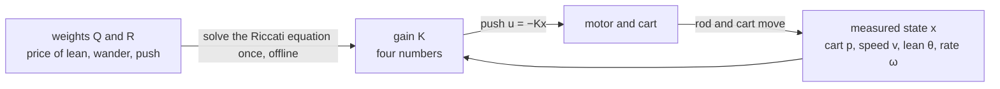
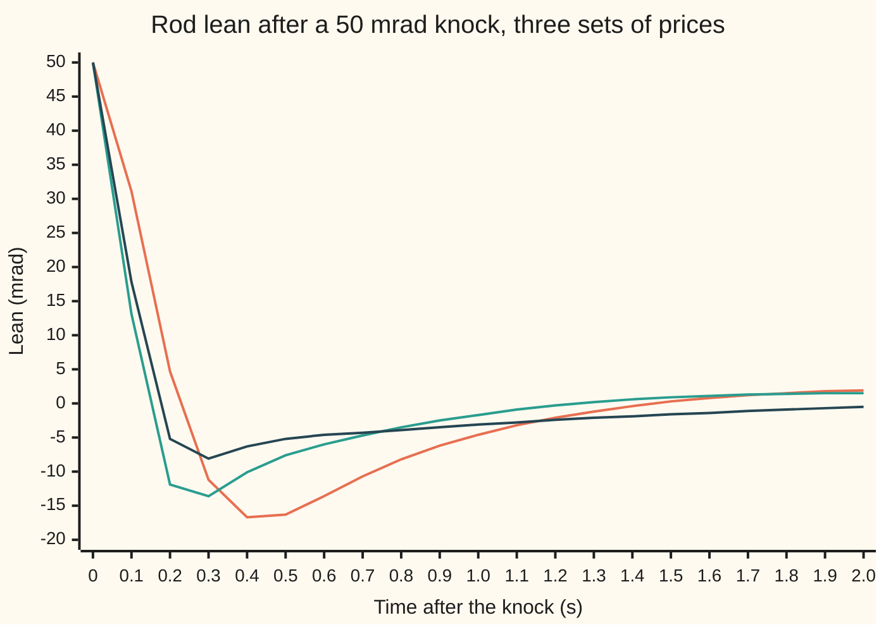

# The LQR: choose feedback by pricing error against control effort

[Syllabus](../../../SYLLABUS.md) → [Engineering mathematics](../README.md) → [State Space and Optimal Control](../README.md#s04) → The LQR

---

## General Overview

A cart on a rail carries a rod 0.613125 m long, balanced upright on a hinge. The motor sets the cart's acceleration. A knock tips the rod 0.05 rad off vertical, a few degrees. The controller has to stand the rod back up and bring the cart back to the middle of the rail, without asking the motor for more than it can give.

[Pole placement](04-pole-placement-and-observers.md) can put the closed-loop poles anywhere, but it does not say where they should go. Faster poles mean harder pushes. The **linear-quadratic regulator** (LQR) settles the question by pricing. Each second the rod leans costs the lean squared, times a weight. Each second of motor effort costs the push squared, times another weight. The controller with the smallest total bill turns out to be a fixed gain: four numbers, computed once, that multiply the four measured states.

Price the lean, the cart's wander and the push by the largest values that are acceptable (0.1 rad, 0.5 m, 5 m/s²). The answer opens with a push of 4.31 m/s². It gets the rod inside 5 mrad (thousandths of a radian) after 0.971 s, and has the cart home inside 1 cm after 2.331 s.

Make the motor ten times cheaper and it pushes 11.00 m/s² and settles the rod in 0.675 s. Make the lean ten times dearer and it pushes 9.56 m/s² and settles the rod in 0.523 s, but the cart now takes 3.847 s to come home. The weights are the dial; the regulator is the best setting for whatever the dial says.

**Write the bill as weighted squares of the state and the push; the cheapest bill is paid by the feedback u = −Kx, with the gain K read off the one solution of the algebraic Riccati equation that makes the loop stable.**

**What kind of fact this is:** a theorem, proved on this card in Why it works by completing the square. The conditions for the solution to exist are stated with their reasons. The weights themselves are a design choice, not a law.

### The picture: the loop the regulator closes



The left arrow runs once, at design time. The loop on the right runs every instant.

---

## The formula

Notation first, in words. The state $x$ is the list of four numbers the model carries ([State space](01-state-space-models-and-the-matrix-exponential.md)): cart position $p$, cart speed $v$, lean $\theta$ (theta) from upright and lean rate $\omega$ (omega). Near upright the plant is $x' = Ax + Bu$ ([Linearisation](02-linearisation-about-an-equilibrium.md)): $p'' = u$ and $\theta'' = 16\,\theta - c\,u$, with $c = 1/l$ for rod length $l$. A raised $\top$ turns a column into a row (the transpose). $Q$ and $R$ are the prices. The bill and its answer are

$$J = \int_0^\infty \big(x^\top Q\, x + u^\top R\, u\big)\,dt, \qquad u = -Kx, \qquad K = R^{-1}B^\top P,$$

$$A^\top P + PA - PBR^{-1}B^\top P + Q = 0 .$$

**Read it aloud:** the total bill is the price of the error plus the price of the push, summed over all time; the cheapest push is minus a gain times the state, and the gain comes from the matrix P that solves the Riccati equation.

Here $Q$ has $q_p$ and $q_\theta$ on its diagonal and zeros elsewhere, so $x^\top Q x = q_p p^2 + q_\theta \theta^2$. With one motor, $R$ is a single number $r$. The best bill from a start $x_0$ is $x_0^\top P x_0$.

| Symbol | Plain meaning | In our example | Push it up and the answer… |
| --- | --- | --- | --- |
| $x$, $x_0$ | state $(p, v, \theta, \omega)$, in m, m/s, rad, rad/s; its starting value | $x_0 = (0, 0, 0.05, 0)$ | bill grows as its square |
| $u$ | push: cart acceleration the motor commands, m/s² | 4.31 m/s² at the start | — |
| $A$, $B$, $I$ | plant matrices: how the state drifts, how the push enters; $I$ the identity matrix | `B = (0, 1, 0, −c)` | — |
| $16$, $c$, $l$ | gravity over rod length, per s²; $c = 1/l$, per m; $l$ the rod length | 16; 1.6310; 0.613125 m | faster fall, harder pushes |
| $q_p$, $q_\theta$ | price per second of cart wander squared, of lean squared (printed `qp`, `qt`) | 4 and 100 | that state is driven out faster |
| $Q$ | the state prices, as a matrix | $q_p$, 0, $q_\theta$, 0 down the diagonal | — |
| $r$, $R$ | price per second of push squared | $r$ = 0.04 | gentler pushes, slower settling |
| $J$, $t$, $\tau$ | the bill: total weighted error and effort; $t$ time, s; $\tau$ (tau) time left before a deadline, s | 0.079000 | — |
| $P$, $V$ | Riccati solution; $V(x) = x^\top P x$, the bill-to-go | $P_{\theta\theta}$ = 31.5999 | — |
| $K$, $k_p$ | gain row, $u = -Kx$; $k_p$ its cart-position entry | −10.000, −12.482, −86.231, −17.564 | — |
| $s$, $j$ | Laplace variable; $j = \sqrt{-1}$ | poles −7.0490 ± 5.8232j, −1.0331 ± 0.9201j | — |
| $\Delta$, $\Delta_c$, $L$ | open-loop and closed-loop characteristic polynomials; $L = K(sI - A)^{-1}B$, the loop's transfer function | $\Delta(s) = s^2(s^2 - 16)$ | — |

### When it holds

- **A linear plant.** The gain is optimal for the straight-line model about upright. Far from upright the real rod, $\theta'' = 16\sin\theta - c\,u\cos\theta$, curves away from it, and the gain is only a good guess. On the curved rod the base gain brings a 0.05 rad knock inside 5 mrad after 0.972 s, against 0.971 s on the straight model; knocked 1.10 rad, the lean passes 90 degrees after 0.662 s and the rod falls.
- **A positive price on the push, $r > 0$.** With $r = 0$ any push is free: ever harder pushes keep lowering the bill, though never below zero, so no best gain exists and the gains run off to infinity.
- **Every unstable motion steerable.** The rod's fall at +4 per s must be reachable by the motor ([Can you steer every state, and can you see every state](03-controllability-and-observability.md)). If not, no gain stabilises it and the Riccati equation has no stabilising solution.
- **Every drifting motion priced.** A motion that does not decay on its own must show up in $Q$. Price only the lean and the cart's position goes unseen: the regulator leaves the cart rolling at 0.0831 m/s forever.
- **The whole state measured.** $u = -Kx$ needs all four numbers now. With one noisy encoder the state has to be estimated first: [LQG](09-lqg-and-the-separation-principle.md).

---

## Why it works

### Step 0: the bill-to-go is a bowl, and the best push slides down it fastest

Start anywhere and play the best strategy: the bill that remains depends only on where you start. For a linear plant with squared prices, doubling the start doubles every push and quadruples every bill. So the bill-to-go is a quadratic bowl, $V(x) = x^\top P x$. [The HJB equation](../../08-Differential%20equations%20and%20dynamics/12-Calculus%20of%20Variations%20and%20Optimal%20Control/08-the-hjb-equation-and-the-linear-quadratic-regulator.md) proved this for one state; here the bowl has four directions. The best push balances the price of pushing now against how fast the push lowers the bowl.

### Step 1: the minimum over the push gives the gain and the Riccati equation

Along the motion the bowl changes at rate $V' = 2x^\top P(Ax + Bu)$. The HJB balance for no deadline says the cheapest running price plus that rate is zero:

$$0 = \min_u \Big( x^\top Q x + u^\top R u + 2x^\top P(Ax + Bu) \Big).$$

The bracket is a bowl in $u$. Its slope in $u$ is $2Ru + 2B^\top P x$ ([Extrema in several variables](../../06-Calculus%20and%20analysis/07-Several%20Variables/06-multivariable-extrema.md)), zero at $u = -R^{-1}B^\top P x$. That is the gain. Put it back: every term is now $x^\top(\cdots)x$, and asking the bracket to vanish for every $x$ is asking the middle matrix to vanish. That matrix is the left side of the algebraic Riccati equation.

### Step 2: no other control does better, by completing the square

Take any push history $u(t)$ that brings the state to rest. Using the Riccati equation to replace $Q$, the running price splits into two parts:

$$x^\top Q x + u^\top R u = -\frac{d}{dt}\big(x^\top P x\big) + (u + Kx)^\top R\,(u + Kx).$$

Integrate from 0 to forever. The first part totals $x_0^\top P x_0$, because the bowl ends at zero. The second part is never negative, since $r > 0$. So every control pays at least $x_0^\top P x_0$, and only $u = -Kx$ pays exactly that.

<details>
<summary>Detailed proof: the split of the running price</summary>

Write $x' = Ax + Bu$. Then $\frac{d}{dt}(x^\top P x) = x^\top(A^\top P + PA)x + 2x^\top PBu$. The Riccati equation gives $A^\top P + PA = -Q + PBR^{-1}B^\top P$, so

$$\frac{d}{dt}(x^\top P x) = -x^\top Q x + x^\top PBR^{-1}B^\top P x + 2x^\top PBu.$$

With $K = R^{-1}B^\top P$, the last two terms are $x^\top K^\top R K x + 2x^\top K^\top R u$. Expand $(u + Kx)^\top R (u + Kx) = u^\top R u + 2x^\top K^\top R u + x^\top K^\top R K x$. Subtract: the right side of the split minus the left side is zero.

A control of finite bill drives every priced state to zero. The existence conditions above make the unpriced ones follow, so $x^\top P x \to 0$ and the integral of the derivative is exactly $-x_0^\top P x_0$.

</details>

The code checks the bowl a third way: nudge any one of the four gains by 5 percent and the bill rises. The cheapest of the eight nudged gains costs 0.079039 against the optimum's 0.079000.

### Step 3: the right root, reached by running a deadline backward

The Riccati equation is quadratic in $P$, so it has several symmetric solutions. Under the conditions in When it holds, exactly one is positive semidefinite (its bowl never dips below zero), and it is the one that makes $A - BK$ stable. A clean way to find it: give the problem a deadline. With $\tau$ (tau) seconds left the bowl's matrix obeys the Riccati differential equation

$$\frac{dP}{d\tau} = A^\top P + PA - PBR^{-1}B^\top P + Q, \qquad P = 0 \text{ when no time is left}.$$

Step it backward and the gain changes with the time left:

| Time left | Gain row $K$ |
| --- | --- |
| 0.25 s | 1.070, 0.150, −60.117, −7.912 |
| 0.5 s | 0.053, −0.225, −60.931, −8.762 |
| 1.0 s | −4.939, −4.101, −70.078, −11.541 |
| 2.0 s | −9.971, −12.101, −85.588, −17.286 |
| 5.0 s | −10.000, −12.480, −86.228, −17.562 |
| no deadline | −10.000, −12.482, −86.231, −17.564 |

Near the deadline the cart is ignored: there is no time left to bring it home, so only the lean is worth paying for. With more time the gains settle: by 5 s of time left they are within a few thousandths of the limit. The code stops at 14.35 s of time left, when a further step changes P by less than 1e-13. That limit is the stabilising root.

### Step 4: Newton's method, from any gain that already works

Pick a gain that stabilises the loop. Here it is pole placement with all four poles at −2, whose closed-loop polynomial is $(s + 2)^4 = s^4 + 8s^3 + 24s^2 + 32s + 16$. Its exact bill matrix $P_K$ solves a linear equation, the Lyapunov equation $(A - BK)^\top P_K + P_K(A - BK) + Q + K^\top R K = 0$ ([Stability of a state-space model](05-hurwitz-schur-and-lyapunov-stability.md)).

Replace the gain by $R^{-1}B^\top P_K$ and repeat. Each round is Newton's method on the Riccati equation, never makes the bill worse, and keeps the loop stable. Nine rounds agree with Step 3 to eight decimals.

### Step 5: the poles without P, and the margins for free

There is a road to the closed-loop poles that never computes $P$. Kalman's identity says that the closed-loop polynomial $\Delta_c(s)$ satisfies

$$\Delta_c(s)\,\Delta_c(-s) = s^4(s^2 - 16)^2 + \frac{q_p}{r}(s^2 - 16)^2 + \frac{q_\theta c^2}{r}\, s^4 .$$

The first term is the open loop's own polynomial times its mirror. The others are the priced outputs: the cart sees the push through $1/s^2$, the lean through $-c/(s^2 - 16)$. The right side is a quartic in $s^2$. Take the four roots in the left half-plane and they are the regulator's poles: −7.0490 ± 5.8232j and −1.0331 ± 0.9201j, exactly the eigenvalues of $A - BK$.

<details>
<summary>Where the identity comes from, and the two corollaries</summary>

Add and subtract $sP$ in the Riccati equation, multiply on the left by $B^\top(-sI - A^\top)^{-1}$ and on the right by $(sI - A)^{-1}B$. With $L(s) = K(sI - A)^{-1}B$, the loop's transfer function, the result is

$$r\,\big(1 + L(-s)\big)\big(1 + L(s)\big) = r + B^\top(-sI - A^\top)^{-1} Q\, (sI - A)^{-1}B .$$

Each factor $1 + L$ is the closed-loop polynomial over the open-loop one, $\Delta_c/\Delta$. Multiply through by $\Delta(s)\Delta(-s)/r$ and read off the identity above.

**Corollary one.** At $s = 0$ the identity reads $\Delta_c(0)^2 = (q_p/r) \times 16^2$. The constant term of $\Delta_c$ is $-16\,k_p$, so the cart gain is $k_p = -\sqrt{q_p/r}$: −10 for the base weights, whatever $q_\theta$ is.

**Corollary two.** On the frequency axis, where $s$ is purely imaginary, the right side is at least $r$, so $\lvert 1 + L(s)\rvert \geq 1$ there. The loop's Nyquist curve ([Nyquist and margins](../03-Feedback%20Control/06-nyquist-criterion-and-stability-margins.md)) never enters the unit disc around −1. That guarantees the gain may be scaled by anything from one half to infinity, and a phase lag of 60 degrees, without losing stability. The guarantee is a floor: this loop survives down to a scale of 0.241.

</details>

### Step 6: choosing the prices

The bill has no natural units, so the prices are a choice. **Bryson's rule** is the usual start: price each quantity at one over the square of its largest acceptable value. Only the ratios matter. Multiply every price by ten and the gain does not move, because the minimising push of ten times a bill is the minimising push of the bill.

---

## Worked numbers, by hand

The base design. The rod is $l = 9.81/16 = 0.613125$ m, so $c = 1/l = 1.6310$ per m. The start is $x_0 = (0, 0, 0.05, 0)$: still, leaning 0.05 rad.

| Step | Arithmetic | Value |
| --- | --- | --- |
| price of cart wander, $q_p$ | $1 / 0.5^2$ | 4 |
| price of lean, $q_\theta$ | $1 / 0.1^2$ | 100 |
| price of push, $r$ | $1 / 5^2$ | 0.04 |
| cart gain, Step 5 | $-\sqrt{4 / 0.04} = -\sqrt{100}$ | −10.000 |
| $P$, lean row (from the Riccati solve) | $P_{\theta v}$, $P_{\theta\theta}$, $P_{\theta\omega}$ | 6.6135, 31.5999, 6.1697 |
| lean gain, $K = R^{-1}B^\top P$ | $(6.6135 - 1.6310 \times 6.1697) / 0.04$ | −86.231 |
| opening push, $u = -Kx_0$ | $86.231 \times 0.05$ | 4.31 m/s² |
| bill, $x_0^\top P x_0$ | $31.5999 \times 0.05^2$ | **0.079000** |

The opening push is 4.31 m/s², inside the 5 m/s² the motor was priced for: the prices did what they were set to do. The push is positive, toward the lean: the cart runs under the falling rod to catch it.

The gain row is −10.000, −12.482, −86.231, −17.564. The cart-position gain is negative, so $u = -Kx = +10p + \cdots$: a cart sitting right of centre is pushed further right. That looks wrong and is not. To bring the cart home leftward, the rod must first be tipped left, and only a push to the right does that.

### What breaks if you drop a piece

| Mistake | Comes out at | What went wrong |
| --- | --- | --- |
| $K = B^\top P$, the $R^{-1}$ forgotten | poles 1.8492 ± 0.0913j: the rod falls | the gain shrinks by the factor $r$ = 0.04, below the 0.241 floor |
| $u = +Kx$, sign flipped | a pole at +22.9472 | the push feeds the fall instead of fighting it |
| Price only the lean, $q_p = 0$ | after 10 s the cart is 0.854 m away, still rolling at 0.0831 m/s | a motion nobody pays for is a motion nobody stops |
| Lean limit read as 0.1 degree, not 0.1 rad | opening push 144.8 m/s² against 5 allowed | the bill is in radians, so the lean price is $(180/\pi)^2$ times too big |
| Run the base gain on the curved rod, knocked 1.10 rad | the lean passes 90 degrees after 0.662 s: the rod falls | the gain is optimal for the straight-line model; this far from upright, gravity and the motor's grip both bend away from it |

---

## How the weights trade speed for effort

The puzzle: three designs, one knock, and no single "best". Each is the cheapest controller for its own bill. Change the bill and the answer moves.

| Design | $q_p$, $q_\theta$, $r$ | Gain row $K$ | Peak push | Rod inside 5 mrad | Cart inside 1 cm |
| --- | --- | --- | --- | --- | --- |
| base | 4, 100, 0.04 | −10.000, −12.482, −86.231, −17.564 | 4.31 m/s² | 0.971 s | 2.331 s |
| cheap motor | 4, 100, 0.004 | −31.623, −36.816, −220.045, −38.259 | 11.00 m/s² | 0.675 s | 1.972 s |
| tight lean | 4, 1000, 0.04 | −10.000, −19.227, −191.143, −26.851 | 9.56 m/s² | 0.523 s | 3.847 s |

**Force one: the price of the push.** Hold the state prices and move $r$:

```
r = 0.4     push  ████████                                   2.13 m/s^2   rod settles 1.420 s
r = 0.04    push  ████████████████                           4.31 m/s^2   rod settles 0.971 s
r = 0.004   push  ████████████████████████████████████████  11.00 m/s^2   rod settles 0.675 s
```

Each tenfold cut in the price of the push at least doubles the opening shove and shortens the settling. The fast pole pair moves out from −7.0490 ± 5.8232j to −11.7481 ± 11.0568j.

**Force two: the price of the lean.** Hold $r$ and raise $q_\theta$ tenfold:

```
q_theta = 100    rod settles  ████████                           0.971 s
q_theta = 1000   rod settles  ████                               0.523 s
q_theta = 100    cart home    ████████████████████               2.331 s
q_theta = 1000   cart home    █████████████████████████████████  3.847 s
```

The rod is now the expensive thing, so the regulator spends its effort on it and lets the cart dawdle. The slow pair moves in from −1.0331 ± 0.9201j to −0.5668 ± 0.5454j. Tightening one state slackens another.

**Both forces in one picture.** The lean after the knock, all three designs:



Orange: base prices. Green: cheap motor. Dark: tight lean. Every design overshoots past upright: the cart has run under the rod and must now be brought back, which tips the rod the other way. The cheap motor kills the lean fastest at first; the tight lean holds the overshoot smallest and then creeps home with the cart.

---

## Code, from first principles, and it actually runs

The code builds the plant, prices it three ways, and reaches the regulator by **four independent roads**:

1. the Riccati differential equation stepped backward until it stops moving;
2. Newton's method on Lyapunov equations from a pole-placement gain;
3. the closed-loop poles from Kalman's identity, which never sees $P$;
4. a simulation of the closed loop whose measured bill must equal $x_0^\top P x_0$.

Eigenvalues come from the characteristic polynomial (Faddeev-LeVerrier) and a root finder (Durand-Kerner); stability tests use the Hurwitz conditions for a quartic ([Routh-Hurwitz](../03-Feedback%20Control/04-routh-hurwitz-criterion.md)). Then every mistake and experiment on the card is rerun, and the base gain is tried on the curved rod.

### Python

```python
# The LQR -- the check behind the card.  Standard library only (math).  Cart and pendulum, linearised
# upright.  State x, stored as z = (cart position p in m, cart speed v in m/s, angle theta in rad, angle rate
# w in rad/s); input u = cart acceleration the motor commands, m/s^2.  p'' = u and theta'' = 16 theta - c u,
# with c = 1/(rod length) = 16/9.81 per m.  Cost J = integral of (qp p^2 + qt theta^2 + r u^2) dt.  Roads: (1) the
# Riccati equation stepped backward in time left (tau) until it stops moving; (2) Newton's method on Lyapunov
# equations, from a pole-placement gain; (3) poles from Kalman's identity, which never sees P; (4) simulating the loop.
from math import sin, cos, pi
a, c = 16.0, 16.0 / 9.81
A = [[0.0, 1, 0, 0], [0, 0, 0, 0], [0, 0, 0, 1], [0, 0, a, 0]]
B, R4 = [0.0, 1, 0, -c], range(4)
def mv(M, v): return [sum(M[i][k] * v[k] for k in R4) for i in R4]
def quad(P, z): return sum(z[i] * P[i][j] * z[j] for i in R4 for j in R4)
def closed(K): return [[A[i][j] - B[i] * K[j] for j in R4] for i in R4]
def ric_rhs(P, Q, r):                    # dP/dtau = A'P + PA + Q - P B B' P / r
    PB = mv(P, B)
    return [[sum(P[i][k] * A[k][j] + A[k][i] * P[k][j] for k in R4) + Q[i][j] - PB[i] * PB[j] / r
             for j in R4] for i in R4]
def add(X, Y, f): return [[X[i][j] + f * Y[i][j] for j in R4] for i in R4]
def ric_ode(Q, r, h=0.002, marks=()):    # road 1: RK4 from P = 0 (no time left) backward
    P, s, seen, step = [[0.0] * 4 for _ in R4], 0.0, {}, 1.0
    while step >= 1e-13 and s < 40:          # stop when a step no longer moves P, or give up after 40 s
        k1 = ric_rhs(P, Q, r); k2 = ric_rhs(add(P, k1, h / 2), Q, r)
        k3 = ric_rhs(add(P, k2, h / 2), Q, r); k4 = ric_rhs(add(P, k3, h), Q, r)
        new = [[P[i][j] + h / 6 * (k1[i][j] + 2 * k2[i][j] + 2 * k3[i][j] + k4[i][j]) for j in R4] for i in R4]
        step = max(abs(new[i][j] - P[i][j]) for i in R4 for j in R4)
        P, s = new, s + h
        seen.update({m: [x / r for x in mv(P, B)] for m in marks if abs(s - m) < h / 2})
    assert step < 1e-13, "the Riccati equation did not settle in 40 s of time left"; return P, s, seen
def solve(M, y):                         # Gaussian elimination with row swaps
    n = len(y); M = [M[i][:] + [y[i]] for i in range(n)]
    for i in range(n):
        p = max(range(i, n), key=lambda k: abs(M[k][i])); M[i], M[p] = M[p], M[i]
        for k in range(i + 1, n):
            f = M[k][i] / M[i][i]
            for j in range(i, n + 1): M[k][j] -= f * M[i][j]
    x = [0.0] * n
    for i in reversed(range(n)): x[i] = (M[i][n] - sum(M[i][j] * x[j] for j in range(i + 1, n))) / M[i][i]
    return x
def cost_matrix(K, Q, r):                # P_K with F'P + PF + Q + r K'K = 0, F = A - BK: J = z0' P_K z0
    F, M, y = closed(K), [[0.0] * 16 for _ in range(16)], [0.0] * 16
    for i in R4:
        for j in R4:
            y[4 * i + j] = -(Q[i][j] + r * K[i] * K[j])
            for k in R4: M[4 * i + j][4 * k + j] += F[k][i]; M[4 * i + j][4 * i + k] += F[k][j]
    x = solve(M, y); return [x[4 * i:4 * i + 4] for i in R4]
def newton(K, Q, r):                     # road 2: cost the gain, improve it, repeat (Kleinman)
    for n in range(1, 50):
        P = cost_matrix(K, Q, r); K2 = [x / r for x in mv(P, B)]
        if max(abs(K2[i] - K[i]) for i in R4) < 1e-10: return P, K2, n
        K = K2
    raise AssertionError("Newton's method did not settle in 49 rounds")
def charpoly(F):                         # Faddeev-LeVerrier: coefficients of det(sI - F)
    cf, M = [1.0], [[0.0] * 4 for _ in R4]
    for k in range(1, 5):
        M = [[sum(F[i][m] * M[m][j] for m in R4) + (cf[-1] if i == j else 0) for j in R4] for i in R4]
        cf.append(-sum(sum(F[i][m] * M[m][i] for m in R4) for i in R4) / k)
    return cf
def roots(cf):                           # Durand-Kerner on a monic quartic
    z = [(0.4 + 0.9j) ** k for k in R4]
    for _ in range(300):
        nz = []
        for i in R4:
            d = [z[i] - z[j] for j in R4 if j != i]; d = d[0] * d[1] * d[2]
            nz.append(z[i] - ((((z[i] + cf[1]) * z[i] + cf[2]) * z[i] + cf[3]) * z[i] + cf[4]) / d)
        z = nz
    return tidy(z)
def tidy(z): return sorted((complex(round(w.real, 9), abs(round(w.imag, 9))) for w in z), key=lambda w: (w.real, w.imag))
def kalman_poles(qp, qt, r):             # road 3: left roots of s^4(s^2-a)^2 + (qp/r)(s^2-a)^2 + (qt c^2/r) s^4
    al, be = qp / r, qt * c * c / r      # as a quartic in w = s^2
    ws = roots([1.0, -2 * a, a * a + al + be, -2 * a * al, al * a * a])
    return tidy([-(w ** 0.5) if (w ** 0.5).real > 0 else w ** 0.5 for w in ws])
def hurwitz(cf):                         # every root of a quartic in the left half-plane
    _, a3, a2, a1, a0 = cf
    return min(cf) > 0 and a3 * a2 > a1 and a3 * a2 * a1 > a1 * a1 + a3 * a3 * a0
def simulate(K, qp, qt, r, z0, h=0.001, t_end=10.0, rhs=None):   # road 4: RK4 on the loop, cost by trapezoids
    F, z, J, pu, px, st, sx, th = closed(K), z0[:], 0.0, 0.0, 0.0, 0.0, 0.0, []
    d, run = rhs or (lambda w: mv(F, w)), lambda z, u: qp * z[0] ** 2 + qt * z[2] ** 2 + r * u * u
    for n in range(int(t_end / h) + 1):
        u = -sum(K[j] * z[j] for j in R4)
        if n % 100 == 0 and n <= 2000: th.append(1000 * z[2])
        pu, px = max(pu, abs(u)), max(px, abs(z[0]))
        if abs(z[2]) > 0.005: st = n * h
        if abs(z[2]) > pi / 2: break         # the rod has fallen past horizontal
        if abs(z[0]) > 0.01: sx = n * h
        k1 = d(z); k2 = d([z[i] + h / 2 * k1[i] for i in R4])
        k3 = d([z[i] + h / 2 * k2[i] for i in R4]); k4 = d([z[i] + h * k3[i] for i in R4])
        z2 = [z[i] + h / 6 * (k1[i] + 2 * k2[i] + 2 * k3[i] + k4[i]) for i in R4]
        J += h / 2 * (run(z, u) + run(z2, -sum(K[j] * z2[j] for j in R4))); z = z2
    return J, pu, px, st, sx, th, z
def Qm(qp, qt): return [[(qp if i == 0 else qt if i == 2 else 0.0) if i == j else 0.0 for j in R4] for i in R4]
fmt = lambda v, f="{:9.3f}": " ".join(f.format(x) for x in v)
pole = lambda ps: "  ".join(dict.fromkeys(f"{round(p.real, 4) + 0.0:.4f}" + (f" +- {p.imag:.4f}j" if p.imag > 5e-5 else "") for p in ps))
Z0, res = [0.0, 0.0, 0.05, 0.0], {}      # pendulum knocked 0.05 rad (2.9 degrees) off upright, at rest
K0 = [-16 / a, -32 / a, -(16 / a + a + 24) / c, -(32 / a + 8) / c]   # pole placement: all four poles at -2
print(f"rod l = {1 / c:.6f} m | open-loop poles:", pole(roots(charpoly(A))), "| det(sI - A + B K0):", fmt(charpoly(closed(K0)), "{:.4f}"))
designs = [("base (Bryson)", 4.0, 100.0, 0.04), ("cheap motor", 4.0, 100.0, 0.004), ("tight angle", 4.0, 1000.0, 0.04)]
for name, qp, qt, r in designs:
    Q = Qm(qp, qt); P1, s_end, fin = ric_ode(Q, r, marks=(0.25, 0.5, 1.0, 2.0, 5.0))
    P, K, its = newton(K0, Q, r)
    pa, pk = roots(charpoly(closed(K))), kalman_poles(qp, qt, r)
    J, pu, px, st, sx, th, _ = simulate(K, qp, qt, r, Z0)
    lo, hi = 0.0, 1.0
    for _ in range(50): lo, hi = (lo, (lo + hi) / 2) if hurwitz(charpoly(closed([(lo + hi) / 2 * k for k in K]))) else ((lo + hi) / 2, hi)
    res[name] = (Q, r, P, K, quad(P, Z0), th, fin)
    print(f"{name}: qp = {qp:g}, qt = {qt:g}, r = {r:g}")
    print(f"  K by Riccati ODE ({s_end:.2f} s to go): {fmt([x / r for x in mv(P1, B)])}")
    print(f"  K by Newton ({its} rounds):          {fmt(K)}   same P to 1e-8: {'yes' if max(abs(P1[i][j] - P[i][j]) for i in R4 for j in R4) < 1e-8 else 'no'}")
    print(f"  poles of A - BK:      {pole(pa)}")
    print(f"  poles, Kalman's identity: {pole(pk)}")
    print(f"  J = x0'P x0 = {quad(P, Z0):.6f}; simulated {J:.6f}")
    print(f"  peak push {pu:.2f} m/s^2, peak cart {100 * px:.1f} cm, angle inside 5 mrad after {st:.3f} s, cart inside 1 cm after {sx:.3f} s")
    print(f"  smallest safe gain scale {hi:.3f}; stable at 0.5 and at 1000: {'yes' if all(hurwitz(charpoly(closed([m * k for k in K]))) for m in (0.5, 1000)) else 'no'}")
    assert abs(quad(P, Z0) - J) < 1e-4 * J and max(abs(P1[i][j] - P[i][j]) for i in R4 for j in R4) < 1e-8
    assert max(abs(p - q) for p, q in zip(pa, pk)) < 1e-6 and abs(K[0] + (qp / r) ** 0.5) < 1e-8 and hi < 0.5
Q, r, P, K, J, th, fin = res["base (Bryson)"]
print("base P, rows:"); [print("  " + fmt(row, "{:10.4f}")) for row in P]
print(f"base gain on theta = (P[theta][v] - c P[theta][w]) / r = ({P[2][1]:.4f} - {c:.4f} x {P[2][3]:.4f}) / {r} = {(P[2][1] - c * P[2][3]) / r:.3f}")
for m in (0.25, 0.5, 1.0, 2.0, 5.0): print(f"base, finite horizon {m} s to go: K = {fmt(fin[m])}")
nudged = min(quad(cost_matrix([K[j] * (1 + e * (j == m)) for j in R4], Q, r), Z0) for m in R4 for e in (-0.05, 0.05))
print(f"base, cheapest of 8 gains nudged 5%: J = {nudged:.6f} (optimum {J:.6f})")
print("chart, angle in mrad at t = 0 to 2 s by 0.1 s:")
for name in res: print(f"  {name:<14}" + fmt(res[name][5], "{:.1f}"))
bad = [("K = B'P, R^-1 forgotten", [r * k for k in K]), ("u = +Kx, sign flipped", [-k for k in K]), ("k_p alone flipped", [-K[0]] + K[1:])]
for label, Kb in bad: print(f"mistake, {label}: poles {pole(roots(charpoly(closed(Kb))))}")
K_q0 = [x / r for x in mv(ric_ode(Qm(0.0, 100.0), r)[0], B)]; zend = simulate(K_q0, 0.0, 100.0, r, Z0)[6]
print(f"mistake, angle-only weight: K = {fmt(K_q0)}; after 10 s cart at {zend[0]:.3f} m, still moving {zend[1]:.4f} m/s")
_, K_deg, _ = newton(K0, Qm(4.0, 100.0 * (180 / 3.141592653589793) ** 2), r)
print(f"mistake, angle weight meant for degrees: opening push {-sum(K_deg[j] * Z0[j] for j in R4):.1f} m/s^2")
_, K10, _ = newton(K0, Qm(40.0, 1000.0), 0.4); dear = simulate(newton(K0, Q, 0.4)[1], 4.0, 100.0, 0.4, Z0)
big = simulate(K, 4.0, 100.0, r, [2 * x for x in Z0])
print(f"try, all weights x10: same gains to 1e-8: {'yes' if max(abs(K10[i] - K[i]) for i in R4) < 1e-8 else 'no'}")
print(f"try, r = 0.4: peak push {dear[1]:.2f} m/s^2, angle inside 5 mrad after {dear[3]:.3f} s")
print(f"try, start at 0.10 rad: J = {big[0]:.6f}, peak push {big[1]:.2f} m/s^2")
assert nudged > J and abs(big[0] - 4 * J) < 1e-4 * big[0] and max(abs(K10[i] - K[i]) for i in R4) < 1e-8
assert max(p.real for p in roots(charpoly(closed([r * k for k in K])))) > 0 and abs(zend[1]) > 0.01
def curved(z): u = -sum(K[j] * z[j] for j in R4); return [z[1], u, z[3], a * sin(z[2]) - c * u * cos(z[2])]
cv = [simulate(K, 4.0, 100.0, r, [0.0, 0.0, x, 0.0], rhs=curved) for x in (0.05, 1.1)]   # the real, curved rod
print(f"curved rod, base gain: from 0.05 rad angle inside 5 mrad after {cv[0][3]:.3f} s; from 1.10 rad the angle passes 90 degrees after {cv[1][3]:.3f} s")
assert max(abs(p - q) for p, q in zip(cv[0][5], th)) < 0.1 and abs(cv[1][6][2]) > pi / 2   # small knock: as straight; big: falls
print("ALL CHECKS PASS")
```

**Ran 2026-11-11 on macOS, Python 3.14.10, standard library only. All checks passed. Output, pasted from the run:**

```
rod l = 0.613125 m | open-loop poles: -4.0000  0.0000  4.0000 | det(sI - A + B K0): 1.0000 8.0000 24.0000 32.0000 16.0000
base (Bryson): qp = 4, qt = 100, r = 0.04
  K by Riccati ODE (14.35 s to go):   -10.000   -12.482   -86.231   -17.564
  K by Newton (9 rounds):            -10.000   -12.482   -86.231   -17.564   same P to 1e-8: yes
  poles of A - BK:      -7.0490 +- 5.8232j  -1.0331 +- 0.9201j
  poles, Kalman's identity: -7.0490 +- 5.8232j  -1.0331 +- 0.9201j
  J = x0'P x0 = 0.079000; simulated 0.079001
  peak push 4.31 m/s^2, peak cart 6.2 cm, angle inside 5 mrad after 0.971 s, cart inside 1 cm after 2.331 s
  smallest safe gain scale 0.241; stable at 0.5 and at 1000: yes
cheap motor: qp = 4, qt = 100, r = 0.004
  K by Riccati ODE (13.66 s to go):   -31.623   -36.816  -220.045   -38.259
  K by Newton (11 rounds):            -31.623   -36.816  -220.045   -38.259   same P to 1e-8: yes
  poles of A - BK:      -11.7481 +- 11.0568j  -1.0439 +- 0.9243j
  poles, Kalman's identity: -11.7481 +- 11.0568j  -1.0439 +- 0.9243j
  J = x0'P x0 = 0.038181; simulated 0.038183
  peak push 11.00 m/s^2, peak cart 4.7 cm, angle inside 5 mrad after 0.675 s, cart inside 1 cm after 1.972 s
  smallest safe gain scale 0.128; stable at 0.5 and at 1000: yes
tight angle: qp = 4, qt = 1000, r = 0.04
  K by Riccati ODE (25.18 s to go):   -10.000   -19.227  -191.143   -26.851
  K by Newton (10 rounds):            -10.000   -19.227  -191.143   -26.851   same P to 1e-8: yes
  poles of A - BK:      -11.7163 +- 11.0134j  -0.5668 +- 0.5454j
  poles, Kalman's identity: -11.7163 +- 11.0134j  -0.5668 +- 0.5454j
  J = x0'P x0 = 0.278026; simulated 0.278039
  peak push 9.56 m/s^2, peak cart 5.2 cm, angle inside 5 mrad after 0.523 s, cart inside 1 cm after 3.847 s
  smallest safe gain scale 0.099; stable at 0.5 and at 1000: yes
base P, rows:
      4.9928     3.1160     7.0255     2.1558
      3.1160     3.1733     6.6135     2.2518
      7.0255     6.6135    31.5999     6.1697
      2.1558     2.2518     6.1697     1.8114
base gain on theta = (P[theta][v] - c P[theta][w]) / r = (6.6135 - 1.6310 x 6.1697) / 0.04 = -86.231
base, finite horizon 0.25 s to go: K =     1.070     0.150   -60.117    -7.912
base, finite horizon 0.5 s to go: K =     0.053    -0.225   -60.931    -8.762
base, finite horizon 1.0 s to go: K =    -4.939    -4.101   -70.078   -11.541
base, finite horizon 2.0 s to go: K =    -9.971   -12.101   -85.588   -17.286
base, finite horizon 5.0 s to go: K =   -10.000   -12.480   -86.228   -17.562
base, cheapest of 8 gains nudged 5%: J = 0.079039 (optimum 0.079000)
chart, angle in mrad at t = 0 to 2 s by 0.1 s:
  base (Bryson) 50.0 31.1 4.7 -11.2 -16.7 -16.3 -13.6 -10.7 -8.2 -6.2 -4.6 -3.2 -2.1 -1.2 -0.4 0.3 0.8 1.2 1.5 1.8 1.9
  cheap motor   50.0 13.1 -11.9 -13.6 -10.1 -7.6 -6.0 -4.7 -3.5 -2.5 -1.7 -0.9 -0.3 0.2 0.6 0.9 1.1 1.3 1.4 1.5 1.5
  tight angle   50.0 17.8 -5.2 -8.1 -6.3 -5.2 -4.6 -4.3 -3.9 -3.5 -3.1 -2.8 -2.4 -2.1 -1.9 -1.6 -1.4 -1.1 -0.9 -0.7 -0.5
mistake, K = B'P, R^-1 forgotten: poles -3.8614  -0.4835  1.8492 +- 0.0913j
mistake, u = +Kx, sign flipped: poles -5.3409  -0.7210 +- 0.8864j  22.9472
mistake, k_p alone flipped: poles -7.0509 +- 7.5721j  -2.6306  0.5682
mistake, angle-only weight: K =     0.000     0.000   -60.763    -8.632; after 10 s cart at 0.854 m, still moving 0.0831 m/s
mistake, angle weight meant for degrees: opening push 144.8 m/s^2
try, all weights x10: same gains to 1e-8: yes
try, r = 0.4: peak push 2.13 m/s^2, angle inside 5 mrad after 1.420 s
try, start at 0.10 rad: J = 0.316006, peak push 8.62 m/s^2
curved rod, base gain: from 0.05 rad angle inside 5 mrad after 0.972 s; from 1.10 rad the angle passes 90 degrees after 0.662 s
ALL CHECKS PASS
```

The four roads agree. The Riccati equation run backward and Newton's method give the same $P$ to eight decimals. Kalman's identity, which never builds $P$, gives the same poles. The simulated bill matches $x_0^\top P x_0$ to the fifth decimal; the small gap is the trapezoid rule's.

### Rust

The same roads in Rust, with complex arithmetic written out by hand. No crates.

```rust
// The LQR -- the same check as linear_quadratic_regulator_check.py, in Rust.  std only, no crates.
// Cart and pendulum, linearised upright.  State x, stored as z = (cart position p in m, cart speed v in m/s,
// angle theta in rad, angle rate w in rad/s); input u = cart acceleration the motor commands, m/s^2.
// p'' = u and theta'' = 16 theta - c u, with c = 1/(rod length) = 16/9.81 per m.
// Roads: (1) the Riccati equation stepped backward in time left (tau); (2) Newton's method on Lyapunov
// equations, from a pole-placement gain; (3) poles from Kalman's identity; (4) simulating the loop.
type M4 = [[f64; 4]; 4]; type V4 = [f64; 4]; type C = (f64, f64);
const AA: f64 = 16.0; fn cc() -> f64 { 16.0 / 9.81 }
fn amat() -> M4 { [[0.0, 1.0, 0.0, 0.0], [0.0; 4], [0.0, 0.0, 0.0, 1.0], [0.0, 0.0, AA, 0.0]] }
fn bvec() -> V4 { [0.0, 1.0, 0.0, -cc()] }
fn mv(m: &M4, v: &V4) -> V4 { let mut o = [0.0; 4]; for i in 0..4 { for k in 0..4 { o[i] += m[i][k] * v[k]; } } o }
fn quad(p: &M4, z: &V4) -> f64 { let mut s = 0.0; for i in 0..4 { for j in 0..4 { s += z[i] * p[i][j] * z[j]; } } s }
fn closed(k: &V4) -> M4 { let (a, b) = (amat(), bvec()); [0, 1, 2, 3].map(|i| [0, 1, 2, 3].map(|j| a[i][j] - b[i] * k[j])) }
fn gain(p: &M4, r: f64) -> V4 { mv(p, &bvec()).map(|x| x / r) } fn scaled(k: &V4, m: f64) -> V4 { k.map(|x| m * x) }
fn ric_rhs(p: &M4, q: &M4, r: f64) -> M4 {          // dP/dtau = A'P + PA + Q - P B B' P / r
    let (a, pb) = (amat(), mv(p, &bvec()));
    [0, 1, 2, 3].map(|i| [0, 1, 2, 3].map(|j| { let mut s = 0.0; for k in 0..4 { s += p[i][k] * a[k][j] + a[k][i] * p[k][j]; }
        s + q[i][j] - pb[i] * pb[j] / r }))
}
fn add(x: &M4, y: &M4, f: f64) -> M4 { [0, 1, 2, 3].map(|i| [0, 1, 2, 3].map(|j| x[i][j] + f * y[i][j])) }
fn ric_ode(q: &M4, r: f64, marks: &[f64]) -> (M4, f64, Vec<V4>) {   // road 1: RK4 from P = 0 backward
    let (h, mut p, mut s, mut seen) = (0.002, [[0.0; 4]; 4], 0.0, vec![[0.0; 4]; marks.len()]);
    loop {
        let k1 = ric_rhs(&p, q, r); let k2 = ric_rhs(&add(&p, &k1, h / 2.0), q, r);
        let k3 = ric_rhs(&add(&p, &k2, h / 2.0), q, r); let k4 = ric_rhs(&add(&p, &k3, h), q, r);
        let nw = [0, 1, 2, 3].map(|i| [0, 1, 2, 3].map(|j| p[i][j] + h / 6.0 * (k1[i][j] + 2.0 * k2[i][j] + 2.0 * k3[i][j] + k4[i][j])));
        let step = (0..16).map(|n| (nw[n / 4][n % 4] - p[n / 4][n % 4]).abs()).fold(0.0, f64::max);
        p = nw; s += h; assert!(s < 40.0, "the Riccati equation did not settle in 40 s of time left");
        for (n, m) in marks.iter().enumerate() { if (s - m).abs() < h / 2.0 { seen[n] = gain(&p, r); } }
        if step < 1e-13 { return (p, s, seen); }
    }
}
fn solve(mut m: Vec<Vec<f64>>, y: &[f64]) -> Vec<f64> {   // Gaussian elimination with row swaps
    let n = y.len(); for i in 0..n { m[i].push(y[i]); }
    for i in 0..n {
        let mut p = i; for k in i..n { if m[k][i].abs() > m[p][i].abs() { p = k; } }
        m.swap(i, p); for k in i + 1..n { let f = m[k][i] / m[i][i]; for j in i..=n { m[k][j] -= f * m[i][j]; } }
    }
    let mut x = vec![0.0; n];
    for i in (0..n).rev() { let mut s = 0.0; for j in i + 1..n { s += m[i][j] * x[j]; } x[i] = (m[i][n] - s) / m[i][i]; }
    x
}
fn cost_matrix(k: &V4, q: &M4, r: f64) -> M4 {       // P_K with F'P + PF + Q + r K'K = 0
    let (f, mut m, mut y) = (closed(k), vec![vec![0.0; 16]; 16], vec![0.0; 16]);
    for i in 0..4 { for j in 0..4 { y[4 * i + j] = -(q[i][j] + r * k[i] * k[j]);
        for l in 0..4 { m[4 * i + j][4 * l + j] += f[l][i]; m[4 * i + j][4 * i + l] += f[l][j]; } } }
    let x = solve(m, &y); [0, 1, 2, 3].map(|i| [0, 1, 2, 3].map(|j| x[4 * i + j]))
}
fn newton(k0: &V4, q: &M4, r: f64) -> (M4, V4, usize) {   // road 2: cost the gain, improve it, repeat
    let mut k = *k0;
    for n in 1..50 { let p = cost_matrix(&k, q, r); let k2 = gain(&p, r);
        if (0..4).map(|i| (k2[i] - k[i]).abs()).fold(0.0, f64::max) < 1e-10 { return (p, k2, n); } k = k2; }
    panic!("Newton did not settle")
}
fn charpoly(f: &M4) -> Vec<f64> {                    // Faddeev-LeVerrier: coefficients of det(sI - F)
    let (mut cf, mut m) = (vec![1.0], [[0.0; 4]; 4]);
    for k in 1..5 {
        let last = cf[cf.len() - 1];
        m = [0, 1, 2, 3].map(|i| [0, 1, 2, 3].map(|j| { let mut s = 0.0; for l in 0..4 { s += f[i][l] * m[l][j]; } if i == j { s + last } else { s } }));
        let mut tr = 0.0; for i in 0..4 { let mut s = 0.0; for l in 0..4 { s += f[i][l] * m[l][i]; } tr += s; }
        cf.push(-tr / k as f64);
    }
    cf
}
fn cm(a: C, b: C) -> C { (a.0 * b.0 - a.1 * b.1, a.0 * b.1 + a.1 * b.0) } fn cd(a: C, b: C) -> C { let d = b.0 * b.0 + b.1 * b.1; ((a.0 * b.0 + a.1 * b.1) / d, (a.1 * b.0 - a.0 * b.1) / d) }
fn csqrt(w: C) -> C { let m = (w.0 * w.0 + w.1 * w.1).sqrt(); let im = ((m - w.0) / 2.0).sqrt(); (((m + w.0) / 2.0).sqrt(), if w.1 < 0.0 { -im } else { im }) }
fn rnd(x: f64) -> f64 { (x * 1e9).round() / 1e9 }
fn tidy(z: Vec<C>) -> Vec<C> { let mut t: Vec<C> = z.iter().map(|w| (rnd(w.0), rnd(w.1).abs())).collect(); t.sort_by(|p, q| p.partial_cmp(q).unwrap()); t }
fn roots(cf: &[f64]) -> Vec<C> {                     // Durand-Kerner on a monic quartic
    let mut z: Vec<C> = vec![(1.0, 0.0)];
    for k in 1..4 { let last = z[k - 1]; z.push(cm(last, (0.4, 0.9))); }
    for _ in 0..300 {
        z = (0..4).map(|i| {
            let mut d = (1.0, 0.0); for j in 0..4 { if j != i { d = cm(d, (z[i].0 - z[j].0, z[i].1 - z[j].1)); } }
            let mut v = (z[i].0 + cf[1], z[i].1); for c in &cf[2..] { v = cm(v, z[i]); v.0 += c; }
            let corr = cd(v, d); (z[i].0 - corr.0, z[i].1 - corr.1) }).collect();
    }
    tidy(z)
}
fn kalman_poles(qp: f64, qt: f64, r: f64) -> Vec<C> { // road 3: left roots, as a quartic in w = s^2
    let (al, be) = (qp / r, qt * cc() * cc() / r);
    let ws = roots(&[1.0, -2.0 * AA, AA * AA + al + be, -2.0 * AA * al, al * AA * AA]);
    tidy(ws.iter().map(|w| { let s = csqrt(*w); if s.0 > 0.0 { (-s.0, -s.1) } else { s } }).collect())
}
fn hurwitz(cf: &[f64]) -> bool {                     // every root of a quartic in the left half-plane
    let (a3, a2, a1, a0) = (cf[1], cf[2], cf[3], cf[4]);
    cf.iter().cloned().fold(f64::INFINITY, f64::min) > 0.0 && a3 * a2 > a1 && a3 * a2 * a1 > a1 * a1 + a3 * a3 * a0
}
struct Run { j: f64, pu: f64, px: f64, st: f64, sx: f64, th: Vec<f64>, z: V4 }
fn curved(k: &V4, z: &V4) -> V4 { let u = -(0..4).map(|j| k[j] * z[j]).sum::<f64>(); [z[1], u, z[3], AA * z[2].sin() - cc() * u * z[2].cos()] }
fn simulate(k: &V4, qp: f64, qt: f64, r: f64, z0: &V4, bend: bool) -> Run {   // road 4: RK4 on the loop, cost by trapezoids
    let (h, f) = (0.001, closed(k)); let d = |z: &V4| if bend { curved(k, z) } else { mv(&f, z) };
    let mut o = Run { j: 0.0, pu: 0.0, px: 0.0, st: 0.0, sx: 0.0, th: vec![], z: *z0 };
    let run = |z: &V4, u: f64| qp * (z[0] * z[0]) + qt * (z[2] * z[2]) + r * u * u;
    let push = |z: &V4| { let mut s = 0.0; for j in 0..4 { s += k[j] * z[j]; } -s };
    let step = |z: &V4, d: &V4, g: f64| [z[0] + g * d[0], z[1] + g * d[1], z[2] + g * d[2], z[3] + g * d[3]];
    for n in 0..((10.0 / h) as usize + 1) {
        let (z, u) = (o.z, push(&o.z));
        if n % 100 == 0 && n <= 2000 { o.th.push(1000.0 * z[2]); }
        o.pu = o.pu.max(u.abs()); o.px = o.px.max(z[0].abs());
        if z[2].abs() > 0.005 { o.st = n as f64 * h; } if z[2].abs() > std::f64::consts::FRAC_PI_2 { break; }   // fallen past horizontal
        if z[0].abs() > 0.01 { o.sx = n as f64 * h; }
        let k1 = d(&z); let k2 = d(&step(&z, &k1, h / 2.0));
        let k3 = d(&step(&z, &k2, h / 2.0)); let k4 = d(&step(&z, &k3, h));
        let mut z2 = z; for i in 0..4 { z2[i] = z[i] + h / 6.0 * (k1[i] + 2.0 * k2[i] + 2.0 * k3[i] + k4[i]); }
        o.j += h / 2.0 * (run(&z, u) + run(&z2, push(&z2))); o.z = z2;
    }
    o
}
fn qm(qp: f64, qt: f64) -> M4 { let mut q = [[0.0; 4]; 4]; q[0][0] = qp; q[2][2] = qt; q }
fn fmt(v: &[f64], w: usize, d: usize) -> String { v.iter().map(|x| format!("{:w$.d$}", x, w = w, d = d)).collect::<Vec<_>>().join(" ") } fn yn(b: bool) -> &'static str { if b { "yes" } else { "no" } }
fn pole(ps: &[C]) -> String {
    let mut s: Vec<String> = ps.iter().map(|p| { let re = format!("{:.4}", p.0); let re = if re == "-0.0000" { "0.0000".to_string() } else { re };
        if p.1 > 5e-5 { format!("{} +- {:.4}j", re, p.1) } else { re } }).collect(); s.dedup(); s.join("  ") }
fn main() {
    let (a, c, z0) = (AA, cc(), [0.0, 0.0, 0.05, 0.0]);   // pendulum knocked 0.05 rad (2.9 degrees) off upright
    let k0: V4 = [-16.0 / a, -32.0 / a, -(16.0 / a + a + 24.0) / c, -(32.0 / a + 8.0) / c];   // all poles at -2
    println!("rod l = {:.6} m | open-loop poles: {} | det(sI - A + B K0): {}", 1.0 / c, pole(&roots(&charpoly(&amat()))), fmt(&charpoly(&closed(&k0)), 0, 4));
    let designs = [("base (Bryson)", "4", "100", "0.04", 4.0, 100.0, 0.04), ("cheap motor", "4", "100", "0.004", 4.0, 100.0, 0.004),
                   ("tight angle", "4", "1000", "0.04", 4.0, 1000.0, 0.04)];
    let mut res = vec![];
    for (name, sx_, sq, sr, qp, qt, r) in designs {
        let q = qm(qp, qt);
        let (p1, s_end, fin) = ric_ode(&q, r, &[0.25, 0.5, 1.0, 2.0, 5.0]);
        let (p, k, its) = newton(&k0, &q, r);
        let (pa, pk) = (roots(&charpoly(&closed(&k))), kalman_poles(qp, qt, r));
        let o = simulate(&k, qp, qt, r, &z0, false);
        let (mut lo, mut hi) = (0.0, 1.0); for _ in 0..50 { let m = (lo + hi) / 2.0; if hurwitz(&charpoly(&closed(&scaled(&k, m)))) { hi = m } else { lo = m } }
        let gap = (0..16).map(|n| (p1[n / 4][n % 4] - p[n / 4][n % 4]).abs()).fold(0.0, f64::max); let safe = [0.5, 1000.0].iter().all(|m| hurwitz(&charpoly(&closed(&scaled(&k, *m)))));
        println!("{}: qp = {}, qt = {}, r = {}", name, sx_, sq, sr);
        println!("  K by Riccati ODE ({:.2} s to go): {}", s_end, fmt(&gain(&p1, r), 9, 3));
        println!("  K by Newton ({} rounds):          {}   same P to 1e-8: {}", its, fmt(&k, 9, 3), yn(gap < 1e-8));
        println!("  poles of A - BK:      {}", pole(&pa));
        println!("  poles, Kalman's identity: {}", pole(&pk));
        println!("  J = x0'P x0 = {:.6}; simulated {:.6}", quad(&p, &z0), o.j);
        println!("  peak push {:.2} m/s^2, peak cart {:.1} cm, angle inside 5 mrad after {:.3} s, cart inside 1 cm after {:.3} s", o.pu, 100.0 * o.px, o.st, o.sx);
        println!("  smallest safe gain scale {:.3}; stable at 0.5 and at 1000: {}", hi, yn(safe));
        let pg = (0..4).map(|i| ((pa[i].0 - pk[i].0).powi(2) + (pa[i].1 - pk[i].1).powi(2)).sqrt()).fold(0.0, f64::max);
        assert!((quad(&p, &z0) - o.j).abs() < 1e-4 * o.j && gap < 1e-8);
        assert!(pg < 1e-6 && (k[0] + (qp / r).sqrt()).abs() < 1e-8 && hi < 0.5);
        res.push((name, q, r, p, k, quad(&p, &z0), o.th, fin));
    }
    let (_, q, r, p, k, j, _, fin) = res[0].clone();
    println!("base P, rows:"); for row in &p { println!("  {}", fmt(row, 10, 4)); }
    println!("base gain on theta = (P[theta][v] - c P[theta][w]) / r = ({:.4} - {:.4} x {:.4}) / {} = {:.3}", p[2][1], c, p[2][3], r, (p[2][1] - c * p[2][3]) / r);
    for (n, m) in ["0.25", "0.5", "1.0", "2.0", "5.0"].iter().enumerate() { println!("base, finite horizon {} s to go: K = {}", m, fmt(&fin[n], 9, 3)); }
    let mut nudged = f64::INFINITY;
    for m in 0..4 { for e in [-0.05, 0.05] { let kn: V4 = [0, 1, 2, 3].map(|i| if i == m { k[i] * (1.0 + e) } else { k[i] * 1.0 });
        nudged = nudged.min(quad(&cost_matrix(&kn, &q, r), &z0)); } }
    println!("base, cheapest of 8 gains nudged 5%: J = {:.6} (optimum {:.6})", nudged, j);
    println!("chart, angle in mrad at t = 0 to 2 s by 0.1 s:");
    for row in &res { println!("  {:<14}{}", row.0, fmt(&row.6, 0, 1)); }
    for (label, kb) in [("K = B'P, R^-1 forgotten", scaled(&k, r)), ("u = +Kx, sign flipped", scaled(&k, -1.0)), ("k_p alone flipped", [-k[0], k[1], k[2], k[3]])] {
        println!("mistake, {}: poles {}", label, pole(&roots(&charpoly(&closed(&kb))))); }
    let k_q0 = gain(&ric_ode(&qm(0.0, 100.0), r, &[]).0, r); let zend = simulate(&k_q0, 0.0, 100.0, r, &z0, false).z;
    println!("mistake, angle-only weight: K = {}; after 10 s cart at {:.3} m, still moving {:.4} m/s", fmt(&k_q0, 9, 3), zend[0], zend[1]);
    let (_, k_deg, _) = newton(&k0, &qm(4.0, 100.0 * (180.0 / 3.141592653589793_f64).powi(2)), r);
    println!("mistake, angle weight meant for degrees: opening push {:.1} m/s^2", -(k_deg[2] * z0[2]));
    let (_, k10, _) = newton(&k0, &qm(40.0, 1000.0), 0.4); let dear = simulate(&newton(&k0, &q, 0.4).1, 4.0, 100.0, 0.4, &z0, false);
    let big = simulate(&k, 4.0, 100.0, r, &scaled(&z0, 2.0), false); let dk = (0..4).map(|i| (k10[i] - k[i]).abs()).fold(0.0, f64::max);
    println!("try, all weights x10: same gains to 1e-8: {}", yn(dk < 1e-8));
    println!("try, r = 0.4: peak push {:.2} m/s^2, angle inside 5 mrad after {:.3} s", dear.pu, dear.st);
    println!("try, start at 0.10 rad: J = {:.6}, peak push {:.2} m/s^2", big.j, big.pu);
    assert!(nudged > j && (big.j - 4.0 * j).abs() < 1e-4 * big.j && dk < 1e-8);
    assert!(roots(&charpoly(&closed(&scaled(&k, r)))).iter().any(|p| p.0 > 0.0) && zend[1].abs() > 0.01);
    let cv: Vec<Run> = [0.05, 1.1].iter().map(|&x| simulate(&k, 4.0, 100.0, r, &[0.0, 0.0, x, 0.0], true)).collect();   // the real, curved rod
    println!("curved rod, base gain: from 0.05 rad angle inside 5 mrad after {:.3} s; from 1.10 rad the angle passes 90 degrees after {:.3} s", cv[0].st, cv[1].st);
    assert!(cv[0].th.iter().zip(&res[0].6).all(|(p, q)| (p - q).abs() < 0.1) && cv[1].z[2].abs() > std::f64::consts::FRAC_PI_2);
    println!("ALL CHECKS PASS");
}
```

**Ran 2026-11-11 on macOS, rustc 1.98.1, no crates. All checks passed. Output, pasted from the run:**

```
rod l = 0.613125 m | open-loop poles: -4.0000  0.0000  4.0000 | det(sI - A + B K0): 1.0000 8.0000 24.0000 32.0000 16.0000
base (Bryson): qp = 4, qt = 100, r = 0.04
  K by Riccati ODE (14.35 s to go):   -10.000   -12.482   -86.231   -17.564
  K by Newton (9 rounds):            -10.000   -12.482   -86.231   -17.564   same P to 1e-8: yes
  poles of A - BK:      -7.0490 +- 5.8232j  -1.0331 +- 0.9201j
  poles, Kalman's identity: -7.0490 +- 5.8232j  -1.0331 +- 0.9201j
  J = x0'P x0 = 0.079000; simulated 0.079001
  peak push 4.31 m/s^2, peak cart 6.2 cm, angle inside 5 mrad after 0.971 s, cart inside 1 cm after 2.331 s
  smallest safe gain scale 0.241; stable at 0.5 and at 1000: yes
cheap motor: qp = 4, qt = 100, r = 0.004
  K by Riccati ODE (13.66 s to go):   -31.623   -36.816  -220.045   -38.259
  K by Newton (11 rounds):            -31.623   -36.816  -220.045   -38.259   same P to 1e-8: yes
  poles of A - BK:      -11.7481 +- 11.0568j  -1.0439 +- 0.9243j
  poles, Kalman's identity: -11.7481 +- 11.0568j  -1.0439 +- 0.9243j
  J = x0'P x0 = 0.038181; simulated 0.038183
  peak push 11.00 m/s^2, peak cart 4.7 cm, angle inside 5 mrad after 0.675 s, cart inside 1 cm after 1.972 s
  smallest safe gain scale 0.128; stable at 0.5 and at 1000: yes
tight angle: qp = 4, qt = 1000, r = 0.04
  K by Riccati ODE (25.18 s to go):   -10.000   -19.227  -191.143   -26.851
  K by Newton (10 rounds):            -10.000   -19.227  -191.143   -26.851   same P to 1e-8: yes
  poles of A - BK:      -11.7163 +- 11.0134j  -0.5668 +- 0.5454j
  poles, Kalman's identity: -11.7163 +- 11.0134j  -0.5668 +- 0.5454j
  J = x0'P x0 = 0.278026; simulated 0.278039
  peak push 9.56 m/s^2, peak cart 5.2 cm, angle inside 5 mrad after 0.523 s, cart inside 1 cm after 3.847 s
  smallest safe gain scale 0.099; stable at 0.5 and at 1000: yes
base P, rows:
      4.9928     3.1160     7.0255     2.1558
      3.1160     3.1733     6.6135     2.2518
      7.0255     6.6135    31.5999     6.1697
      2.1558     2.2518     6.1697     1.8114
base gain on theta = (P[theta][v] - c P[theta][w]) / r = (6.6135 - 1.6310 x 6.1697) / 0.04 = -86.231
base, finite horizon 0.25 s to go: K =     1.070     0.150   -60.117    -7.912
base, finite horizon 0.5 s to go: K =     0.053    -0.225   -60.931    -8.762
base, finite horizon 1.0 s to go: K =    -4.939    -4.101   -70.078   -11.541
base, finite horizon 2.0 s to go: K =    -9.971   -12.101   -85.588   -17.286
base, finite horizon 5.0 s to go: K =   -10.000   -12.480   -86.228   -17.562
base, cheapest of 8 gains nudged 5%: J = 0.079039 (optimum 0.079000)
chart, angle in mrad at t = 0 to 2 s by 0.1 s:
  base (Bryson) 50.0 31.1 4.7 -11.2 -16.7 -16.3 -13.6 -10.7 -8.2 -6.2 -4.6 -3.2 -2.1 -1.2 -0.4 0.3 0.8 1.2 1.5 1.8 1.9
  cheap motor   50.0 13.1 -11.9 -13.6 -10.1 -7.6 -6.0 -4.7 -3.5 -2.5 -1.7 -0.9 -0.3 0.2 0.6 0.9 1.1 1.3 1.4 1.5 1.5
  tight angle   50.0 17.8 -5.2 -8.1 -6.3 -5.2 -4.6 -4.3 -3.9 -3.5 -3.1 -2.8 -2.4 -2.1 -1.9 -1.6 -1.4 -1.1 -0.9 -0.7 -0.5
mistake, K = B'P, R^-1 forgotten: poles -3.8614  -0.4835  1.8492 +- 0.0913j
mistake, u = +Kx, sign flipped: poles -5.3409  -0.7210 +- 0.8864j  22.9472
mistake, k_p alone flipped: poles -7.0509 +- 7.5721j  -2.6306  0.5682
mistake, angle-only weight: K =     0.000     0.000   -60.763    -8.632; after 10 s cart at 0.854 m, still moving 0.0831 m/s
mistake, angle weight meant for degrees: opening push 144.8 m/s^2
try, all weights x10: same gains to 1e-8: yes
try, r = 0.4: peak push 2.13 m/s^2, angle inside 5 mrad after 1.420 s
try, start at 0.10 rad: J = 0.316006, peak push 8.62 m/s^2
curved rod, base gain: from 0.05 rad angle inside 5 mrad after 0.972 s; from 1.10 rad the angle passes 90 degrees after 0.662 s
ALL CHECKS PASS
```

The two outputs agree line for line.

### Lean

Lean proves the split of Step 2 and the price scaling of Step 6, for any number of states and pushes.

- Suppose $P$ is symmetric and solves the Riccati equation, the state price $Q$ is never negative, and the push price $R$ is positive. Then every push history that brings the state to rest, with a finite bill, pays at least $x_0^\top P x_0$.
- Take the same $P$, $Q$ and $R$, and suppose the loop $u = -Kx$ brings the state to rest. Then that loop pays exactly $x_0^\top P x_0$.
- Take $P$ and $R$ as above, any state $x$ and any push $u$. Then $x^\top Q x + u^\top R u = -V' + (u + Kx)^\top R\,(u + Kx)$. Here $V'$ is the bowl's rate of change from Step 1.
- Take any number $c > 0$ and multiply both $Q$ and $R$ by it. Then $cP$ solves the new Riccati equation, and the gain $K$ does not move.
- The hand arithmetic holds: Bryson's prices 4, 100 and 1/25, and the cart gain −10. Every price times ten keeps the ratios.
- Pole placement's polynomial $(s + 2)^4$ expands to $s^4 + 8s^3 + 24s^2 + 32s + 16$.

Lean does not find $P$ or show the loop is stable, so those, and the computed numbers, are left to the Python and Rust checks.

```lean
-- The LQR: if P is a symmetric solution of the algebraic Riccati equation and the push price R is positive definite, every push history that brings the state to rest pays at least x₀ᵀPx₀, and the feedback u = -Kx with K = R⁻¹BᵀP pays exactly that.
import Mathlib.LinearAlgebra.Matrix.PosDef
import Mathlib.MeasureTheory.Integral.IntegralEqImproper
import Mathlib.Analysis.SpecialFunctions.Pow.Real

open Matrix Filter Topology MeasureTheory

lemma lqr_dot_mulVec_eq {a b : ℕ} (M : Matrix (Fin a) (Fin b) ℝ) (x : Fin a → ℝ) (y : Fin b → ℝ) :
    x ⬝ᵥ (M *ᵥ y) = (Mᵀ *ᵥ x) ⬝ᵥ y := by
  rw [dotProduct_mulVec, mulVec_transpose]

lemma lqr_split_aux {n m : ℕ}
    (A Q P : Matrix (Fin n) (Fin n) ℝ) (B : Matrix (Fin n) (Fin m) ℝ) (R : Matrix (Fin m) (Fin m) ℝ)
    (hR : R.PosDef) (hP : P.IsSymm)
    (hric : Aᵀ * P + P * A - P * B * R⁻¹ * Bᵀ * P + Q = 0)
    (x : Fin n → ℝ) (u : Fin m → ℝ) :
    x ⬝ᵥ (Q *ᵥ x) + u ⬝ᵥ (R *ᵥ u)
      = -(2 * (x ⬝ᵥ (P *ᵥ (A *ᵥ x + B *ᵥ u))))
        + (u + (R⁻¹ * Bᵀ * P) *ᵥ x) ⬝ᵥ (R *ᵥ (u + (R⁻¹ * Bᵀ * P) *ᵥ x)) := by
  have hRu : IsUnit R.det := (Matrix.isUnit_iff_isUnit_det R).mp hR.isUnit
  have hRT : Rᵀ = R := by
    have h := hR.isHermitian
    rwa [IsHermitian, conjTranspose_eq_transpose_of_trivial] at h
  have hPT : Pᵀ = P := hP
  have hQ' : Q = P * B * R⁻¹ * Bᵀ * P - Aᵀ * P - P * A := by
    rw [← sub_eq_zero, ← hric]; abel
  set K := R⁻¹ * Bᵀ * P with hK
  have hRK : R * K = Bᵀ * P := by
    simp only [K, ← Matrix.mul_assoc, Matrix.mul_nonsing_inv _ hRu, Matrix.one_mul]
  have e2 : u ⬝ᵥ (R *ᵥ (K *ᵥ x)) = x ⬝ᵥ (P *ᵥ (B *ᵥ u)) := by
    rw [mulVec_mulVec, hRK, ← mulVec_mulVec, lqr_dot_mulVec_eq Bᵀ, transpose_transpose,
      lqr_dot_mulVec_eq P x, hPT, dotProduct_comm]
  have e1 : (K *ᵥ x) ⬝ᵥ (R *ᵥ u) = x ⬝ᵥ (P *ᵥ (B *ᵥ u)) := by
    rw [lqr_dot_mulVec_eq, hRT, dotProduct_comm, e2]
  have e3 : (K *ᵥ x) ⬝ᵥ (R *ᵥ (K *ᵥ x)) = x ⬝ᵥ ((P * B * R⁻¹ * Bᵀ * P) *ᵥ x) := by
    rw [mulVec_mulVec x R K, hRK, lqr_dot_mulVec_eq, transpose_mul, hPT, transpose_transpose,
      mulVec_mulVec, dotProduct_comm, hK]
    simp only [Matrix.mul_assoc]
  have e4 : x ⬝ᵥ ((Aᵀ * P) *ᵥ x) = x ⬝ᵥ (P *ᵥ (A *ᵥ x)) := by
    rw [← mulVec_mulVec, lqr_dot_mulVec_eq, transpose_transpose, dotProduct_comm,
      lqr_dot_mulVec_eq P x, hPT]
  have e5 : x ⬝ᵥ ((P * A) *ᵥ x) = x ⬝ᵥ (P *ᵥ (A *ᵥ x)) := by rw [mulVec_mulVec]
  rw [hQ']
  simp only [sub_mulVec, dotProduct_sub, mulVec_add, dotProduct_add, add_dotProduct, e1, e2, e3,
    e4, e5]
  ring

lemma lqr_quad_hasDerivWithinAt {n : ℕ} (P : Matrix (Fin n) (Fin n) ℝ) (hP : P.IsSymm)
    {x : ℝ → Fin n → ℝ} {x' : Fin n → ℝ} {s : Set ℝ} {t : ℝ} (h : HasDerivWithinAt x x' s t) :
    HasDerivWithinAt (fun t => x t ⬝ᵥ (P *ᵥ x t)) (2 * (x t ⬝ᵥ (P *ᵥ x'))) s t := by
  have hc : ∀ i, HasDerivWithinAt (fun t => x t i) (x' i) s t := fun i => hasDerivWithinAt_pi.1 h i
  have hPx : ∀ i, HasDerivWithinAt (fun t => (P *ᵥ x t) i) ((P *ᵥ x') i) s t := by
    intro i
    simp only [mulVec, dotProduct]
    exact HasDerivWithinAt.fun_sum (fun j _ => (hc j).const_mul (P i j))
  have := HasDerivWithinAt.fun_sum (u := Finset.univ) (fun i _ => (hc i).mul (hPx i))
  convert this using 1
  · funext r; rfl
  have hPT : Pᵀ = P := hP
  have : x' ⬝ᵥ (P *ᵥ x t) = x t ⬝ᵥ (P *ᵥ x') := by
    rw [lqr_dot_mulVec_eq, hPT, dotProduct_comm]
  rw [Finset.sum_add_distrib]
  change _ = x' ⬝ᵥ (P *ᵥ x t) + x t ⬝ᵥ (P *ᵥ x')
  rw [this]; ring

lemma lqr_quad_form_nonneg {k : ℕ} (M : Matrix (Fin k) (Fin k) ℝ) (hM : M.PosSemidef)
    (v : Fin k → ℝ) : 0 ≤ v ⬝ᵥ (M *ᵥ v) := by
  simpa using hM.dotProduct_mulVec_nonneg v

#print axioms lqr_dot_mulVec_eq
#print axioms lqr_split_aux
#print axioms lqr_quad_hasDerivWithinAt
#print axioms lqr_quad_form_nonneg


/-- The LQR theorem, proved on the card by completing the square.
Plant x' = Ax + Bu with n states and m pushes; the bill is the integral over all time of
xᵀQx + uᵀRu, with state prices Q (weighted squares, never negative) and a positive price R on
the push. Let P be a symmetric solution of the algebraic Riccati equation
AᵀP + PA - PBR⁻¹BᵀP + Q = 0 and let K = R⁻¹BᵀP. Then, from a start x₀:
(1) every push history u that brings the state to rest, with a finite bill, pays at least x₀ᵀPx₀;
(2) the feedback u = -Kx, when its loop brings the state to rest, pays exactly x₀ᵀPx₀.
So the cheapest bill is x₀ᵀPx₀ and it is paid by u = -Kx. -/
theorem lqr_feedback_pays_the_cheapest_bill {n m : ℕ}
    (A Q P : Matrix (Fin n) (Fin n) ℝ) (B : Matrix (Fin n) (Fin m) ℝ) (R : Matrix (Fin m) (Fin m) ℝ)
    (hQ : Q.PosSemidef) (hR : R.PosDef) (hP : P.IsSymm)
    (hric : Aᵀ * P + P * A - P * B * R⁻¹ * Bᵀ * P + Q = 0) (x₀ : Fin n → ℝ) :
    (∀ (x : ℝ → Fin n → ℝ) (u : ℝ → Fin m → ℝ),
        x 0 = x₀ →
        (∀ t, 0 ≤ t → HasDerivWithinAt x (A *ᵥ x t + B *ᵥ u t) (Set.Ici 0) t) →
        Tendsto x atTop (𝓝 0) →
        IntegrableOn (fun t => x t ⬝ᵥ (Q *ᵥ x t) + u t ⬝ᵥ (R *ᵥ u t)) (Set.Ioi 0) →
        x₀ ⬝ᵥ (P *ᵥ x₀) ≤ ∫ t in Set.Ioi 0, (x t ⬝ᵥ (Q *ᵥ x t) + u t ⬝ᵥ (R *ᵥ u t))) ∧
    (∀ y : ℝ → Fin n → ℝ,
        y 0 = x₀ →
        (∀ t, 0 ≤ t →
          HasDerivWithinAt y (A *ᵥ y t + B *ᵥ (-((R⁻¹ * Bᵀ * P) *ᵥ y t))) (Set.Ici 0) t) →
        Tendsto y atTop (𝓝 0) →
        ∫ t in Set.Ioi 0, (y t ⬝ᵥ (Q *ᵥ y t) +
            (-((R⁻¹ * Bᵀ * P) *ᵥ y t)) ⬝ᵥ (R *ᵥ (-((R⁻¹ * Bᵀ * P) *ᵥ y t))))
          = x₀ ⬝ᵥ (P *ᵥ x₀)) := by
  have hφ : Continuous (fun v : Fin n → ℝ => v ⬝ᵥ (P *ᵥ v)) := by fun_prop
  have hV0 : ∀ z : ℝ → Fin n → ℝ, Tendsto z atTop (𝓝 0) →
      Tendsto (fun t => -(z t ⬝ᵥ (P *ᵥ z t))) atTop (𝓝 0) := by
    intro z hz
    have := (hφ.tendsto 0).comp hz
    simpa using this.neg
  refine ⟨?_, ?_⟩
  · intro x u hx0 hder hlim hint
    have hW : ∀ t, 0 ≤ t → HasDerivWithinAt (fun t => -(x t ⬝ᵥ (P *ᵥ x t)))
        (-(2 * (x t ⬝ᵥ (P *ᵥ (A *ᵥ x t + B *ᵥ u t))))) (Set.Ici 0) t :=
      fun t ht => (lqr_quad_hasDerivWithinAt P hP (hder t ht)).neg
    have hle : ∀ T, 0 ≤ T → -(x T ⬝ᵥ (P *ᵥ x T)) - -(x 0 ⬝ᵥ (P *ᵥ x 0)) ≤
        ∫ t in (0:ℝ)..T, (x t ⬝ᵥ (Q *ᵥ x t) + u t ⬝ᵥ (R *ᵥ u t)) := by
      intro T hT
      refine intervalIntegral.sub_le_integral_of_hasDeriv_right_of_le
        (g := fun t => -(x t ⬝ᵥ (P *ᵥ x t)))
        (g' := fun t => -(2 * (x t ⬝ᵥ (P *ᵥ (A *ᵥ x t + B *ᵥ u t)))))
        (φ := fun t => x t ⬝ᵥ (Q *ᵥ x t) + u t ⬝ᵥ (R *ᵥ u t)) hT ?_ ?_ ?_ ?_
      · intro t ht
        exact ((hW t ht.1).continuousWithinAt).mono Set.Icc_subset_Ici_self
      · intro t ht
        exact (hW t ht.1.le).mono (fun s hs => le_of_lt (lt_trans ht.1 hs))
      · rw [integrableOn_Icc_iff_integrableOn_Ioc]
        exact hint.mono_set Set.Ioc_subset_Ioi_self
      · intro t _
        rw [lqr_split_aux A Q P B R hR hP hric (x t) (u t)]
        have := lqr_quad_form_nonneg R hR.posSemidef (u t + (R⁻¹ * Bᵀ * P) *ᵥ x t)
        linarith
    have h1 : Tendsto (fun T => -(x T ⬝ᵥ (P *ᵥ x T)) - -(x 0 ⬝ᵥ (P *ᵥ x 0))) atTop
        (𝓝 (0 - -(x 0 ⬝ᵥ (P *ᵥ x 0)))) := (hV0 x hlim).sub_const _
    have h2 := intervalIntegral_tendsto_integral_Ioi 0 hint tendsto_id
    have := le_of_tendsto_of_tendsto h1 h2 (eventually_ge_atTop 0 |>.mono hle)
    rw [hx0] at this
    simpa using this
  · intro y hy0 hder hlim
    have hW : ∀ t, 0 ≤ t → HasDerivWithinAt (fun t => -(y t ⬝ᵥ (P *ᵥ y t)))
        (y t ⬝ᵥ (Q *ᵥ y t) +
            (-((R⁻¹ * Bᵀ * P) *ᵥ y t)) ⬝ᵥ (R *ᵥ (-((R⁻¹ * Bᵀ * P) *ᵥ y t)))) (Set.Ici 0) t := by
      intro t ht
      have := (lqr_quad_hasDerivWithinAt P hP (hder t ht)).neg
      convert this using 1
      rw [lqr_split_aux A Q P B R hR hP hric (y t)]
      simp
    have key := integral_Ioi_of_hasDerivAt_of_nonneg (a := (0:ℝ)) (l := 0)
      ((hW 0 le_rfl).continuousWithinAt)
      (fun t ht => (hW t (le_of_lt ht)).hasDerivAt (Ici_mem_nhds ht))
      (fun t _ => add_nonneg (lqr_quad_form_nonneg Q hQ _)
        (lqr_quad_form_nonneg R hR.posSemidef _))
      (hV0 y hlim)
    rw [key, hy0]
    ring

/-- Step 2's split of the running price, which is the whole proof in one line.
With P symmetric and solving the Riccati equation, R positive definite and K = R⁻¹BᵀP, for every
state x and push u: xᵀQx + uᵀRu = -(the rate of change of xᵀPx along x' = Ax + Bu)
+ (u + Kx)ᵀR(u + Kx), where that rate is 2xᵀP(Ax + Bu). -/
theorem lqr_running_price_split {n m : ℕ}
    (A Q P : Matrix (Fin n) (Fin n) ℝ) (B : Matrix (Fin n) (Fin m) ℝ) (R : Matrix (Fin m) (Fin m) ℝ)
    (hR : R.PosDef) (hP : P.IsSymm)
    (hric : Aᵀ * P + P * A - P * B * R⁻¹ * Bᵀ * P + Q = 0)
    (x : Fin n → ℝ) (u : Fin m → ℝ) :
    x ⬝ᵥ (Q *ᵥ x) + u ⬝ᵥ (R *ᵥ u)
      = -(2 * (x ⬝ᵥ (P *ᵥ (A *ᵥ x + B *ᵥ u))))
        + (u + (R⁻¹ * Bᵀ * P) *ᵥ x) ⬝ᵥ (R *ᵥ (u + (R⁻¹ * Bᵀ * P) *ᵥ x)) := by
  exact lqr_split_aux A Q P B R hR hP hric x u

/-- Step 6: only the ratios of the prices matter. Multiply every price (Q and R) by the same
positive number c: then cP solves the new Riccati equation, and the gain R⁻¹BᵀP does not move. -/
theorem lqr_gain_unchanged_when_all_prices_scale {n m : ℕ}
    (A Q P : Matrix (Fin n) (Fin n) ℝ) (B : Matrix (Fin n) (Fin m) ℝ) (R : Matrix (Fin m) (Fin m) ℝ)
    (hR : R.PosDef) (hric : Aᵀ * P + P * A - P * B * R⁻¹ * Bᵀ * P + Q = 0)
    (c : ℝ) (hc : 0 < c) :
    Aᵀ * (c • P) + (c • P) * A - (c • P) * B * (c • R)⁻¹ * Bᵀ * (c • P) + c • Q = 0 ∧
    (c • R)⁻¹ * Bᵀ * (c • P) = R⁻¹ * Bᵀ * P := by
  have hRu : IsUnit R.det := (Matrix.isUnit_iff_isUnit_det R).mp hR.isUnit
  have hinv : (c • R)⁻¹ = c⁻¹ • R⁻¹ := by
    have := invertibleOfNonzero hc.ne'
    rw [Matrix.inv_smul R c hRu, invOf_eq_inv]
  have hcc : c⁻¹ * c = 1 := inv_mul_cancel₀ hc.ne'
  have hcc' : c * c⁻¹ = 1 := mul_inv_cancel₀ hc.ne'
  rw [hinv]
  refine ⟨?_, ?_⟩
  · simp only [Matrix.mul_smul, Matrix.smul_mul, smul_smul]
    rw [hcc, mul_one]
    rw [← smul_add, ← smul_sub, ← smul_add, hric, smul_zero]
  · simp only [Matrix.mul_smul, Matrix.smul_mul, smul_smul, hcc', one_smul]

-- Bryson's rule on the card's limits 0.5 m, 0.1 rad and 5 m/s²: prices 4, 100 and 1/25.
example : (1 : ℚ) / (1 / 2) ^ 2 = 4 := by norm_num
example : (1 : ℚ) / (1 / 10) ^ 2 = 100 := by norm_num
example : (1 : ℚ) / 5 ^ 2 = 1 / 25 := by norm_num

-- Corollary one: the cart gain is -√(q_p / r) = -√(4 / (1/25)) = -√100 = -10.
example : -Real.sqrt (4 / (1 / 25)) = -10 := by
  rw [show (4 : ℝ) / (1 / 25) = 10 ^ 2 by norm_num, Real.sqrt_sq (by norm_num)]

-- Step 4: pole placement with all four poles at -2 gives s⁴ + 8s³ + 24s² + 32s + 16.
example (s : ℝ) : (s + 2) ^ 4 = s ^ 4 + 8 * s ^ 3 + 24 * s ^ 2 + 32 * s + 16 := by ring

-- Every price times ten keeps the ratios: 40 / 0.4 = 4 / 0.04 = 100 and 1000 / 0.4 = 100 / 0.04.
example : (40 : ℚ) / (4 / 10) = 4 / (4 / 100) ∧ (1000 : ℚ) / (4 / 10) = 100 / (4 / 100) := by norm_num

#print axioms lqr_feedback_pays_the_cheapest_bill
#print axioms lqr_running_price_split
#print axioms lqr_gain_unchanged_when_all_prices_scale
```

**Checked 2026-11-14 on macOS, Lean 4.36.0-rc2, Mathlib v4.36.0-rc2. Every proof is complete and uses only Lean's standard axioms. Output, pasted from the run:**

```
'lqr_dot_mulVec_eq' depends on axioms: [propext, Classical.choice, Quot.sound]
'lqr_split_aux' depends on axioms: [propext, Classical.choice, Quot.sound]
'lqr_quad_hasDerivWithinAt' depends on axioms: [propext, Classical.choice, Quot.sound]
'lqr_quad_form_nonneg' depends on axioms: [propext, Classical.choice, Quot.sound]
'lqr_feedback_pays_the_cheapest_bill' depends on axioms: [propext, Classical.choice, Quot.sound]
'lqr_running_price_split' depends on axioms: [propext, Classical.choice, Quot.sound]
'lqr_gain_unchanged_when_all_prices_scale' depends on axioms: [propext, Classical.choice, Quot.sound]
```

> [!TIP]
> **Try changing**
> - Guess first: multiply every price by ten (`Qm(40.0, 1000.0)` and `r = 0.4`). Does the gain change? **No**: the gains agree to eight decimals, because only the ratios of the prices matter.
> - Guess first: make the motor ten times dearer, `r = 0.4`. The opening push falls to **2.13 m/s²** and the rod takes **1.420 s** to settle inside 5 mrad.
> - Guess first: knock the rod twice as far, `Z0 = [0.0, 0.0, 0.10, 0.0]`. The gain is the same, the peak push doubles to **8.62 m/s²**, and the bill quadruples to **0.316006**. A quadratic bill on a linear plant scales as the start squared.

---

## The usual mistake

> [!warning]
> **Treating the weights as physics.** "Optimal" means optimal for the bill you wrote, and you wrote it. The base design is not better than the cheap-motor design; it is cheapest for a different price list. Pick prices from what matters (Bryson's rule is a start), look at the response, and adjust. The regulator's job is to turn a price list into a stabilising gain with good margins, not to tell you the price list.
>
> Smaller traps:
> - **Forgetting $R^{-1}$.** $K = B^\top P$ without dividing by $r$ shrinks the gain by the factor 0.04 here, and the rod falls: poles 1.8492 ± 0.0913j.
> - **Mixing units in the bill.** Read the 0.1 lean limit as 0.1 degree instead of 0.1 rad and the lean price grows by $(180/\pi)^2$; the opening push becomes 144.8 m/s². Write every state in the units the model uses, then choose the prices.
> - **Leaving a state out of the bill.** With $q_p = 0$ the regulator balances the rod and lets the cart roll off at 0.0831 m/s: 0.854 m away after 10 s, and counting.
> - **"Fixing" the cart gain's sign.** The cart gain is negative and looks backward. Flip $k_p$ alone and a pole sits at +0.5682: the cart creeps away.

---

## Where you meet it in real life

- **Self-balancing scooters and robots.** A rider on two wheels is the cart and rod. The balance loop is an inverted pendulum with a motor at the bottom, and a gain from this calculation is the standard first design.
- **Aircraft flight control.** Stability augmentation systems are often designed as regulators on the linearised aircraft, with prices on pitch rate, sideslip and control-surface travel, then scheduled across speeds and altitudes.
- **Rockets and landers.** Holding an upright booster on its engine thrust is the inverted pendulum again, with the engine's swivel as the push.
- **Satellites.** Pointing control trades pointing error against the fuel or reaction-wheel effort spent fixing it, which is exactly the bill on this card.
- **Hard-disk heads and active suspensions.** Fast mechanical servos where the push is current, and pricing it protects the amplifier and the heat budget.

> **Say it back**
> The LQR prices error and effort as weighted squares and sums them over all time. For a linear plant the best bill from any state is a quadratic bowl, $x^\top P x$, and the push that minimises the bill is $u = -Kx$ with $K = R^{-1}B^\top P$. $P$ is the stabilising solution of the algebraic Riccati equation, reached by running a deadline backward or by Newton's method on Lyapunov equations. Cheaper effort or dearer error means faster poles and harder pushes, and only the price ratios matter. With the full state measured, the loop keeps a gain margin from one half to infinity and 60 degrees of phase.

---

## What this builds on

- [Pole placement](04-pole-placement-and-observers.md): any pole positions can be bought with a gain; this card chooses the positions by price. Its gain is Newton's starting point here.
- [Stability of a state-space model](05-hurwitz-schur-and-lyapunov-stability.md): the Lyapunov equation, which costs any stabilising gain exactly, and the eigenvalue tests used on every design.
- [The HJB equation](../../08-Differential%20equations%20and%20dynamics/12-Calculus%20of%20Variations%20and%20Optimal%20Control/08-the-hjb-equation-and-the-linear-quadratic-regulator.md): the balance between running cost and the fall of the bill-to-go, and the one-state regulator this card grows to four states.
- [Extrema in several variables](../../06-Calculus%20and%20analysis/07-Several%20Variables/06-multivariable-extrema.md): setting a slope to zero and checking the bowl curves upward, done here over the push.

## Where this goes next

- [LQG](09-lqg-and-the-separation-principle.md): the gain from this card fed with estimates from a Kalman filter ([The Kalman filter](07-kalman-filter.md): an estimator that predicts the state forward, then corrects it by each measurement), since one noisy encoder does not measure all four states. The 60 degree margin assumes every state is measured; fed estimates, the guarantee is gone, which is why LQG needs care.
- [Predictive control](10-model-predictive-control.md): the same bill over a finite horizon, solved again at every tick so that limits on the motor can be obeyed, with the Riccati solution as the cost beyond the horizon.

This card's gain never asks how hard the motor can actually push. What to do when the best push is one the motor cannot deliver is the question it leaves open.

---

## Sources

Verified 2026-11-11: every link below resolves to the publisher's page.

- Kalman, R. E. "When Is a Linear Control System Optimal?" *Journal of Basic Engineering* 86, no. 1 (1964): 51–60. [doi:10.1115/1.3653115](https://doi.org/10.1115/1.3653115). The return-difference identity behind Step 5, and the unit-disc property behind the margins.
- Kleinman, D. L. "On an Iterative Technique for Riccati Equation Computations." *IEEE Transactions on Automatic Control* 13, no. 1 (1968): 114–115. [doi:10.1109/TAC.1968.1098829](https://doi.org/10.1109/TAC.1968.1098829). Newton's method on Lyapunov equations, road 2 in the code.
- Safonov, M. G., and M. Athans. "Gain and Phase Margin for Multiloop LQG Regulators." *IEEE Transactions on Automatic Control* 22, no. 2 (1977): 173–179. [doi:10.1109/TAC.1977.1101470](https://doi.org/10.1109/TAC.1977.1101470). The guaranteed one-half-to-infinity gain margin and 60 degree phase margin, for several inputs at once.
- Bryson, A. E., and Y.-C. Ho. *Applied Optimal Control: Optimization, Estimation and Control*. Routledge, 1975. [Publisher page](https://www.routledge.com/Applied-Optimal-Control-Optimization-Estimation-and-Control/Bryson/p/book/9780891162285). The regulator derived by completing the square, and the rule for choosing the prices.
- Anderson, B. D. O., and J. B. Moore. *Optimal Control: Linear Quadratic Methods*. Dover, 2007. [Publisher page](https://store.doverpublications.com/products/9780486457666). The finite-horizon Riccati equation, its limit, and the existence conditions in When it holds.
