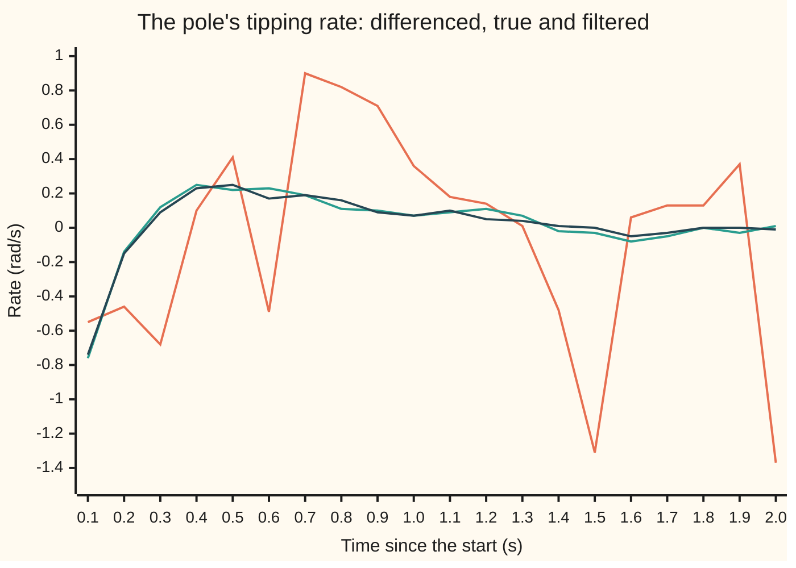
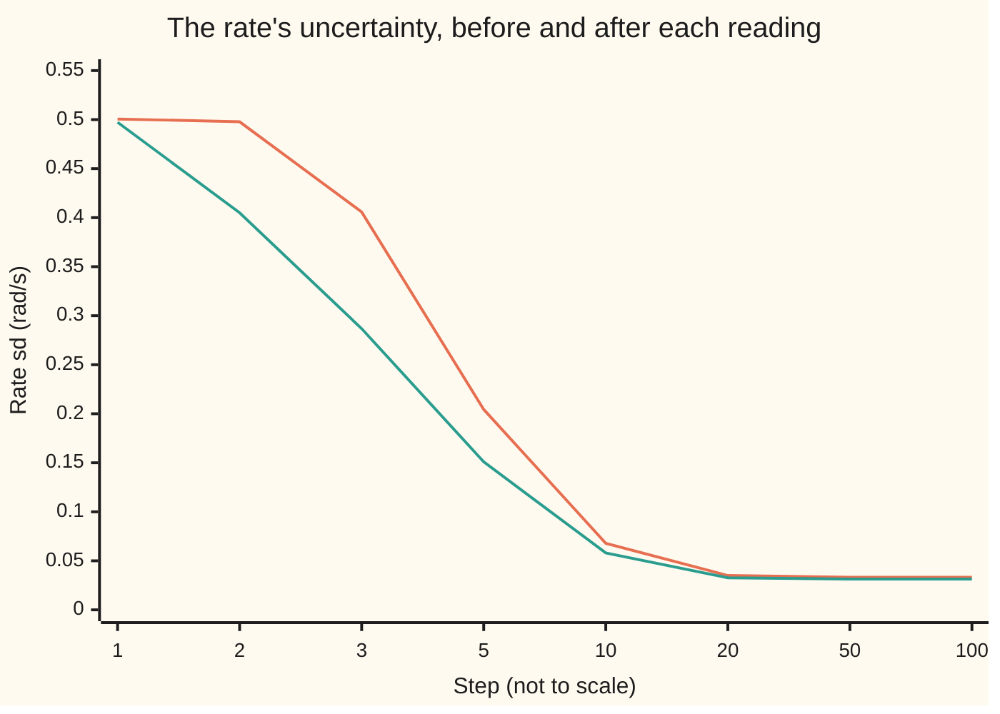

# The Kalman filter: predict forward, then correct by the measurement's surprise

[Syllabus](../../../SYLLABUS.md) → [Engineering mathematics](../README.md) → [State Space and Optimal Control](../README.md#s04) → The Kalman filter

---

## General Overview

A cart on a short rail balances a pole upright, 0.613125 m long. An encoder at the pivot (a sensor that counts the pole's turning) reports the pole's angle 100 times a second. Each reading is off by about 0.005 radians, at random. The balancing rule needs one more number: how fast the pole is tipping, its **rate**, in radians per second. No sensor reports the rate.

The obvious fix is to difference: take two readings 0.01 s apart and divide their change by 0.01 s. Two errors of 0.005 rad, divided by a hundredth of a second, leave a rate that is wrong by 0.707107 rad/s on a typical reading. In the run below, the pole's real rate, sampled every tenth of a second, stays within 0.25 rad/s once it settles. The differenced rate is mostly noise.

The Kalman filter does better by never starting from scratch. Before each reading it **predicts**: it runs the pendulum's own equation forward 0.01 s from its last estimate, and widens its uncertainty to allow for random pushes.

When the reading arrives it **corrects**: it compares the reading with the predicted reading, and moves the estimate by a fraction of that gap, the **surprise**. The fraction is the **gain**. It comes from the two uncertainties, the prediction's and the encoder's, not from guesswork.

The rate is never read, yet each surprise in the angle moves the rate estimate too, because the filter knows how errors in the two are tied together. Once settled, the filter's rate is wrong by 0.031422 rad/s on a typical step.

**Predict the state forward with the model, compare the prediction with the reading, and move every estimate by a gain times the surprise; the gain, and the uncertainty it rests on, follow from conditioning a normal belief on a noisy linear reading, and if the model is right the surprises come out as pure noise.**

**What kind of fact this is:** a theorem inside a model. Given a linear model with normal noise of known size, the recursion gives the exact conditional mean and covariance of the state, proved on this card in Why it works, and its gain is the best linear gain even without normality. The pendulum's linear equation and the two noise sizes are assumptions about the rig.

### The picture: two seconds of a hidden rate



Orange: the rate from differencing two encoder readings, jumping between −1.37 and 0.90 rad/s. Green: the true rate, which the filter never sees. Dark blue: the filter's rate, lying on the green line to within a few hundredths. One simulated run (seed 1), plotted every tenth of a second; another seed draws another run.

---

## The formula

Notation first, in words. The state is the list of numbers the model carries ([State space](01-state-space-models-and-the-matrix-exponential.md)): here the angle $\theta$ (theta) from upright, in radians, and the rate $\omega$ (omega), in radians per second. Step $k$ is the $k$-th tick of the 100 hertz clock. A hat means "the filter's estimate of"; a raised minus means "before the reading of this step"; a raised T is the transpose, rows turned into columns ([Multivariate normal](../../09-Probability%20and%20statistics/05-Transformations%20and%20Joint%20Laws/06-multivariate-normal.md)).

Three words from probability recur. A normal law is the bell-shaped spread of random errors. A covariance matrix lists each part's variance (its squared typical error) and how the parts' errors move together. The sd (standard deviation) is the square root of a variance: the typical size of an error.

The model, near upright, is that the pole's angular acceleration is $(g/l)\,\theta - u/l$, where $g/l = 16$ per second squared and $u$ is the cart's acceleration, chosen by the balancing rule. The balancing rule sets $u = l\,(32\,\hat\theta + 8\,\hat\omega)$ from the filter's estimates, a rule from [Pole placement](04-pole-placement-and-observers.md); here it only matters that the filter knows each $u$. One 0.01 s step of the model, with a random push $w_k$ and encoder noise $v_k$, is

$$x_k = F\,x_{k-1} + G\,u_{k-1} + w_k, \qquad y_k = H\,x_k + v_k .$$

The random push is an unknown angular acceleration of sd 1 rad/s², held constant through each 0.01 s step. Each 1 rad/s² of it moves the angle by 0.000050 rad and the rate by 0.010003 rad/s, together, so $Q$ = `[[0.000050², 0.000050 × 0.010003], [0.000050 × 0.010003, 0.010003²]]`: one push drives both parts, so they are perfectly correlated.

The filter runs two moves per step. **Predict:**

$$\hat x_k^- = F\,\hat x_{k-1} + G\,u_{k-1}, \qquad P_k^- = F\,P_{k-1}\,F^T + Q .$$

**Correct:**

$$\nu_k = y_k - H\,\hat x_k^-, \qquad S_k = H\,P_k^-\,H^T + R, \qquad K_k = P_k^-\,H^T S_k^{-1},$$

$$\hat x_k = \hat x_k^- + K_k\,\nu_k, \qquad P_k = (I - K_k H)\,P_k^- .$$

**Read it aloud:** run the model forward and let the uncertainty grow by the random push; then take the reading minus what the prediction said it would be, and move each estimate by its gain times that surprise, the gain being how much the prediction's error reaches into the reading divided by how uncertain the reading is in all.

$Q$, $R$, $K$ and $P$ here are the push and noise sizes, the filter's gain and its error covariance, not the prices, gain and Riccati solution of [The LQR](06-linear-quadratic-regulator.md); [LQG](09-lqg-and-the-separation-principle.md) uses both sets and renames the filter's to keep them apart.

| Symbol | Plain meaning | In our example | Push it up and the answer… |
| --- | --- | --- | --- |
| $x_k$, $k$ | the true state at step $k$; steps are 0.01 s apart | rate −0.76 rad/s at 0.1 s in the chart's run | — |
| $\theta$, $\omega$ | the angle from upright (rad); its rate (rad/s), never measured | both start near zero | — |
| $\hat x_k^-$, $\hat x_k$ | the estimate before and after reading $k$ | step 1: rate −0.027683 rad/s after | — |
| $P_k^-$, $P_k$ | covariance matrix of the estimate's error, before and after | settles at rate sd 0.031422 rad/s | — |
| $F$, $A$ | one step of the unforced pendulum, $e^{0.01A}$; $A$ the pendulum's rate-of-change matrix | F = `[[1.000800, 0.010003], [0.160043, 1.000800]]`; A = `[[0, 1], [16, 0]]` | a faster fall widens every prediction |
| $G$, $u_k$ | how a cart acceleration moves the state; that acceleration (m/s²) | G = (−0.000082, −0.016314) | — |
| $g$, $l$ | gravity; the pole's length | 9.81 m/s²; 0.613125 m | — |
| $Q$, $w_k$ | covariance of one step's random push; the push | push sd 1 rad/s²: angle sd 0.000050 rad and rate sd 0.010003 rad/s per step, fully correlated | the gain rises: readings count for more |
| $y_k$, $H$, $I$ | the encoder reading; `H = [1, 0]` picks out the angle; $I$ the matrix that changes nothing | $y_1$ = −0.024350 rad | — |
| $R$, $v_k$ | the encoder's noise variance; the noise | 0.005 squared | the gain falls: readings count for less |
| $\nu_k$, $S_k$ | the surprise (innovation): reading minus predicted reading; its predicted variance | steady surprise sd 0.005548 rad | — |
| $K_k$ | the gain: how far each estimate moves per unit of surprise | steady 0.187853 on angle, 1.952854 per s on rate | — |

The cart's own position and speed follow exactly from the accelerations the controller commanded, so in this example all the uncertainty sits in the pole's two states, and the filter carries those two. The same recursion runs unchanged on all four, with four-by-four matrices.

### When it holds

- **The model is linear.** The equation uses $\theta$ where the true pole has $\sin\theta$. Far from upright the predictions bend wrong and the recursion is no longer exact; [Filtering a nonlinear plant](08-extended-kalman-filter-and-nonlinear-estimation.md) handles that. Started 0.5 rad from upright on the curved pole, $\theta'' = 16\sin\theta - (u/l)\cos\theta$ plus the push, the filter's squared surprises over the first 0.5 s average 1.250 times their predicted variance and its rate error is 0.1254 rad/s; on the straight model, from the same lean, they are 1.001 and 0.1120 rad/s.
- **The noises are white and independent.** Each step's push and each reading's error must be fresh. A slow wobble in the table shared across steps makes the surprises correlated, and the gain is then no longer the best.
- **$Q$ and $R$ are the true sizes.** The filter's $P$ is its claim, computed from them. Tell it the push is 100 times smaller than it is and it claims more accuracy than it has, by a margin the surprises reveal (What breaks, below).
- **The input is in the prediction.** The cart's acceleration moves the pole; a prediction without $G\,u$ drifts away from the truth every step the cart works.
- **The readings can see the hidden states.** Here the rate shows up in how the angle changes. A state that never touches the readings, such as the cart's position seen from a pivot encoder, can never be pinned down: if it were uncertain, its uncertainty would grow without limit ([Can you steer every state, and can you see every state](03-controllability-and-observability.md)).

---

## Why it works

### Step 0: a normal belief stays normal

The filter's belief about the state is a normal law: a centre $\hat x$ and a covariance $P$. Both of its moves keep it normal. Predicting is a fixed linear map plus fresh independent normal noise. Correcting is conditioning on a reading that is linear in the state plus normal noise. So two summaries, centre and covariance, carry the whole belief from step to step, and the filter only has to update those two.

### Step 1: predict by pushing the belief through the model

If the error at step $k-1$ has covariance $P_{k-1}$, then after the step it is $F$ times that error plus the fresh push $w_k$. A fixed matrix on both sides of a covariance, $F P F^T$, is the rule for a linear map of a normal vector ([Multivariate normal](../../09-Probability%20and%20statistics/05-Transformations%20and%20Joint%20Laws/06-multivariate-normal.md)). Independent noise adds its own covariance $Q$. The known input $G\,u$ moves the centre and adds no uncertainty.

$F$ itself is one 0.01 s step of the pendulum without the cart, $e^{0.01A}$ for `A = [[0, 1], [16, 0]]`. For this matrix it works out to cosh and sinh of 0.04: `F = [[cosh 0.04, sinh(0.04)/4], [4 sinh 0.04, cosh 0.04]]`. The entry 0.160043 is why the angle's error leaks into the rate: an upright pole tips faster the further it leans.

### Step 2: correct by conditioning on the reading

Before the reading, the state and the reading are jointly normal. Their covariances follow from $y = Hx + v$:

- the state's covariance is $P^-$;
- the state and the reading co-vary by $P^- H^T$;
- the reading's variance is $H P^- H^T + R = S$.

Conditioning one block of a normal vector on another ([Bivariate normal](../../09-Probability%20and%20statistics/05-Transformations%20and%20Joint%20Laws/05-bivariate-normal-and-conditioning.md) does one number, the multivariate card does blocks) gives

$$E[x \mid y] = \hat x^- + P^- H^T S^{-1}\,(y - H\hat x^-), \qquad \operatorname{Cov}[x \mid y] = P^- - P^- H^T S^{-1} H P^- .$$

That is the gain, $K = P^- H^T S^{-1}$, and the corrected covariance, $(I - KH)P^-$. With one encoder, $S$ is a single number, and $K$ is the first column of $P^-$ divided by it: (angle variance, angle-rate covariance) over $S$. The rate moves on an angle surprise exactly in proportion to how the two errors co-vary. That is how a state no sensor reads still gets corrected.

In one dimension this is the precision-weighted average of [Normal-normal](../../09-Probability%20and%20statistics/10-Bayesian%20Inference/03-normal-normal.md). In matrices, precisions (inverse covariances) still add: $P^{-1} = (P^-)^{-1} + H^T R^{-1} H$. The code computes the correction both ways and gets the same six decimals.

### Step 3: the gain is the best one even without normality

Take any gain $K$, not just the formula's. The new error is $(I - KH)$ times the old error minus $K$ times the encoder noise, so its covariance is

$$P(K) = (I - KH)\,P^-\,(I - KH)^T + K R K^T .$$

Completing the square shows $P(K)$ equals the formula's covariance plus a term that is never negative and vanishes only at the formula's gain. No other linear correction does better on any state, and the argument used only the noise covariances, not their normal shape.

<details>
<summary>Completing the square</summary>

Write $K^* = P^- H^T S^{-1}$ and expand, using $S = H P^- H^T + R$:

$$P(K) = P^- - K H P^- - P^- H^T K^T + K S K^T = P^- - K^* S K^{*T} + (K - K^*)\,S\,(K - K^*)^T .$$

$S$ is positive, so the last term is a covariance-shaped matrix that is zero only when $K = K^*$. The first two terms are $P^- - P^- H^T S^{-1} H P^-$, Step 2's corrected covariance. The code uses $P(K)$ as written, the Joseph form, because it stays right for any gain; that is what lets it score a deliberately wrong gain.

</details>

### Step 4: the surprises of a right filter are pure noise

The surprise $\nu_k$ is the reading minus its best prediction from all earlier readings. The error of a best prediction is uncorrelated with everything it was built from, and every earlier surprise was built from earlier readings. So the surprises are uncorrelated with each other; with normal noise, independent. Each has variance $S_k$.

That gives a test that needs no access to the truth. Divide each surprise by $\sqrt{S_k}$. The squares should average 1, and each should be uncorrelated with the one before. A filter with the wrong $Q$, a missing input, or a hand-picked gain leaves part of each surprise predictable from the last, and the test shows it.

### Step 5: the uncertainty runs on its own, and settles

Put the correction inside the next prediction and $P^-$ obeys

$$P_{k+1}^- = F\left(P_k^- - P_k^- H^T S_k^{-1} H P_k^-\right)F^T + Q .$$

This is the **Riccati recursion**: no reading appears in it. The gains can be computed before the cart moves. When every unstable motion shows up in the readings and every one is stirred by the push $Q$, it settles to one steady $P$ and one steady gain, whatever the start. Here it settles within about half a second. The same kind of equation, mirrored, gives the regulator's gain ([The LQR](06-linear-quadratic-regulator.md) solves its continuous-time form).

---

## Worked numbers, by hand

Step 1, from a start that knows nothing beyond "near upright": centre zero, angle sd 0.05 rad, rate sd 0.5 rad/s, no correlation. No cart acceleration yet.

| Step | Arithmetic | Value |
| --- | --- | --- |
| predicted angle variance | 1.000800² × 0.05² + 0.010003² × 0.5² + 0.000050² | 0.002529 |
| predicted rate variance | 0.160043² × 0.05² + 1.000800² × 0.5² + 0.010003² | 0.250564 |
| predicted angle-rate covariance | 1.000800 × 0.160043 × 0.05² + 0.010003 × 1.000800 × 0.5² + 0.000050 × 0.010003 | 0.002904 |
| surprise variance $S$ | 0.002529 + 0.005² | 0.002554 |
| gain on angle | 0.002529 / 0.002554 | 0.990212 |
| gain on rate (per s) | 0.002904 / 0.002554 | 1.136873 |
| surprise $\nu_1$ | −0.024350 − 0 | −0.024350 |
| angle estimate | 0 + 0.990212 × (−0.024350) | −0.024111 |
| **rate estimate** | 0 + 1.136873 × (−0.024350) | **−0.027683** |

The first reading pins the angle, which was uncertain by 0.05 rad, almost entirely to the reading. It barely touches the rate, whose sd only falls to 0.497256 rad/s: one reading says where the pole is, not how fast it moves.

### What breaks if you drop a piece

Each row runs the broken filter alongside the right one on the same 2,000 simulated runs, scored over the last second of each. The right filter: rate error 0.0316 rad/s, squared surprises averaging 0.996 times their predicted variance, correlation with the previous surprise −0.003.

| Mistake | Comes out at | What went wrong |
| --- | --- | --- |
| Difference two readings for the rate | rate error 0.7064 rad/s | Every reading's error is divided by 0.01 s; nothing averages it away |
| Tell the filter $Q$ is 100 times smaller | rate error 0.0481; squared surprises 1.835 times their predicted variance, correlated +0.455 | The filter trusts its model too much and lags behind each push |
| Leave $G\,u$ out of the prediction | rate error 0.0498; correlated +0.120 | The cart's pushes look like surprises, one after another |
| Use twice the steady gain | rate error 0.0344; squared surprises 0.995 times their predicted variance, but correlated −0.148 | Each correction overshoots and the next surprise pulls it back |

The last row is the reason to check correlation and not only size: a wrong gain's surprises can be the right size and still be predictable.

---

## How the gain settles

The puzzle: the gain on the rate starts at 1.137 per second, leaps to 33.396 at the second step, then sinks to 1.953 and stays. Why does the filter first ignore the rate, then lunge at it, then calm down?

Step 1 learns the angle. Step 2's surprise is then mostly the rate's doing, since the angle is pinned and the rate, still uncertain by about half a radian per second, has moved the pole for 0.01 s. So the filter reads that surprise as rate, at a gain about a third of differencing's 1/0.01 s = 100 per second. As the rate becomes known, the prediction carries it, and each new reading only trims it.

| Step | 1 | 2 | 3 | 5 | 10 | 20 | 50 | 100 |
| --- | --- | --- | --- | --- | --- | --- | --- | --- |
| gain on rate (per s) | 1.137 | 33.396 | 33.174 | 18.216 | 5.667 | 2.220 | 1.953 | 1.953 |
| rate sd after the prediction (rad/s) | 0.5006 | 0.4978 | 0.4058 | 0.2044 | 0.0679 | 0.0350 | 0.0332 | 0.0332 |
| rate sd after the reading (rad/s) | 0.4973 | 0.4050 | 0.2868 | 0.1509 | 0.0581 | 0.0327 | 0.0314 | 0.0314 |

The uncertainty has two forces on it. Each prediction widens it: the push adds 0.010003² (rad/s)² to the rate's variance, and the angle's error leaks into the rate through F. Each reading narrows it.

**Force one: the prediction widens.** The rate's sd just before each reading:

```
step   rate sd after the prediction (rad/s)
   1   ████████████████████████████████████████  0.5006
   2   ████████████████████████████████████████  0.4978
   3   ████████████████████████████████          0.4058
   5   ████████████████                          0.2044
  10   █████                                     0.0679
  20   ███                                       0.0350
  50   ███                                       0.0332
 100   ███                                       0.0332
```

**Force two: the reading narrows.** The rate's sd just after each reading:

```
step   rate sd after the reading (rad/s)
   1   ████████████████████████████████████████  0.4973
   2   ████████████████████████████████          0.4050
   3   ███████████████████████                   0.2868
   5   ████████████                              0.1509
  10   █████                                     0.0581
  20   ███                                       0.0327
  50   ███                                       0.0314
 100   ███                                       0.0314
```

**Both forces in one picture.**



Orange: after each prediction. Green: after each reading. The gap between them is the reading's work: wide at steps 2 and 3, where the gain lunges, and from step 50 a steady 0.0332 against 0.0314 rad/s, where each reading takes out exactly what the prediction put in. By then, half a second in, the gain and the uncertainty have reached their steady values, 0.187853 on the angle and 1.952854 per second on the rate, with a rate sd of 0.031422 rad/s. From there the filter is a fixed rule, and the chart at the top shows it working.

---

## Code, from first principles, and it actually runs

The script builds the 0.01 s step from cosh and sinh and checks it against the matrix exponential's own series. It works step 1 by hand and repeats the correction in precision form. It runs the Riccati recursion to the steady gain, then finds the same gain a second way: a brute-force search over fixed gains that uses only Step 3's error formula and never the gain formula. It then simulates 2,000 runs of two seconds, with random numbers from a written-out SplitMix64 generator and Box-Muller normals, and scores the right filter and three broken ones on the same draws. Last, it starts the filter 0.5 rad from upright on the curved pole. Five roads: the gain formula, the search, the precision form, the simulation's actual errors against $P$, and the surprise test. The asserts tie each road to another.

### Python

```python
# Kalman filter on the balancing pendulum -- the check behind the card.  Standard library only.
# Roads: the gain formula and its Riccati recursion; a brute-force search over fixed gains;
# the information (precision) form of the correction; 2000 simulated runs; innovation statistics.
import math
DT, L = 0.01, 9.81 / 16             # 100 hertz; pole length l (m), so g/l = 16 per second squared
SA, SR = 1.0, 0.005                 # random angular acceleration sd (rad/s^2); encoder sd (rad)
ch, sh = math.cosh(0.04), math.sinh(0.04)
F = [[ch, sh / 4], [4 * sh, ch]]    # exact 0.01 s step of theta'' = 16 theta, from the matrix exponential
g = [(ch - 1) / 16, sh / 4]         # what a held angular acceleration of 1 rad/s^2 adds in one step
G = [-g[0] / L, -g[1] / L]          # a cart acceleration a pushes the pole by -a/l
Q = [[SA * SA * g[i] * g[j] for j in range(2)] for i in range(2)]
R, P0, M64 = SR * SR, [[0.05 * 0.05, 0.0], [0.0, 0.5 * 0.5]], (1 << 64) - 1
class Rng:                                       # SplitMix64 bits, Box-Muller normals
    def __init__(s, seed): s.s = seed
    def u(s):
        s.s = (s.s + 0x9E3779B97F4A7C15) & M64
        z = ((s.s ^ (s.s >> 30)) * 0xBF58476D1CE4E5B9) & M64
        z = ((z ^ (z >> 27)) * 0x94D049BB133111EB) & M64
        return ((z ^ (z >> 31)) >> 11) / 2.0 ** 53
    def n(s):
        a = 1.0 - s.u()
        return math.sqrt(-2.0 * math.log(a)) * math.cos(2.0 * math.pi * s.u())
def predict(x, P, u, q=1.0, use_u=True):
    x = [F[0][0] * x[0] + F[0][1] * x[1] + use_u * G[0] * u, F[1][0] * x[0] + F[1][1] * x[1] + use_u * G[1] * u]
    FP = [[F[i][0] * P[0][j] + F[i][1] * P[1][j] for j in range(2)] for i in range(2)]
    return x, [[FP[i][0] * F[j][0] + FP[i][1] * F[j][1] + q * Q[i][j] for j in range(2)] for i in range(2)]
def correct(x, P, y, K=None):                    # the encoder reads the angle only: H = [1, 0]
    S = P[0][0] + R
    if K is None: K = [P[0][0] / S, P[1][0] / S]
    nu, A = y - x[0], [[1 - K[0], 0.0], [-K[1], 1.0]]           # Joseph form: right for any gain
    AP = [[A[i][0] * P[0][j] + A[i][1] * P[1][j] for j in range(2)] for i in range(2)]
    Pn = [[AP[i][0] * A[j][0] + AP[i][1] * A[j][1] + K[i] * K[j] * R for j in range(2)] for i in range(2)]
    return [x[0] + K[0] * nu, x[1] + K[1] * nu], Pn, nu, S, K
def inv2(P): d = P[0][0] * P[1][1] - P[0][1] * P[1][0]; return [[P[1][1] / d, -P[0][1] / d], [-P[1][0] / d, P[0][0] / d]]
def info_correct(x, P, y):                       # precisions add; means weighted by precision
    I = inv2(P); I2 = [[I[0][0] + 1 / R, I[0][1]], [I[1][0], I[1][1]]]; Pn = inv2(I2)
    b = [I[0][0] * x[0] + I[0][1] * x[1] + y / R, I[1][0] * x[0] + I[1][1] * x[1]]
    return [Pn[0][0] * b[0] + Pn[0][1] * b[1], Pn[1][0] * b[0] + Pn[1][1] * b[1]], Pn
def bend(t, u, w, n=10):                         # the curved pole: theta'' = 16 sin theta - (u/l) cos theta + w, RK4
    f, h = lambda s: [s[1], 16 * math.sin(s[0]) - u / L * math.cos(s[0]) + w], DT / n
    for _ in range(n):
        k1 = f(t); k2 = f([t[0] + h / 2 * k1[0], t[1] + h / 2 * k1[1]]); k3 = f([t[0] + h / 2 * k2[0], t[1] + h / 2 * k2[1]])
        k4 = f([t[0] + h * k3[0], t[1] + h * k3[1]]); t = [t[i] + h / 6 * (k1[i] + 2 * k2[i] + 2 * k3[i] + k4[i]) for i in range(2)]
    return t
def run(seed, steps, variants, th0=0.0, curved=False):   # variant 0 is the true filter and drives the cart
    r = Rng(seed)
    t = [th0 + math.sqrt(P0[0][0]) * r.n(), math.sqrt(P0[1][1]) * r.n()]
    est = [([th0, 0.0], [row[:] for row in P0]) for _ in variants]
    out, yprev = [], None
    for k in range(1, steps + 1):
        u = L * (32 * est[0][0][0] + 8 * est[0][0][1])          # a = l (32 th + 8 om), from Pole placement
        w = SA * r.n()
        t = bend(t, u, w) if curved else [F[0][0] * t[0] + F[0][1] * t[1] + G[0] * u + g[0] * w, F[1][0] * t[0] + F[1][1] * t[1] + G[1] * u + g[1] * w]
        y = t[0] + SR * r.n()
        rec = []
        for i, (q, use_u, K) in enumerate(variants):
            x, P = predict(est[i][0], est[i][1], u, q, use_u)
            x, P, nu, S, _ = correct(x, P, y, K)
            est[i] = (x, P); rec.append((x, nu, S))
        fd = (y - yprev) / DT if yprev is not None else 0.0
        out.append((t, y, fd, rec)); yprev = y
    return out
def show(label, v): print(f"{label:<44} {v:>12.6f}")
# ---- step 1, by hand ----
xp, Pp = predict([0.0, 0.0], P0, 0.0); y1 = run(1, 1, [(1.0, True, None)])[0][1]
x1, P1, nu1, S1, K1 = correct(xp, Pp, y1); xi, Pi = info_correct(xp, Pp, y1)
for lab, v in [("pole length l (m)", L), ("push: angular acceleration sd (rad/s^2)", SA), ("F: cosh 0.04", F[0][0]), ("F: sinh 0.04 / 4 (s)", F[0][1]), ("F: 4 sinh 0.04 (per s)", F[1][0]),
               ("G: angle per m/s^2 of cart", G[0]), ("G: rate per m/s^2 of cart", G[1]),
               ("Q: angle sd added per step (rad)", math.sqrt(Q[0][0])), ("Q: rate sd added per step", math.sqrt(Q[1][1])),
               ("step 1 predicted angle var P-", Pp[0][0]), ("step 1 predicted rate var", Pp[1][1]),
               ("step 1 predicted covariance", Pp[0][1]), ("step 1 reading y1 (rad)", y1), ("step 1 S = P- + R", S1),
               ("step 1 gain on angle", K1[0]), ("step 1 gain on rate (per s)", K1[1]),
               ("step 1 angle estimate", x1[0]), ("  by precisions", xi[0]), ("step 1 rate estimate", x1[1]),
               ("  by precisions", xi[1]), ("step 1 rate sd after", math.sqrt(P1[1][1])), ("  by precisions", math.sqrt(Pi[1][1]))]:
    show(lab, v)
# ---- the steady gain: Riccati recursion, then a brute-force search over fixed gains ----
P, settle = P0, []
for k in range(1, 1001):
    _, Pm = predict([0, 0], P, 0.0)
    _, P, _, Sinf, Kinf = correct([0, 0], Pm, 0.0)
    if k in (1, 2, 3, 5, 10, 20, 50, 100): settle.append((k, Kinf[1], math.sqrt(P[1][1]), math.sqrt(Pm[1][1])))
print("settling, step      " + "".join(f"{s[0]:>8d}" for s in settle))
print("  gain on rate      " + "".join(f"{s[1]:>8.3f}" for s in settle))
print("  rate sd predicted " + "".join(f"{s[3]:>8.4f}" for s in settle))
print("  rate sd (rad/s)   " + "".join(f"{s[2]:>8.4f}" for s in settle))
def cost(K):                                    # steady error of a fixed gain, iterated to rest
    E = P0
    for _ in range(1500):
        _, E = predict([0, 0], E, 0.0); _, E, _, _, _ = correct([0, 0], E, 0.0, K)
    return E[0][0] / (DT * DT) + E[1][1]
Ks, step, rounds = [0.5, 5.0], [0.1, 1.0], 0; best = cost(Ks)
while step[0] > 1e-7 and rounds < 200:          # pattern search; it needs 35 rounds, give up after 200
    moved, rounds = False, rounds + 1
    for i in range(2):
        for sgn in (1, -1):
            trial = Ks[:]; trial[i] += sgn * step[i]
            if trial[0] < 1 and (c := cost(trial)) < best: Ks, best, moved = trial, c, True
    if not moved: step = [s / 2 for s in step]
for lab, v in [("steady gain on angle", Kinf[0]), ("  by search", Ks[0]), ("steady gain on rate (per s)", Kinf[1]),
               ("  by search", Ks[1]), ("steady angle sd (rad)", math.sqrt(P[0][0])), ("steady rate sd (rad/s)", math.sqrt(P[1][1])),
               ("steady innovation sd (rad)", math.sqrt(Sinf)), ("rate sd from differencing (rad/s)", math.sqrt(2 * R) / DT)]:
    show(lab, v)
# ---- 2000 runs of 2 seconds: errors and surprises over the last second ----
VAR = [(1.0, True, None), (0.01, True, None), (1.0, False, None), (1.0, True, [2 * Kinf[0], 2 * Kinf[1]])]
NAMES = ["the filter", "Q 100 times too small", "input left out of predict", "twice the steady gain"]
acc = [[0.0] * 5 for _ in VAR]; fd2 = 0.0; n = 0
for seed in range(1, 2001):
    out = run(seed, 200, VAR)
    for k in range(100, 200):
        t, y, fd, rec = out[k]; n += 1; fd2 += (fd - t[1]) ** 2
        for i, (x, nu, S) in enumerate(rec):
            z, zp = nu / math.sqrt(S), out[k - 1][3][i][1] / math.sqrt(out[k - 1][3][i][2])
            a = acc[i]; a[0] += (x[0] - t[0]) ** 2; a[1] += (x[1] - t[1]) ** 2; a[2] += z * z; a[3] += z * zp
st = [(math.sqrt(a[0] / n), math.sqrt(a[1] / n), a[2] / n, a[3] / a[2]) for a in acc]
for nm, (ea, er, nis, c1) in zip(NAMES, st):
    print(f"{nm:<26} angle rms {ea:.6f}  rate rms {er:.4f}  surprise^2/S {nis:.3f}  lag-1 {c1:+.3f}")
print(f"differencing the encoder   rate rms {math.sqrt(fd2 / n):.4f}")
# ---- one run (seed 1) for the chart: every 0.1 s ----
story = run(1, 200, VAR[:1])
for lab, f in [("chart, time (s)", lambda o, k: (k + 1) * DT), ("chart, true rate", lambda o, k: o[0][1]),
               ("chart, filter rate", lambda o, k: o[3][0][0][1]), ("chart, differenced", lambda o, k: o[2])]:
    print(f"{lab:<19}" + " ".join(f"{f(story[k], k):5.2f}" for k in range(9, 200, 10)))
E, T, A = [[1.0, 0.0], [0.0, 1.0]], [[1.0, 0.0], [0.0, 1.0]], [[0.0, DT], [16 * DT, 0.0]]   # e^(A dt) by its series
for j in range(1, 15): T = [[(T[i][0] * A[0][c] + T[i][1] * A[1][c]) / j for c in range(2)] for i in range(2)]; E = [[E[i][c] + T[i][c] for c in range(2)] for i in range(2)]
assert max(abs(E[i][c] - F[i][c]) for i in range(2) for c in range(2)) < 1e-14, "cosh-sinh step vs the series"
assert max(abs(x1[i] - xi[i]) for i in range(2)) < 1e-12 and abs(P1[1][1] - Pi[1][1]) < 1e-12, "gain form vs precisions"
assert abs(Kinf[0] - Ks[0]) < 1e-5 and abs(Kinf[1] - Ks[1]) < 1e-4, "Riccati gain vs brute-force search"
assert abs(st[0][1] / math.sqrt(P[1][1]) - 1) < 0.03 and abs(st[0][0] / math.sqrt(P[0][0]) - 1) < 0.03, "simulated vs P"
assert abs(st[0][2] - 1) < 0.015 and abs(st[0][3]) < 0.01, "the filter's surprises: right size, uncorrelated"
assert st[1][2] > 1.5 and st[1][3] > 0.3 and st[3][3] < -0.1, "mis-tuned filters leave a pattern in the surprises"
assert abs(math.sqrt(fd2 / n) / (math.sqrt(2 * R) / DT) - 1) < 0.02, "differencing noise vs its formula"
assert min(v[1] for v in st) == st[0][1], "no variant beats the filter on the rate"
assert step[0] <= 1e-7, "the brute-force gain search did not settle"
cs = []                                          # 200 runs from a 0.5 rad lean, first 0.5 s: straight pole, then curved pole
for cv in (False, True):
    o = [s for seed in range(1, 201) for s in run(seed, 50, VAR[:1], 0.5, cv)]
    cs.append((math.sqrt(sum((s[3][0][0][1] - s[0][1]) ** 2 for s in o) / len(o)), sum(s[3][0][1] ** 2 / s[3][0][2] for s in o) / len(o)))
print(f"from 0.5 rad, first 0.5 s: straight pole rate rms {cs[0][0]:.4f} surprise^2/S {cs[0][1]:.3f}; curved pole {cs[1][0]:.4f} and {cs[1][1]:.3f}")
assert abs(cs[0][1] - 1) < 0.05 and cs[1][1] > 1.15, "straight pole: right-sized surprises; curved pole: too big"
print("ALL CHECKS PASS")
```

**Ran 2026-11-11 on macOS, Python 3.14.10, standard library only. All checks passed. Output, pasted from the run:**

```
pole length l (m)                                0.613125
push: angular acceleration sd (rad/s^2)          1.000000
F: cosh 0.04                                     1.000800
F: sinh 0.04 / 4 (s)                             0.010003
F: 4 sinh 0.04 (per s)                           0.160043
G: angle per m/s^2 of cart                      -0.000082
G: rate per m/s^2 of cart                       -0.016314
Q: angle sd added per step (rad)                 0.000050
Q: rate sd added per step                        0.010003
step 1 predicted angle var P-                    0.002529
step 1 predicted rate var                        0.250564
step 1 predicted covariance                      0.002904
step 1 reading y1 (rad)                         -0.024350
step 1 S = P- + R                                0.002554
step 1 gain on angle                             0.990212
step 1 gain on rate (per s)                      1.136873
step 1 angle estimate                           -0.024111
  by precisions                                 -0.024111
step 1 rate estimate                            -0.027683
  by precisions                                 -0.027683
step 1 rate sd after                             0.497256
  by precisions                                  0.497256
settling, step             1       2       3       5      10      20      50     100
  gain on rate         1.137  33.396  33.174  18.216   5.667   2.220   1.953   1.953
  rate sd predicted   0.5006  0.4978  0.4058  0.2044  0.0679  0.0350  0.0332  0.0332
  rate sd (rad/s)     0.4973  0.4050  0.2868  0.1509  0.0581  0.0327  0.0314  0.0314
steady gain on angle                             0.187853
  by search                                      0.187852
steady gain on rate (per s)                      1.952854
  by search                                      1.952854
steady angle sd (rad)                            0.002167
steady rate sd (rad/s)                           0.031422
steady innovation sd (rad)                       0.005548
rate sd from differencing (rad/s)                0.707107
the filter                 angle rms 0.002174  rate rms 0.0316  surprise^2/S 0.996  lag-1 -0.003
Q 100 times too small      angle rms 0.004634  rate rms 0.0481  surprise^2/S 1.835  lag-1 +0.455
input left out of predict  angle rms 0.002749  rate rms 0.0498  surprise^2/S 1.136  lag-1 +0.120
twice the steady gain      angle rms 0.002587  rate rms 0.0344  surprise^2/S 0.995  lag-1 -0.148
differencing the encoder   rate rms 0.7064
chart, time (s)     0.10  0.20  0.30  0.40  0.50  0.60  0.70  0.80  0.90  1.00  1.10  1.20  1.30  1.40  1.50  1.60  1.70  1.80  1.90  2.00
chart, true rate   -0.76 -0.14  0.12  0.25  0.22  0.23  0.19  0.11  0.10  0.07  0.09  0.11  0.07 -0.02 -0.03 -0.08 -0.05  0.00 -0.03  0.01
chart, filter rate -0.74 -0.15  0.09  0.23  0.25  0.17  0.19  0.16  0.09  0.07  0.10  0.05  0.04  0.01 -0.00 -0.05 -0.03 -0.00  0.00 -0.01
chart, differenced -0.55 -0.46 -0.68  0.10  0.41 -0.49  0.90  0.82  0.71  0.36  0.18  0.14  0.01 -0.48 -1.31  0.06  0.13  0.13  0.37 -1.37
from 0.5 rad, first 0.5 s: straight pole rate rms 0.1120 surprise^2/S 1.001; curved pole 0.1254 and 1.250
ALL CHECKS PASS
```

### Rust

```rust
// Kalman filter on the balancing pendulum -- the same check as kalman_filter_check.py, in Rust.
// Roads: the gain formula and its Riccati recursion; a brute-force search over fixed gains;
// the information (precision) form of the correction; 2000 simulated runs; innovation statistics.
type M2 = [[f64; 2]; 2];
const DT: f64 = 0.01; const L: f64 = 9.81 / 16.0;    // 100 hertz; pole length l (m), so g/l = 16 per s^2
const SA: f64 = 1.0; const SR: f64 = 0.005;          // random angular acceleration sd (rad/s^2); encoder sd (rad)
const R: f64 = SR * SR; const P0: M2 = [[0.05 * 0.05, 0.0], [0.0, 0.5 * 0.5]];
struct Model { f: M2, g: [f64; 2], gu: [f64; 2], q: M2 }
struct Rng { s: u64 }                  // SplitMix64 bits, Box-Muller normals
impl Rng {
    fn u(&mut self) -> f64 {
        self.s = self.s.wrapping_add(0x9E3779B97F4A7C15);
        let mut z = (self.s ^ (self.s >> 30)).wrapping_mul(0xBF58476D1CE4E5B9);
        z = (z ^ (z >> 27)).wrapping_mul(0x94D049BB133111EB);
        ((z ^ (z >> 31)) >> 11) as f64 / 9007199254740992.0
    }
    fn n(&mut self) -> f64 {
        let a = 1.0 - self.u();
        (-2.0 * a.ln()).sqrt() * (2.0 * std::f64::consts::PI * self.u()).cos()
    }
}
fn predict(m: &Model, x: [f64; 2], p: &M2, u: f64, q: f64, use_u: f64) -> ([f64; 2], M2) {
    let f = &m.f;
    let xn = [f[0][0] * x[0] + f[0][1] * x[1] + use_u * m.gu[0] * u, f[1][0] * x[0] + f[1][1] * x[1] + use_u * m.gu[1] * u];
    let fp: M2 = std::array::from_fn(|i| std::array::from_fn(|j| f[i][0] * p[0][j] + f[i][1] * p[1][j]));
    (xn, std::array::from_fn(|i| std::array::from_fn(|j| fp[i][0] * f[j][0] + fp[i][1] * f[j][1] + q * m.q[i][j])))
}
fn correct(x: [f64; 2], p: &M2, y: f64, kf: Option<[f64; 2]>) -> ([f64; 2], M2, f64, f64, [f64; 2]) {
    let s = p[0][0] + R;                           // the encoder reads the angle only: H = [1, 0]
    let k = kf.unwrap_or([p[0][0] / s, p[1][0] / s]);
    let (nu, a) = (y - x[0], [[1.0 - k[0], 0.0], [-k[1], 1.0]]);   // Joseph form: right for any gain
    let ap: M2 = std::array::from_fn(|i| std::array::from_fn(|j| a[i][0] * p[0][j] + a[i][1] * p[1][j]));
    let pn: M2 = std::array::from_fn(|i| std::array::from_fn(|j| ap[i][0] * a[j][0] + ap[i][1] * a[j][1] + k[i] * k[j] * R));
    ([x[0] + k[0] * nu, x[1] + k[1] * nu], pn, nu, s, k)
}
fn inv2(p: &M2) -> M2 { let d = p[0][0] * p[1][1] - p[0][1] * p[1][0]; [[p[1][1] / d, -p[0][1] / d], [-p[1][0] / d, p[0][0] / d]] }
fn info_correct(x: [f64; 2], p: &M2, y: f64) -> ([f64; 2], M2) {   // precisions add; means weighted by precision
    let i = inv2(p);
    let pn = inv2(&[[i[0][0] + 1.0 / R, i[0][1]], [i[1][0], i[1][1]]]);
    let b = [i[0][0] * x[0] + i[0][1] * x[1] + y / R, i[1][0] * x[0] + i[1][1] * x[1]];
    ([pn[0][0] * b[0] + pn[0][1] * b[1], pn[1][0] * b[0] + pn[1][1] * b[1]], pn)
}
fn bend(t: [f64; 2], u: f64, w: f64) -> [f64; 2] {   // the curved pole: theta'' = 16 sin theta - (u/l) cos theta + w, RK4
    let f = |s: [f64; 2]| [s[1], 16.0 * s[0].sin() - u / L * s[0].cos() + w]; let (h, mut t) = (DT / 10.0, t);
    for _ in 0..10 {
        let k1 = f(t); let k2 = f([t[0] + h / 2.0 * k1[0], t[1] + h / 2.0 * k1[1]]); let k3 = f([t[0] + h / 2.0 * k2[0], t[1] + h / 2.0 * k2[1]]);
        let k4 = f([t[0] + h * k3[0], t[1] + h * k3[1]]); t = [0, 1].map(|i| t[i] + h / 6.0 * (k1[i] + 2.0 * k2[i] + 2.0 * k3[i] + k4[i]));
    }
    t
}
type Var = (f64, f64, Option<[f64; 2]>);
struct Step { t: [f64; 2], y: f64, fd: f64, rec: Vec<([f64; 2], f64, f64)> }
fn run(m: &Model, seed: u64, steps: usize, vars: &[Var], th0: f64, curved: bool) -> Vec<Step> {   // variant 0 drives the cart
    let mut r = Rng { s: seed };
    let t0 = th0 + P0[0][0].sqrt() * r.n();
    let mut t = [t0, P0[1][1].sqrt() * r.n()];
    let mut est: Vec<([f64; 2], M2)> = vars.iter().map(|_| ([th0, 0.0], P0)).collect();
    let (mut out, mut yprev): (Vec<Step>, Option<f64>) = (Vec::new(), None);
    for _ in 1..=steps {
        let u = L * (32.0 * est[0].0[0] + 8.0 * est[0].0[1]);          // a = l (32 th + 8 om), from Pole placement
        let w = SA * r.n();
        let f = &m.f;
        t = if curved { bend(t, u, w) } else { [f[0][0] * t[0] + f[0][1] * t[1] + m.gu[0] * u + m.g[0] * w, f[1][0] * t[0] + f[1][1] * t[1] + m.gu[1] * u + m.g[1] * w] };
        let y = t[0] + SR * r.n();
        let mut rec = Vec::new();
        for (i, &(q, use_u, k)) in vars.iter().enumerate() {
            let (x, p) = predict(m, est[i].0, &est[i].1, u, q, use_u);
            let (x, p, nu, s, _) = correct(x, &p, y, k);
            est[i] = (x, p); rec.push((x, nu, s));
        }
        let fd = match yprev { Some(yp) => (y - yp) / DT, None => 0.0 }; out.push(Step { t, y, fd, rec }); yprev = Some(y);
    }
    out
}
fn show(label: &str, v: f64) { println!("{:<44} {:>12.6}", label, v); }
fn cost(m: &Model, k: [f64; 2]) -> f64 {           // steady error of a fixed gain, iterated to rest
    let mut e = P0;
    for _ in 0..1500 { e = correct([0.0, 0.0], &predict(m, [0.0, 0.0], &e, 0.0, 1.0, 1.0).1, 0.0, Some(k)).1; }
    e[0][0] / (DT * DT) + e[1][1]
}
fn main() {
    let (ch, sh) = (0.04_f64.cosh(), 0.04_f64.sinh()); let g = [(ch - 1.0) / 16.0, sh / 4.0];
    let q: M2 = std::array::from_fn(|i| std::array::from_fn(|j| SA * SA * g[i] * g[j]));
    let m = Model { f: [[ch, sh / 4.0], [4.0 * sh, ch]], g, gu: [-g[0] / L, -g[1] / L], q };
    // ---- step 1, by hand ----
    let (xp, pp) = predict(&m, [0.0, 0.0], &P0, 0.0, 1.0, 1.0);
    let y1 = run(&m, 1, 1, &[(1.0, 1.0, None)], 0.0, false)[0].y;
    let (x1, p1, _nu1, s1, k1) = correct(xp, &pp, y1, None);
    let (xi, pi) = info_correct(xp, &pp, y1);
    for (lab, v) in [("pole length l (m)", L), ("push: angular acceleration sd (rad/s^2)", SA), ("F: cosh 0.04", m.f[0][0]), ("F: sinh 0.04 / 4 (s)", m.f[0][1]), ("F: 4 sinh 0.04 (per s)", m.f[1][0]),
                     ("G: angle per m/s^2 of cart", m.gu[0]), ("G: rate per m/s^2 of cart", m.gu[1]),
                     ("Q: angle sd added per step (rad)", m.q[0][0].sqrt()), ("Q: rate sd added per step", m.q[1][1].sqrt()),
                     ("step 1 predicted angle var P-", pp[0][0]), ("step 1 predicted rate var", pp[1][1]),
                     ("step 1 predicted covariance", pp[0][1]), ("step 1 reading y1 (rad)", y1), ("step 1 S = P- + R", s1),
                     ("step 1 gain on angle", k1[0]), ("step 1 gain on rate (per s)", k1[1]),
                     ("step 1 angle estimate", x1[0]), ("  by precisions", xi[0]), ("step 1 rate estimate", x1[1]),
                     ("  by precisions", xi[1]), ("step 1 rate sd after", p1[1][1].sqrt()), ("  by precisions", pi[1][1].sqrt())] { show(lab, v); }
    // ---- the steady gain: Riccati recursion, then a brute-force search over fixed gains ----
    let (mut p, mut settle) = (P0, Vec::new());
    let (mut sinf, mut kinf) = (0.0, [0.0, 0.0]);
    for k in 1..=1000 {
        let pm = predict(&m, [0.0, 0.0], &p, 0.0, 1.0, 1.0).1;
        let c = correct([0.0, 0.0], &pm, 0.0, None); (p, sinf, kinf) = (c.1, c.3, c.4);
        if [1, 2, 3, 5, 10, 20, 50, 100].contains(&k) { settle.push((k, kinf[1], p[1][1].sqrt(), pm[1][1].sqrt())); }
    }
    println!("settling, step      {}", settle.iter().map(|s| format!("{:>8}", s.0)).collect::<String>());
    println!("  gain on rate      {}", settle.iter().map(|s| format!("{:>8.3}", s.1)).collect::<String>());
    println!("  rate sd predicted {}", settle.iter().map(|s| format!("{:>8.4}", s.3)).collect::<String>());
    println!("  rate sd (rad/s)   {}", settle.iter().map(|s| format!("{:>8.4}", s.2)).collect::<String>());
    let (mut ks, mut step, mut rounds) = ([0.5, 5.0], [0.1, 1.0], 0); let mut best = cost(&m, ks);
    while step[0] > 1e-7 && rounds < 200 {          // pattern search; it needs 35 rounds, give up after 200
        let mut moved = false; rounds += 1;
        for i in 0..2 {
            for sgn in [1.0, -1.0] {
                let mut trial = ks; trial[i] += sgn * step[i];
                if trial[0] < 1.0 { let c = cost(&m, trial); if c < best { ks = trial; best = c; moved = true; } }
            }
        }
        if !moved { step = [step[0] / 2.0, step[1] / 2.0]; }
    }
    for (lab, v) in [("steady gain on angle", kinf[0]), ("  by search", ks[0]), ("steady gain on rate (per s)", kinf[1]),
                     ("  by search", ks[1]), ("steady angle sd (rad)", p[0][0].sqrt()), ("steady rate sd (rad/s)", p[1][1].sqrt()),
                     ("steady innovation sd (rad)", sinf.sqrt()), ("rate sd from differencing (rad/s)", (2.0 * R).sqrt() / DT)] { show(lab, v); }
    // ---- 2000 runs of 2 seconds: errors and surprises over the last second ----
    let vars: [Var; 4] = [(1.0, 1.0, None), (0.01, 1.0, None), (1.0, 0.0, None), (1.0, 1.0, Some([2.0 * kinf[0], 2.0 * kinf[1]]))];
    let names = ["the filter", "Q 100 times too small", "input left out of predict", "twice the steady gain"];
    let (mut acc, mut fd2, mut n) = ([[0.0_f64; 4]; 4], 0.0, 0.0);
    for seed in 1..=2000u64 {
        let out = run(&m, seed, 200, &vars, 0.0, false);
        for k in 100..200 {
            let st = &out[k]; n += 1.0; fd2 += (st.fd - st.t[1]).powi(2);
            for (i, &(x, nu, s)) in st.rec.iter().enumerate() {
                let (z, zp) = (nu / s.sqrt(), out[k - 1].rec[i].1 / out[k - 1].rec[i].2.sqrt());
                let a = &mut acc[i];
                a[0] += (x[0] - st.t[0]).powi(2); a[1] += (x[1] - st.t[1]).powi(2); a[2] += z * z; a[3] += z * zp;
            }
        }
    }
    let st: Vec<[f64; 4]> = acc.iter().map(|a| [(a[0] / n).sqrt(), (a[1] / n).sqrt(), a[2] / n, a[3] / a[2]]).collect();
    for (nm, v) in names.iter().zip(&st) {
        println!("{:<26} angle rms {:.6}  rate rms {:.4}  surprise^2/S {:.3}  lag-1 {:+.3}", nm, v[0], v[1], v[2], v[3]);
    }
    println!("differencing the encoder   rate rms {:.4}", (fd2 / n).sqrt());
    // ---- one run (seed 1) for the chart: every 0.1 s ----
    let story = run(&m, 1, 200, &vars[..1], 0.0, false); let pick: [(&str, fn(&Step, usize) -> f64); 4] = [("chart, time (s)", |_, k| (k + 1) as f64 * DT), ("chart, true rate", |o, _| o.t[1]),
                                                    ("chart, filter rate", |o, _| o.rec[0].0[1]), ("chart, differenced", |o, _| o.fd)];
    for (lab, f) in pick {
        let row: Vec<String> = (9..200).step_by(10).map(|k| format!("{:5.2}", f(&story[k], k))).collect();
        println!("{:<19}{}", lab, row.join(" "));
    }
    let (mut e, mut t, a): (M2, M2, M2) = ([[1.0, 0.0], [0.0, 1.0]], [[1.0, 0.0], [0.0, 1.0]], [[0.0, DT], [16.0 * DT, 0.0]]);
    for j in 1..15 { t = std::array::from_fn(|i| std::array::from_fn(|c| (t[i][0] * a[0][c] + t[i][1] * a[1][c]) / j as f64)); for i in 0..2 { for c in 0..2 { e[i][c] += t[i][c]; } } }
    assert!((0..4).all(|z| (e[z / 2][z % 2] - m.f[z / 2][z % 2]).abs() < 1e-14), "cosh-sinh step vs the series");
    assert!((0..2).all(|i| (x1[i] - xi[i]).abs() < 1e-12) && (p1[1][1] - pi[1][1]).abs() < 1e-12, "gain form vs precisions");
    assert!((kinf[0] - ks[0]).abs() < 1e-5 && (kinf[1] - ks[1]).abs() < 1e-4, "Riccati gain vs brute-force search");
    assert!((st[0][1] / p[1][1].sqrt() - 1.0).abs() < 0.03 && (st[0][0] / p[0][0].sqrt() - 1.0).abs() < 0.03, "simulated vs P");
    assert!((st[0][2] - 1.0).abs() < 0.015 && st[0][3].abs() < 0.01, "the filter's surprises: right size, uncorrelated");
    assert!(st[1][2] > 1.5 && st[1][3] > 0.3 && st[3][3] < -0.1, "mis-tuned filters leave a pattern in the surprises");
    assert!(((fd2 / n).sqrt() / ((2.0 * R).sqrt() / DT) - 1.0).abs() < 0.02, "differencing noise vs its formula");
    assert!(st.iter().all(|v| v[1] >= st[0][1]), "no variant beats the filter on the rate");
    assert!(step[0] <= 1e-7, "the brute-force gain search did not settle");
    let mut cs = Vec::new();                       // 200 runs from a 0.5 rad lean, first 0.5 s: straight pole, then curved pole
    for cv in [false, true] {
        let o: Vec<Step> = (1..=200u64).flat_map(|seed| run(&m, seed, 50, &vars[..1], 0.5, cv)).collect(); let n = o.len() as f64;
        cs.push(((o.iter().map(|s| (s.rec[0].0[1] - s.t[1]).powi(2)).sum::<f64>() / n).sqrt(), o.iter().map(|s| s.rec[0].1.powi(2) / s.rec[0].2).sum::<f64>() / n));
    }
    println!("from 0.5 rad, first 0.5 s: straight pole rate rms {:.4} surprise^2/S {:.3}; curved pole {:.4} and {:.3}", cs[0].0, cs[0].1, cs[1].0, cs[1].1);
    assert!((cs[0].1 - 1.0).abs() < 0.05 && cs[1].1 > 1.15, "straight pole: right-sized surprises; curved pole: too big");
    println!("ALL CHECKS PASS");
}
```

**Ran 2026-11-11 on macOS, rustc 1.98.1, no crates. All checks passed. Output, pasted from the run:**

```
pole length l (m)                                0.613125
push: angular acceleration sd (rad/s^2)          1.000000
F: cosh 0.04                                     1.000800
F: sinh 0.04 / 4 (s)                             0.010003
F: 4 sinh 0.04 (per s)                           0.160043
G: angle per m/s^2 of cart                      -0.000082
G: rate per m/s^2 of cart                       -0.016314
Q: angle sd added per step (rad)                 0.000050
Q: rate sd added per step                        0.010003
step 1 predicted angle var P-                    0.002529
step 1 predicted rate var                        0.250564
step 1 predicted covariance                      0.002904
step 1 reading y1 (rad)                         -0.024350
step 1 S = P- + R                                0.002554
step 1 gain on angle                             0.990212
step 1 gain on rate (per s)                      1.136873
step 1 angle estimate                           -0.024111
  by precisions                                 -0.024111
step 1 rate estimate                            -0.027683
  by precisions                                 -0.027683
step 1 rate sd after                             0.497256
  by precisions                                  0.497256
settling, step             1       2       3       5      10      20      50     100
  gain on rate         1.137  33.396  33.174  18.216   5.667   2.220   1.953   1.953
  rate sd predicted   0.5006  0.4978  0.4058  0.2044  0.0679  0.0350  0.0332  0.0332
  rate sd (rad/s)     0.4973  0.4050  0.2868  0.1509  0.0581  0.0327  0.0314  0.0314
steady gain on angle                             0.187853
  by search                                      0.187852
steady gain on rate (per s)                      1.952854
  by search                                      1.952854
steady angle sd (rad)                            0.002167
steady rate sd (rad/s)                           0.031422
steady innovation sd (rad)                       0.005548
rate sd from differencing (rad/s)                0.707107
the filter                 angle rms 0.002174  rate rms 0.0316  surprise^2/S 0.996  lag-1 -0.003
Q 100 times too small      angle rms 0.004634  rate rms 0.0481  surprise^2/S 1.835  lag-1 +0.455
input left out of predict  angle rms 0.002749  rate rms 0.0498  surprise^2/S 1.136  lag-1 +0.120
twice the steady gain      angle rms 0.002587  rate rms 0.0344  surprise^2/S 0.995  lag-1 -0.148
differencing the encoder   rate rms 0.7064
chart, time (s)     0.10  0.20  0.30  0.40  0.50  0.60  0.70  0.80  0.90  1.00  1.10  1.20  1.30  1.40  1.50  1.60  1.70  1.80  1.90  2.00
chart, true rate   -0.76 -0.14  0.12  0.25  0.22  0.23  0.19  0.11  0.10  0.07  0.09  0.11  0.07 -0.02 -0.03 -0.08 -0.05  0.00 -0.03  0.01
chart, filter rate -0.74 -0.15  0.09  0.23  0.25  0.17  0.19  0.16  0.09  0.07  0.10  0.05  0.04  0.01 -0.00 -0.05 -0.03 -0.00  0.00 -0.01
chart, differenced -0.55 -0.46 -0.68  0.10  0.41 -0.49  0.90  0.82  0.71  0.36  0.18  0.14  0.01 -0.48 -1.31  0.06  0.13  0.13  0.37 -1.37
from 0.5 rad, first 0.5 s: straight pole rate rms 0.1120 surprise^2/S 1.001; curved pole 0.1254 and 1.250
ALL CHECKS PASS
```

The two outputs match line for line, random runs included: both programs draw the same SplitMix64 bits.

### Lean

Lean proves the matrix facts behind the correction, for every size of state and reading. Here $P^-$ is a covariance and $R$ is a positive noise covariance.

- Any gain's error covariance $P(K)$ is the formula's covariance plus a never-negative term.
- That term vanishes only at $K = P^- H^T S^{-1}$.
- The formula's covariance equals $(I - KH)P^-$.
- When $P^-$ is invertible, the precisions add.

The pendulum's numbers (beyond A squaring to 16 I), the simulated runs and the surprise test are left to the Python and Rust checks.

```lean
-- The Kalman filter: for any prior covariance, any linear reading and any positive reading noise, the gain P Hᵀ S⁻¹ gives the smallest error covariance of every linear correction, that smallest covariance is (I - K H) P, and in precision form the precisions add.
import Mathlib.LinearAlgebra.Matrix.PosDef
import Mathlib.LinearAlgebra.Matrix.NonsingularInverse
import Mathlib.LinearAlgebra.Matrix.Notation

open Matrix

lemma kf_alg {n m : Type*} [Fintype n] [DecidableEq n] [Fintype m]
    [DecidableEq m] (P : Matrix n n ℝ) (H : Matrix m n ℝ) (R S Si : Matrix m m ℝ)
    (K : Matrix n m ℝ) (hPt : Pᵀ = P) (hSit : Siᵀ = Si) (h1 : Si * S = 1) (h2 : S * Si = 1)
    (hS : S = H * P * Hᵀ + R) :
    (1 - K * H) * P * (1 - K * H)ᵀ + K * R * Kᵀ =
        (P - P * Hᵀ * Si * H * P) + (K - P * Hᵀ * Si) * S * (K - P * Hᵀ * Si)ᵀ := by
  have hR : R = S - H * P * Hᵀ := by rw [hS]; abel
  subst hR
  have e1 : ∀ X : Matrix m n ℝ, S * (Si * X) = X := fun X => by rw [← Matrix.mul_assoc, h2, Matrix.one_mul]
  have e2 : ∀ X : Matrix m n ℝ, Si * (S * X) = X := fun X => by rw [← Matrix.mul_assoc, h1, Matrix.one_mul]
  simp only [Matrix.mul_sub, Matrix.sub_mul, transpose_sub, transpose_mul, transpose_one, transpose_transpose, hPt, hSit,
    Matrix.mul_one, Matrix.one_mul, Matrix.mul_assoc, e1, e2]
  abel

lemma kf_eq_zero_of_posDef {m : Type*} [Fintype m] [DecidableEq m] (S : Matrix m m ℝ) (hS : S.PosDef) {n : Type*} [Fintype n]
   (D : Matrix n m ℝ) (h : D * S * Dᵀ = 0) : D = 0 := by
  ext i j
  have hi : D i = 0 := by
    by_contra hne
    have := hS.dotProduct_mulVec_pos hne
    have e : (D * S * Dᵀ) i i = ∑ x, ∑ y, D i x * (S x y * D i y) := by
      simp only [Matrix.mul_apply, Matrix.transpose_apply, Finset.sum_mul]
      rw [Finset.sum_comm]
      refine Finset.sum_congr rfl fun x _ => Finset.sum_congr rfl fun y _ => by ring
    simp [dotProduct, mulVec, Finset.mul_sum] at this
    have h0 : ∑ x, ∑ y, D i x * (S x y * D i y) = 0 := by rw [← e, h]; rfl
    linarith
  simp [hi]

lemma kf_woodbury {n m : Type*} [Fintype n] [DecidableEq n] [Fintype m]
    [DecidableEq m] (P Pi : Matrix n n ℝ) (H : Matrix m n ℝ) (R Ri S Si : Matrix m m ℝ)
    (hP : P * Pi = 1) (hR : R * Ri = 1) (h1 : Si * S = 1)
    (hS : S = H * P * Hᵀ + R) :
    (P - P * Hᵀ * Si * H * P) * (Pi + Hᵀ * Ri * H) = 1 := by
  have e : Si * (H * P * Hᵀ) = 1 - Si * R := by
    rw [show H * P * Hᵀ = S - R by rw [hS]; abel, Matrix.mul_sub, h1]
  have e' : P * Hᵀ * Si * H * P * Hᵀ * Ri * H = P * Hᵀ * Ri * H - P * Hᵀ * Si * H := by
    calc P * Hᵀ * Si * H * P * Hᵀ * Ri * H = P * Hᵀ * (Si * (H * P * Hᵀ)) * Ri * H := by
          simp only [Matrix.mul_assoc]
      _ = _ := by
          rw [e, Matrix.mul_sub, Matrix.sub_mul, Matrix.sub_mul, Matrix.mul_one]
          simp only [Matrix.mul_assoc, hR, Matrix.one_mul]
  have e'' : P * Hᵀ * Si * H * P * Pi = P * Hᵀ * Si * H := by
    rw [Matrix.mul_assoc _ P Pi, hP, Matrix.mul_one]
  rw [Matrix.sub_mul, Matrix.mul_add, Matrix.mul_add, hP, e'']
  rw [show P * Hᵀ * Si * H * P * (Hᵀ * Ri * H) = P * Hᵀ * Si * H * P * Hᵀ * Ri * H by
    simp only [Matrix.mul_assoc], e', show P * (Hᵀ * Ri * H) = P * Hᵀ * Ri * H by
    simp only [Matrix.mul_assoc]]
  abel

lemma kf_S_posDef {n m : Type*} [Fintype n] [Fintype m]
    (P : Matrix n n ℝ) (H : Matrix m n ℝ) (R : Matrix m m ℝ)
    (hP : P.PosSemidef) (hR : R.PosDef) : (H * P * Hᵀ + R).PosDef := by
  have h := hP.mul_mul_conjTranspose_same H
  rw [conjTranspose_eq_transpose_of_trivial] at h
  exact PosDef.posSemidef_add h hR

lemma kf_square {n m : Type*} [Fintype n] [DecidableEq n] [Fintype m]
    [DecidableEq m] (P : Matrix n n ℝ) (H : Matrix m n ℝ) (R : Matrix m m ℝ)
    (hP : P.PosSemidef) (hR : R.PosDef) (K : Matrix n m ℝ) :
    (1 - K * H) * P * (1 - K * H)ᵀ + K * R * Kᵀ =
        (P - P * Hᵀ * (H * P * Hᵀ + R)⁻¹ * H * P) +
          (K - P * Hᵀ * (H * P * Hᵀ + R)⁻¹) * (H * P * Hᵀ + R) *
            (K - P * Hᵀ * (H * P * Hᵀ + R)⁻¹)ᵀ := by
  have hS := kf_S_posDef P H R hP hR
  have hdet := (isUnit_iff_isUnit_det _).mp hS.isUnit
  have hPt : Pᵀ = P := by
    have := hP.isHermitian; rwa [IsHermitian, conjTranspose_eq_transpose_of_trivial] at this
  have hSt : (H * P * Hᵀ + R)ᵀ = H * P * Hᵀ + R := by
    have := hS.isHermitian; rwa [IsHermitian, conjTranspose_eq_transpose_of_trivial] at this
  exact kf_alg P H R _ _ K hPt (by rw [transpose_nonsing_inv, hSt]) (nonsing_inv_mul _ hdet)
    (mul_nonsing_inv _ hdet) rfl

/-- Step 3, the card's claim that the Kalman gain is the best linear gain: take a predicted error
covariance P (positive semidefinite), a reading matrix H and a reading-noise covariance R (positive
definite), and let S = H P Hᵀ + R and K* = P Hᵀ S⁻¹. For any gain K, the corrected error covariance
(I - K H) P (I - K H)ᵀ + K R Kᵀ minus the one at K* is positive semidefinite, so no linear correction
does better on any state, and the two are equal only when K is the formula's gain K*. -/
theorem kalman_gain_is_best_linear_gain {n m : Type*} [Fintype n] [DecidableEq n] [Fintype m]
    [DecidableEq m] (P : Matrix n n ℝ) (H : Matrix m n ℝ) (R : Matrix m m ℝ)
    (hP : P.PosSemidef) (hR : R.PosDef) (K : Matrix n m ℝ) :
    let S := H * P * Hᵀ + R
    let Kstar := P * Hᵀ * S⁻¹
    let err := fun G : Matrix n m ℝ => (1 - G * H) * P * (1 - G * H)ᵀ + G * R * Gᵀ
    (err K - err Kstar).PosSemidef ∧ (err K = err Kstar ↔ K = Kstar) := by
  intro S Kstar err
  have hS : S.PosDef := kf_S_posDef P H R hP hR
  have hdiff : err K - err Kstar = (K - Kstar) * S * (K - Kstar)ᵀ := by
    simp only [err]
    rw [kf_square P H R hP hR K, kf_square P H R hP hR Kstar]
    simp [Kstar, S]
  refine ⟨?_, ?_⟩
  · rw [hdiff]
    have := hS.posSemidef.mul_mul_conjTranspose_same (K - Kstar)
    rwa [conjTranspose_eq_transpose_of_trivial] at this
  · constructor
    · intro h
      have h0 : (K - Kstar) * S * (K - Kstar)ᵀ = 0 := by rw [← hdiff, h, sub_self]
      exact sub_eq_zero.mp (kf_eq_zero_of_posDef S hS _ h0)
    · intro h; rw [h]

/-- Completing the square and Step 2's corrected covariance: with S = H P Hᵀ + R and
K* = P Hᵀ S⁻¹, every gain K has error covariance
(I - K H) P (I - K H)ᵀ + K R Kᵀ = (P - P Hᵀ S⁻¹ H P) + (K - K*) S (K - K*)ᵀ,
and the first term, the covariance left after conditioning on the reading, equals (I - K* H) P. -/
theorem kalman_completing_the_square {n m : Type*} [Fintype n] [DecidableEq n] [Fintype m]
    [DecidableEq m] (P : Matrix n n ℝ) (H : Matrix m n ℝ) (R : Matrix m m ℝ)
    (hP : P.PosSemidef) (hR : R.PosDef) (K : Matrix n m ℝ) :
    let S := H * P * Hᵀ + R
    let Kstar := P * Hᵀ * S⁻¹
    (1 - K * H) * P * (1 - K * H)ᵀ + K * R * Kᵀ =
        (P - P * Hᵀ * S⁻¹ * H * P) + (K - Kstar) * S * (K - Kstar)ᵀ ∧
      P - P * Hᵀ * S⁻¹ * H * P = (1 - Kstar * H) * P := by
  intro S Kstar
  refine ⟨kf_square P H R hP hR K, ?_⟩
  simp only [Kstar, Matrix.sub_mul, Matrix.one_mul]

/-- The precision form: when the predicted covariance P and the reading noise R are positive
definite, the corrected covariance (I - K* H) P is the inverse of P⁻¹ + Hᵀ R⁻¹ H, so the
precisions (inverse covariances) add. -/
theorem kalman_precisions_add {n m : Type*} [Fintype n] [DecidableEq n] [Fintype m]
    [DecidableEq m] (P : Matrix n n ℝ) (H : Matrix m n ℝ) (R : Matrix m m ℝ)
    (hP : P.PosDef) (hR : R.PosDef) :
    let S := H * P * Hᵀ + R
    let Kstar := P * Hᵀ * S⁻¹
    ((1 - Kstar * H) * P)⁻¹ = P⁻¹ + Hᵀ * R⁻¹ * H := by
  intro S Kstar
  have hS : S.PosDef := kf_S_posDef P H R hP.posSemidef hR
  apply inv_eq_right_inv
  have e : (1 - Kstar * H) * P = P - P * Hᵀ * S⁻¹ * H * P := by
    simp only [Kstar, Matrix.sub_mul, Matrix.one_mul]
  rw [e]
  exact kf_woodbury P P⁻¹ H R R⁻¹ S S⁻¹
    (mul_nonsing_inv _ ((isUnit_iff_isUnit_det _).mp hP.isUnit))
    (mul_nonsing_inv _ ((isUnit_iff_isUnit_det _).mp hR.isUnit))
    (nonsing_inv_mul _ ((isUnit_iff_isUnit_det _).mp hS.isUnit)) rfl

-- The pendulum's rate-of-change matrix A = [[0, 1], [16, 0]] squares to 16 I, which is why
-- one 0.01 s step e^(0.01 A) works out to cosh and sinh of 0.04.
example : !![(0 : ℤ), 1; 16, 0] * !![0, 1; 16, 0] = (16 : ℤ) • (1 : Matrix (Fin 2) (Fin 2) ℤ) := by
  simp [Matrix.mul_fin_two, Matrix.one_fin_two]

#print axioms kalman_gain_is_best_linear_gain
#print axioms kalman_completing_the_square
#print axioms kalman_precisions_add
#print axioms kf_alg
#print axioms kf_eq_zero_of_posDef
#print axioms kf_woodbury
#print axioms kf_S_posDef
#print axioms kf_square
```

**Checked 2026-11-11 on macOS, Lean 4.36.0-rc2, Mathlib v4.36.0-rc2. Every proof is complete and uses only Lean's standard axioms. Output, pasted from the run:**

```
'kalman_gain_is_best_linear_gain' depends on axioms: [propext, Classical.choice, Quot.sound]
'kalman_completing_the_square' depends on axioms: [propext, Classical.choice, Quot.sound]
'kalman_precisions_add' depends on axioms: [propext, Classical.choice, Quot.sound]
'kf_alg' depends on axioms: [propext, Classical.choice, Quot.sound]
'kf_eq_zero_of_posDef' depends on axioms: [propext, Classical.choice, Quot.sound]
'kf_woodbury' depends on axioms: [propext, Classical.choice, Quot.sound]
'kf_S_posDef' depends on axioms: [propext, Classical.choice, Quot.sound]
'kf_square' depends on axioms: [propext, Classical.choice, Quot.sound]
```

> [!TIP]
> **Try changing**
> Guess first, then run it. The asserts are pinned to the right filter's behaviour, so a broken change should trip one.
> - **Guess first:** does the chart's seed matter to any assert? Change `run(1, 200, VAR[:1])` to seed 2. The chart lines change and every assert still passes: they rest on the 2,000 runs and on the formulas, not on one run.
> - **Guess first:** what if $S$ forgets the prediction's share? In `correct`, set `S = R`. The gain form no longer matches the precision form, and the first assert after the series check stops it.
> - **Guess first:** what if the filter believes in no push at all? In `VAR`, set the first entry's `1.0` to `0.0`. Its real error rises and its surprises swell, and the assert comparing the simulation with the steady $P$ stops it.
> - **Guess first:** does halving the encoder noise halve the rate error? Set `SR` to `0.0025`. Every assert still passes, because every road recomputes from the new noise. The steady rate sd falls, but by far less than half: the random push feeds the error too.

---

## The usual mistake

> [!warning]
> **Believing $P$ without checking the surprises.** $P$ is the filter's claim about its own error, computed from $Q$ and $R$ before any reading arrives. It is right only if the model is. Tell the filter the push is 100 times smaller than it is and the surprises come out 1.835 times their claimed variance and correlated +0.455 from one step to the next. Plots of the estimate look smooth either way. The surprises, divided by $\sqrt{S}$, are the check: squares averaging 1, no correlation.
>
> - **Differencing for the rate.** The rate comes out wrong by 0.7064 rad/s, more than the pole ever moves once balanced.
> - **Forgetting the input.** Without $G\,u$ in the prediction the rate error is 0.0498 rad/s, and the surprises lean +0.120 on each other.
> - **Turning the gain up to make the filter "faster".** Twice the steady gain gives 0.0344 rad/s, worse than 0.0316, with surprises of the right size but correlated −0.148.
> - **Reading $S$ as the encoder's noise.** The surprise's sd is 0.005548 rad, not 0.005: it carries the prediction's own error as well.

---

## Where you meet it in real life

- **Phones and drones.** The orientation a phone reports comes from fusing a gyroscope (good at rates, drifts) with an accelerometer (noisy, no drift); a Kalman filter or a cousin weighs the two.
- **Navigation.** Satellite fixes arrive once a second and jump by metres; inertial sensors run hundreds of times a second and drift. The filter predicts with the inertial sensors and corrects with the fixes.
- **Radar and air traffic.** A tracker predicts each aircraft's position and speed between sweeps and corrects on each return; the surprise test flags a manoeuvre.
- **Battery gauges.** A battery's state of charge is never measured; the filter predicts it from the current drawn and corrects it from the voltage.
- **Economics.** Forecasters estimate a hidden "current state of the economy" from monthly releases that arrive late and noisy, with the same predict-correct recursion.

> **Say it back**
> The Kalman filter keeps a normal belief about the hidden state: a centre and a covariance. Each step it predicts by running the model forward and adding the push's covariance, then corrects by moving every estimate by a gain times the surprise in the reading. The gain is how much the prediction's error reaches into the reading divided by the reading's total uncertainty, which is how an unmeasured rate gets corrected from an angle. The covariance runs on its own and settles, so a balanced pole gets a fixed rule. If the model and the noise sizes are right, the surprises are pure noise, and checking that is how a filter is tuned.

---

## What this builds on

- [Can you steer every state, and can you see every state](03-controllability-and-observability.md): whether the readings can see every state at all; the condition under which the uncertainty settles.
- [Pole placement](04-pole-placement-and-observers.md): the observer, a fixed-gain estimator chosen by where its poles go; the Kalman gain is the one chosen by the noise instead. Also the balancing rule used here.
- [Normal-normal](../../09-Probability%20and%20statistics/10-Bayesian%20Inference/03-normal-normal.md): the one-dimensional correction, precisions adding.
- [Multivariate normal](../../09-Probability%20and%20statistics/05-Transformations%20and%20Joint%20Laws/06-multivariate-normal.md): linear maps of normal vectors and conditioning on a block, the two moves of the filter.
- [Filtering](../../11-Stochastic%20processes%20and%20calculus/09-Beyond%20Brownian/04-filtering-and-the-kalman-bucy-filter.md): the Kalman-Bucy filter, in continuous time, with its Riccati differential equation; this card is the discrete recursion a computer runs.
- [A moving hedge ratio](../../12-Financial%20mathematics/50-Signals%2C%20Mean%20Reversion%20and%20Backtesting/07-kalman-filter-for-dynamic-hedge-ratios.md): the same filter with a one-number state, a drifting hedge ratio; this card does it in matrices, with a state no sensor reads.

## Where this goes next

- [Filtering a nonlinear plant](08-extended-kalman-filter-and-nonlinear-estimation.md): the pole swung far from upright, where $\sin\theta$ is not $\theta$ and the recursion must be linearised as it runs.
- [LQG](09-lqg-and-the-separation-principle.md): the regulator fed the filter's estimates, and why the two can be designed apart.

This card assumes $Q$ and $R$ are known; it leaves open how to estimate them from the surprises themselves when they are not.

---

## Sources

Verified 2026-11-11: every link below resolves to the publisher's page.

- Kalman, R. E. "A New Approach to Linear Filtering and Prediction Problems." *Journal of Basic Engineering* 82, no. 1 (1960): 35–45. [doi:10.1115/1.3662552](https://doi.org/10.1115/1.3662552). The original discrete recursion and its Riccati equation.
- Kailath, T. "An Innovations Approach to Least-Squares Estimation, Part I: Linear Filtering in Additive White Noise." *IEEE Transactions on Automatic Control* 13, no. 6 (1968): 646–655. [doi:10.1109/TAC.1968.1099025](https://doi.org/10.1109/TAC.1968.1099025). The surprises as a white sequence carrying all the readings' information: Step 4.
- Mehra, R. "On the Identification of Variances and Adaptive Kalman Filtering." *IEEE Transactions on Automatic Control* 15, no. 2 (1970): 175–184. [doi:10.1109/TAC.1970.1099422](https://doi.org/10.1109/TAC.1970.1099422). Testing the surprises for whiteness and estimating $Q$ and $R$ from them.
- Bar-Shalom, Y., X.-R. Li, and T. Kirubarajan. *Estimation with Applications to Tracking and Navigation*. Wiley, 2001. [doi:10.1002/0471221279](https://doi.org/10.1002/0471221279). The normalised-surprise consistency tests used in the code, and tracking practice.
- Simon, D. *Optimal State Estimation: Kalman, H Infinity, and Nonlinear Approaches*. Wiley, 2006. [doi:10.1002/0470045345](https://doi.org/10.1002/0470045345). The Joseph form, the information form, and a modern textbook route.
