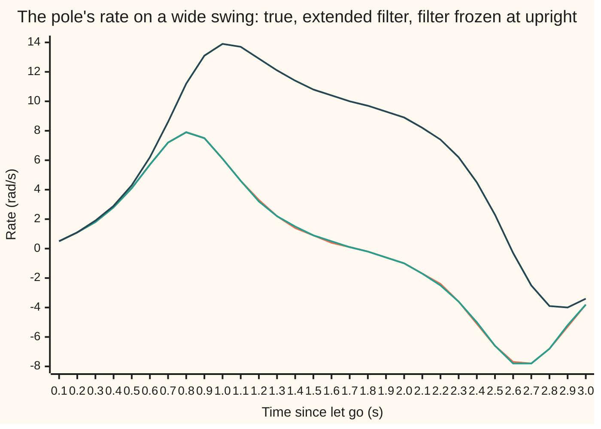

# Filtering a nonlinear plant: relinearise each step, or push sample points through

[Syllabus](../../../SYLLABUS.md) → [Engineering mathematics](../README.md) → [State Space and Optimal Control](../README.md#s04) → Filtering a nonlinear plant

---

## General Overview

The balancing cart from [The Kalman filter](07-kalman-filter.md) has stopped. Its pole, 0.613125 m long, is let go from rest 0.3 rad (17.188734°) from upright. It falls, sweeps through the bottom 0.8 s later at 7.9 rad/s, stalls near the top of the far side at about 1.7 s, and falls back. The same encoder reads the angle 100 times a second, off by about 0.005 rad. The rate must be inferred.

The last card's filter was built for a pole near upright. Its model has gravity's pull growing in a straight line with the angle, without limit. On this swing its rate is off by 7.8751 rad/s on a typical step, while it claims 0.0314 rad/s. Its surprises give it away: squared, they average 6260.062 times the variance it predicted.

Two repairs keep the predict-and-correct rhythm and fix only the prediction. The **extended filter** redraws the straight-line model at every step, at the current guess, so the line touches the true curve where the pole is. The **unscented filter** draws no line: it runs five sample points with the belief's centre and spread through the true model and measures where they land. Both are off by 0.0308 rad/s and claim 0.0310. They part ways only when the belief is wide, as after the encoder goes quiet for 2.5 s.

**A nonlinear plant can be filtered by carrying a bell-curve belief through each step approximately, either along the model's tangent at the current guess (extended) or by pushing a few points with the right centre and spread through the model itself (unscented), and the filter's own surprises show whether the approximation still holds.**

**What kind of fact this is:** a method, not a theorem. Both filters reduce to the Kalman filter, and are exact, when the model is linear. Otherwise they are approximations whose quality has to be measured, as this card does. The pendulum equation and the noise sizes are assumptions about the rig.

### The picture: one swing, two filters



Orange: the true rate, peaking at 7.9 rad/s through the bottom and swinging back to −7.8 rad/s. Green: the extended filter, on top of the orange line at this scale; the unscented filter would sit there too. Dark blue: the last card's filter, linear about upright. Its straight-line gravity drives it to 13.9 rad/s at 1.0 s, when the real pole is slowing at 6.1 rad/s. One simulated run (seed 1), every tenth of a second.

---

## The formula

Notation first, in words. The state is the angle $\theta$ (theta), measured from upright in radians, and the rate $\omega$ (omega), in radians per second. Step $k$ is the $k$-th tick of the 100 hertz clock, $\Delta t = 0.01$ s apart. As on [The Kalman filter](07-kalman-filter.md), a hat means "the filter's estimate of", a raised minus means "before this step's reading", $P$ is the covariance (the matrix of variances and co-variances) of the estimate's error, and a raised T turns rows into columns. $E[\,\cdot\,]$ is an average over the belief.

A normal law is the bell-shaped spread of random errors. The sd (standard deviation) is a spread's typical error size. The rms (root mean square) is the typical size of actual errors: the square root of their average square.

The model is the full pendulum, with gravity's pull growing as the sine of the angle, plus a random push $w$. Here $\ddot\theta$ is the angle's acceleration, the rate of change of $\omega$:

$$\ddot\theta = \frac{g}{l}\sin\theta + w, \qquad \frac{g}{l} = 16\ \text{s}^{-2}.$$

Write $f$ for one 0.01 s step of this equation without the push, computed by RK4 (the fourth-order Runge–Kutta method, from [Runge-Kutta four](../../08-Differential%20equations%20and%20dynamics/05-Numerical%20Evolution/04-runge-kutta-four.md)). The encoder reads $y_k = \theta_k + v_k$: still linear in the state.

**Extended filter, predict:**

$$\hat x_k^- = f(\hat x_{k-1}), \qquad P_k^- = F_k\,P_{k-1}\,F_k^T + Q, \qquad F_k = e^{A\,\Delta t},\quad A = \begin{pmatrix} 0 & 1 \\ \kappa_k & 0 \end{pmatrix},\quad \kappa_k = 16\cos\hat\theta_{k-1}.$$

**Unscented filter, predict.** With $n = 2$ states, take $2n+1 = 5$ sigma points (sample points matching the belief): the centre, and the centre plus and minus $\sqrt{3}$ times each column $L_i$ of a square root of $P$ (a matrix $L$ with $L L^T = P$):

$$\chi_0 = \hat x_{k-1}, \qquad \chi_{\pm i} = \hat x_{k-1} \pm \sqrt{3}\,L_i, \qquad W_0 = \tfrac13,\quad W_{\pm i} = \tfrac16,$$

$$\hat x_k^- = \sum_m W_m\, f(\chi_m), \qquad P_k^- = \sum_m W_m\,\big(f(\chi_m) - \hat x_k^-\big)\big(f(\chi_m) - \hat x_k^-\big)^T + Q ,$$

the sums running over all five points $m$.

**Both, correct:** the last card's correction, unchanged: surprise $\nu_k = y_k - \hat\theta_k^-$, its variance $S_k = P^-_{k,\theta\theta} + R$ (the predicted angle variance plus the encoder's), gain $K_k$ = first column of $P_k^-$ over $S_k$, then $\hat x_k = \hat x_k^- + K_k \nu_k$ and $P_k = (I - K_k H) P_k^-$, where `H = [1, 0]` picks out the angle and $I$ is the identity matrix.

**Read it aloud:** move the centre with the true model; move the spread either by the model's slope at the centre (extended) or by running five well-placed points through the model and measuring their spread (unscented); then correct by the surprise as before.

| Symbol | Plain meaning | In our example | Push it up and the answer… |
| --- | --- | --- | --- |
| $\theta$, $\omega$ | angle from upright (rad); its rate (rad/s), never measured | let go at 0.3 rad, rate 0 | — |
| $g/l$, $g$, $l$ | gravity over pole length; gravity; length | 16 s⁻²; 9.81 m/s²; 0.613125 m | a faster, wilder swing |
| $f$, $\Delta t$, $k$ | one step of the full nonlinear model; the step length; the step count | RK4 in four slices; 0.01 s; step 1 is the first reading | — |
| $\hat x$, $P$ | estimate of $(\theta, \omega)$ and the covariance of its error; a raised minus means before the reading | settled rate sd 0.0310 rad/s | — |
| $F_k$, $A$, $\kappa_k$, $c$, $s$ | slope matrix of one step at the estimate; slope of the continuous model; gravity's slope $16\cos\hat\theta$; the two series inside $F_k$ | κ = 15.285384 s⁻² at the start | larger κ: errors grow faster in a step |
| $Q$, $w$ | covariance of one step's random push; the push | push sd 1 rad/s² held for a step | the gain rises: readings count more |
| $y_k$, $R$, $v$ | the encoder reading; its noise variance; the noise | $y_1$ = 0.287734 rad; 0.005 squared | the gain falls: readings count less |
| $\nu_k$, $S_k$ | surprise: reading minus predicted angle; its predicted variance | ν²/S averages 0.998 | — |
| $K_k$, $H$, $I$ | gain; `H = [1, 0]` picks the angle out of the state; the matrix that changes nothing | step 1: 0.990211 on angle | — |
| $\chi_m$, $W_m$, $L$, $L_i$ | sigma points; their weights; a square root of $P$; its column $i$ | five points, weights 1/3 and 1/6 | — |
| $n$ | number of states; the spread factor is 3 whatever $n$ is, and equals $n + 1$ only because $n = 2$ | 2 | — |
| $\mu$, $\sigma_\theta$, $z$, $E$ | a belief's centre angle and its standard deviation, in the wide-belief test; the offset $\theta - \mu$; an average over the belief | π/2; 0.5 rad (28.647890°) | larger $\sigma_\theta$: the tangent's mean drifts further off |

### When it holds

- **The belief is narrow compared with the model's bend.** Gravity's slope $16\cos\theta$ changes over about a radian. At 100 readings a second the angle estimate is good to 0.0021 rad and both filters are excellent. After 2.5 s blind it is radians wide. Even on the 274 runs where the pole fell back, the extended filter claims 0.342 rad while missing by 0.810 rad, and 0.091 of its returns land beyond 3 claimed sd.
- **One bell curve can describe the belief.** If some possible poles tip over the top and others fall back, the belief has two humps. Neither filter can say that: both miss the 26 runs of 300 that tipped, by about 10 rad.
- **$Q$ covers what the model leaves out:** the random pushes and the approximation's own error. Set 100 times too small, the filter's squared surprises average 2.295 times their claimed variance.
- **The step is integrated accurately.** The code's RK4 conserves the swing's energy to six decimals over 3 s. A crude step would make the model itself drift.

---

## Why it works

### Step 0: only the prediction needs fixing

The exact filter is the forward recursion of [Hidden Markov models](../../11-Stochastic%20processes%20and%20calculus/03-Markov%20Chains/08-hidden-markov-models.md): carry the whole belief curve, push it through the model, weight it by the reading. With a few hidden states that is a sum. With two real numbers it is an integral over a curved model, too costly at 100 hertz.

The Kalman filter carries just a centre and a covariance, exact for a linear model. The correction here is linear (the encoder reads $\theta$ plus noise), so it stays. Only the prediction through $\sin\theta$ must be approximated, and the two filters are two ways to do it.

### Step 1: the extended filter redraws the tangent at every step

Linearising ([Linearisation](02-linearisation-about-an-equilibrium.md)) replaces a model by its tangent: a small input error moves the output by $F$ times that error, $F$ being the matrix of slopes. An error with covariance $P$ then has covariance $F P F^T$ after the step. The extended filter linearises at the current estimate, every step, not once at an equilibrium. The centre still moves by the true $f$.

The slope of the continuous model at angle $\hat\theta$ is $A = $ `[[0, 1], [κ, 0]]` with $\kappa = 16\cos\hat\theta$. The matrix exponential $e^{A\Delta t}$ carries the linear model forward by $\Delta t$ ([The matrix exponential](../../08-Differential%20equations%20and%20dynamics/04-Systems%20and%20the%20Matrix%20Exponential/04-the-matrix-exponential.md)). Because $A^2 = \kappa I$, it splits into two short series, $c = 1 + \kappa\Delta t^2/2 + \dots$ and $s = \Delta t + \kappa\Delta t^3/6 + \dots$, with $F = $ `[[c, s], [κ s, c]]`. Along one swing the slope matrix changes completely:

| Where the pole is | κ (s⁻²) | Slope matrix $F$ over 0.01 s | What it says about errors |
| --- | --- | --- | --- |
| upright | +16 | `[[1.000800, …], [0.160043, 1.000800]]` (cosh and sinh of 0.04) | they grow: the last card's matrix |
| horizontal | 0 | `[[1, 0.010000], [0.000000, 1]]` | they coast: an angle error does not change the rate |
| bottom | −16 | `[[0.999200, …], [−0.159957, 0.999200]]` (cos and sin of 0.04) | they circle: hanging is stable |

The frozen filter uses the first row everywhere; through the bottom it has even the sign of κ wrong.

The extended filter takes κ at the start of each step. The code checks that against the actual RK4 step's slope, found by nudging the input. At the bottom both give −0.159957. At horizontal the actual step gives −0.000043, not 0, because the angle moves during the step: the approximation's size at 100 hertz.

### Step 2: what any tangent misses

The average of a curved function is not the function of the average. For an angle with a normal spread $\sigma_\theta$ about $\mu$,

$$E[\sin\theta] = e^{-\sigma_\theta^2/2}\,\sin\mu .$$

To see it, write $\theta = \mu + z$ with $z$ normal, centre 0, spread $\sigma_\theta$. Then $\sin\theta = \sin\mu\cos z + \cos\mu\sin z$. The average of $\sin z$ is 0 by symmetry, and the average of $\cos z$ is $e^{-\sigma_\theta^2/2}$, a standard normal integral (complete the square). The tangent gives $\sin\mu$: right to first order, wrong by a term in $\sigma_\theta^2$.

Take the pole horizontal, $\mu = \pi/2$, with $\sigma_\theta = 0.5$ rad. Gravity's push $16\sin\theta$ averages 14.119950 rad/s²; 200,000 random draws give 14.118600. The tangent says 16.000000, with spread 0.000000, because the sine is flat at its peak. The true spread is 2.502583.

### Step 3: the unscented filter pushes points instead

The five points have exactly the belief's centre and covariance. The weights sum to 1, the $\pm$ pairs cancel in the mean, and each pair adds $2 \times \tfrac16 \times 3\,L_i L_i^T = L_i L_i^T$ to the spread, which sums to $L L^T = P$. So for a linear $f$ the unscented filter is the Kalman filter.

For a curved $f$, expand it in a Taylor series about the centre: a sum of powers of the offset from the centre. The mean picks up each power of the offsets, weighted by the points' moments (weighted averages of the offset's powers). Along the angle the points' second moment is $2 \times \tfrac16 \times 3\sigma_\theta^2 = \sigma_\theta^2$ and their fourth is $2 \times \tfrac16 \times 9\sigma_\theta^4 = 3\sigma_\theta^4$, both a normal law's.

In general the fourth moment is the spread factor times $\sigma_\theta^4$, so matching a normal law needs a spread factor of exactly 3 whatever the number of states; it equals $n + 1$ here only because $n = 2$. For a function of the angle alone the mean is then right through the fourth-order term; the tangent stops at the first.

The horizontal pole, by hand:

| Point | Angle | Push $16\sin\theta$ (rad/s²) | Weight |
| --- | --- | --- | --- |
| centre | π/2 | 16 | 1/3 |
| angle ± √3 × 0.5 | π/2 ± 0.866025 | 10.365750 each | 1/6 each |
| rate ± (the rate does not change the push) | π/2 | 16 each | 1/6 each |
| **mean** | | 16 × 2/3 + 10.365750 × 1/3 = **14.121917** | |

Exact: 14.119950. The spread comes out 2.656011 against 2.502583, close but not exact. No derivative was taken; the model was evaluated five times.

### Step 4: the surprises still test the filter

A right filter's surprises, each divided by $\sqrt{S}$, square to 1 on average and are uncorrelated step to step ([The Kalman filter](07-kalman-filter.md)). The test needs no truth. For a nonlinear filter it is the main tool, because $P$ is only the approximation's claim.

**Divergence** is that claim parting from the real error, and it shows as squared surprises far above 1. The lag-1 correlation (each surprise against the one before) says which way the tuning is off:

- **Positive correlation, squared surprises above 1:** the filter is sluggish and overconfident. Raise $Q$.
- **Positive correlation, squared surprises far below 1:** sluggish and too humble about its readings. Lower $R$.
- **Negative correlation:** the filter chases noise and overshoots. Lower $Q$.

---

## Worked numbers, by hand

Step 1 of the extended filter, from the belief "angle 0.3 rad give or take 0.05, rate 0 give or take 0.5 rad/s", uncorrelated, with the last card's $Q$.

| Step | Arithmetic | Value |
| --- | --- | --- |
| gravity's slope κ | 16 cos 0.3 | 15.285384 s⁻² |
| slope matrix, diagonal $c$ | 1 + 15.285384 × 0.01² / 2 | 1.000764 |
| slope matrix, angle per rate $s$ | 0.01 + 15.285384 × 0.01³ / 6 | 0.010003 s |
| slope matrix, rate per angle | 15.285384 × 0.010003 | 0.152893 s⁻¹ |
| predicted angle | 0.3 + ½ × 16 sin 0.3 × 0.01² (RK4 agrees) | 0.300236 rad |
| predicted rate | RK4: about 0.01 × 16 sin 0.3, a hair more as the pole leans | 0.047295 rad/s |
| predicted angle variance | 1.000764² × 0.05² + 0.010003² × 0.5² + (0.00005)² | 0.002529 |
| predicted angle-rate covariance | 1.000764 × 0.152893 × 0.05² + 0.010003 × 1.000764 × 0.5² + 0.00005 × 0.01 | 0.002886 |
| surprise variance $S$ | 0.002529 + 0.005² | 0.002554 |
| gain on angle | 0.002529 / 0.002554 | 0.990211 |
| gain on rate | 0.002886 / 0.002554 | 1.129896 s⁻¹ |
| reading $y_1$ | from the run (seed 1) | 0.287734 rad |
| angle estimate | 0.300236 + 0.990211 × (0.287734 − 0.300236) | 0.287857 rad |
| **rate estimate** | 0.047295 + 1.129896 × (0.287734 − 0.300236) | **0.033169 rad/s** |

The reading came in 0.012502 rad below the prediction. The filter moves the angle almost all the way to it, and lowers the rate: a pole lower than predicted was probably moving more slowly. Against the last card's step 1, the spread arithmetic changes only through κ, 15.285384 instead of 16; the centre now starts at 0.3 rad and moves by the true sine.

### What breaks if you drop a piece

Each row runs on the same 300 simulated swings of 3 s, scored from 0.5 s on. The extended filter: rate error 0.0308 rad/s, claimed 0.0310, squared surprises 0.998 of their predicted size, lag-1 correlation −0.002. The unscented filter matches every printed digit.

| Mistake | Comes out at | What went wrong |
| --- | --- | --- |
| Use the last card's filter, linear about upright | rate error 7.8751 rad/s, claiming 0.0314; surprises 6260.062, correlated +0.999 | Its gravity grows without limit: it diverges |
| Tell the filter $Q$ is 100 times smaller | 0.0470, claiming 0.0063; surprises 2.295, correlated +0.562 | Overconfident in its model, it lags |
| Tell the filter $R$ is 100 times larger | 0.0470, claiming 0.0634; surprises 0.023, correlated +0.563 | Distrusts the encoder: the same lag |
| Tell the filter $Q$ is 100 times larger | 0.0896, claiming 0.1644; surprises 0.843, correlated −0.174 | Chases each noisy reading and overshoots |

Rows two and three have the same error and correlation because they have the same ratio of $Q$ to $R$. Once the start belief is forgotten, the gain depends only on that ratio, so the estimates are the same. The overall scale changes only how large $P$ claims the error is: 10 times apart in claimed sd, about 100 times in squared surprise. That is why only the size of the surprises tells them apart.

Retuning row two shows the rule of Step 4 at work. Its surprises are too big and positively correlated, so raise $Q$. Tenfold, to $Q$/10: squared surprises 1.240, correlation +0.192, rate error 0.0361 rad/s. Tenfold again, back to the true $Q$: 0.998, −0.002 and 0.0308 rad/s.

---

## When the readings stop

The puzzle: both filters track the swing equally well, so why carry five points? The answer shows when the belief gets wide. In the code the encoder goes quiet 0.5 s after let-go; both filters predict blind until one reading comes back. "Misses by" is the rms surprise of that reading; "claims" is the spread the filter predicted for it.

| Blind for, which runs | Runs | Extended: misses by / claims | Unscented: misses by / claims | Returns beyond 3 claimed sd, extended / unscented |
| --- | --- | --- | --- | --- |
| 1.0 s, all | 300 | 0.065 / 0.064 rad | 0.065 / 0.066 rad | 0.003 / 0.003 |
| 2.5 s, all | 300 | 3.155 / 0.343 rad | 3.060 / 2.949 rad | 0.170 / 0.057 |
| 2.5 s, tipped over the top | 26 | 10.389 / 0.351 rad | 9.973 / 3.080 rad | 1.000 / 0.654 |
| 2.5 s, not tipped (fell back) | 274 | 0.810 / 0.342 rad | 0.902 / 2.936 rad | 0.091 / 0.000 |

After 1.0 s both claims are honest. During the 2.5 s spell the pole passes near the top of the far side, at about 1.7 s, where a small difference in speed decides whether it stalls or tips over; 26 of the 300 runs went over.

The two claims part late, not at the stall. Each filter's claimed angle sd against the real rms angle error, in radians, over all 300 runs, while still blind:

| Time | 1.7 s | 2.3 s | 2.5 s | 2.9 s |
| --- | --- | --- | --- | --- |
| extended | 0.138 / 0.139 | 1.190 / 1.181 | 1.526 / 1.876 | 0.546 / 2.991 |
| unscented | 0.140 / 0.139 | 1.147 / 1.175 | 1.650 / 1.817 | 2.661 / 2.857 |

Through the stall and up to about 2.3 s, both claims grow with the real spread and match it. After about 2.4 s the runs that tipped run on over the top, while the rest, and both filters' centres, swing back down through the bottom. There the extended filter's tangent is the hanging pendulum's, which turns angle error into rate error (Step 1's table: "they circle"). So its claimed angle spread shrinks, to 0.546 rad by 2.9 s, while the real spread keeps growing.

The unscented filter's points, radians apart, ride the true curve at different speeds, so its claim keeps growing too.

Miss against claim, in radians, on the 274 runs that fell back, after 2.5 s blind:

```
extended    misses  ████████                          0.810
            claims  ███                               0.342
unscented   misses  █████████                         0.902
            claims  █████████████████████████████     2.936
```

Read run by run, neither filter wins. On the runs that fell back, neither is lost, and the extended filter is the closer, but it is overconfident in the tails: 0.091 of its returns land beyond 3 claimed sd.

The unscented filter claims about 2.9 rad on every run, tipped or not. Its overall claim, 2.949 rad against a 3.060 rad miss, is honest only on average: about three times too wide on the runs that fell back, too narrow on the runs that tipped.

Both filters miss the 26 tipped runs by about 10 rad, and neither claim marks them out. The real belief has two humps, poles that fell back and poles that went over, and one bell curve cannot hold it. The five points buy an honest claim on average, not an honest claim for each run.

---

## Code, from first principles, and it actually runs

The script steps the pendulum by RK4 and checks it conserves energy. It checks the slope matrix's series against cosh and sinh at upright, cos and sin at the bottom, and finite differences of the actual step. It checks the unscented push against the exact $16e^{-\sigma_\theta^2/2}$ and 200,000 random draws, and works step 1. Then it simulates 300 swings (SplitMix64 bits, Box–Muller normals) and scores seven filter settings and two dropouts, splitting the long dropout by whether the pole tipped over. Five roads: series against closed forms and finite differences; unscented against exact and random; actual errors against $P$; the surprise test; the two filters against each other.

### Python

```python
# Extended and unscented filters on a pole swung far from upright -- the check behind the card.  Standard library only.
# Roads: the step's slope matrix by series, by closed form and by finite differences; the unscented step against
# the exact mean of a sine and against 200,000 random draws; every filter scored against simulated truth.
import math
DT, GL = 0.01, 16.0                 # 100 hertz; g/l (per s^2) for a pole 9.81/16 = 0.613125 m long
SA, SR = 1.0, 0.005                 # random angular acceleration sd (rad/s^2); encoder sd (rad)
TH0, P0 = 0.3, [[0.05 ** 2, 0.0], [0.0, 0.5 ** 2]]      # let go 0.3 rad from upright; the filter's start belief
gv = [DT * DT / 2, DT]              # what a held angular acceleration of 1 rad/s^2 adds in one step
Q = [[SA * SA * gv[i] * gv[j] for j in range(2)] for i in range(2)]
R, M64 = SR * SR, (1 << 64) - 1

class Rng:                                       # SplitMix64 bits, Box-Muller normals
    def __init__(s, seed): s.s = seed
    def u(s):
        s.s = (s.s + 0x9E3779B97F4A7C15) & M64
        z = ((s.s ^ (s.s >> 30)) * 0xBF58476D1CE4E5B9) & M64
        z = ((z ^ (z >> 27)) * 0x94D049BB133111EB) & M64
        return ((z ^ (z >> 31)) >> 11) / 2.0 ** 53
    def n(s):
        a = 1.0 - s.u()
        return math.sqrt(-2.0 * math.log(a)) * math.cos(2.0 * math.pi * s.u())
def f(x):                                        # one 0.01 s step of theta'' = 16 sin(theta): RK4 in 4 slices
    th, om, h = x[0], x[1], DT / 4
    for _ in range(4):
        a1, b1 = om, GL * math.sin(th)
        a2, b2 = om + h / 2 * b1, GL * math.sin(th + h / 2 * a1)
        a3, b3 = om + h / 2 * b2, GL * math.sin(th + h / 2 * a2)
        a4, b4 = om + h * b3, GL * math.sin(th + h * a3)
        th, om = th + h / 6 * (a1 + 2 * a2 + 2 * a3 + a4), om + h / 6 * (b1 + 2 * b2 + 2 * b3 + b4)
    return [th, om]
def jac(th, k=None):                             # e^(A dt), A = [[0, 1], [k, 0]], k = 16 cos(theta): A^2 = k I
    k = GL * math.cos(th) if k is None else k
    c = s = 0.0; t = 1.0
    for m in range(8):
        c += t; s += t * DT / (2 * m + 1); t *= k * DT * DT / ((2 * m + 1) * (2 * m + 2))
    return [[c, s], [k * s, c]]
def fpf(F, P, q):
    FP = [[F[i][0] * P[0][j] + F[i][1] * P[1][j] for j in range(2)] for i in range(2)]
    return [[FP[i][0] * F[j][0] + FP[i][1] * F[j][1] + q * Q[i][j] for j in range(2)] for i in range(2)]
def sigma(x, P):                                 # 2n + 1 = 5 points, n + kappa = 3: weights 1/3, then 1/6 each
    a = math.sqrt(P[0][0]); b = P[1][0] / a; c = math.sqrt(max(P[1][1] - b * b, 0.0)); r3 = math.sqrt(3.0)
    pts = [x, [x[0] + r3 * a, x[1] + r3 * b], [x[0] - r3 * a, x[1] - r3 * b], [x[0], x[1] + r3 * c], [x[0], x[1] - r3 * c]]
    return pts, [1 / 3, 1 / 6, 1 / 6, 1 / 6, 1 / 6]
def predict(kind, x, P, q):
    if kind == "ekf": return f(x), fpf(jac(x[0]), P, q)     # move the centre exactly; slope matrix at the centre
    if kind == "lin":                                        # last card's filter: slope matrix frozen at upright
        F = jac(0.0); return [F[0][0] * x[0] + F[0][1] * x[1], F[1][0] * x[0] + F[1][1] * x[1]], fpf(F, P, q)
    pts, w = sigma(x, P); ys = [f(p) for p in pts]           # unscented: push the five points, refit
    m = [sum(w[j] * ys[j][i] for j in range(5)) for i in range(2)]
    return m, [[sum(w[j] * (ys[j][i] - m[i]) * (ys[j][l] - m[l]) for j in range(5)) + q * Q[i][l] for l in range(2)] for i in range(2)]
def correct(x, P, y, rr=1.0):                    # the encoder reads the angle: the last card's correction
    S = P[0][0] + rr * R; K = [P[0][0] / S, P[1][0] / S]; nu = y - x[0]
    Pn = [[P[0][0] - K[0] * P[0][0], P[0][1] - K[0] * P[0][1]], [P[1][0] - K[1] * P[0][0], P[1][1] - K[1] * P[0][1]]]
    return [x[0] + K[0] * nu, x[1] + K[1] * nu], Pn, nu, S, K
def run(seed, steps, variants, blind=()):         # variants: (kind, Q factor, R factor); blind: steps with no reading
    r = Rng(seed); t = [TH0, 0.0]
    est = [([TH0, 0.0], [row[:] for row in P0]) for _ in variants]; out = []
    for k in range(1, steps + 1):
        w = SA * r.n(); t = f(t); t = [t[0] + gv[0] * w, t[1] + gv[1] * w]; y = t[0] + SR * r.n(); rec = []
        for i, (kind, q, rr) in enumerate(variants):
            x, P = predict(kind, est[i][0], est[i][1], q); nu = S = None
            if k not in blind: x, P, nu, S, _ = correct(x, P, y, rr)
            est[i] = (x, P); rec.append((x, P, nu, S))
        out.append((t, y, rec))
    return out
def show(rows):
    for label, v in rows: print(f"{label:<44} {v:>12.6f}")
# ---- the slope matrix three ways, and the integrator's energy drift ----
def fd(x, e=1e-6):                               # finite differences of the actual step, column by column
    up, dn = [f([x[0] + e * (i == 0), x[1] + e * (i == 1)]) for i in range(2)], [f([x[0] - e * (i == 0), x[1] - e * (i == 1)]) for i in range(2)]
    return [[(up[j][i] - dn[j][i]) / (2 * e) for j in range(2)] for i in range(2)]
Fup, Fbot, Fhor, Fd_bot, Fd_hor = jac(0.0), jac(math.pi), jac(math.pi / 2), fd([math.pi, 0.0]), fd([math.pi / 2, 0.0])
x = [TH0, 0.0]
for _ in range(300): x = f(x)
drift = abs(x[1] ** 2 / 2 + GL * math.cos(x[0]) - GL * math.cos(TH0))
show([("pole length l = 9.81 / 16 (m)", 9.81 / GL), ("start angle 0.3 rad in degrees", math.degrees(TH0)), ("wide belief sd 0.5 rad in degrees", math.degrees(0.5)),
      ("slope at upright, cosh 0.04", Fup[0][0]), ("  4 sinh 0.04 (per s)", Fup[1][0]), ("slope at bottom, cos 0.04", Fbot[0][0]),
      ("  -4 sin 0.04 (per s)", Fbot[1][0]), ("  by finite differences", Fd_bot[1][0]), ("slope at horizontal, angle per rate (s)", Fhor[0][1]),
      ("  rate per angle (per s)", Fhor[1][0]), ("  by finite differences", Fd_hor[1][0]), ("energy drift over 3 s, no noise (per s^2)", drift)])
# ---- one extended step by hand, from the start belief ----
xp, Pp = predict("ekf", [TH0, 0.0], P0, 1.0); F1 = jac(TH0)
y1 = run(1, 1, [("ekf", 1, 1)])[0][1]; x1, P1, nu1, S1, K1 = correct(xp, Pp, y1)
show([("step 1: k = 16 cos 0.3 (per s^2)", GL * math.cos(TH0)), ("step 1: slope, diagonal", F1[0][0]), ("step 1: slope, angle per rate (s)", F1[0][1]),
      ("step 1: slope, rate per angle (per s)", F1[1][0]), ("step 1: predicted angle (rad)", xp[0]), ("step 1: predicted rate (rad/s)", xp[1]),
      ("step 1: predicted angle var", Pp[0][0]), ("step 1: predicted covariance", Pp[0][1]), ("step 1: reading (rad)", y1), ("step 1: S", S1),
      ("step 1: gain on angle", K1[0]), ("step 1: gain on rate (per s)", K1[1]), ("step 1: angle estimate (rad)", x1[0]), ("step 1: rate estimate (rad/s)", x1[1])])
# ---- a wide belief at the horizontal pole: gravity's push 16 sin(theta), angle sd 0.5 rad ----
SD = 0.5; pts, w = sigma([math.pi / 2, 0.0], [[SD * SD, 0.0], [0.0, 0.01]])
pu = [GL * math.sin(p[0]) for p in pts]; mu = sum(a * b for a, b in zip(w, pu))
sdu = math.sqrt(sum(a * (b - mu) ** 2 for a, b in zip(w, pu)))
ex, exsd = GL * math.exp(-SD * SD / 2), GL * (1 - math.exp(-SD * SD)) / math.sqrt(2)
r = Rng(7); mc = [GL * math.sin(math.pi / 2 + SD * r.n()) for _ in range(200000)]
mcm = sum(mc) / len(mc); mcsd = math.sqrt(sum((v - mcm) ** 2 for v in mc) / len(mc))
show([("wide belief: sigma point angle offset (rad)", math.sqrt(3) * SD), ("  push at the offset points", pu[1]), ("  push, unscented mean", mu),
      ("  push, exact mean 16 exp(-sd^2/2)", ex), ("  push, 200000 draws", mcm), ("  push, extended (tangent) mean", GL), ("  sd, unscented", sdu),
      ("  sd, exact", exsd), ("  sd, 200000 draws", mcsd), ("  sd, extended (tangent)", abs(GL * math.cos(math.pi / 2)) * SD)])
# ---- 300 runs of 3 s at 100 hertz, scored from 0.5 s on ----
VAR = [("ekf", 1, 1), ("ukf", 1, 1), ("lin", 1, 1), ("ekf", 0.01, 1), ("ekf", 0.1, 1), ("ekf", 100, 1), ("ekf", 1, 100)]
NAMES = ["extended filter", "unscented filter", "frozen at upright", "extended, Q / 100", "extended, Q / 10", "extended, Q x 100", "extended, R x 100"]
acc = [[0.0] * 5 for _ in VAR]; n = 0
for seed in range(1, 301):
    out = run(seed, 300, VAR)
    for k in range(50, 300):
        t, _, rec = out[k]; n += 1
        for i, (x, P, nu, S) in enumerate(rec):
            z, zp = nu / math.sqrt(S), out[k - 1][2][i][2] / math.sqrt(out[k - 1][2][i][3])
            a = acc[i]; a[0] += (x[0] - t[0]) ** 2; a[1] += (x[1] - t[1]) ** 2; a[2] += z * z; a[3] += z * zp; a[4] += P[1][1]
st = [(math.sqrt(a[0] / n), math.sqrt(a[1] / n), a[2] / n, a[3] / a[2], math.sqrt(a[4] / n)) for a in acc]
for nm, (ea, er, nis, c1, cl) in zip(NAMES, st):
    print(f"{nm:<19} angle rms {ea:.4f}  rate rms {er:.4f}  claimed {cl:.4f}  surprise^2/S {nis:8.3f}  lag-1 {c1:+.3f}")
# ---- the encoder drops out after 0.5 s; one reading comes back; runs split by whether the pole tipped over ----
drop, tl = {}, [[0.0] * 8 for _ in range(2)]     # drop[blind, group, filter]: runs, beyond 3 sd, sum nu^2, sum S; tl: at 1.7, 2.3, 2.5, 2.9 s
for D in (100, 250):
    for seed in range(1, 301):
        out = run(seed, 50 + D, VAR[:2], blind=range(51, 50 + D)); tip = any(not 0 < o[0][0] < 2 * math.pi for o in out)
        for i, (x, P, nu, S) in enumerate(out[-1][2]):
            for g in ("all", "tipped" if tip else "not tipped"):
                a = drop.setdefault((D, g, i), [0, 0, 0.0, 0.0]); a[0] += 1; a[1] += nu * nu > 9 * S; a[2] += nu * nu; a[3] += S
            for j, k in enumerate((169, 229, 249, 289) if D == 250 else ()): o = out[k]; tl[i][2 * j] += o[2][i][1][0][0]; tl[i][2 * j + 1] += (o[2][i][0][0] - o[0][0]) ** 2
ms = {key: (math.sqrt(a[2] / a[0]), math.sqrt(a[3] / a[0]), a[1] / a[0]) for key, a in drop.items()}   # miss rms, claimed, beyond 3 sd
for D, g in ((100, "all"), (250, "all"), (250, "tipped"), (250, "not tipped")):
    print(f"blind {D / 100:.1f} s, {g:<10} {drop[D, g, 0][0]:3d} runs" + "".join(f"  {NAMES[i].split()[0]}: miss rms {ms[D, g, i][0]:6.3f} rad, claimed {ms[D, g, i][1]:.3f} rad, beyond 3 sd {ms[D, g, i][2]:.3f}" for i in range(2)))
for i in range(2): print(f"blind 2.5 s, {NAMES[i].split()[0]:<9} claimed / real angle sd (rad) at 1.7, 2.3, 2.5, 2.9 s" + "".join(f"  {math.sqrt(tl[i][j] / 300):.3f} / {math.sqrt(tl[i][j + 1] / 300):.3f}" for j in range(0, 8, 2)))
# ---- one run (seed 1) for the chart: every 0.1 s ----
story = run(1, 300, VAR[:3])
for lab, g in [("chart, time (s)", lambda o, k: (k + 1) * DT), ("chart, true rate", lambda o, k: o[0][1]),
               ("chart, extended rate", lambda o, k: o[2][0][0][1]), ("chart, frozen rate", lambda o, k: o[2][2][0][1])]:
    print(f"{lab:<21}" + " ".join(f"{g(story[k], k):5.1f}" for k in range(9, 300, 10)))
E = [[math.cosh(0.04), math.sinh(0.04) / 4], [4 * math.sinh(0.04), math.cosh(0.04)]]
assert max(abs(Fup[i][j] - E[i][j]) for i in range(2) for j in range(2)) < 1e-14, "series vs cosh-sinh at upright"
assert abs(Fbot[1][0] + 4 * math.sin(0.04)) < 1e-14 and abs(Fd_bot[1][0] - Fbot[1][0]) < 1e-8, "slope at bottom: closed form, finite differences"
assert abs(Fd_hor[1][0] - Fhor[1][0]) < 1e-4 and drift < 1e-6, "frozen slope near the step's own; RK4 keeps energy"
assert abs(xp[0] - (TH0 + GL * math.sin(TH0) * DT * DT / 2)) < 1e-6, "predicted angle vs the hand formula"
assert abs(mu - ex) < 0.01 and abs(mcm - ex) < 4 * exsd / math.sqrt(2e5) and abs(sdu / exsd - 1) < 0.1, "unscented vs exact vs draws"
assert abs(st[0][1] / st[0][4] - 1) < 0.03 and abs(st[0][2] - 1) < 0.015 and abs(st[0][3]) < 0.01, "extended filter is honest"
assert abs(st[1][1] / st[0][1] - 1) < 0.01 and st[2][2] > 100, "unscented agrees; frozen filter diverges"
assert st[3][2] > st[4][2] > st[0][2] and st[3][3] > 0.3 and st[6][2] < 0.1 and st[6][3] > 0.3 and st[5][3] < -0.1, "mis-tuning shows in the surprises"
assert ms[100, "all", 0][2] < 0.02 and all(ms[250, "tipped", i][0] > 2 * math.pi and ms[250, "tipped", i][1] < 1.25 * ms[250, "not tipped", i][1] for i in range(2)), "both miss the tipped runs; neither claim marks them"
assert ms[250, "not tipped", 0][0] < ms[250, "not tipped", 1][0] < ms[250, "not tipped", 1][1] / 2 and all(abs(tl[i][2] / tl[i][3] - 1) < 0.2 for i in range(2)) and 9 * tl[0][6] < tl[0][7], "untipped runs; when the claims part"
print("ALL CHECKS PASS")
```

**Ran 2026-11-11 on macOS, Python 3.14.10, standard library only. All checks passed. Output, pasted from the run:**

```
pole length l = 9.81 / 16 (m)                    0.613125
start angle 0.3 rad in degrees                  17.188734
wide belief sd 0.5 rad in degrees               28.647890
slope at upright, cosh 0.04                      1.000800
  4 sinh 0.04 (per s)                            0.160043
slope at bottom, cos 0.04                        0.999200
  -4 sin 0.04 (per s)                           -0.159957
  by finite differences                         -0.159957
slope at horizontal, angle per rate (s)          0.010000
  rate per angle (per s)                         0.000000
  by finite differences                         -0.000043
energy drift over 3 s, no noise (per s^2)        0.000000
step 1: k = 16 cos 0.3 (per s^2)                15.285384
step 1: slope, diagonal                          1.000764
step 1: slope, angle per rate (s)                0.010003
step 1: slope, rate per angle (per s)            0.152893
step 1: predicted angle (rad)                    0.300236
step 1: predicted rate (rad/s)                   0.047295
step 1: predicted angle var                      0.002529
step 1: predicted covariance                     0.002886
step 1: reading (rad)                            0.287734
step 1: S                                        0.002554
step 1: gain on angle                            0.990211
step 1: gain on rate (per s)                     1.129896
step 1: angle estimate (rad)                     0.287857
step 1: rate estimate (rad/s)                    0.033169
wide belief: sigma point angle offset (rad)      0.866025
  push at the offset points                     10.365750
  push, unscented mean                          14.121917
  push, exact mean 16 exp(-sd^2/2)              14.119950
  push, 200000 draws                            14.118600
  push, extended (tangent) mean                 16.000000
  sd, unscented                                  2.656011
  sd, exact                                      2.502583
  sd, 200000 draws                               2.507797
  sd, extended (tangent)                         0.000000
extended filter     angle rms 0.0021  rate rms 0.0308  claimed 0.0310  surprise^2/S    0.998  lag-1 -0.002
unscented filter    angle rms 0.0021  rate rms 0.0308  claimed 0.0310  surprise^2/S    0.998  lag-1 -0.002
frozen at upright   angle rms 0.3565  rate rms 7.8751  claimed 0.0314  surprise^2/S 6260.062  lag-1 +0.999
extended, Q / 100   angle rms 0.0056  rate rms 0.0470  claimed 0.0063  surprise^2/S    2.295  lag-1 +0.562
extended, Q / 10    angle rms 0.0028  rate rms 0.0361  claimed 0.0135  surprise^2/S    1.240  lag-1 +0.192
extended, Q x 100   angle rms 0.0031  rate rms 0.0896  claimed 0.1644  surprise^2/S    0.843  lag-1 -0.174
extended, R x 100   angle rms 0.0056  rate rms 0.0470  claimed 0.0634  surprise^2/S    0.023  lag-1 +0.563
blind 1.0 s, all        300 runs  extended: miss rms  0.065 rad, claimed 0.064 rad, beyond 3 sd 0.003  unscented: miss rms  0.065 rad, claimed 0.066 rad, beyond 3 sd 0.003
blind 2.5 s, all        300 runs  extended: miss rms  3.155 rad, claimed 0.343 rad, beyond 3 sd 0.170  unscented: miss rms  3.060 rad, claimed 2.949 rad, beyond 3 sd 0.057
blind 2.5 s, tipped      26 runs  extended: miss rms 10.389 rad, claimed 0.351 rad, beyond 3 sd 1.000  unscented: miss rms  9.973 rad, claimed 3.080 rad, beyond 3 sd 0.654
blind 2.5 s, not tipped 274 runs  extended: miss rms  0.810 rad, claimed 0.342 rad, beyond 3 sd 0.091  unscented: miss rms  0.902 rad, claimed 2.936 rad, beyond 3 sd 0.000
blind 2.5 s, extended  claimed / real angle sd (rad) at 1.7, 2.3, 2.5, 2.9 s  0.138 / 0.139  1.190 / 1.181  1.526 / 1.876  0.546 / 2.991
blind 2.5 s, unscented claimed / real angle sd (rad) at 1.7, 2.3, 2.5, 2.9 s  0.140 / 0.139  1.147 / 1.175  1.650 / 1.817  2.661 / 2.857
chart, time (s)        0.1   0.2   0.3   0.4   0.5   0.6   0.7   0.8   0.9   1.0   1.1   1.2   1.3   1.4   1.5   1.6   1.7   1.8   1.9   2.0   2.1   2.2   2.3   2.4   2.5   2.6   2.7   2.8   2.9   3.0
chart, true rate       0.5   1.1   1.8   2.8   4.1   5.7   7.2   7.9   7.5   6.1   4.6   3.3   2.2   1.4   0.9   0.4   0.1  -0.2  -0.6  -1.0  -1.7  -2.4  -3.6  -5.1  -6.6  -7.7  -7.8  -6.8  -5.3  -3.8
chart, extended rate   0.5   1.1   1.8   2.8   4.1   5.7   7.2   7.9   7.5   6.1   4.6   3.2   2.2   1.5   0.9   0.5   0.1  -0.2  -0.6  -1.0  -1.7  -2.5  -3.6  -5.0  -6.6  -7.8  -7.8  -6.8  -5.2  -3.8
chart, frozen rate     0.5   1.1   1.9   2.9   4.3   6.2   8.6  11.2  13.1  13.9  13.7  12.9  12.1  11.4  10.8  10.4  10.0   9.7   9.3   8.9   8.2   7.4   6.2   4.5   2.3  -0.3  -2.5  -3.9  -4.0  -3.4
ALL CHECKS PASS
```

### Rust

```rust
// Extended and unscented filters on a pole swung far from upright -- the check behind the card.  std only.
// Roads: the step's slope matrix by series, by closed form and by finite differences; the unscented step against
// the exact mean of a sine and against 200,000 random draws; every filter scored against simulated truth.
use std::f64::consts::PI;
const DT: f64 = 0.01; const GL: f64 = 16.0;  // 100 hertz; g/l (per s^2) for a pole 9.81/16 = 0.613125 m long
const SA: f64 = 1.0; const SR: f64 = 0.005;  // random angular acceleration sd (rad/s^2); encoder sd (rad)
const TH0: f64 = 0.3;                        // let go 0.3 rad from upright
type V = [f64; 2]; type M = [[f64; 2]; 2];
const P0: M = [[0.05 * 0.05, 0.0], [0.0, 0.5 * 0.5]]; // the filter's start belief
const GV: V = [DT * DT / 2.0, DT]; // what a held angular acceleration of 1 rad/s^2 adds in one step
const R: f64 = SR * SR;

struct Rng(u64); // SplitMix64 bits, Box-Muller normals
impl Rng {
    fn u(&mut self) -> f64 {
        self.0 = self.0.wrapping_add(0x9E3779B97F4A7C15);
        let mut z = (self.0 ^ (self.0 >> 30)).wrapping_mul(0xBF58476D1CE4E5B9);
        z = (z ^ (z >> 27)).wrapping_mul(0x94D049BB133111EB);
        ((z ^ (z >> 31)) >> 11) as f64 / 9007199254740992.0
    }
    fn n(&mut self) -> f64 { let a = 1.0 - self.u(); (-2.0 * a.ln()).sqrt() * (2.0 * PI * self.u()).cos() }
}
fn q(i: usize, j: usize) -> f64 { SA * SA * GV[i] * GV[j] }
fn f(x: V) -> V { // one 0.01 s step of theta'' = 16 sin(theta): RK4 in 4 slices
    let (mut th, mut om, h) = (x[0], x[1], DT / 4.0);
    for _ in 0..4 {
        let (a1, b1) = (om, GL * th.sin());
        let (a2, b2) = (om + h / 2.0 * b1, GL * (th + h / 2.0 * a1).sin());
        let (a3, b3) = (om + h / 2.0 * b2, GL * (th + h / 2.0 * a2).sin());
        let (a4, b4) = (om + h * b3, GL * (th + h * a3).sin());
        th += h / 6.0 * (a1 + 2.0 * a2 + 2.0 * a3 + a4); om += h / 6.0 * (b1 + 2.0 * b2 + 2.0 * b3 + b4);
    }
    [th, om]
}
fn jac(th: f64) -> M { // e^(A dt), A = [[0, 1], [k, 0]], k = 16 cos(theta): A^2 = k I
    let k = GL * th.cos();
    let (mut c, mut s, mut t) = (0.0, 0.0, 1.0);
    for m in 0..8 { let m = m as f64; c += t; s += t * DT / (2.0 * m + 1.0); t *= k * DT * DT / ((2.0 * m + 1.0) * (2.0 * m + 2.0)); }
    [[c, s], [k * s, c]]
}
fn fpf(f: &M, p: &M, qf: f64) -> M {
    let (mut fp, mut o) = ([[0.0; 2]; 2], [[0.0; 2]; 2]);
    for i in 0..2 { for j in 0..2 { fp[i][j] = f[i][0] * p[0][j] + f[i][1] * p[1][j]; } }
    for i in 0..2 { for j in 0..2 { o[i][j] = fp[i][0] * f[j][0] + fp[i][1] * f[j][1] + qf * q(i, j); } }
    o
}
fn sigma(x: V, p: &M) -> ([V; 5], [f64; 5]) { // 2n + 1 = 5 points, n + kappa = 3: weights 1/3, then 1/6 each
    let a = p[0][0].sqrt(); let b = p[1][0] / a; let c = (p[1][1] - b * b).max(0.0).sqrt(); let r3 = 3f64.sqrt();
    ([x, [x[0] + r3 * a, x[1] + r3 * b], [x[0] - r3 * a, x[1] - r3 * b], [x[0], x[1] + r3 * c], [x[0], x[1] - r3 * c]],
     [1.0 / 3.0, 1.0 / 6.0, 1.0 / 6.0, 1.0 / 6.0, 1.0 / 6.0])
}
fn predict(kind: u8, x: V, p: &M, qf: f64) -> (V, M) {
    if kind == 0 { return (f(x), fpf(&jac(x[0]), p, qf)); } // extended: centre moved exactly, slope at the centre
    if kind == 2 { let fm = jac(0.0); return ([fm[0][0] * x[0] + fm[0][1] * x[1], fm[1][0] * x[0] + fm[1][1] * x[1]], fpf(&fm, p, qf)); }
    let (pts, w) = sigma(x, p); // unscented: push the five points, refit
    let ys: Vec<V> = pts.iter().map(|&pt| f(pt)).collect();
    let (mut m, mut o) = ([0.0; 2], [[0.0; 2]; 2]);
    for i in 0..2 { for j in 0..5 { m[i] += w[j] * ys[j][i]; } }
    for i in 0..2 { for l in 0..2 { for j in 0..5 { o[i][l] += w[j] * (ys[j][i] - m[i]) * (ys[j][l] - m[l]); } o[i][l] += qf * q(i, l); } }
    (m, o)
}
fn correct(x: V, p: &M, y: f64, rr: f64) -> (V, M, f64, f64, V) { // the encoder reads the angle
    let s = p[0][0] + rr * R; let k = [p[0][0] / s, p[1][0] / s]; let nu = y - x[0];
    let pn = [[p[0][0] - k[0] * p[0][0], p[0][1] - k[0] * p[0][1]], [p[1][0] - k[1] * p[0][0], p[1][1] - k[1] * p[0][1]]];
    ([x[0] + k[0] * nu, x[1] + k[1] * nu], pn, nu, s, k)
}
type Rec = (V, M, f64, f64);
fn run(seed: u64, steps: usize, vars: &[(u8, f64, f64)], blind: (usize, usize)) -> Vec<(V, f64, Vec<Rec>)> {
    let (mut r, mut t, mut out) = (Rng(seed), [TH0, 0.0], Vec::new());
    let mut est: Vec<(V, M)> = vars.iter().map(|_| ([TH0, 0.0], P0)).collect();
    for k in 1..=steps {
        let w = SA * r.n(); t = f(t); t = [t[0] + GV[0] * w, t[1] + GV[1] * w];
        let (y, mut rec) = (t[0] + SR * r.n(), Vec::new());
        for (i, &(kind, qf, rr)) in vars.iter().enumerate() {
            let (mut x, mut p) = predict(kind, est[i].0, &est[i].1, qf);
            let (mut nu, mut s) = (f64::NAN, f64::NAN);
            if !(blind.0 <= k && k < blind.1) { let c = correct(x, &p, y, rr); x = c.0; p = c.1; nu = c.2; s = c.3; }
            est[i] = (x, p); rec.push((x, p, nu, s));
        }
        out.push((t, y, rec));
    }
    out
}
fn show(rows: &[(&str, f64)]) { for (l, v) in rows { println!("{:<44} {:>12.6}", l, v); } }
fn fd(x: V) -> M { // finite differences of the actual step, column by column
    let (e, mut o) = (1e-6, [[0.0; 2]; 2]);
    for j in 0..2 { let (mut a, mut b) = (x, x); a[j] += e; b[j] -= e; let (u, d) = (f(a), f(b)); for i in 0..2 { o[i][j] = (u[i] - d[i]) / (2.0 * e); } }
    o
}
fn main() {
    let (fup, fbot, fhor, fd_bot, fd_hor) = (jac(0.0), jac(PI), jac(PI / 2.0), fd([PI, 0.0]), fd([PI / 2.0, 0.0]));
    let mut x = [TH0, 0.0]; for _ in 0..300 { x = f(x); }
    let drift = (x[1] * x[1] / 2.0 + GL * x[0].cos() - GL * TH0.cos()).abs();
    show(&[("pole length l = 9.81 / 16 (m)", 9.81 / GL), ("start angle 0.3 rad in degrees", TH0.to_degrees()), ("wide belief sd 0.5 rad in degrees", 0.5f64.to_degrees()),
        ("slope at upright, cosh 0.04", fup[0][0]), ("  4 sinh 0.04 (per s)", fup[1][0]), ("slope at bottom, cos 0.04", fbot[0][0]),
        ("  -4 sin 0.04 (per s)", fbot[1][0]), ("  by finite differences", fd_bot[1][0]), ("slope at horizontal, angle per rate (s)", fhor[0][1]),
        ("  rate per angle (per s)", fhor[1][0]), ("  by finite differences", fd_hor[1][0]), ("energy drift over 3 s, no noise (per s^2)", drift)]);
    // ---- one extended step by hand, from the start belief ----
    let (xp, pp) = predict(0, [TH0, 0.0], &P0, 1.0); let f1 = jac(TH0);
    let y1 = run(1, 1, &[(0, 1.0, 1.0)], (0, 0))[0].1;
    let (x1, _p1, _nu1, s1, k1) = correct(xp, &pp, y1, 1.0);
    show(&[("step 1: k = 16 cos 0.3 (per s^2)", GL * TH0.cos()), ("step 1: slope, diagonal", f1[0][0]), ("step 1: slope, angle per rate (s)", f1[0][1]),
        ("step 1: slope, rate per angle (per s)", f1[1][0]), ("step 1: predicted angle (rad)", xp[0]), ("step 1: predicted rate (rad/s)", xp[1]),
        ("step 1: predicted angle var", pp[0][0]), ("step 1: predicted covariance", pp[0][1]), ("step 1: reading (rad)", y1), ("step 1: S", s1),
        ("step 1: gain on angle", k1[0]), ("step 1: gain on rate (per s)", k1[1]), ("step 1: angle estimate (rad)", x1[0]), ("step 1: rate estimate (rad/s)", x1[1])]);
    // ---- a wide belief at the horizontal pole: gravity's push 16 sin(theta), angle sd 0.5 rad ----
    let sd = 0.5; let (pts, w) = sigma([PI / 2.0, 0.0], &[[sd * sd, 0.0], [0.0, 0.01]]);
    let pu: Vec<f64> = pts.iter().map(|p| GL * p[0].sin()).collect();
    let mu: f64 = (0..5).map(|j| w[j] * pu[j]).sum();
    let sdu = (0..5).map(|j| w[j] * (pu[j] - mu).powi(2)).sum::<f64>().sqrt();
    let (ex, exsd) = (GL * (-sd * sd / 2.0).exp(), GL * (1.0 - (-sd * sd).exp()) / 2f64.sqrt());
    let mut r = Rng(7); let mc: Vec<f64> = (0..200000).map(|_| GL * (PI / 2.0 + sd * r.n()).sin()).collect();
    let mcm = mc.iter().sum::<f64>() / mc.len() as f64;
    let mcsd = (mc.iter().map(|v| (v - mcm).powi(2)).sum::<f64>() / mc.len() as f64).sqrt();
    show(&[("wide belief: sigma point angle offset (rad)", 3f64.sqrt() * sd), ("  push at the offset points", pu[1]), ("  push, unscented mean", mu),
        ("  push, exact mean 16 exp(-sd^2/2)", ex), ("  push, 200000 draws", mcm), ("  push, extended (tangent) mean", GL), ("  sd, unscented", sdu),
        ("  sd, exact", exsd), ("  sd, 200000 draws", mcsd), ("  sd, extended (tangent)", (GL * (PI / 2.0).cos()).abs() * sd)]);
    // ---- 300 runs of 3 s at 100 hertz, scored from 0.5 s on ----
    let vars = [(0u8, 1.0, 1.0), (1, 1.0, 1.0), (2, 1.0, 1.0), (0, 0.01, 1.0), (0, 0.1, 1.0), (0, 100.0, 1.0), (0, 1.0, 100.0)];
    let names = ["extended filter", "unscented filter", "frozen at upright", "extended, Q / 100", "extended, Q / 10", "extended, Q x 100", "extended, R x 100"];
    let (mut acc, mut n) = ([[0.0f64; 5]; 7], 0.0);
    for seed in 1..=300u64 {
        let out = run(seed, 300, &vars, (0, 0));
        for k in 50..300 {
            let (t, _, rec) = &out[k]; n += 1.0;
            for (i, (x, p, nu, s)) in rec.iter().enumerate() {
                let (z, zp) = (nu / s.sqrt(), out[k - 1].2[i].2 / out[k - 1].2[i].3.sqrt());
                let a = &mut acc[i]; a[0] += (x[0] - t[0]).powi(2); a[1] += (x[1] - t[1]).powi(2); a[2] += z * z; a[3] += z * zp; a[4] += p[1][1];
            }
        }
    }
    let st: Vec<[f64; 5]> = acc.iter().map(|a| [(a[0] / n).sqrt(), (a[1] / n).sqrt(), a[2] / n, a[3] / a[2], (a[4] / n).sqrt()]).collect();
    for (nm, s) in names.iter().zip(&st) { println!("{:<19} angle rms {:.4}  rate rms {:.4}  claimed {:.4}  surprise^2/S {:8.3}  lag-1 {:+.3}", nm, s[0], s[1], s[4], s[2], s[3]); }
    // ---- the encoder drops out after 0.5 s; one reading comes back; runs split by whether the pole tipped over ----
    let (mut drop, mut tl) = ([[[0.0f64; 4]; 2]; 6], [[0.0f64; 8]; 2]); // drop[3 x blind + all / tipped / not tipped][filter]; tl: at 1.7, 2.3, 2.5, 2.9 s
    for (di, &d) in [100usize, 250].iter().enumerate() {
        for seed in 1..=300u64 {
            let out = run(seed, 50 + d, &vars[..2], (51, 50 + d)); let tip = out.iter().any(|o| !(0.0 < o.0[0] && o.0[0] < 2.0 * PI));
            for (i, (_, _, nu, s)) in out.last().unwrap().2.iter().enumerate() {
                for g in [3 * di, 3 * di + if tip { 1 } else { 2 }] { let a = &mut drop[g][i]; a[0] += 1.0; if nu * nu > 9.0 * s { a[1] += 1.0; } a[2] += nu * nu; a[3] += s; }
                if d == 250 { for (j, &k) in [169usize, 229, 249, 289].iter().enumerate() { tl[i][2 * j] += out[k].2[i].1[0][0]; tl[i][2 * j + 1] += (out[k].2[i].0[0] - out[k].0[0]).powi(2); } }
            }
        }
    }
    let ms = |g: usize, i: usize| { let a = drop[g][i]; [(a[2] / a[0]).sqrt(), (a[3] / a[0]).sqrt(), a[1] / a[0]] }; // miss rms, claimed, beyond 3 sd
    for (g, d, lab) in [(0, 1.0, "all"), (3, 2.5, "all"), (4, 2.5, "tipped"), (5, 2.5, "not tipped")] { println!("blind {:.1} s, {:<10} {:3} runs{}", d, lab, drop[g][0][0] as usize, (0..2).map(|i| format!("  {}: miss rms {:6.3} rad, claimed {:.3} rad, beyond 3 sd {:.3}", names[i].split(' ').next().unwrap(), ms(g, i)[0], ms(g, i)[1], ms(g, i)[2])).collect::<String>()); }
    for i in 0..2 { println!("blind 2.5 s, {:<9} claimed / real angle sd (rad) at 1.7, 2.3, 2.5, 2.9 s{}", names[i].split(' ').next().unwrap(), (0..8).step_by(2).map(|j| format!("  {:.3} / {:.3}", (tl[i][j] / 300.0).sqrt(), (tl[i][j + 1] / 300.0).sqrt())).collect::<String>()); }
    // ---- one run (seed 1) for the chart: every 0.1 s ----
    let story = run(1, 300, &vars[..3], (0, 0));
    let line = |lab: &str, g: &dyn Fn(usize) -> f64| {
        let v: Vec<String> = (9..300).step_by(10).map(|k| format!("{:5.1}", g(k))).collect();
        println!("{:<21}{}", lab, v.join(" "));
    };
    line("chart, time (s)", &|k| (k + 1) as f64 * DT);
    line("chart, true rate", &|k| story[k].0[1]);
    line("chart, extended rate", &|k| story[k].2[0].0[1]);
    line("chart, frozen rate", &|k| story[k].2[2].0[1]);
    let e = [[0.04f64.cosh(), 0.04f64.sinh() / 4.0], [4.0 * 0.04f64.sinh(), 0.04f64.cosh()]];
    assert!((0..4).all(|m| (fup[m / 2][m % 2] - e[m / 2][m % 2]).abs() < 1e-14), "series vs cosh-sinh at upright");
    assert!((fbot[1][0] + 4.0 * 0.04f64.sin()).abs() < 1e-14 && (fd_bot[1][0] - fbot[1][0]).abs() < 1e-8, "slope at bottom");
    assert!((fd_hor[1][0] - fhor[1][0]).abs() < 1e-4 && drift < 1e-6, "frozen slope near the step's own; RK4 keeps energy");
    assert!((xp[0] - (TH0 + GL * TH0.sin() * DT * DT / 2.0)).abs() < 1e-6, "predicted angle vs the hand formula");
    assert!((mu - ex).abs() < 0.01 && (mcm - ex).abs() < 4.0 * exsd / 2e5f64.sqrt() && (sdu / exsd - 1.0).abs() < 0.1, "unscented vs exact vs draws");
    assert!((st[0][1] / st[0][4] - 1.0).abs() < 0.03 && (st[0][2] - 1.0).abs() < 0.015 && st[0][3].abs() < 0.01, "extended filter is honest");
    assert!((st[1][1] / st[0][1] - 1.0).abs() < 0.01 && st[2][2] > 100.0, "unscented agrees; frozen filter diverges");
    assert!(st[3][2] > st[4][2] && st[4][2] > st[0][2] && st[3][3] > 0.3 && st[6][2] < 0.1 && st[6][3] > 0.3 && st[5][3] < -0.1, "mis-tuning shows in the surprises");
    assert!(ms(0, 0)[2] < 0.02 && (0..2).all(|i| ms(4, i)[0] > 2.0 * PI && ms(4, i)[1] < 1.25 * ms(5, i)[1]), "both miss the tipped runs; neither claim marks them");
    assert!(ms(5, 0)[0] < ms(5, 1)[0] && ms(5, 1)[0] < ms(5, 1)[1] / 2.0 && (0..2).all(|i| (tl[i][2] / tl[i][3] - 1.0).abs() < 0.2) && 9.0 * tl[0][6] < tl[0][7], "untipped runs; when the claims part");
    println!("ALL CHECKS PASS");
}
```

**Ran 2026-11-11 on macOS, rustc 1.98.1, no crates. All checks passed. Output, pasted from the run:**

```
pole length l = 9.81 / 16 (m)                    0.613125
start angle 0.3 rad in degrees                  17.188734
wide belief sd 0.5 rad in degrees               28.647890
slope at upright, cosh 0.04                      1.000800
  4 sinh 0.04 (per s)                            0.160043
slope at bottom, cos 0.04                        0.999200
  -4 sin 0.04 (per s)                           -0.159957
  by finite differences                         -0.159957
slope at horizontal, angle per rate (s)          0.010000
  rate per angle (per s)                         0.000000
  by finite differences                         -0.000043
energy drift over 3 s, no noise (per s^2)        0.000000
step 1: k = 16 cos 0.3 (per s^2)                15.285384
step 1: slope, diagonal                          1.000764
step 1: slope, angle per rate (s)                0.010003
step 1: slope, rate per angle (per s)            0.152893
step 1: predicted angle (rad)                    0.300236
step 1: predicted rate (rad/s)                   0.047295
step 1: predicted angle var                      0.002529
step 1: predicted covariance                     0.002886
step 1: reading (rad)                            0.287734
step 1: S                                        0.002554
step 1: gain on angle                            0.990211
step 1: gain on rate (per s)                     1.129896
step 1: angle estimate (rad)                     0.287857
step 1: rate estimate (rad/s)                    0.033169
wide belief: sigma point angle offset (rad)      0.866025
  push at the offset points                     10.365750
  push, unscented mean                          14.121917
  push, exact mean 16 exp(-sd^2/2)              14.119950
  push, 200000 draws                            14.118600
  push, extended (tangent) mean                 16.000000
  sd, unscented                                  2.656011
  sd, exact                                      2.502583
  sd, 200000 draws                               2.507797
  sd, extended (tangent)                         0.000000
extended filter     angle rms 0.0021  rate rms 0.0308  claimed 0.0310  surprise^2/S    0.998  lag-1 -0.002
unscented filter    angle rms 0.0021  rate rms 0.0308  claimed 0.0310  surprise^2/S    0.998  lag-1 -0.002
frozen at upright   angle rms 0.3565  rate rms 7.8751  claimed 0.0314  surprise^2/S 6260.062  lag-1 +0.999
extended, Q / 100   angle rms 0.0056  rate rms 0.0470  claimed 0.0063  surprise^2/S    2.295  lag-1 +0.562
extended, Q / 10    angle rms 0.0028  rate rms 0.0361  claimed 0.0135  surprise^2/S    1.240  lag-1 +0.192
extended, Q x 100   angle rms 0.0031  rate rms 0.0896  claimed 0.1644  surprise^2/S    0.843  lag-1 -0.174
extended, R x 100   angle rms 0.0056  rate rms 0.0470  claimed 0.0634  surprise^2/S    0.023  lag-1 +0.563
blind 1.0 s, all        300 runs  extended: miss rms  0.065 rad, claimed 0.064 rad, beyond 3 sd 0.003  unscented: miss rms  0.065 rad, claimed 0.066 rad, beyond 3 sd 0.003
blind 2.5 s, all        300 runs  extended: miss rms  3.155 rad, claimed 0.343 rad, beyond 3 sd 0.170  unscented: miss rms  3.060 rad, claimed 2.949 rad, beyond 3 sd 0.057
blind 2.5 s, tipped      26 runs  extended: miss rms 10.389 rad, claimed 0.351 rad, beyond 3 sd 1.000  unscented: miss rms  9.973 rad, claimed 3.080 rad, beyond 3 sd 0.654
blind 2.5 s, not tipped 274 runs  extended: miss rms  0.810 rad, claimed 0.342 rad, beyond 3 sd 0.091  unscented: miss rms  0.902 rad, claimed 2.936 rad, beyond 3 sd 0.000
blind 2.5 s, extended  claimed / real angle sd (rad) at 1.7, 2.3, 2.5, 2.9 s  0.138 / 0.139  1.190 / 1.181  1.526 / 1.876  0.546 / 2.991
blind 2.5 s, unscented claimed / real angle sd (rad) at 1.7, 2.3, 2.5, 2.9 s  0.140 / 0.139  1.147 / 1.175  1.650 / 1.817  2.661 / 2.857
chart, time (s)        0.1   0.2   0.3   0.4   0.5   0.6   0.7   0.8   0.9   1.0   1.1   1.2   1.3   1.4   1.5   1.6   1.7   1.8   1.9   2.0   2.1   2.2   2.3   2.4   2.5   2.6   2.7   2.8   2.9   3.0
chart, true rate       0.5   1.1   1.8   2.8   4.1   5.7   7.2   7.9   7.5   6.1   4.6   3.3   2.2   1.4   0.9   0.4   0.1  -0.2  -0.6  -1.0  -1.7  -2.4  -3.6  -5.1  -6.6  -7.7  -7.8  -6.8  -5.3  -3.8
chart, extended rate   0.5   1.1   1.8   2.8   4.1   5.7   7.2   7.9   7.5   6.1   4.6   3.2   2.2   1.5   0.9   0.5   0.1  -0.2  -0.6  -1.0  -1.7  -2.5  -3.6  -5.0  -6.6  -7.8  -7.8  -6.8  -5.2  -3.8
chart, frozen rate     0.5   1.1   1.9   2.9   4.3   6.2   8.6  11.2  13.1  13.9  13.7  12.9  12.1  11.4  10.8  10.4  10.0   9.7   9.3   8.9   8.2   7.4   6.2   4.5   2.3  -0.3  -2.5  -3.9  -4.0  -3.4
ALL CHECKS PASS
```

The two outputs match line for line, random runs included: both programs draw the same SplitMix64 bits.

### Lean

Lean proves the exact facts behind Steps 2 and 3, for every centre and every spread.

- Take an angle with a normal law, centre $\mu$ and sd $\sigma_\theta$. Then $E[\sin\theta] = e^{-\sigma_\theta^2/2}\sin\mu$, not the tangent's $\sin\mu$.
- Suppose a step is linear: $F$ times the state, plus a fixed shift, with $L L^T = P$. Then the five sigma points give exactly the Kalman filter's new centre and covariance $F P F^T$.
- Take any sum of powers of $\theta$ up to the fourth, with the points' angles laid out as in Step 3's table. Then their weighted mean equals its average over the normal law with centre $\mu$ and sd $\sigma_\theta$.

The simulated runs, the slope matrices' numbers, the RK4 step and every filter's accuracy are left to the Python and Rust checks.

```lean
-- Filtering a nonlinear plant: the average of sin θ over a normal belief is e^(-σ²/2) sin μ, not the tangent's sin μ, while the five unscented sample points reproduce a linear step's mean and covariance exactly and a normal law's averages of every polynomial in the angle up to degree four.
import Mathlib.Probability.Distributions.Gaussian.Real
import Mathlib.Analysis.SpecialFunctions.Trigonometric.Basic
import Mathlib.Analysis.SpecialFunctions.Pow.Real
import Mathlib.LinearAlgebra.Matrix.Notation
import Mathlib.Algebra.Polynomial.Eval.Defs
import Mathlib.Algebra.Polynomial.Degree.Defs
import Mathlib.Algebra.Polynomial.Eval.Degree
import Mathlib.Algebra.Polynomial.Degree.Lemmas

open MeasureTheory ProbabilityTheory Matrix
open scoped NNReal

/-- The card's five sigma points for a two-state belief with centre `x` and a square root `L`
of its covariance: the centre, then the centre plus and minus `√3` times each column of `L`. -/
noncomputable def sigmaPoints (x : Fin 2 → ℝ) (L : Matrix (Fin 2) (Fin 2) ℝ) : Fin 5 → Fin 2 → ℝ :=
  ![x,
    x + Real.sqrt 3 • (fun j => L j 0),
    x - Real.sqrt 3 • (fun j => L j 0),
    x + Real.sqrt 3 • (fun j => L j 1),
    x - Real.sqrt 3 • (fun j => L j 1)]

/-- The card's sigma-point weights: 1/3 on the centre, 1/6 on each of the other four. -/
noncomputable def sigmaWeights : Fin 5 → ℝ :=
  ![1 / 3, 1 / 6, 1 / 6, 1 / 6, 1 / 6]

lemma mgf_aux_hasDeriv (v t : ℝ) : HasDerivAt (fun t => Real.exp (v * t ^ 2 / 2))
    (v * t * Real.exp (v * t ^ 2 / 2)) t := by
  have h : HasDerivAt (fun t : ℝ => v * t ^ 2 / 2) (v * t) t := by
    have := ((hasDerivAt_pow 2 t).const_mul v).div_const 2
    convert this using 1; ring
  exact ((Real.hasDerivAt_exp _).comp t h).congr_deriv (by ring)

lemma gauss_moments (v : ℝ≥0) :
    ∫ x, x ^ 1 ∂gaussianReal 0 v = 0 ∧ ∫ x, x ^ 2 ∂gaussianReal 0 v = v ∧
    ∫ x, x ^ 3 ∂gaussianReal 0 v = 0 ∧ ∫ x, x ^ 4 ∂gaussianReal 0 v = 3 * (v : ℝ) ^ 2 := by
  have hm : ∀ n : ℕ, ∫ x, x ^ n ∂gaussianReal 0 v
      = iteratedDeriv n (fun t => Real.exp (v * t ^ 2 / 2)) 0 := by
    intro n
    have := iteratedDeriv_mgf_zero (X := fun x : ℝ => x) (μ := gaussianReal 0 v) (by simp) n
    rw [mgf_fun_id_gaussianReal] at this
    simp only [zero_mul, zero_add] at this
    rw [this]; rfl
  set f : ℝ → ℝ := fun t => Real.exp (v * t ^ 2 / 2) with hf
  have d1 : deriv f = fun t => v * t * f t := by
    funext t; exact (mgf_aux_hasDeriv v t).deriv
  have d2 : deriv (fun t => v * t * f t) = fun t => (v + v ^ 2 * t ^ 2) * f t := by
    funext t
    have h : HasDerivAt (fun t => v * t * f t) ((v + v ^ 2 * t ^ 2) * f t) t :=
      (((hasDerivAt_id t).const_mul (v:ℝ)).mul (mgf_aux_hasDeriv v t)).congr_deriv
        (by simp [f]; ring)
    exact h.deriv
  have d3 : deriv (fun t => (v + v ^ 2 * t ^ 2) * f t)
      = fun t => (3 * v ^ 2 * t + v ^ 3 * t ^ 3) * f t := by
    funext t
    have h : HasDerivAt (fun t => (v + v ^ 2 * t ^ 2) * f t)
        ((3 * v ^ 2 * t + v ^ 3 * t ^ 3) * f t) t :=
      ((((hasDerivAt_pow 2 t).const_mul ((v:ℝ)^2)).const_add (v:ℝ)).mul
        (mgf_aux_hasDeriv v t)).congr_deriv (by simp [f]; ring)
    exact h.deriv
  have d4 : deriv (fun t => (3 * v ^ 2 * t + v ^ 3 * t ^ 3) * f t) 0 = 3 * (v:ℝ) ^ 2 := by
    have h : HasDerivAt (fun t => (3 * v ^ 2 * t + v ^ 3 * t ^ 3) * f t) (3 * (v:ℝ) ^ 2) 0 :=
      ((((hasDerivAt_id (0:ℝ)).const_mul (3 * (v:ℝ)^2)).add
        ((hasDerivAt_pow 3 (0:ℝ)).const_mul ((v:ℝ)^3)))).mul
        (mgf_aux_hasDeriv v 0) |>.congr_deriv (by simp)
    exact h.deriv
  refine ⟨?_, ?_, ?_, ?_⟩
  · rw [hm, iteratedDeriv_one, d1]; simp
  · rw [hm, iteratedDeriv_succ, iteratedDeriv_one, d1, d2]; simp [f]
  · rw [hm, iteratedDeriv_succ, iteratedDeriv_succ, iteratedDeriv_one, d1, d2, d3]; simp
  · rw [hm, iteratedDeriv_succ, iteratedDeriv_succ, iteratedDeriv_succ, iteratedDeriv_one,
      d1, d2, d3, d4]

/-- What any tangent misses: if the angle `θ` has a normal law with centre `μ` and standard
deviation `σ`, then the average of `sin θ` is `e^(-σ²/2) sin μ`, not the tangent's `sin μ`. -/
theorem integral_sin_gaussianReal (μ : ℝ) (σ : ℝ≥0) :
    ∫ θ, Real.sin θ ∂(gaussianReal μ (σ ^ 2)) = Real.exp (-(σ : ℝ) ^ 2 / 2) * Real.sin μ := by
  have h := complexMGF_id_gaussianReal (μ := μ) (v := σ ^ 2) Complex.I
  unfold complexMGF at h
  have hint : Integrable (fun x : ℝ => Complex.exp (Complex.I * (id x : ℝ))) (gaussianReal μ (σ ^ 2)) := by
    refine Integrable.of_bound (C := 1) (by fun_prop) (Filter.Eventually.of_forall fun x => ?_)
    rw [mul_comm]; simp [Complex.norm_exp_ofReal_mul_I]
  have h3 : ∫ x, (Complex.exp (Complex.I * (id x : ℝ))).im ∂(gaussianReal μ (σ ^ 2))
      = (∫ x, Complex.exp (Complex.I * (id x : ℝ)) ∂(gaussianReal μ (σ ^ 2))).im :=
    integral_im hint
  have e1 : ∀ x : ℝ, (Complex.exp (Complex.I * (id x : ℝ))).im = Real.sin x := by
    intro x; rw [mul_comm]; simp [Complex.exp_ofReal_mul_I_im]
  simp_rw [e1] at h3
  have hc : (((σ ^ 2 : ℝ≥0) : ℝ) : ℂ) = (((σ : ℝ) ^ 2 : ℝ) : ℂ) := by push_cast; rfl
  rw [h3, h, hc, Complex.exp_im]
  set s : ℝ := (σ : ℝ) ^ 2 with hs
  have hre : (Complex.I * (μ : ℂ) + (s : ℂ) * Complex.I ^ 2 / 2).re = -s / 2 := by
    simp [Complex.I_sq]
  have him : (Complex.I * (μ : ℂ) + (s : ℂ) * Complex.I ^ 2 / 2).im = μ := by
    simp [Complex.I_sq]
  rw [hre, him]

/-- For a linear (affine) step `z ↦ F z + b`, the unscented filter is the Kalman filter:
pushing the five sigma points of a belief with centre `x` and covariance `P = L Lᵀ` through
the step and refitting with the weights 1/3, 1/6, 1/6, 1/6, 1/6 gives mean `F x + b` and
covariance `F P Fᵀ` exactly. -/
theorem unscented_exact_for_linear_step (x b : Fin 2 → ℝ) (F L P : Matrix (Fin 2) (Fin 2) ℝ)
    (hL : L * Lᵀ = P) :
    let y : Fin 5 → Fin 2 → ℝ := fun m => F *ᵥ sigmaPoints x L m + b
    let ybar : Fin 2 → ℝ := ∑ m, sigmaWeights m • y m
    ybar = F *ᵥ x + b ∧
      ∑ m, sigmaWeights m • vecMulVec (y m - ybar) (y m - ybar) = F * P * Fᵀ := by
  intro y ybar
  have h3 : Real.sqrt 3 ^ 2 = 3 := Real.sq_sqrt (by norm_num)
  have hbar : ybar = F *ᵥ x + b := by
    funext i
    simp only [ybar, y, Fin.sum_univ_five, sigmaPoints, sigmaWeights]
    simp [mulVec, dotProduct, Fin.sum_univ_two]
    ring
  refine ⟨hbar, ?_⟩
  rw [hbar, ← hL]
  ext i j
  simp only [y, Fin.sum_univ_five, sigmaPoints, sigmaWeights]
  fin_cases i <;> fin_cases j <;>
    simp [mulVec, dotProduct, Fin.sum_univ_two, vecMulVec_apply, Matrix.mul_apply] <;>
    ring_nf <;> rw [h3] <;> ring

/-- For a function of the angle alone, the unscented mean is right through the fourth-order
term: for every polynomial `p` of degree at most 4, the weighted average of `p` over the
sigma points' angles (`μ` with total weight 2/3, `μ ± √3 σ` with weight 1/6 each) equals the
average of `p θ` when `θ` has a normal law with centre `μ` and standard deviation `σ`. -/
theorem unscented_mean_exact_degree_le_four (p : Polynomial ℝ) (hp : p.natDegree ≤ 4)
    (μ : ℝ) (σ : ℝ≥0) :
    (2 / 3) * p.eval μ + (1 / 6) * p.eval (μ + Real.sqrt 3 * σ)
        + (1 / 6) * p.eval (μ - Real.sqrt 3 * σ)
      = ∫ θ, p.eval θ ∂(gaussianReal μ (σ ^ 2)) := by
  set q : Polynomial ℝ := p.comp (Polynomial.X + Polynomial.C μ) with hq
  have hqe : ∀ x, q.eval x = p.eval (x + μ) := by intro x; simp [q]
  have hqd : q.natDegree < 5 := by
    have hc := Polynomial.natDegree_comp_le (p := p) (q := Polynomial.X + Polynomial.C μ)
    have h1 : (Polynomial.X + Polynomial.C μ).natDegree ≤ 1 := by
      exact (Polynomial.natDegree_add_le _ _).trans (by simp)
    have hm : p.natDegree * (Polynomial.X + Polynomial.C μ).natDegree ≤ 4 :=
      (Nat.mul_le_mul hp h1).trans (by norm_num)
    rw [hq]; omega
  have hshift : ∫ θ, p.eval θ ∂(gaussianReal μ (σ ^ 2))
      = ∫ x, q.eval x ∂(gaussianReal 0 (σ ^ 2)) := by
    have hmap : (gaussianReal 0 (σ ^ 2)).map (fun x => x + μ) = gaussianReal μ (σ ^ 2) := by
      rw [gaussianReal_map_add_const]; simp
    rw [← hmap, integral_map (by fun_prop) (by fun_prop)]
    simp [hqe]
  have hev : ∀ x, q.eval x = q.coeff 0 + q.coeff 1 * x ^ 1 + q.coeff 2 * x ^ 2
      + q.coeff 3 * x ^ 3 + q.coeff 4 * x ^ 4 := by
    intro x
    rw [Polynomial.eval_eq_sum_range' hqd]
    simp [Finset.sum_range_succ]
  have hI : ∀ n : ℕ, Integrable (fun x : ℝ => x ^ n) (gaussianReal 0 (σ ^ 2)) := fun n =>
    integrable_pow_of_mem_interior_integrableExpSet (X := fun x : ℝ => x) (by simp) n
  obtain ⟨m1, m2, m3, m4⟩ := gauss_moments (σ ^ 2)
  have hR : ∫ x, q.eval x ∂(gaussianReal 0 (σ ^ 2))
      = q.coeff 0 + q.coeff 2 * (σ : ℝ) ^ 2 + q.coeff 4 * (3 * (σ : ℝ) ^ 4) := by
    simp_rw [hev]
    rw [integral_add (by fun_prop) ((hI 4).const_mul _), integral_add (by fun_prop) ((hI 3).const_mul _),
      integral_add (by fun_prop) ((hI 2).const_mul _), integral_add (by fun_prop) ((hI 1).const_mul _)]
    rw [integral_const_mul, integral_const_mul, integral_const_mul, integral_const_mul,
      m1, m2, m3, m4, integral_const]
    simp only [probReal_univ, smul_eq_mul, one_mul]
    push_cast; ring
  rw [hshift, hR]
  have e0 : p.eval μ = q.eval 0 := by rw [hqe]; simp
  have e1 : p.eval (μ + Real.sqrt 3 * σ) = q.eval (Real.sqrt 3 * σ) := by rw [hqe]; ring_nf
  have e2 : p.eval (μ - Real.sqrt 3 * σ) = q.eval (-(Real.sqrt 3 * σ)) := by rw [hqe]; ring_nf
  rw [e0, e1, e2, hev, hev, hev]
  have h3 : Real.sqrt 3 ^ 2 = 3 := Real.sq_sqrt (by norm_num)
  ring_nf
  rw [show Real.sqrt 3 ^ 4 = (Real.sqrt 3 ^ 2) ^ 2 by ring, h3]
  ring

-- The pole length: g / l = 16 with g = 9.81 m/s² and l = 0.613125 m.
example : ((981 : ℚ) / 100) / (613125 / 1000000) = 16 := by norm_num

-- The five weights sum to 1.
example : (1 / 3 : ℚ) + 4 * (1 / 6) = 1 := by norm_num

-- Along the angle, the points' second moment is σ² (2 × 1/6 × 3) and their fourth is
-- 3 σ⁴ (2 × 1/6 × 9), both a normal law's.
example : (2 : ℚ) * (1 / 6) * 3 = 1 := by norm_num
example : (2 : ℚ) * (1 / 6) * 9 = 3 := by norm_num

-- The continuous slope A = [[0, 1], [κ, 0]] squares to κ I, at upright (κ = 16) and at the
-- bottom (κ = -16).
example : !![(0 : ℤ), 1; 16, 0] * !![(0 : ℤ), 1; 16, 0] = !![(16 : ℤ), 0; 0, 16] := by decide
example : !![(0 : ℤ), 1; -16, 0] * !![(0 : ℤ), 1; -16, 0] = !![(-16 : ℤ), 0; 0, -16] := by decide

#print axioms mgf_aux_hasDeriv
#print axioms gauss_moments
#print axioms integral_sin_gaussianReal
#print axioms unscented_exact_for_linear_step
#print axioms unscented_mean_exact_degree_le_four
```

**Checked 2026-11-14 on macOS, Lean 4.36.0-rc2, Mathlib v4.36.0-rc2. Every proof is complete and uses only Lean's standard axioms. Output, pasted from the run:**

```
'mgf_aux_hasDeriv' depends on axioms: [propext, Classical.choice, Quot.sound]
'gauss_moments' depends on axioms: [propext, Classical.choice, Quot.sound]
'integral_sin_gaussianReal' depends on axioms: [propext, Classical.choice, Quot.sound]
'unscented_exact_for_linear_step' depends on axioms: [propext, Classical.choice, Quot.sound]
'unscented_mean_exact_degree_le_four' depends on axioms: [propext, Classical.choice, Quot.sound]
```

> [!TIP]
> **Try changing**
> Guess first, then run it.
> - **Guess first:** what if the extended filter's slope used the wrong function? In `jac`, change `math.cos(th)` to `math.sin(th)`. At upright the slope becomes zero, and the first assert, against cosh and sinh, stops it.
> - **Guess first:** does the spread factor 3 matter? In `sigma`, set `r3 = math.sqrt(2.0)`. The unscented mean of gravity's push drifts more than 0.01 from the exact 14.119950, and the assert on the wide belief stops it.
> - **Guess first:** what if the filter believes the encoder is twice as noisy as it is? In `correct`, change `rr * R` to `rr * R * 4`. The filter's surprises come out smaller than it claims, and the assert on its honesty fails.
> - **Guess first:** is the 2.5 s dropout result a fluke of these seeds? Change `range(1, 301)` in the dropout loop to `range(301, 601)`. About as many runs tip, both filters still miss them by more than a full turn, the extended filter is still the closer on the rest, and every assert still passes.

---

## The usual mistake

> [!warning]
> **Trusting $P$ because the estimate looks smooth.** In a nonlinear filter $P$ is the approximation's claim, and nothing forces it to be true. After 2.5 s blind, on the runs where the pole fell back, the extended filter claims 0.342 rad and misses by 0.810 rad; on the runs that tipped it still claims 0.351 rad and misses by 10.389 rad. The unscented filter's claim, about 2.9 rad on every run, is right only on average. Anything that reads $P$, a controller or a fault alarm, acts on a number that does not describe this run. Check the surprises instead.
>
> - **Reusing the last card's matrices.** Frozen at upright, the rate is off by 7.8751 rad/s while the filter claims 0.0314.
> - **Fixing lag by guessing.** $Q$ too small and $R$ too large both lag (+0.562, +0.563); the surprises' size, 2.295 or 0.023, says which knob.
> - **Assuming the unscented filter is always better.** At 100 readings a second both give 0.0308 rad/s.
> - **Expecting either to handle two possibilities.** After 2.5 s blind both miss the 26 tipped runs by about 10 rad, and 0.654 of the unscented filter's returns on those runs land beyond 3 claimed sd.

---

## Where you meet it in real life

- **Spacecraft navigation.** The extended filter was developed for the Apollo programme's navigation, relinearising orbital mechanics around each new estimate.
- **Drones and phones.** Orientation is nonlinear in any set of angles; flight controllers run extended or unscented filters on gyroscope and accelerometer readings.
- **Battery gauges.** Voltage is a curved function of state of charge; the gauge linearises it at its current guess, or samples it.
- **Robot localisation.** Ranges and bearings to landmarks are curved functions of position. A lost robot, whose belief has many humps, needs particle filters: many weighted samples, not one bell curve.

> **Say it back**
> A Kalman filter is exact only for a linear model, and a wide swing is far from linear. The extended filter redraws the model's tangent at every step, at the current estimate. The unscented filter pushes five points with the belief's centre and spread through the true model and measures where they land, which catches how the curve bends the mean. While the belief is narrow they agree; when it is wide, the extended filter's claim can shrink while the truth spreads. The surprises, squared over their claimed variance, show divergence and which covariance to retune.

---

## What this builds on

- [The Kalman filter](07-kalman-filter.md): the recursion, the gain and the surprise test, used unchanged except for predicting the spread.
- [Linearisation](02-linearisation-about-an-equilibrium.md): the tangent about an equilibrium; the extended filter takes it about a moving estimate.
- [Hidden Markov models](../../11-Stochastic%20processes%20and%20calculus/03-Markov%20Chains/08-hidden-markov-models.md): the exact filter, carrying a whole belief curve; this card's filters are its affordable approximation for a continuous state.

## Where this goes next

- [LQG](09-lqg-and-the-separation-principle.md): a regulator fed a filter's estimate; with a nonlinear plant an extended filter takes the Kalman filter's place, and the separation guarantee is no longer exact.
- [Predictive control](10-model-predictive-control.md): plans over a horizon from the current estimate, which on a swinging pole comes from a filter like these.

This card set $Q$ and $R$ by hand and checked them by the surprises; it leaves open how to estimate them, and the pole's length, from the readings while the filter runs, and how to carry a two-humped belief like the 2.5 s dropout's, which takes many weighted samples (a particle filter) instead of one bell curve.

---

## Sources

Verified 2026-11-11: every link below resolves to the publisher's page.

- Julier, S. J., J. K. Uhlmann, and H. F. Durrant-Whyte. "A New Method for the Nonlinear Transformation of Means and Covariances in Filters and Estimators." *IEEE Transactions on Automatic Control* 45, no. 3 (2000): 477–482. [doi:10.1109/9.847726](https://doi.org/10.1109/9.847726). The sigma points, the weights, and the spread factor 3 that matches a normal law's fourth moment.
- Julier, S. J., and J. K. Uhlmann. "Unscented Filtering and Nonlinear Estimation." *Proceedings of the IEEE* 92, no. 3 (2004): 401–422. [doi:10.1109/JPROC.2003.823141](https://doi.org/10.1109/JPROC.2003.823141). The unscented filter against the extended one, with Step 3's Taylor-series argument.
- Fitzgerald, R. J. "Divergence of the Kalman Filter." *IEEE Transactions on Automatic Control* 16, no. 6 (1971): 736–747. [doi:10.1109/TAC.1971.1099836](https://doi.org/10.1109/TAC.1971.1099836). How a filter's covariance parts from its real error, and how too small a $Q$ causes it.
- Bar-Shalom, Y., X.-R. Li, and T. Kirubarajan. *Estimation with Applications to Tracking and Navigation*. Wiley, 2001. [doi:10.1002/0471221279](https://doi.org/10.1002/0471221279). The extended filter in practice, and the normalised-surprise tests used to tune $Q$ and $R$.
- Simon, D. *Optimal State Estimation: Kalman, H Infinity, and Nonlinear Approaches*. Wiley, 2006. [doi:10.1002/0470045345](https://doi.org/10.1002/0470045345). A textbook route through the extended, unscented and particle filters.
