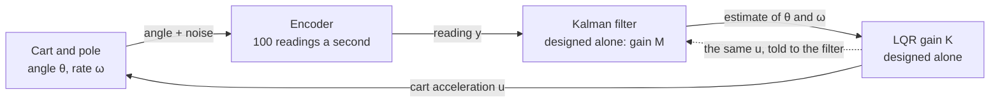
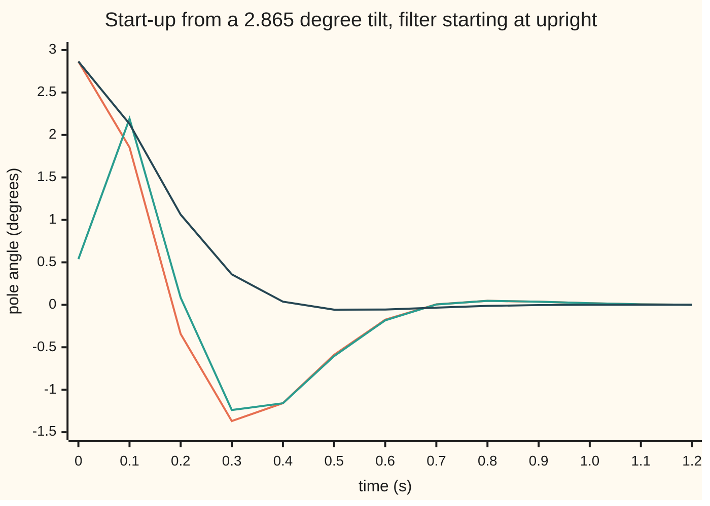

# LQG: design regulator and estimator apart, then bolt them together

[Syllabus](../../../SYLLABUS.md) → [Engineering mathematics](../README.md) → [State Space and Optimal Control](../README.md#s04) → LQG

---

## General Overview

A cart balances a pole upright, 0.613125 m long. One encoder at the pivot reads the pole's angle 100 times a second, and each reading is off by about 0.005 rad (0.2865°) of noise. Random shoves tip the pole about. The motor sets the cart's acceleration. Nothing measures how fast the pole is tipping.

Two earlier cards each solved half of this. [The LQR](06-linear-quadratic-regulator.md) found the best feedback gain, assuming the angle and its rate are known exactly. [The Kalman filter](07-kalman-filter.md) found the best estimate of both from the noisy angle readings. LQG (linear plant, quadratic price, Gaussian noise) joins them in the most naive way possible: feed the filter's estimate into the regulator's gain, unchanged, as if the estimate were the truth.

That naive join is the best controller there is for this problem. The joined loop has four poles (the numbers that set how fast each error dies away), and they are exactly the regulator's two plus the filter's two. Its average cost per tick (100 × angle² + 0.04 × acceleration², with the angle in radians and the cart's commanded acceleration in m/s²) is 8.2888 × 10⁻³, against 2.2729 × 10⁻³ if the rate could be seen directly; the gap is the price of looking through a noisy encoder. And there is a catch. The regulator alone keeps balancing with a motor anywhere from 0.1712 to 14.7138 times as strong as the model says. The joined loop survives only 0.3630 to 2.9189 times. Fit a motor three times stronger and the regulator alone would cope; the joined loop falls over.

**Design the best regulator as if the state were known, and the best estimator as if no one were steering, then feed the estimate into the gain: the loop's poles are the two designs' poles side by side and its cost is the best possible, but the regulator's safety margins do not come along.**

**What kind of fact this is:** a theorem, the separation principle: the poles are proved on this card in Why it works, and the optimal cost in outline, in a fold. The lost margins are a fact about this example, computed in the checks; that no margin is guaranteed in general is a published result, cited in Sources.

### The picture: two designs, one loop



The dotted arrow carries the whole trick. The filter is told exactly what the motor was asked to do, so the steering cancels out of the filter's own errors.

As on the Kalman filter card, the state here is the pole's angle and rate. The cart's position is left to an outer loop. The prices are the LQR card's for the angle and the motor (100 and 0.04), charged here per tick rather than per second. With the cart left out, the gain has two numbers instead of that card's four.

---

## The formula

Notation: the Kalman filter card writes the plant as $F$, $G$, $H$ and its gain as $K$. This card keeps the shelf's $A$, $B$, $C$, keeps $K$ for the regulator as the LQR card does, and calls the filter's settled gain $M$. The plant, one tick of 0.01 s at a time:

$$x_{k+1} = A\,x_k + B\,u_k + B\,d_k, \qquad y_k = C\,x_k + v_k.$$

The controller, two lines from the Kalman filter card and one from the LQR card:

$$\hat x_k = z_k + M\,(y_k - C z_k), \qquad u_k = -K\,\hat x_k, \qquad z_{k+1} = A\,\hat x_k + B\,u_k.$$

The separation principle, for the whole four-number loop:

$$\det\big(\lambda I - \Phi\big) \;=\; \det\big(\lambda I - (A - BK)\big)\;\cdot\;\det\big(\lambda I - A(I - MC)\big).$$

**Read it aloud:** the joined loop's poles are the regulator's poles together with the filter's poles, and nothing else.

Here $\Phi$ is the 4 × 4 matrix that steps the plant and the controller forward together (`F` in the code, where `G` and `H` are the loop's noise inputs and its command row, unrelated to the Kalman filter card's $F$, $G$, $H$), $\det(\lambda I - \cdot)$ is a matrix's characteristic polynomial, whose roots $\lambda$ are its poles, and $I$ is the identity matrix. The cost splits the same way:

$$J \;=\; \underbrace{\sigma_d^2\,B^{\mathsf T}PB}_{\text{if the state were seen}} \;+\; \underbrace{s\,K\,\Sigma\,K^{\mathsf T}}_{\text{price of the estimation error}}, \qquad s = R + B^{\mathsf T}PB.$$

**Read it aloud:** the average cost per tick is what the regulator would pay with perfect sight, plus the filter's leftover error, weighted by how hard the regulator would have pushed on it.

| Symbol | Plain meaning | In our example | Push it up and the answer… |
| --- | --- | --- | --- |
| $x_k$ | the state at tick $k$: angle $\theta$ from upright (rad) and rate $\omega$ (rad/s) | starts at 0.05 rad (2.865°) in the chart | — |
| $u_k$ | the cart's commanded acceleration, m/s² | rms 0.3390 m/s² | — |
| $y_k$, $C$ | the encoder reading; $C$ = (1, 0) picks out the angle | noise 0.2865° rms | — |
| $g$, $l$, $h$ | gravity, pole length, one tick | 9.81 m/s², 0.613125 m, 0.01 s | longer $l$: a slower fall, an easier job |
| $A$, $B$ | one tick of the plant, and what one tick of $u$ does | rows (1.0008, 0.0100), (0.1600, 1.0008); $B$ = (−0.0001, −0.0163) | — |
| $d_k$, $v_k$, $\sigma_d$, $\sigma_v$ | the shove (as an extra cart acceleration) and the encoder noise, and their sizes | 0.613125 m/s² (1 rad/s² on the pole), 0.005 rad | $J$ rises; only their ratio changes the filter |
| $Q$, $R$, $s$ | prices on angle, rate and motor effort; $s$ as defined above | angle 100, rate 0, effort 0.04 | a different $K$ |
| $K$, $P$ | the LQR gain and the regulator's cost-to-go matrix, from [The LQR](06-linear-quadratic-regulator.md) | $K$ = (−57.3003, −8.3351) | a stiffer loop |
| $M$, $\Sigma$ | the Kalman gain, and the error covariance just after a correction, from [The Kalman filter](07-kalman-filter.md) | $M$ = (0.1879, 1.9529); rms angle error 0.1242° | bigger $M$: more trust in each reading |
| $z_k$, $\hat x_k$, $e_k$ | the filter's prediction before the reading, its estimate after, and the prediction error $x_k - z_k$ | — | — |
| $\Phi$, $I$, $\lambda$, $j$ | the 4 × 4 loop matrix, the identity, a pole (often complex), and $j = \sqrt{-1}$ | poles $0.9305 \pm 0.0540\,j$ and $0.8970 \pm 0.0865\,j$ | — |
| $J$, $\kappa$ | average cost per tick, $E[100\,\theta^2 + 0.04\,u^2]$; the real motor's strength as a multiple of the model's | 8.2888 × 10⁻³; $\kappa$ = 1 | $\kappa$ far from 1: closer to the edge |

The filter's gain $M$ matches the Kalman filter card's settled gain to the four places printed here: same pole, same encoder, same shoves.

### When it holds

- **The plant is linear.** This model is the upright pole linearised ([Linearisation](02-linearisation-about-an-equilibrium.md)). At large tilts the filter's model is wrong and the poles no longer split; the nonlinear filters are on [Filtering a nonlinear plant](08-extended-kalman-filter-and-nonlinear-estimation.md).
- **The price is quadratic and the noise Gaussian, with known sizes.** With hard limits on the motor, the best command is no longer the gain times the estimate, so certainty equivalence fails, although the filter is still the right one; [Predictive control](10-model-predictive-control.md) handles limits. With the wrong noise sizes the filter is no longer best and the cost rises: 1492.5533 × 10⁻³ for the recovery filter below, against 8.2888.
- **The model is exactly the plant.** The pole split relies on the filter's copy of $B$ matching the real motor. A motor three times stronger breaks the split and, here, the loop.
- **Every unstable motion can be steered and seen.** The angle reading reveals both angle and rate, so both designs exist ([Can you steer every state, and can you see every state](03-controllability-and-observability.md)). The cart's position could not be estimated from the angle alone, which is one reason it is left out.

---

## Why it works

### Step 0: change what you keep track of

Track the plant's state and the filter's *error*, instead of the plant and the filter. The filter is told every command the motor gets and applies it to its own copy of the plant, so the steering cancels out of the difference. The error then runs on its own, and the state merely feels it. A loop with that one-way structure has its poles in two separate piles.

### Step 1: the filter's error does not care what the motor does

Let $e_k = x_k - z_k$ be the prediction error. Subtract the predictor from the plant, and the $B u_k$ terms cancel:

$$e_{k+1} = A x_k + B u_k + B d_k - A\hat x_k - B u_k = A(I - MC)\,e_k - A M v_k + B d_k.$$

No $u$, and no $K$. The error obeys the filter's own dynamics whatever the regulator does.

### Step 2: the state sees the error as a disturbance

Since $x_k - \hat x_k = (I - MC)e_k - M v_k$, the command is $u_k = -K x_k + K\big((I - MC) e_k - M v_k\big)$, and

$$\begin{pmatrix} x_{k+1} \\ e_{k+1} \end{pmatrix} = \begin{pmatrix} A - BK & BK(I - MC) \\ 0 & A(I - MC) \end{pmatrix}\begin{pmatrix} x_k \\ e_k \end{pmatrix} + \text{noise}.$$

The bottom-left block is zero. The determinant of a block-triangular matrix is the product of its diagonal blocks' determinants, and that is the separation formula. Going from $(x, z)$ to $(x, e)$ is only a change of coordinates, so the poles are the same either way.

The checks reach this a second way, with no triangle in sight. They build the 4 × 4 loop in the original plant-and-filter coordinates, compute its characteristic polynomial by the Faddeev–LeVerrier recursion (a formula for the coefficients from traces of matrix powers), and compare it with the product of the two 2 × 2 polynomials. They agree to nine decimals.

### Step 3: certainty equivalence, the gain stays the same

The pole split says the join is *stable*. Optimality, meaning no other controller using the same readings does better, needs one more idea: **certainty equivalence**, acting on the best estimate as if it were the truth.

The regulator's Riccati equation lets the expected cost be rewritten, by completing the square, as a part no controller can change plus $s\,E\big[(u_k + K x_k)^2\big]$. The controller does not know $x_k$, only the readings, so split $x_k$ into the estimate plus the error. The error's size $\Sigma$ does not depend on $u$ (Step 1). The only part the controller can touch is then $(u_k + K\hat x_k)^2$, which is zero at $u_k = -K\hat x_k$. What is left over is the second term of the cost formula, smallest when $\Sigma$ is smallest, which is the Kalman filter's job.

<details>
<summary>The cost argument in a little more detail</summary>

The discrete Riccati equation $P = Q + A^{\mathsf T}PA - K^{\mathsf T} s K$ gives, for any $x$ and $u$,

$$x^{\mathsf T}Qx + Ru^2 = x^{\mathsf T}Px - (Ax + Bu)^{\mathsf T}P(Ax + Bu) + s\,(u + Kx)^2.$$

Average over the noise, in the steady state. Since $x_{k+1} = Ax_k + Bu_k + Bd_k$, the first two terms leave only the shove's contribution, $\sigma_d^2 B^{\mathsf T}PB$, each tick. The last term is $s\,E[(u + K\hat x)^2] + s\,K\Sigma K^{\mathsf T}$, because the estimation error is uncorrelated with anything the controller knows. Only the first of those depends on the choice of $u$. Setting $u = -K\hat x$ makes it zero, and the Kalman filter makes $\Sigma$ as small as it can be. That gives $J = \sigma_d^2 B^{\mathsf T}PB + s\,K\Sigma K^{\mathsf T}$.

</details>

The checks compute the cost three ways: this formula; the steady covariance of the whole 4 × 4 loop, found by iterating $S \leftarrow \Phi S \Phi^{\mathsf T} + (\text{noise})$; and a 200,000-tick simulation with home-made random numbers. The first two agree to every printed digit, 8.2888 × 10⁻³, and the simulation lands at 8.3566 × 10⁻³. They also try a gentler gain, $0.8K$, and a harder one, $1.2K$, on the same filter: both cost more, as certainty equivalence says.

### What the split does *not* say about the response

Separate poles do not mean separate behaviour. Start the pole at 2.865° (0.05 rad) while the filter believes it is upright, with the noise switched off so the curves are smooth:



Orange: the true angle under LQG. Green: the filter's estimate of it. Dark blue: the angle under the LQR with the state seen exactly. The first reading lifts the estimate only to 0.538°. At 0.1 s the estimate has overshot to 2.192° while the pole is already at 1.854°, so the regulator pushes too hard, and the pole swings through to −1.369° at 0.3 s. The LQR alone is at −0.057° at its lowest charted point, 0.5 s. Both settle within a second, but the response carries the filter's speed as well as the regulator's.

### Step 4: robustness is not separated

The margins on [Nyquist and margins](../03-Feedback%20Control/06-nyquist-criterion-and-stability-margins.md) ask how far a loop is from instability. Here the question is how strong or weak the real motor could be, as a multiple $\kappa$ of the model's, before the loop goes unstable. Each edge is found by a stability test on the characteristic polynomial, the Schur–Cohn–Jury test (it checks that every root lies inside the unit circle without finding any root), then halving the interval until the edge is pinned down.

```
strongest motor that still balances (multiple of the model's)
LQR, state seen exactly    ████████████████████████████████████████  14.7138
LQG, the joined loop       ████████                                    2.9189
LQG, recovery filter       ██████████████████████████████████          12.5304
```

The weakest motor that still balances is 0.1712, 0.3630 and 0.1795 times the model's, in the same order. The LQR card's guarantee, any scale from one half to infinity, is for a loop that acts continuously; acting once per tick, this regulator's range is 0.1712 to 14.7138, finite at the top because one tick of a hard enough push overshoots. Why the join loses so much: with a motor of strength $\kappa$, the plant receives $\kappa B u_k$ while the filter still adds $B u_k$ to its copy. The $u$ terms in Step 1 no longer cancel, the zero block fills in, and the regulator's gain now feeds the filter's error. Nothing about the two designs taken separately predicts what that coupling does. In 1978 a two-page paper showed how bad it can get: there are LQG loops with arbitrarily small margins, however comfortable the regulator and the filter look alone.

The standard repair is **loop transfer recovery**: design the filter as if huge shoves entered exactly where the motor does, here 100 m/s² instead of 0.613125. The filter then trusts each reading almost fully, and the joined loop's margins move back towards the regulator's: 0.1795 to 12.5304. The price is noise. That filter passes the encoder's noise straight to the motor, and the cost per tick jumps from 8.2888 × 10⁻³ to 1492.5533 × 10⁻³.

---

## Worked numbers, by hand

The pole: $g = 9.81$ m/s², $l = 0.613125$ m, so $g/l = 16$; tick $h = 0.01$ s. $K$ and $M$ come from the Riccati recursions on the two earlier cards.

| Step | Arithmetic | Value |
| --- | --- | --- |
| open-loop pole, $\sqrt{g/l}$ | $\sqrt{16}$ | 4.0000 rad/s |
| one tick of the plant, $A$ | $\cosh$ and $\sinh$ of $4 \times 0.01$ | rows (1.0008, 0.0100), (0.1600, 1.0008) |
| regulator polynomial, $\det(\lambda I - (A - BK))$ | from $K$ = (−57.3003, −8.3351) | $\lambda^2 - 1.8609\lambda + 0.8687$ |
| filter polynomial, $\det(\lambda I - A(I - MC))$ | from $M$ = (0.1879, 1.9529) | $\lambda^2 - 1.7941\lambda + 0.8121$ |
| product, $\lambda^3$ coefficient | $-1.8609 - 1.7941$ | −3.6550 |
| product, $\lambda^2$ coefficient | $0.8687 + 0.8121 + 1.8609 \times 1.7941$ | 5.0195 |
| product, $\lambda$ coefficient | $-(1.8609 \times 0.8121 + 1.7941 \times 0.8687)$ | −3.0699 |
| product, constant | $0.8687 \times 0.8121$ | 0.7055 |
| the 4 × 4 loop, computed directly | Faddeev–LeVerrier | 1, −3.6550, 5.0195, −3.0699, 0.7055 |
| regulator poles | $0.9305 \pm 0.0540\,j$, size $\sqrt{0.8687}$ | 0.9320 |
| filter poles | $0.8970 \pm 0.0865\,j$, size $\sqrt{0.8121}$ | 0.9012 |
| cost per tick, state seen | $\sigma_d^2 B^{\mathsf T}PB$ | 2.2729 × 10⁻³ |
| **cost per tick, LQG** | 2.2729 × 10⁻³ plus the price of the estimation error | **8.2888 × 10⁻³** |

The hand products use the rounded coefficients and land within one unit in the last place; the checks use the full ones. The filter's poles (size 0.9012) are a little faster than the regulator's (0.9320), so the estimate settles first. The pole stays within 0.3482° rms of upright, while the encoder's own noise is 0.2865° rms; the estimate of the angle is off by 0.1242° rms, better than any single reading.

### What breaks if you drop a piece

Same pole, same noise, correct cost 8.2888 × 10⁻³ per tick:

| Mistake | Comes out at (× 10⁻³) | What went wrong |
| --- | --- | --- |
| Act on the prediction $z_k$, ignoring the newest reading | 9.3253 | the command is a tick out of date |
| Soften the gain to $0.8K$ "because the estimate is uncertain" | 8.5706 | the error's size does not depend on the gain, so caution buys nothing |
| Stiffen the gain to $1.2K$ | 8.4589 | the LQR gain is already the best trade |
| No filter: raw angle, rate by differencing two readings | 1607.9094 | two noisy readings 0.01 s apart give a rate that is mostly noise, and the gain multiplies it |
| Use the recovery filter for everyday running | 1492.5533 | it trusts every noisy reading |

---

## Code, from first principles, and it actually runs

The script builds the one-tick plant from $\cosh$ and $\sinh$, runs the LQR and Kalman Riccati recursions until they settle, and joins them. It takes two roads to the pole split (a product of polynomials against the full 4 × 4 polynomial), three to the cost (formula, loop covariance, simulation), and two to the margins (a stability test, and running the loop with a motor 3 and 2.5 times the model's to see which falls over). Random numbers come from a hand-written generator, so both languages draw the same sequence.

### Python

```python
# LQG on the balancing pendulum -- the check behind the card.  Standard library only.
# Regulator (LQR) and estimator (Kalman filter) are designed apart, then joined.  Roads: loop
# poles by two polynomials; cost by formula, covariance and simulation; margins by test and by run.
from math import sqrt, cosh, sinh, log, cos, pi
g, l, h = 9.81, 9.81 / 16, 0.01                # gravity m/s^2, pole length m (g/l = 16), tick s
a = g / l; w = sqrt(a); ch, sh = cosh(w * h), sinh(w * h)
A = [[ch, sh / w], [w * sh, ch]]               # exact one-tick step of (angle, rate)
B = [[-(ch - 1) / (a * l)], [-sh / (w * l)]]   # what one tick of cart acceleration u does
C = [[1.0, 0.0]]                               # the encoder reads the angle only
Q, R = [[100.0, 0.0], [0.0, 0.0]], 0.04        # prices: angle, rate, motor effort
SD, SV = 1.0 * l, 0.005                        # gust (1 rad/s^2 on the pole) in m/s^2; encoder rad

def mm(X, Y): return [[sum(X[i][k] * Y[k][j] for k in range(len(Y))) for j in range(len(Y[0]))] for i in range(len(X))]
def tr(X): return [list(r) for r in zip(*X)]
def ad(X, Y, s=1.0): return [[x + s * y for x, y in zip(p, q)] for p, q in zip(X, Y)]
def eye(n): return [[float(i == j) for j in range(n)] for i in range(n)]
def sc(X, s): return [[s * x for x in r] for r in X]

def lqr(Q, R):                                 # regulator Riccati recursion, run until it settles
    P = Q
    for _ in range(5000):
        s = R + mm(mm(tr(B), P), B)[0][0]; K = sc(mm(mm(tr(B), P), A), 1.0 / s)
        P = ad(Q, mm(mm(tr(A), P), ad(A, mm(B, K), -1)))
    return K, P, s
def kalman(sd, sv):                            # filter Riccati recursion, run until it settles
    Wn = sc(mm(B, tr(B)), sd * sd); S = Wn     # gusts enter where the motor does
    for _ in range(5000):
        M = sc(mm(S, tr(C)), 1.0 / (S[0][0] + sv * sv))
        Sf = ad(S, mm(M, mm(C, S)), -1)        # error covariance just after a correction
        S = ad(mm(mm(A, Sf), tr(A)), Wn)
    return M, Sf
def charpoly(F):                               # Faddeev-LeVerrier: [1, c1, c2, ...]
    n = len(F); Mk = eye(n); c = [1.0]
    for k in range(1, n + 1):
        AM = mm(F, Mk); ck = -sum(AM[i][i] for i in range(n)) / k
        c.append(ck); Mk = ad(AM, eye(n), ck)
    return c
def stable(c):                                 # Schur-Cohn-Jury: every root inside the unit circle?
    while len(c) > 1:
        k = c[-1] / c[0]
        if abs(k) >= 1: return False
        c = [c[i] - k * c[-1 - i] for i in range(len(c) - 1)]
    return True
def loop(K, M, kg=1.0, Mu=None):               # state (x, z), z = prediction; plant receives kg * u
    Mu = M if Mu is None else Mu               # u = -K (z + Mu (y - C z)),  y = C x + v
    Hx, Hz, hv = sc(mm(K, mm(Mu, C)), -1), sc(mm(K, ad(eye(2), mm(Mu, C), -1)), -1), -mm(K, Mu)[0][0]
    AM = mm(A, M); AMC = mm(AM, C)
    F = [r1 + r2 for r1, r2 in zip(ad(A, mm(B, Hx), kg), sc(mm(B, Hz), kg))]
    F += [r1 + r2 for r1, r2 in zip(ad(AMC, mm(B, Hx)), ad(ad(A, AMC, -1), mm(B, Hz)))]
    G = [[B[0][0], kg * B[0][0] * hv], [B[1][0], kg * B[1][0] * hv],
         [0.0, AM[0][0] + B[0][0] * hv], [0.0, AM[1][0] + B[1][0] * hv]]
    return F, G, Hx[0] + Hz[0], hv             # u = H . state + hv * v
def raw(K):                                    # no filter: angle straight in, rate by differencing
    k1, k2 = K[0][0], K[0][1] / h              # state (angle, rate, last reading)
    F = [r + [B[i][0] * k2] for i, r in enumerate(ad(A, sc(mm(B, [[k1 + k2, 0.0]]), -1)))] + [[1.0, 0.0, 0.0]]
    G = [[B[0][0], -B[0][0] * (k1 + k2)], [B[1][0], -B[1][0] * (k1 + k2)], [0.0, 1.0]]
    return F, G, [-(k1 + k2), 0.0, k2], -(k1 + k2)
def cost(F, G, H, hv, sd=SD, sv=SV):           # steady covariance: S = F S F' + G N G'
    GNG = mm(mm(G, [[sd * sd, 0.0], [0.0, sv * sv]]), tr(G)); S = [[0.0] * len(F) for _ in F]
    for _ in range(4000): S = ad(mm(mm(F, S), tr(F)), GNG)
    u2 = mm(mm([H], S), tr([H]))[0][0] + hv * hv * sv * sv
    return Q[0][0] * S[0][0] + Q[1][1] * S[1][1] + R * u2, S, u2
def margin(ok, lo, hi):                        # bisect for the input gain where stability is lost
    for _ in range(60):
        mid = 0.5 * (lo + hi); lo, hi = (mid, hi) if ok(mid) == ok(lo) else (lo, mid)
    return 0.5 * (lo + hi)
def margins(M): return [margin(lambda k: stable(charpoly(loop(K, M, k)[0])), 1.0, e) for e in (0.01, 100.0)]
def run(F, steps=1000):                        # noise-free loop from a nudge: size after 10 s / before
    x = [0.01] + [0.0] * (len(F) - 1)
    for _ in range(steps): x = [sum(F[i][j] * x[j] for j in range(len(x))) for i in range(len(x))]
    return sqrt(sum(v * v for v in x)) / 0.01

K, P, s = lqr(Q, R)
M, Sf = kalman(SD, SV)
F, G, H, hv = loop(K, M)
pr, pe, p4 = charpoly(ad(A, mm(B, K), -1)), charpoly(mm(A, ad(eye(2), mm(M, C), -1))), charpoly(F)
prod = [sum(pr[i] * pe[k - i] for i in range(3) if 0 <= k - i <= 2) for k in range(5)]
J_full = SD * SD * mm(mm(tr(B), P), B)[0][0]
J_sep = J_full + s * mm(mm(K, Sf), tr(K))[0][0]
J_cov, S, u2 = cost(F, G, H, hv)

st, mask = 20251025, (1 << 64) - 1             # splitmix64, then Box-Muller for bell-curve draws
def unif():
    global st
    st = (st + 0x9E3779B97F4A7C15) & mask; z = st
    z = ((z ^ (z >> 30)) * 0xBF58476D1CE4E5B9) & mask; z = ((z ^ (z >> 27)) * 0x94D049BB133111EB) & mask
    return (((z ^ (z >> 31)) >> 11) + 0.5) / 2.0 ** 53
def gauss(): return sqrt(-2.0 * log(unif())) * cos(2.0 * pi * unif())
xi, acc = [0.0] * 4, 0.0
for _ in range(200000):
    d, v = SD * gauss(), SV * gauss()
    u = sum(H[j] * xi[j] for j in range(4)) + hv * v
    acc += Q[0][0] * xi[0] ** 2 + Q[1][1] * xi[1] ** 2 + R * u * u
    xi = [sum(F[i][j] * xi[j] for j in range(4)) + G[i][0] * d + G[i][1] * v for i in range(4)]
J_sim = acc / 200000

M_ltr, _ = kalman(100.0, SV)                   # recovery: design the filter for 100 m/s^2 gusts
gm = [margin(lambda k: stable(charpoly(ad(A, mm(B, K), -k))), 1.0, e) for e in (0.01, 100.0)]
gm += margins(M) + margins(M_ltr)
grow = [run(ad(A, mm(B, K), -3.0)), run(loop(K, M, 3.0)[0]), run(loop(K, M, 2.5)[0])]
wrong = [cost(*loop(sc(K, 0.8), M))[0], cost(*loop(sc(K, 1.2), M))[0], cost(*loop(K, M, 1.0, [[0.0], [0.0]]))[0],
         cost(*raw(K))[0], cost(*loop(K, M_ltr))[0]]
tries = []
for sd, sv in ((SD, SV / 10), (SD * 10, SV)):
    Mt, _ = kalman(sd, sv); tries.append([1000 * cost(*loop(K, Mt), sd, sv)[0]] + margins(Mt))

def f(v, p=4): return " ".join(f"{x:10.{p}f}" for x in v)
def zs(c): re = -c[1] / 2; return [re, sqrt(c[2] - re * re), sqrt(c[2])]
for name, v in [("open-loop pole sqrt(g/l), rad/s", [w]), ("A row 1, row 2", A[0] + A[1]), ("B", tr(B)[0]),
                ("LQR gain K, per rad and rad/s", K[0]), ("Kalman gain M", tr(M)[0]),
                ("char poly, regulator A - BK", pr), ("char poly, estimator A(I - MC)", pe),
                ("their product", prod), ("char poly, whole 4-state loop", p4),
                ("regulator poles re, im, size", zs(pr)), ("estimator poles re, im, size", zs(pe)),
                ("cost per tick x1000: see all", [1000 * J_full]), ("  separation formula", [1000 * J_sep]),
                ("  loop covariance", [1000 * J_cov]), ("  simulated, 200000 ticks", [1000 * J_sim]),
                ("rms angle, estimate error (deg)", [sqrt(S[0][0]) * 180 / pi, sqrt(Sf[0][0]) * 180 / pi]),
                ("rms encoder noise deg, motor", [SV * 180 / pi, sqrt(u2)]),
                ("gain margin LQR low, high", gm[0:2]), ("gain margin LQG low, high", gm[2:4]),
                ("gain margin LQG recovered", gm[4:6]), ("10 s at 3x: LQR, LQG; 2.5x: LQG", grow),
                ("wrong x1000: 0.8K, 1.2K, no corr.", [1000 * x for x in wrong[:3]]),
                ("wrong x1000: raw, recovery filter", [1000 * x for x in wrong[3:]]),
                ("try encoder /10: cost, margins", tries[0]), ("try gusts x10: cost, margins", tries[1])]:
    print(f"{name:<34}" + f(v))
print("chart t(s)   true LQG   estimate   LQR (deg)")
x, z, xr = [0.05, 0.0], [[0.0], [0.0]], [0.05, 0.0]  # 0.05 rad tilt; estimator starts at upright
for k in range(121):
    xh = ad(z, sc(M, x[0] - z[0][0]))          # correct by the reading (noise-free run)
    if k % 10 == 0: print(f"chart {k * h:5.2f}", f([x[0] * 180 / pi, xh[0][0] * 180 / pi, xr[0] * 180 / pi], 3))
    u = -mm(K, xh)[0][0]; ur = -(K[0][0] * xr[0] + K[0][1] * xr[1])
    x = [A[i][0] * x[0] + A[i][1] * x[1] + B[i][0] * u for i in range(2)]
    xr = [A[i][0] * xr[0] + A[i][1] * xr[1] + B[i][0] * ur for i in range(2)]
    z = ad(mm(A, xh), sc(B, u))

assert max(abs(p - q) for p, q in zip(prod, p4)) < 1e-9, "separation: loop poles = regulator + estimator poles"
assert abs(J_sep - J_cov) < 1e-9 * J_cov, "separation cost formula vs covariance of the whole loop"
assert abs(J_sim - J_cov) < 0.03 * J_cov, "simulation within 3% of the covariance cost"
assert all(c > J_cov for c in wrong), "every departure from LQR gain on Kalman estimate costs more"
assert grow[0] < 1 and grow[1] > 1 and grow[2] < 1 and 2.5 < gm[3] < 3.0, "running the loop agrees with the test"
assert gm[2] > gm[0] and gm[3] < gm[1] and gm[4] < gm[2], "LQG margins narrower; recovery widens them"
print("ALL CHECKS PASS")
```

**Ran 2026-11-11 on macOS, Python 3.14.10, standard library only. All checks passed. Output, pasted from the run:**

```
open-loop pole sqrt(g/l), rad/s       4.0000
A row 1, row 2                        1.0008     0.0100     0.1600     1.0008
B                                    -0.0001    -0.0163
LQR gain K, per rad and rad/s       -57.3003    -8.3351
Kalman gain M                         0.1879     1.9529
char poly, regulator A - BK           1.0000    -1.8609     0.8687
char poly, estimator A(I - MC)        1.0000    -1.7941     0.8121
their product                         1.0000    -3.6550     5.0195    -3.0699     0.7055
char poly, whole 4-state loop         1.0000    -3.6550     5.0195    -3.0699     0.7055
regulator poles re, im, size          0.9305     0.0540     0.9320
estimator poles re, im, size          0.8970     0.0865     0.9012
cost per tick x1000: see all          2.2729
  separation formula                  8.2888
  loop covariance                     8.2888
  simulated, 200000 ticks             8.3566
rms angle, estimate error (deg)       0.3482     0.1242
rms encoder noise deg, motor          0.2865     0.3390
gain margin LQR low, high             0.1712    14.7138
gain margin LQG low, high             0.3630     2.9189
gain margin LQG recovered             0.1795    12.5304
10 s at 3x: LQR, LQG; 2.5x: LQG       0.0000    52.2310     0.0019
wrong x1000: 0.8K, 1.2K, no corr.     8.5706     8.4589     9.3253
wrong x1000: raw, recovery filter  1607.9094  1492.5533
try encoder /10: cost, margins        3.3186     0.2246     5.4382
try gusts x10: cost, margins        331.8568     0.2246     5.4382
chart t(s)   true LQG   estimate   LQR (deg)
chart  0.00      2.865      0.538      2.865
chart  0.10      1.854      2.192      2.130
chart  0.20     -0.343      0.084      1.062
chart  0.30     -1.369     -1.239      0.358
chart  0.40     -1.158     -1.159      0.037
chart  0.50     -0.589     -0.605     -0.057
chart  0.60     -0.176     -0.183     -0.056
chart  0.70      0.005      0.004     -0.033
chart  0.80      0.047      0.047     -0.013
chart  0.90      0.036      0.037     -0.003
chart  1.00      0.018      0.018      0.001
chart  1.10      0.006      0.006      0.001
chart  1.20      0.001      0.001      0.001
ALL CHECKS PASS
```

The two pole polynomials multiply to the loop's own, digit for digit. Formula and covariance give the same cost, and the simulation lands at 8.3566. The stability test puts the joined loop's upper edge at 2.9189, and running the loop agrees: with a motor 3 times the model's, a 0.01 rad nudge grows 52.2310-fold in 10 s; at 2.5 times it shrinks to 0.0019 of itself.

### Rust

The same checks with the same inputs and the same random sequence. No crates.

```rust
// LQG on the balancing pendulum -- the same check as lqg_and_the_separation_principle_check.py.
// Standard library only, no crates.  Regulator and estimator designed apart, then joined.
// Compile: rustc --edition 2021 -O lqg_and_the_separation_principle_check.rs -o /tmp/lqg_check
type Mat = Vec<Vec<f64>>;
const G0: f64 = 9.81; const L: f64 = 9.81 / 16.0; const H: f64 = 0.01;   // g/l = 16; tick s
const SD: f64 = 1.0 * L; const SV: f64 = 0.005;                 // gust m/s^2, encoder noise rad
const PI: f64 = std::f64::consts::PI;
fn mm(x: &Mat, y: &Mat) -> Mat {
    (0..x.len()).map(|i| (0..y[0].len()).map(|j| (0..y.len()).map(|k| x[i][k] * y[k][j]).sum()).collect()).collect()
}
fn tr(x: &Mat) -> Mat { (0..x[0].len()).map(|j| x.iter().map(|r| r[j]).collect()).collect() }
fn ad(x: &Mat, y: &Mat, s: f64) -> Mat {
    x.iter().zip(y).map(|(p, q)| p.iter().zip(q).map(|(a, b)| a + s * b).collect()).collect()
}
fn eye(n: usize) -> Mat { (0..n).map(|i| (0..n).map(|j| if i == j { 1.0 } else { 0.0 }).collect()).collect() }
fn sc(x: &Mat, s: f64) -> Mat { x.iter().map(|r| r.iter().map(|v| s * v).collect()).collect() }
struct Plant { a: Mat, b: Mat, c: Mat, q: Mat, r: f64 }
fn lqr(p: &Plant) -> (Mat, Mat, f64) {                          // regulator Riccati recursion
    let (mut pm, mut k, mut s) = (p.q.clone(), vec![vec![0.0; 2]], 0.0);
    for _ in 0..5000 {
        s = p.r + mm(&mm(&tr(&p.b), &pm), &p.b)[0][0]; k = sc(&mm(&mm(&tr(&p.b), &pm), &p.a), 1.0 / s);
        pm = ad(&p.q, &mm(&mm(&tr(&p.a), &pm), &ad(&p.a, &mm(&p.b, &k), -1.0)), 1.0);
    }
    (k, pm, s)
}
fn kalman(p: &Plant, sd: f64, sv: f64) -> (Mat, Mat) {          // filter Riccati recursion
    let wn = sc(&mm(&p.b, &tr(&p.b)), sd * sd);
    let (mut s, mut m, mut sf) = (wn.clone(), vec![], vec![]);
    for _ in 0..5000 {
        m = sc(&mm(&s, &tr(&p.c)), 1.0 / (s[0][0] + sv * sv));
        sf = ad(&s, &mm(&m, &mm(&p.c, &s)), -1.0);               // error covariance after correction
        s = ad(&mm(&mm(&p.a, &sf), &tr(&p.a)), &wn, 1.0);
    }
    (m, sf)
}
fn charpoly(f: &Mat) -> Vec<f64> {                              // Faddeev-LeVerrier
    let n = f.len(); let mut mk = eye(n); let mut c = vec![1.0];
    for k in 1..=n {
        let am = mm(f, &mk); let ck = -(0..n).map(|i| am[i][i]).sum::<f64>() / k as f64;
        c.push(ck); mk = ad(&am, &eye(n), ck);
    }
    c
}
fn stable(mut c: Vec<f64>) -> bool {                            // Schur-Cohn-Jury test
    while c.len() > 1 {
        let k = c[c.len() - 1] / c[0];
        if k.abs() >= 1.0 { return false; }
        c = (0..c.len() - 1).map(|i| c[i] - k * c[c.len() - 1 - i]).collect();
    }
    true
}
// state (x, z), z = prediction; plant receives kg * u;  u = -K (z + Mu (y - C z)),  y = C x + v
fn lp(p: &Plant, k: &Mat, m: &Mat, kg: f64, mu: &Mat) -> (Mat, Mat, Vec<f64>, f64) {
    let (a, b, c) = (&p.a, &p.b, &p.c);
    let hx = sc(&mm(k, &mm(mu, c)), -1.0); let hz = sc(&mm(k, &ad(&eye(2), &mm(mu, c), -1.0)), -1.0);
    let hv = -mm(k, mu)[0][0];
    let am = mm(a, m); let amc = mm(&am, c);
    let top = ad(a, &mm(b, &hx), kg); let tz = sc(&mm(b, &hz), kg);
    let bot = ad(&amc, &mm(b, &hx), 1.0); let bz = ad(&ad(a, &amc, -1.0), &mm(b, &hz), 1.0);
    let mut f: Mat = (0..2).map(|i| [top[i].clone(), tz[i].clone()].concat()).collect();
    f.extend((0..2).map(|i| [bot[i].clone(), bz[i].clone()].concat()));
    let g = vec![vec![b[0][0], kg * b[0][0] * hv], vec![b[1][0], kg * b[1][0] * hv],
                 vec![0.0, am[0][0] + b[0][0] * hv], vec![0.0, am[1][0] + b[1][0] * hv]];
    (f, g, [hx[0].clone(), hz[0].clone()].concat(), hv)
}
fn raw(p: &Plant, k: &Mat) -> (Mat, Mat, Vec<f64>, f64) {       // angle straight in, rate by differencing
    let (k1, k2) = (k[0][0], k[0][1] / H);
    let top = ad(&p.a, &sc(&mm(&p.b, &vec![vec![k1 + k2, 0.0]]), -1.0), 1.0);
    let mut f: Mat = (0..2).map(|i| vec![top[i][0], top[i][1], p.b[i][0] * k2]).collect();
    f.push(vec![1.0, 0.0, 0.0]);
    let g = vec![vec![p.b[0][0], -p.b[0][0] * (k1 + k2)], vec![p.b[1][0], -p.b[1][0] * (k1 + k2)], vec![0.0, 1.0]];
    (f, g, vec![-(k1 + k2), 0.0, k2], -(k1 + k2))
}
fn cost(p: &Plant, l: &(Mat, Mat, Vec<f64>, f64), sd: f64, sv: f64) -> (f64, Mat, f64) {
    let (f, g, hh, hv) = l;                                     // steady covariance S = F S F' + G N G'
    let gng = mm(&mm(g, &vec![vec![sd * sd, 0.0], vec![0.0, sv * sv]]), &tr(g));
    let mut s = vec![vec![0.0; f.len()]; f.len()];
    for _ in 0..4000 { s = ad(&mm(&mm(f, &s), &tr(f)), &gng, 1.0); }
    let hm = vec![hh.clone()]; let u2 = mm(&mm(&hm, &s), &tr(&hm))[0][0] + hv * hv * sv * sv;
    (p.q[0][0] * s[0][0] + p.q[1][1] * s[1][1] + p.r * u2, s, u2)
}
fn margin(ok: &dyn Fn(f64) -> bool, mut lo: f64, mut hi: f64) -> f64 {
    for _ in 0..60 { let mid = 0.5 * (lo + hi); if ok(mid) == ok(lo) { lo = mid } else { hi = mid } }
    0.5 * (lo + hi)
}
fn run(f: &Mat) -> f64 {                                        // size after 10 s / size before
    let mut x = vec![0.0; f.len()]; x[0] = 0.01;
    for _ in 0..1000 { x = (0..x.len()).map(|i| (0..x.len()).map(|j| f[i][j] * x[j]).sum()).collect(); }
    x.iter().map(|v| v * v).sum::<f64>().sqrt() / 0.01
}
fn fm(v: &[f64], p: usize) -> String { v.iter().map(|x| format!("{:10.*}", p, x)).collect::<Vec<_>>().join(" ") }
fn main() {
    let (a0, w) = (G0 / L, (G0 / L).sqrt()); let (ch, sh) = ((w * H).cosh(), (w * H).sinh());
    let p = Plant { a: vec![vec![ch, sh / w], vec![w * sh, ch]], b: vec![vec![-(ch - 1.0) / (a0 * L)], vec![-sh / (w * L)]],
                    c: vec![vec![1.0, 0.0]], q: vec![vec![100.0, 0.0], vec![0.0, 0.0]], r: 0.04 };
    let ((k, pm, s), (m, sf)) = (lqr(&p), kalman(&p, SD, SV));
    let lq = lp(&p, &k, &m, 1.0, &m);
    let abk = ad(&p.a, &mm(&p.b, &k), -1.0);
    let (pr, pe, p4) = (charpoly(&abk), charpoly(&mm(&p.a, &ad(&eye(2), &mm(&m, &p.c), -1.0))), charpoly(&lq.0));
    let prod: Vec<f64> = (0..5).map(|kk: usize| (0..3).filter(|&i| kk >= i && kk - i <= 2).map(|i| pr[i] * pe[kk - i]).sum()).collect();
    let j_full = SD * SD * mm(&mm(&tr(&p.b), &pm), &p.b)[0][0];
    let j_sep = j_full + s * mm(&mm(&k, &sf), &tr(&k))[0][0];
    let (j_cov, sc_, u2) = cost(&p, &lq, SD, SV);
    let mut st: u64 = 20251025;                                 // splitmix64, then Box-Muller
    let mut unif = || {
        st = st.wrapping_add(0x9E3779B97F4A7C15); let mut z = st;
        z = (z ^ (z >> 30)).wrapping_mul(0xBF58476D1CE4E5B9); z = (z ^ (z >> 27)).wrapping_mul(0x94D049BB133111EB);
        (((z ^ (z >> 31)) >> 11) as f64 + 0.5) / 2f64.powi(53)
    };
    let (f, g, hh, hv) = &lq; let (mut xi, mut acc) = (vec![0.0; 4], 0.0);
    for _ in 0..200000 {
        let d = SD * (-2.0 * unif().ln()).sqrt() * (2.0 * PI * unif()).cos();
        let v = SV * (-2.0 * unif().ln()).sqrt() * (2.0 * PI * unif()).cos();
        let u = (0..4).map(|j| hh[j] * xi[j]).sum::<f64>() + hv * v;
        acc += p.q[0][0] * xi[0] * xi[0] + p.q[1][1] * xi[1] * xi[1] + p.r * u * u;
        xi = (0..4).map(|i| (0..4).map(|j| f[i][j] * xi[j]).sum::<f64>() + g[i][0] * d + g[i][1] * v).collect();
    }
    let j_sim = acc / 200000.0;
    let (m_ltr, _) = kalman(&p, 100.0, SV);                      // recovery: filter for 100 m/s^2 gusts
    let margins = |mx: &Mat| -> Vec<f64> {
        [0.01, 100.0].iter().map(|&e| margin(&|kg| stable(charpoly(&lp(&p, &k, mx, kg, mx).0)), 1.0, e)).collect()
    };
    let mut gm: Vec<f64> = [0.01, 100.0].iter().map(|&e| margin(&|kg| stable(charpoly(&ad(&p.a, &mm(&p.b, &k), -kg))), 1.0, e)).collect();
    gm.extend(margins(&m)); gm.extend(margins(&m_ltr));
    let grow = [run(&ad(&p.a, &mm(&p.b, &k), -3.0)), run(&lp(&p, &k, &m, 3.0, &m).0), run(&lp(&p, &k, &m, 2.5, &m).0)];
    let zero = vec![vec![0.0], vec![0.0]];
    let wrong = [cost(&p, &lp(&p, &sc(&k, 0.8), &m, 1.0, &m), SD, SV).0, cost(&p, &lp(&p, &sc(&k, 1.2), &m, 1.0, &m), SD, SV).0,
                 cost(&p, &lp(&p, &k, &m, 1.0, &zero), SD, SV).0, cost(&p, &raw(&p, &k), SD, SV).0,
                 cost(&p, &lp(&p, &k, &m_ltr, 1.0, &m_ltr), SD, SV).0];
    let mut tries = vec![];
    for (sd, sv) in [(SD, SV / 10.0), (SD * 10.0, SV)] {
        let (mt, _) = kalman(&p, sd, sv);
        let mut t = vec![1000.0 * cost(&p, &lp(&p, &k, &mt, 1.0, &mt), sd, sv).0]; t.extend(margins(&mt)); tries.push(t);
    }
    let zs = |c: &Vec<f64>| { let re = -c[1] / 2.0; vec![re, (c[2] - re * re).sqrt(), c[2].sqrt()] };
    let rows: Vec<(&str, Vec<f64>)> = vec![
        ("open-loop pole sqrt(g/l), rad/s", vec![w]), ("A row 1, row 2", [p.a[0].clone(), p.a[1].clone()].concat()),
        ("B", tr(&p.b)[0].clone()), ("LQR gain K, per rad and rad/s", k[0].clone()), ("Kalman gain M", tr(&m)[0].clone()),
        ("char poly, regulator A - BK", pr.clone()), ("char poly, estimator A(I - MC)", pe.clone()),
        ("their product", prod.clone()), ("char poly, whole 4-state loop", p4.clone()),
        ("regulator poles re, im, size", zs(&pr)), ("estimator poles re, im, size", zs(&pe)),
        ("cost per tick x1000: see all", vec![1000.0 * j_full]), ("  separation formula", vec![1000.0 * j_sep]),
        ("  loop covariance", vec![1000.0 * j_cov]), ("  simulated, 200000 ticks", vec![1000.0 * j_sim]),
        ("rms angle, estimate error (deg)", vec![sc_[0][0].sqrt() * 180.0 / PI, sf[0][0].sqrt() * 180.0 / PI]),
        ("rms encoder noise deg, motor", vec![SV * 180.0 / PI, u2.sqrt()]),
        ("gain margin LQR low, high", gm[0..2].to_vec()), ("gain margin LQG low, high", gm[2..4].to_vec()),
        ("gain margin LQG recovered", gm[4..6].to_vec()), ("10 s at 3x: LQR, LQG; 2.5x: LQG", grow.to_vec()),
        ("wrong x1000: 0.8K, 1.2K, no corr.", wrong[..3].iter().map(|x| 1000.0 * x).collect()),
        ("wrong x1000: raw, recovery filter", wrong[3..].iter().map(|x| 1000.0 * x).collect()),
        ("try encoder /10: cost, margins", tries[0].clone()), ("try gusts x10: cost, margins", tries[1].clone()),
    ];
    for (name, v) in &rows { println!("{:<34}{}", name, fm(v, 4)); }
    println!("chart t(s)   true LQG   estimate   LQR (deg)");
    let (mut x, mut z, mut xr) = (vec![0.05, 0.0], vec![vec![0.0], vec![0.0]], vec![0.05, 0.0]);
    for kk in 0..121 {
        let xh = ad(&z, &sc(&m, x[0] - z[0][0]), 1.0);          // correct by the reading (noise-free run)
        if kk % 10 == 0 { println!("chart {:5.2} {}", kk as f64 * H, fm(&[x[0] * 180.0 / PI, xh[0][0] * 180.0 / PI, xr[0] * 180.0 / PI], 3)); }
        let u = -mm(&k, &xh)[0][0]; let ur = -(k[0][0] * xr[0] + k[0][1] * xr[1]);
        x = (0..2).map(|i| p.a[i][0] * x[0] + p.a[i][1] * x[1] + p.b[i][0] * u).collect();
        xr = (0..2).map(|i| p.a[i][0] * xr[0] + p.a[i][1] * xr[1] + p.b[i][0] * ur).collect();
        z = ad(&mm(&p.a, &xh), &sc(&p.b, u), 1.0);
    }
    assert!(prod.iter().zip(&p4).map(|(a, b)| (a - b).abs()).fold(0.0, f64::max) < 1e-9, "separation: loop poles");
    assert!((j_sep - j_cov).abs() < 1e-9 * j_cov, "separation cost formula vs loop covariance");
    assert!((j_sim - j_cov).abs() < 0.03 * j_cov, "simulation within 3% of the covariance cost");
    assert!(wrong.iter().all(|&c| c > j_cov), "every departure costs more");
    assert!(grow[0] < 1.0 && grow[1] > 1.0 && grow[2] < 1.0 && 2.5 < gm[3] && gm[3] < 3.0, "running agrees with the test");
    assert!(gm[2] > gm[0] && gm[3] < gm[1] && gm[4] < gm[2], "LQG margins narrower; recovery widens them");
    println!("ALL CHECKS PASS");
}
```

**Ran 2026-11-11 on macOS, rustc 1.98.1, no crates. All checks passed. Output, pasted from the run:**

```
open-loop pole sqrt(g/l), rad/s       4.0000
A row 1, row 2                        1.0008     0.0100     0.1600     1.0008
B                                    -0.0001    -0.0163
LQR gain K, per rad and rad/s       -57.3003    -8.3351
Kalman gain M                         0.1879     1.9529
char poly, regulator A - BK           1.0000    -1.8609     0.8687
char poly, estimator A(I - MC)        1.0000    -1.7941     0.8121
their product                         1.0000    -3.6550     5.0195    -3.0699     0.7055
char poly, whole 4-state loop         1.0000    -3.6550     5.0195    -3.0699     0.7055
regulator poles re, im, size          0.9305     0.0540     0.9320
estimator poles re, im, size          0.8970     0.0865     0.9012
cost per tick x1000: see all          2.2729
  separation formula                  8.2888
  loop covariance                     8.2888
  simulated, 200000 ticks             8.3566
rms angle, estimate error (deg)       0.3482     0.1242
rms encoder noise deg, motor          0.2865     0.3390
gain margin LQR low, high             0.1712    14.7138
gain margin LQG low, high             0.3630     2.9189
gain margin LQG recovered             0.1795    12.5304
10 s at 3x: LQR, LQG; 2.5x: LQG       0.0000    52.2310     0.0019
wrong x1000: 0.8K, 1.2K, no corr.     8.5706     8.4589     9.3253
wrong x1000: raw, recovery filter  1607.9094  1492.5533
try encoder /10: cost, margins        3.3186     0.2246     5.4382
try gusts x10: cost, margins        331.8568     0.2246     5.4382
chart t(s)   true LQG   estimate   LQR (deg)
chart  0.00      2.865      0.538      2.865
chart  0.10      1.854      2.192      2.130
chart  0.20     -0.343      0.084      1.062
chart  0.30     -1.369     -1.239      0.358
chart  0.40     -1.158     -1.159      0.037
chart  0.50     -0.589     -0.605     -0.057
chart  0.60     -0.176     -0.183     -0.056
chart  0.70      0.005      0.004     -0.033
chart  0.80      0.047      0.047     -0.013
chart  0.90      0.036      0.037     -0.003
chart  1.00      0.018      0.018      0.001
chart  1.10      0.006      0.006      0.001
chart  1.20      0.001      0.001      0.001
ALL CHECKS PASS
```

The two outputs are identical, line for line.

> [!TIP]
> **Try changing**
> - **Guess first:** a motor 3 times stronger than the model, `run(loop(K, M, 3.0)[0])`. The LQG loop's nudge grows 52.2310-fold in 10 s; the LQR with the state seen shrinks it to 0.0000. Same gain, same motor.
> - **Guess first:** a ten times quieter encoder, `kalman(SD, SV / 10)`. The cost falls to 3.3186 × 10⁻³ and the margins widen to 0.2246 and 5.4382.
> - **Guess first:** shoves ten times stronger instead, `kalman(SD * 10, SV)`. The cost rises to 331.8568 × 10⁻³, but the margins are 0.2246 and 5.4382 again. The filter depends only on the ratio of the two noises.
> - **Guess first:** the recovery filter, `kalman(100.0, SV)`. Margins come back to 0.1795 and 12.5304; the cost becomes 1492.5533 × 10⁻³.

---

## The usual mistake

> [!warning]
> **Assuming the joined loop inherits the regulator's margins.** Separation is about poles and cost for the exact model. It says nothing about a wrong one. This regulator survives a motor 14.7138 times the model's; the joined loop dies above 2.9189. Check the margins of the loop actually built, from the plant's input round to the plant's input.
>
> Smaller traps:
> - **Softening the gain because the state is uncertain.** $0.8K$ costs 8.5706 × 10⁻³ against 8.2888. The gain stays exactly the LQR's.
> - **Differencing the encoder for the rate.** Cost 1607.9094 × 10⁻³: the difference of two noisy readings is mostly noise.
> - **Expecting the LQR's response.** From a 2.865° start the LQG pole is at −1.369° at 0.3 s; the LQR's lowest charted point is −0.057°. The filter's speed shows up in every transient.
> - **Treating the noise sizes as facts rather than knobs.** Only their ratio matters to the filter (shoves × 10 and encoder ÷ 10 give the same margins, 0.2246 to 5.4382), and turning the ratio up buys margin with noise.

---

## Where you meet it in real life

- **Self-balancing robots and scooters.** Noisy tilt sensors feed an estimator, the estimate feeds a state-feedback gain, and the designer checks the margins afterwards, because a fresh battery makes a stronger motor.
- **Disk-drive heads.** The head's position is read from patterns written on the disk, and its velocity is never measured. An estimator supplies it to the feedback gain thousands of times a second.
- **Flight control.** Early LQG designs for aircraft looked excellent on paper and had thin margins in practice. Loop transfer recovery became a standard repair for multi-input designs in the 1980s.
- **Economic policy models.** In linear-quadratic models of an economy, the policy maker acts on the best estimate of the state as if it were known. That is certainty equivalence, the same theorem with interest rates in place of a motor.

> **Say it back**
> LQG feeds the Kalman filter's estimate into the LQR's gain, each designed as if the other did not exist. The filter is told every motor command, so its error ignores the steering, and the loop's poles are the regulator's plus the filter's. The cost is what perfect sight would cost plus the filter's leftover error, priced by the gain, and no controller using the same readings does better. But the split holds only for the exact model: the regulator's comfortable margins do not survive the join, and buying them back costs noise.

---

## What this builds on

- [The LQR](06-linear-quadratic-regulator.md): the gain $K$ and the cost-to-go matrix $P$, from pricing the angle against the motor's effort, assuming the state is known.
- [The Kalman filter](07-kalman-filter.md): the gain $M$ and the error covariance $\Sigma$, from predicting forward and correcting by each reading's surprise.

## Where this goes next

- [Predictive control](10-model-predictive-control.md): when the motor has hard limits, plan a short future, apply the first move and replan, usually still acting on a filtered estimate.
- Robustness and Adaptation (a planned shelf): designing for a guaranteed margin from the start, rather than checking it afterwards.

The question this card leaves open: if the model may be wrong by up to a known amount, which controller does best on the worst plant in that range?

---

## Sources

Verified 2026-11-11: every link below resolves to the publisher's page.

- Joseph, Peter D., and Julius T. Tou. "On linear control theory." *Transactions of the AIEE, Part II: Applications and Industry* 80, no. 4 (1961): 193–196. [doi:10.1109/TAI.1961.6371743](https://doi.org/10.1109/TAI.1961.6371743). The discrete-time separation theorem: estimate optimally, then apply the deterministic optimal gain.
- Athans, Michael. "The role and use of the stochastic linear-quadratic-Gaussian problem in control system design." *IEEE Transactions on Automatic Control* 16, no. 6 (1971): 529–552. [doi:10.1109/TAC.1971.1099818](https://doi.org/10.1109/TAC.1971.1099818). The LQG problem as a design tool, with certainty equivalence and the split of the cost.
- Doyle, John C. "Guaranteed margins for LQG regulators." *IEEE Transactions on Automatic Control* 23, no. 4 (1978): 756–757. [doi:10.1109/TAC.1978.1101812](https://doi.org/10.1109/TAC.1978.1101812). The two-page counterexample: an LQG loop can have arbitrarily small margins.
- Doyle, John C., and Gunter Stein. "Robustness with observers." *IEEE Transactions on Automatic Control* 24, no. 4 (1979): 607–611. [doi:10.1109/TAC.1979.1102095](https://doi.org/10.1109/TAC.1979.1102095). Loop transfer recovery: fictitious noise at the plant's input brings the regulator's margins back.
- Stein, Gunter, and Michael Athans. "The LQG/LTR procedure for multivariable feedback control design." *IEEE Transactions on Automatic Control* 32, no. 2 (1987): 105–114. [doi:10.1109/TAC.1987.1104550](https://doi.org/10.1109/TAC.1987.1104550). The recovery procedure as a complete design method, and its price in noise.
