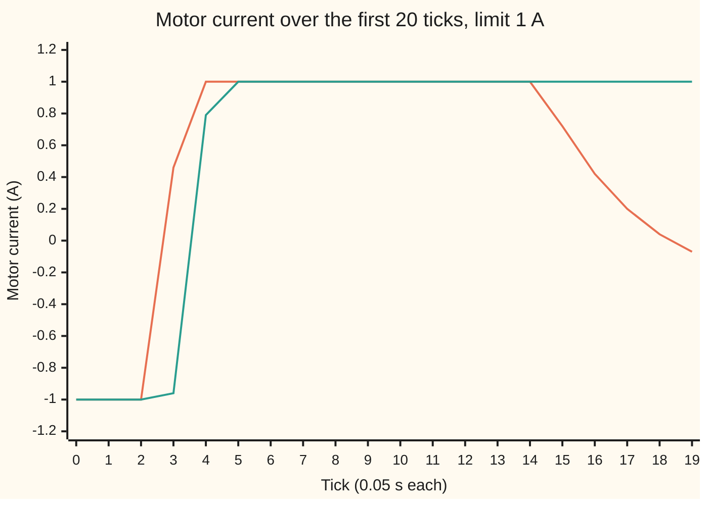
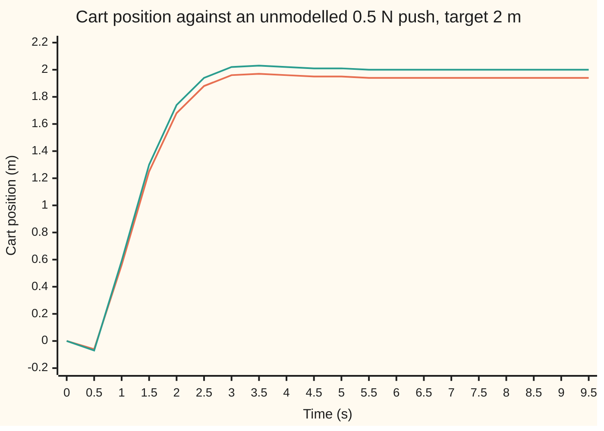

# Predictive control: plan a whole future, use the first move, replan next tick

[Syllabus](../../../SYLLABUS.md) → [Engineering mathematics](../README.md) → [State Space and Optimal Control](../README.md#s04) → Predictive control

---

## General Overview

A 1.0 kg cart runs on a straight track. On top of it, a 0.2 kg weight sits at the end of a 0.735 m rod, balanced upside down. A motor pushes the cart with 4 N for every amp of current, and its driver will not deliver more than **1 A**, either way. The job: move the cart **2 m** to the right without dropping the pendulum. This rig is not the one on the other cards of this shelf. A current limit is a limit on force, so the masses of the cart and the weight now matter, and the motor sets a current rather than an acceleration. With this rod length the pendulum keeps the shelf's open-loop pole, 4 rad/s.

A regulator designed for this rig by the method of [The LQR](06-linear-quadratic-regulator.md), with this card's own weights, knows the best move for every state, but it was derived with no limit on the motor. At the start it asks for **−4.1675 A**, a hard push to the left, more than four times what the driver gives. (Pushing left first is right: the cart slides out from under the pendulum, which tips it towards the target.) Clip that request to 1 A, tick after tick, and the pendulum passes 0.5 rad from upright after **0.60 s**. It is falling.

Predictive control does something else. Twenty times a second it plans the next 20 moves, a whole second of future, with the limit written into the plan. It applies only the first move. Next tick it measures again and plans again from scratch. Its plan pushes left at the limit for three ticks, which tips the pendulum towards the target, then reverses to 0.461 A to the right and pushes right at the limit. At 5.95 s, the last tick of a 6 s run, the cart is at 2.0001 m, and the pendulum never leans more than 0.2190 rad.

**Predictive control turns "the best moves over the next N ticks, inside the limits" into a quadratic program (a bowl-shaped cost to minimise inside straight-line limits), solves it every tick from the newest measurement, applies only the first move, and adds a disturbance state to the model so that a steady push it was not told about leaves no offset.**

**What kind of fact this is:** a method, a recipe for computing moves; the theorem attached to it, that the optimal cost falls every tick when the final state is priced by the LQR, is proved in Why it works under a condition stated there; along this run the code confirms the cost never rises.

### The picture: the first second of motor current



The first line (orange) is predictive control. The second line (green) is the clipped LQR. Both start by pushing left at the limit. At tick 3 the clipped LQR is still pushing left at −0.96 A, because it does not know the limit will stop it catching the pendulum later. Predictive control has already looked a second ahead, seen that, and reversed to 0.46 A to the right. From tick 15 it backs off. The clipped LQR is stuck at +1 A, chasing a pendulum it can no longer catch.

---

## The formula

[Discretising a design](../02-Linear%20Systems%20and%20Transforms/09-zero-order-hold-and-tustin-discretisation.md) turns the cart and pendulum into a 20 Hz model, $x_{k+1} = A x_k + B u_k$. It is exact when the current is held flat over each tick. Each tick, predictive control solves

$$\min_{u_0,\dots,u_{N-1}}\; \sum_{k=0}^{N-1}\left(x_k^{\top} Q\, x_k + R\,u_k^2\right) + x_N^{\top} P\, x_N \quad\text{subject to}\quad x_{k+1} = A x_k + B u_k,\quad x_0 = \text{the state measured now},\quad -\bar u \le u_k \le \bar u,$$

applies $u_0$, and throws the rest away. Stack the moves into one column $U$, substitute the model, and the problem becomes a quadratic program:

$$\min_{U}\; U^{\top} H\, U + 2\,(F x_0)^{\top} U \quad\text{subject to}\quad -\bar u \le U \le \bar u.$$

For zero offset, the model carries one more state, a constant push $d$ added to the motor current:

$$x_{k+1} = A x_k + B\,(u_k + d_k), \qquad d_{k+1} = d_k.$$

**Read it aloud:** choose the next N motor currents that keep the predicted cart near the target and the pendulum upright as cheaply as possible, inside the current limit and with the final state priced by the LQR; use the first, then do it all again.

| Symbol | Plain meaning | In our example | Push it up and the answer… |
| --- | --- | --- | --- |
| $x_k$, $k$ | the state $k$ ticks into the plan, measured from the target: cart position $p$ (m), cart speed $v$ (m/s), pendulum angle $\theta$ from upright (rad), its rate $\omega$ (rad/s) | starts at `(-2, 0, 0, 0)`; elsewhere on the card, cart positions are measured from the start, where the target is 2 m | a bigger start error presses the limits for longer |
| $u_k$ | the motor current at tick $k$, measured from $u_s$, in amps | first move −1.000 A | — |
| $\bar u$ | the driver's current limit | 1 A, which is 4 N | at 1.5 A even the clipped LQR copes |
| $N$, $T$ | the horizon, in ticks; one tick | 20 ticks of 0.05 s, 1 s ahead | longer: closer to the best over all time, more work |
| $A$, $B$ | the 20 Hz model of [Discretising a design](../02-Linear%20Systems%20and%20Transforms/09-zero-order-hold-and-tustin-discretisation.md) | the pendulum's lean grows by a factor of 1.2214 each tick on its own; $B$ = `(0.0050, 0.2002, -0.0068, -0.2739)` | — |
| $Q$, $R$ | weights on state error and on current | $Q$ = diag(1, 0.1, 10, 0.1), $R$ = 0.1 | bigger $R$: gentler current, slower arrival |
| $P$, $K$, $K_p$ | the LQR's cost-to-go matrix and gain, from the Riccati equation; $K_p$ is the gain's entry on cart position | $K$ = `(-2.0838, -2.5703, -17.4541, -4.3411)` | — |
| $U$ | the plan: all $N$ moves stacked in one column | 20 currents | — |
| $H$, $F$ | the quadratic program's bowl (20 by 20) and its tilt per unit of state (20 by 4); inside them, $W_k$ is $Q$, or $P$ at $k = N$, and $S_{kj}$ is the effect of move $j$ on tick $k$; $i$, $j$ number the moves | built once, offline | — |
| $J$ | the cost of the best plan, in cost units | 104.0446 at tick 0 | — |
| $d$, $\hat d$, $e$ | an unmodelled steady push, in amps of motor current; its estimate; $e$, the surprise: the state measured minus the state the push-free model predicted one tick ago | 0.5 N push to the right, 0.125 A; estimate 0.1250 A | a bigger $d$ eats into the limit |
| $r$, $C$, $x_s$, $u_s$ | the target cart position; $C$ picks $p$ out of the state, and $I$ is the identity matrix; the steady state and steady current that hold $p = r$ against $\hat d$ | 2 m; `(1, 0, 0, 0)`; `(2, 0, 0, 0)`; −0.125 A | — |

### When it holds

- **The model is close to the plant.** The plan is only as good as its prediction. Here the model is exact, so the moves applied match the tick-0 plan to 1e-9. A real plant drifts from its model, and replanning from each new measurement is what corrects it.
- **The state is known.** The code measures all four states. With one noisy encoder, they come from [The Kalman filter](07-kalman-filter.md), and [LQG](09-lqg-and-the-separation-principle.md) says when an estimate may stand in for the state. If the estimate is poor, every plan starts from the wrong place.
- **The final state is priced right.** Price $x_N$ with the LQR's $P$ and a 20-tick plan works. Drop $P$ and shorten the horizon to 5 ticks, and the plan cannot see far enough. The cart runs to −2.2747 m by 2 s and the pendulum is past 0.5 rad at 2.30 s.
- **The problem stays feasible.** Limits on the current alone can always be met: zero current obeys them. A limit on the state, say the end of the track, can become impossible after a disturbance, and then the solver has no answer. The standard fix is a soft constraint: a slack variable (a paid allowance for breaking the limit) with a large weight in the cost.
- **The solver finishes inside one tick.** Here that is 20 variables, small enough to solve many times over inside one 0.05 s tick. Fast motors with long horizons need fast solvers; that is the job of the Optimization wing.

---

## Why it works

### Step 0: a plan is easy to check, a policy is hard to compute

With a limit on the motor, the best move as a function of every possible state is a patchwork of pieces, no longer one matrix $K$. Computing it everywhere is the dynamic program of [Dynamic programming](../../08-Differential%20equations%20and%20dynamics/12-Calculus%20of%20Variations%20and%20Optimal%20Control/07-dynamic-programming-and-the-bellman-equation.md) over four continuous numbers, which is hopeless. But the best plan from *one* state, the one measured now, is a small finite problem. Predictive control solves only that, every tick, and re-solves when the state changes.

### Step 1: substituting the model turns the plan into a quadratic program

Run the model forward from $x_0$. The state after $k$ ticks is a sum: the free motion $A^k x_0$, plus each earlier move's effect, $A^{k-1-j} B\, u_j$ for move $j$. Every predicted state is therefore linear in $U$. The cost is a sum of squares of linear things, so it is quadratic in $U$: a bowl. The limits are a box. A convex bowl in a box has exactly one lowest point, and a solver can find it reliably.

<details>
<summary>The matrices, written out</summary>

Write $S_{kj} = A^{k-1-j}B$ for the effect of move $j$ on the state at tick $k$ ($j < k$), and $W_k = Q$ for $k < N$, $W_N = P$. Then

$$H_{ij} = R\,[i = j] + \sum_{k = \max(i,j)+1}^{N} S_{ki}^{\top} W_k\, S_{kj}, \qquad F_i = \sum_{k=i+1}^{N} S_{ki}^{\top} W_k\, A^k.$$

$H$ is positive definite because $R > 0$. The code builds both once; each tick it only multiplies $F$ by the new state.

</details>

### Step 2: with no limit, the first planned move is the LQR move

Take the limit away and the bowl's lowest point solves $HU = -F x_0$. With the final state priced by $P$, the 20-tick problem is exactly the infinite-horizon LQR problem cut at tick 20, because $x_N^{\top} P x_N$ is the true cost of everything after. The principle of optimality from [Dynamic programming](../../08-Differential%20equations%20and%20dynamics/12-Calculus%20of%20Variations%20and%20Optimal%20Control/07-dynamic-programming-and-the-bellman-equation.md) then makes the first move $-Kx_0$. The code finds −4.1675 A both ways. Predictive control is the LQR with the limit written in.

### Step 3: with the limit, the answer is certified by its gradient

At the lowest point of a bowl inside a box, each move is in one of two states. Either it sits strictly inside its limits, and the cost's slope along it is zero. Or it sits on a limit, and the slope points outwards, so moving it inwards would cost more. These are the KKT conditions (Karush–Kuhn–Tucker: the checklist for a minimum under inequality limits). For a convex bowl they are sufficient: any plan that passes them is the best plan. The code computes the slopes by a separate route, running the plan through the model and sweeping a costate (the cost's sensitivity to each state) backwards from tick 20. Free moves have zero slope to 1e-9. Every move at the limit presses outwards, the weakest by 0.0237.

### Step 4: replan from the measurement, then the cost falls tick by tick

Let $J(x)$ be the cost of the best plan from state $x$. At tick 0 the plan is $u_0, \dots, u_{19}$. At tick 1 one candidate is the old plan's tail, $u_1, \dots, u_{19}$, plus one new move: the LQR move $-Kx_{20}$. If that move fits inside the limit, the candidate's cost is $J(x_0)$ minus the first stage cost $x_0^{\top}Qx_0 + Ru_0^2$. The reason is that $P$ satisfies the Riccati equation, so the new last stage plus the new final price add up to the old final price. The best plan at tick 1 costs no more than that candidate. So

$$J(x_1) \;\le\; J(x_0) - \left(x_0^{\top} Q\, x_0 + R\,u_0^2\right).$$

The cost falls by at least the stage cost every tick, and it can never go below zero. So the stage costs shrink to zero, and the state goes to the target. The cost is a Lyapunov function (an energy-like number that can only fall), as in [Stability of a state-space model](05-hurwitz-schur-and-lyapunov-stability.md). Along this run the drop is exactly the stage cost: 4.1000, then 4.1320. The cost never rises in 120 ticks.

The condition is that the LQR move at the end of the plan fits inside the limit. Designs that need a guarantee add it as a terminal constraint: $x_N$ must lie in a set where the LQR never asks for more than $\bar u$ and never leaves the set. Such a set is control invariant (once inside, a move exists that keeps you inside). Feasibility then carries from one tick to the next: the shifted plan is always available.

### Step 5: a disturbance state removes the offset

Push the cart with a steady 0.5 N to the right, towards the target, that the model does not know about: a slight slope in the track, say. The predictor keeps predicting a push-free world. At rest the plant needs −0.125 A of current to cancel the push, and the only way the controller makes that current is from an error: $-K_p(p - r) = -0.125$. So it parks off target by $0.125/K_p$. That is short of the target, although the push points at it, because $K_p$ is negative: the LQR answers a cart that is short with a push left, the lean-first move of the overview.

The fix is to put the push into the model as a state that does not change, $d_{k+1} = d_k$, and estimate it. Each tick, the surprise $e$ is the state measured minus the state the push-free model predicted one tick ago. Here it is exactly $B d$. The part of $e$ that looks like extra current, $B^{\top}e / B^{\top}B$, is a fresh reading of $d$. The estimate moves a fifth of the way towards it each tick. Then the target is recomputed by solving

$$\begin{pmatrix} A - I & B \\ C & 0 \end{pmatrix}\begin{pmatrix} x_s \\ u_s \end{pmatrix} = \begin{pmatrix} -B\hat d \\ r \end{pmatrix},$$

which here gives $x_s$ = `(2, 0, 0, 0)` and $u_s = -\hat d$. The plan is made about $(x_s, u_s)$. The estimate stops moving only when it equals the reading, so it settles on the true push, and the cart settles at $p = r$. The argument needs only that the steady state exists and that the push is visible in the surprise. For the cart and pendulum both hold, since the 5-by-5 matrix above is invertible.

---

## Worked numbers, by hand

From rest, 2 m short of the target, current limit 1 A; then the same move against an unmodelled 0.5 N push.

| Step | Arithmetic | Value |
| --- | --- | --- |
| LQR's first request | $-K x_0 = -(-2.0838) \times (-2)$ | −4.1675 A |
| against the limit | more than four times 1 A | plan's first move −1.000 A |
| first stage cost | $1 \times (-2)^2 + 0.1 \times (-1)^2$ | 4.1000 |
| cost of the best plan, tick 0 then tick 1 | 104.0446 → 99.9446 | drop 4.1000 |
| push, as motor current | 0.5 N ÷ 4 N/A | 0.125 A |
| plain predictive control, parked offset | $0.125 / K_p = 0.125/(-2.0838)$ | −0.0600 m: parks at 1.9400 m |
| offset-free: steady current | $u_s = -\hat d$ | −0.1250 A |
| **offset-free: cart at 9.95 s** | settles on $r$ | **2.0000 m** |

The cart reaches the target and stays there. The motor holds −0.1250 A, which cancels the push exactly, and the estimate $\hat d$ has settled on 0.1250 A.

### What breaks if you drop a piece

| Mistake | Comes out at | What went wrong |
| --- | --- | --- |
| Clip the LQR move instead of planning with the limit | pendulum past 0.5 rad at 0.60 s | The LQR assumes it can always push harder later. Clipped, it commits too long to the first push and cannot catch the pendulum. |
| No disturbance state | parks at 1.9400 m, 0.0600 m short | The plan keeps aiming for a push-free world; only an error can produce the current the push needs |
| Apply the whole tick-0 plan without replanning, with the push | angle −1.0904 rad at 1 s, planned 0.0282, on the linear model; far outside its range, the real pendulum has fallen | An unstable plant amplifies every prediction error; only feedback from new measurements corrects them |
| Horizon 5 ticks, final state priced by $Q$ instead of $P$ | cart at −2.2747 m at 2 s, pendulum past 0.5 rad at 2.30 s | A quarter-second view sees a cheap plan that leaves the pendulum's unstable mode for later |

---

## How it moves: the push, tick by tick

The puzzle: both controllers plan with the same limit and the same model, and both see the push in their measurements. Only one of them ends up at 2 m.

Here is the 0.5 N push story, cart position in metres:

| Time | Plain predictive control | With the disturbance state |
| --- | --- | --- |
| 0 s | 0.00 | 0.00 |
| 0.5 s | −0.06 | −0.07 |
| 1 s | 0.56 | 0.59 |
| 2 s | 1.68 | 1.74 |
| 3.5 s | 1.97 | 2.03 |
| 5.5 s | 1.94 | 2.00 |
| 9.5 s | 1.94 | 2.00 |

Both start by stepping back, −0.06 m and −0.07 m at 0.5 s, before setting off. The plain version replans every tick from the true state, so the pendulum stays up and the cart arrives. But at 1.94 m each plan promises to close the last 0.0600 m, and its first move is exactly cancelled by the push. The next tick starts from the same place, and promises the same again. The version with the disturbance state keeps refining $\hat d$ until it agrees with what it measures, and its target current moves to −0.125 A.



The first line (orange) is plain predictive control, which parks at 1.94 m. The second line (green) carries the disturbance state and settles on 2.00 m.

---

## Code, from first principles, and it actually runs

The script discretises the plant itself (Van Loan's exponential of a 5-by-5 matrix, as in [Discretising a design](../02-Linear%20Systems%20and%20Transforms/09-zero-order-hold-and-tustin-discretisation.md)) and finds the LQR by iterating the Riccati equation. It builds $H$ and $F$, then reaches the tick-0 plan by **three independent roads**. Road 1 is an active-set solver: fix the moves that want to break a limit at the limit, solve the rest exactly, release any limit the slopes say is wrong, repeat. Road 2 is an accelerated projected gradient method: roll downhill, clip to the box, 20,000 times. Road 3 is the costate certificate of Step 3, which never touches $H$. A fourth check removes the limit and compares with the LQR. The script then runs the closed loop for 6 s and 10 s and reproduces every row of the tables above.

### Python

```python
# Predictive control -- the check behind the card.  Standard library only.
# Cart and pendulum, motor current limited to 1 A, sampled at 20 Hz.  Each tick: plan 20 moves
# by a quadratic program, apply the first, replan.  Roads: active-set solve, accelerated projected
# gradient, a costate (backward) gradient as an optimality certificate, and LQR as the no-limit case.
from math import sqrt, exp
M, m, l, g, kf, T, N, UMAX = 1.0, 0.2, 0.735, 9.8, 4.0, 0.05, 20, 1.0
Q, R, D = [1.0, 0.1, 10.0, 0.1], 0.1, 0.125           # weights; push 0.5 N = 0.125 A of motor current
Ac = [[0, 1, 0, 0], [0, 0, -m * g / M, 0], [0, 0, 0, 1], [0, 0, (M + m) * g / (M * l), 0]]
Bc = [0, kf / M, 0, -kf / (M * l)]                    # states: cart p, cart v, angle th, rate w

def mm(X, Y): return [[sum(X[i][k] * Y[k][j] for k in range(len(Y))) for j in range(len(Y[0]))] for i in range(len(X))]
def mv(X, v): return [sum(a * b for a, b in zip(r, v)) for r in X]
def dot(a, b): return sum(x * y for x, y in zip(a, b))
def tr(X): return [list(r) for r in zip(*X)]
def solve(X, b):                                       # Gauss-Jordan with partial pivoting
    n = len(b); X = [X[i][:] + [b[i]] for i in range(n)]
    for c in range(n):
        p = max(range(c, n), key=lambda r: abs(X[r][c])); X[c], X[p] = X[p], X[c]
        for r in range(n):
            if r != c:
                f = X[r][c] / X[c][c]
                for j in range(c, n + 1): X[r][j] -= f * X[c][j]
    return [X[i][n] / X[i][i] for i in range(n)]

Z = [Ac[i] + [Bc[i]] for i in range(4)] + [[0.0] * 5]  # Van Loan: exp([[A, B], [0, 0]] T)
E = [[float(i == j) for j in range(5)] for i in range(5)]; term = [r[:] for r in E]
for k in range(1, 20):
    term = [[v * T / 256 / k for v in r] for r in mm(term, Z)]; E = [[a + b for a, b in zip(r, s)] for r, s in zip(E, term)]
for _ in range(8): E = mm(E, E)
A = [r[:4] for r in E[:4]]; B = [r[4] for r in E[:4]]

P = [[Q[i] * (i == j) for j in range(4)] for i in range(4)]   # LQR: Riccati iteration, stable form
for it in range(100000):
    PB = mv(P, B); K = [dot(PB, [A[i][j] for i in range(4)]) / (R + dot(B, PB)) for j in range(4)]
    Acl = [[A[i][j] - B[i] * K[j] for j in range(4)] for i in range(4)]
    Pn = [[a + Q[i] * (i == j) + R * K[i] * K[j] for j, a in enumerate(r)] for i, r in enumerate(mm(tr(Acl), mm(P, Acl)))]
    done = max(abs(Pn[i][j] - P[i][j]) for i in range(4) for j in range(4)) < 1e-10; P = Pn
    if done: break

def build(n, Pt):                                      # condensed: cost = U'HU + 2 (F x0)'U + const
    AB, Ak = [B[:]], [[[float(i == j) for j in range(4)] for i in range(4)]]
    for k in range(n): AB.append(mv(A, AB[-1])); Ak.append(mm(A, Ak[-1]))
    W = lambda k: Pt if k == n else [[Q[i] * (i == j) for j in range(4)] for i in range(4)]
    H = [[R * (i == j) + sum(dot(AB[k - 1 - i], mv(W(k), AB[k - 1 - j])) for k in range(max(i, j) + 1, n + 1))
          for j in range(n)] for i in range(n)]
    F = [[sum(dot(AB[k - 1 - i], mv(W(k), [Ak[k][a][c] for a in range(4)])) for k in range(i + 1, n + 1))
          for c in range(4)] for i in range(n)]
    return H, F

def active_set(H, f, lo, hi):                          # road 1: fix moves at limits until KKT holds
    n, fix = len(f), {}
    while True:
        free = [i for i in range(n) if i not in fix]
        s = solve([[H[i][j] for j in free] for i in free], [-f[i] - sum(H[i][j] * v for j, v in fix.items()) for i in free]) if free else []
        U = [fix.get(i, 0.0) for i in range(n)]
        for i, v in zip(free, s): U[i] = v
        out = [(max(U[i] - hi[i], lo[i] - U[i]), i) for i in free if U[i] > hi[i] or U[i] < lo[i]]
        if out: i = max(out)[1]; fix[i] = hi[i] if U[i] > hi[i] else lo[i]; continue
        gr = [dot(H[i], U) + f[i] for i in range(n)]
        bad = [i for i, v in fix.items() if (v == hi[i] and gr[i] > 0) or (v == lo[i] and gr[i] < 0)]
        if not bad: return U
        del fix[max(bad, key=lambda i: abs(gr[i]))]

def fista(H, f, lo, hi, iters):                        # road 2: accelerated projected gradient
    v = [1.0] * len(f)
    for _ in range(300): w = mv(H, v); L = max(abs(a) for a in w); v = [a / L for a in w]
    x = [0.0] * len(f); y, t = x[:], 1.0
    for _ in range(iters):
        xn = [min(h, max(lo_, a - (b + c) / L)) for a, b, c, lo_, h in zip(y, mv(H, y), f, lo, hi)]
        tn = (1 + sqrt(1 + 4 * t * t)) / 2; y = [a + (t - 1) / tn * (a - b) for a, b in zip(xn, x)]; x, t = xn, tn
    return x

def costate(x0, U, Pt):                                # road 3: simulate the plan, gradient by costate
    xs = [x0]
    for u in U: xs.append([a + b * u for a, b in zip(mv(A, xs[-1]), B)])
    J = sum(dot(Q, [v * v for v in x]) + R * u * u for x, u in zip(xs, U)) + dot(xs[-1], mv(Pt, xs[-1]))
    lam, grad = [2 * v for v in mv(Pt, xs[-1])], [0.0] * len(U)
    for k in range(len(U) - 1, -1, -1):
        grad[k] = 2 * R * U[k] + dot(B, lam)
        lam = [2 * q * v + a for q, v, a in zip(Q, xs[k], mv(tr(A), lam))]
    return J, grad, xs

def run(mode, d, ticks, H=None, F=None, um=UMAX, r=2.0):  # closed loop on the 20 Hz model
    x, dh, prev, log = [0.0] * 4, 0.0, None, []
    for k in range(ticks):
        if mode == "free" and prev:                    # disturbance state: what the last move missed
            e = [a - b - c * prev[1] for a, b, c in zip(x, mv(A, prev[0]), B)]; dh += 0.2 * (dot(B, e) / dot(B, B) - dh)
        xs_us = solve([[A[i][j] - (i == j) for j in range(4)] + [B[i]] for i in range(4)] + [[1, 0, 0, 0, 0]], [-b * dh for b in B] + [r])
        xe, us = [a - b for a, b in zip(x, xs_us[:4])], xs_us[4]
        if mode == "clip": u = max(-um, min(um, us - dot(K, xe)))
        else: n = len(F); u = us + active_set(H, mv(F, xe), [-um - us] * n, [um - us] * n)[0]
        log.append((x, u, dh, xe)); prev = (x, u)
        x = [a + b * (u + d) for a, b in zip(mv(A, x), B)]
    return log

H, F = build(N, P); x0 = [-2.0, 0.0, 0.0, 0.0]           # at rest, 2 m short of the target
U = active_set(H, mv(F, x0), [-UMAX] * N, [UMAX] * N); Uf = fista(H, mv(F, x0), [-UMAX] * N, [UMAX] * N, 20000)
J0, grad, plan = costate(x0, U, P); Uu = solve(H, [-v for v in mv(F, x0)])
kkt_free = max(abs(gv) for gv, u in zip(grad, U) if abs(u) < UMAX)
kkt_sign = min(-gv * u for gv, u in zip(grad, U) if abs(u) == UMAX)     # > 0: each limit is pressed against
mpc, clip = run("mpc", 0.0, 120, H, F), run("clip", 0.0, 120)
Js = [costate(e, active_set(H, mv(F, e), [-UMAX] * N, [UMAX] * N), P)[0] for _, _, _, e in mpc]
fall = lambda lg: next((f"{k * T:.2f} s" for k, (x, *_) in enumerate(lg) if abs(x[2]) > 0.5), "never")
plain, free = run("mpc", D, 200, H, F), run("free", D, 200, H, F)
ol = plan[0]
for u in U: ol = [a + b * (u + D) for a, b in zip(mv(A, ol), B)]           # the tick-0 plan, never replanned
H5, F5 = build(5, [[Q[i] * (i == j) for j in range(4)] for i in range(4)]); short = run("mpc", 0.0, 80, H5, F5)
H10, F10 = build(10, P); m10 = run("mpc", 0.0, 120, H10, F10)
clip15, mpc05, free2 = run("clip", 0.0, 120, um=1.5), run("mpc", 0.0, 120, H, F, um=0.5), run("free", 2 * D, 200, H, F)
f4 = lambda v: f"{v:.4f}"
print("discrete pendulum pole e^(4T)", f4(A[2][2] + sqrt(A[2][3] * A[3][2])), " B", " ".join(f4(b) for b in B))
print("LQR gain K", " ".join(f4(k) for k in K), " Riccati sweeps", it + 1)
print("tick-0 plan, A:", " ".join(f"{u:.3f}" for u in U))
print("road 2 projected gradient, largest gap", f"{max(abs(a - b) for a, b in zip(U, Uf)):.2e}")
print("road 3 costate: free-move gradient below 1e-9", kkt_free < 1e-9, " limit push", f4(kkt_sign), " plan cost", f4(J0))
print("no limit: QP first move", f4(Uu[0]), " LQR -K x0", f4(-dot(K, x0)))
print("plan angle peak rad", f4(max(abs(x[2]) for x in plan)), " plan end p", f4(plan[-1][0] + 2))
print("MPC: peak angle", f4(max(abs(x[2]) for x, *_ in mpc)), " p at 5.95 s", f4(mpc[-1][0][0]), " moves = plan to 1e-9", max(abs(a[1] - b) for a, b in zip(mpc, U)) < 1e-9)
print("MPC: optimal cost ticks 0,1,2,10", " ".join(f4(Js[k]) for k in (0, 1, 2, 10)), " rises", sum(b > a for a, b in zip(Js, Js[1:])))
print("MPC: cost drops", f4(Js[0] - Js[1]), f4(Js[1] - Js[2]), " stage costs", " ".join(f4(dot(Q, [v * v for v in e]) + R * u * u) for _, u, _, e in mpc[:2]))
print("clipped LQR: first moves", " ".join(f"{u:.3f}" for _, u, *_ in clip[:6]), " angle past 0.5 rad at", fall(clip))
print("push, plain MPC: p at 9.95 s", f4(plain[-1][0][0]), " offset", f4(plain[-1][0][0] - 2), " formula d/K_p", f4(D / K[0]))
print("push, offset-free: p at 9.95 s", f4(free[-1][0][0]), " d estimate", f4(free[-1][2]), " current", f4(free[-1][1]))
print("push, plan never replanned: angle at 1 s", f4(ol[2]), " planned", f4(plan[-1][2]))
print("N=5, no terminal cost: p at 2 s", f4(short[40][0][0]), " angle past 0.5 rad at", fall(short))
print("try: N=10 with P, peak angle", f4(max(abs(x[2]) for x, *_ in m10)), " limit 1.5 A, clipped LQR falls:", fall(clip15))
print("try: limit 0.5 A, MPC peak angle", f4(max(abs(x[2]) for x, *_ in mpc05)), " p at 5.95 s", f4(mpc05[-1][0][0]), " falls:", fall(mpc05))
print("try: push 1 N, offset-free p at 9.95 s", f4(free2[-1][0][0]), " current", f4(free2[-1][1]))
print("chart current, MPC  ", " ".join(f"{u:.2f}" for _, u, *_ in mpc[:20]))
print("chart current, clip ", " ".join(f"{u:.2f}" for _, u, *_ in clip[:20]))
print("chart p, plain      ", " ".join(f"{plain[k][0][0]:.2f}" for k in range(0, 200, 10)))
print("chart p, offset-free", " ".join(f"{free[k][0][0]:.2f}" for k in range(0, 200, 10)))
assert abs(A[2][2] + sqrt(A[2][3] * A[3][2]) - exp(0.2)) < 1e-9, "Van Loan pole vs e^(4T)"
assert max(abs(a - b) for a, b in zip(U, Uf)) < 1e-3, "active set vs projected gradient"
assert kkt_free < 1e-9 and kkt_sign > 0, "costate gradient certifies the plan"
assert abs(Uu[0] + dot(K, x0)) < 1e-8, "no limits: first planned move is the LQR move"
assert all(abs(u) <= UMAX + 1e-12 for _, u, *_ in mpc + free) and max(abs(x[2]) for x, *_ in mpc) < 0.25, "MPC keeps limits"
assert abs(plain[-1][0][0] - 2 - D / K[0]) < 1e-4 and abs(free[-1][0][0] - 2) < 1e-4, "offset, and its removal"
assert sum(b > a + 1e-9 for a, b in zip(Js, Js[1:])) == 0, "optimal cost never rises"
print("ALL CHECKS PASS")
```

**Ran 2026-11-11 on macOS, Python 3.14.10, standard library only. All checks passed. Output, pasted from the run:**

```
discrete pendulum pole e^(4T) 1.2214  B 0.0050 0.2002 -0.0068 -0.2739
LQR gain K -2.0838 -2.5703 -17.4541 -4.3411  Riccati sweeps 209
tick-0 plan, A: -1.000 -1.000 -1.000 0.461 1.000 1.000 1.000 1.000 1.000 1.000 1.000 1.000 1.000 1.000 1.000 0.717 0.420 0.202 0.044 -0.071
road 2 projected gradient, largest gap 2.51e-04
road 3 costate: free-move gradient below 1e-9 True  limit push 0.0237  plan cost 104.0446
no limit: QP first move -4.1675  LQR -K x0 -4.1675
plan angle peak rad 0.2190  plan end p 0.6035
MPC: peak angle 0.2190  p at 5.95 s 2.0001  moves = plan to 1e-9 True
MPC: optimal cost ticks 0,1,2,10 104.0446 99.9446 95.8126 58.2133  rises 0
MPC: cost drops 4.1000 4.1320  stage costs 4.1000 4.1320
clipped LQR: first moves -1.000 -1.000 -1.000 -0.958 0.786 1.000  angle past 0.5 rad at 0.60 s
push, plain MPC: p at 9.95 s 1.9400  offset -0.0600  formula d/K_p -0.0600
push, offset-free: p at 9.95 s 2.0000  d estimate 0.1250  current -0.1250
push, plan never replanned: angle at 1 s -1.0904  planned 0.0282
N=5, no terminal cost: p at 2 s -2.2747  angle past 0.5 rad at 2.30 s
try: N=10 with P, peak angle 0.2223  limit 1.5 A, clipped LQR falls: never
try: limit 0.5 A, MPC peak angle 0.1425  p at 5.95 s 2.0006  falls: never
try: push 1 N, offset-free p at 9.95 s 2.0000  current -0.2500
chart current, MPC   -1.00 -1.00 -1.00 0.46 1.00 1.00 1.00 1.00 1.00 1.00 1.00 1.00 1.00 1.00 1.00 0.72 0.42 0.20 0.04 -0.07
chart current, clip  -1.00 -1.00 -1.00 -0.96 0.79 1.00 1.00 1.00 1.00 1.00 1.00 1.00 1.00 1.00 1.00 1.00 1.00 1.00 1.00 1.00
chart p, plain       0.00 -0.06 0.56 1.25 1.68 1.88 1.96 1.97 1.96 1.95 1.95 1.94 1.94 1.94 1.94 1.94 1.94 1.94 1.94 1.94
chart p, offset-free 0.00 -0.07 0.59 1.30 1.74 1.94 2.02 2.03 2.02 2.01 2.01 2.00 2.00 2.00 2.00 2.00 2.00 2.00 2.00 2.00
ALL CHECKS PASS
```

The projected gradient method lands within 2.51e-04 A of the active-set plan; it is slow because the bowl is long and thin, which is why real solvers use active sets or interior points. When the plan's one second runs out, the cart is only at 0.6035 m of its 2 m: the final price $P$ is what makes a 1-second plan aim at a 6-second journey.

### Rust

Same model, same roads, same output. No crates.

```rust
// Predictive control -- the same check as model_predictive_control_check.py, in Rust.  No crates.
// Same model, same four roads: active set, projected gradient, costate gradient, LQR with no limits.
type Mat = Vec<Vec<f64>>;
const T: f64 = 0.05; const NH: usize = 20; const UMAX: f64 = 1.0; const R: f64 = 0.1; const D: f64 = 0.125; const Q: [f64; 4] = [1.0, 0.1, 10.0, 0.1];
fn mm(x: &Mat, y: &Mat) -> Mat { (0..x.len()).map(|i| (0..y[0].len()).map(|j| (0..y.len()).fold(0.0, |s, k| s + x[i][k] * y[k][j])).collect()).collect() }
fn dot(a: &[f64], b: &[f64]) -> f64 { a.iter().zip(b).fold(0.0, |s, (x, y)| s + x * y) }
fn mv(x: &Mat, v: &[f64]) -> Vec<f64> { x.iter().map(|r| dot(r, v)).collect() }
fn tr(x: &Mat) -> Mat { (0..x[0].len()).map(|j| x.iter().map(|r| r[j]).collect()).collect() }
fn eye(n: usize) -> Mat { (0..n).map(|i| (0..n).map(|j| if i == j { 1.0 } else { 0.0 }).collect()).collect() }
fn qmat() -> Mat { (0..4).map(|i| (0..4).map(|j| if i == j { Q[i] } else { 0.0 }).collect()).collect() }
fn solve(x: &Mat, b: &[f64]) -> Vec<f64> {                       // Gauss-Jordan with partial pivoting
    let n = b.len();
    let mut x: Mat = (0..n).map(|i| { let mut r = x[i].clone(); r.push(b[i]); r }).collect();
    for c in 0..n {
        let mut p = c; for r in c..n { if x[r][c].abs() > x[p][c].abs() { p = r; } } x.swap(c, p);
        for r in 0..n { if r != c { let f = x[r][c] / x[c][c]; for j in c..=n { x[r][j] -= f * x[c][j]; } } }
    }
    (0..n).map(|i| x[i][n] / x[i][i]).collect()
}
struct Sys { a: Mat, b: Vec<f64>, p: Mat, k: Vec<f64> }
fn build(s: &Sys, n: usize, pt: &Mat) -> (Mat, Mat) {          // condensed: cost = U'HU + 2 (F x0)'U + const
    let (mut ab, mut ak) = (vec![s.b.clone()], vec![eye(4)]);
    for _ in 0..n { let v = mv(&s.a, ab.last().unwrap()); ab.push(v); let m = mm(&s.a, ak.last().unwrap()); ak.push(m); }
    let w = |k: usize| if k == n { pt.clone() } else { qmat() };
    let h = (0..n).map(|i| (0..n).map(|j| {
        let sm = (i.max(j) + 1..=n).fold(0.0, |acc, k| acc + dot(&ab[k - 1 - i], &mv(&w(k), &ab[k - 1 - j])));
        (if i == j { R } else { 0.0 }) + sm }).collect()).collect();
    let f = (0..n).map(|i| (0..4).map(|c| (i + 1..=n).fold(0.0, |acc, k| {
        let col: Vec<f64> = (0..4).map(|a| ak[k][a][c]).collect(); acc + dot(&ab[k - 1 - i], &mv(&w(k), &col)) })).collect()).collect();
    (h, f)
}
fn active_set(h: &Mat, f: &[f64], lo: &[f64], hi: &[f64]) -> Vec<f64> {   // road 1
    let n = f.len(); let mut fix: Vec<(usize, f64)> = vec![];
    loop {
        let free: Vec<usize> = (0..n).filter(|i| !fix.iter().any(|&(j, _)| j == *i)).collect();
        let hm: Mat = free.iter().map(|&i| free.iter().map(|&j| h[i][j]).collect()).collect();
        let rhs: Vec<f64> = free.iter().map(|&i| -f[i] - fix.iter().fold(0.0, |s, &(j, v)| s + h[i][j] * v)).collect();
        let sl = if free.is_empty() { vec![] } else { solve(&hm, &rhs) };
        let mut u = vec![0.0; n]; for &(j, v) in &fix { u[j] = v; } for (&i, &v) in free.iter().zip(&sl) { u[i] = v; }
        let mut out: Option<(f64, usize)> = None;
        for &i in &free {
            let vi = (u[i] - hi[i]).max(lo[i] - u[i]);
            if (u[i] > hi[i] || u[i] < lo[i]) && out.map_or(true, |(bv, _)| vi >= bv) { out = Some((vi, i)); }
        }
        if let Some((_, i)) = out { fix.push((i, if u[i] > hi[i] { hi[i] } else { lo[i] })); continue; }
        let gr: Vec<f64> = (0..n).map(|i| dot(&h[i], &u) + f[i]).collect();
        let mut bad: Option<usize> = None;
        for (pos, &(i, v)) in fix.iter().enumerate() {
            if ((v == hi[i] && gr[i] > 0.0) || (v == lo[i] && gr[i] < 0.0)) && bad.map_or(true, |b| gr[i].abs() > gr[fix[b].0].abs()) { bad = Some(pos); }
        }
        match bad { None => return u, Some(b) => { fix.remove(b); } }
    }
}
fn fista(h: &Mat, f: &[f64], lo: &[f64], hi: &[f64], iters: usize) -> Vec<f64> {   // road 2
    let mut v = vec![1.0; f.len()]; let mut l = 0.0;
    for _ in 0..300 { let w = mv(h, &v); l = w.iter().fold(0.0_f64, |m, a| m.max(a.abs())); v = w.iter().map(|a| a / l).collect(); }
    let (mut x, mut y, mut t) = (vec![0.0; f.len()], vec![0.0; f.len()], 1.0_f64);
    for _ in 0..iters {
        let hy = mv(h, &y);
        let xn: Vec<f64> = (0..f.len()).map(|i| hi[i].min(lo[i].max(y[i] - (hy[i] + f[i]) / l))).collect();
        let tn = (1.0 + (1.0 + 4.0 * t * t).sqrt()) / 2.0;
        y = xn.iter().zip(&x).map(|(a, b)| a + (t - 1.0) / tn * (a - b)).collect(); x = xn; t = tn;
    }
    x
}
fn costate(s: &Sys, x0: &[f64], u: &[f64], pt: &Mat) -> (f64, Vec<f64>, Mat) {   // road 3
    let mut xs: Mat = vec![x0.to_vec()];
    for &uk in u { let nx: Vec<f64> = mv(&s.a, xs.last().unwrap()).iter().zip(&s.b).map(|(a, b)| a + b * uk).collect(); xs.push(nx); }
    let xn = xs.last().unwrap().clone(); let j = xs.iter().zip(u).fold(0.0, |acc, (x, &uk)| acc + (dot(&Q, &x.iter().map(|v| v * v).collect::<Vec<_>>()) + R * uk * uk)) + dot(&xn, &mv(pt, &xn));
    let (mut lam, mut grad): (Vec<f64>, Vec<f64>) = (mv(pt, &xn).iter().map(|v| 2.0 * v).collect(), vec![0.0; u.len()]);
    let at = tr(&s.a);
    for k in (0..u.len()).rev() {
        grad[k] = 2.0 * R * u[k] + dot(&s.b, &lam);
        let al = mv(&at, &lam); lam = (0..4).map(|i| 2.0 * Q[i] * xs[k][i] + al[i]).collect();
    }
    (j, grad, xs)
}
struct Tick { x: Vec<f64>, u: f64, dh: f64, xe: Vec<f64> }
fn run(s: &Sys, mode: &str, d: f64, ticks: usize, hf: Option<&(Mat, Mat)>, um: f64) -> Vec<Tick> {
    let (mut x, mut dh, mut prev, mut log): (Vec<f64>, f64, Option<(Vec<f64>, f64)>, Vec<Tick>) = (vec![0.0; 4], 0.0, None, vec![]);
    for _ in 0..ticks {
        if let (true, Some((px, pu))) = (mode == "free", &prev) {   // disturbance state: what the last move missed
            let e: Vec<f64> = (0..4).map(|i| x[i] - mv(&s.a, px)[i] - s.b[i] * pu).collect();
            dh += 0.2 * (dot(&s.b, &e) / dot(&s.b, &s.b) - dh);
        }
        let mut km: Mat = (0..4).map(|i| { let mut r: Vec<f64> = (0..4).map(|j| s.a[i][j] - if i == j { 1.0 } else { 0.0 }).collect(); r.push(s.b[i]); r }).collect();
        km.push(vec![1.0, 0.0, 0.0, 0.0, 0.0]); let mut rhs: Vec<f64> = s.b.iter().map(|b| -b * dh).collect(); rhs.push(2.0); let xsu = solve(&km, &rhs);
        let (xe, us): (Vec<f64>, f64) = ((0..4).map(|i| x[i] - xsu[i]).collect(), xsu[4]);
        let u = if mode == "clip" { (-um).max(um.min(us - dot(&s.k, &xe))) } else {
            let (h, f) = hf.unwrap(); let n = f.len();
            us + active_set(h, &mv(f, &xe), &vec![-um - us; n], &vec![um - us; n])[0] };
        log.push(Tick { x: x.clone(), u, dh, xe }); prev = Some((x.clone(), u));
        x = mv(&s.a, &x).iter().zip(&s.b).map(|(a, b)| a + b * (u + d)).collect();
    }
    log
}
fn sci(v: f64, p: usize) -> String {                             // Python-style 2.51e-04
    let s = format!("{:.*e}", p, v); let (m, e) = s.split_once('e').unwrap(); let e: i32 = e.parse().unwrap(); format!("{}e{}{:02}", m, if e < 0 { "-" } else { "+" }, e.abs()) }
fn f4(v: f64) -> String { format!("{:.4}", v) } fn tf(b: bool) -> &'static str { if b { "True" } else { "False" } }
fn join(v: &[f64], p: usize) -> String { v.iter().map(|u| format!("{:.*}", p, u)).collect::<Vec<_>>().join(" ") }
fn fall(lg: &[Tick]) -> String { lg.iter().position(|t| t.x[2].abs() > 0.5).map_or("never".to_string(), |k| format!("{:.2} s", k as f64 * T)) }
fn peak(lg: &[Tick]) -> f64 { lg.iter().fold(0.0_f64, |m, t| m.max(t.x[2].abs())) }
fn main() {
    let (mm_, m, l, g, kf) = (1.0_f64, 0.2_f64, 0.735_f64, 9.8_f64, 4.0_f64);
    let ac = [[0.0, 1.0, 0.0, 0.0], [0.0, 0.0, -m * g / mm_, 0.0], [0.0, 0.0, 0.0, 1.0], [0.0, 0.0, (mm_ + m) * g / (mm_ * l), 0.0]];
    let bc = [0.0, kf / mm_, 0.0, -kf / (mm_ * l)];
    let mut z: Mat = (0..4).map(|i| { let mut r = ac[i].to_vec(); r.push(bc[i]); r }).collect(); z.push(vec![0.0; 5]);
    let (mut e, mut term) = (eye(5), eye(5));                        // Van Loan: exp([[A, B], [0, 0]] T)
    for k in 1..20 {
        term = mm(&term, &z).iter().map(|r| r.iter().map(|v| v * T / 256.0 / k as f64).collect()).collect();
        e = e.iter().zip(&term).map(|(r, s)| r.iter().zip(s).map(|(a, b)| a + b).collect()).collect();
    }
    for _ in 0..8 { e = mm(&e, &e); }
    let a: Mat = e[..4].iter().map(|r| r[..4].to_vec()).collect(); let b: Vec<f64> = e[..4].iter().map(|r| r[4]).collect();
    let (mut p, mut k, mut sweeps) = (qmat(), vec![0.0; 4], 0);     // LQR: Riccati iteration, stable form
    for it in 0..100000 {
        let pb = mv(&p, &b); let den = R + dot(&b, &pb);
        k = (0..4).map(|j| dot(&pb, &(0..4).map(|i| a[i][j]).collect::<Vec<_>>()) / den).collect();
        let acl: Mat = (0..4).map(|i| (0..4).map(|j| a[i][j] - b[i] * k[j]).collect()).collect();
        let pn: Mat = mm(&tr(&acl), &mm(&p, &acl)).iter().enumerate().map(|(i, r)| r.iter().enumerate()
            .map(|(j, v)| v + if i == j { Q[i] } else { 0.0 } + R * k[i] * k[j]).collect()).collect();
        let done = (0..4).all(|i| (0..4).all(|j| (pn[i][j] - p[i][j]).abs() < 1e-10)); p = pn; sweeps = it + 1; if done { break; }
    }
    let s = Sys { a, b, p: p.clone(), k };
    let hf = build(&s, NH, &s.p); let (h, f) = (&hf.0, &hf.1); let x0 = [-2.0, 0.0, 0.0, 0.0];
    let (lo, hi) = (vec![-UMAX; NH], vec![UMAX; NH]); let u = active_set(h, &mv(f, &x0), &lo, &hi); let uf = fista(h, &mv(f, &x0), &lo, &hi, 20000);
    let (j0, grad, plan) = costate(&s, &x0, &u, &s.p); let uu = solve(h, &mv(f, &x0).iter().map(|v| -v).collect::<Vec<_>>());
    let kkt_free = grad.iter().zip(&u).filter(|(_, x)| x.abs() < UMAX).fold(0.0_f64, |mx, (gv, _)| mx.max(gv.abs()));
    let kkt_sign = grad.iter().zip(&u).filter(|(_, x)| x.abs() == UMAX).fold(f64::INFINITY, |mn, (gv, x)| mn.min(-gv * x));
    let gap = u.iter().zip(&uf).fold(0.0_f64, |mx, (a, b)| mx.max((a - b).abs()));
    let (mpc, clip) = (run(&s, "mpc", 0.0, 120, Some(&hf), UMAX), run(&s, "clip", 0.0, 120, None, UMAX));
    let js: Vec<f64> = mpc.iter().map(|t| costate(&s, &t.xe, &active_set(h, &mv(f, &t.xe), &lo, &hi), &s.p).0).collect();
    let (plain, free) = (run(&s, "mpc", D, 200, Some(&hf), UMAX), run(&s, "free", D, 200, Some(&hf), UMAX));
    let mut ol = plan[0].clone(); for &uk in &u { ol = mv(&s.a, &ol).iter().zip(&s.b).map(|(a, b)| a + b * (uk + D)).collect(); }   // never replanned
    let (hf5, hf10) = (build(&s, 5, &qmat()), build(&s, 10, &s.p));
    let (short, m10) = (run(&s, "mpc", 0.0, 80, Some(&hf5), UMAX), run(&s, "mpc", 0.0, 120, Some(&hf10), UMAX));
    let (clip15, mpc05, free2) = (run(&s, "clip", 0.0, 120, None, 1.5), run(&s, "mpc", 0.0, 120, Some(&hf), 0.5), run(&s, "free", 2.0 * D, 200, Some(&hf), UMAX));
    let (pole, rises) = (s.a[2][2] + (s.a[2][3] * s.a[3][2]).sqrt(), js.windows(2).filter(|w| w[1] > w[0]).count()); let pend = plain.last().unwrap().x[0]; let fend = free.last().unwrap().x[0];
    println!("discrete pendulum pole e^(4T) {}  B {}", f4(pole), s.b.iter().map(|v| f4(*v)).collect::<Vec<_>>().join(" "));
    println!("LQR gain K {}  Riccati sweeps {}", s.k.iter().map(|v| f4(*v)).collect::<Vec<_>>().join(" "), sweeps);
    println!("tick-0 plan, A: {}", join(&u, 3));
    println!("road 2 projected gradient, largest gap {}", sci(gap, 2));
    println!("road 3 costate: free-move gradient below 1e-9 {}  limit push {}  plan cost {}", tf(kkt_free < 1e-9), f4(kkt_sign), f4(j0));
    println!("no limit: QP first move {}  LQR -K x0 {}", f4(uu[0]), f4(-dot(&s.k, &x0)));
    println!("plan angle peak rad {}  plan end p {}", f4(plan.iter().fold(0.0_f64, |mx, x| mx.max(x[2].abs()))), f4(plan.last().unwrap()[0] + 2.0));
    println!("MPC: peak angle {}  p at 5.95 s {}  moves = plan to 1e-9 {}", f4(peak(&mpc)), f4(mpc.last().unwrap().x[0]), tf(mpc.iter().zip(&u).all(|(t, b)| (t.u - b).abs() < 1e-9)));
    println!("MPC: optimal cost ticks 0,1,2,10 {}  rises {}", [0, 1, 2, 10].iter().map(|&k| f4(js[k])).collect::<Vec<_>>().join(" "), rises);
    let st: Vec<String> = mpc[..2].iter().map(|t| f4(dot(&Q, &t.xe.iter().map(|v| v * v).collect::<Vec<_>>()) + R * t.u * t.u)).collect();
    println!("MPC: cost drops {} {}  stage costs {}", f4(js[0] - js[1]), f4(js[1] - js[2]), st.join(" "));
    println!("clipped LQR: first moves {}  angle past 0.5 rad at {}", join(&clip[..6].iter().map(|t| t.u).collect::<Vec<_>>(), 3), fall(&clip));
    println!("push, plain MPC: p at 9.95 s {}  offset {}  formula d/K_p {}", f4(pend), f4(pend - 2.0), f4(D / s.k[0]));
    println!("push, offset-free: p at 9.95 s {}  d estimate {}  current {}", f4(fend), f4(free.last().unwrap().dh), f4(free.last().unwrap().u));
    println!("push, plan never replanned: angle at 1 s {}  planned {}", f4(ol[2]), f4(plan.last().unwrap()[2]));
    println!("N=5, no terminal cost: p at 2 s {}  angle past 0.5 rad at {}", f4(short[40].x[0]), fall(&short));
    println!("try: N=10 with P, peak angle {}  limit 1.5 A, clipped LQR falls: {}", f4(peak(&m10)), fall(&clip15));
    println!("try: limit 0.5 A, MPC peak angle {}  p at 5.95 s {}  falls: {}", f4(peak(&mpc05)), f4(mpc05.last().unwrap().x[0]), fall(&mpc05));
    println!("try: push 1 N, offset-free p at 9.95 s {}  current {}", f4(free2.last().unwrap().x[0]), f4(free2.last().unwrap().u));
    println!("chart current, MPC   {}", join(&mpc[..20].iter().map(|t| t.u).collect::<Vec<_>>(), 2));
    println!("chart current, clip  {}", join(&clip[..20].iter().map(|t| t.u).collect::<Vec<_>>(), 2));
    println!("chart p, plain       {}", join(&(0..200).step_by(10).map(|k| plain[k].x[0]).collect::<Vec<_>>(), 2));
    println!("chart p, offset-free {}", join(&(0..200).step_by(10).map(|k| free[k].x[0]).collect::<Vec<_>>(), 2));
    assert!((pole - (0.2_f64).exp()).abs() < 1e-9, "Van Loan pole vs e^(4T)");
    assert!(gap < 1e-3, "active set vs projected gradient");
    assert!(kkt_free < 1e-9 && kkt_sign > 0.0, "costate gradient certifies the plan");
    assert!((uu[0] + dot(&s.k, &x0)).abs() < 1e-8, "no limits: first planned move is the LQR move");
    assert!(mpc.iter().chain(&free).all(|t| t.u.abs() <= UMAX + 1e-12) && peak(&mpc) < 0.25, "MPC keeps limits");
    assert!((pend - 2.0 - D / s.k[0]).abs() < 1e-4 && (fend - 2.0).abs() < 1e-4, "offset, and its removal");
    assert!(js.windows(2).all(|w| w[1] <= w[0] + 1e-9), "optimal cost never rises");
    println!("ALL CHECKS PASS");
}
```

**Ran 2026-11-11 on macOS, rustc 1.98.1, no crates. All checks passed. Output, pasted from the run:**

```
discrete pendulum pole e^(4T) 1.2214  B 0.0050 0.2002 -0.0068 -0.2739
LQR gain K -2.0838 -2.5703 -17.4541 -4.3411  Riccati sweeps 209
tick-0 plan, A: -1.000 -1.000 -1.000 0.461 1.000 1.000 1.000 1.000 1.000 1.000 1.000 1.000 1.000 1.000 1.000 0.717 0.420 0.202 0.044 -0.071
road 2 projected gradient, largest gap 2.51e-04
road 3 costate: free-move gradient below 1e-9 True  limit push 0.0237  plan cost 104.0446
no limit: QP first move -4.1675  LQR -K x0 -4.1675
plan angle peak rad 0.2190  plan end p 0.6035
MPC: peak angle 0.2190  p at 5.95 s 2.0001  moves = plan to 1e-9 True
MPC: optimal cost ticks 0,1,2,10 104.0446 99.9446 95.8126 58.2133  rises 0
MPC: cost drops 4.1000 4.1320  stage costs 4.1000 4.1320
clipped LQR: first moves -1.000 -1.000 -1.000 -0.958 0.786 1.000  angle past 0.5 rad at 0.60 s
push, plain MPC: p at 9.95 s 1.9400  offset -0.0600  formula d/K_p -0.0600
push, offset-free: p at 9.95 s 2.0000  d estimate 0.1250  current -0.1250
push, plan never replanned: angle at 1 s -1.0904  planned 0.0282
N=5, no terminal cost: p at 2 s -2.2747  angle past 0.5 rad at 2.30 s
try: N=10 with P, peak angle 0.2223  limit 1.5 A, clipped LQR falls: never
try: limit 0.5 A, MPC peak angle 0.1425  p at 5.95 s 2.0006  falls: never
try: push 1 N, offset-free p at 9.95 s 2.0000  current -0.2500
chart current, MPC   -1.00 -1.00 -1.00 0.46 1.00 1.00 1.00 1.00 1.00 1.00 1.00 1.00 1.00 1.00 1.00 0.72 0.42 0.20 0.04 -0.07
chart current, clip  -1.00 -1.00 -1.00 -0.96 0.79 1.00 1.00 1.00 1.00 1.00 1.00 1.00 1.00 1.00 1.00 1.00 1.00 1.00 1.00 1.00
chart p, plain       0.00 -0.06 0.56 1.25 1.68 1.88 1.96 1.97 1.96 1.95 1.95 1.94 1.94 1.94 1.94 1.94 1.94 1.94 1.94 1.94
chart p, offset-free 0.00 -0.07 0.59 1.30 1.74 1.94 2.02 2.03 2.02 2.01 2.01 2.00 2.00 2.00 2.00 2.00 2.00 2.00 2.00 2.00
ALL CHECKS PASS
```

> [!TIP]
> **Try changing**
> - Guess first: does a 10-tick horizon, still priced by $P$, change much? That is `build(10, P)` in the script. The peak angle goes from 0.2190 to 0.2223 rad. With the right final price, a short plan loses little.
> - Guess first: with a 1.5 A limit, does the clipped LQR still fall? That is `run("clip", 0.0, 120, um=1.5)`. It never passes 0.5 rad. Clipping fails only when the limit binds hard.
> - Guess first: a tighter 0.5 A limit, more lean or less? That is `um=0.5` on the `mpc` run. Peak angle 0.1425 rad, and the cart is still at 2.0006 m at 5.95 s. A weaker push makes the plan tip the pendulum less.
> - Guess first: double the push to 1 N (`2 * D`). Does the offset come back? With the disturbance state the cart still ends at 2.0000 m, holding −0.2500 A.

---

## The usual mistake

> [!warning]
> **Treating the plan as the output.** The plan is 20 moves long, and it is thrown away after one. Running the tick-0 plan to the end, with a 0.5 N push the model does not know, leaves the pendulum at −1.0904 rad after 1 s where the plan promised 0.0282 rad. That is the linear model's number, far outside its range: the real pendulum has fallen. The point of the method is the replanning: the plan is how the first move is chosen, and feedback comes from planning again from each new measurement.
>
> - **Clipping a design made without the limit.** The LQR's move is optimal only if the motor can deliver it. Clipped, it fell after 0.60 s; planned with the limit, it lands at 2.0001 m.
> - **Forgetting the final price.** Price only the first 5 ticks and the cart runs to −2.2747 m by 2 s. A horizon short enough to compute fast needs $P$ on its last state.
> - **Expecting replanning to remove offset by itself.** Replanning from the true state still parks at 1.9400 m against a 0.5 N push. Only a disturbance state, estimated and fed into the target, removes it.
> - **Putting hard limits on states.** A track-end limit can make the problem impossible after a big disturbance, and then the solver returns nothing. Soften state limits with a weighted slack; keep only the physical ones, like the current, hard.

---

## Where you meet it in real life

- **Oil refineries and chemical plants.** Predictive control has run distillation columns since the 1980s, holding product quality against valve limits, with a disturbance model to remove offset.
- **Car engines and electric drives.** Fuel injection, turbocharger boost and motor current controllers plan a short way ahead inside actuator limits, and dedicated chips solve the quadratic program each tick.
- **Buildings.** Heating and cooling plans use the weather forecast to pre-cool a building before the afternoon peak price, inside comfort limits.
- **Drones and walking robots.** Footstep and thrust plans are recomputed many times a second, with the motor limits written into the plan.
- **Power grids.** Battery and generator schedules are replanned every few minutes as demand forecasts update.

> **Say it back**
> Predictive control plans the next N moves with the limits written in, applies the first and replans next tick from a new measurement. Substituting the model makes the plan a quadratic program: a bowl in a box, with one lowest point that the KKT conditions certify. Pricing the final state with the LQR makes a short plan behave like an infinite one, and with no limit it is the LQR. With that price the plan's cost falls every tick. A constant disturbance state, estimated from the prediction errors, moves the target so that a steady push leaves no offset.

---

## What this builds on

- [The LQR](06-linear-quadratic-regulator.md): the gain $K$ and the cost-to-go matrix $P$; here $P$ prices the last state of every plan, and $K$ is the answer when no limit binds.
- [Discretising a design](../02-Linear%20Systems%20and%20Transforms/09-zero-order-hold-and-tustin-discretisation.md): the zero-order-hold model $A$, $B$ that the plan runs forward 20 times.
- [Dynamic programming](../../08-Differential%20equations%20and%20dynamics/12-Calculus%20of%20Variations%20and%20Optimal%20Control/07-dynamic-programming-and-the-bellman-equation.md): the principle of optimality, which makes the plan's tail optimal and gives the cost-falls-every-tick argument.

## Where this goes next

- Quadratic programs (planned, Optimization wing): the bowl-in-a-box problem itself, and when it has one answer.
- KKT conditions (planned, Optimization wing): the checklist of Step 3, proved.
- Interior point methods (planned, Optimization wing): the other family of solvers fast enough to run every tick.
- Writing down model error (planned, shelf 10 of this wing): what to do when the model behind every plan is wrong by a known amount.

The question this card leaves open: when the plant itself is nonlinear, as the pendulum is far from upright, the plan is no longer a bowl, and what then guarantees the solver finds the best plan in time?

---

## Sources

Verified 2026-11-11: every link below resolves to the publisher's page.

- Mayne, D. Q., J. B. Rawlings, C. V. Rao, and P. O. M. Scokaert. "Constrained model predictive control: Stability and optimality." *Automatica* 36, no. 6 (2000): 789–814. [doi:10.1016/S0005-1098(99)00214-9](https://doi.org/10.1016/S0005-1098(99)00214-9). The cost-falls-every-tick argument of Step 4, with terminal cost and terminal set.
- Muske, Kenneth R., and Thomas A. Badgwell. "Disturbance modeling for offset-free linear model predictive control." *Journal of Process Control* 12, no. 5 (2002): 617–632. [doi:10.1016/S0959-1524(01)00051-8](https://doi.org/10.1016/S0959-1524(01)00051-8). The disturbance state and target calculation of Step 5.
- Qin, S. Joe, and Thomas A. Badgwell. "A survey of industrial model predictive control technology." *Control Engineering Practice* 11, no. 7 (2003): 733–764. [doi:10.1016/S0967-0661(02)00186-7](https://doi.org/10.1016/S0967-0661(02)00186-7). Where the method is used in industry, and how.
- Beck, Amir, and Marc Teboulle. "A Fast Iterative Shrinkage-Thresholding Algorithm for Linear Inverse Problems." *SIAM Journal on Imaging Sciences* 2, no. 1 (2009): 183–202. [doi:10.1137/080716542](https://doi.org/10.1137/080716542). The accelerated projected gradient method used as road 2.
- Borrelli, Francesco, Alberto Bemporad, and Manfred Morari. *Predictive Control for Linear and Hybrid Systems*. Cambridge University Press, 2017. [doi:10.1017/9781139061759](https://doi.org/10.1017/9781139061759). The condensed quadratic program, invariant sets and recursive feasibility, at textbook length.
