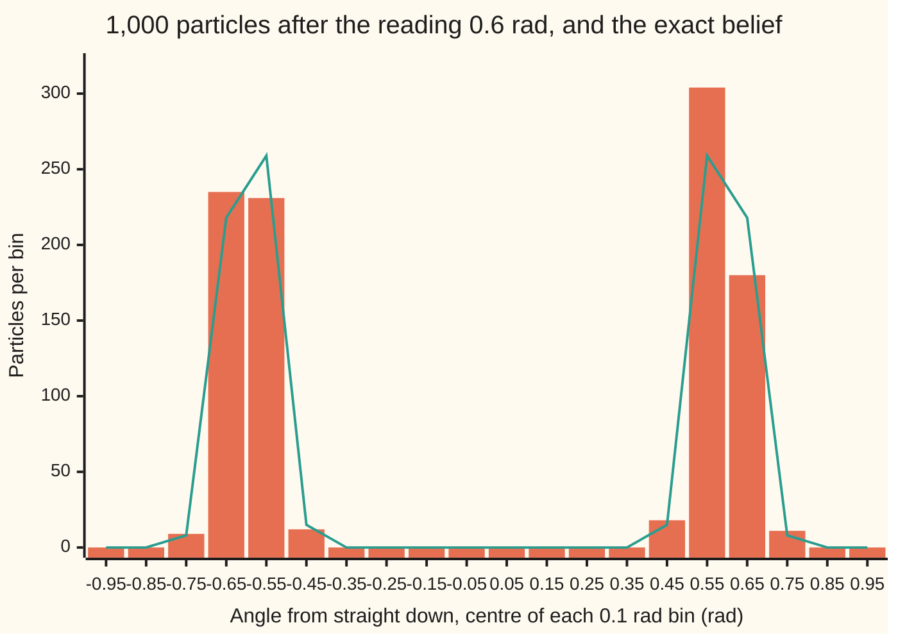
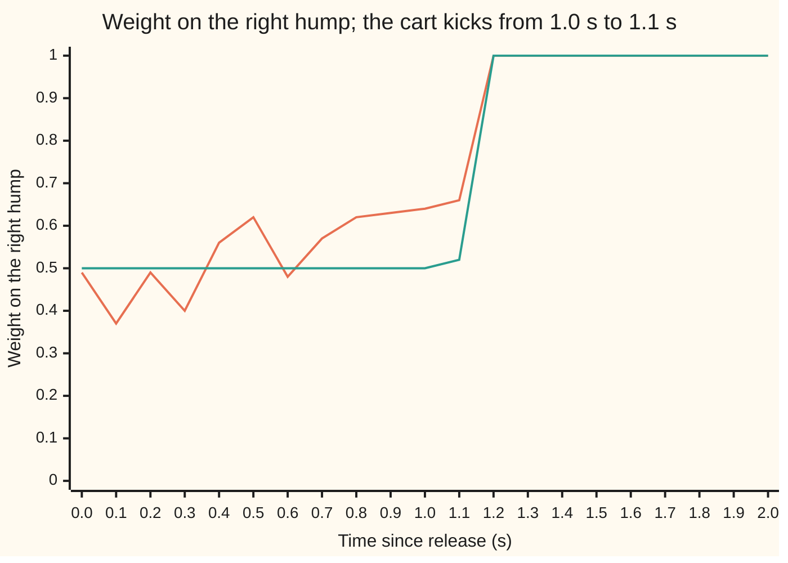

# Particle filters: a cloud of weighted guesses for beliefs with more than one hump

[Syllabus](../../../SYLLABUS.md) → [Engineering mathematics](../README.md) → [State Space and Optimal Control](../README.md#s04) → Particle filters

---

## General Overview

Before the cart can swing its pole up to balance, the pole hangs below the pivot, 0.613125 m long. The swing-up controller must know which way the pole is swinging, so it can push the cart at the right moment.

This rig has a cheap encoder (a sensor on the pivot that reads the pole's angle) that reports only the **size** of the angle, not its side: a pole 0.6 rad (34.4°) to the left reads the same as one 0.6 rad to the right. It reads 100 times a second, with a typical error of 0.05 rad at every angle.

The pole is released at rest. The first reading is 0.6 rad. The honest belief now has two humps: about 0.6 rad to one side or about 0.6 rad to the other, even odds. In this run the truth is −0.6 rad.

The filters of [The Kalman filter](07-kalman-filter.md) and [Filtering a nonlinear plant](08-extended-kalman-filter-and-nonlinear-estimation.md) carry one bell curve, so they cannot say "one of two places". The extended filter, started a hair to the positive side, commits to the positive hump: the mirror image of the truth. It then tracks that mirror swing. At 1 s it says −0.4340 rad when the truth is +0.424 rad, and claims to be within 0.0108 rad. The unscented filter stays at exactly 0, the one angle the reading has ruled out.

A **particle filter** carries 1,000 guesses instead. Each guess, a **particle**, is one possible angle and rate. Each step it does three things:

1. **Predict:** move every particle by the pendulum model, plus a random push.
2. **Weight:** give each particle a weight by how well it explains the new reading.
3. **Resample:** when only a few particles carry the weight, copy the heavy ones and drop the light ones.

After the first reading the 1,000 particles are worth only 132.8 equal ones; that count is their **effective sample size** (ESS). Resampling turns them into a fresh cloud: 487 particles near −0.6 rad and 513 near +0.6 rad. Both humps survive.

For the first second no reading can tell the humps apart. At 1.0 s the cart gives a known kick, 3 m/s² for 0.1 s. The kick pushes both candidate swings the same way, so they stop being mirror images. By 1.15 s the particle filter puts 0.99 of its weight on the right hump. Over the last 4 s of a 10 s run its angle is off by 0.0104 rad (root-mean-square: the typical size of the error), and it claims 0.0107 rad.

**A particle filter carries a belief as a cloud of weighted guesses: move each guess with the model and a random push, weight it by how well it explains the reading, and copy the heavy guesses whenever the effective sample size falls too low; the cloud can take any shape, so it can hold two humps until the data choose one.**

**What kind of fact this is:** a method. It is a Monte Carlo approximation (an estimate built from random draws) of the exact filter, and its error shrinks as the number of particles grows. The pendulum equation and the noise sizes are assumptions about the rig.

### The picture: the cloud after the first reading



Orange bars: the particles after resampling, counted in 0.1 rad bins. Green line: the count the exact two-hump belief predicts for each bin. The middle is empty: no particle sits near 0 rad, where one bell curve would put its centre. The bars are lumpier than the line because 132.8 effective particles were copied to make 1,000.

---

## The formula

Notation first, in words. This card measures the angle $`\varphi`$ (phi) from straight down, in radians. Earlier cards measure the angle from upright, where this hanging pole sits at π rad. The rate $`\omega`$ (omega) is in radians per second. Step $`k`$ is the $`k`$-th tick of the 100 hertz clock, $`\Delta t = 0.01`$ s apart; reading $`y_0`$ comes at release.

The model is the hanging pendulum on a cart that may accelerate at $`a`$, plus a random push $`w`$:

```math
\ddot\varphi = -\frac{g}{l}\sin\varphi - \frac{a}{l}\cos\varphi + w, \qquad \frac{g}{l} = 16\ \text{s}^{-2}, \qquad y_k = |\varphi_k| + v_k .
```

Here $`\ddot\varphi`$ is the angle's acceleration. The push $`w`$ is a random angular acceleration with standard deviation (sd: typical size) $`\sigma_w = 1`$ rad/s², held for one step. The reading $`y_k`$ is the size of the angle plus noise $`v_k`$ with sd $`\sigma_v = 0.05`$ rad. Write $`f_k`$ for one 0.01 s step of the model, computed by RK4 (the fourth-order Runge–Kutta method).

The filter holds $`N = 1000`$ particles $`x^{(i)} = (\varphi^{(i)}, \omega^{(i)})`$, with weights $`W^{(i)}`$ that add to 1. Each step:

```math
x_k^{(i)} = f_k\big(x_{k-1}^{(i)}\big) + \text{a fresh random push}, \qquad \tilde W_k^{(i)} = W_{k-1}^{(i)}\, L\big(y_k \mid x_k^{(i)}\big), \qquad W_k^{(i)} = \frac{\tilde W_k^{(i)}}{\sum_j \tilde W_k^{(j)}},
```

with the **likelihood** $`L`$, how well a particle explains the reading, up to a constant factor:

```math
L\big(y \mid x^{(i)}\big) = \exp\!\Big(-\frac{\big(y - |\varphi^{(i)}|\big)^2}{2\sigma_v^2}\Big).
```

Then the **effective sample size** (ESS), and the rule for resampling:

```math
N_{\mathrm{eff}} = \frac{1}{\sum_i \big(W_k^{(i)}\big)^2}, \qquad \text{resample when } N_{\mathrm{eff}} < \frac{N}{2} = 500 .
```

**Systematic resampling** draws one number $`u`$, uniform between 0 and $`1/N`$. It lays down $`N`$ evenly spaced pointers $`u, u + 1/N, u + 2/N, \dots`$ on the running total of the weights. Each pointer picks the particle whose slice of the total it lands in. The picked particles, with equal weights $`1/N`$, are the new cloud.

Any answer is a weighted sum over the cloud. The angle estimate is $`\hat\varphi = \sum_i W^{(i)}\varphi^{(i)}`$, and the chance of any region is the total weight of the particles inside it.

**Read it aloud:** move each guess with the model and its own random push; multiply its weight by how well it explains the reading, then rescale the weights to add to 1; if one over the sum of the squared weights falls below half the particle count, replace the cloud by copies drawn in proportion to the weights.

| Symbol | Plain meaning | In our example | Push it up and the answer… |
| --- | --- | --- | --- |
| $`\varphi`$, $`\omega`$, $`s_0`$ | angle from straight down (rad); its rate (rad/s), never measured; the start belief's angle sd | released at −0.6 rad, at rest; $`s_0 = 0.5`$ rad | a wider start belief: the expected first ESS rises from 138.1 to 143.0 at 0.6 rad, then falls (133.3 at 0.8 rad) |
| $`g/l`$, $`a`$ | gravity over pole length; the cart's acceleration, a known input | 16 s⁻²; 3.000 m/s² from 1.0 s to 1.1 s, else 0 | a bigger kick parts the humps sooner |
| $`f_k`$, $`\Delta t`$, $`k`$ | one RK4 step of the model; the step length; the step count | 0.01 s; 1,000 steps, 10 s | — |
| $`w`$, $`\sigma_w`$ | random push, an angular acceleration held for a step; its sd | 1 rad/s² | each particle wanders further per step |
| $`y_k`$, $`v_k`$, $`\sigma_v`$ | the reading, the size of the angle plus noise; the noise; its sd | $`y_0 = 0.6`$ rad; 0.05 rad | flatter weights, higher ESS, wider humps |
| $`N`$, $`i`$, $`j`$ | number of particles; particle labels | 1,000 | smaller Monte Carlo error, more arithmetic |
| $`x^{(i)}`$ | particle $`i`$: one guess of (angle, rate) | 1,000 draws from the start belief | — |
| $`L`$; $`p`$, $`c_k`$ | likelihood: how well a particle explains the reading; the exact belief's density and its rescaling constant (Why it works) | 0.606531 for a particle at −0.55 rad | — |
| $`\tilde W^{(i)}`$, $`W^{(i)}`$ | weight before and after rescaling to add to 1 | after the first reading the largest is 11.038 times $`1/N`$ | — |
| $`N_{\mathrm{eff}}`$, $`cv^2`$ | effective sample size: how many equal-weight particles the cloud is worth; the weights' squared spread | 132.8 after the first reading | more uneven weights: lower ESS |
| $`u`$ | the one uniform draw that places all the resampling pointers | between 0 and 0.001 | — |
| $`\hat\varphi`$ | weighted mean of the cloud's angles | 1.00 s: +0.124 rad, truth +0.424 | — |

### When it holds

- **Some particles land near the truth.** Weights can only choose among particles that exist. With 1,000 particles on two states this is easy. The number needed grows fast with the number of states, which is why large systems use other methods.
- **The prediction adds a random push.** Without it, copies of one particle stay identical forever, and the cloud shrinks to a few distinct points.
- **The cloud is resampled when the ESS falls.** Weights multiply step after step; never resampled, one particle ends up carrying all the weight.
- **The model and the noise sizes are right.** The weights are only as good as $`L`$. A sensor model that reads a signed angle would kill the right hump at the first reading.
- **Some reading can eventually tell the humps apart.** Without the kick the two humps stay mirror images forever. The exact answer then stays at even odds, and no filter can do better.

---

## Why it works

### Step 0: the exact filter carries a whole curve

The exact filter is the forward recursion of [Hidden Markov models](../../11-Stochastic%20processes%20and%20calculus/03-Markov%20Chains/08-hidden-markov-models.md). It predicts by adding up every way the state could have arrived, then corrects by multiplying by the chance of the reading, then rescales. For a continuous state the adding up is an integral.

Write $`p(x_k \mid y_{0:k})`$ for the belief: the density (chance per unit of angle and rate) of the state at step $`k`$, given every reading so far. The recursion is

```math
p(x_k \mid y_{0:k}) = \frac{1}{c_k}\, L(y_k \mid x_k) \int p(x_k \mid x_{k-1})\, p(x_{k-1} \mid y_{0:k-1})\, dx_{k-1},
```

where $`p(x_k \mid x_{k-1})`$ is the model's law for one step and $`c_k`$ is whatever makes the total chance 1.

For a sine model that integral over the whole (angle, rate) plane has no formula, and it is due every 0.01 s. [The Kalman filter](07-kalman-filter.md) avoids it by assuming a bell curve. A particle filter avoids it by carrying samples.

### Step 1: predicting is simulating

Suppose the particles are random draws from the belief at step $`k-1`$. Run each one through the model with its own random push. Each result is then a draw from the predicted belief, the integral above. The integral says "pick where the pole was, then where it goes next", and a simulation does exactly that.

### Step 2: correcting is importance sampling

The predicted cloud is a **proposal**: the law the draws actually came from. The target is the corrected belief: the predicted belief times $`L`$, rescaled. [Importance sampling](../../09-Probability%20and%20statistics/11-Simulation/06-importance-sampling.md) says: weight each draw by target density over proposal density, and weighted averages aim at the target.

Here that ratio is $`L(y_k \mid x^{(i)})`$ times the unknown constant $`1/c_k`$. Rescaling the weights to add to 1 removes the constant. This is the self-normalised form of importance sampling, used when a density is known only up to a factor. A particle filter whose proposal is the model's own prediction, as here, is the **bootstrap filter**.

### Step 3: the weights degenerate, and the ESS measures it

Weights multiply from step to step, so small differences grow. Left alone, one particle ends up with nearly all the weight and the other 999 are wasted arithmetic. This is **degeneracy**.

The ESS counts how many particles are still working. The weights average $`1/N`$. Their spread, as a squared coefficient of variation (variance over squared mean), is $`cv^2 = N\sum_i (W^{(i)})^2 - 1`$. A weighted average has roughly the error of a plain average of $`N/(1 + cv^2)`$ independent draws (Kong, Liu and Wong, in Sources). Substituting:

```math
N_{\mathrm{eff}} = \frac{N}{1 + cv^2} = \frac{N}{N\sum_i \big(W^{(i)}\big)^2} = \frac{1}{\sum_i \big(W^{(i)}\big)^2}.
```

Equal weights give $`N`$. All the weight on one particle gives 1. It never leaves that range: the Cauchy–Schwarz inequality gives $`1 = (\sum_i W^{(i)})^2 \le N \sum_i (W^{(i)})^2`$, and $`\sum_i (W^{(i)})^2 \le \max_i W^{(i)} \le 1`$.

The first reading's expected ESS, 138.1 particles, has a closed form, worked below; this cloud's own value is 132.8.

### Step 4: resampling resets the weights without bias

Resampling replaces the weighted cloud by $`N`$ copies, each particle copied in proportion to its weight. Particle $`i`$ gets $`N W^{(i)}`$ copies on average. So any average over the new equal-weight cloud aims at the same value as the weighted average before it.

Systematic resampling uses one random number for all $`N`$ pointers. Because the pointers are $`1/N`$ apart, particle $`i`$ gets either the whole number just below $`N W^{(i)}`$ or the one just above. A small case, with five particles:

| Particle | 1 | 2 | 3 | 4 | 5 |
| --- | --- | --- | --- | --- | --- |
| weight | 0.1 | 0.4 | 0.05 | 0.3 | 0.15 |
| running total | 0.1 | 0.5 | 0.55 | 0.85 | 1.0 |
| fair share, 5 × weight | 0.5 | 2 | 0.25 | 1.5 | 0.75 |
| copies, pointers at 0.07, 0.27, 0.47, 0.67, 0.87 | 1 | 2 | 0 | 1 | 1 |

The pointer at 0.07 falls in particle 1's slice (0 to 0.1); 0.27 and 0.47 fall in particle 2's (0.1 to 0.5); 0.67 in particle 4's; 0.87 in particle 5's. The picks are 1, 2, 2, 4, 5.

Resampling has a price. It adds randomness, and it leaves duplicates. The random push in the next prediction spreads the duplicates apart again. Resampling only when the ESS falls below $`N/2`$ pays that price only when the weights have really degenerated: 46 times in the run's 1,001 readings.

### Step 5: why one bell curve cannot do this

The reading $`|\varphi|`$ has slope +1 to the right of 0 and −1 to the left. The extended filter ([Filtering a nonlinear plant](08-extended-kalman-filter-and-nonlinear-estimation.md)) uses the slope at its current guess. Started at exactly 0 it has no slope and learns nothing. Nudged to +0.001 rad it takes slope +1 and walks to the positive hump. Every later correction keeps it on the mirror image of the truth.

The unscented filter starts with sigma points in mirror pairs about 0. Each pair predicts the same reading, so the angle and the predicted reading have zero covariance, and the gain is zero. At 1 s it still says +0.000000 rad, claiming an sd of 0.3948 rad, where the true belief has almost no weight.

The particle filter assumes no shape. Its cloud is two lumps because the belief is.

---

## Worked numbers, by hand

The first reading, $`y_0 = 0.6`$ rad, against the start belief: angle normal with centre 0 and sd 0.5 rad, rate normal with centre 0 and sd 0.1 rad/s. The rate does not enter the reading, so only the angle matters here.

| Step | Arithmetic | Value |
| --- | --- | --- |
| weight of a particle at −0.55 rad | $`\exp(-(0.55 - 0.6)^2 / (2 \times 0.05^2)) = e^{-0.5}`$ | 0.606531 |
| weight of a particle at +0.60 rad | $`e^{0}`$ | 1.000000 |
| weight of a particle at +0.20 rad | $`\exp(-0.4^2 / (2 \times 0.05^2)) = e^{-32}`$ | 1.266 × 10⁻¹⁴ |
| start variance plus sensor variance | 0.5² + 0.05² | 0.2525 rad² |
| hump centres | ± 0.6 × 0.5² / 0.2525 | ±0.594059 rad |
| hump sd | $`\sqrt{0.5^2 \times 0.05^2 / 0.2525}`$ | 0.049752 rad |
| share of each hump | mirror symmetry | 0.500000 |
| mean weight over the start belief | $`2 \times \tfrac{0.05}{\sqrt{0.2525}} \times \exp(-0.6^2 / (2 \times 0.2525))`$ | 0.097560 |
| mean squared weight | $`2 \times \tfrac{0.05}{\sqrt{2 \times 0.5^2 + 0.05^2}} \times \exp(-0.6^2 / (2 \times 0.5^2 + 0.05^2))`$ | 0.068912 |
| expected ESS fraction | 0.097560² / 0.068912 | 0.138118 |
| expected ESS | 1000 × 0.138118 | 138.1 |
| **ESS of this cloud** | $`1 / \sum_i (W^{(i)})^2`$ | **132.8: below 500, so resample** |
| after systematic resampling | particles on each side | 487 negative, 513 positive |

Each hump is the start belief times a bell curve in the reading. That is the Kalman correction of [The Kalman filter](07-kalman-filter.md): the centre moves from 0 toward 0.6 by the gain 0.5² / 0.2525, and the sd shrinks from 0.5 to 0.049752 rad.

The answer means that after one reading the 1,000 particles do the work of 132.8 equal ones. Resampling restores 1,000 equal weights, about half on each side, as the exact belief says.

<details>
<summary>Where the mean-weight formulas come from</summary>

For one side, the weight is a bell curve in $`\varphi`$ centred on the reading. Average it over the start belief, a bell curve with centre 0 and sd $`s_0 = 0.5`$. The product of two bell curves integrates in closed form:

$`\displaystyle \int \frac{e^{-\varphi^2/(2 s_0^2)}}{s_0\sqrt{2\pi}}\, e^{-(\varphi - y)^2/(2\sigma_v^2)}\, d\varphi = \frac{\sigma_v}{\sqrt{s_0^2 + \sigma_v^2}}\, e^{-y^2/(2(s_0^2 + \sigma_v^2))}.`$

The other side, centred on $`-y`$, gives the same, so the mean weight is twice this. The two sides barely overlap: their tails meet only at 0, far out on both. The squared weight is the same bell curve with $`\sigma_v^2`$ halved, which gives the second formula. The ratio (mean weight)² / (mean squared weight) is the ESS fraction a very large cloud would show.

</details>

### What breaks if you drop a piece

Each row runs on the same simulated 10 s, scored over the last 4 s unless stated. The particle filter as built: off by 0.0104 rad, claiming 0.0107 rad. The bank of two extended filters, one per hump, used as a cross-check: 0.0105 rad.

| Mistake | Comes out at | What went wrong |
| --- | --- | --- |
| One bell curve: extended filter, nudged to +0.001 rad | off by 1.1198 rad, claiming 0.0106 | It picked the mirror hump at the first reading and never left it |
| One bell curve: unscented filter | +0.000000 rad at 1 s, claiming 0.3948; off by 0.4629 rad over the first second | Mirror-image sigma points give zero gain; it sits in the empty middle |
| Never resample | ESS 1.0 at 10 s; off by 0.0426 rad, claiming 0.0094 | Degeneracy: one particle carries all the weight |
| No random push in the prediction | 3 distinct particles at 10 s; off by 0.0519 rad, claiming 0.0000 | Copies stay identical; the cloud cannot follow the real random pushes |

The unscented filter recovers once the kick breaks the mirror symmetry: off by 0.0104 rad over the last 4 s, claiming 0.0106. The extended filter does not. It already sits on the mirror image of the true swing, and its corrections during the kick pull it onto the mirror image of the new swing. Once the kick ends, that mirror swing gives the same readings forever, and one bell curve has no second hump to weigh it against: over the last 4 s the filter stays 0.0105 rad (rms) from it.

The last row's ESS at 10 s, 733.0, looks healthy: the ESS counts weights, not distinct particles, so it cannot see copies of 3.

---

## When the kick decides

The puzzle: for the first second no reading can tell the humps apart, so what makes the filter choose? The answer is a known push that treats the two candidates differently.

The kick moves both candidate swings toward negative angle, because $`\cos\varphi`$ is the same on both sides. At 1 s the true pole is at +0.424 rad and its mirror image at −0.424 rad, both swinging toward the bottom at 1.775 rad/s. The kick speeds up the true pole, already moving toward negative angle, and slows the mirror, moving the other way. By 1.15 s their sizes are 0.056 and 0.145 rad. The readings now favour one of them.

| t (s) | True angle (rad) | Particle mean (rad) | Particle sd (rad) | Weight on the right hump: particles / bank | ESS |
| --- | --- | --- | --- | --- | --- |
| 0.00 | −0.600 | +0.009 | 0.597 | 0.489 / 0.500 | 132.8 |
| 0.50 | +0.262 | +0.066 | 0.255 | 0.619 / 0.500 | 819.7 |
| 1.00 | +0.424 | +0.124 | 0.417 | 0.643 / 0.500 | 422.4 |
| 1.10 | +0.197 | +0.050 | 0.209 | 0.658 / 0.524 | 644.0 |
| 1.15 | +0.058 | +0.057 | 0.016 | 0.996 / 0.991 | 975.1 |
| 1.20 | −0.083 | −0.086 | 0.011 | 1.000 / 1.000 | 945.6 |
| 1.50 | −0.699 | −0.702 | 0.010 | 1.000 / 1.000 | 611.3 |
| 10.00 | −0.372 | −0.363 | 0.011 | 1.000 / 1.000 | 838.4 |

The "right hump" is the set of particles nearer the true state than to its mirror image. The **bank** is the cross-check: two extended filters, one started on each hump, each weighted by how well it predicts the readings. It is exact here at 0.500 until the kick, because everything is mirror-symmetric.



Orange: the particle filter. Green: the bank. Both pass 0.99 at 1.15 s.

Two things show in the first second:

- **The split wanders.** The exact share is 0.500, but the cloud's share drifts to 0.643 by 1.0 s. Each resampling copies a random selection, and the share drifts with it. This is Monte Carlo error; more particles shrink it.
- **The mean is the wrong summary.** The particle mean sits between the humps, off by 0.4258 rad over the first second. The cloud's estimate of the size of the angle, $`\sum_i W^{(i)} |\varphi^{(i)}|`$, is off by only 0.0106 rad. The filter knows how far the pole swings; it does not yet know which way.

---

## Code, from first principles, and it actually runs

The script simulates the hanging pole for 10 s with random pushes (SplitMix64 bits, Box–Muller normals) and records its readings. It runs the particle filter, the extended and unscented filters, and a bank of two extended filters, one per hump, on the same readings. Four independent roads: the first reading's belief in closed form, on a fine grid and as a particle cloud; the cloud's histogram against the exact two-hump counts; the particle filter's hump weights and decision time against the bank's; every estimate against the simulated truth, with actual error against claimed sd. Systematic resampling is checked against its promise that every copy count is within 1 of the fair share.

### Python

```python
# Particle filter on a hanging pole whose sensor sees only the size of the angle -- the check behind the card. Standard
# library only. Roads: closed form, fine grid and particles for the first reading; particles against a two-filter bank.
import math
GL, DT, SV, SA = 16.0, 0.01, 0.05, 1.0      # g/l (1/s^2); step (s); sensor sd (rad); random push sd (rad/s^2)
N, NT, KICK, STEPS = 1000, 500, 4.893, 1000  # particles; resample when ESS < NT; kick a/l (rad/s^2) from 1.0 to 1.1 s
S0, W0, Y0, PHI0 = 0.5, 0.1, 0.6, -0.6      # prior sd of angle (rad) and rate (rad/s); first reading; true release angle
M64, Q = (1 << 64) - 1, [SA * SA * DT ** 4 / 4, SA * SA * DT ** 3 / 2, SA * SA * DT * DT]
class Rng:                                  # SplitMix64 bits, Box-Muller normals
    def __init__(s, seed): s.x = seed
    def u(s):
        s.x = (s.x + 0x9E3779B97F4A7C15) & M64
        z = ((s.x ^ (s.x >> 30)) * 0xBF58476D1CE4E5B9) & M64
        z = ((z ^ (z >> 27)) * 0x94D049BB133111EB) & M64
        return (((z ^ (z >> 31)) >> 11) + 0.5) / 2.0 ** 53
    def n(s): u1 = s.u(); u2 = s.u(); return math.sqrt(-2.0 * math.log(u1)) * math.cos(2.0 * math.pi * u2)
def kick(j): return KICK if 100 <= j < 110 else 0.0
def step(p, w, j, a=0.0):                   # RK4 over one 0.01 s step; a = random angular acceleration held for the step
    f = lambda q: -GL * math.sin(q) - kick(j) * math.cos(q) + a
    k1p, k1w = w, f(p)
    k2p, k2w = w + DT / 2 * k1w, f(p + DT / 2 * k1p)
    k3p, k3w = w + DT / 2 * k2w, f(p + DT / 2 * k2p)
    k4p, k4w = w + DT * k3w, f(p + DT * k3p)
    return p + DT / 6 * (k1p + 2 * k2p + 2 * k3p + k4p), w + DT / 6 * (k1w + 2 * k2w + 2 * k3w + k4w)
tr = Rng(1); truth = [(PHI0, 0.0)]; ys = [Y0]
for j in range(STEPS): p, w = step(*truth[-1], j, SA * tr.n()); truth.append((p, w)); ys.append(abs(p) + SV * tr.n())
def right(x, k):                            # nearer the true state than its mirror image (-angle, -rate)?
    P, W = truth[k]; return (x[0] - P) ** 2 + ((x[1] - W) / 4) ** 2 < (x[0] + P) ** 2 + ((x[1] + W) / 4) ** 2
def systematic(wt, u):                      # one uniform u in [0, 1/n); returns the index picked by each pointer
    n = len(wt); c, j, out = wt[0], 0, []
    for i in range(n):
        while u + i / n > c and j < n - 1: j += 1; c += wt[j]
        out.append(j)
    return out
def pf(n, thr, jit=True, seed=2026, keep=None):
    rng = Rng(seed); xs = []
    for _ in range(n): a = S0 * rng.n(); xs.append((a, W0 * rng.n()))
    wt = [1.0 / n] * n; rec = []; nres = 0
    for k in range(STEPS + 1):
        if k > 0: xs = [step(p, w, k - 1, SA * rng.n() if jit else 0.0) for p, w in xs]      # predict
        wt = [wi * math.exp(-(ys[k] - abs(p)) ** 2 / (2 * SV * SV)) for wi, (p, w) in zip(wt, xs)]  # weight
        s = sum(wt); wt = [wi / s for wi in wt]
        ess = 1.0 / sum(wi * wi for wi in wt)
        m = sum(wi * p for wi, (p, w) in zip(wt, xs)); size = sum(wi * abs(p) for wi, (p, w) in zip(wt, xs))
        sd = math.sqrt(sum(wi * (p - m) ** 2 for wi, (p, w) in zip(wt, xs)))
        rec.append((m, sd, sum(wi for wi, x in zip(wt, xs) if right(x, k)), ess, len(set(xs)), size))
        if ess < thr:                                                                       # resample
            idx = systematic(wt, rng.u() / n)
            if keep is not None and k == 0: keep.extend([wt, idx, xs])
            xs = [xs[i] for i in idx]; wt = [1.0 / n] * n; nres += 1
    return rec, nres
def ekf(x, P, y, j=None):                   # extended filter; P = [angle var, covariance, rate var]
    if j is not None:
        k = -GL * math.cos(x[0]) + kick(j) * math.sin(x[0]); c, s = 1 + k * DT * DT / 2, DT + k * DT ** 3 / 6
        a, b, d = P; ks = k * s
        P = [c * c * a + 2 * c * s * b + s * s * d + Q[0], c * ks * a + (c * c + s * ks) * b + s * c * d + Q[1],
             ks * ks * a + 2 * ks * c * b + c * c * d + Q[2]]
        x = step(*x, j)
    h = (x[0] > 0) - (x[0] < 0); a, b, d = P; S = a + SV * SV; nu = y - abs(x[0])
    k0, k1 = h * a / S, h * b / S; return (x[0] + k0 * nu, x[1] + k1 * nu), [a - k0 * h * a, b - k0 * h * b, d - k1 * h * b], \
        math.exp(-nu * nu / (2 * S)) / math.sqrt(2 * math.pi * S)
def sigma(x, P):                            # centre, then centre +- sqrt(3) times each column of a square root of P
    l1 = math.sqrt(P[0]); l2 = P[1] / l1; l3 = math.sqrt(P[2] - l2 * l2); r = math.sqrt(3.0)
    return [x, (x[0] + r * l1, x[1] + r * l2), (x[0] - r * l1, x[1] - r * l2), (x[0], x[1] + r * l3), (x[0], x[1] - r * l3)]
def wsum(a, b): return sum(w * u * v for w, u, v in zip([1 / 3] + [1 / 6] * 4, a, b))    # weights 1/3, then 1/6
def ukf(x, P, y, j=None):                   # unscented filter, five sigma points, weights 1/3 and 1/6
    if j is not None:
        ch = [step(*c, j) for c in sigma(x, P)]; one = [1.0] * 5
        x = (wsum(one, [c[0] for c in ch]), wsum(one, [c[1] for c in ch]))
        ep, ew = [c[0] - x[0] for c in ch], [c[1] - x[1] for c in ch]
        P = [wsum(ep, ep) + Q[0], wsum(ep, ew) + Q[1], wsum(ew, ew) + Q[2]]
    ch = sigma(x, P); Y = [abs(c[0]) for c in ch]; my = wsum([1.0] * 5, Y)
    ep, ew, ey = [c[0] - x[0] for c in ch], [c[1] - x[1] for c in ch], [v - my for v in Y]
    S = wsum(ey, ey) + SV * SV; k0, k1 = wsum(ep, ey) / S, wsum(ew, ey) / S; nu = y - my
    return (x[0] + k0 * nu, x[1] + k1 * nu), [P[0] - k0 * k0 * S, P[1] - k0 * k1 * S, P[2] - k1 * k1 * S]
# ---- road 1: the first reading in closed form, and on a fine grid ----
V = S0 * S0 + SV * SV; cen, hsd = Y0 * S0 * S0 / V, math.sqrt(S0 * S0 * SV * SV / V)
def mw(s): return [2 * v / math.sqrt(s * s + v * v) * math.exp(-Y0 * Y0 / (2 * (s * s + v * v))) for v in (SV, SV / math.sqrt(2))]
EL, EL2 = mw(S0)                            # mean weight and mean squared weight over a start belief of sd S0
g = [(-3 + i * 0.0005) for i in range(12001)]
gp = [math.exp(-q * q / (2 * S0 * S0)) for q in g]; gl = [math.exp(-(Y0 - abs(q)) ** 2 / (2 * SV * SV)) for q in g]
Z = sum(a * b for a, b in zip(gp, gl)); gc = sum(a * b * abs(q) for a, b, q in zip(gp, gl, g)) / Z
gsd = math.sqrt(sum(a * b * (abs(q) - gc) ** 2 for a, b, q in zip(gp, gl, g)) / Z)
gneg = sum(a * b for a, b, q in zip(gp, gl, g) if q < 0) / Z; gess = Z * Z / sum(gp) / sum(a * b * b for a, b in zip(gp, gl))
print(f"setup: g/l {GL} 1/s^2 (pole {9.81 / GL} m), 0.6 rad = {math.degrees(0.6):.1f} deg, start sd {S0} rad and {W0} rad/s, step {DT} s, sensor sd {SV} rad, push sd {SA} rad/s^2, {N} particles, resample below {NT}")
print(f"first reading {Y0} rad, closed form: prior + sensor variance {V:.4f} rad^2, hump centres +-{cen:.6f} rad, hump sd {hsd:.6f} rad, each hump 0.500000")
print(f"first reading {Y0} rad, fine grid:   hump centres +-{gc:.6f} rad, hump sd {gsd:.6f} rad, negative hump {gneg:.6f}")
print(f"weight of a particle at -0.55 / 0.60 / 0.20 rad: {math.exp(-0.05 ** 2 / (2 * SV * SV)):.6f} / 1.000000 / {math.exp(-0.4 ** 2 / (2 * SV * SV)):.3e}")
print(f"mean weight {EL:.6f}, mean squared weight {EL2:.6f}, expected ESS fraction: closed form {EL * EL / EL2:.6f}, grid {gess:.6f}, so {N * EL * EL / EL2:.1f} particles; start sd 0.6 / 0.8 rad: " + " / ".join(f"{N * a * a / b:.1f}" for a, b in (mw(0.6), mw(0.8))) + " particles")
assert abs(gc - cen) < 1e-5 and abs(gsd - hsd) < 1e-5 and abs(gneg - 0.5) < 1e-9 and abs(gess - EL * EL / EL2) < 1e-5
keep = []; rec, nres = pf(N, NT, keep=keep); w0, idx0, xs0 = keep; cp = [idx0.count(i) for i in range(N)]
neg = sum(1 for i in idx0 if xs0[i][0] < 0); big = max(range(N), key=lambda i: w0[i])
print(f"particles after reading 1: ESS {rec[0][3]:.1f} of {N}, so resample; largest N*w {N * w0[big]:.3f} gets {cp[big]} copies")
print(f"after resampling: {neg} particles on the negative hump, {N - neg} on the positive (split sd from the ESS: {N * math.sqrt(0.25 / rec[0][3]):.1f} particles); every copy count within 1 of N*w: {all(abs(c - N * w) < 1 for c, w in zip(cp, w0))}")
assert all(abs(c - N * w) < 1 for c, w in zip(cp, w0)) and abs(rec[0][3] / N - EL * EL / EL2) < 0.03 and abs(neg - N / 2) < 3 * N * math.sqrt(0.25 / rec[0][3])
hist = [sum(1 for i in idx0 if math.floor((xs0[i][0] + 1.0) / 0.1) == b) for b in range(20)]
def Phi(z):                                 # normal CDF, Abramowitz and Stegun 7.1.26 (error below 1.5e-7)
    x = abs(z) / math.sqrt(2.0); t = 1.0 / (1.0 + 0.3275911 * x)
    e = 1.0 - t * (0.254829592 + t * (-0.284496736 + t * (1.421413741 + t * (-1.453152027 + t * 1.061405429)))) * math.exp(-x * x)
    return 0.5 * (1.0 + e) if z >= 0 else 0.5 * (1.0 - e)
ex = [N * 0.5 * sum(Phi((-0.9 + 0.1 * b - s * cen) / hsd) - Phi((-1 + 0.1 * b - s * cen) / hsd) for s in (1, -1)) for b in range(20)]
print("figure, particles per 0.1 rad bin from -1.0 to 1.0 rad:", hist)
print("figure, exact belief, expected per bin:", "[" + ", ".join(f"{e:.0f}" for e in ex) + "]")
assert sum((h - e) ** 2 / e for h, e in zip(hist, ex) if e > 5) * rec[0][3] / N < 25   # chi-square, scaled by ESS / N
toy = systematic([0.1, 0.4, 0.05, 0.3, 0.15], 0.07)
print(f"systematic resampling, weights 0.1 0.4 0.05 0.3 0.15, pointers 0.07 + i/5: picks particles {[i + 1 for i in toy]}")
# ---- road 2: the run, particles against a bank of two extended filters, one per hump ----
bank = [[(s * cen, 0.0), [hsd * hsd, 0.0, W0 * W0], 0.5] for s in (1, -1)]; bw = [0.5]
xe, Pe, _ = ekf((0.001, 0.0), [S0 * S0, 0.0, W0 * W0], Y0); xu, Pu = ukf((0.0, 0.0), [S0 * S0, 0.0, W0 * W0], Y0)
be, ee, ue, es, us = [0.0], [xe[0]], [xu[0]], [math.sqrt(Pe[0])], [math.sqrt(Pu[0])]
for k in range(1, STEPS + 1):
    for b in bank: b[0], b[1], lik = ekf(b[0], b[1], ys[k], k - 1); b[2] *= lik
    s = sum(b[2] for b in bank)
    for b in bank: b[2] /= s
    bw.append(sum(b[2] for b in bank if right(b[0], k))); be.append(sum(b[2] * b[0][0] for b in bank))
    xe, Pe, _ = ekf(xe, Pe, ys[k], k - 1); xu, Pu = ukf(xu, Pu, ys[k], k - 1)
    ee.append(xe[0]); ue.append(xu[0]); es.append(math.sqrt(Pe[0])); us.append(math.sqrt(Pu[0]))
rms = lambda e, a=600, b=STEPS: math.sqrt(sum((e[k] - truth[k][0]) ** 2 for k in range(a, b + 1)) / (b - a + 1))
claim = lambda s, a=600, b=STEPS: math.sqrt(sum(s[k] ** 2 for k in range(a, b + 1)) / (b - a + 1))
pm, ps = [r[0] for r in rec], [r[1] for r in rec]
print("t (s) | true angle | particle mean | particle sd | right-hump weight: particles / bank | ESS")
for k in (0, 50, 100, 110, 115, 120, 150, 1000):
    print(f"{k * DT:.2f} | {truth[k][0]:+.3f} | {rec[k][0]:+.3f} | {rec[k][1]:.3f} | {rec[k][2]:.3f} / {bw[k]:.3f} | {rec[k][3]:.1f}")
for lab, ws in (("particles", [r[2] for r in rec]), ("bank     ", bw)):
    print(f"chart, right-hump weight every 0.1 s, {lab}: [" + ", ".join(f"{ws[k]:.2f}" for k in range(0, 201, 10)) + "]")
m0 = [truth[100], (-truth[100][0], -truth[100][1])]
for j in range(100, 115): m0 = [step(p, w, j) for p, w in m0]
print(f"kick: cart {KICK / GL * 9.81:.3f} m/s^2 for 0.1 s; true state and its mirror at 1 s, both swinging toward 0 at {abs(truth[100][1]):.3f} rad/s, pushed alike, sizes at 1.15 s {abs(m0[0][0]):.3f} and {abs(m0[1][0]):.3f} rad")
dec = lambda ws: next(k for k in range(STEPS + 1) if ws[k] > 0.99) * DT
print(f"right hump passes 0.99 at: particles {dec([r[2] for r in rec]):.2f} s, bank {dec(bw):.2f} s; resamplings {nres} in {STEPS + 1} readings")
sz = math.sqrt(sum((rec[k][5] - abs(truth[k][0])) ** 2 for k in range(101)) / 101)
print(f"0 to 1 s, rms error: size of angle, particles {sz:.4f}; angle, particle mean {rms(pm, 0, 100):.4f}, extended {rms(ee, 0, 100):.4f}, unscented {rms(ue, 0, 100):.4f} rad")
print(f"unscented at 1 s: angle {ue[100]:+.6f} rad, claims sd {us[100]:.4f} rad; extended at 1 s: {ee[100]:+.4f} rad, claims sd {es[100]:.4f} rad")
print(f"6 to 10 s, rms error / claimed sd: particles {rms(pm):.4f} / {claim(ps):.4f}, bank {rms(be):.4f}, extended {rms(ee):.4f} / {claim(es):.4f}, unscented {rms(ue):.4f} / {claim(us):.4f} rad; extended against the mirror image of the truth {rms([-v for v in ee]):.4f} rad")
assert abs(dec([r[2] for r in rec]) - dec(bw)) < 0.05 and all(abs(bw[k] - 0.5) < 1e-9 for k in range(101))
assert rms(pm) < 0.02 and 0.67 < rms(pm) / claim(ps) < 1.5 and abs(rms(pm) - rms(be)) < 0.003 and rms(ee) > 0.5 and rms([-v for v in ee]) < 0.02
for lab, (r, nr) in (("never resample", pf(N, 0)), ("no random push", pf(N, NT, jit=False))):
    e, c = rms([x[0] for x in r]), claim([x[1] for x in r])
    print(f"what breaks, {lab}: ESS at 10 s {r[STEPS][3]:.1f}, distinct particles {r[STEPS][4]}, rms error {e:.4f} / claimed sd {c:.4f} rad")
    assert e > 2 * rms(pm) and c < e / 3
print("ALL CHECKS PASS")
```

**Ran 2026-11-23 on macOS, Python 3.14.10, standard library only. All checks passed. Output, pasted from the run:**

```
setup: g/l 16.0 1/s^2 (pole 0.613125 m), 0.6 rad = 34.4 deg, start sd 0.5 rad and 0.1 rad/s, step 0.01 s, sensor sd 0.05 rad, push sd 1.0 rad/s^2, 1000 particles, resample below 500
first reading 0.6 rad, closed form: prior + sensor variance 0.2525 rad^2, hump centres +-0.594059 rad, hump sd 0.049752 rad, each hump 0.500000
first reading 0.6 rad, fine grid:   hump centres +-0.594059 rad, hump sd 0.049752 rad, negative hump 0.500000
weight of a particle at -0.55 / 0.60 / 0.20 rad: 0.606531 / 1.000000 / 1.266e-14
mean weight 0.097560, mean squared weight 0.068912, expected ESS fraction: closed form 0.138118, grid 0.138118, so 138.1 particles; start sd 0.6 / 0.8 rad: 143.0 / 133.3 particles
particles after reading 1: ESS 132.8 of 1000, so resample; largest N*w 11.038 gets 11 copies
after resampling: 487 particles on the negative hump, 513 on the positive (split sd from the ESS: 43.4 particles); every copy count within 1 of N*w: True
figure, particles per 0.1 rad bin from -1.0 to 1.0 rad: [0, 0, 9, 235, 231, 12, 0, 0, 0, 0, 0, 0, 0, 0, 18, 304, 180, 11, 0, 0]
figure, exact belief, expected per bin: [0, 0, 8, 218, 259, 15, 0, 0, 0, 0, 0, 0, 0, 0, 15, 259, 218, 8, 0, 0]
systematic resampling, weights 0.1 0.4 0.05 0.3 0.15, pointers 0.07 + i/5: picks particles [1, 2, 2, 4, 5]
t (s) | true angle | particle mean | particle sd | right-hump weight: particles / bank | ESS
0.00 | -0.600 | +0.009 | 0.597 | 0.489 / 0.500 | 132.8
0.50 | +0.262 | +0.066 | 0.255 | 0.619 / 0.500 | 819.7
1.00 | +0.424 | +0.124 | 0.417 | 0.643 / 0.500 | 422.4
1.10 | +0.197 | +0.050 | 0.209 | 0.658 / 0.524 | 644.0
1.15 | +0.058 | +0.057 | 0.016 | 0.996 / 0.991 | 975.1
1.20 | -0.083 | -0.086 | 0.011 | 1.000 / 1.000 | 945.6
1.50 | -0.699 | -0.702 | 0.010 | 1.000 / 1.000 | 611.3
10.00 | -0.372 | -0.363 | 0.011 | 1.000 / 1.000 | 838.4
chart, right-hump weight every 0.1 s, particles: [0.49, 0.37, 0.49, 0.40, 0.56, 0.62, 0.48, 0.57, 0.62, 0.63, 0.64, 0.66, 1.00, 1.00, 1.00, 1.00, 1.00, 1.00, 1.00, 1.00, 1.00]
chart, right-hump weight every 0.1 s, bank     : [0.50, 0.50, 0.50, 0.50, 0.50, 0.50, 0.50, 0.50, 0.50, 0.50, 0.50, 0.52, 1.00, 1.00, 1.00, 1.00, 1.00, 1.00, 1.00, 1.00, 1.00]
kick: cart 3.000 m/s^2 for 0.1 s; true state and its mirror at 1 s, both swinging toward 0 at 1.775 rad/s, pushed alike, sizes at 1.15 s 0.056 and 0.145 rad
right hump passes 0.99 at: particles 1.15 s, bank 1.15 s; resamplings 46 in 1001 readings
0 to 1 s, rms error: size of angle, particles 0.0106; angle, particle mean 0.4258, extended 0.9262, unscented 0.4629 rad
unscented at 1 s: angle +0.000000 rad, claims sd 0.3948 rad; extended at 1 s: -0.4340 rad, claims sd 0.0108 rad
6 to 10 s, rms error / claimed sd: particles 0.0104 / 0.0107, bank 0.0105, extended 1.1198 / 0.0106, unscented 0.0104 / 0.0106 rad; extended against the mirror image of the truth 0.0105 rad
what breaks, never resample: ESS at 10 s 1.0, distinct particles 1000, rms error 0.0426 / claimed sd 0.0094 rad
what breaks, no random push: ESS at 10 s 733.0, distinct particles 3, rms error 0.0519 / claimed sd 0.0000 rad
ALL CHECKS PASS
```

### Rust

```rust
// Particle filter on a hanging pole whose sensor sees only the size of the angle -- the check behind the card. Std only.
// Roads: closed form, fine grid and particles for the first reading; particles against a two-filter bank.
const GL: f64 = 16.0; const DT: f64 = 0.01; const SV: f64 = 0.05; const SA: f64 = 1.0;
const N: usize = 1000; const NT: f64 = 500.0; const KICK: f64 = 4.893; const STEPS: usize = 1000;
const S0: f64 = 0.5; const W0: f64 = 0.1; const Y0: f64 = 0.6; const PHI0: f64 = -0.6;
type X = (f64, f64); type Rec = (f64, f64, f64, f64, usize, f64); // mean, sd, right-hump weight, ESS, distinct, size of angle
struct Rng(u64);
impl Rng { // SplitMix64 bits, Box-Muller normals
    fn u(&mut self) -> f64 {
        self.0 = self.0.wrapping_add(0x9E3779B97F4A7C15); let mut z = self.0;
        z = (z ^ (z >> 30)).wrapping_mul(0xBF58476D1CE4E5B9); z = (z ^ (z >> 27)).wrapping_mul(0x94D049BB133111EB);
        (((z ^ (z >> 31)) >> 11) as f64 + 0.5) / 2f64.powf(53.0)
    }
    fn n(&mut self) -> f64 { let u1 = self.u(); let u2 = self.u(); (-2.0 * u1.ln()).sqrt() * (2.0 * std::f64::consts::PI * u2).cos() }
}
fn sum<I: IntoIterator<Item = f64>>(it: I) -> f64 { // the same compensated (Neumaier) sum as Python's built-in sum
    let (mut s, mut c) = (0.0f64, 0.0f64);
    for x in it { let t = s + x; if s.abs() >= x.abs() { c += (s - t) + x } else { c += (x - t) + s }; s = t; }
    if c != 0.0 && c.is_finite() { s + c } else { s }
}
fn kick(j: usize) -> f64 { if (100..110).contains(&j) { KICK } else { 0.0 } }
fn step(p: f64, w: f64, j: usize, a: f64) -> X { // RK4 over one 0.01 s step, random angular acceleration a held
    let f = |q: f64| -GL * q.sin() - kick(j) * q.cos() + a;
    let (k1p, k1w) = (w, f(p)); let (k2p, k2w) = (w + DT / 2.0 * k1w, f(p + DT / 2.0 * k1p));
    let (k3p, k3w) = (w + DT / 2.0 * k2w, f(p + DT / 2.0 * k2p)); let (k4p, k4w) = (w + DT * k3w, f(p + DT * k3p));
    (p + DT / 6.0 * (k1p + 2.0 * k2p + 2.0 * k3p + k4p), w + DT / 6.0 * (k1w + 2.0 * k2w + 2.0 * k3w + k4w))
}
fn right(x: X, t: X) -> bool { // nearer the true state than its mirror image (-angle, -rate)?
    (x.0 - t.0).powf(2.0) + ((x.1 - t.1) / 4.0).powf(2.0) < (x.0 + t.0).powf(2.0) + ((x.1 + t.1) / 4.0).powf(2.0)
}
fn systematic(wt: &[f64], u: f64) -> Vec<usize> { // one uniform u in [0, 1/n); the index picked by each pointer
    let n = wt.len(); let (mut c, mut j, mut out) = (wt[0], 0usize, vec![]);
    for i in 0..n { while u + i as f64 / n as f64 > c && j < n - 1 { j += 1; c += wt[j]; } out.push(j); } out
}
fn pf(n: usize, thr: f64, jit: bool, tr: &[X], ys: &[f64], keep: &mut Vec<(Vec<f64>, Vec<usize>, Vec<X>)>) -> (Vec<Rec>, usize) {
    let mut rng = Rng(2026); let mut xs: Vec<X> = vec![];
    for _ in 0..n { let a = S0 * rng.n(); xs.push((a, W0 * rng.n())); }
    let mut wt = vec![1.0 / n as f64; n]; let mut rec = vec![]; let mut nres = 0;
    for k in 0..=STEPS {
        if k > 0 { xs = xs.iter().map(|&(p, w)| step(p, w, k - 1, if jit { SA * rng.n() } else { 0.0 })).collect(); }
        wt = wt.iter().zip(&xs).map(|(wi, x)| wi * (-(ys[k] - x.0.abs()).powf(2.0) / (2.0 * SV * SV)).exp()).collect();
        let s = sum(wt.iter().cloned()); wt = wt.iter().map(|wi| wi / s).collect();
        let ess = 1.0 / sum(wt.iter().map(|wi| wi * wi));
        let m = sum(wt.iter().zip(&xs).map(|(wi, x)| wi * x.0)); let size = sum(wt.iter().zip(&xs).map(|(wi, x)| wi * x.0.abs()));
        let sd = sum(wt.iter().zip(&xs).map(|(wi, x)| wi * (x.0 - m).powf(2.0))).sqrt();
        let mut d: Vec<(u64, u64)> = xs.iter().map(|x| (x.0.to_bits(), x.1.to_bits())).collect(); d.sort(); d.dedup();
        rec.push((m, sd, sum(wt.iter().zip(&xs).filter(|(_, x)| right(**x, tr[k])).map(|(wi, _)| *wi)), ess, d.len(), size));
        if ess < thr {
            let idx = systematic(&wt, rng.u() / n as f64);
            if k == 0 && keep.is_empty() { keep.push((wt.clone(), idx.clone(), xs.clone())); }
            xs = idx.iter().map(|&i| xs[i]).collect(); wt = vec![1.0 / n as f64; n]; nres += 1;
        }
    }
    (rec, nres)
}
fn ekf(x: X, p: [f64; 3], y: f64, j: Option<usize>, q: &[f64; 3]) -> (X, [f64; 3], f64) { // P = angle var, cov, rate var
    let (mut x, mut p) = (x, p);
    if let Some(j) = j {
        let k = -GL * x.0.cos() + kick(j) * x.0.sin(); let (c, s) = (1.0 + k * DT * DT / 2.0, DT + k * DT.powf(3.0) / 6.0);
        let (a, b, d) = (p[0], p[1], p[2]); let ks = k * s;
        p = [c * c * a + 2.0 * c * s * b + s * s * d + q[0], c * ks * a + (c * c + s * ks) * b + s * c * d + q[1],
             ks * ks * a + 2.0 * ks * c * b + c * c * d + q[2]];
        x = step(x.0, x.1, j, 0.0);
    }
    let h = ((x.0 > 0.0) as i32 - (x.0 < 0.0) as i32) as f64; let (a, b, d) = (p[0], p[1], p[2]); let s = a + SV * SV;
    let nu = y - x.0.abs(); let (k0, k1) = (h * a / s, h * b / s);
    ((x.0 + k0 * nu, x.1 + k1 * nu), [a - k0 * h * a, b - k0 * h * b, d - k1 * h * b],
     (-nu * nu / (2.0 * s)).exp() / (2.0 * std::f64::consts::PI * s).sqrt())
}
fn sigma(x: X, p: [f64; 3]) -> Vec<X> { // centre, then centre +- sqrt(3) times each column of a square root of P
    let l1 = p[0].sqrt(); let l2 = p[1] / l1; let l3 = (p[2] - l2 * l2).sqrt(); let r = 3f64.sqrt();
    vec![x, (x.0 + r * l1, x.1 + r * l2), (x.0 - r * l1, x.1 - r * l2), (x.0, x.1 + r * l3), (x.0, x.1 - r * l3)]
}
fn wsum(a: &[f64], b: &[f64]) -> f64 { let wu = [1.0 / 3.0, 1.0 / 6.0, 1.0 / 6.0, 1.0 / 6.0, 1.0 / 6.0]; sum((0..5).map(|i| wu[i] * a[i] * b[i])) }
fn ukf(x: X, p: [f64; 3], y: f64, j: Option<usize>, q: &[f64; 3]) -> (X, [f64; 3]) { // five sigma points
    let (mut x, mut p) = (x, p); let one = [1.0; 5];
    if let Some(j) = j {
        let ch: Vec<X> = sigma(x, p).iter().map(|c| step(c.0, c.1, j, 0.0)).collect();
        let c0: Vec<f64> = ch.iter().map(|c| c.0).collect(); let c1: Vec<f64> = ch.iter().map(|c| c.1).collect();
        x = (wsum(&one, &c0), wsum(&one, &c1));
        let ep: Vec<f64> = c0.iter().map(|v| v - x.0).collect(); let ew: Vec<f64> = c1.iter().map(|v| v - x.1).collect();
        p = [wsum(&ep, &ep) + q[0], wsum(&ep, &ew) + q[1], wsum(&ew, &ew) + q[2]];
    }
    let ch = sigma(x, p); let yv: Vec<f64> = ch.iter().map(|c| c.0.abs()).collect(); let my = wsum(&one, &yv);
    let ep: Vec<f64> = ch.iter().map(|c| c.0 - x.0).collect(); let ew: Vec<f64> = ch.iter().map(|c| c.1 - x.1).collect();
    let ey: Vec<f64> = yv.iter().map(|v| v - my).collect();
    let s = wsum(&ey, &ey) + SV * SV; let (k0, k1) = (wsum(&ep, &ey) / s, wsum(&ew, &ey) / s); let nu = y - my;
    ((x.0 + k0 * nu, x.1 + k1 * nu), [p[0] - k0 * k0 * s, p[1] - k0 * k1 * s, p[2] - k1 * k1 * s])
}
fn phi(z: f64) -> f64 { // normal CDF, Abramowitz and Stegun 7.1.26 (error below 1.5e-7)
    let x = z.abs() / 2f64.sqrt(); let t = 1.0 / (1.0 + 0.3275911 * x);
    let e = 1.0 - t * (0.254829592 + t * (-0.284496736 + t * (1.421413741 + t * (-1.453152027 + t * 1.061405429)))) * (-x * x).exp();
    if z >= 0.0 { 0.5 * (1.0 + e) } else { 0.5 * (1.0 - e) }
}
fn list(v: &[f64]) -> String { format!("[{}]", v.iter().map(|x| format!("{:.2}", x)).collect::<Vec<_>>().join(", ")) }
fn main() {
    let q = [SA * SA * DT.powf(4.0) / 4.0, SA * SA * DT.powf(3.0) / 2.0, SA * SA * DT * DT];
    let mut tr = Rng(1); let mut truth: Vec<X> = vec![(PHI0, 0.0)]; let mut ys = vec![Y0];
    for j in 0..STEPS { let l = truth[j]; let x = step(l.0, l.1, j, SA * tr.n()); truth.push(x); ys.push(x.0.abs() + SV * tr.n()); }
    // ---- road 1: the first reading in closed form, and on a fine grid ----
    let v = S0 * S0 + SV * SV; let (cen, hsd) = (Y0 * S0 * S0 / v, (S0 * S0 * SV * SV / v).sqrt());
    let mw = |s: f64| [SV, SV / 2f64.sqrt()].map(|v| 2.0 * v / (s * s + v * v).sqrt() * (-Y0 * Y0 / (2.0 * (s * s + v * v))).exp());
    let [el, el2] = mw(S0); // mean weight and mean squared weight over a start belief of sd S0
    let g: Vec<f64> = (0..12001).map(|i| -3.0 + i as f64 * 0.0005).collect();
    let gp: Vec<f64> = g.iter().map(|q| (-q * q / (2.0 * S0 * S0)).exp()).collect();
    let gl: Vec<f64> = g.iter().map(|q| (-(Y0 - q.abs()).powf(2.0) / (2.0 * SV * SV)).exp()).collect();
    let z = sum((0..g.len()).map(|i| gp[i] * gl[i])); let gc = sum((0..g.len()).map(|i| gp[i] * gl[i] * g[i].abs())) / z;
    let gsd = (sum((0..g.len()).map(|i| gp[i] * gl[i] * (g[i].abs() - gc).powf(2.0))) / z).sqrt();
    let gneg = sum((0..g.len()).filter(|&i| g[i] < 0.0).map(|i| gp[i] * gl[i])) / z;
    let gess = z * z / sum(gp.iter().cloned()) / sum((0..g.len()).map(|i| gp[i] * gl[i] * gl[i]));
    println!("setup: g/l {:?} 1/s^2 (pole {:?} m), 0.6 rad = {:.1} deg, start sd {:?} rad and {:?} rad/s, step {:?} s, sensor sd {:?} rad, push sd {:?} rad/s^2, {} particles, resample below {}", GL, 9.81 / GL, 0.6f64.to_degrees(), S0, W0, DT, SV, SA, N, NT);
    println!("first reading {:?} rad, closed form: prior + sensor variance {:.4} rad^2, hump centres +-{:.6} rad, hump sd {:.6} rad, each hump 0.500000", Y0, v, cen, hsd);
    println!("first reading {:?} rad, fine grid:   hump centres +-{:.6} rad, hump sd {:.6} rad, negative hump {:.6}", Y0, gc, gsd, gneg);
    println!("weight of a particle at -0.55 / 0.60 / 0.20 rad: {:.6} / 1.000000 / {:.3e}", (-0.05f64.powf(2.0) / (2.0 * SV * SV)).exp(), (-0.4f64.powf(2.0) / (2.0 * SV * SV)).exp());
    println!("mean weight {:.6}, mean squared weight {:.6}, expected ESS fraction: closed form {:.6}, grid {:.6}, so {:.1} particles; start sd 0.6 / 0.8 rad: {}", el, el2, el * el / el2, gess, N as f64 * el * el / el2,
        [mw(0.6), mw(0.8)].map(|[a, b]| format!("{:.1}", N as f64 * a * a / b)).join(" / ") + " particles");
    assert!((gc - cen).abs() < 1e-5 && (gsd - hsd).abs() < 1e-5 && (gneg - 0.5).abs() < 1e-9 && (gess - el * el / el2).abs() < 1e-5);
    let mut keep = vec![]; let (rec, nres) = pf(N, NT, true, &truth, &ys, &mut keep); let (w0, idx0, xs0) = keep[0].clone();
    let mut cp = vec![0usize; N]; for &i in &idx0 { cp[i] += 1; }
    let neg = idx0.iter().filter(|&&i| xs0[i].0 < 0.0).count(); let mut big = 0; for i in 0..N { if w0[i] > w0[big] { big = i; } }
    let within = (0..N).all(|i| (cp[i] as f64 - N as f64 * w0[i]).abs() < 1.0);
    println!("particles after reading 1: ESS {:.1} of {}, so resample; largest N*w {:.3} gets {} copies", rec[0].3, N, N as f64 * w0[big], cp[big]);
    println!("after resampling: {} particles on the negative hump, {} on the positive (split sd from the ESS: {:.1} particles); every copy count within 1 of N*w: {}", neg, N - neg, N as f64 * (0.25 / rec[0].3).sqrt(), if within { "True" } else { "False" });
    assert!(within && (rec[0].3 / N as f64 - el * el / el2).abs() < 0.03 && (neg as f64 - N as f64 / 2.0).abs() < 3.0 * N as f64 * (0.25 / rec[0].3).sqrt());
    let hist: Vec<usize> = (0..20).map(|b| idx0.iter().filter(|&&i| ((xs0[i].0 + 1.0) / 0.1).floor() == b as f64).count()).collect();
    let ex: Vec<f64> = (0..20).map(|b| N as f64 * 0.5 * sum([1.0, -1.0].iter().map(|s| phi((-0.9 + 0.1 * b as f64 - s * cen) / hsd) - phi((-1.0 + 0.1 * b as f64 - s * cen) / hsd)))).collect();
    println!("figure, particles per 0.1 rad bin from -1.0 to 1.0 rad: {:?}", hist);
    println!("figure, exact belief, expected per bin: [{}]", ex.iter().map(|e| format!("{:.0}", e)).collect::<Vec<_>>().join(", "));
    assert!(sum((0..20).filter(|&b| ex[b] > 5.0).map(|b| (hist[b] as f64 - ex[b]).powf(2.0) / ex[b])) * rec[0].3 / (N as f64) < 25.0); // chi-square, scaled by ESS / N
    let toy: Vec<usize> = systematic(&[0.1, 0.4, 0.05, 0.3, 0.15], 0.07).iter().map(|i| i + 1).collect();
    println!("systematic resampling, weights 0.1 0.4 0.05 0.3 0.15, pointers 0.07 + i/5: picks particles {:?}", toy);
    // ---- road 2: the run, particles against a bank of two extended filters, one per hump ----
    let mut bank: Vec<(X, [f64; 3], f64)> = [1.0, -1.0].iter().map(|s| ((s * cen, 0.0), [hsd * hsd, 0.0, W0 * W0], 0.5)).collect();
    let (mut xe, mut pe, _) = ekf((0.001, 0.0), [S0 * S0, 0.0, W0 * W0], Y0, None, &q); let (mut xu, mut pu) = ukf((0.0, 0.0), [S0 * S0, 0.0, W0 * W0], Y0, None, &q);
    let (mut bw, mut be, mut ee, mut ue, mut es, mut us) = (vec![0.5], vec![0.0], vec![xe.0], vec![xu.0], vec![pe[0].sqrt()], vec![pu[0].sqrt()]);
    for k in 1..=STEPS {
        for b in bank.iter_mut() { let (x, p, lik) = ekf(b.0, b.1, ys[k], Some(k - 1), &q); b.0 = x; b.1 = p; b.2 *= lik; }
        let s = sum(bank.iter().map(|b| b.2)); for b in bank.iter_mut() { b.2 /= s; }
        bw.push(sum(bank.iter().filter(|b| right(b.0, truth[k])).map(|b| b.2))); be.push(sum(bank.iter().map(|b| b.2 * b.0 .0)));
        let r = ekf(xe, pe, ys[k], Some(k - 1), &q); xe = r.0; pe = r.1; let r = ukf(xu, pu, ys[k], Some(k - 1), &q); xu = r.0; pu = r.1;
        ee.push(xe.0); ue.push(xu.0); es.push(pe[0].sqrt()); us.push(pu[0].sqrt());
    }
    let rms = |e: &[f64], a: usize, b: usize| (sum((a..=b).map(|k| (e[k] - truth[k].0).powf(2.0))) / (b - a + 1) as f64).sqrt();
    let claim = |s: &[f64], a: usize, b: usize| (sum((a..=b).map(|k| s[k].powf(2.0))) / (b - a + 1) as f64).sqrt();
    let pm: Vec<f64> = rec.iter().map(|r| r.0).collect(); let ps: Vec<f64> = rec.iter().map(|r| r.1).collect();
    println!("t (s) | true angle | particle mean | particle sd | right-hump weight: particles / bank | ESS");
    for k in [0, 50, 100, 110, 115, 120, 150, 1000] { println!("{:.2} | {:+.3} | {:+.3} | {:.3} | {:.3} / {:.3} | {:.1}", k as f64 * DT, truth[k].0, rec[k].0, rec[k].1, rec[k].2, bw[k], rec[k].3); }
    let rw: Vec<f64> = rec.iter().map(|r| r.2).collect();
    for (lab, ws) in [("particles", &rw), ("bank     ", &bw)] { println!("chart, right-hump weight every 0.1 s, {}: {}", lab, list(&(0..21).map(|i| ws[10 * i]).collect::<Vec<_>>())); }
    let mut m0 = [truth[100], (-truth[100].0, -truth[100].1)];
    for j in 100..115 { m0 = [step(m0[0].0, m0[0].1, j, 0.0), step(m0[1].0, m0[1].1, j, 0.0)]; }
    println!("kick: cart {:.3} m/s^2 for 0.1 s; true state and its mirror at 1 s, both swinging toward 0 at {:.3} rad/s, pushed alike, sizes at 1.15 s {:.3} and {:.3} rad", KICK / GL * 9.81, truth[100].1.abs(), m0[0].0.abs(), m0[1].0.abs());
    let dec = |ws: &[f64]| (0..=STEPS).find(|&k| ws[k] > 0.99).unwrap() as f64 * DT;
    println!("right hump passes 0.99 at: particles {:.2} s, bank {:.2} s; resamplings {} in {} readings", dec(&rw), dec(&bw), nres, STEPS + 1);
    let sz = (sum((0..101).map(|k| (rec[k].5 - truth[k].0.abs()).powf(2.0))) / 101.0).sqrt();
    println!("0 to 1 s, rms error: size of angle, particles {:.4}; angle, particle mean {:.4}, extended {:.4}, unscented {:.4} rad", sz, rms(&pm, 0, 100), rms(&ee, 0, 100), rms(&ue, 0, 100));
    println!("unscented at 1 s: angle {:+.6} rad, claims sd {:.4} rad; extended at 1 s: {:+.4} rad, claims sd {:.4} rad", ue[100], us[100], ee[100], es[100]);
    let ep = rms(&pm, 600, STEPS); let cpm = claim(&ps, 600, STEPS); let mir = rms(&ee.iter().map(|v| -v).collect::<Vec<_>>(), 600, STEPS);
    println!("6 to 10 s, rms error / claimed sd: particles {:.4} / {:.4}, bank {:.4}, extended {:.4} / {:.4}, unscented {:.4} / {:.4} rad; extended against the mirror image of the truth {:.4} rad",
        ep, cpm, rms(&be, 600, STEPS), rms(&ee, 600, STEPS), claim(&es, 600, STEPS), rms(&ue, 600, STEPS), claim(&us, 600, STEPS), mir);
    assert!((dec(&rw) - dec(&bw)).abs() < 0.05 && (0..101).all(|k| (bw[k] - 0.5).abs() < 1e-9));
    assert!(ep < 0.02 && 0.67 < ep / cpm && ep / cpm < 1.5 && (ep - rms(&be, 600, STEPS)).abs() < 0.003 && rms(&ee, 600, STEPS) > 0.5 && mir < 0.02);
    for (lab, thr, jit) in [("never resample", 0.0, true), ("no random push", NT, false)] {
        let (r, _) = pf(N, thr, jit, &truth, &ys, &mut keep);
        let e = rms(&r.iter().map(|x| x.0).collect::<Vec<_>>(), 600, STEPS); let c = claim(&r.iter().map(|x| x.1).collect::<Vec<_>>(), 600, STEPS);
        println!("what breaks, {}: ESS at 10 s {:.1}, distinct particles {}, rms error {:.4} / claimed sd {:.4} rad", lab, r[STEPS].3, r[STEPS].4, e, c);
        assert!(e > 2.0 * ep && c < e / 3.0);
    }
    println!("ALL CHECKS PASS");
}
```

**Ran 2026-11-23 on macOS, rustc 1.98.1, no crates. All checks passed. Output, pasted from the run:**

```
setup: g/l 16.0 1/s^2 (pole 0.613125 m), 0.6 rad = 34.4 deg, start sd 0.5 rad and 0.1 rad/s, step 0.01 s, sensor sd 0.05 rad, push sd 1.0 rad/s^2, 1000 particles, resample below 500
first reading 0.6 rad, closed form: prior + sensor variance 0.2525 rad^2, hump centres +-0.594059 rad, hump sd 0.049752 rad, each hump 0.500000
first reading 0.6 rad, fine grid:   hump centres +-0.594059 rad, hump sd 0.049752 rad, negative hump 0.500000
weight of a particle at -0.55 / 0.60 / 0.20 rad: 0.606531 / 1.000000 / 1.266e-14
mean weight 0.097560, mean squared weight 0.068912, expected ESS fraction: closed form 0.138118, grid 0.138118, so 138.1 particles; start sd 0.6 / 0.8 rad: 143.0 / 133.3 particles
particles after reading 1: ESS 132.8 of 1000, so resample; largest N*w 11.038 gets 11 copies
after resampling: 487 particles on the negative hump, 513 on the positive (split sd from the ESS: 43.4 particles); every copy count within 1 of N*w: True
figure, particles per 0.1 rad bin from -1.0 to 1.0 rad: [0, 0, 9, 235, 231, 12, 0, 0, 0, 0, 0, 0, 0, 0, 18, 304, 180, 11, 0, 0]
figure, exact belief, expected per bin: [0, 0, 8, 218, 259, 15, 0, 0, 0, 0, 0, 0, 0, 0, 15, 259, 218, 8, 0, 0]
systematic resampling, weights 0.1 0.4 0.05 0.3 0.15, pointers 0.07 + i/5: picks particles [1, 2, 2, 4, 5]
t (s) | true angle | particle mean | particle sd | right-hump weight: particles / bank | ESS
0.00 | -0.600 | +0.009 | 0.597 | 0.489 / 0.500 | 132.8
0.50 | +0.262 | +0.066 | 0.255 | 0.619 / 0.500 | 819.7
1.00 | +0.424 | +0.124 | 0.417 | 0.643 / 0.500 | 422.4
1.10 | +0.197 | +0.050 | 0.209 | 0.658 / 0.524 | 644.0
1.15 | +0.058 | +0.057 | 0.016 | 0.996 / 0.991 | 975.1
1.20 | -0.083 | -0.086 | 0.011 | 1.000 / 1.000 | 945.6
1.50 | -0.699 | -0.702 | 0.010 | 1.000 / 1.000 | 611.3
10.00 | -0.372 | -0.363 | 0.011 | 1.000 / 1.000 | 838.4
chart, right-hump weight every 0.1 s, particles: [0.49, 0.37, 0.49, 0.40, 0.56, 0.62, 0.48, 0.57, 0.62, 0.63, 0.64, 0.66, 1.00, 1.00, 1.00, 1.00, 1.00, 1.00, 1.00, 1.00, 1.00]
chart, right-hump weight every 0.1 s, bank     : [0.50, 0.50, 0.50, 0.50, 0.50, 0.50, 0.50, 0.50, 0.50, 0.50, 0.50, 0.52, 1.00, 1.00, 1.00, 1.00, 1.00, 1.00, 1.00, 1.00, 1.00]
kick: cart 3.000 m/s^2 for 0.1 s; true state and its mirror at 1 s, both swinging toward 0 at 1.775 rad/s, pushed alike, sizes at 1.15 s 0.056 and 0.145 rad
right hump passes 0.99 at: particles 1.15 s, bank 1.15 s; resamplings 46 in 1001 readings
0 to 1 s, rms error: size of angle, particles 0.0106; angle, particle mean 0.4258, extended 0.9262, unscented 0.4629 rad
unscented at 1 s: angle +0.000000 rad, claims sd 0.3948 rad; extended at 1 s: -0.4340 rad, claims sd 0.0108 rad
6 to 10 s, rms error / claimed sd: particles 0.0104 / 0.0107, bank 0.0105, extended 1.1198 / 0.0106, unscented 0.0104 / 0.0106 rad; extended against the mirror image of the truth 0.0105 rad
what breaks, never resample: ESS at 10 s 1.0, distinct particles 1000, rms error 0.0426 / claimed sd 0.0094 rad
what breaks, no random push: ESS at 10 s 733.0, distinct particles 3, rms error 0.0519 / claimed sd 0.0000 rad
ALL CHECKS PASS
```

### Lean

Lean proves the ESS range, its two ends and the resampling copy count for any number of particles, and checks the five-particle table.

- Suppose the $`N`$ weights are never negative and add to 1. Then the ESS lies between 1 and $`N`$.
- Suppose $`N \ge 1`$ and every weight is $`1/N`$. Then the ESS is $`N`$.
- All the weight on one particle gives an ESS of 1.
- Suppose the weights are never negative and add to 1, and $`0 \le u < 1/N`$. Then each particle's number of copies differs from its fair share $`N W^{(i)}`$ by less than 1.
- Lean counts the table's pointers slice by slice, in hundredths, and gets 1, 2, 0, 1 and 1 copies.

Whether the cloud tracks the exact belief, and every simulated number such as the ESS of 132.8, is left to the Python and Rust checks.

```lean
-- Particle filters: the effective sample size of N weights that add to 1 lies between 1 and N, and systematic resampling gives each particle within 1 of its fair share N times its weight.
import Mathlib.Algebra.Order.BigOperators.Ring.Finset
import Mathlib.Algebra.Order.Chebyshev
import Mathlib.Order.Interval.Finset.Fin
import Mathlib.Basic.Real.Basic
import Mathlib.Algebra.Order.Archimedean.Real.Basic
import Mathlib.Tactic.Linarith
import Mathlib.Tactic.FieldSimp
import Mathlib.Tactic.Ring

open Finset

/-- Helper: the natural-number ceiling of a number above -1 is less than one above it. -/
theorem natCeil_sub_lt_one_of_gt_neg_one (z : ℝ) (hz : -1 < z) : ((⌈z⌉₊ : ℕ) : ℝ) - z < 1 := by
  rcases le_or_gt z 0 with h | h
  · rw [Nat.ceil_eq_zero.mpr h]; simp; linarith
  · have := Nat.ceil_lt_add_one (R := ℝ) h.le; linarith

#print axioms natCeil_sub_lt_one_of_gt_neg_one

/-- The effective sample size never leaves its range: if N weights are nonnegative and add to 1,
then one over the sum of their squares is at least 1 and at most N. -/
theorem ess_between_one_and_card {N : ℕ} (W : Fin N → ℝ) (hW : ∀ i, 0 ≤ W i)
    (hsum : ∑ i, W i = 1) :
    1 ≤ 1 / ∑ i, W i ^ 2 ∧ 1 / ∑ i, W i ^ 2 ≤ N := by
  have hpos : 0 < ∑ i, W i ^ 2 := by
    by_contra h
    push Not at h
    have h0 : ∀ i ∈ (univ : Finset (Fin N)), W i ^ 2 = 0 :=
      (Finset.sum_eq_zero_iff_of_nonneg (fun i _ => sq_nonneg (W i))).mp
        (le_antisymm h (Finset.sum_nonneg (fun i _ => sq_nonneg (W i))))
    have : ∑ i, W i = 0 := Finset.sum_eq_zero (fun i hi => pow_eq_zero_iff (n := 2) (by norm_num) |>.mp (h0 i hi))
    linarith
  have hle1 : ∀ i, W i ≤ 1 := by
    intro i
    rw [← hsum]
    exact Finset.single_le_sum (fun k _ => hW k) (Finset.mem_univ i)
  have hsq : ∑ i, W i ^ 2 ≤ 1 := by
    rw [← hsum]
    refine Finset.sum_le_sum (fun i _ => ?_)
    nlinarith [hW i, hle1 i]
  have hcs := sq_sum_le_card_mul_sum_sq (s := (univ : Finset (Fin N))) (f := W)
  rw [hsum, Finset.card_univ, Fintype.card_fin] at hcs
  constructor
  · rw [le_div_iff₀ hpos]; linarith
  · rw [div_le_iff₀ hpos]; linarith

/-- The two ends of the range: equal weights 1/N give an effective sample size of N,
and all the weight on one particle gives 1. -/
theorem ess_equal_weights_and_one_particle {N : ℕ} (W : Fin N → ℝ) :
    ((0 < N ∧ ∀ i, W i = 1 / N) → 1 / ∑ i, W i ^ 2 = N) ∧
    (∀ j, W = Pi.single j 1 → 1 / ∑ i, W i ^ 2 = 1) := by
  constructor
  · rintro ⟨hN, hW⟩
    have hNr : (N : ℝ) ≠ 0 := by exact_mod_cast hN.ne'
    simp only [hW, Finset.sum_const, Finset.card_univ, Fintype.card_fin, nsmul_eq_mul]
    field_simp
  · rintro j rfl
    have : ∑ i, (Pi.single j (1 : ℝ) : Fin N → ℝ) i ^ 2 = 1 := by
      rw [Finset.sum_eq_single j]
      · simp
      · intro b _ hb; simp [hb]
      · intro h; exact absurd (Finset.mem_univ j) h
    rw [this]; norm_num

/-- Systematic resampling: with weights that are nonnegative and add to 1, one draw u with
0 ≤ u < 1/N, and N pointers u + i/N for i = 0, ..., N - 1, the number of pointers that land in
particle j's slice of the running total is within 1 of its fair share N times its weight. -/
theorem systematic_resampling_copies_within_one {N : ℕ} (W : Fin N → ℝ) (hW : ∀ i, 0 ≤ W i)
    (hsum : ∑ i, W i = 1) (u : ℝ) (hu0 : 0 ≤ u) (hu1 : u < 1 / N) (j : Fin N) :
    |(((range N).filter (fun i : ℕ =>
        ∑ k ∈ Iio j, W k ≤ u + i / N ∧ u + i / N < ∑ k ∈ Iic j, W k)).card : ℝ)
      - N * W j| < 1 := by
  have hN : 0 < N := Fin.pos j
  have hNr : (0 : ℝ) < N := by exact_mod_cast hN
  have hb : ∑ k ∈ Iic j, W k = ∑ k ∈ Iio j, W k + W j := by
    rw [← Finset.Iio_insert, Finset.sum_insert Finset.notMem_Iio_self, add_comm]
  have ha0 : 0 ≤ ∑ k ∈ Iio j, W k := Finset.sum_nonneg (fun i _ => hW i)
  have hb1 : ∑ k ∈ Iic j, W k ≤ 1 := by
    rw [← hsum]
    exact Finset.sum_le_sum_of_subset_of_nonneg (Finset.subset_univ _) (fun i _ _ => hW i)
  rw [hb] at hb1 ⊢
  set a := ∑ k ∈ Iio j, W k with ha
  have hNu : N * u < 1 := by
    rw [lt_div_iff₀ hNr] at hu1; linarith
  set x : ℝ := N * a - N * u with hx
  set y : ℝ := N * (a + W j) - N * u with hy
  have hxy : x ≤ y := by
    have := mul_nonneg hNr.le (hW j); simp only [hx, hy]; nlinarith
  have hyN : y ≤ N := by
    have := mul_nonneg hNr.le hu0
    have := mul_le_mul_of_nonneg_left hb1 hNr.le
    simp only [hy]; nlinarith
  have hfilter : (range N).filter (fun i : ℕ => a ≤ u + i / N ∧ u + i / N < a + W j)
      = Finset.Ico ⌈x⌉₊ ⌈y⌉₊ := by
    ext i
    simp only [Finset.mem_filter, Finset.mem_range, Finset.mem_Ico]
    have key : u + (i : ℝ) / N = (N * u + i) / N := by field_simp
    rw [key, le_div_iff₀ hNr, div_lt_iff₀ hNr, Nat.ceil_le, Nat.lt_ceil]
    constructor
    · rintro ⟨_, h1, h2⟩
      constructor
      · simp only [hx]; linarith
      · simp only [hy]; linarith
    · rintro ⟨h1, h2⟩
      refine ⟨?_, ?_, ?_⟩
      · have : (i : ℝ) < N := lt_of_lt_of_le h2 hyN
        exact_mod_cast this
      · simp only [hx] at h1; linarith
      · simp only [hy] at h2; linarith
  rw [hfilter, Nat.card_Ico, Nat.cast_sub (Nat.ceil_mono hxy)]
  have hx1 : -1 < x := by
    have := mul_nonneg hNr.le ha0; simp only [hx]; linarith
  have hy1 : -1 < y := lt_of_lt_of_le hx1 hxy
  have c1 := natCeil_sub_lt_one_of_gt_neg_one x hx1
  have c2 := natCeil_sub_lt_one_of_gt_neg_one y hy1
  have c3 : x ≤ (⌈x⌉₊ : ℝ) := Nat.le_ceil x
  have c4 : y ≤ (⌈y⌉₊ : ℝ) := Nat.le_ceil y
  have hWj : (N : ℝ) * W j = y - x := by simp only [hx, hy]; ring
  rw [hWj, abs_sub_lt_iff]
  constructor <;> linarith

/- The card's five-particle table, in hundredths: weights 10, 40, 5, 30, 15 (running totals
10, 50, 55, 85, 100) and pointers 7, 27, 47, 67, 87 give copy counts 1, 2, 0, 1, 1. -/
example : ((range 5).filter (fun i => 0 ≤ 7 + 20 * i ∧ 7 + 20 * i < 10)).card = 1 := by decide
example : ((range 5).filter (fun i => 10 ≤ 7 + 20 * i ∧ 7 + 20 * i < 50)).card = 2 := by decide
example : ((range 5).filter (fun i => 50 ≤ 7 + 20 * i ∧ 7 + 20 * i < 55)).card = 0 := by decide
example : ((range 5).filter (fun i => 55 ≤ 7 + 20 * i ∧ 7 + 20 * i < 85)).card = 1 := by decide
example : ((range 5).filter (fun i => 85 ≤ 7 + 20 * i ∧ 7 + 20 * i < 100)).card = 1 := by decide

/- The resampling threshold is half the particle count, and the first resampling keeps all
1,000 particles: 487 on the negative hump and 513 on the positive. -/
example : 1000 / 2 = 500 ∧ 487 + 513 = 1000 := by decide

#print axioms ess_between_one_and_card
#print axioms ess_equal_weights_and_one_particle
#print axioms systematic_resampling_copies_within_one
```

**Checked 2026-11-23 on macOS, Lean 4.36.0-rc2, Mathlib v4.36.0-rc2. Every proof is complete and uses only Lean's standard axioms. Output, pasted from the run:**

```
'natCeil_sub_lt_one_of_gt_neg_one' depends on axioms: [propext, Classical.choice, Quot.sound]
'ess_between_one_and_card' depends on axioms: [propext, Classical.choice, Quot.sound]
'ess_equal_weights_and_one_particle' depends on axioms: [propext, Classical.choice, Quot.sound]
'systematic_resampling_copies_within_one' depends on axioms: [propext, Classical.choice, Quot.sound]
```

> [!TIP]
> **Try changing**
> - **Guess first:** is the extended filter always wrong? Set `PHI0` to `0.6`, so the pole is released on the side the filter was nudged toward. It is now right, as close as the particle filter, and the assert that expects it to fail stops the run. One bell curve is a coin toss here.
> - **Guess first:** what if the cart never kicks? Set `KICK` to `0.0`. The bank stays at 0.50 for the whole run, the particle split keeps wandering near 0.6, and the script stops at the decision-time line because no time passes 0.99.
> - **Guess first:** are 100 particles enough? Set `N` to `100` and `NT` to `50`. After the first reading the ESS is 14.2 of 100, and resampling leaves 71 particles on one hump and 29 on the other. The ESS puts the split's sd at 13.3 particles of 100 (43.4 of 1,000), so the assert lets 71 and 29 through and every check passes.
> - **Guess first:** what if the cloud is resampled at every step? Set `NT` to `N + 1`. Every check still passes; the split wanders by a different path (0.48 at 1.0 s), and the ESS row for the no-push run reads 1000.0 for 1 distinct particle.

---

## The usual mistake

> [!warning]
> **Reading the particle mean as the answer when the cloud has two humps.** The mean of a two-humped cloud sits in the valley between the humps, where the belief puts almost no weight: over the first second it misses by 0.4258 rad, while the cloud's estimate of the size of the angle misses by 0.0106. Report the humps and their weights, or a quantity the humps agree on, until one hump wins.
>
> - **Trusting the ESS as the only health check.** With no random push the ESS at 10 s is 733.0, yet only 3 distinct particles remain, off by 0.0519 rad while claiming 0.0000.
> - **Never resampling.** The ESS falls to 1.0 and the cloud claims 0.0094 rad while missing by 0.0426.
> - **Nudging a one-bell filter off zero to break the tie.** The extended filter, nudged to the wrong side, misses by 1.1198 rad over the last 4 s and claims 0.0106.

---

## Where you meet it in real life

- **Robot localisation.** Monte Carlo localisation runs this card's loop on a robot and a map: each particle is a possible position and heading, moved by the wheel odometry plus noise and weighted by how well the laser or sonar ranges match the map from that pose. In a corridor of identical doors the belief has one hump per door, and the cloud keeps them all until the robot sees something unique, just as the kick decided the pole.
- **Tracking by direction only.** The bootstrap filter was introduced on a target seen only by its bearing (its direction from the sensor), where the range is unknown and the belief is far from a bell curve.
- **Navigation by terrain.** An aircraft or submarine compares the ground height it measures with a stored map. Several places can match, so the belief has several humps until the track rules them out.

> **Say it back**
> A particle filter carries a belief as many weighted guesses of the state. Each step it moves every guess with the model and a random push, then weights it by how well it explains the reading; this is importance sampling with the prediction as the proposal. Weights degenerate, and the effective sample size, one over the sum of squared weights, says how many guesses still work. When it falls below half, systematic resampling copies guesses in proportion to their weights. Because the cloud has no fixed shape, it holds both humps of a sensor that sees only the size of the angle, where one bell curve picks a side or sits in the empty middle.

---

## What this builds on

- [Filtering a nonlinear plant](08-extended-kalman-filter-and-nonlinear-estimation.md): the extended and unscented filters, run here on the same readings, and the two-humped belief that card left open.
- [The Kalman filter](07-kalman-filter.md): the predict-and-correct rhythm, and the correction that gives each hump's centre and spread after the first reading.
- [Importance sampling](../../09-Probability%20and%20statistics/11-Simulation/06-importance-sampling.md): weighting draws by target over proposal, which is the particle filter's correction step.
- [Hidden Markov models](../../11-Stochastic%20processes%20and%20calculus/03-Markov%20Chains/08-hidden-markov-models.md): the exact forward recursion that the cloud approximates.

## Where this goes next

- [Smoothing and square roots](12-rts-smoothing-and-square-root-filters.md): looks back over the whole run to improve earlier estimates with later readings, and carries the Kalman filter's covariance in a form that rounding cannot make negative.

This card held two humps and let a known kick decide between them; it leaves open how to choose that kick on purpose, the input that tells the humps apart fastest, and how many particles a state of many more numbers needs.

---

## Sources

Verified 2026-11-23: every link below resolves to the publisher's page.

- Gordon, N. J., D. J. Salmond, and A. F. M. Smith. "Novel Approach to Nonlinear/Non-Gaussian Bayesian State Estimation." *IEE Proceedings F (Radar and Signal Processing)* 140, no. 2 (1993): 107–113. [doi:10.1049/ip-f-2.1993.0015](https://doi.org/10.1049/ip-f-2.1993.0015). The bootstrap filter: predict by simulation, weight by the likelihood, resample; first shown on bearings-only tracking.
- Arulampalam, M. S., S. Maskell, N. Gordon, and T. Clapp. "A Tutorial on Particle Filters for Online Nonlinear/Non-Gaussian Bayesian Tracking." *IEEE Transactions on Signal Processing* 50, no. 2 (2002): 174–188. [doi:10.1109/78.978374](https://doi.org/10.1109/78.978374). The recursion of Step 0, degeneracy, the effective sample size and the resample-when-low rule.
- Kong, A., J. S. Liu, and W. H. Wong. "Sequential Imputations and Bayesian Missing Data Problems." *Journal of the American Statistical Association* 89, no. 425 (1994): 278–288. [doi:10.1080/01621459.1994.10476469](https://doi.org/10.1080/01621459.1994.10476469). The effective sample size as N over one plus the squared coefficient of variation of the weights.
- Douc, R., O. Cappé, and E. Moulines. "Comparison of Resampling Schemes for Particle Filtering." *Proceedings of the 4th International Symposium on Image and Signal Processing and Analysis* (2005): 64–69. [doi:10.1109/ISPA.2005.195385](https://doi.org/10.1109/ISPA.2005.195385). Multinomial, residual, stratified and systematic resampling compared.
- Dellaert, F., D. Fox, W. Burgard, and S. Thrun. "Monte Carlo Localization for Mobile Robots." *Proceedings of the 1999 IEEE International Conference on Robotics and Automation*, vol. 2 (1999): 1322–1328. [doi:10.1109/ROBOT.1999.772544](https://doi.org/10.1109/ROBOT.1999.772544). The particle filter on a robot and a map, holding several position hypotheses at once.
