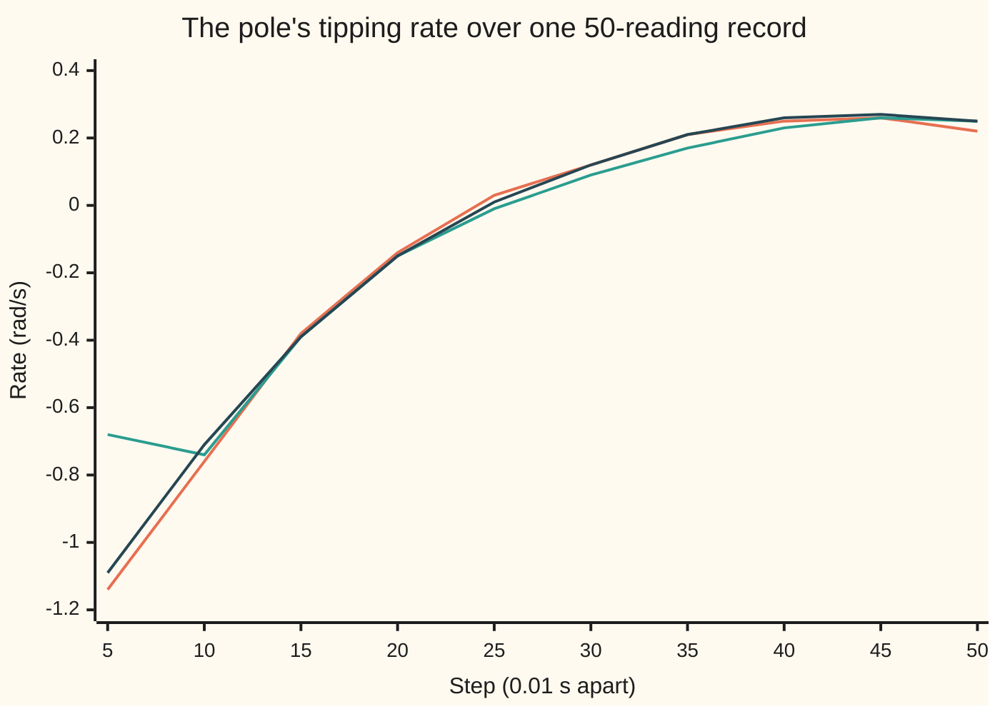
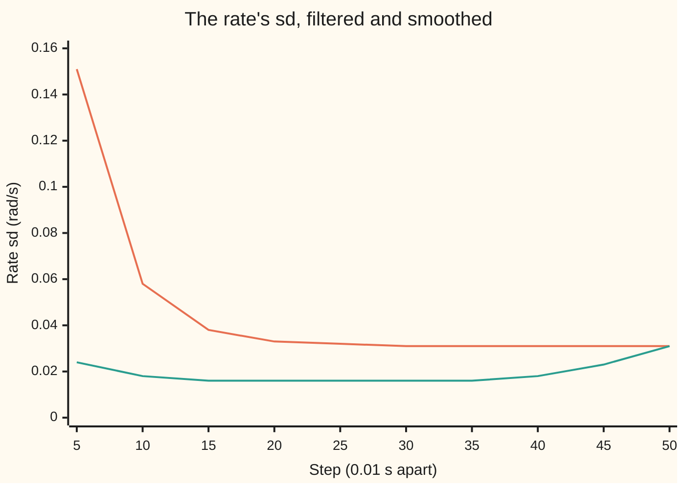

# Smoothing and square roots: use tomorrow's readings, and keep the covariance honest

[Syllabus](../../../SYLLABUS.md) → [Engineering mathematics](../README.md) → [State Space and Optimal Control](../README.md#s04) → Smoothing and square roots

---

## General Overview

The cart from [The Kalman filter](07-kalman-filter.md) balances its pole, 0.613125 m long. One encoder (a sensor that counts the pole's turning) reads the angle 100 times a second, off by about 0.005 rad at random. The filter estimates the pole's tipping **rate**, in radians per second, which no sensor reads. Here the cart runs for 50 readings, half a second, and the whole log is saved.

At each step the filter may use only the readings so far, because the controller needs an answer now. An engineer looking at the saved log later has no such limit. At step 5, the filter's rate was −0.68 rad/s. The true rate was −1.14 rad/s. The readings after step 5 show where the pole went next, and they put the rate at −1.09 rad/s.

**Smoothing** is the method that uses those later readings. The Rauch–Tung–Striebel (RTS) smoother runs the ordinary filter forward, then walks back from the last step to the first and corrects each estimate with what came after it. In the middle of the record it halves the rate's standard deviation (sd, the typical size of an error): 0.016 rad/s against the filter's 0.031 rad/s. At step 50 the two agree, because no reading comes after it.

The second half of the card is about arithmetic. A cheap chip may store numbers in **single precision**, about 7 significant digits. The filter's **covariance matrix** $`P`$ lists each error's variance and how the errors move together. Give the filter a fine encoder (sd 0.0001 rad, variance $`R = 10^{-8}`$ rad²) and a model with no random push. The two eigenvalues of $`P`$ (its variances along its two main directions) drift apart: by step 300, with the angle in rad and the rate in rad/s, the larger is $`1.104 \times 10^{11}`$ times the smaller. Call that ratio the **spread**. It is more than 7 digits can hold. At step 212 the usual update returns a negative eigenvalue: a negative variance, which is impossible.

The **square-root filter** stores a factor $`L`$ with $`L L^T = P`$ in place of $`P`$. A matrix times its own transpose never has a negative eigenvalue. The factor's spread is only the square root of $`P`$'s, so single precision holds it: at every printed step of a 300-step run it matches double precision to four digits.

**Run the filter forward, then walk back through the record, correcting each step's estimate by a gain times the gap between where the smoothed path went next and where the filter had predicted it would go; and carry the covariance as a triangular factor, updated by rotations, so rounding can never make it negative.**

**What kind of fact this is:** two kinds. The smoother is a theorem inside a model: given a linear model with normal noise of known size, it gives the exact mean and covariance of each state given every reading, proved in Why it works. The square-root filter is a numerical method. That its covariance can never have a negative eigenvalue is a theorem (Step 4). How many digits it saves is measured on this card, for this run.

### The picture: one record, filtered and smoothed



Orange: the true rate. Green: the filter, which at step 5 still lags at −0.68 rad/s. Dark blue: the smoother, at −1.09 rad/s at step 5 and on the orange line at most steps after that. At step 50 the green and blue lines meet at 0.25 rad/s. One simulated run (seed 1), plotted every fifth step.

---

## The formula

Notation first, in words. The state $`x_k`$ is the angle and the rate at step $`k`$, the $`k`$-th tick of the 100 hertz clock. As on [The Kalman filter](07-kalman-filter.md), a hat means "the estimate of", a raised minus means "predicted, before this step's reading", and a raised T is the transpose (rows turned into columns). $`\hat x_k`$ and $`P_k`$ are the filter's estimate and covariance after reading $`k`$. A raised $`s`$ marks the smoothed version, which uses all $`N = 50`$ readings.

**The RTS smoother.** Run the filter forward and keep its numbers. Start at the end with $`\hat x_N^{s} = \hat x_N`$ and $`P_N^{s} = P_N`$. Then, for $`k = N-1`$ down to 0:

```math
C_k = P_k\,F^T \left(P_{k+1}^-\right)^{-1}, \qquad \hat x_k^{s} = \hat x_k + C_k\left(\hat x_{k+1}^{s} - \hat x_{k+1}^-\right), \qquad P_k^{s} = P_k + C_k\left(P_{k+1}^{s} - P_{k+1}^-\right)C_k^T .
```

**Read it aloud:** the smoother gain is how the filter's error at step $`k`$ carries into its prediction for step $`k+1`$, divided by that prediction's uncertainty; move each estimate by the gain times the gap between the smoothed next state and the predicted next state, and move its covariance the same way.

**The square-root filter.** Store a lower-triangular $`L`$ (zeros above the diagonal) with $`L L^T = P`$, the Cholesky factor. Each step multiplies a short, wide block of numbers by an orthogonal matrix $`\Theta`$ (a rotation: $`\Theta\Theta^T = I`$, so lengths and angles are kept), chosen to put zeros where the triangle needs them. Predict, then correct:

```math
\begin{pmatrix} F L_{k} & \sqrt{Q} \end{pmatrix}\Theta_1 = \begin{pmatrix} L_{k+1}^- & 0 \end{pmatrix}, \qquad \begin{pmatrix} \sqrt{R} & H L_{k+1}^- \\ 0 & L_{k+1}^- \end{pmatrix}\Theta_2 = \begin{pmatrix} \sqrt{S} & 0 \\ \bar K & L_{k+1} \end{pmatrix}.
```

**Read it aloud:** to predict, rotate the stepped-forward factor and the push's factor into one new triangle; to correct, rotate a block holding the reading's noise and the predicted factor, and read off the surprise's sd, the gain times that sd, and the corrected factor.

The gain is $`K = \bar K / \sqrt{S}`$. Here the random push has one source, $`Q = g\,g^T`$, so $`\sqrt{Q}`$ is the single column $`g`$. No $`P`$ is ever formed, and no subtraction of two covariances happens.

| Symbol | Plain meaning | In our example | Push it up and the answer… |
| --- | --- | --- | --- |
| $`k`$, $`N`$ | step number, 0.01 s apart; the last step of the record | $`N = 50`$ | longer record: the middle steps stay at 0.016 rad/s |
| $`x_k`$, $`\hat x_k`$, $`P_k`$ | the true state (angle, rate) at step $`k`$; the filter's estimate and covariance after reading $`k`$ | step 49: rate 0.258311 rad/s, rate variance 987.587423 × 10⁻⁶ (rad/s)² | — |
| $`\hat x_{k+1}^-`$, $`P_{k+1}^-`$ | the prediction for step $`k+1`$, before its reading | from [The Kalman filter](07-kalman-filter.md) | — |
| $`\hat x_k^{s}`$, $`P_k^{s}`$, $`\Delta`$ | the smoothed estimate and covariance, given all $`N`$ readings; $`\Delta`$ is $`P_{50}^{s} - P_{50}^-`$ in the worked numbers | step 49: rate 0.252746 rad/s, rate variance 875.446207 × 10⁻⁶ (rad/s)² | — |
| $`C_k`$ | the smoother gain: how far step $`k`$ moves per unit of gap at step $`k+1`$ | step 49: rate per angle 1.808639 per s, rate per rate 0.803118 | — |
| $`F`$, $`G\,u`$ | one 0.01 s step of the pendulum; the cart's known push $`u`$ on it, through $`G`$ | as on the Kalman card | — |
| $`Q`$, $`g`$, $`w`$ | the random push's covariance; its single column; the push itself | push sd 1 rad/s² | later readings help less: step 25's smoothed rate variance is 0.243 of the filtered as modelled, 0.266 at $`10\,Q`$, 0.287 at $`100\,Q`$ |
| $`R`$, $`H`$ | the encoder's noise variance; `H = [1, 0]` picks the angle | 0.005² rad²; 10⁻⁸ rad² in the single-precision test | each reading counts for less |
| $`S`$, $`K`$, $`\bar K`$ | the surprise's variance; the filter gain; the gain times $`\sqrt{S}`$ | as on the Kalman card | — |
| $`L`$, $`L^-`$; $`U`$, $`D`$ | lower-triangular factors with $`L L^T = P`$; the UD filter's factors | step 300 spread: 3.323 × 10⁵ | — |
| $`\Theta`$, $`I`$; $`M`$ | an orthogonal matrix, built from plane rotations, with $`\Theta\Theta^T = I`$, the identity; the wide block that $`\Theta`$ turns into a triangle (Step 4) | one rotation per zero made | — |
| $`\lambda_{\min}`$, $`\varepsilon`$ | smallest eigenvalue of $`P`$; single precision's unit roundoff | $`\varepsilon = 5.960 \times 10^{-8}`$ | smaller $`\varepsilon`$: more steps before trouble |
| $`A \le B`$, $`z`$ | $`B - A`$ is positive semidefinite: $`z^T(B - A)z \ge 0`$ for every vector $`z`$ | $`P_k^{s} \le P_k`$ at every step (Step 3) | — |

The spread of $`P`$ is its largest eigenvalue divided by its smallest. The spread of $`L`$ is the same ratio for its singular values (the stretch factors of $`L`$), and it is the square root of $`P`$'s.

### When it holds

- **The whole record is in hand.** The smoothed estimate at step $`k`$ waits for reading $`N`$. A controller needs its answer now, so it runs on the filter; the smoother is for logs, calibration and replay. Smoothing with only a few later readings is the compromise, at the cost of that many steps of lag.
- **The model and the noise sizes are right.** The smoother inherits every assumption of the filter. Told a push variance $`Q`$ 100 times too small, it claims far less error than it makes (What breaks, below).
- **The known input is in both passes.** The backward pass compares the smoothed next state with the filter's prediction, which contains $`G\,u`$. Leave it out there and every cart push looks like a gap to correct.
- **The predicted covariance is invertible.** $`C_k`$ needs $`(P_{k+1}^-)^{-1}`$. Here it always is, because $`F`$ is invertible and the start was uncertain in every direction. A state known exactly would need another form of the smoother.
- **The factor's spread fits the precision.** The square-root filter needs the spread of $`L`$, not of $`P`$, to be well inside $`1/\varepsilon`$. At step 300, $`P`$'s spread is $`1.104 \times 10^{11}`$, beyond single precision, while $`L`$'s is $`3.323 \times 10^{5}`$. A run long enough to push $`L`$'s spread past $`1/\varepsilon`$ would defeat the square-root filter too.

---

## Why it works

### Step 0: once the next state is known, later readings add nothing

The readings after step $`k+1`$ depend on the past only through the state at step $`k+1`$. So if $`x_{k+1}`$ were known exactly, they would say nothing more about $`x_k`$. This is the Markov property: the state carries all the history that matters.

That splits smoothing into two easy moves. First, use the filter's information up to step $`k`$ to say how $`x_k`$ would shift if $`x_{k+1}`$ were known. Then average that over what all $`N`$ readings say about $`x_{k+1}`$, which is the smoothed belief one step later. Start from the last step, where filtered and smoothed are the same thing, and walk back.

### Step 1: how the state shifts if the next state is known

Given readings 1 to $`k`$, the state $`x_k`$ and the next state $`x_{k+1} = F x_k + G u_{k+1} + w_{k+1}`$ are jointly normal. The random push $`w_{k+1}`$ over that step has covariance $`Q`$ and is independent of $`x_k`$. So:

- $`x_k`$ has covariance $`P_k`$;
- $`x_k`$ and $`x_{k+1}`$ co-vary by $`P_k F^T`$;
- $`x_{k+1}`$ has covariance $`F P_k F^T + Q = P_{k+1}^-`$, and mean $`\hat x_{k+1}^-`$.

Conditioning one block of a normal vector on another, the same move as the filter's correction, gives a mean $`\hat x_k + C_k(x_{k+1} - \hat x_{k+1}^-)`$ and a covariance $`P_k - C_k P_{k+1}^- C_k^T`$, with $`C_k = P_k F^T (P_{k+1}^-)^{-1}`$. The gain is a regression coefficient: how much $`x_k`$ moves per unit of surprise in $`x_{k+1}`$.

### Step 2: average over what the whole record says about the next state

By Step 0, adding the later readings changes nothing once $`x_{k+1}`$ is fixed. So the smoothed belief about $`x_k`$ is Step 1's belief, averaged over $`x_{k+1}`$ drawn from its smoothed law: mean $`\hat x_{k+1}^{s}`$, covariance $`P_{k+1}^{s}`$.

The mean of a linear rule is the rule applied to the mean. That gives the formula for $`\hat x_k^{s}`$. The covariance is the average spread left inside (Step 1's covariance) plus the spread of the shifting mean ($`C_k P_{k+1}^{s} C_k^T`$). Adding them gives the formula for $`P_k^{s}`$.

<details>
<summary>The covariance, line by line</summary>

The law of total covariance says: total spread equals the average of the conditional spread plus the spread of the conditional mean. Here the conditional spread is the same for every $`x_{k+1}`$, and the conditional mean is $`\hat x_k + C_k(x_{k+1} - \hat x_{k+1}^-)`$, a fixed matrix $`C_k`$ times $`x_{k+1}`$ plus a constant. So

$`\displaystyle P_k^{s} = \left(P_k - C_k P_{k+1}^- C_k^T\right) + C_k P_{k+1}^{s} C_k^T = P_k + C_k\left(P_{k+1}^{s} - P_{k+1}^-\right)C_k^T .`$

The mean follows the same way:

$`\displaystyle \hat x_k^{s} = E\left[\hat x_k + C_k(x_{k+1} - \hat x_{k+1}^-)\right] = \hat x_k + C_k\left(\hat x_{k+1}^{s} - \hat x_{k+1}^-\right).`$

Both rest on the model being linear with normal noise, so that conditioning gives a linear mean and a fixed covariance.

</details>

The code checks this a second way, with no backward pass. It writes all 51 states and all 50 readings as one big normal vector, builds the 50 × 50 covariance of the readings, and conditions on all of them at once. Across all 51 steps the largest gap between the two answers is $`3.984 \times 10^{-13}`$.

### Step 3: the smoothed covariance is never larger

In the sense of [Quadratic forms](../../03-Algebra/07-Eigenvalues%20and%20Symmetric%20Matrices/05-quadratic-forms-and-positive-definite.md), write $`A \le B`$ when $`B - A`$ is positive semidefinite: $`z^T(B - A)z \ge 0`$ for every $`z`$. A reading never adds uncertainty, so $`P_{k+1} \le P_{k+1}^-`$. Suppose $`P_{k+1}^{s} \le P_{k+1}`$. Then $`P_{k+1}^{s} - P_{k+1}^- \le 0`$, and so $`P_k^{s} - P_k = C_k (P_{k+1}^{s} - P_{k+1}^-)C_k^T \le 0`$. Starting from equality at step $`N`$, this walks back to every step.

So in theory the smoothed variance is never above the filtered one. Here the code finds it strictly below, for both the angle and the rate, at every step from 1 to 49. At step 50 they are equal by construction; the code checks the filter's variances there against batch conditioning.



Orange: the filter's rate sd, which starts wide and settles at 0.031 rad/s. Green: the smoother's, flat at 0.016 rad/s in the middle and rising to meet the filter at step 50. The covariance does not depend on the readings, so this chart holds for every run.

### Step 4: a matrix times its own transpose is never negative

For any matrix $`M`$ and any vector $`z`$, $`z^T M M^T z = |M^T z|^2 \ge 0`$. So every $`M M^T`$ is positive semidefinite: no negative eigenvalue, whatever the entries of $`M`$ are, rounded or not.

The square-root filter writes every covariance in that shape:

- **Predict.** $`P^- = F P F^T + Q = (F L)(F L)^T + g g^T`$, which is $`M M^T`$ for the wide block $`M = (F L \;\; g)`$.
- **Correct.** Multiply out the block in the formula, $`M = \begin{pmatrix} \sqrt{R} & H L^- \\ 0 & L^- \end{pmatrix}`$. Then $`M M^T`$ has corner $`R + H P^- H^T = S`$, off-corner $`P^- H^T`$, and lower block $`P^-`$. The triangle on the right has the same product only if $`\bar K = P^- H^T/\sqrt{S}`$ and $`L L^T = P^- - P^- H^T S^{-1} H P^-`$: the gain and the corrected covariance of the Kalman filter.

An orthogonal $`\Theta`$ does not change the product: $`(M\Theta)(M\Theta)^T = M \Theta \Theta^T M^T = M M^T`$. So any rotation of $`M`$ into a triangle gives the new factor. Making the zeros one at a time with plane rotations, each mixing two columns, is a QR factorisation: the matrix form of [Gram-Schmidt](../../03-Algebra/06-Dot%20Products%20and%20Best%20Fits/03-gram-schmidt-and-orthonormal-bases.md), done by rotations because they lose less to rounding.

Rounding now perturbs $`L`$, and a perturbed $`L`$ still gives $`L L^T \ge 0`$. The plain update instead forms $`P^- - K H P^-`$, a subtraction of two nearly equal matrices, and rounding can push the difference below zero.

### Step 5: the factor needs half the digits

The eigenvalues of $`L L^T`$ are the squares of the singular values of $`L`$. So the factor's spread is the square root of the covariance's.

Single precision rounds each number with relative error up to $`\varepsilon = 5.960 \times 10^{-8}`$, the unit roundoff. An eigenvalue of $`P`$ smaller than about $`\varepsilon`$ times the largest is buried in the rounding of the large entries. The run below has no push, so the uncertainty along one mix of angle and rate keeps shrinking. Between steps 250 and 300 it shrinks by 0.923116 per step, which is $`e^{-0.08}`$ = 0.923116: the pendulum's stable mode (the motion that dies away by itself) fades as $`e^{-4t}`$, and a variance goes as its square. The largest eigenvalue settles at $`1.307 \times 10^{-8}`$.

| Smallest eigenvalue at step | 50 | 100 | 150 | 200 | 250 | 300 |
| --- | --- | --- | --- | --- | --- | --- |
| double precision | 5.068e-11 | 1.047e-12 | 1.926e-14 | 3.529e-16 | 6.463e-18 | 1.184e-19 |
| single, plain update | 5.069e-11 | 1.047e-12 | 1.905e-14 | 3.657e-16 | **−1.509e-23** | 3.657e-16 |
| single, Joseph form | 5.068e-11 | 1.047e-12 | 1.936e-14 | 3.135e-16 | **−3.772e-24** | **−3.772e-24** |
| single, square root | 5.068e-11 | 1.047e-12 | 1.926e-14 | 3.529e-16 | 6.463e-18 | 1.184e-19 |

Once the smallest eigenvalue falls below about $`\varepsilon`$ times $`1.307 \times 10^{-8}`$, near step 200, the plain update's value is rounding noise. It first goes negative at step 212. The Joseph form from [The Kalman filter](07-kalman-filter.md) adds a never-negative term to a never-negative term, but it still forms $`P`$ itself in single precision and goes negative at step 206. The square-root filter, in single precision, matches double precision to all four printed digits at step 300, where $`P`$'s spread is $`1.104 \times 10^{11}`$ and $`L`$'s is $`3.323 \times 10^{5}`$.

A close cousin, the **UD filter**, stores $`P = U D U^T`$ with $`U`$ unit upper-triangular and $`D`$ diagonal. It keeps the same protection and needs no square roots, which mattered on early flight computers. $`D`$ holds the variances themselves and $`U`$, with ones on its diagonal, only how the directions mix, so its updates rework $`U`$ and $`D`$ a column at a time with multiplication, division and addition. Simon's textbook (Sources, chapter 6) derives it; this card does not.

---

## Worked numbers, by hand

The last backward step, from step 50 to step 49, on the rate. The code computes the gain $`C_{49}`$ from $`P_{49}`$, $`F`$ and $`P_{50}^-`$. Write $`\Delta = P_{50}^{s} - P_{50}^-`$: what the later readings, here only reading 50, removed from the prediction for step 50. Variances are in units of $`10^{-6}`$ (rad/s)², or rad² and rad²/s for the other entries.

| Step | Arithmetic | Value |
| --- | --- | --- |
| gain, rate per angle (per s) | from $`P_{49} F^T (P_{50}^-)^{-1}`$ | 1.808639 |
| gain, rate per rate | same | 0.803118 |
| $`\Delta`$: angle variance, angle-rate covariance, rate variance (× 10⁻⁶) | $`P_{50} - P_{50}^-`$ | −1.086777, −11.298460, −117.462217 |
| angle term | 1.808639² × (−1.086777) | −3.555038 |
| cross term | 2 × 1.808639 × 0.803118 × (−11.298460) | −32.823182 |
| rate term | 0.803118² × (−117.462217) | −75.762996 |
| filtered rate variance at step 49 (× 10⁻⁶) | from the forward pass | 987.587423 |
| **smoothed rate variance at step 49 (× 10⁻⁶)** | 987.587423 − 3.555038 − 32.823182 − 75.762996 | **875.446207** |
| same, by conditioning on all 50 readings at once | the batch road | 875.446208 |
| gap at step 50: smoothed minus predicted | angle (rad); rate (rad/s) | −0.000548; −0.005696 |
| **smoothed rate at step 49 (rad/s)** | 0.258311 + 1.808639 × (−0.000548) + 0.803118 × (−0.005696) | **0.252746** |

The last line gives 0.252745 from the rounded inputs; the code, unrounded, gives 0.252746. Reading 50 came in below its prediction, so the smoother pulls step 49's rate down from 0.258311 to 0.252746 rad/s, toward the true 0.224946 rad/s.

### What breaks if you drop a piece

The first two rows run the broken smoother on the same 2,000 simulated records; the last two are the 300-step single-precision run. The error is the root mean square (rms: the square root of the average squared error) of the rate over all 50 steps; "claims" is the same average of the method's own sd. The forward filter makes 0.1127 rad/s and claims 0.1131. The smoother makes 0.0200 rad/s and claims 0.0199. Both averages are pulled up by the wide start.

| Mistake | Comes out at | What went wrong |
| --- | --- | --- |
| Leave $`G\,u`$ out of the backward pass's prediction | 0.0936 rad/s, while claiming 0.0199 | Every cart push looks like a gap, and the smoother corrects for it |
| Tell both passes $`Q`$ is 100 times smaller | 0.0276 rad/s, while claiming 0.0061 | The smoother trusts the model's path too much and spreads errors along it |
| Plain update in single precision, $`R = 10^{-8}`$, no push | smallest eigenvalue first negative at step 212; −1.509e-23 at step 250 | Subtracting nearly equal matrices loses the small eigenvalue to rounding |
| Joseph form in single precision, same run | first negative at step 206 | Each term is safe, but $`P`$ itself still cannot hold a spread of $`10^{11}`$ in 7 digits |

---

## Code, from first principles, and it actually runs

The script simulates 50 readings of the balancing cart with the generator and seed of [The Kalman filter](07-kalman-filter.md), so reading 1 is the same −0.024350 rad. It takes four roads. The RTS pass is checked against batch conditioning on all 50 readings at once, by a written-out Cholesky solve. The filter and the smoother are checked against the real errors of 2,000 simulated records. The covariance alone is run for 300 steps in single precision (both languages round to single precision after every operation, which gives the same result as native single-precision arithmetic; the square-root run never forms $`P`$, so its eigenvalues are read from $`L L^T`$ multiplied out in double) and compared with double precision. In double precision, the square-root update is checked against the plain one.

### Python

```python
# RTS smoothing and square-root filters on the balancing pendulum -- the check behind the card. Standard library only. Roads: RTS
# vs batch conditioning on all 50 readings, both vs 2000 simulated runs; single-precision updates vs double precision.
import math, struct; from functools import reduce
L, SA, SR, N = 9.81 / 16, 1.0, 0.005, 50                 # pole (m); push sd (rad/s^2); encoder sd (rad); readings at 100 Hz
ch, sh = math.cosh(0.04), math.sinh(0.04)
F, g = [[ch, sh / 4], [4 * sh, ch]], [(ch - 1) / 16, sh / 4]   # one 0.01 s step; what a 1 rad/s^2 push adds
G, R, P0, M64 = [-g[0] / L, -g[1] / L], SR * SR, [[0.0025, 0.0], [0.0, 0.25]], (1 << 64) - 1
def Qm(q): return [[q * SA * SA * g[i] * g[j] for j in range(2)] for i in range(2)]
class Rng:                                                  # SplitMix64 bits, Box-Muller normals (as on The Kalman filter)
    def __init__(s, seed): s.s = seed
    def u(s):
        s.s = (s.s + 0x9E3779B97F4A7C15) & M64
        z = ((s.s ^ (s.s >> 30)) * 0xBF58476D1CE4E5B9) & M64
        z = ((z ^ (z >> 27)) * 0x94D049BB133111EB) & M64
        return ((z ^ (z >> 31)) >> 11) / 2.0 ** 53
    def n(s): a = 1.0 - s.u(); return math.sqrt(-2.0 * math.log(a)) * math.cos(2.0 * math.pi * s.u())
def tot(it): return reduce(lambda a, b: a + b, it, 0.0)     # plain left-to-right sum, as in Rust
def mm(A, B): return [[A[i][0] * B[0][j] + A[i][1] * B[1][j] for j in range(2)] for i in range(2)]
def tr(A): return [[A[0][0], A[1][0]], [A[0][1], A[1][1]]]
def add(A, B, s=1.0): return [[A[i][j] + s * B[i][j] for j in range(2)] for i in range(2)]
def inv(A): d = A[0][0] * A[1][1] - A[0][1] * A[1][0]; return [[A[1][1] / d, -A[0][1] / d], [-A[1][0] / d, A[0][0] / d]]
def mv(A, v): return [A[0][0] * v[0] + A[0][1] * v[1], A[1][0] * v[0] + A[1][1] * v[1]]
def fstep(x, P, u, y, q=1.0):                              # one predict-and-correct step of The Kalman filter
    xm = [a + b * u for a, b in zip(mv(F, x), G)]; Pm = add(mm(mm(F, P), tr(F)), Qm(q))
    S = Pm[0][0] + R; K = [Pm[0][0] / S, Pm[1][0] / S]; nu = y - xm[0]
    return xm, Pm, [xm[0] + K[0] * nu, xm[1] + K[1] * nu], [[Pm[i][j] - K[i] * Pm[0][j] for j in range(2)] for i in range(2)]
def filt(ys, us, q=1.0):                                    # forward pass; index 0 is the start, 1..N the readings
    xf, Pf, xm, Pm = [[0.0, 0.0]], [P0], [None], [None]
    for k in range(1, N + 1):
        a, b, c, d = fstep(xf[-1], Pf[-1], us[k], ys[k], q); xm.append(a); Pm.append(b); xf.append(c); Pf.append(d)
    return xf, Pf, xm, Pm
def smooth(xf, Pf, xm, Pm, us, use_u=True):                 # the RTS backward pass
    xs, Ps, Cs = [None] * N + [xf[N]], [None] * N + [Pf[N]], [None] * (N + 1)
    for k in range(N - 1, -1, -1):
        C = mm(mm(Pf[k], tr(F)), inv(Pm[k + 1])); Cs[k] = C
        pred = xm[k + 1] if use_u else mv(F, xf[k])
        d = mv(C, [xs[k + 1][0] - pred[0], xs[k + 1][1] - pred[1]]); xs[k] = [xf[k][0] + d[0], xf[k][1] + d[1]]
        Ps[k] = add(Pf[k], mm(mm(C, add(Ps[k + 1], Pm[k + 1], -1.0)), tr(C)))
    return xs, Ps, Cs
def run(seed):                                              # the cart balances on the right filter's estimates
    r = Rng(seed); t = [0.05 * r.n(), 0.5 * r.n()]; ts, ys, us = [t], [0.0], [0.0]; x, P = [0.0, 0.0], P0
    for k in range(1, N + 1):
        u = L * (32 * x[0] + 8 * x[1]); w = SA * r.n()
        t = [a + b * u + c * w for a, b, c in zip(mv(F, t), G, g)]; y = t[0] + SR * r.n()
        ts.append(t); ys.append(y); us.append(u); _, _, x, P = fstep(x, P, u, y)
    return ts, ys, us
def batch(ys, us):                                          # condition the joint normal law of all states on all readings
    Fp, m, Sg = [[[1.0, 0.0], [0.0, 1.0]]], [[0.0, 0.0]], [P0]
    for k in range(1, N + 1):
        Fp.append(mm(F, Fp[-1])); m.append([a + b * us[k] for a, b in zip(mv(F, m[-1]), G)]); Sg.append(add(mm(mm(F, Sg[-1]), tr(F)), Qm(1.0)))
    def cxy(k, i):                                          # covariance of state k with reading i
        if i <= k: M = mm(Fp[k - i], Sg[i]); return (M[0][0], M[1][0])
        M = mm(Fp[i - k], Sg[k]); return (M[0][0], M[0][1])
    A = [[cxy(j, i)[0] + (R if i == j else 0.0) for j in range(1, N + 1)] for i in range(1, N + 1)]
    Lc = [[0.0] * N for _ in range(N)]                      # Cholesky A = Lc Lc^T, then two triangular solves
    for i in range(N):
        for j in range(i + 1):
            s = A[i][j] - tot(Lc[i][p] * Lc[j][p] for p in range(j))
            Lc[i][j] = math.sqrt(s) if i == j else s / Lc[j][j]
    def solve(b):                                           # forward, then backward substitution
        z = [0.0] * N
        for i in range(N): z[i] = (b[i] - tot(Lc[i][p] * z[p] for p in range(i))) / Lc[i][i]
        for i in range(N - 1, -1, -1): z[i] = (z[i] - tot(Lc[p][i] * z[p] for p in range(i + 1, N))) / Lc[i][i]
        return z
    a, out = solve([ys[i] - m[i][0] for i in range(1, N + 1)]), []
    for k in range(N + 1):                                  # mean and the two variances of state k given every reading
        c = [cxy(k, i) for i in range(1, N + 1)]; bb = [solve([v[j] for v in c]) for j in range(2)]
        out.append(([m[k][j] + tot(c[i][j] * a[i] for i in range(N)) for j in range(2)], [Sg[k][j][j] - tot(c[i][j] * bb[j][i] for i in range(N)) for j in range(2)]))
    return out
def sci(v): m, e = f"{v:.3e}".split("e"); return f"{m}e{int(e)}"
# ---- one record of 50 readings (seed 1): forward filter, backward pass, batch conditioning ----
ts, ys, us = run(1); xf, Pf, xm, Pm = filt(ys, us); xs, Ps, Cs = smooth(xf, Pf, xm, Pm, us); bt = batch(ys, us)
C, D = Cs[49], add(Ps[50], Pm[50], -1.0); T = [C[1][0] ** 2 * D[0][0], 2 * C[1][0] * C[1][1] * D[0][1], C[1][1] ** 2 * D[1][1]]
for lab, v in [("reading 1 (rad)", ys[1]), ("C49 rate<-angle (1/s)", C[1][0]), ("C49 rate<-rate", C[1][1]),
               ("D50 angle var x1e6", 1e6 * D[0][0]), ("D50 angle-rate cov x1e6", 1e6 * D[0][1]), ("D50 rate var x1e6", 1e6 * D[1][1]),
               ("term c10^2 D00 x1e6", 1e6 * T[0]), ("term 2 c10 c11 D01 x1e6", 1e6 * T[1]), ("term c11^2 D11 x1e6", 1e6 * T[2]),
               ("step 49 filtered rate var x1e6", 1e6 * Pf[49][1][1]), ("step 49 smoothed rate var x1e6", 1e6 * Ps[49][1][1]),
               ("  by batch conditioning", 1e6 * bt[49][1][1]), ("step 50 angle: smoothed - predicted", xs[50][0] - xm[50][0]),
               ("step 50 rate: smoothed - predicted", xs[50][1] - xm[50][1]), ("step 49 filtered rate (rad/s)", xf[49][1]),
               ("step 49 smoothed rate (rad/s)", xs[49][1]), ("  by batch conditioning", bt[49][0][1]), ("step 49 true rate (rad/s)", ts[49][1])]: print(f"{lab:<40} {v:>12.6f}")
gap = max(max(abs(xs[k][j] - bt[k][0][j]) for j in range(2)) + max(abs(Ps[k][j][j] - bt[k][1][j]) for j in range(2)) for k in range(N + 1))
print(f"largest gap, RTS vs batch, over all 51 steps   {sci(gap)}")
print("step              " + " ".join(f"{k:6d}" for k in range(5, N + 1, 5)))
for lab, P in [("rate sd, filtered ", Pf), ("rate sd, smoothed ", Ps)]: print(lab + " ".join(f"{math.sqrt(P[k][1][1]):6.3f}" for k in range(5, N + 1, 5)))
for lab, X in [("seed 1 true rate  ", ts), ("seed 1 filter rate", xf), ("seed 1 smooth rate", xs)]: print(lab + " ".join(f"{X[k][1]:6.2f}" for k in range(5, N + 1, 5)))
print("step 25 rate variance, smoothed / filtered, Q x1 x10 x100:", *(f"{smooth(*f, us)[1][25][1][1] / f[1][25][1][1]:.3f}" for f in (filt(ys, us, q) for q in (1.0, 10.0, 100.0))))
# ---- 2000 records: actual errors against the claimed sd, and two broken smoothers ----
acc, n = [0.0] * 4, 0
for seed in range(1, 2001):
    ts, ys, us = run(seed); fw, fq = filt(ys, us), filt(ys, us, 0.01); n += N
    for i, e in enumerate([fw[0], smooth(*fw, us)[0], smooth(*fw, us, False)[0], smooth(*fq, us)[0]]): acc[i] += tot((e[k][1] - ts[k][1]) ** 2 for k in range(1, N + 1))
cl = [math.sqrt(tot(P[k][1][1] for k in range(1, N + 1)) / N) for P in (Pf, Ps, Ps, smooth(*filt(ys, us, 0.01), us)[1])]
st, NM = [math.sqrt(a / n) for a in acc], ["forward filter", "RTS smoother", "smoother, G u left out", "smoother, Q 100x too small"]
for nm, e, c in zip(NM, st, cl): print(f"{nm:<27} rate rms {e:.4f}  claimed {c:.4f} rad/s")
# ---- single precision: a precise encoder (R = 1e-8 rad^2), no modelled push (Q = 0), 300 steps of the covariance alone ----
def f32(x): return struct.unpack("f", struct.pack("f", x))[0]
def rot(M, r):                                              # Givens rotations on columns: lower-triangular T with T T^T = M M^T
    M = [row[:] for row in M]
    for i in range(len(M)):
        for k in range(i + 1, len(M[0])):
            a, b = M[i][i], M[i][k]
            if b == 0.0: continue
            h = r(math.sqrt(r(r(a * a) + r(b * b)))); c, s = r(a / h), r(b / h)
            for row in M: row[i], row[k] = r(r(c * row[i]) + r(s * row[k])), r(r(c * row[k]) - r(s * row[i]))
    return M
def lmin(P):                                                # smallest eigenvalue of the symmetric part, as det / largest
    a, b, d = P[0][0], (P[0][1] + P[1][0]) / 2, P[1][1]; return (a * d - b * b) / ((a + d + math.sqrt((a - d) ** 2 + 4 * b * b)) / 2)
def cov32(form, r, steps=300, Rv=1e-8):
    Ff, Rf, P, Lf, sR, first, out = [[r(v) for v in row] for row in F], r(Rv), [[r(P0[0][0]), 0.0], [0.0, r(P0[1][1])]], [[r(0.05), 0.0], [0.0, r(0.5)]], r(math.sqrt(Rv)), None, {}
    for k in range(1, steps + 1):
        if form == "square root":                           # predict: rotate [F L]; correct: rotate [[sqrt R, H L], [0, L]]
            FL = [[r(r(Ff[i][0] * Lf[0][j]) + r(Ff[i][1] * Lf[1][j])) for j in range(2)] for i in range(2)]
            Lm = rot(FL, r); post = rot([[sR, Lm[0][0], 0.0], [0.0, Lm[0][0], 0.0], [0.0, Lm[1][0], Lm[1][1]]], r)
            Lf = [[post[1][1], 0.0], [post[2][1], post[2][2]]]; P = mm(Lf, tr(Lf))
        else:
            FP = [[r(r(Ff[i][0] * P[0][j]) + r(Ff[i][1] * P[1][j])) for j in range(2)] for i in range(2)]
            Pm = [[r(r(FP[i][0] * Ff[j][0]) + r(FP[i][1] * Ff[j][1])) for j in range(2)] for i in range(2)]
            S = r(Pm[0][0] + Rf); K = [r(Pm[0][0] / S), r(Pm[1][0] / S)]
            if form == "plain": P = [[r(Pm[i][j] - r(K[i] * Pm[0][j])) for j in range(2)] for i in range(2)]
            else:                                           # Joseph: (I - K H) P- (I - K H)^T + K R K^T
                A = [[r(1.0 - K[0]), 0.0], [r(-K[1]), 1.0]]; AP = [[r(r(A[i][0] * Pm[0][j]) + r(A[i][1] * Pm[1][j])) for j in range(2)] for i in range(2)]
                P = [[r(r(r(AP[i][0] * A[j][0]) + r(AP[i][1] * A[j][1])) + r(r(K[i] * K[j]) * Rf)) for j in range(2)] for i in range(2)]
        if first is None and lmin(P) < 0: first = k
        if k % 50 == 0: out[k] = lmin(P)
    return out, first, P
ref = cov32("plain", lambda v: v); res = {fm: cov32(fm, f32) for fm in ("plain", "Joseph", "square root")}
print("smallest eigenvalue   step " + "".join(f"{k:>11d}" for k in ref[0]))
for nm, (o, fi, _) in [("double precision", ref)] + [(f"single, {fm}", v) for fm, v in res.items()]:
    print(f"{nm:<26} " + "".join(f"{sci(v):>11}" for v in o.values()) + f"   first negative: {fi if fi else 'never'}")
lmx = ref[2][0][0] + ref[2][1][1] - ref[0][300]             # largest eigenvalue: trace minus smallest
print(f"step 300: largest eigenvalue {sci(lmx)}, ratio {sci(lmx / ref[0][300])}; for the factor {sci(math.sqrt(lmx / ref[0][300]))}")
print(f"single-precision unit roundoff {sci(2.0 ** -24)}; per-step shrink of the smallest, steps 250 to 300: {(ref[0][300] / ref[0][250]) ** 0.02:.6f}, e^-0.08 = {math.exp(-0.08):.6f}")
assert gap < 1e-10, "RTS backward pass vs batch conditioning on all 50 readings"
assert all(Ps[k][j][j] < Pf[k][j][j] for k in range(1, N) for j in range(2)) and all(abs(Pf[N][j][j] - bt[N][1][j]) < 1e-12 for j in range(2)), "smoothed below filtered; filter equals batch at the end"
assert all(abs(e / c - 1) < 0.03 for e, c in zip(st[:2], cl[:2])), "simulated errors vs the claimed sd: filter and smoother"
assert st[2] > 3 * cl[2] and st[3] > 3 * cl[3], "broken smoothers claim far less error than they make"
assert all(abs(res["square root"][0][k] / v - 1) < 0.01 for k, v in ref[0].items()), "single-precision square root vs double"
assert ref[1] is None and res["plain"][1] is not None and res["Joseph"][1] is not None, "double holds; plain and Joseph go negative"
assert abs(cov32("square root", lambda v: v)[0][300] / ref[0][300] - 1) < 1e-3, "square-root form vs plain form, both in double"
print("ALL CHECKS PASS")
```

**Ran 2026-11-23 on macOS, Python 3.14.10, standard library only. All checks passed. Output, pasted from the run:**

```
reading 1 (rad)                             -0.024350
C49 rate<-angle (1/s)                        1.808639
C49 rate<-rate                               0.803118
D50 angle var x1e6                          -1.086777
D50 angle-rate cov x1e6                    -11.298460
D50 rate var x1e6                         -117.462217
term c10^2 D00 x1e6                         -3.555038
term 2 c10 c11 D01 x1e6                    -32.823182
term c11^2 D11 x1e6                        -75.762996
step 49 filtered rate var x1e6             987.587423
step 49 smoothed rate var x1e6             875.446207
  by batch conditioning                    875.446208
step 50 angle: smoothed - predicted         -0.000548
step 50 rate: smoothed - predicted          -0.005696
step 49 filtered rate (rad/s)                0.258311
step 49 smoothed rate (rad/s)                0.252746
  by batch conditioning                      0.252746
step 49 true rate (rad/s)                    0.224946
largest gap, RTS vs batch, over all 51 steps   3.984e-13
step                   5     10     15     20     25     30     35     40     45     50
rate sd, filtered  0.151  0.058  0.038  0.033  0.032  0.031  0.031  0.031  0.031  0.031
rate sd, smoothed  0.024  0.018  0.016  0.016  0.016  0.016  0.016  0.018  0.023  0.031
seed 1 true rate   -1.14  -0.76  -0.38  -0.14   0.03   0.12   0.21   0.25   0.26   0.22
seed 1 filter rate -0.68  -0.74  -0.39  -0.15  -0.01   0.09   0.17   0.23   0.26   0.25
seed 1 smooth rate -1.09  -0.71  -0.39  -0.15   0.01   0.12   0.21   0.26   0.27   0.25
step 25 rate variance, smoothed / filtered, Q x1 x10 x100: 0.243 0.266 0.287
forward filter              rate rms 0.1127  claimed 0.1131 rad/s
RTS smoother                rate rms 0.0200  claimed 0.0199 rad/s
smoother, G u left out      rate rms 0.0936  claimed 0.0199 rad/s
smoother, Q 100x too small  rate rms 0.0276  claimed 0.0061 rad/s
smallest eigenvalue   step          50        100        150        200        250        300
double precision             5.068e-11  1.047e-12  1.926e-14  3.529e-16  6.463e-18  1.184e-19   first negative: never
single, plain                5.069e-11  1.047e-12  1.905e-14  3.657e-16 -1.509e-23  3.657e-16   first negative: 212
single, Joseph               5.068e-11  1.047e-12  1.936e-14  3.135e-16 -3.772e-24 -3.772e-24   first negative: 206
single, square root          5.068e-11  1.047e-12  1.926e-14  3.529e-16  6.463e-18  1.184e-19   first negative: never
step 300: largest eigenvalue 1.307e-8, ratio 1.104e11; for the factor 3.323e5
single-precision unit roundoff 5.960e-8; per-step shrink of the smallest, steps 250 to 300: 0.923116, e^-0.08 = 0.923116
ALL CHECKS PASS
```

### Rust

```rust
// RTS smoothing and square-root filters on the balancing pendulum -- the same check as rts_smoothing_and_square_root_filters_check.py,
// in Rust, no crates. Roads: RTS vs batch conditioning on all 50 readings, both vs 2000 simulated runs; single-precision updates
// vs double precision.
type M2 = [[f64; 2]; 2]; type V2 = [f64; 2];
const L: f64 = 9.81 / 16.0; const SA: f64 = 1.0; const SR: f64 = 0.005; const N: usize = 50;
const R: f64 = SR * SR; const P0: M2 = [[0.0025, 0.0], [0.0, 0.25]];
struct Md { f: M2, g: V2, gu: V2 }
struct Rng { s: u64 }                                       // SplitMix64 bits, Box-Muller normals (as on The Kalman filter)
impl Rng {
    fn u(&mut self) -> f64 {
        self.s = self.s.wrapping_add(0x9E3779B97F4A7C15);
        let mut z = (self.s ^ (self.s >> 30)).wrapping_mul(0xBF58476D1CE4E5B9); z = (z ^ (z >> 27)).wrapping_mul(0x94D049BB133111EB);
        ((z ^ (z >> 31)) >> 11) as f64 / 9007199254740992.0
    }
    fn n(&mut self) -> f64 { let a = 1.0 - self.u(); (-2.0 * a.ln()).sqrt() * (2.0 * std::f64::consts::PI * self.u()).cos() }
}
fn mm(a: &M2, b: &M2) -> M2 { std::array::from_fn(|i| std::array::from_fn(|j| a[i][0] * b[0][j] + a[i][1] * b[1][j])) }
fn tr(a: &M2) -> M2 { [[a[0][0], a[1][0]], [a[0][1], a[1][1]]] }
fn add(a: &M2, b: &M2, s: f64) -> M2 { std::array::from_fn(|i| std::array::from_fn(|j| a[i][j] + s * b[i][j])) }
fn inv(a: &M2) -> M2 { let d = a[0][0] * a[1][1] - a[0][1] * a[1][0]; [[a[1][1] / d, -a[0][1] / d], [-a[1][0] / d, a[0][0] / d]] }
fn mv(a: &M2, v: V2) -> V2 { [a[0][0] * v[0] + a[0][1] * v[1], a[1][0] * v[0] + a[1][1] * v[1]] }
fn qm(m: &Md, q: f64) -> M2 { std::array::from_fn(|i| std::array::from_fn(|j| q * SA * SA * m.g[i] * m.g[j])) }
fn fstep(m: &Md, x: V2, p: &M2, u: f64, y: f64, q: f64) -> (V2, M2, V2, M2) {   // one predict-and-correct step
    let fx = mv(&m.f, x); let xm = [fx[0] + m.gu[0] * u, fx[1] + m.gu[1] * u]; let pm = add(&mm(&mm(&m.f, p), &tr(&m.f)), &qm(m, q), 1.0);
    let s = pm[0][0] + R; let k = [pm[0][0] / s, pm[1][0] / s]; let nu = y - xm[0];
    (xm, pm, [xm[0] + k[0] * nu, xm[1] + k[1] * nu], std::array::from_fn(|i| std::array::from_fn(|j| pm[i][j] - k[i] * pm[0][j])))
}
struct Fw { xf: Vec<V2>, pf: Vec<M2>, xm: Vec<V2>, pm: Vec<M2> }
fn filt(m: &Md, ys: &[f64], us: &[f64], q: f64) -> Fw {     // forward pass; index 0 is the start, 1..N the readings
    let mut w = Fw { xf: vec![[0.0, 0.0]], pf: vec![P0], xm: vec![[0.0; 2]], pm: vec![[[0.0; 2]; 2]] };
    for k in 1..=N { let (a, b, c, d) = fstep(m, w.xf[k - 1], &w.pf[k - 1], us[k], ys[k], q); w.xm.push(a); w.pm.push(b); w.xf.push(c); w.pf.push(d); }
    w
}
fn smooth(m: &Md, w: &Fw, use_u: bool) -> (Vec<V2>, Vec<M2>, Vec<M2>) {   // the RTS backward pass
    let (mut xs, mut ps, mut cs) = (vec![[0.0; 2]; N + 1], vec![[[0.0; 2]; 2]; N + 1], vec![[[0.0; 2]; 2]; N + 1]); xs[N] = w.xf[N]; ps[N] = w.pf[N];
    for k in (0..N).rev() {
        let c = mm(&mm(&w.pf[k], &tr(&m.f)), &inv(&w.pm[k + 1])); cs[k] = c;
        let pred = if use_u { w.xm[k + 1] } else { mv(&m.f, w.xf[k]) };
        let d = mv(&c, [xs[k + 1][0] - pred[0], xs[k + 1][1] - pred[1]]); xs[k] = [w.xf[k][0] + d[0], w.xf[k][1] + d[1]];
        ps[k] = add(&w.pf[k], &mm(&mm(&c, &add(&ps[k + 1], &w.pm[k + 1], -1.0)), &tr(&c)), 1.0);
    }
    (xs, ps, cs)
}
fn run(m: &Md, seed: u64) -> (Vec<V2>, Vec<f64>, Vec<f64>) {   // the cart balances on the right filter's estimates
    let mut r = Rng { s: seed }; let t0 = 0.05 * r.n(); let mut t = [t0, 0.5 * r.n()];
    let (mut ts, mut ys, mut us, mut x, mut p) = (vec![t], vec![0.0], vec![0.0], [0.0, 0.0], P0);
    for _ in 1..=N {
        let u = L * (32.0 * x[0] + 8.0 * x[1]); let w = SA * r.n();
        let ft = mv(&m.f, t); t = [0, 1].map(|i| ft[i] + m.gu[i] * u + m.g[i] * w); let y = t[0] + SR * r.n();
        ts.push(t); ys.push(y); us.push(u); let o = fstep(m, x, &p, u, y, 1.0); x = o.2; p = o.3;
    }
    (ts, ys, us)
}
fn sum(it: impl Iterator<Item = f64>) -> f64 { it.fold(0.0, |a, b| a + b) }
fn batch(m: &Md, ys: &[f64], us: &[f64]) -> Vec<(V2, V2)> {   // condition the joint normal law of all states on all readings
    let (mut fp, mut mu, mut sg) = (vec![[[1.0, 0.0], [0.0, 1.0]]], vec![[0.0, 0.0]], vec![P0]);
    for k in 1..=N {
        fp.push(mm(&m.f, &fp[k - 1])); let a = mv(&m.f, mu[k - 1]); mu.push([a[0] + m.gu[0] * us[k], a[1] + m.gu[1] * us[k]]);
        sg.push(add(&mm(&mm(&m.f, &sg[k - 1]), &tr(&m.f)), &qm(m, 1.0), 1.0));
    }
    let cxy = |k: usize, i: usize| -> V2 { if i <= k { let a = mm(&fp[k - i], &sg[i]); [a[0][0], a[1][0]] } else { let a = mm(&fp[i - k], &sg[k]); [a[0][0], a[0][1]] } };   // covariance of state k with reading i
    let a: Vec<Vec<f64>> = (1..=N).map(|i| (1..=N).map(|j| cxy(j, i)[0] + if i == j { R } else { 0.0 }).collect()).collect();
    let mut lc = vec![vec![0.0; N]; N];                     // Cholesky A = Lc Lc^T, then two triangular solves
    for i in 0..N { for j in 0..=i { let s = a[i][j] - sum((0..j).map(|p| lc[i][p] * lc[j][p])); lc[i][j] = if i == j { s.sqrt() } else { s / lc[j][j] }; } }
    let solve = |b: &[f64]| -> Vec<f64> {                   // forward, then backward substitution
        let mut z = vec![0.0; N];
        for i in 0..N { z[i] = (b[i] - sum((0..i).map(|p| lc[i][p] * z[p]))) / lc[i][i]; }
        for i in (0..N).rev() { z[i] = (z[i] - sum((i + 1..N).map(|p| lc[p][i] * z[p]))) / lc[i][i]; }
        z
    };
    let av = solve(&(1..=N).map(|i| ys[i] - mu[i][0]).collect::<Vec<_>>());
    (0..=N).map(|k| {                                       // mean and the two variances of state k given every reading
        let c: Vec<V2> = (1..=N).map(|i| cxy(k, i)).collect();
        let bb: Vec<Vec<f64>> = (0..2).map(|j| solve(&c.iter().map(|v| v[j]).collect::<Vec<_>>())).collect();
        ([0, 1].map(|j| mu[k][j] + sum((0..N).map(|i| c[i][j] * av[i]))), [0, 1].map(|j| sg[k][j][j] - sum((0..N).map(|i| c[i][j] * bb[j][i]))))
    }).collect()
}
fn sci(v: f64) -> String { format!("{:.3e}", v) }
fn rot(m0: &[Vec<f64>], r: fn(f64) -> f64) -> Vec<Vec<f64>> {   // Givens rotations on columns: lower-triangular T, T T^T = M M^T
    let mut m = m0.to_vec();
    for i in 0..m.len() {
        for k in i + 1..m[0].len() {
            let (a, b) = (m[i][i], m[i][k]); if b == 0.0 { continue; }
            let h = r(r(r(a * a) + r(b * b)).sqrt()); let (c, s) = (r(a / h), r(b / h));
            for row in m.iter_mut() { let (x, y) = (row[i], row[k]); row[i] = r(r(c * x) + r(s * y)); row[k] = r(r(c * y) - r(s * x)); }
        }
    }
    m
}
fn lmin(p: &M2) -> f64 {                                   // smallest eigenvalue of the symmetric part, as det / largest
    let (a, b, d) = (p[0][0], (p[0][1] + p[1][0]) / 2.0, p[1][1]); (a * d - b * b) / ((a + d + ((a - d).powi(2) + 4.0 * b * b).sqrt()) / 2.0)
}
fn cov32(m: &Md, form: &str, r: fn(f64) -> f64) -> (Vec<(usize, f64)>, Option<usize>, M2) {
    let ff: M2 = m.f.map(|row| row.map(r)); let rf = r(1e-8); let mut p: M2 = [[r(P0[0][0]), 0.0], [0.0, r(P0[1][1])]];
    let (mut lf, sr, mut first, mut out): (M2, f64, Option<usize>, Vec<(usize, f64)>) = ([[r(0.05), 0.0], [0.0, r(0.5)]], r(1e-8f64.sqrt()), None, Vec::new());
    for k in 1..=300 {
        if form == "square root" {                          // predict: rotate [F L]; correct: rotate [[sqrt R, H L], [0, L]]
            let fl: Vec<Vec<f64>> = (0..2).map(|i| (0..2).map(|j| r(r(ff[i][0] * lf[0][j]) + r(ff[i][1] * lf[1][j]))).collect()).collect();
            let lm = rot(&fl, r); let post = rot(&[vec![sr, lm[0][0], 0.0], vec![0.0, lm[0][0], 0.0], vec![0.0, lm[1][0], lm[1][1]]], r);
            lf = [[post[1][1], 0.0], [post[2][1], post[2][2]]]; p = mm(&lf, &tr(&lf));
        } else {
            let fp: M2 = std::array::from_fn(|i| std::array::from_fn(|j| r(r(ff[i][0] * p[0][j]) + r(ff[i][1] * p[1][j]))));
            let pm: M2 = std::array::from_fn(|i| std::array::from_fn(|j| r(r(fp[i][0] * ff[j][0]) + r(fp[i][1] * ff[j][1]))));
            let s = r(pm[0][0] + rf); let kk = [r(pm[0][0] / s), r(pm[1][0] / s)];
            if form == "plain" { p = std::array::from_fn(|i| std::array::from_fn(|j| r(pm[i][j] - r(kk[i] * pm[0][j])))); } else {   // Joseph
                let a = [[r(1.0 - kk[0]), 0.0], [r(-kk[1]), 1.0]]; let ap: M2 = std::array::from_fn(|i| std::array::from_fn(|j| r(r(a[i][0] * pm[0][j]) + r(a[i][1] * pm[1][j]))));
                p = std::array::from_fn(|i| std::array::from_fn(|j| r(r(r(ap[i][0] * a[j][0]) + r(ap[i][1] * a[j][1])) + r(r(kk[i] * kk[j]) * rf))));
            }
        }
        if first.is_none() && lmin(&p) < 0.0 { first = Some(k); }
        if k % 50 == 0 { out.push((k, lmin(&p))); }
    }
    (out, first, p)
}
fn main() {
    let (ch, sh) = (0.04_f64.cosh(), 0.04_f64.sinh()); let g = [(ch - 1.0) / 16.0, sh / 4.0];
    let m = Md { f: [[ch, sh / 4.0], [4.0 * sh, ch]], g, gu: [-g[0] / L, -g[1] / L] };
    // ---- one record of 50 readings (seed 1): forward filter, backward pass, batch conditioning ----
    let (ts, ys, us) = run(&m, 1); let w = filt(&m, &ys, &us, 1.0); let (xs, ps, cs) = smooth(&m, &w, true); let bt = batch(&m, &ys, &us);
    let (c, d) = (cs[49], add(&ps[50], &w.pm[50], -1.0)); let t = [c[1][0].powi(2) * d[0][0], 2.0 * c[1][0] * c[1][1] * d[0][1], c[1][1].powi(2) * d[1][1]];
    for (lab, v) in [("reading 1 (rad)", ys[1]), ("C49 rate<-angle (1/s)", c[1][0]), ("C49 rate<-rate", c[1][1]),
                     ("D50 angle var x1e6", 1e6 * d[0][0]), ("D50 angle-rate cov x1e6", 1e6 * d[0][1]), ("D50 rate var x1e6", 1e6 * d[1][1]),
                     ("term c10^2 D00 x1e6", 1e6 * t[0]), ("term 2 c10 c11 D01 x1e6", 1e6 * t[1]), ("term c11^2 D11 x1e6", 1e6 * t[2]),
                     ("step 49 filtered rate var x1e6", 1e6 * w.pf[49][1][1]), ("step 49 smoothed rate var x1e6", 1e6 * ps[49][1][1]),
                     ("  by batch conditioning", 1e6 * bt[49].1[1]), ("step 50 angle: smoothed - predicted", xs[50][0] - w.xm[50][0]),
                     ("step 50 rate: smoothed - predicted", xs[50][1] - w.xm[50][1]), ("step 49 filtered rate (rad/s)", w.xf[49][1]),
                     ("step 49 smoothed rate (rad/s)", xs[49][1]), ("  by batch conditioning", bt[49].0[1]), ("step 49 true rate (rad/s)", ts[49][1])] { println!("{:<40} {:>12.6}", lab, v); }
    let mx = |a: f64, b: f64| if b > a { b } else { a };
    let gap = (0..=N).map(|k| mx((xs[k][0] - bt[k].0[0]).abs(), (xs[k][1] - bt[k].0[1]).abs()) + mx((ps[k][0][0] - bt[k].1[0]).abs(), (ps[k][1][1] - bt[k].1[1]).abs())).fold(f64::MIN, mx);
    println!("largest gap, RTS vs batch, over all 51 steps   {}", sci(gap));
    let row = |f: &dyn Fn(usize) -> String| (5..=N).step_by(5).map(f).collect::<Vec<_>>().join(" ");
    println!("step              {}", row(&|k| format!("{:6}", k)));
    for (lab, p) in [("rate sd, filtered ", &w.pf), ("rate sd, smoothed ", &ps)] { println!("{}{}", lab, row(&|k| format!("{:6.3}", p[k][1][1].sqrt()))); }
    for (lab, x) in [("seed 1 true rate  ", &ts), ("seed 1 filter rate", &w.xf), ("seed 1 smooth rate", &xs)] { println!("{}{}", lab, row(&|k| format!("{:6.2}", x[k][1]))); }
    println!("step 25 rate variance, smoothed / filtered, Q x1 x10 x100: {}", [1.0, 10.0, 100.0].map(|q| { let f = filt(&m, &ys, &us, q); format!("{:.3}", smooth(&m, &f, true).1[25][1][1] / f.pf[25][1][1]) }).join(" "));
    // ---- 2000 records: actual errors against the claimed sd, and two broken smoothers ----
    let (mut acc, mut n, mut last) = ([0.0f64; 4], 0.0, (Vec::new(), Vec::new()));
    for seed in 1..=2000u64 {
        let (ts, ys, us) = run(&m, seed); let (fw, fq) = (filt(&m, &ys, &us, 1.0), filt(&m, &ys, &us, 0.01)); n += N as f64;
        let ests = [fw.xf.clone(), smooth(&m, &fw, true).0, smooth(&m, &fw, false).0, smooth(&m, &fq, true).0];
        for (i, e) in ests.iter().enumerate() { acc[i] += sum((1..=N).map(|k| (e[k][1] - ts[k][1]).powi(2))); }
        last = (ys, us);
    }
    let pq = smooth(&m, &filt(&m, &last.0, &last.1, 0.01), true).1;
    let cl: Vec<f64> = [&w.pf, &ps, &ps, &pq].iter().map(|p| (sum((1..=N).map(|k| p[k][1][1])) / N as f64).sqrt()).collect();
    let st: Vec<f64> = acc.iter().map(|a| (a / n).sqrt()).collect();
    let nm = ["forward filter", "RTS smoother", "smoother, G u left out", "smoother, Q 100x too small"];
    for i in 0..4 { println!("{:<27} rate rms {:.4}  claimed {:.4} rad/s", nm[i], st[i], cl[i]); }
    // ---- single precision: a precise encoder (R = 1e-8 rad^2), no modelled push (Q = 0), 300 steps of the covariance alone ----
    let (f64r, f32r): (fn(f64) -> f64, fn(f64) -> f64) = (|v| v, |v| v as f32 as f64);
    let rf = cov32(&m, "plain", f64r); let forms = ["plain", "Joseph", "square root"];
    let res: Vec<_> = forms.iter().map(|fm| cov32(&m, fm, f32r)).collect();
    println!("smallest eigenvalue   step {}", rf.0.iter().map(|(k, _)| format!("{:>11}", k)).collect::<String>());
    let names = ["double precision".to_string(), "single, plain".to_string(), "single, Joseph".to_string(), "single, square root".to_string()];
    for (nm, o) in names.iter().zip([&rf, &res[0], &res[1], &res[2]]) {
        let fi = match o.1 { Some(k) => k.to_string(), None => "never".to_string() };
        println!("{:<26} {}   first negative: {}", nm, o.0.iter().map(|(_, v)| format!("{:>11}", sci(*v))).collect::<String>(), fi);
    }
    let l300 = rf.0[5].1; let lmx = rf.2[0][0] + rf.2[1][1] - l300;   // largest eigenvalue: trace minus smallest
    println!("step 300: largest eigenvalue {}, ratio {}; for the factor {}", sci(lmx), sci(lmx / l300), sci((lmx / l300).sqrt()));
    println!("single-precision unit roundoff {}; per-step shrink of the smallest, steps 250 to 300: {:.6}, e^-0.08 = {:.6}", sci(2.0f64.powi(-24)), (l300 / rf.0[4].1).powf(0.02), (-0.08f64).exp());
    assert!(gap < 1e-10, "RTS backward pass vs batch conditioning on all 50 readings");
    assert!((1..N).all(|k| (0..2).all(|j| ps[k][j][j] < w.pf[k][j][j])) && (0..2).all(|j| (w.pf[N][j][j] - bt[N].1[j]).abs() < 1e-12), "smoothed below filtered; filter equals batch at the end");
    assert!((0..2).all(|i| (st[i] / cl[i] - 1.0).abs() < 0.03), "simulated errors vs the claimed sd: filter and smoother");
    assert!(st[2] > 3.0 * cl[2] && st[3] > 3.0 * cl[3], "broken smoothers claim far less error than they make");
    assert!(rf.0.iter().zip(&res[2].0).all(|(a, b)| (b.1 / a.1 - 1.0).abs() < 0.01), "single-precision square root vs double");
    assert!(rf.1.is_none() && res[0].1.is_some() && res[1].1.is_some(), "double holds; plain and Joseph go negative");
    assert!((cov32(&m, "square root", f64r).0[5].1 / l300 - 1.0).abs() < 1e-3, "square-root form vs plain form, both in double");
    println!("ALL CHECKS PASS");
}
```

**Ran 2026-11-23 on macOS, rustc 1.98.1, no crates. All checks passed. Output, pasted from the run:**

```
reading 1 (rad)                             -0.024350
C49 rate<-angle (1/s)                        1.808639
C49 rate<-rate                               0.803118
D50 angle var x1e6                          -1.086777
D50 angle-rate cov x1e6                    -11.298460
D50 rate var x1e6                         -117.462217
term c10^2 D00 x1e6                         -3.555038
term 2 c10 c11 D01 x1e6                    -32.823182
term c11^2 D11 x1e6                        -75.762996
step 49 filtered rate var x1e6             987.587423
step 49 smoothed rate var x1e6             875.446207
  by batch conditioning                    875.446208
step 50 angle: smoothed - predicted         -0.000548
step 50 rate: smoothed - predicted          -0.005696
step 49 filtered rate (rad/s)                0.258311
step 49 smoothed rate (rad/s)                0.252746
  by batch conditioning                      0.252746
step 49 true rate (rad/s)                    0.224946
largest gap, RTS vs batch, over all 51 steps   3.984e-13
step                   5     10     15     20     25     30     35     40     45     50
rate sd, filtered  0.151  0.058  0.038  0.033  0.032  0.031  0.031  0.031  0.031  0.031
rate sd, smoothed  0.024  0.018  0.016  0.016  0.016  0.016  0.016  0.018  0.023  0.031
seed 1 true rate   -1.14  -0.76  -0.38  -0.14   0.03   0.12   0.21   0.25   0.26   0.22
seed 1 filter rate -0.68  -0.74  -0.39  -0.15  -0.01   0.09   0.17   0.23   0.26   0.25
seed 1 smooth rate -1.09  -0.71  -0.39  -0.15   0.01   0.12   0.21   0.26   0.27   0.25
step 25 rate variance, smoothed / filtered, Q x1 x10 x100: 0.243 0.266 0.287
forward filter              rate rms 0.1127  claimed 0.1131 rad/s
RTS smoother                rate rms 0.0200  claimed 0.0199 rad/s
smoother, G u left out      rate rms 0.0936  claimed 0.0199 rad/s
smoother, Q 100x too small  rate rms 0.0276  claimed 0.0061 rad/s
smallest eigenvalue   step          50        100        150        200        250        300
double precision             5.068e-11  1.047e-12  1.926e-14  3.529e-16  6.463e-18  1.184e-19   first negative: never
single, plain                5.069e-11  1.047e-12  1.905e-14  3.657e-16 -1.509e-23  3.657e-16   first negative: 212
single, Joseph               5.068e-11  1.047e-12  1.936e-14  3.135e-16 -3.772e-24 -3.772e-24   first negative: 206
single, square root          5.068e-11  1.047e-12  1.926e-14  3.529e-16  6.463e-18  1.184e-19   first negative: never
step 300: largest eigenvalue 1.307e-8, ratio 1.104e11; for the factor 3.323e5
single-precision unit roundoff 5.960e-8; per-step shrink of the smallest, steps 250 to 300: 0.923116, e^-0.08 = 0.923116
ALL CHECKS PASS
```

The two outputs match line for line. Python's built-in `sum` adds floats with extra care, so the script uses a plain left-to-right sum, the same as the Rust.

### Lean

Lean proves Steps 3 and 4 for any number of states and readings, and checks the hand sum in Worked numbers.

- Suppose $`0 \le P_0`$, $`0 \le Q`$, and $`0 \le R`$ with $`R`$ invertible. Then $`P_k^{s} \le P_k`$ at every step $`k`$ from 0 to $`N`$.
- Take any wide block $`M`$ and any orthogonal $`\Theta`$. Then $`(M\Theta)(M\Theta)^T = M M^T`$, and $`0 \le M M^T`$.
- Take the correction block in The formula, with $`P^- = L^- (L^-)^T`$ and $`\sqrt{R}`$ invertible. Suppose an orthogonal $`\Theta`$ turns it into a triangle with corner $`s`$, lower-left $`\bar K`$ and lower-right $`L`$. Then $`s s^T = S`$ and $`\bar K = P^- H^T (s^T)^{-1}`$. Also $`L L^T = P^- - P^- H^T S^{-1} H P^-`$, the Kalman filter's corrected covariance.
- The hand sum 987.587423 − 3.555038 − 32.823182 − 75.762996 equals 875.446207 exactly.

The 50-reading record, batch conditioning, the 2,000 simulated runs and the single-precision eigenvalues are left to the Python and Rust checks.

```lean
-- Smoothing and square roots: the RTS backward pass never makes a covariance larger than the filter's, and a covariance carried as a factor times its own transpose, updated by rotations, is never negative and gives the Kalman gain and corrected covariance.
import Mathlib.LinearAlgebra.Matrix.PosDef
import Mathlib.LinearAlgebra.Matrix.NonsingularInverse
import Mathlib.Data.Matrix.Block
import Mathlib.Algebra.Order.Star.Real

open Matrix

namespace RTSSmoothing

variable {n m : Type*} [Fintype n] [DecidableEq n] [Fintype m] [DecidableEq m]

/-- The predicted covariance `P⁻ = F P Fᵀ + Q`. -/
noncomputable def predCov (F Q P : Matrix n n ℝ) : Matrix n n ℝ := F * P * Fᵀ + Q

/-- The plain Kalman correction `P = P⁻ - K H P⁻`, with `S = H P⁻ Hᵀ + R` and `K = P⁻ Hᵀ S⁻¹`. -/
noncomputable def corrCov (H : Matrix m n ℝ) (R : Matrix m m ℝ) (Pm : Matrix n n ℝ) : Matrix n n ℝ :=
  Pm - (Pm * Hᵀ * (H * Pm * Hᵀ + R)⁻¹) * H * Pm

/-- The forward filter's covariance after reading `k`; step 0 is the start `P₀`. -/
noncomputable def filtCov (F Q : Matrix n n ℝ) (H : Matrix m n ℝ) (R : Matrix m m ℝ)
    (P₀ : Matrix n n ℝ) : ℕ → Matrix n n ℝ
  | 0 => P₀
  | k + 1 => corrCov H R (predCov F Q (filtCov F Q H R P₀ k))

/-- The smoother gain `C_k = P_k Fᵀ (P⁻_{k+1})⁻¹`. -/
noncomputable def gain (F Q : Matrix n n ℝ) (H : Matrix m n ℝ) (R : Matrix m m ℝ)
    (P₀ : Matrix n n ℝ) (k : ℕ) : Matrix n n ℝ :=
  filtCov F Q H R P₀ k * Fᵀ * (predCov F Q (filtCov F Q H R P₀ k))⁻¹

/-- The RTS backward pass, `j` steps back from the last step `N`:
`P^s_N = P_N` and `P^s_k = P_k + C_k (P^s_{k+1} - P⁻_{k+1}) C_kᵀ`. -/
noncomputable def smoothBack (F Q : Matrix n n ℝ) (H : Matrix m n ℝ) (R : Matrix m m ℝ)
    (P₀ : Matrix n n ℝ) (N : ℕ) : ℕ → Matrix n n ℝ
  | 0 => filtCov F Q H R P₀ N
  | j + 1 =>
    filtCov F Q H R P₀ (N - (j + 1)) +
      gain F Q H R P₀ (N - (j + 1)) *
        (smoothBack F Q H R P₀ N j - predCov F Q (filtCov F Q H R P₀ (N - (j + 1)))) *
        (gain F Q H R P₀ (N - (j + 1)))ᵀ

/-- The smoothed covariance `P^s_k` at step `k` of a record of `N` readings. -/
noncomputable def smoothCov (F Q : Matrix n n ℝ) (H : Matrix m n ℝ) (R : Matrix m m ℝ)
    (P₀ : Matrix n n ℝ) (N k : ℕ) : Matrix n n ℝ :=
  smoothBack F Q H R P₀ N (N - k)

omit [Fintype n] [DecidableEq n] in
/-- Over the reals, a positive semidefinite matrix equals its transpose. -/
theorem psd_transpose_eq {P : Matrix n n ℝ} (hP : P.PosSemidef) : Pᵀ = P := by
  have h := hP.isHermitian.eq
  rwa [conjTranspose_eq_transpose_of_trivial] at h

/-- The Joseph form of the Kalman correction. -/
theorem corrCov_joseph (H : Matrix m n ℝ) (R : Matrix m m ℝ) (Pm : Matrix n n ℝ)
    (hP : Pmᵀ = Pm) (hS : IsUnit (H * Pm * Hᵀ + R).det)
    (hSt : (H * Pm * Hᵀ + R)ᵀ = H * Pm * Hᵀ + R) :
    corrCov H R Pm =
      (1 - Pm * Hᵀ * (H * Pm * Hᵀ + R)⁻¹ * H) * Pm * (1 - Pm * Hᵀ * (H * Pm * Hᵀ + R)⁻¹ * H)ᵀ +
        (Pm * Hᵀ * (H * Pm * Hᵀ + R)⁻¹) * R * (Pm * Hᵀ * (H * Pm * Hᵀ + R)⁻¹)ᵀ := by
  unfold corrCov
  set S := H * Pm * Hᵀ + R with hSdef
  have hSi : S⁻¹ᵀ = S⁻¹ := by rw [transpose_nonsing_inv, hSt]
  have key : Pm * Hᵀ * S⁻¹ * (H * Pm * Hᵀ) * S⁻¹ * H * Pm + Pm * Hᵀ * S⁻¹ * R * S⁻¹ * H * Pm
      = Pm * Hᵀ * S⁻¹ * H * Pm := by
    have : Pm * Hᵀ * S⁻¹ * S * S⁻¹ * H * Pm = Pm * Hᵀ * S⁻¹ * H * Pm := by
      rw [Matrix.mul_assoc (Pm * Hᵀ * S⁻¹) S S⁻¹, mul_nonsing_inv S hS, Matrix.mul_one]
    rw [← this, hSdef]
    simp only [Matrix.mul_add, Matrix.add_mul]
  simp only [transpose_sub, transpose_one, transpose_mul, transpose_transpose, hSi, hP, sub_mul,
    mul_sub, Matrix.one_mul, Matrix.mul_one] at key ⊢
  simp only [Matrix.mul_assoc] at key ⊢
  generalize Pm * (Hᵀ * (S⁻¹ * (H * (Pm * (Hᵀ * (S⁻¹ * (H * Pm))))))) = B at key ⊢
  generalize Pm * (Hᵀ * (S⁻¹ * (R * (S⁻¹ * (H * Pm))))) = C at key ⊢
  rw [← key]
  abel

#print axioms psd_transpose_eq
#print axioms corrCov_joseph

/-- The correction keeps the covariance positive semidefinite and never makes it larger. -/
theorem corrCov_facts (H : Matrix m n ℝ) (R : Matrix m m ℝ) (Pm : Matrix n n ℝ)
    (hP : Pm.PosSemidef) (hR : R.PosDef) :
    (corrCov H R Pm).PosSemidef ∧ (Pm - corrCov H R Pm).PosSemidef := by
  have hPt := psd_transpose_eq hP
  have hHPH : (H * Pm * Hᵀ).PosSemidef := by
    have := hP.mul_mul_conjTranspose_same H
    rwa [conjTranspose_eq_transpose_of_trivial] at this
  have hSpd : (H * Pm * Hᵀ + R).PosDef := Matrix.PosDef.posSemidef_add hHPH hR
  have hSu : IsUnit (H * Pm * Hᵀ + R).det := (isUnit_iff_isUnit_det _).mp hSpd.isUnit
  have hSt : (H * Pm * Hᵀ + R)ᵀ = H * Pm * Hᵀ + R := psd_transpose_eq hSpd.posSemidef
  constructor
  · rw [corrCov_joseph H R Pm hPt hSu hSt]
    refine PosSemidef.add ?_ ?_
    · have := hP.mul_mul_conjTranspose_same (1 - Pm * Hᵀ * (H * Pm * Hᵀ + R)⁻¹ * H)
      rwa [conjTranspose_eq_transpose_of_trivial] at this
    · have := hR.posSemidef.mul_mul_conjTranspose_same (Pm * Hᵀ * (H * Pm * Hᵀ + R)⁻¹)
      rwa [conjTranspose_eq_transpose_of_trivial] at this
  · have hEq : Pm - corrCov H R Pm = (H * Pm)ᵀ * (H * Pm * Hᵀ + R)⁻¹ * (H * Pm) := by
      unfold corrCov
      rw [sub_sub_cancel, transpose_mul, hPt]
      simp only [Matrix.mul_assoc]
    rw [hEq]
    have := hSpd.inv.posSemidef.conjTranspose_mul_mul_same (H * Pm)
    rwa [conjTranspose_eq_transpose_of_trivial] at this

omit [DecidableEq n] in
/-- The predicted covariance is positive semidefinite. -/
theorem predCov_psd (F Q P : Matrix n n ℝ) (hP : P.PosSemidef) (hQ : Q.PosSemidef) :
    (predCov F Q P).PosSemidef := by
  have := hP.mul_mul_conjTranspose_same F
  rw [conjTranspose_eq_transpose_of_trivial] at this
  exact this.add hQ

/-- Every filtered covariance is positive semidefinite. -/
theorem filtCov_psd (F Q : Matrix n n ℝ) (H : Matrix m n ℝ) (R : Matrix m m ℝ)
    (P₀ : Matrix n n ℝ) (hP₀ : P₀.PosSemidef) (hQ : Q.PosSemidef) (hR : R.PosDef) (k : ℕ) :
    (filtCov F Q H R P₀ k).PosSemidef := by
  induction k with
  | zero => exact hP₀
  | succ k ih => exact (corrCov_facts H R _ (predCov_psd F Q _ ih hQ) hR).1

/-- The backward pass, `j` steps back, stays below the filter. -/
theorem smoothBack_le (F Q : Matrix n n ℝ) (H : Matrix m n ℝ) (R : Matrix m m ℝ)
    (P₀ : Matrix n n ℝ) (hP₀ : P₀.PosSemidef) (hQ : Q.PosSemidef) (hR : R.PosDef) (N : ℕ) :
    ∀ j, j ≤ N → (filtCov F Q H R P₀ (N - j) - smoothBack F Q H R P₀ N j).PosSemidef := by
  intro j
  induction j with
  | zero =>
    intro _
    simp only [Nat.sub_zero, smoothBack, sub_self]
    exact PosSemidef.zero
  | succ j ih =>
    intro hj
    have ih' := ih (by omega)
    have hk1 : N - j = N - (j + 1) + 1 := by omega
    rw [hk1] at ih'
    set k := N - (j + 1)
    set Pk := filtCov F Q H R P₀ k
    set Pm := predCov F Q Pk
    set C := gain F Q H R P₀ k
    set X := smoothBack F Q H R P₀ N j
    have hstep : filtCov F Q H R P₀ (k + 1) = corrCov H R Pm := rfl
    have hgoal : filtCov F Q H R P₀ k - smoothBack F Q H R P₀ N (j + 1) = C * (Pm - X) * Cᵀ := by
      show Pk - (Pk + C * (X - Pm) * Cᵀ) = C * (Pm - X) * Cᵀ
      rw [sub_add_cancel_left, ← neg_sub Pm X, Matrix.mul_neg, Matrix.neg_mul, neg_neg]
    rw [hgoal]
    have hPmX : (Pm - X).PosSemidef := by
      have hsplit : Pm - X = (Pm - corrCov H R Pm) + (filtCov F Q H R P₀ (k + 1) - X) := by
        rw [hstep]; abel
      rw [hsplit]
      exact (corrCov_facts H R Pm
        (predCov_psd F Q Pk (filtCov_psd F Q H R P₀ hP₀ hQ hR k) hQ) hR).2.add ih'
    have := hPmX.mul_mul_conjTranspose_same C
    rwa [conjTranspose_eq_transpose_of_trivial] at this

#print axioms corrCov_facts
#print axioms predCov_psd
#print axioms filtCov_psd
#print axioms smoothBack_le

/-- **The smoothed covariance is never larger.** Run the Kalman filter forward from a start
covariance `P₀`, with push covariance `Q` and reading-noise covariance `R > 0`, then run the RTS
backward pass. At every step `k` of the record, `P^s_k ≤ P_k`: the filtered covariance minus the
smoothed one is positive semidefinite. (Lean's matrix inverse is total, so the card's condition that
`P⁻_{k+1}` be invertible is not needed for this inequality; it only makes `C_k` the regression gain.) -/
theorem rts_smoothed_covariance_le_filtered (F Q : Matrix n n ℝ) (H : Matrix m n ℝ)
    (R : Matrix m m ℝ) (P₀ : Matrix n n ℝ) (hP₀ : P₀.PosSemidef) (hQ : Q.PosSemidef)
    (hR : R.PosDef) (N k : ℕ) (hk : k ≤ N) :
    (filtCov F Q H R P₀ k - smoothCov F Q H R P₀ N k).PosSemidef := by
  have h := smoothBack_le F Q H R P₀ hP₀ hQ hR N (N - k) (Nat.sub_le N k)
  rwa [Nat.sub_sub_self hk] at h

/-- **A matrix times its own transpose is never negative, and a rotation does not change it.**
For any block `M` and any orthogonal `Θ` (`Θ Θᵀ = I`), `(M Θ)(M Θ)ᵀ = M Mᵀ`, and this product is
positive semidefinite. So the square-root filter's covariance `L Lᵀ` has no negative eigenvalue,
whatever the entries of `L` are. -/
theorem rotated_factor_product_posSemidef {k : Type*} [Fintype k] [DecidableEq k]
    (M : Matrix n k ℝ) (Θ : Matrix k k ℝ) (hΘ : Θ * Θᵀ = 1) :
    (M * Θ) * (M * Θ)ᵀ = M * Mᵀ ∧ ((M * Θ) * (M * Θ)ᵀ).PosSemidef := by
  constructor
  · rw [transpose_mul, Matrix.mul_assoc M Θ, ← Matrix.mul_assoc Θ, hΘ, Matrix.one_mul]
  · have := posSemidef_self_mul_conjTranspose (M * Θ)
    rwa [conjTranspose_eq_transpose_of_trivial] at this

/-- **The square-root correction reads off the Kalman update.** Rotate the block
`[[√R, H L⁻], [0, L⁻]]` by an orthogonal `Θ` into a lower block-triangle `[[s, 0], [K̄, L]]`.
With `P⁻ = L⁻ L⁻ᵀ` and `S = R + H P⁻ Hᵀ`, where `R = √R √Rᵀ` is invertible: `s sᵀ = S`,
so `s` is the surprise's square root `√S`; `K̄ = P⁻ Hᵀ (sᵀ)⁻¹`, the gain times `√S`; and the
new factor gives the Kalman filter's corrected covariance, `L Lᵀ = P⁻ - P⁻ Hᵀ S⁻¹ H P⁻`. -/
theorem sqrt_correction_gives_kalman_update (sR : Matrix m m ℝ) (H : Matrix m n ℝ)
    (Lm : Matrix n n ℝ) (s : Matrix m m ℝ) (Kbar : Matrix n m ℝ) (L : Matrix n n ℝ)
    (Θ : Matrix (m ⊕ n) (m ⊕ n) ℝ) (hR : IsUnit sR.det) (hΘ : Θ * Θᵀ = 1)
    (hrot : fromBlocks sR (H * Lm) 0 Lm * Θ = fromBlocks s 0 Kbar L) :
    s * sᵀ = sR * sRᵀ + H * (Lm * Lmᵀ) * Hᵀ ∧
      Kbar = (Lm * Lmᵀ) * Hᵀ * (sᵀ)⁻¹ ∧
      L * Lᵀ = Lm * Lmᵀ - (Lm * Lmᵀ) * Hᵀ * (sR * sRᵀ + H * (Lm * Lmᵀ) * Hᵀ)⁻¹ * H * (Lm * Lmᵀ) := by
  have hBB : fromBlocks s 0 Kbar L * (fromBlocks s 0 Kbar L)ᵀ =
      fromBlocks sR (H * Lm) 0 Lm * (fromBlocks sR (H * Lm) 0 Lm)ᵀ := by
    rw [← hrot, transpose_mul, Matrix.mul_assoc, ← Matrix.mul_assoc Θ, hΘ, Matrix.one_mul]
  simp only [fromBlocks_transpose, fromBlocks_multiply, transpose_zero, Matrix.mul_zero,
    Matrix.zero_mul, add_zero, zero_add, transpose_mul] at hBB
  obtain ⟨h11, h12, h21, h22⟩ := fromBlocks_inj.mp hBB
  have hPt : (Lm * Lmᵀ)ᵀ = Lm * Lmᵀ := by rw [transpose_mul, transpose_transpose]
  have h11' : s * sᵀ = sR * sRᵀ + H * (Lm * Lmᵀ) * Hᵀ := by
    rw [h11]; simp only [Matrix.mul_assoc]
  have hsR : (sR * sRᵀ).PosDef := by
    have := PosDef.mul_conjTranspose_self sR
      (vecMul_injective_iff_isUnit.mpr ((isUnit_iff_isUnit_det sR).mpr hR))
    rwa [conjTranspose_eq_transpose_of_trivial] at this
  have hHPH : (H * (Lm * Lmᵀ) * Hᵀ).PosSemidef := by
    have h1 := posSemidef_self_mul_conjTranspose Lm
    rw [conjTranspose_eq_transpose_of_trivial] at h1
    have := h1.mul_mul_conjTranspose_same H
    rwa [conjTranspose_eq_transpose_of_trivial] at this
  have hS : (sR * sRᵀ + H * (Lm * Lmᵀ) * Hᵀ).PosDef := hsR.add_posSemidef hHPH
  have hdet : (s * sᵀ).det ≠ 0 := by rw [h11']; exact hS.det_pos.ne'
  rw [det_mul, det_transpose] at hdet
  have hs : IsUnit s.det := isUnit_iff_ne_zero.mpr (left_ne_zero_of_mul hdet)
  have hst : IsUnit sᵀ.det := by rw [det_transpose]; exact hs
  have hK : Kbar = (Lm * Lmᵀ) * Hᵀ * (sᵀ)⁻¹ := by
    calc Kbar = Kbar * sᵀ * (sᵀ)⁻¹ := (mul_nonsing_inv_cancel_right _ _ hst).symm
      _ = (Lm * Lmᵀ) * Hᵀ * (sᵀ)⁻¹ := by rw [h21]; simp only [Matrix.mul_assoc]
  refine ⟨h11', hK, ?_⟩
  have hL : L * Lᵀ = Lm * Lmᵀ - Kbar * Kbarᵀ := eq_sub_of_add_eq' h22
  rw [hL, ← h11', Matrix.mul_inv_rev, hK, transpose_mul, transpose_mul, transpose_nonsing_inv,
    transpose_transpose, transpose_transpose, hPt]
  simp only [Matrix.mul_assoc]

-- The card's hand computation of the smoothed rate variance at step 49, in units of 10⁻¹² (rad/s)²:
-- 987.587423 − 3.555038 − 32.823182 − 75.762996 = 875.446207 (× 10⁻⁶).
example : (987587423 : ℤ) - 3555038 - 32823182 - 75762996 = 875446207 := by norm_num

#print axioms rts_smoothed_covariance_le_filtered
#print axioms rotated_factor_product_posSemidef
#print axioms sqrt_correction_gives_kalman_update

end RTSSmoothing
```

**Checked 2026-11-23 on macOS, Lean 4.36.0-rc2, Mathlib v4.36.0-rc2. Every proof is complete and uses only Lean's standard axioms. Output, pasted from the run:**

```
'RTSSmoothing.psd_transpose_eq' depends on axioms: [propext, Classical.choice, Quot.sound]
'RTSSmoothing.corrCov_joseph' depends on axioms: [propext, Classical.choice, Quot.sound]
'RTSSmoothing.corrCov_facts' depends on axioms: [propext, Classical.choice, Quot.sound]
'RTSSmoothing.predCov_psd' depends on axioms: [propext, Classical.choice, Quot.sound]
'RTSSmoothing.filtCov_psd' depends on axioms: [propext, Classical.choice, Quot.sound]
'RTSSmoothing.smoothBack_le' depends on axioms: [propext, Classical.choice, Quot.sound]
'RTSSmoothing.rts_smoothed_covariance_le_filtered' depends on axioms: [propext, Classical.choice, Quot.sound]
'RTSSmoothing.rotated_factor_product_posSemidef' depends on axioms: [propext, Classical.choice, Quot.sound]
'RTSSmoothing.sqrt_correction_gives_kalman_update' depends on axioms: [propext, Classical.choice, Quot.sound]
```

> [!TIP]
> **Try changing**
> - **Guess first:** does a longer record make the middle better than 0.016 rad/s? Set `N` to 80. The middle stays at 0.016 rad/s, because far-off readings barely matter. The last step still equals the filter's 0.031 rad/s, and every assert passes.
> - **Guess first:** does a 100 times noisier encoder cure the single-precision failure? In `cov32`, set `Rv=1e-6`. The plain update goes negative at step 229 and the Joseph form at step 215. The spread of $`P`$ is still $`1.104 \times 10^{11}`$: it is the ratio of the eigenvalues that matters, not their size.
> - **Guess first:** what if the backward pass adds the gap's covariance with the wrong sign? In `smooth`, change `add(Ps[k + 1], Pm[k + 1], -1.0)` to `1.0`. The smoothed variances grow instead of shrinking, and the assert against batch conditioning stops it.
> - **Guess first:** does the square-root filter need its rotations to be exact? In `rot`, flip the minus in the second column's update to a plus. The rotation stops being orthogonal, $`L L^T`$ stops equalling $`P`$, and the assert comparing single-precision square roots with double precision stops it.

---

## The usual mistake

> [!warning]
> **Smoothing in real time.** The smoothed estimate at step $`k`$ uses readings after step $`k`$. A controller fed smoothed estimates is using information from the future; in a log replay it looks better than any real controller could be. Over 2,000 records the smoother's rate error is 0.0200 rad/s against the filter's 0.1127, and none of that gain is available at the moment of control. Use the filter to act and the smoother to look back.
>
> - **Forgetting the input in the backward pass.** The rate error rises to 0.0936 rad/s while the smoother claims 0.0199.
> - **Trusting a smoother built on the wrong $`Q`$.** It claims 0.0061 rad/s and errs by 0.0276 rad/s; the smoother is only as honest as the filter under it.
> - **Fixing a negative eigenvalue by symmetrising or clipping.** Averaging $`P`$ with its transpose, or clamping a negative variance to zero, hides the symptom while the small eigenvalue stays wrong. In single precision the plain update's smallest eigenvalue at step 300 is 3.657e-16 against the true 1.184e-19.
> - **Believing the Joseph form is enough.** It tolerates a wrong or rounded gain, but it still stores $`P`$ itself, and in single precision it goes negative at step 206.

---

## Where you meet it in real life

- **Flight and vehicle data.** After a test flight or a crash, investigators rebuild the full path from logged sensors with a smoother, because every later reading sharpens the earlier states.
- **Orbit determination.** Tracking stations fit a spacecraft's orbit to a whole pass of range and Doppler readings at once; a smoother does that fit recursively.
- **Embedded estimators.** Filters on microcontrollers and early flight computers worked with short word lengths; square-root and UD forms were developed so the covariance stayed meaningful there.
- **Economics.** Hidden quantities such as trend growth are re-estimated as new data arrive; the smoothed history moves, and the revisions are the backward pass at work.
- **Motion capture and sport.** Marker and tracker paths are smoothed offline before velocities and accelerations are computed from them.

> **Say it back**
> The filter uses only the readings so far; the smoother runs it forward, then walks back, moving each estimate by a gain times the gap between the smoothed next state and the filter's prediction of it. It works because, once the next state is known, later readings say nothing more about this one, so the backward pass only conditions and averages. The smoothed covariance is never above the filtered one, and here it halves the rate's sd in the middle of the record and meets the filter at the last step. In low precision, a covariance whose eigenvalues differ by more than the digits available can be rounded into a negative variance, even in the Joseph form. Carrying a triangular factor and updating it by rotations keeps every covariance a matrix times its own transpose, which can never be negative, and halves the digits it needs.

---

## What this builds on

- [The Kalman filter](07-kalman-filter.md): the forward pass whose estimates, predictions and covariances the smoother walks back through, and the Joseph form that this card tests in single precision.
- [Filtering a nonlinear plant](08-extended-kalman-filter-and-nonlinear-estimation.md): the sample-point filter there needs a square root of $`P`$ at every step; a square-root filter already carries one.
- [Gram-Schmidt](../../03-Algebra/06-Dot%20Products%20and%20Best%20Fits/03-gram-schmidt-and-orthonormal-bases.md): building perpendicular directions one at a time, which in matrix form is the QR step that rotates the block into a triangle.
- [Quadratic forms](../../03-Algebra/07-Eigenvalues%20and%20Symmetric%20Matrices/05-quadratic-forms-and-positive-definite.md): what positive semidefinite means, the order $`A \le B`$ used in Step 3, and why $`M M^T`$ can never be negative.

## Where this goes next

- [Cholesky](../../16-Numerical%20analysis/03-Numerical%20Linear%20Algebra/04-cholesky-decomposition.md): the triangular factor $`L`$ itself, how to compute it, and when it exists.
- [QR](../../16-Numerical%20analysis/03-Numerical%20Linear%20Algebra/05-qr-householder-and-gram-schmidt.md): rotations and reflections that turn a block into a triangle, and why they are kinder to rounding than Gram-Schmidt in its plain form.
- [Machine epsilon and cancellation](../../16-Numerical%20analysis/01-Floating%20Point%20and%20Error/03-rounding-cancellation-and-machine-epsilon.md): the unit roundoff $`\varepsilon`$ and the subtraction of nearly equal numbers that sinks the plain update.

This card smooths a linear model with known noise sizes; it leaves open how to smooth a nonlinear plant, and how to use the smoothed record to estimate $`Q`$ and $`R`$ themselves.

---

## Sources

Verified 2026-11-23: every link below resolves to the publisher's page.

- Rauch, H. E., F. Tung, and C. T. Striebel. "Maximum Likelihood Estimates of Linear Dynamic Systems." *AIAA Journal* 3, no. 8 (1965): 1445–1450. [doi:10.2514/3.3166](https://doi.org/10.2514/3.3166). The backward pass, its gain and its covariance recursion.
- Kaminski, P. G., A. E. Bryson, and S. F. Schmidt. "Discrete Square Root Filtering: A Survey of Current Techniques." *IEEE Transactions on Automatic Control* 16, no. 6 (1971): 727–736. [doi:10.1109/TAC.1971.1099816](https://doi.org/10.1109/TAC.1971.1099816). Why the covariance loses positivity in short word lengths, and the square-root forms that prevent it.
- Simon, D. *Optimal State Estimation: Kalman, H Infinity, and Nonlinear Approaches*. Wiley, 2006. [doi:10.1002/0470045345](https://doi.org/10.1002/0470045345). Textbook treatments of square-root and UD filtering and of fixed-interval smoothing.
- Särkkä, S. *Bayesian Filtering and Smoothing*. Cambridge University Press, 2013. [doi:10.1017/CBO9781139344203](https://doi.org/10.1017/CBO9781139344203). The smoother derived as a backward conditioning step, the route taken in Why it works.
