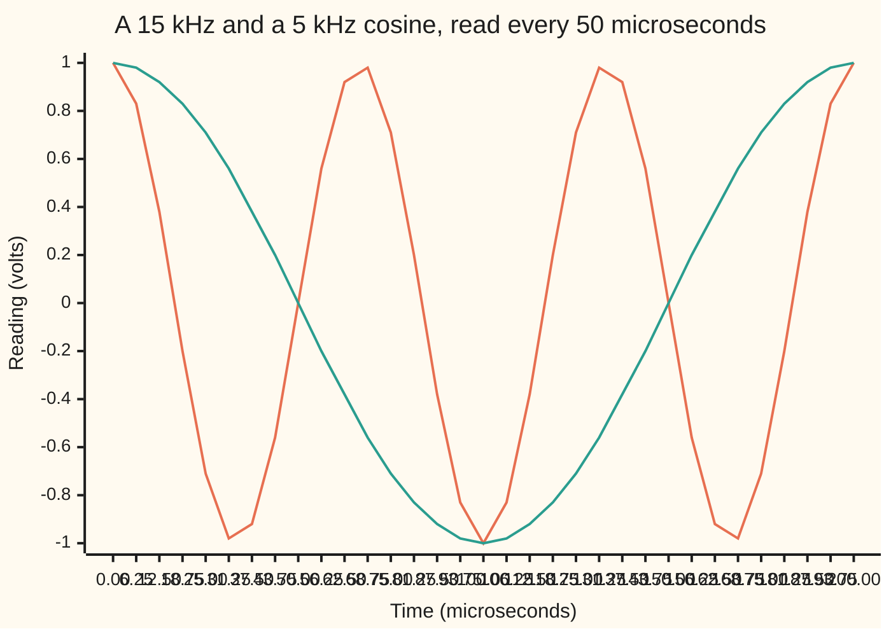
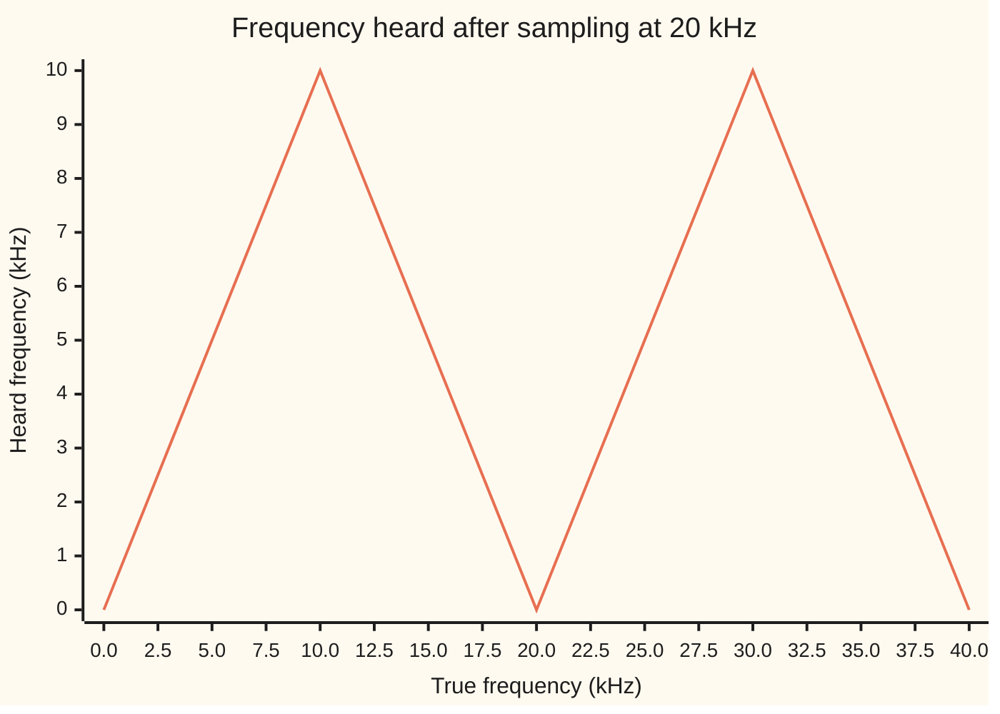

# Sampling: measure faster than twice the top frequency or fast becomes slow

[Syllabus](../../../SYLLABUS.md) → [Engineering mathematics](../README.md) → [Signals](../README.md#s05) → Sampling

---

## General Overview

A test rig plays a steady 15 kHz whistle, fifteen thousand vibrations a second, into a microphone. The microphone feeds a converter that measures the voltage 20,000 times a second and stores each reading as a number. Played back from those numbers, the whistle is a 5 kHz tone: lower, and just as loud.

Nothing broke. A reading every 50 microseconds (millionths of a second) lands three quarters of a cycle further along the 15 kHz wave each time. A 5 kHz wave moves a quarter of a cycle per reading.

Three quarters forward lands where a quarter back does, and a cosine reads the same a quarter cycle back as a quarter forward. So the two give exactly the same list of numbers: 1, 0, −1, 0, 1 and on. The converter cannot tell the two apart, and nothing after it can.

The sampling theorem says when a list of readings holds the whole signal. If nothing in the signal is as fast as half the sampling rate, here 10 kHz, the readings fix the signal exactly, between readings too. Anything faster comes back folded down to a false, slower frequency, called an **alias**.

So the fast part has to be removed before the converter, by an analogue low-pass filter (a circuit that passes slow wobbles and blocks fast ones). This card sizes that filter. To keep 0 to 5 kHz at 20 kHz sampling, it must cut whatever would fold onto that band by 60 dB (decibels), to a thousandth of its height. That takes a seventh-order filter, one with seven poles (points where the filter's response formula becomes infinite, each one steepening the cut).

**A signal with nothing at or above half the sampling rate is fixed exactly by its samples, and can be rebuilt between them; any faster frequency returns as a false slower one, so it must be filtered out before sampling.**

**What kind of fact this is:** a theorem, proved on this card in Why it works; the alias formula is a one-line identity, and the filter size is a design rule built on a model of the filter.

### The picture: two tones, one set of readings



Orange: the 15 kHz whistle. Green: a 5 kHz tone. The converter reads at 0, 50, 100, 150 and 200 microseconds, where the two lines meet at 1.00, 0.00, −1.00, 0.00 and 1.00. Between readings they differ completely; at the readings they never do.

---

## The formula

Notation first. A signal is $x(t)$, its value at time $t$. The converter reads it every $T$ seconds, $f_s = 1/T$ times a second; $f_s$ is the **sampling rate**. The $n$-th reading is $x[n] = x(nT)$, square brackets for a count of samples, as in [The z-transform](../02-Linear%20Systems%20and%20Transforms/08-z-transform-and-discrete-time-systems.md).

A signal is **band-limited** to $B$ when its spectrum $X(f)$, the amount of each frequency $f$ it holds ([The Fourier transform](../../07-Complex%20analysis/08-Transforms%20in%20Outline/03-fourier-transform.md)), is zero for every $|f| > B$. Frequencies here are in hertz (cycles per second) or kHz, not radians per second.

**The sampling theorem.** If $x$ is band-limited to $B$ and $f_s > 2B$, then for every time $t$

$$x(t) = \sum_{n=-\infty}^{\infty} x[n]\;\operatorname{sinc}\!\left(\frac{t - nT}{T}\right), \qquad \operatorname{sinc}(u) = \frac{\sin \pi u}{\pi u},\ \operatorname{sinc}(0) = 1.$$

**Read it aloud:** the signal at any moment is every reading times a sinc bump centred on that reading's time, all added up.

Half the sampling rate, $f_s/2$, is the **Nyquist frequency**: 10 kHz here. Twice the band limit, $2B$, is the **Nyquist rate**: the sampling rate to beat. For the 15 kHz whistle it is 30 kHz, and 20 kHz falls short.

**The alias.** A tone at $f$ sampled at $f_s$ gives the same samples as a tone at

$$f_a = \lvert f - k f_s \rvert, \qquad k = \text{the whole number nearest } f/f_s.$$

**Read it aloud:** the heard frequency is the distance from the true frequency to the nearest whole multiple of the sampling rate.

For the whistle, 15/20 is nearest 1, so $f_a$ = |15 − 20| = 5 kHz. The answer always lands between 0 and $f_s/2$.

**The filter before the converter.** To keep 0 to $f_p$ clean, everything at or above $f_{\text{stop}} = f_s - f_p$ must be cut by $A$ decibels (dB: a loss of $A$ dB divides a wave's height by $10^{A/20}$). A Butterworth low-pass filter of order $N$, the standard design that is flattest in the kept band, with its corner at $f_p$, does it when

$$N \ \ge\ \frac{\log_{10}\!\left(10^{A/10} - 1\right)}{2\,\log_{10}\!\left(f_{\text{stop}}/f_p\right)}.$$

**Read it aloud:** the order needed is the required loss, in powers of ten, over twice the number of decades (factors of ten in frequency) between the band edge and the stop edge.

| Symbol | Plain meaning | In our example | Push it up and the answer… |
| --- | --- | --- | --- |
| $f$, $\omega$ | frequency of a tone, kHz; $\omega = 2\pi f$, the same in radians per second, used only in Step 3 | 15 kHz whistle | the alias walks up and down between 0 and 10 kHz |
| $f_s$, $T$ | sampling rate; time between readings, $T = 1/f_s$ | 20 kHz; 50 μs | Nyquist frequency rises, fewer tones alias |
| $f_s/2$ | the Nyquist frequency: the fastest tone the readings can hold | 10 kHz | — |
| $B$, $2B$ | band limit: nothing above it; the Nyquist rate | 15 kHz; 30 kHz | a faster converter is needed |
| $f_a$, $k$ | the alias, the frequency heard; the nearest whole multiple | 5 kHz; 1 | — |
| $x(t)$, $x[n]$, $n$ | the signal; its $n$-th reading; the reading count | 1, 0, −1, 0, 1 | — |
| $t$, $u$ | time; time counted in readings, $u = t/T$ | 12.5 μs is $u$ = 0.25 | — |
| $X(f)$, $j$, $z$ | the spectrum, amount of frequency $f$; the square root of −1; a tone's point on the unit circle, $z = e^{j2\pi f T}$ | spikes at ±15 kHz; the whistle's $z$ at 270° | — |
| $c_n$ | a Fourier coefficient of the spectrum, in the proof | $T\,x[n]$ | — |
| $\operatorname{sinc}$ | the bump sin(πu)/(πu): 1 at 0, zero at every other whole number | — | — |
| $f_p$, $f_{\text{stop}}$ | band kept; where the cut must be complete, $f_s - f_p$ | 5 kHz; 15 kHz | wider band, steeper filter |
| $N$, $A$ | filter order (its number of poles); loss required at $f_{\text{stop}}$ | 7; 60 dB | more loss, higher order |

### When it holds

- **Band-limited, strictly.** The theorem needs nothing at or above $f_s/2$. Exactly at it fails: a 10 kHz sine read at 20 kHz is caught at its zero crossings, and every reading is 0.000000.
- **Every reading, for ever.** The sinc sum runs over all $n$. A real recording stops, and a ten-second chord still needs a window and a finite sum, the subject of [Windows](03-windows-and-spectral-leakage.md). No signal that stops is exactly band-limited; the theorem is approached, not met.
- **Readings exactly on time.** The spacing $T$ must be steady. Jitter (small timing wobble) turns a pure tone into a tone plus noise.
- **Exact values.** A converter rounds each reading to one of its steps. That rounding is a separate error; for a 16-bit converter one step is 96.33 dB below full scale, which sets the $A$ worth aiming for.
- **The filter model.** The order rule is for a Butterworth filter; other designs (Chebyshev, elliptic) trade a ripple in the band for a steeper cut and need fewer poles.

---

## Why it works

### Step 0: a sampler sees positions on a circle, and a full turn is invisible

Write a tone as a point turning round a circle ([Fourier series](../../08-Differential%20equations%20and%20dynamics/09-Fourier%20Series/01-fourier-series-and-orthogonality.md)). Between readings, a 15 kHz tone turns 270°. The converter does not see the turning, only where the point is at each reading. A turn of 270° lands where a turn of −90° lands. So any tone that turns a whole number of extra laps between readings looks the same, and frequency is only known up to whole multiples of $f_s$.

### Step 1: frequencies one sampling rate apart give the same readings

Write the tone as $e^{j2\pi f t}$, $j$ being the square root of −1 as engineers write it. Its $n$-th reading is $e^{j2\pi f nT}$. Add $f_s$ to the frequency:

$$e^{j2\pi (f + f_s) nT} = e^{j2\pi f nT}\, e^{j2\pi n} = e^{j2\pi f nT},$$

since $f_s T = 1$ and $e^{j2\pi n} = 1$ for every whole $n$. So $f$ and $f + k f_s$ are indistinguishable for every whole $k$.

A real cosine is two such turning points, at $+f$ and $-f$ ([Euler's formula](../../07-Complex%20analysis/01-Complex%20Numbers%20and%20the%20Plane/04-eulers-formula.md)). So the cosine at $f$ also matches the cosine at $k f_s - f$. Pick the $k$ that brings the answer nearest 0: that is $f_a = \lvert f - k f_s\rvert$, folded into 0 to $f_s/2$.

The whistle at 15 kHz turns 270° per reading, the same point as −90°; the 5 kHz tone turns 90°, its mirror image, and a cosine is the sum of a point and its mirror.

In the z-plane of [The z-transform](../02-Linear%20Systems%20and%20Transforms/08-z-transform-and-discrete-time-systems.md), a tone of frequency $f$ sits at $z = e^{j2\pi f T}$ on the unit circle. One lap of the circle is $f_s$. That is why the circle has room for 0 to $f_s/2$ and no more.

A sine is the difference of a point and its mirror, so folding about a multiple of $f_s$ flips its sign: the 15 kHz sine's readings are minus those of the 5 kHz sine. The cosine never flips.

### Step 2: sampling copies the spectrum every $f_s$

Step 1, applied to every frequency at once, says that the readings carry the spectrum $X(f)$ plus copies of it shifted by every whole multiple of $f_s$: $\pm f_s$, $\pm 2f_s$ and on. This is the Poisson summation formula; it is stated here and proved in Poisson summation and sampling (planned).

If $X$ sits inside $-B$ to $B$, the copy at $+f_s$ starts at $f_s - B$. The copies stay clear of the original exactly when $f_s - B > B$, that is $f_s > 2B$. Then the readings hold an undamaged copy of $X$, and Step 3 recovers it. If the copies overlap, two frequencies share each spot and no rule can split them.

### Step 3: the readings are the Fourier coefficients of the spectrum

Here the spectrum is $X(f) = \int x(t)\, e^{-j2\pi f t}\, dt$, integrated over all time: the transform of [The Fourier transform](../../07-Complex%20analysis/08-Transforms%20in%20Outline/03-fourier-transform.md) with ω written as $2\pi f$; the inverse then has no $1/2\pi$ in front.

Since $X$ is zero outside $-f_s/2$ to $f_s/2$, treat that stretch as one period and expand $X$ in a Fourier series there. By the inverse transform, its coefficients turn out to be $T\,x(nT)$: the readings. Put the series back into the inverse transform and each term integrates to one sinc bump. The readings fix the spectrum, and the spectrum fixes the signal.

<details>
<summary>Detailed proof: the sinc sum</summary>

Let $X(f) = 0$ for $|f| > B$, with $B < f_s/2$. Then $X$ lives on $-B$ to $B$, strictly inside the interval from $-f_s/2$ to $f_s/2$, of width $f_s$, and is zero outside that interval. On that interval expand $X$ in a complex Fourier series in the variable $f$, period $f_s$:

$$X(f) = \sum_n c_n\, e^{-j2\pi n f/f_s}, \qquad c_n = \frac{1}{f_s}\int_{-f_s/2}^{f_s/2} X(f)\, e^{j2\pi n f/f_s}\, df.$$

The inverse transform at $t = nT = n/f_s$ is $x(nT) = \int X(f)\, e^{j2\pi f nT}\, df$, the same integral, since $X$ is zero outside the interval. So $c_n = T\,x(nT)$. Now rebuild $x$ at any $t$:

$$x(t) = \int_{-f_s/2}^{f_s/2} X(f)\, e^{j2\pi f t}\, df = \sum_n T\,x(nT) \int_{-f_s/2}^{f_s/2} e^{j2\pi f (t - nT)}\, df.$$

The last integral is $\sin(\pi f_s (t - nT)) / (\pi (t - nT))$, and $T$ times it is $\operatorname{sinc}((t - nT)/T)$. That is the formula. Swapping sum and integral is safe when $X$ has finite energy, since the Fourier series then converges in mean square ([Convergence](../../08-Differential%20equations%20and%20dynamics/09-Fourier%20Series/02-convergence-jumps-and-gibbs.md)). ∎

</details>

Each sinc bump is 1 at its own reading and 0 at every other one, so the sum passes through every reading. Between readings the bumps overlap and add up to the band-limited wave, and to no other.

### Step 4: what this means for the whistle

Fed the whistle's readings, the sinc sum cannot rebuild 15 kHz: the formula only ever builds signals below $f_s/2$. It rebuilds the one band-limited wave through those readings, the 5 kHz tone. At 12.5 μs it gives 0.92388: the 5 kHz value, where the 15 kHz whistle was at 0.38268. That is the alias, made audible by the very formula that would have recovered a legal signal perfectly.

### Step 5: the filter has to come first

After sampling, the whistle's readings are a 5 kHz tone's readings, digit for digit. A digital filter sees numbers only, so it cannot remove the alias without removing a real 5 kHz tone too. The fast part must go while it is still a voltage, before the converter.

What must go? Anything that folds into the kept band, 0 to $f_p$. By Step 1, that is every frequency within $f_p$ of a multiple of $f_s$. The lowest such frequency is $f_s - f_p$: 15 kHz for a 5 kHz band. Between $f_p$ and $f_s - f_p$ lies a **guard band**, where the filter can roll off; content there folds onto the part above $f_p$ that gets thrown away anyway.

A Butterworth filter of order $N$ cuts a wobble at $f$ by

$$10\log_{10}\!\left(1 + (f/f_p)^{2N}\right) \ \text{dB},$$

when its corner sits at $f_p$. Its $N$ poles sit evenly on a half circle in the left half plane, where complex numbers have a negative real part ([Poles and zeros](../02-Linear%20Systems%20and%20Transforms/03-poles-zeros-and-stability.md)). Each one steepens the fall above the corner by the same amount ([Bode plots](../02-Linear%20Systems%20and%20Transforms/04-frequency-response-and-bode-plots.md)). Ask for $A$ dB at $f_{\text{stop}}$, take logarithms, and the order rule falls out. The code reaches the order a second way, from the distances to the poles alone.

### The picture: where every frequency lands



The line is the alias formula. Up to 10 kHz it is honest. Past it, it folds back like a paper concertina: 15 kHz lands on 5, 25 and 35 kHz land there too, and 20 kHz becomes 0, a constant.

---

## Worked numbers, by hand

| Step | Arithmetic | Value |
| --- | --- | --- |
| time between readings | 1 / 20 kHz | 50.0 μs |
| Nyquist frequency | 20 / 2 | 10.0 kHz |
| Nyquist rate the whistle needs | 2 × 15 | 30.0 kHz: 20 is too slow |
| nearest multiple | 15 / 20 is nearest 1 | k = 1 |
| alias | \|15 − 20 × 1\| | **5.00 kHz** |
| turn per reading | 360° × 15 / 20, the same point as 270° − 360° | 270°, that is −90° |
| filter stop edge | 20 − 5 | 15 kHz |
| filter order | log10(10^6 − 1) / (2 log10 3) | 6.288, so **order 7** |
| loss at 15 kHz | 10 log10(1 + 3^14) | 66.80 dB |
| the whistle after the filter | 10^(−66.80/20) | 0.000457 of its height, still heard at 5 kHz |
| loss at the 5 kHz band edge | 10 log10(1 + 1) | 3.01 dB |

Sampled at 20 kHz, the 15 kHz whistle is heard at 5 kHz. A seventh-order filter ahead of the converter shrinks it to 0.000457 of its height first. Order 6 would give only 57.25 dB, short of 60.

### What breaks if you drop a piece

| Mistake | Comes out at | What went wrong |
| --- | --- | --- |
| Assume a tone above the Nyquist frequency is simply lost | a 5 kHz tone at amplitude 1.000, full loudness | Folding moves a tone; it does not delete it |
| Filter after the converter, digital low-pass with corner at 5 kHz | the alias kept at 0.7071 of its height | Its readings are a real 5 kHz tone's; no digital filter can tell |
| Sample at exactly twice the band limit: 10 kHz sine at 20 kHz | every reading 0.000000 | The theorem needs $f_s > 2B$ strictly |
| Size the filter for 60 dB at the Nyquist frequency, 10 kHz | order 10 | The stop edge is $f_s - f_p$ = 15 kHz; 10 kHz content folds onto the discarded part, so order 7 suffices |

---

## Code, from first principles, and it actually runs

The script reaches the 5 kHz alias by four independent roads. Road 1 is the folding formula. Road 2 compares the readings of the two cosines one by one, 400 of them, and checks the sine's sign flip. Road 3 never uses the formula: it searches the readings' spectrum from 0 to 10 kHz by brute-force sums, and finds the peak. Road 4 rebuilds the wave between readings with the sinc sum and compares it with both tones.

The filter order comes two ways: from the closed-form rule, and by raising the order until the poles themselves, placed on their half circle, give the loss. The same is done for the guitar chord at four sampling rates.

### Python

```python
# Sampling and the Nyquist theorem -- the check behind the card.  Standard library only.
# A 15 kHz tone sampled 20,000 times a second returns as 5 kHz.  Four roads to that 5 kHz:
# the folding formula; the samples compared one by one; a brute-force search of the
# samples' spectrum; the sinc sum rebuilding the wave between samples.  Then the filter
# that must go before the converter, sized by formula and by its poles.
import math

def rnd(x): return math.floor(x + 0.5)                  # round half up, the same in both languages
def fold(f, fs): return abs(f - fs * rnd(f / fs))       # frequency heard, between 0 and fs/2
def signed(f, fs): return f - fs * rnd(f / fs)          # negative: the pattern turns backwards
def clean(v, d): return 0.0 if abs(v) < 0.5 * 10 ** -d else v
def row(label, vals, d): print(label + " " + " ".join(f"{clean(v, d):.{d}f}" for v in vals))

def atten_formula(ratio, n):                            # Butterworth loss in dB, ratio = f / corner
    return 10 * math.log10(1 + ratio ** (2 * n))

def atten_poles(ratio, n):                              # the same loss from distances to the n poles
    gain = 1.0
    for k in range(1, n + 1):
        ang = math.pi * (2 * k + n - 1) / (2 * n)       # poles on a half circle, left half plane
        gain /= math.hypot(-math.cos(ang), ratio - math.sin(ang))
    return -20 * math.log10(gain)

def order_formula(A, ratio):
    return math.ceil(math.log10(10 ** (A / 10) - 1) / (2 * math.log10(ratio)))

def order_search(A, ratio):                             # smallest n whose poles give A dB
    n = 1
    while atten_poles(ratio, n) < A: n += 1
    return n

# ---- the example: 15 kHz tone, 20 kHz sampling (kHz and milliseconds throughout) ----
fs, f, N = 20.0, 15.0, 400
print(f"spacing T = {1000 / fs:.1f} us; Nyquist frequency fs/2 = {fs / 2:.1f} kHz; Nyquist rate of the tone 2f = {2 * f:.1f} kHz")
alias = fold(f, fs)
print(f"road 1, folding: |{f:.0f} - {fs:.0f} x {rnd(f / fs)}| = {alias:.2f} kHz")
print(f"angle turned per sample: 15 kHz {360 * f / fs:.0f} deg, the same point as {360 * f / fs - 360:.0f}; 5 kHz {360 * alias / fs:.0f} deg")
x15 = [math.cos(2 * math.pi * f * n / fs) for n in range(N)]
x5 = [math.cos(2 * math.pi * alias * n / fs) for n in range(N)]
gap = max(abs(a - b) for a, b in zip(x15, x5))
flip = max(abs(math.sin(2 * math.pi * f * n / fs) + math.sin(2 * math.pi * alias * n / fs)) for n in range(N))
small = lambda v: "below 1e-9" if v < 1e-9 else f"{v:.3f}"
print(f"road 2, {N} samples: largest gap, 15 vs 5 kHz cosine, {small(gap)}; sine 15 plus sine 5, {small(flip)}")
row("first samples, 15 kHz cosine", x15[:5], 2)
best, peak = 0.0, -1.0
for i in range(201):                                    # 0 to 10 kHz in 50 Hz steps
    g = 0.05 * i
    re = sum(x * math.cos(2 * math.pi * g * n / fs) for n, x in enumerate(x15))
    im = sum(x * math.sin(2 * math.pi * g * n / fs) for n, x in enumerate(x15))
    amp = 2 * math.hypot(re, im) / N
    if amp > peak: best, peak = g, amp
print(f"road 3, spectrum of the samples, 0 to 10 kHz: peak at {best:.2f} kHz, amplitude {peak:.3f}")
M = 50000                                               # sinc terms each side of t = 0
rebuilt = []
for u in (0.25, 0.75, 1.6):                             # times in sample spacings
    s = sum((-1) ** (n % 2) * math.cos(2 * math.pi * f * n / fs) / (math.pi * (u - n)) for n in range(-M, M + 1)) * math.sin(math.pi * u)
    t = u / fs
    rebuilt.append((u, s, math.cos(2 * math.pi * alias * t), math.cos(2 * math.pi * f * t)))
    print(f"road 4, sinc sum at t = {1000 * t:6.2f} us: rebuilt {s:.5f}; 5 kHz {rebuilt[-1][2]:.5f}; 15 kHz {rebuilt[-1][3]:.5f}")
edge = max(abs(math.sin(2 * math.pi * 10.0 * n / fs)) for n in range(N))
print(f"10 kHz sine sampled at exactly 20 kHz: largest sample {edge:.6f}")
print("fold at 20 kHz: " + ", ".join(f"{g:.0f} -> {fold(g, fs):.0f}" for g in (9, 11, 15, 19, 21, 25, 35)))

# ---- the filter before the converter: keep 0-5 kHz, crush what folds onto it by 60 dB ----
fp, A = 5.0, 60.0
stop = fs - fp
n7, n7s = order_formula(A, stop / fp), order_search(A, stop / fp)
print(f"filter: pass to {fp:.0f} kHz, stop from fs - fp = {stop:.0f} kHz, ratio {stop / fp:.0f}, {A:.0f} dB = height / {10 ** (A / 20):.0f}")
print(f"  order by formula {n7} ({math.log10(10 ** (A / 10) - 1) / (2 * math.log10(stop / fp)):.3f} rounded up), by pole search {n7s}; loss at {stop:.0f} kHz: order 6 {atten_poles(3, 6):.2f} dB, order 7 {atten_poles(3, 7):.2f} dB")
print(f"  loss at the {fp:.0f} kHz band edge {atten_poles(1, 7):.2f} dB, amplitude {10 ** (-atten_poles(1, 7) / 20):.4f}")
print(f"  15 kHz tone after the order-7 filter: amplitude {10 ** (-atten_poles(3, 7) / 20):.6f}, still heard at {alias:.0f} kHz")
print(f"  sized at the Nyquist frequency instead, 60 dB at 10 kHz: order {order_formula(A, 10 / fp)}")

# ---- the house example: a ten second guitar chord at 44.1 kHz ----
fh, ph = 44.1, 20.0
Ah = 20 * math.log10(2 ** 16)                           # one step of a 16-bit converter
print(f"guitar: {round(10 * fh * 1000)} samples in 10 s; Nyquist {fh / 2:.2f} kHz; stop edge {fh - ph:.1f} kHz; {Ah:.2f} dB")
print(f"  top E string 329.63 Hz: harmonics below Nyquist {math.floor(fh / 2 / 0.32963)}; a 30 kHz pick click returns at {fold(30, fh):.1f} kHz")
orders = []
for m in (1, 2, 4, 8):
    r = (m * fh - ph) / ph
    orders.append((order_formula(Ah, r), order_search(Ah, r)))
    print(f"  sampling {m} x 44.1 = {m * fh:6.1f} kHz: stop edge {m * fh - ph:6.1f} kHz, order {orders[-1][0]} (pole search {orders[-1][1]})")
print(f"phone: 8 kHz sampling, 3.4 kHz kept, stop edge {8 - 3.4:.1f} kHz; film: 22 turns/s at 24 frames/s looks like {signed(22, 24):.0f}")
print(f"try: 25 kHz -> {fold(25, fs):.0f}; 19 kHz -> {fold(19, fs):.0f}; 15 kHz at 40 kHz -> {fold(15, 40):.0f}; 90 dB needs order {order_formula(90, 3)}; fs 40: Nyquist {40 / 2:.0f} kHz, stop edge {40 - fp:.0f} kHz, order {order_formula(A, (40 - fp) / fp)}")
row("chart, true kHz", [2.5 * i for i in range(17)], 1)
row("chart, heard kHz", [fold(2.5 * i, fs) for i in range(17)], 1)
row("chart, time us", [6.25 * i for i in range(33)], 2)
row("chart, 15 kHz wave", [math.cos(2 * math.pi * f * 6.25e-3 * i) for i in range(33)], 2)
row("chart, 5 kHz wave", [math.cos(2 * math.pi * alias * 6.25e-3 * i) for i in range(33)], 2)

assert alias == 5.0 and abs(best - alias) < 1e-9 and abs(peak - 1) < 1e-9, "spectrum search must find the folded tone"
assert gap < 1e-9 and flip < 1e-9, "15 and 5 kHz must give the same samples"
assert all(abs(s - c5) < 1e-4 and abs(s - c15) > 0.1 for _, s, c5, c15 in rebuilt), "sinc rebuild must give 5 kHz"
assert all(abs(atten_poles(r, n) - atten_formula(r, n)) < 1e-7 for r in (1, 2, 3, 7.82) for n in range(1, 61))
assert n7 == n7s == 7 and atten_poles(3, 6) < A <= atten_poles(3, 7), "order 7 is the smallest that reaches 60 dB"
assert all(a == b for a, b in orders) and [a for a, _ in orders] == [60, 10, 6, 4], "house orders by both roads"
assert edge < 1e-9, "a sine at exactly fs/2 is sampled at its zeros"
print("ALL CHECKS PASS")
```

**Ran 2026-11-11 on macOS, Python 3.14.10, standard library only. All checks passed. Output, pasted from the run:**

```
spacing T = 50.0 us; Nyquist frequency fs/2 = 10.0 kHz; Nyquist rate of the tone 2f = 30.0 kHz
road 1, folding: |15 - 20 x 1| = 5.00 kHz
angle turned per sample: 15 kHz 270 deg, the same point as -90; 5 kHz 90 deg
road 2, 400 samples: largest gap, 15 vs 5 kHz cosine, below 1e-9; sine 15 plus sine 5, below 1e-9
first samples, 15 kHz cosine 1.00 0.00 -1.00 0.00 1.00
road 3, spectrum of the samples, 0 to 10 kHz: peak at 5.00 kHz, amplitude 1.000
road 4, sinc sum at t =  12.50 us: rebuilt 0.92388; 5 kHz 0.92388; 15 kHz 0.38268
road 4, sinc sum at t =  37.50 us: rebuilt 0.38268; 5 kHz 0.38268; 15 kHz -0.92388
road 4, sinc sum at t =  80.00 us: rebuilt -0.80902; 5 kHz -0.80902; 15 kHz 0.30902
10 kHz sine sampled at exactly 20 kHz: largest sample 0.000000
fold at 20 kHz: 9 -> 9, 11 -> 9, 15 -> 5, 19 -> 1, 21 -> 1, 25 -> 5, 35 -> 5
filter: pass to 5 kHz, stop from fs - fp = 15 kHz, ratio 3, 60 dB = height / 1000
  order by formula 7 (6.288 rounded up), by pole search 7; loss at 15 kHz: order 6 57.25 dB, order 7 66.80 dB
  loss at the 5 kHz band edge 3.01 dB, amplitude 0.7071
  15 kHz tone after the order-7 filter: amplitude 0.000457, still heard at 5 kHz
  sized at the Nyquist frequency instead, 60 dB at 10 kHz: order 10
guitar: 441000 samples in 10 s; Nyquist 22.05 kHz; stop edge 24.1 kHz; 96.33 dB
  top E string 329.63 Hz: harmonics below Nyquist 66; a 30 kHz pick click returns at 14.1 kHz
  sampling 1 x 44.1 =   44.1 kHz: stop edge   24.1 kHz, order 60 (pole search 60)
  sampling 2 x 44.1 =   88.2 kHz: stop edge   68.2 kHz, order 10 (pole search 10)
  sampling 4 x 44.1 =  176.4 kHz: stop edge  156.4 kHz, order 6 (pole search 6)
  sampling 8 x 44.1 =  352.8 kHz: stop edge  332.8 kHz, order 4 (pole search 4)
phone: 8 kHz sampling, 3.4 kHz kept, stop edge 4.6 kHz; film: 22 turns/s at 24 frames/s looks like -2
try: 25 kHz -> 5; 19 kHz -> 1; 15 kHz at 40 kHz -> 15; 90 dB needs order 10; fs 40: Nyquist 20 kHz, stop edge 35 kHz, order 4
chart, true kHz 0.0 2.5 5.0 7.5 10.0 12.5 15.0 17.5 20.0 22.5 25.0 27.5 30.0 32.5 35.0 37.5 40.0
chart, heard kHz 0.0 2.5 5.0 7.5 10.0 7.5 5.0 2.5 0.0 2.5 5.0 7.5 10.0 7.5 5.0 2.5 0.0
chart, time us 0.00 6.25 12.50 18.75 25.00 31.25 37.50 43.75 50.00 56.25 62.50 68.75 75.00 81.25 87.50 93.75 100.00 106.25 112.50 118.75 125.00 131.25 137.50 143.75 150.00 156.25 162.50 168.75 175.00 181.25 187.50 193.75 200.00
chart, 15 kHz wave 1.00 0.83 0.38 -0.20 -0.71 -0.98 -0.92 -0.56 0.00 0.56 0.92 0.98 0.71 0.20 -0.38 -0.83 -1.00 -0.83 -0.38 0.20 0.71 0.98 0.92 0.56 0.00 -0.56 -0.92 -0.98 -0.71 -0.20 0.38 0.83 1.00
chart, 5 kHz wave 1.00 0.98 0.92 0.83 0.71 0.56 0.38 0.20 0.00 -0.20 -0.38 -0.56 -0.71 -0.83 -0.92 -0.98 -1.00 -0.98 -0.92 -0.83 -0.71 -0.56 -0.38 -0.20 0.00 0.20 0.38 0.56 0.71 0.83 0.92 0.98 1.00
ALL CHECKS PASS
```

### Rust

```rust
// Sampling and the Nyquist theorem -- the same check as sampling_and_the_nyquist_theorem_check.py.
// Standard library only, no crates.  A 15 kHz tone sampled 20,000 times a second returns
// as 5 kHz: by folding, by comparing samples, by a spectrum search, by the sinc sum.
// Then the filter before the converter, sized by formula and by its poles.
use std::f64::consts::PI;

fn rnd(x: f64) -> f64 { (x + 0.5).floor() }              // round half up, as in the Python
fn fold(f: f64, fs: f64) -> f64 { (f - fs * rnd(f / fs)).abs() }
fn signed(f: f64, fs: f64) -> f64 { f - fs * rnd(f / fs) }
fn clean(v: f64, d: i32) -> f64 { if v.abs() < 0.5 * 10f64.powi(-d) { 0.0 } else { v } }
fn row(label: &str, vals: &[f64], d: usize) {
    let s: Vec<String> = vals.iter().map(|v| format!("{:.*}", d, clean(*v, d as i32))).collect();
    println!("{} {}", label, s.join(" "));
}
fn small(v: f64) -> String { if v < 1e-9 { "below 1e-9".to_string() } else { format!("{:.3}", v) } }

fn atten_formula(ratio: f64, n: i32) -> f64 { 10.0 * (1.0 + ratio.powi(2 * n)).log10() }

fn atten_poles(ratio: f64, n: i32) -> f64 {              // loss in dB from distances to the n poles
    let mut gain = 1.0;
    for k in 1..=n {
        let ang = PI * (2 * k + n - 1) as f64 / (2 * n) as f64;
        gain /= (-ang.cos()).hypot(ratio - ang.sin());
    }
    -20.0 * f64::log10(gain)
}

fn order_formula(a: f64, ratio: f64) -> i32 {
    ((10f64.powf(a / 10.0) - 1.0).log10() / (2.0 * ratio.log10())).ceil() as i32
}

fn order_search(a: f64, ratio: f64) -> i32 {
    let mut n = 1;
    while atten_poles(ratio, n) < a { n += 1; }
    n
}

fn main() {
    let (fs, f, nn) = (20.0_f64, 15.0_f64, 400usize);
    println!("spacing T = {:.1} us; Nyquist frequency fs/2 = {:.1} kHz; Nyquist rate of the tone 2f = {:.1} kHz", 1000.0 / fs, fs / 2.0, 2.0 * f);
    let alias = fold(f, fs);
    println!("road 1, folding: |{:.0} - {:.0} x {}| = {:.2} kHz", f, fs, rnd(f / fs) as i64, alias);
    println!("angle turned per sample: 15 kHz {:.0} deg, the same point as {:.0}; 5 kHz {:.0} deg", 360.0 * f / fs, 360.0 * f / fs - 360.0, 360.0 * alias / fs);
    let x15: Vec<f64> = (0..nn).map(|n| (2.0 * PI * f * n as f64 / fs).cos()).collect();
    let x5: Vec<f64> = (0..nn).map(|n| (2.0 * PI * alias * n as f64 / fs).cos()).collect();
    let gap = x15.iter().zip(&x5).map(|(a, b)| (a - b).abs()).fold(0.0, f64::max);
    let flip = (0..nn).map(|n| ((2.0 * PI * f * n as f64 / fs).sin() + (2.0 * PI * alias * n as f64 / fs).sin()).abs()).fold(0.0, f64::max);
    println!("road 2, {} samples: largest gap, 15 vs 5 kHz cosine, {}; sine 15 plus sine 5, {}", nn, small(gap), small(flip));
    row("first samples, 15 kHz cosine", &x15[..5], 2);
    let (mut best, mut peak) = (0.0_f64, -1.0_f64);
    for i in 0..201 {                                      // 0 to 10 kHz in 50 Hz steps
        let g = 0.05 * i as f64;
        let (mut re, mut im) = (0.0, 0.0);
        for (n, x) in x15.iter().enumerate() {
            re += x * (2.0 * PI * g * n as f64 / fs).cos();
            im += x * (2.0 * PI * g * n as f64 / fs).sin();
        }
        let amp = 2.0 * f64::hypot(re, im) / nn as f64;
        if amp > peak { best = g; peak = amp; }
    }
    println!("road 3, spectrum of the samples, 0 to 10 kHz: peak at {:.2} kHz, amplitude {:.3}", best, peak);
    let m = 50000i64;                                      // sinc terms each side of t = 0
    let mut rebuilt = Vec::new();
    for u in [0.25_f64, 0.75, 1.6] {
        let mut s = 0.0;
        for n in -m..=m {
            let sign = if n.rem_euclid(2) == 0 { 1.0 } else { -1.0 };
            s += sign * (2.0 * PI * f * n as f64 / fs).cos() / (PI * (u - n as f64));
        }
        s *= (PI * u).sin();
        let t = u / fs;
        let (c5, c15) = ((2.0 * PI * alias * t).cos(), (2.0 * PI * f * t).cos());
        rebuilt.push((s, c5, c15));
        println!("road 4, sinc sum at t = {:6.2} us: rebuilt {:.5}; 5 kHz {:.5}; 15 kHz {:.5}", 1000.0 * t, s, c5, c15);
    }
    let edge = (0..nn).map(|n| (2.0 * PI * 10.0 * n as f64 / fs).sin().abs()).fold(0.0, f64::max);
    println!("10 kHz sine sampled at exactly 20 kHz: largest sample {:.6}", edge);
    let fl: Vec<String> = [9.0, 11.0, 15.0, 19.0, 21.0, 25.0, 35.0].iter().map(|g| format!("{:.0} -> {:.0}", g, fold(*g, fs))).collect();
    println!("fold at 20 kHz: {}", fl.join(", "));

    // ---- the filter before the converter: keep 0-5 kHz, crush what folds onto it by 60 dB ----
    let (fp, a) = (5.0_f64, 60.0_f64);
    let stop = fs - fp;
    let (n7, n7s) = (order_formula(a, stop / fp), order_search(a, stop / fp));
    println!("filter: pass to {:.0} kHz, stop from fs - fp = {:.0} kHz, ratio {:.0}, {:.0} dB = height / {:.0}", fp, stop, stop / fp, a, 10f64.powf(a / 20.0));
    println!("  order by formula {} ({:.3} rounded up), by pole search {}; loss at {:.0} kHz: order 6 {:.2} dB, order 7 {:.2} dB", n7, (10f64.powf(a / 10.0) - 1.0).log10() / (2.0 * (stop / fp).log10()), n7s, stop, atten_poles(3.0, 6), atten_poles(3.0, 7));
    println!("  loss at the {:.0} kHz band edge {:.2} dB, amplitude {:.4}", fp, atten_poles(1.0, 7), 10f64.powf(-atten_poles(1.0, 7) / 20.0));
    println!("  15 kHz tone after the order-7 filter: amplitude {:.6}, still heard at {:.0} kHz", 10f64.powf(-atten_poles(3.0, 7) / 20.0), alias);
    println!("  sized at the Nyquist frequency instead, 60 dB at 10 kHz: order {}", order_formula(a, 10.0 / fp));

    // ---- the house example: a ten second guitar chord at 44.1 kHz ----
    let (fh, ph) = (44.1_f64, 20.0_f64);
    let ah = 20.0 * 2f64.powi(16).log10();                 // one step of a 16-bit converter
    println!("guitar: {} samples in 10 s; Nyquist {:.2} kHz; stop edge {:.1} kHz; {:.2} dB", (10.0 * fh * 1000.0).round() as i64, fh / 2.0, fh - ph, ah);
    println!("  top E string 329.63 Hz: harmonics below Nyquist {}; a 30 kHz pick click returns at {:.1} kHz", (fh / 2.0 / 0.32963).floor() as i64, fold(30.0, fh));
    let mut orders = Vec::new();
    for mm in [1.0_f64, 2.0, 4.0, 8.0] {
        let r = (mm * fh - ph) / ph;
        orders.push((order_formula(ah, r), order_search(ah, r)));
        let o = orders[orders.len() - 1];
        println!("  sampling {} x 44.1 = {:6.1} kHz: stop edge {:6.1} kHz, order {} (pole search {})", mm as i64, mm * fh, mm * fh - ph, o.0, o.1);
    }
    println!("phone: 8 kHz sampling, 3.4 kHz kept, stop edge {:.1} kHz; film: 22 turns/s at 24 frames/s looks like {:.0}", 8.0 - 3.4, signed(22.0, 24.0));
    println!("try: 25 kHz -> {:.0}; 19 kHz -> {:.0}; 15 kHz at 40 kHz -> {:.0}; 90 dB needs order {}; fs 40: Nyquist {:.0} kHz, stop edge {:.0} kHz, order {}", fold(25.0, fs), fold(19.0, fs), fold(15.0, 40.0), order_formula(90.0, 3.0), 40.0 / 2.0, 40.0 - fp, order_formula(a, (40.0 - fp) / fp));
    let tk: Vec<f64> = (0..17).map(|i| 2.5 * i as f64).collect();
    row("chart, true kHz", &tk, 1);
    row("chart, heard kHz", &tk.iter().map(|g| fold(*g, fs)).collect::<Vec<_>>(), 1);
    row("chart, time us", &(0..33).map(|i| 6.25 * i as f64).collect::<Vec<_>>(), 2);
    row("chart, 15 kHz wave", &(0..33).map(|i| (2.0 * PI * f * 6.25e-3 * i as f64).cos()).collect::<Vec<_>>(), 2);
    row("chart, 5 kHz wave", &(0..33).map(|i| (2.0 * PI * alias * 6.25e-3 * i as f64).cos()).collect::<Vec<_>>(), 2);

    assert!(alias == 5.0 && (best - alias).abs() < 1e-9 && (peak - 1.0).abs() < 1e-9, "spectrum search must find the folded tone");
    assert!(gap < 1e-9 && flip < 1e-9, "15 and 5 kHz must give the same samples");
    assert!(rebuilt.iter().all(|&(s, c5, c15)| (s - c5).abs() < 1e-4 && (s - c15).abs() > 0.1), "sinc rebuild must give 5 kHz");
    for r in [1.0, 2.0, 3.0, 7.82] {
        for n in 1..=60 { assert!((atten_poles(r, n) - atten_formula(r, n)).abs() < 1e-7); }
    }
    assert!(n7 == 7 && n7s == 7 && atten_poles(3.0, 6) < a && a <= atten_poles(3.0, 7), "order 7 is the smallest that reaches 60 dB");
    assert!(orders.iter().all(|o| o.0 == o.1) && orders.iter().map(|o| o.0).collect::<Vec<_>>() == vec![60, 10, 6, 4], "house orders by both roads");
    assert!(edge < 1e-9, "a sine at exactly fs/2 is sampled at its zeros");
    println!("ALL CHECKS PASS");
}
```

**Ran 2026-11-11 on macOS, rustc 1.98.1, no crates. All checks passed. Output, pasted from the run:**

```
spacing T = 50.0 us; Nyquist frequency fs/2 = 10.0 kHz; Nyquist rate of the tone 2f = 30.0 kHz
road 1, folding: |15 - 20 x 1| = 5.00 kHz
angle turned per sample: 15 kHz 270 deg, the same point as -90; 5 kHz 90 deg
road 2, 400 samples: largest gap, 15 vs 5 kHz cosine, below 1e-9; sine 15 plus sine 5, below 1e-9
first samples, 15 kHz cosine 1.00 0.00 -1.00 0.00 1.00
road 3, spectrum of the samples, 0 to 10 kHz: peak at 5.00 kHz, amplitude 1.000
road 4, sinc sum at t =  12.50 us: rebuilt 0.92388; 5 kHz 0.92388; 15 kHz 0.38268
road 4, sinc sum at t =  37.50 us: rebuilt 0.38268; 5 kHz 0.38268; 15 kHz -0.92388
road 4, sinc sum at t =  80.00 us: rebuilt -0.80902; 5 kHz -0.80902; 15 kHz 0.30902
10 kHz sine sampled at exactly 20 kHz: largest sample 0.000000
fold at 20 kHz: 9 -> 9, 11 -> 9, 15 -> 5, 19 -> 1, 21 -> 1, 25 -> 5, 35 -> 5
filter: pass to 5 kHz, stop from fs - fp = 15 kHz, ratio 3, 60 dB = height / 1000
  order by formula 7 (6.288 rounded up), by pole search 7; loss at 15 kHz: order 6 57.25 dB, order 7 66.80 dB
  loss at the 5 kHz band edge 3.01 dB, amplitude 0.7071
  15 kHz tone after the order-7 filter: amplitude 0.000457, still heard at 5 kHz
  sized at the Nyquist frequency instead, 60 dB at 10 kHz: order 10
guitar: 441000 samples in 10 s; Nyquist 22.05 kHz; stop edge 24.1 kHz; 96.33 dB
  top E string 329.63 Hz: harmonics below Nyquist 66; a 30 kHz pick click returns at 14.1 kHz
  sampling 1 x 44.1 =   44.1 kHz: stop edge   24.1 kHz, order 60 (pole search 60)
  sampling 2 x 44.1 =   88.2 kHz: stop edge   68.2 kHz, order 10 (pole search 10)
  sampling 4 x 44.1 =  176.4 kHz: stop edge  156.4 kHz, order 6 (pole search 6)
  sampling 8 x 44.1 =  352.8 kHz: stop edge  332.8 kHz, order 4 (pole search 4)
phone: 8 kHz sampling, 3.4 kHz kept, stop edge 4.6 kHz; film: 22 turns/s at 24 frames/s looks like -2
try: 25 kHz -> 5; 19 kHz -> 1; 15 kHz at 40 kHz -> 15; 90 dB needs order 10; fs 40: Nyquist 20 kHz, stop edge 35 kHz, order 4
chart, true kHz 0.0 2.5 5.0 7.5 10.0 12.5 15.0 17.5 20.0 22.5 25.0 27.5 30.0 32.5 35.0 37.5 40.0
chart, heard kHz 0.0 2.5 5.0 7.5 10.0 7.5 5.0 2.5 0.0 2.5 5.0 7.5 10.0 7.5 5.0 2.5 0.0
chart, time us 0.00 6.25 12.50 18.75 25.00 31.25 37.50 43.75 50.00 56.25 62.50 68.75 75.00 81.25 87.50 93.75 100.00 106.25 112.50 118.75 125.00 131.25 137.50 143.75 150.00 156.25 162.50 168.75 175.00 181.25 187.50 193.75 200.00
chart, 15 kHz wave 1.00 0.83 0.38 -0.20 -0.71 -0.98 -0.92 -0.56 0.00 0.56 0.92 0.98 0.71 0.20 -0.38 -0.83 -1.00 -0.83 -0.38 0.20 0.71 0.98 0.92 0.56 0.00 -0.56 -0.92 -0.98 -0.71 -0.20 0.38 0.83 1.00
chart, 5 kHz wave 1.00 0.98 0.92 0.83 0.71 0.56 0.38 0.20 0.00 -0.20 -0.38 -0.56 -0.71 -0.83 -0.92 -0.98 -1.00 -0.98 -0.92 -0.83 -0.71 -0.56 -0.38 -0.20 0.00 0.20 0.38 0.56 0.71 0.83 0.92 0.98 1.00
ALL CHECKS PASS
```

The two outputs match line for line. The Rust builds the same sums in its own loops. Both write each sinc bump as (−1)^n sin(πu)/(π(u − n)), the same quantity with the sine taken once.

### Lean

Lean proves the sampling theorem, the alias formula and the filter order rule in general, and checks the worked numbers.

- Suppose $x$ has a spectrum $X(f)$ of finite energy, zero for every $|f| > B$, and $f_s > 2B$. Then at every time $t$, the sinc sum of all readings $x[n]$ adds up to $x(t)$.
- Take a cosine tone at $f$, sampled at $f_s > 0$, with $k$ the whole number nearest $f/f_s$. Then its readings equal those of a cosine at $f_a = \lvert f - k f_s \rvert$. That $f_a$ always lands between 0 and $f_s/2$.
- Take a Butterworth filter of order $N$, corner $f_p$, stop edge $f_{\text{stop}} > f_p$, and required loss $A > 0$ dB. Then it cuts $A$ dB at $f_{\text{stop}}$ exactly when $N$ meets the order rule.
- The whistle folds to 5 kHz, and order 7 reaches 60 dB while order 6 does not.

The pole search, the spectrum search, and the 10 kHz sine read at its zeros are left to the Python and Rust checks.

```lean
-- Sampling: a finite-energy signal with no frequency above B is rebuilt exactly from its readings by the sinc sum whenever the sampling rate beats 2B, a tone's readings match those of its alias folded into 0 to half the sampling rate, and the Butterworth order rule is exactly the condition for the filter to reach the required loss.
import Mathlib.Analysis.SpecialFunctions.Trigonometric.Sinc
import Mathlib.Analysis.Fourier.AddCircle
import Mathlib.Analysis.SpecialFunctions.Integrals.Basic
import Mathlib.Analysis.SpecialFunctions.Log.Base
import Mathlib.Analysis.SpecialFunctions.Pow.Real
import Mathlib.MeasureTheory.Function.LpSeminorm.Basic
import Mathlib.MeasureTheory.Integral.Bochner.Basic
import Mathlib.MeasureTheory.Measure.Lebesgue.Basic
import Mathlib.Algebra.Order.Round
import Mathlib.Topology.Algebra.InfiniteSum.Defs
import Mathlib.Tactic.NormNum

open MeasureTheory

namespace Sampling

open ComplexConjugate in
/-- Parseval's identity for inner products of two square-integrable functions on `(a, a + T]`. -/
theorem parseval_liftIoc (T a : ℝ) [hT : Fact (0 < T)] {f g : ℝ → ℂ}
    (hf : MemLp f 2 (volume.restrict (Set.Ioc a (a + T))))
    (hg : MemLp g 2 (volume.restrict (Set.Ioc a (a + T)))) :
    HasSum (fun i => conj (fourierCoeff (AddCircle.liftIoc T a f) i) *
        fourierCoeff (AddCircle.liftIoc T a g) i)
      (T⁻¹ • ∫ x in a..a + T, conj (f x) * g x) := by
  have hF := hf.memLp_liftIoc.haarAddCircle
  have hG := hg.memLp_liftIoc.haarAddCircle
  have H := fourierBasis.hasSum_inner_mul_inner hF.toLp hG.toLp
  convert H using 1
  · funext i
    rw [← inner_conj_symm, ← HilbertBasis.repr_apply_apply, ← HilbertBasis.repr_apply_apply,
      fourierBasis_repr, fourierBasis_repr, fourierCoeff_congr_ae hF.coeFn_toLp,
      fourierCoeff_congr_ae hG.coeFn_toLp]
  · rw [MeasureTheory.L2.inner_def]
    have e : ∫ y, inner ℂ ((hF.toLp) y) ((hG.toLp) y) ∂AddCircle.haarAddCircle
        = ∫ y, AddCircle.liftIoc T a (fun x => conj (f x) * g x) y ∂AddCircle.haarAddCircle := by
      apply integral_congr_ae
      filter_upwards [hF.coeFn_toLp, hG.coeFn_toLp] with y hy1 hy2
      rw [hy1, hy2]
      simp [AddCircle.liftIoc, mul_comm]
    rw [e, AddCircle.integral_haarAddCircle, AddCircle.integral_liftIoc_eq_intervalIntegral]

/-- The Fourier coefficients of a lifted function, as an interval integral over `(a, a + T]`. -/
theorem fourierCoeff_liftIoc_eq_intervalIntegral (T a : ℝ) [hT : Fact (0 < T)] (f : ℝ → ℂ)
    (n : ℤ) :
    fourierCoeff (AddCircle.liftIoc T a f) n
      = (1 / T) • ∫ x in a..a + T, fourier (-n) (x : AddCircle T) • f x := by
  rw [fourierCoeff_eq_intervalIntegral _ _ a]
  congr 1
  refine intervalIntegral.integral_congr_ae (ae_of_all _ fun x hx => ?_)
  rw [Set.uIoc_of_le (lt_add_of_pos_right a hT.out).le] at hx
  simp only [AddCircle.liftIoc_coe_apply hx]

/-- The integral of `e^{-i·2u·ν/fs}` over one period `(-fs/2, fs/2]`, divided by the period,
is the normalised sinc `sin u / u`. -/
theorem integral_exp_over_period (fs u : ℝ) (hfs : 0 < fs) :
    (1 / fs : ℂ) * ∫ ν in -fs / 2..-fs / 2 + fs,
        Complex.exp (-(2 * Complex.I * u / fs) * ν) = (Real.sinc u : ℂ) := by
  have hfs' : (fs : ℂ) ≠ 0 := by exact_mod_cast hfs.ne'
  rcases eq_or_ne u 0 with hu | hu
  · subst hu
    simp [Real.sinc_zero]
    field_simp
  · have hc : -(2 * Complex.I * u / fs) ≠ 0 := by
      have : (u : ℂ) ≠ 0 := by exact_mod_cast hu
      simp [Complex.I_ne_zero, this, hfs']
    rw [integral_exp_mul_complex hc, Real.sinc_of_ne_zero hu]
    have e1 : -(2 * Complex.I * u / fs) * ((-fs / 2 + fs : ℝ) : ℂ) = -(u * Complex.I) := by
      push_cast; field_simp; ring
    have e2 : -(2 * Complex.I * u / fs) * ((-fs / 2 : ℝ) : ℂ) = (u * Complex.I) := by
      push_cast; field_simp
    rw [e1, e2, Complex.exp_mul_I, ← neg_mul, Complex.exp_mul_I, Complex.cos_neg,
      Complex.sin_neg]
    have : (u : ℂ) ≠ 0 := by exact_mod_cast hu
    push_cast
    field_simp
    ring_nf

#print axioms parseval_liftIoc
#print axioms fourierCoeff_liftIoc_eq_intervalIntegral
#print axioms integral_exp_over_period

/-- **The sampling theorem.** Let the spectrum `X` have finite energy and be zero at every
frequency `f` with `|f| > B`, and let the signal be `x(t) = ∫ X(f) e^{j2πft} df`. If the
sampling rate `fs` is more than twice the band limit, `fs > 2B`, then at every time `t` the
signal is the sum over all readings `x[n] = x(n/fs)` of the reading times a sinc bump centred
on its time: `x(t) = Σₙ x(n/fs) · sinc((t - n/fs)·fs)`, where `sinc(u) = sin(πu)/(πu)` and
`sinc(0) = 1` (Mathlib's `Real.sinc` is the unnormalised `sin u / u`, so it is applied to `πu`). -/
theorem band_limited_signal_is_sinc_sum_of_its_samples (X : ℝ → ℂ) (B fs : ℝ)
    (hX : MemLp X 2 volume) (hband : ∀ f : ℝ, B < |f| → X f = 0) (hfs : 2 * B < fs)
    (x : ℝ → ℂ) (hx : ∀ t : ℝ, x t = ∫ f : ℝ, Complex.exp (2 * Real.pi * Complex.I * f * t) * X f)
    (t : ℝ) :
    HasSum (fun n : ℤ => x (n / fs) * (Real.sinc (Real.pi * (fs * t - n)) : ℂ)) (x t) := by
  rcases lt_or_ge B 0 with hB | hB
  · have hX0 : ∀ f, X f = 0 := fun f => hband f (lt_of_lt_of_le hB (abs_nonneg f))
    have hx0 : ∀ s, x s = 0 := fun s => by rw [hx]; simp [hX0]
    simp only [hx0, zero_mul]
    exact hasSum_zero
  have hfs0 : 0 < fs := by linarith
  have : Fact (0 < fs) := ⟨hfs0⟩
  have hfs' : (fs : ℂ) ≠ 0 := by exact_mod_cast hfs0.ne'
  set k : ℝ → ℂ := fun ν => Complex.exp (-(2 * Real.pi * Complex.I * ν * t)) with hk_def
  have hk : MemLp k 2 (volume.restrict (Set.Ioc (-fs / 2) (-fs / 2 + fs))) := by
    refine MemLp.of_bound (by fun_prop : Continuous k).aestronglyMeasurable 1
      (ae_of_all _ fun ν => ?_)
    simp [k, Complex.norm_exp]
  have hXr : MemLp X 2 (volume.restrict (Set.Ioc (-fs / 2) (-fs / 2 + fs))) := hX.restrict _
  have P := parseval_liftIoc fs (-fs / 2) hk hXr
  have hsupp : ∀ ν, ν ∉ Set.Ioc (-fs / 2) (-fs / 2 + fs) → X ν = 0 := by
    intro ν hν
    apply hband
    simp only [Set.mem_Ioc, not_and_or, not_lt, not_le] at hν
    rw [lt_abs]
    rcases hν with h | h
    · right; linarith
    · left; linarith
  have hint : ∀ F : ℝ → ℂ,
      (∫ ν in (-fs / 2)..(-fs / 2 + fs), F ν * X ν) = ∫ ν, F ν * X ν := by
    intro F
    rw [intervalIntegral.integral_of_le (by linarith)]
    exact setIntegral_eq_integral_of_forall_compl_eq_zero (fun ν hν => by simp [hsupp ν hν])
  have h1 : ∀ n : ℤ, fourierCoeff (AddCircle.liftIoc fs (-fs / 2) X) n
      = x (((-n : ℤ) : ℝ) / fs) / fs := by
    intro n
    rw [fourierCoeff_liftIoc_eq_intervalIntegral]
    simp_rw [smul_eq_mul, fourier_coe_apply]
    have e : ∀ ν : ℝ, Complex.exp (2 * Real.pi * Complex.I * ((-n : ℤ) : ℂ) * ν / fs) * X ν
        = Complex.exp (2 * Real.pi * Complex.I * ν * (((((-n : ℤ) : ℝ) / fs : ℝ)) : ℂ)) * X ν := by
      intro ν
      congr 2
      push_cast
      ring
    rw [hint, hx, Complex.real_smul, div_eq_inv_mul, integral_congr_ae (ae_of_all _ e)]
    push_cast
    ring
  have h2 : ∀ n : ℤ, (starRingEnd ℂ) (fourierCoeff (AddCircle.liftIoc fs (-fs / 2) k) n)
      = (Real.sinc (Real.pi * (fs * t + n)) : ℂ) := by
    intro n
    have : fourierCoeff (AddCircle.liftIoc fs (-fs / 2) k) n
        = (Real.sinc (Real.pi * (fs * t + n)) : ℂ) := by
      rw [fourierCoeff_liftIoc_eq_intervalIntegral, ← integral_exp_over_period fs _ hfs0,
        Complex.real_smul]
      push_cast
      congr 1
      refine intervalIntegral.integral_congr (fun ν _ => ?_)
      simp only [k, smul_eq_mul, fourier_coe_apply]
      rw [← Complex.exp_add]
      congr 1
      push_cast
      field_simp
      ring
    rw [this, Complex.conj_ofReal]
  have h3 : fs⁻¹ • (∫ ν in (-fs / 2)..(-fs / 2 + fs), (starRingEnd ℂ) (k ν) * X ν) = x t / fs := by
    have hc : ∀ ν, (starRingEnd ℂ) (k ν) = Complex.exp (2 * Real.pi * Complex.I * ν * t) := by
      intro ν
      simp [k, ← Complex.exp_conj, map_ofNat]
    simp_rw [hc]
    rw [hint, ← hx, Complex.real_smul]
    push_cast
    ring
  simp only [h1, h2, h3] at P
  have P2 := P.mul_left (fs : ℂ)
  rw [← (Equiv.neg ℤ).hasSum_iff]
  convert P2 using 1
  · funext n
    simp only [Function.comp_apply, Equiv.neg_apply, Int.cast_neg, sub_neg_eq_add]
    field_simp
  · field_simp

/-- **The alias.** A tone at frequency `f` read `fs > 0` times a second gives exactly the same
readings as a tone at `f_a = |f - k·fs|`, where `k` is the whole number nearest `f/fs`; and
`f_a` always lands between 0 and `fs/2`. -/
theorem tone_and_its_alias_give_the_same_samples (f fs : ℝ) (hfs : 0 < fs) :
    (∀ n : ℤ, Real.cos (2 * Real.pi * f * (n / fs))
        = Real.cos (2 * Real.pi * |f - round (f / fs) * fs| * (n / fs))) ∧
      0 ≤ |f - round (f / fs) * fs| ∧ |f - round (f / fs) * fs| ≤ fs / 2 := by
  refine ⟨fun n => ?_, abs_nonneg _, ?_⟩
  · have hfs' : fs ≠ 0 := hfs.ne'
    have key : 2 * Real.pi * (f - round (f / fs) * fs) * (n / fs)
        = 2 * Real.pi * f * (n / fs) - ((round (f / fs) * n : ℤ) : ℝ) * (2 * Real.pi) := by
      push_cast; field_simp
    rcases abs_choice (f - round (f / fs) * fs) with h | h
    · rw [h, key, Real.cos_sub_int_mul_two_pi]
    · rw [h, show 2 * Real.pi * -(f - round (f / fs) * fs) * (n / fs)
          = -(2 * Real.pi * (f - round (f / fs) * fs) * (n / fs)) by ring, Real.cos_neg, key,
        Real.cos_sub_int_mul_two_pi]
  · have e : f - round (f / fs) * fs = (f / fs - round (f / fs)) * fs := by
      field_simp
    rw [e, abs_mul, abs_of_pos hfs]
    have := abs_sub_round (f / fs)
    nlinarith

/-- **The filter order rule.** A Butterworth filter of order `N` with its corner at the band
edge `fp` cuts a wobble at the stop edge `fstop > fp` by `10 log₁₀(1 + (fstop/fp)^{2N})` dB.
For a required loss `A > 0` dB, it reaches that loss exactly when
`N ≥ log₁₀(10^{A/10} - 1) / (2 log₁₀(fstop/fp))`. -/
theorem butterworth_order_rule (A fp fstop : ℝ) (N : ℕ) (hA : 0 < A) (hfp : 0 < fp)
    (hstop : fp < fstop) :
    A ≤ 10 * Real.logb 10 (1 + (fstop / fp) ^ (2 * N)) ↔
      Real.logb 10 ((10 : ℝ) ^ (A / 10) - 1) / (2 * Real.logb 10 (fstop / fp)) ≤ N := by
  have hr : 1 < fstop / fp := (one_lt_div hfp).2 hstop
  have hL : 0 < Real.logb 10 (fstop / fp) := Real.logb_pos (by norm_num) hr
  have hP : 0 < (10 : ℝ) ^ (A / 10) - 1 := by
    have := Real.one_lt_rpow (by norm_num : (1 : ℝ) < 10) (by positivity : 0 < A / 10)
    linarith
  have hpow : 0 < (fstop / fp) ^ (2 * N) := by positivity
  have e : (N : ℝ) * (2 * Real.logb 10 (fstop / fp)) = Real.logb 10 ((fstop / fp) ^ (2 * N)) := by
    rw [Real.logb_pow]; push_cast; ring
  rw [div_le_iff₀ (by positivity), e, Real.logb_le_logb (by norm_num) hP hpow,
    ← div_le_iff₀' (by norm_num : (0 : ℝ) < 10),
    Real.le_logb_iff_rpow_le (by norm_num) (by positivity)]
  constructor <;> intro h <;> linarith

/-! The card's whole-number worked examples. Frequencies in kHz unless stated. -/

-- Time between readings at 20 kHz: 1/20000 s = 50 μs.
example : (1 : ℚ) / 20000 = 50 / 1000000 := by norm_num
-- Nyquist frequency 20/2 = 10 kHz; the whistle's Nyquist rate 2 × 15 = 30 kHz, and 20 falls short.
example : (20 : ℕ) / 2 = 10 ∧ 2 * 15 = 30 ∧ 20 < 2 * 15 := by decide
-- The alias of the whistle: 15/20 is nearest 1, and |15 - 20 × 1| = 5 kHz.
example : round ((15 : ℚ) / 20) = 1 := by norm_num [round_eq]
example : |(15 : ℤ) - 20 * 1| = 5 := by decide
-- Turn per reading: 360° × 15/20 = 270°, the same point as 270° - 360° = -90°.
example : (360 : ℚ) * 15 / 20 = 270 ∧ (270 : ℤ) - 360 = -90 := by norm_num
-- Folding at 20 kHz: 9 → 9, 11 → 9, 15 → 5, 19 → 1, 21 → 1, 25 → 5, 35 → 5.
example : ([9, 11, 15, 19, 21, 25, 35] : List ℤ).map (fun f => |f - 20 * round ((f : ℚ) / 20)|)
    = [9, 9, 5, 1, 1, 5, 5] := by
  norm_num [round_eq]
-- 15 kHz sampled at 40 kHz stays at 15.
example : |(15 : ℤ) - 40 * round ((15 : ℚ) / 40)| = 15 := by norm_num [round_eq]
-- Film: 22 turns a second at 24 frames a second looks like 22 - 24 × 1 = -2 turns a second.
example : (22 : ℤ) - 24 * round ((22 : ℚ) / 24) = -2 := by norm_num [round_eq]
-- Filter: stop edge 20 - 5 = 15 kHz, ratio 15/5 = 3; 60 dB is a power ratio of 10^6.
-- Order 7 reaches it (1 + 3^14 ≥ 10^6), order 6 does not (1 + 3^12 < 10^6).
example : (20 : ℕ) - 5 = 15 ∧ 15 / 5 = 3 := by decide
example : (10 : ℕ) ^ 6 ≤ 1 + 3 ^ 14 ∧ 1 + 3 ^ 12 < (10 : ℕ) ^ 6 := by norm_num
-- Sized at the Nyquist frequency instead (ratio 10/5 = 2): order 10 is the smallest for 60 dB.
example : (10 : ℕ) ^ 6 ≤ 1 + 2 ^ 20 ∧ 1 + 2 ^ 18 < (10 : ℕ) ^ 6 := by norm_num
-- Try it: 90 dB at ratio 3 needs order 10.
example : (10 : ℕ) ^ 9 ≤ 1 + 3 ^ 20 ∧ 1 + 3 ^ 18 < (10 : ℕ) ^ 9 := by norm_num
-- Try it: at 40 kHz, Nyquist 20 kHz, stop edge 40 - 5 = 35 kHz, ratio 7, order 4 for 60 dB.
example : (40 : ℕ) / 2 = 20 ∧ 40 - 5 = 35 ∧ 35 / 5 = 7 := by decide
example : (10 : ℕ) ^ 6 ≤ 1 + 7 ^ 8 ∧ 1 + 7 ^ 6 < (10 : ℕ) ^ 6 := by norm_num
-- Guitar: 44100 readings a second for 10 s is 441000 readings; Nyquist 22050 Hz;
-- stop edge 44100 - 20000 = 24100 Hz.
example : (44100 : ℕ) * 10 = 441000 ∧ 44100 / 2 = 22050 ∧ 44100 - 20000 = 24100 := by decide

#print axioms band_limited_signal_is_sinc_sum_of_its_samples
#print axioms tone_and_its_alias_give_the_same_samples
#print axioms butterworth_order_rule

end Sampling
```

**Checked 2026-11-14 on macOS, Lean 4.36.0-rc2, Mathlib v4.36.0-rc2. Every proof is complete and uses only Lean's standard axioms. Output, pasted from the run:**

```
'Sampling.parseval_liftIoc' depends on axioms: [propext, Classical.choice, Quot.sound]
'Sampling.fourierCoeff_liftIoc_eq_intervalIntegral' depends on axioms: [propext, Classical.choice, Quot.sound]
'Sampling.integral_exp_over_period' depends on axioms: [propext, Classical.choice, Quot.sound]
'Sampling.band_limited_signal_is_sinc_sum_of_its_samples' depends on axioms: [propext, Classical.choice, Quot.sound]
'Sampling.tone_and_its_alias_give_the_same_samples' depends on axioms: [propext, Classical.choice, Quot.sound]
'Sampling.butterworth_order_rule' depends on axioms: [propext, Classical.choice, Quot.sound]
```

> [!TIP]
> **Try changing**
> Guess first, then run it. The asserts are pinned to the whistle's numbers, so a change that moves them stops the run.
> - **Guess first: where does 25 kHz land?** Set `f` to `25.0`. Roads 1, 3 and 4 still say 5 kHz. But 25 = 20 + 5 folds without a mirror, so the sine no longer flips, and the sample-comparison assert stops it.
> - **Guess first: 19 kHz?** Set `f` to `19.0`. It is heard at 1 kHz, a low hum, and the first assert stops it.
> - **Guess first: sample at 40 kHz.** Set `fs` to `40.0`. The Nyquist frequency is now 20 kHz, the whistle comes through as 15 kHz, and the stop edge moves to 35 kHz, so the filter needs only order 4. Road 3 still searches 0 to 10 kHz, finds nothing, and its assert stops the run.
> - **Guess first: ask for 90 dB.** Set `A` to `90.0`. The order rises from 7 to 10, and the order assert stops it.

---

## The usual mistake

> [!warning]
> **Trying to remove aliasing after sampling.** Once the 15 kHz whistle is read at 20 kHz, its readings are a 5 kHz tone's readings, exactly. Software, a digital filter or a cleverer rebuild cannot tell them apart, because no information separates them. The only cure is an analogue filter in front of the converter, sized for the stop edge $f_s - f_p$.
>
> - **Nyquist frequency versus Nyquist rate.** The frequency is half the sampling rate, 10 kHz here. The rate is twice the band limit, 30 kHz for the whistle. Mix them up, compare the 15 kHz whistle with 30 kHz instead of 10 kHz, and it looks safe; it is not.
> - **"Twice" is not enough.** A 10 kHz sine at exactly 20 kHz can be read at every zero crossing: all readings 0.000000. The inequality is strict.
> - **The band limit is of the whole signal.** A guitar's top E string vibrates at 329.63 Hz, but its harmonics, tones at whole-number multiples of that frequency, climb far higher: 66 of them sit below 22.05 kHz, and the rest, with the pick's click, must be filtered. A 30 kHz click left in returns at 14.1 kHz.
> - **Folding direction.** 25 kHz at 20 kHz sampling is heard at 5 kHz, not −5, and its sine keeps its sign; 15 kHz lands on 5 kHz with its sine flipped. A mirror fold reverses the phase, so a phase read from the wrong fold is off by twice the phase: half a cycle for the sine.

---

## Where you meet it in real life

- **CD audio.** The house example: a ten-second guitar chord at 44.1 kHz is 441000 readings, holding everything below 22.05 kHz. Keeping 0 to 20 kHz leaves a guard band to 24.1 kHz. Crushing everything above it by 96.33 dB, one step of the 16-bit format, would take a Butterworth filter of order 60.
- **Oversampling converters.** So nobody builds that filter. Converters read four or eight times faster, where a gentle analogue filter suffices, then filter digitally and drop readings ([Changing rate](05-resampling-decimation-and-interpolation.md)):

```
sampling rate   Butterworth order for 96.33 dB above the stop edge
  44.1 kHz   ████████████████████████████████████████████████████████████  60
  88.2 kHz   ██████████                                                    10
 176.4 kHz   ██████                                                         6
 352.8 kHz   ████                                                           4
```

- **Telephones.** Speech is sampled at 8 kHz and kept to 3.4 kHz, so the filter's stop edge is 4.6 kHz.
- **Film.** A camera at 24 frames a second samples a spinning wheel. Spokes passing 22 times a second look like −2: the wheel creeps backwards. The negative sign is a negative frequency, a turn the other way.
- **Cameras and screens.** A camera sensor samples in space. Fine stripes on a shirt fold into broad false patterns, moiré, which is why many sensors sit behind an optical blur filter: the same filter, before the sampler.

> **Say it back**
> A converter sees a signal only at its readings, so frequencies a whole sampling rate apart look the same. A signal with nothing at or above half the sampling rate is fixed exactly by its readings, and the sinc sum rebuilds it between them. Anything faster folds down: a 15 kHz whistle read at 20 kHz is heard at 5 kHz, as loud as before. No processing after the converter can undo that. So a low-pass filter goes first, sized to crush everything from $f_s - f_p$ up.

---

## What this builds on

- [Bode plots](../02-Linear%20Systems%20and%20Transforms/04-frequency-response-and-bode-plots.md): gain in decibels against frequency on log scales, and the roll-off each pole adds, which sizes the filter.
- [The z-transform](../02-Linear%20Systems%20and%20Transforms/08-z-transform-and-discrete-time-systems.md): readings as a sequence, and frequency as an angle on the unit circle, where one lap is the sampling rate.
- [The Fourier transform](../../07-Complex%20analysis/08-Transforms%20in%20Outline/03-fourier-transform.md): the spectrum $X(f)$ and the inverse transform the proof runs through.
- [Fourier series](../../08-Differential%20equations%20and%20dynamics/09-Fourier%20Series/01-fourier-series-and-orthogonality.md): the series that the proof writes the spectrum as, with the readings as its coefficients.

## Where this goes next

- [The DFT and the FFT](02-discrete-fourier-transform-and-the-fft.md): road 3 done properly, a block of readings turned into a list of frequencies, fast.
- [Changing rate](05-resampling-decimation-and-interpolation.md): oversampling's second half, filtering digitally and dropping readings without aliasing.
- Poisson summation and sampling (planned): Step 2's copies of the spectrum, proved, and sampling of signals in a band away from zero.
- Sampling (planned): the same theorem seen from functional analysis, where a row of spikes explains why evenly spaced readings suffice.
- [Spectral methods](../../16-Numerical%20analysis/07-PDE%20Solvers/10-spectral-methods-and-the-fft.md): the transform used to solve differential equations, where taking a derivative becomes multiplying each frequency's amount by a number.

A real recording stops, so it is never exactly band-limited: how much error does cutting the sinc sum short leave, and how should the edges be tapered?

---

## Sources

Verified 2026-11-11: every link below resolves to the publisher's page.

- Whittaker, E. T. "On the Functions which are Represented by the Expansions of the Interpolation-Theory." *Proceedings of the Royal Society of Edinburgh* 35 (1915): 181–194. [doi:10.1017/S0370164600017806](https://doi.org/10.1017/S0370164600017806). The sinc sum, first written down as an interpolation series.
- Nyquist, H. "Certain Topics in Telegraph Transmission Theory." *Transactions of the American Institute of Electrical Engineers* 47, no. 2 (1928): 617–644. [doi:10.1109/T-AIEE.1928.5055024](https://doi.org/10.1109/T-AIEE.1928.5055024). Why a channel of a given width carries twice that many independent values a second.
- Shannon, C. E. "Communication in the Presence of Noise." *Proceedings of the IRE* 37, no. 1 (1949): 10–21. [doi:10.1109/JRPROC.1949.232969](https://doi.org/10.1109/JRPROC.1949.232969). The theorem in its modern form, with the Fourier series proof used in Step 3.
- Jerri, A. J. "The Shannon Sampling Theorem—Its Various Extensions and Applications: A Tutorial Review." *Proceedings of the IEEE* 65, no. 11 (1977): 1565–1596. [doi:10.1109/PROC.1977.10771](https://doi.org/10.1109/PROC.1977.10771). Truncation, jitter and aliasing errors, the gaps listed in When it holds.
- Unser, M. "Sampling—50 Years After Shannon." *Proceedings of the IEEE* 88, no. 4 (2000): 569–587. [doi:10.1109/5.843002](https://doi.org/10.1109/5.843002). The theorem as a projection onto band-limited signals, and what practice uses in place of the ideal sinc.
