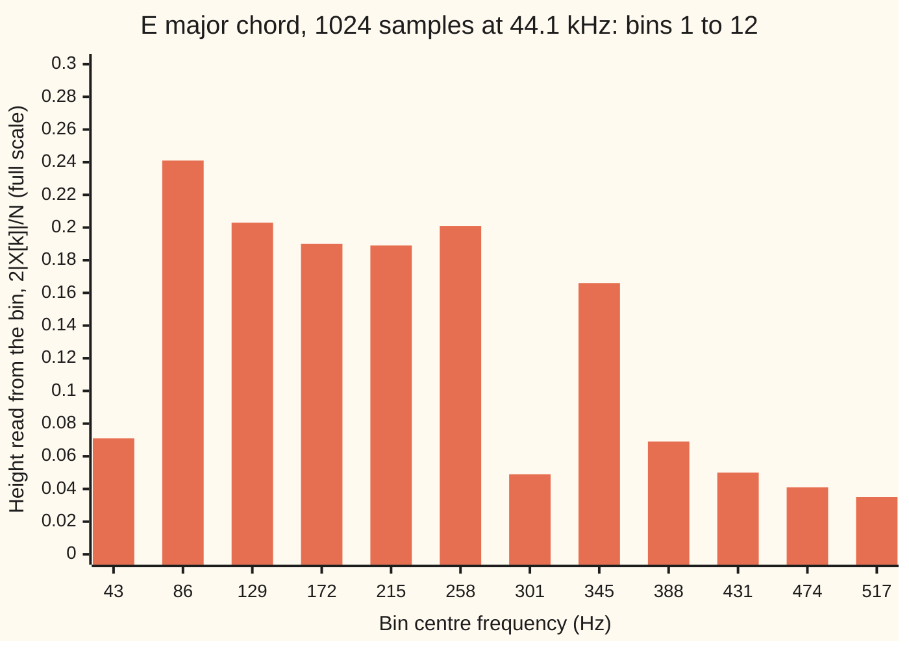

# The DFT and the FFT: a block of samples becomes a list of frequencies

[Syllabus](../../../SYLLABUS.md) → [Engineering mathematics](../README.md) → [Signals](../README.md#s05) → The DFT and the FFT

---

## General Overview

A guitarist strums an open E major chord for ten seconds. A converter samples the pickup's voltage 44,100 times a second, so the recording is 441,000 numbers. A tuner app wants two things from them: which strings are sounding, and whether each one is in tune.

The app cuts out a block of 1024 samples, 23.22 ms (thousandths of a second) of sound, and runs the **discrete Fourier transform**, the DFT: 1024 numbers in, a list of frequency strengths out. Each entry in that list covers a slot of frequency called a **bin**. Here every bin is 43.07 Hz wide (hertz: cycles per second). That number is the sampling rate divided by the block length, and it is the same as one over the block's duration.

43.07 Hz is too coarse for a guitar. The six strings run from 82.41 Hz to 329.63 Hz, and they all land in bins 2 to 8. The spectrum shows three bumps, not six, and the top string reads 344.53 Hz, 76.6 cents sharp (a cent is a hundredth of a semitone). A block 16 times longer, 16,384 samples or 0.3715 s, has bins 2.69 Hz wide. It shows six clean peaks, each within 1.25 Hz of its string.

The long block costs work. The DFT sum written straight from its definition takes N × N multiplications for N samples: 1,048,576 for the short block and 268 million for the long one. The **fast Fourier transform**, the FFT, gets the same outputs by splitting the block into even-numbered and odd-numbered samples, then splitting each half again, down to single samples. It needs 5,120 multiplications for the short block and 114,688 for the long one.

**A block of N samples taken f_s times a second gives frequency bins f_s/N apart, one over the record's length, so only a longer record gives finer resolution; the FFT computes all N bins in (N/2) log₂ N multiplications instead of N², by splitting the block into even and odd samples again and again.**

**What kind of fact this is:** the bin width follows from the DFT's definition, and the FFT is an exact rearrangement of the same sum, both proved on this card in Why it works; the chord is a model, six steady pure tones, one per string.

### The picture: what a 23 ms block can see



Bars: the height each bin reports, as a fraction of the converter's full scale. The six strings sit at 82, 123, 165, 208, 247 and 330 Hz, with true heights 0.30 down to 0.15. They come out as three peaks: 86 and 258 Hz at the two ends of one broad hump, and 345 Hz alone. The bins are wider than the gaps between the strings.

---

## The formula

Notation first. Engineers on this shelf write $j$ for the square root of −1; the rest of the library writes $i$. The block holds samples $x[n]$, with $n$ counting from 0 to $N-1$, taken $f_s$ times a second ([Sampling](01-sampling-and-the-nyquist-theorem.md)). The DFT turns them into outputs $X[k]$, one per bin $k$, by turning sample $n$ through $k \times n$ steps of $1/N$ of a circle and adding ([The discrete Fourier transform](../../07-Complex%20analysis/08-Transforms%20in%20Outline/02-discrete-fourier-transform.md) builds it and proves the inverse):

$$X[k] = \sum_{n=0}^{N-1} x[n]\, w^{kn}, \qquad w = e^{-j2\pi/N}.$$

This card adds three things: what frequency each bin is, how wide it is, and how to compute all of them fast.

**Bin width.**

$$\Delta f = \frac{f_s}{N} = \frac{1}{T_{\text{rec}}}, \qquad f_k = k\,\Delta f \quad \text{for } 0 \le k \le N/2.$$

**Read it aloud:** bins are spaced by the sampling rate over the block length, which is one over the record's duration; bin $k$ sits at $k$ bin widths.

**The split.** Let $E[k]$ be the DFT of the even-numbered samples $x[0], x[2], x[4], \dots$ and $O[k]$ the DFT of the odd-numbered ones, each $N/2$ long. Then for $k = 0$ to $N/2 - 1$

$$X[k] = E[k] + w^k\, O[k], \qquad X[k + N/2] = E[k] - w^k\, O[k].$$

**Read it aloud:** each output is the even half's output plus the odd half's output turned by $w^k$; the output half a block further on uses the same two numbers with a minus sign.

**The cost.** Splitting again and again, down to single samples, takes

$$M(N) = \frac{N}{2}\log_2 N \quad \text{multiplications, against } N^2 \text{ for the sum.}$$

**Reading a height.** A steady tone that fits a whole number of cycles in the block shows up in its bin with height $A = 2\lvert X[k]\rvert / N$.

| Symbol | Plain meaning | In our example | Push it up and the answer… |
| --- | --- | --- | --- |
| $f_s$ | sampling rate, samples per second | 44.1 kHz | bins get wider, for the same $N$ |
| $N$ | block length, samples per block (a power of 2 here) | 1024 | bins get narrower; more work |
| $T_{\text{rec}}$ | record length, $N/f_s$ | 23.22 ms | bins get narrower |
| $\Delta f$ | bin width, the spacing between bins | 43.07 Hz | — |
| $k$, $f_k$ | bin number; that bin's frequency, $k\,\Delta f$ | bin 8 is 344.53 Hz | past $N/2$, bins mirror lower ones |
| $x[n]$; $n$, $m$ | sample $n$, in units of full scale; sample counters; in the split, samples $2m$ and $2m+1$ | the chord's voltage | — |
| $X[k]$ | output $k$ of the DFT, a complex number | $X[8] = -64.1640 - 55.8147j$ | — |
| $w$, $j$ | one step of $1/N$ of a circle clockwise, $e^{-j2\pi/N}$; the square root of −1 | $w^8 = 0.9988 - 0.0491j$ | — |
| $E[k]$, $O[k]$ | DFTs of the even and odd samples, $N/2$ long | $E[8] = -31.8308 - 27.9011j$, $O[8] = -30.9247 - 29.4665j$ | — |
| $\log_2 N$ | number of halvings from $N$ samples down to 1 | 10 | one more level per doubling |
| $M(N)$ | multiplications the FFT needs | 5120 | grows a little faster than $N$ |
| $A$ | a tone's height read from its bin, $2\lvert X[k]\rvert/N$ | E4 is 0.15; the long block reads 0.101 | — |

### When it holds

- **The record length sets the resolution**, the smallest gap between two tones that still shows as two peaks: about $1/T_{\text{rec}}$, one bin of the unpadded block. Padding with zeros adds bins, not resolution. The 1024-sample block shows three peaks for six strings, because most neighbouring strings sit less than one bin apart.
- **Each tone fits a whole number of cycles in the block.** Then it lands in one bin. Otherwise it leaks into its neighbours: a tone of height 1 at bin 10.5 reads 0.652 and 0.622 in bins 10 and 11, and still 0.023 ten bins away. Tapering the block to reduce this is [Windows](03-windows-and-spectral-leakage.md).
- **The tones are steady across the block.** A real string fades and its pitch wobbles. Over 23 ms that barely matters; over 0.37 s the fading spreads each peak a little.
- **N is a power of 2, for this even–odd split.** The 441,000-sample recording is not. Pad it with zeros to 524,288 = 2¹⁹, or split by other factors (3, 5, 7), which the same idea also handles.
- **Bins above N/2 are mirrors.** For real samples, bin $N-k$ holds the conjugate of bin $k$ (the same number with the sign of its $j$ part flipped). Bin $N/2$ is the Nyquist frequency, 22,050 Hz; nothing above it is a new frequency ([Sampling](01-sampling-and-the-nyquist-theorem.md)).

---

## Why it works

### Step 0: half-size transforms cost a quarter each

The sum needs $N^2$ multiplications, one per pair of sample and bin. A transform of half the length needs a quarter of that. Two of them, one for the even samples and one for the odd, need half. If the full answer can be built from those two halves cheaply, the work is halved. And each half can be split again. That is the whole fast transform; the rest is checking that the halves really do combine, and counting.

### Step 1: bin k is k whole cycles per record

The DFT measures sample $n$ against $w^{kn}$, a pointer that makes $k$ full turns over the $N$ samples. The block lasts $T_{\text{rec}} = N/f_s$ seconds. So bin $k$ is the wave that makes $k$ cycles in $T_{\text{rec}}$ seconds: $k/T_{\text{rec}} = k f_s/N$ hertz. For the 1024 block, 1/0.02322 s = 43.07 Hz per bin.

Why can two tones less than a bin apart not be told apart? Two tones $\Delta f$ apart drift apart by exactly one cycle over the record. That is the smallest drift for which the two tones, multiplied together and summed over the block, cancel, by the root-of-unity fact (equal steps that go around a circle a whole number of times add up to zero) on [The discrete Fourier transform](../../07-Complex%20analysis/08-Transforms%20in%20Outline/02-discrete-fourier-transform.md). E2 and B2 are 41.06 Hz apart; over 23.22 ms they drift only 0.95 cycles apart, less than one, so the block cannot tell them apart cleanly. Over 0.3715 s they drift 15.26 cycles apart, and separate.

Seen as a [Change of basis](../../03-Algebra/07-Eigenvalues%20and%20Symmetric%20Matrices/01-change-of-basis.md): the $N$ waves $w^{kn}$ are perpendicular directions in the space of blocks, and the DFT gives each block's address in them. There are only $N$ such directions for $N$ samples, spread evenly from 0 to $f_s$. More directions need more samples.

### Step 2: the even and odd halves combine

Split the sum into even samples, $n = 2m$, and odd ones, $n = 2m+1$:

$$X[k] = \sum_{m=0}^{N/2-1} x[2m]\,(w^2)^{mk} \;+\; w^k \sum_{m=0}^{N/2-1} x[2m+1]\,(w^2)^{mk}.$$

Now $w^2 = e^{-j2\pi/(N/2)}$ is exactly the step for a block of $N/2$. So the first sum is $E[k]$, the DFT of the even samples, and the second is $O[k]$, the DFT of the odd samples. The odd samples sit one slot later, which costs one extra turn, $w^k$. That gives $X[k] = E[k] + w^k O[k]$.

Two facts give the other half of the outputs free. $E$ and $O$ repeat every $N/2$ bins, since $(w^2)^{N/2} = 1$. And $w^{k + N/2} = -w^k$, since $w^{N/2}$ is half a turn, −1. So $X[k + N/2] = E[k] - w^k O[k]$. One product, $w^k O[k]$, serves two outputs. This pair of outputs from one product is called a **butterfly**.

For the chord, bin 8: $E[8] = -31.8308 - 27.9011j$, $O[8] = -30.9247 - 29.4665j$, $w^8 = 0.9988 - 0.0491j$. Adding gives $X[8] = -64.1640 - 55.8147j$, and subtracting gives $X[520] = 0.5025 + 0.0125j$. The sum written out in full gives the same two numbers.

### Step 3: count the multiplications

Let $M(N)$ be the multiplications for a block of $N$. One split does two half-size transforms and $N/2$ turns:

$$M(N) = 2\,M(N/2) + N/2, \qquad M(1) = 0.$$

Each level of splitting holds blocks that add up to $N$ samples, so each level costs $N/2$ turns in all. Halving 1024 down to 1 takes $\log_2 1024 = 10$ levels. So $M(1024) = 512 \times 10 = 5120$.


Read the chain right to left: the FFT starts from single samples and stitches pairs, then pairs of pairs, ten times. Only the first split was done by hand in the code: two 512-point sums, 524,288 products together, plus 512 turns, 524,800 in all, already half the full sum's 1,048,576.

<details>
<summary>Detailed proof: M(N) = (N/2) log₂ N</summary>

Take $N = 2^L$. Claim: $M(2^L) = 2^{L-1} L$. For $L = 0$ both sides are 0. If it holds for $L - 1$, then

$$M(2^L) = 2\,M(2^{L-1}) + 2^{L-1} = 2 \cdot 2^{L-2}(L-1) + 2^{L-1} = 2^{L-1}(L - 1 + 1) = 2^{L-1} L.$$

So it holds for every $L$, by induction. Some of these turns are by $w^0 = 1$ and need no real work; fast codes skip them, and the count here keeps them so it matches the code exactly.

</details>

### Step 4: reading a real signal's spectrum

The chord's samples are real numbers. For real samples, bin $N - k$ holds the conjugate of bin $k$, so bins $N/2 + 1$ to $N - 1$ repeat bins below $N/2$ in mirror image. Only bins 0 to $N/2$ carry information. Bin $k$ is at $k f_s / N$ hertz, and a tone that fits the block shows a height $2\lvert X[k]\rvert/N$: the 2 because its mirror twin carries the other half.

A tone of height 1 placed exactly on bin 10, at 430.66 Hz, reads 1.000000 in bin 10 and 0.000000 in bin 11. A real chord does not fit the bins, so its heights come out lower and smeared: E4 sits at bin 122.46 of the long block, nearly halfway, and reads 0.101 for a true 0.15. Its frequency is still right to within half a bin.

Running the transform backwards takes the same FFT with $w$ replaced by its conjugate, then a division by $N$. The code does this and gets every sample back.

---

## Worked numbers, by hand

The 1024-sample block at 44.1 kHz.

| Step | Arithmetic | Value |
| --- | --- | --- |
| record length | 1024 / 44,100 | 23.22 ms |
| bin width | 44,100 / 1024 | **43.07 Hz** |
| top useful bin | 1024 / 2 = 512; 512 × 43.07 | 22,050.00 Hz, the Nyquist frequency |
| where E4 sits | 329.63 / 43.07 | bin 7.65 |
| E4 as read | bin 8 × 43.07 | 344.53 Hz, 14.90 Hz sharp |
| the sum's cost | 1024 × 1024 | 1,048,576 multiplications |
| halvings | 2 × 2 × … ten times = 1024 | 10 |
| the FFT's cost | 512 × 10 | **5,120 multiplications** |
| speed-up | 1,048,576 / 5,120 | 204.8 |
| long block bin width | 44,100 / 16,384 | 2.69 Hz |
| long block FFT cost | 8,192 × 14 | 114,688, against 268,435,456 |

A 23 ms block gives 43.07 Hz bins, too coarse to name the strings of a chord, and the FFT computes it 204.8 times faster than the sum.

### Reading the chord from the long block

16,384 samples, 0.3715 s, bins 2.69 Hz apart. Each peak, its bin's frequency, and the height read off it:

```
string  bin   bin (Hz)  true (Hz)   height
E2       31     83.44     82.41     0.227  ███████████████████████
B2       46    123.82    123.47     0.248  █████████████████████████
E3       61    164.19    164.81     0.205  ████████████████████
G#3      77    207.26    207.65     0.191  ███████████████████
B3       92    247.63    246.94     0.161  ████████████████
E4      122    328.38    329.63     0.101  ██████████
```

Six strings, six peaks, each within 1.25 Hz of the truth, less than half a bin. The heights are below the true 0.30 to 0.15, because no string fits the block a whole number of times. The whole ten-second recording would give a resolution of 1/10 s = 0.10 Hz.

### What breaks if you drop a piece

| Mistake | Comes out at | What went wrong |
| --- | --- | --- |
| Name the notes from the 1024 block | 3 peaks; E4 at 344.53 Hz, 76.6 cents sharp | The bins, 43.07 Hz, are as wide as the gaps between strings, 39.29 to 82.69 Hz |
| Pad the 1024 samples with zeros to 16,384, for 2.69 Hz bins | 8 peaks: E2 at 69.98 Hz, and two at 21.53 and 395.67 Hz that are no string | Padding adds bins, not record; the smear is still 43 Hz wide |
| Stitch the top half with + instead of − | outputs wrong by up to 177.60 | $w^{N/2} = -1$: half a turn flips the odd half's sign |
| Leave out the turn $w^k$ on the odd half | outputs wrong by up to 247.04 | The odd samples are one slot late, and that delay is a turn |
| Read bin 1016 of 1024 as a frequency | 43,755.47 Hz | It is the mirror of bin 8, 344.53 Hz |

---

## Code, from first principles, and it actually runs

The script builds the chord as six sines, then reaches the spectrum **three independent ways**: the DFT sum written out, all 1,048,576 products; one even–odd split done by hand from two 512-point sums; and the recursive FFT. All three agree to 10⁻⁹. The FFT's products are counted and checked against (N/2) log₂ N. The inverse FFT returns the samples, and the energy, the sum of squares, matches on both sides. On the long block, where the full sum would take 268 million products, the FFT's peak bins are checked one by one against the sum written out, and each peak against the string that made it.

### Python

```python
# The DFT and the FFT -- the check behind the card.  Standard library only.  A model guitar chord
# (open E major: six steady pure tones, one per string) sampled at 44.1 kHz.  Road one: the DFT sum
# written out, N x N products.  Road two: the FFT, halving again and again, with every product counted.
import math
FS = 44100.0                                             # sampling rate, Hz
NOTES = [("E2", 82.4069, 0.30), ("B2", 123.4708, 0.25), ("E3", 164.8138, 0.22),
         ("G#3", 207.6523, 0.20), ("B3", 246.9417, 0.18), ("E4", 329.6276, 0.15)]
count = [0]
tw = lambda m, n: complex(math.cos(2 * math.pi * m / n), -math.sin(2 * math.pi * m / n))   # w^m, w = e^(-2 pi j/n)

def tone_block(n, tones):                                # x[n]: a sum of sines, n samples from t = 0
    return [sum(a * math.sin(2 * math.pi * f * i / FS) for _, f, a in tones) for i in range(n)]

def dft(x):                                              # road one: the definition, N x N products
    N = len(x)
    table = [tw(m, N) for m in range(N)]
    count[0] += N * N
    return [sum(x[i] * table[k * i % N] for i in range(N)) for k in range(N)]

def one_bin(x, k):                                       # one output by the definition, for spot checks
    N = len(x)
    return sum(x[i] * tw(k * i % N, N) for i in range(N))

def fft(a, sign=-1.0, mode="right"):                     # road two: even half, odd half, stitch
    n = len(a)
    if n == 1: return [complex(a[0])]
    ev, od, out = fft(a[0::2], sign, mode), fft(a[1::2], sign, mode), [0j] * n
    for k in range(n // 2):
        w = complex(math.cos(2 * math.pi * k / n), sign * math.sin(2 * math.pi * k / n))
        t = od[k] if mode == "no turn" else w * od[k]
        count[0] += 1
        out[k] = ev[k] + t
        out[k + n // 2] = ev[k] + t if mode == "same sign" else ev[k] - t
    return out

def amps(X, n_real):                                     # 2|X[k]|/N: a tone's height, bins 0 to N/2
    return [2 * math.sqrt(z.real ** 2 + z.imag ** 2) / n_real for z in X[:len(X) // 2 + 1]]

def peaks(a, floor):                                     # local maxima above the floor
    return [k for k in range(1, len(a) - 1) if a[k] > floor and a[k] > a[k - 1] and a[k] >= a[k + 1]]

gap = lambda A, B: max(math.sqrt((p - q).real ** 2 + (p - q).imag ** 2) for p, q in zip(A, B))
N, NL, FLOOR = 1024, 16384, 0.08
x = tone_block(N, NOTES)
count[0] = 0; Xd = dft(x); m_dft = count[0]
count[0] = 0; X = fft(x); m_fft = count[0]
count[0] = 0; E, O = dft(x[0::2]), dft(x[1::2]); m_one = count[0] + N // 2   # one split by hand
H, w8 = N // 2, tw(8, N)
split = [E[k % H] + (1 if k < H else -1) * tw(k % H, N) * O[k % H] for k in range(N)]
back = [z / N for z in fft(X, +1.0)]
e_t, e_f = sum(v * v for v in x), sum(z.real ** 2 + z.imag ** 2 for z in X) / N
df, rec = FS / N, N / FS
print(f"block: N = {N} samples at {FS / 1000:.1f} kHz; record {1000 * rec:.2f} ms; bin width fs/N = {df:.2f} Hz = 1/record")
print(f"top bin N/2 = {N // 2}: {N // 2 * df:.2f} Hz, the Nyquist frequency")
print(f"multiplications: DFT sum {m_dft}; FFT {m_fft}; (N/2) log2 N = {N // 2 * int(math.log2(N))}; speed-up {m_dft / m_fft:.1f}")
print(f"one split: two 512-point sums {m_one - N // 2} products + {N // 2} turns = {m_one}; split against DFT sum: {'below 1e-9' if gap(split, Xd) < 1e-9 else 'TOO BIG'}")
c4 = lambda z: f"{z.real:.4f} {'-' if z.imag < 0 else '+'} {abs(z.imag):.4f}j"
print(f"bin 8: E[8] = {c4(E[8])}; O[8] = {c4(O[8])}; w^8 = {c4(w8)}")
print(f"bin 8: X[8] = E[8] + w^8 O[8] = {c4(E[8] + w8 * O[8])}; X[520] = E[8] - w^8 O[8] = {c4(E[8] - w8 * O[8])}")
print(f"FFT against DFT sum, largest gap: {'below 1e-9' if gap(X, Xd) < 1e-9 else 'TOO BIG'}")
print(f"inverse FFT returns the samples: {'yes' if gap(back, x) < 1e-12 else 'no'}; energy sum x^2 {e_t:.6f}, sum |X|^2 / N {e_f:.6f}")
for nm, f, a in NOTES:
    print(f"  {nm:<3} {f:8.2f} Hz  amplitude {a:.2f}  sits at bin {f / df:5.2f}; nearest bin {round(f / df)} = {round(f / df) * df:6.2f} Hz")
a1 = amps(X, N)
pk1 = peaks(a1, FLOOR)
print(f"1024 block, peaks above {FLOOR:.2f}: {len(pk1)} at bins {pk1} = {', '.join(f'{k * df:.2f}' for k in pk1)} Hz")
print("chart, 1024 block, bin " + " ".join(f"{k}" for k in range(1, 13)))
print("chart, 1024 block, Hz " + " ".join(f"{k * df:.0f}" for k in range(1, 13)))
print("chart, 1024 block, height " + " ".join(f"{v:.3f}" for v in a1[1:13]))
gaps = [NOTES[i + 1][1] - NOTES[i][1] for i in range(5)]
print(f"gaps between strings: {', '.join(f'{g:.2f}' for g in gaps)} Hz; E2 and B2 drift {gaps[0] * rec:.2f} cycles apart in {1000 * rec:.2f} ms, {gaps[0] * NL / FS:.2f} in {NL / FS:.4f} s")
e4 = round(329.6276 / df) * df
print(f"E4 read from the 1024 block: {e4:.2f} Hz, {e4 - 329.6276:.2f} Hz sharp, {1200 * math.log2(e4 / 329.6276):.1f} cents")
xl = tone_block(NL, NOTES)
count[0] = 0; XL = fft(xl); m_long = count[0]
dfl, aL = FS / NL, amps(XL, NL)
pkL = peaks(aL, FLOOR)
print(f"long block: N = {NL}, record {NL / FS:.4f} s, bin width {dfl:.4f} Hz; FFT {NL // 2} x {round(math.log(NL, 2))} = {m_long} products; DFT sum would need {NL * NL}, speed-up {NL * NL / m_long:.0f}")
spot = gap([XL[k] for k in pkL], [one_bin(xl, k) for k in pkL])
print(f"E4 sits at long-block bin {329.6276 / dfl:.2f}")
print(f"long block, peaks above {FLOOR:.2f}: {len(pkL)}; FFT at those bins against the DFT sum: {'below 1e-8' if spot < 1e-8 else 'TOO BIG'}")
for (nm, f, a), k in zip(NOTES, pkL):
    print(f"  {nm:<3} bin {k:3d} = {k * dfl:6.2f} Hz  (true {f:6.2f}, off {k * dfl - f:+.2f})  height {aL[k]:.3f}  {'#' * round(100 * aL[k])}")
pad = fft(x + [0.0] * (NL - N))
pkP = peaks(amps(pad, N), FLOOR)
print(f"1024 samples padded with zeros to {NL}: bins {dfl:.4f} Hz apart, peaks above {FLOOR:.2f}: {len(pkP)} at {', '.join(f'{k * dfl:.2f}' for k in pkP)} Hz")
on = amps(fft(tone_block(N, [("", 10 * df, 1.0)])), N)
half = amps(fft(tone_block(N, [("", 10.5 * df, 1.0)])), N)
print(f"tone of height 1 on bin 10 ({10 * df:.2f} Hz): bin 10 reads {on[10]:.6f}, bin 11 reads {on[11]:.6f}")
print(f"tone of height 1 at bin 10.5 ({10.5 * df:.2f} Hz): bins 10 and 11 read {half[10]:.3f} and {half[11]:.3f}; bin 20 still {half[20]:.3f}")
count[0] = 0; ss = fft(x, mode="same sign"); nt = fft(x, mode="no turn")
print(f"mistake, top half stitched with + not -: largest error {gap(ss, Xd):.2f}; no turn w^k on the odd half: {gap(nt, Xd):.2f}")
print(f"mistake, bin 1016 of 1024 read as {1016 * df:.2f} Hz; it is the mirror of bin 8, {8 * df:.2f} Hz")
print(f"10 s recording: {int(10 * FS)} samples, resolution 1/10 s = {1 / 10:.2f} Hz; padded to 2^19 = {2 ** 19}: DFT sum {2 ** 38}, FFT {2 ** 18 * 19}, speed-up {2 ** 38 / (2 ** 18 * 19):.0f}")
pk4 = peaks(amps(fft(tone_block(4096, NOTES)), 4096), FLOOR)
print(f"try: N 2048 -> {FS / 2048:.2f} Hz, record {2048 / FS * 1000:.2f} ms; fs 48 kHz, N 1024 -> {48000 / 1024:.2f} Hz; N 4096 -> {FS / 4096:.2f} Hz, {len(pk4)} peaks; Wi-Fi 20 MHz / 64 -> {20e6 / 64 / 1000:.1f} kHz")
assert gap(X, Xd) < 1e-9                                 # road two against road one
assert gap(split, Xd) < 1e-9                             # one even/odd split against road one
assert m_fft == N // 2 * round(math.log(N, 2))           # products counted against (N/2) log2 N
assert gap(back, x) < 1e-12                              # the inverse returns the samples
assert abs(e_t - e_f) < 1e-9                             # energy, time side against frequency side
assert len(pkL) == 6 and all(abs(k * dfl - f) <= dfl / 2 for (_, f, _), k in zip(NOTES, pkL))
assert spot < 1e-8                                       # long-block FFT against single-bin sums
assert abs(on[10] - 1.0) < 1e-9                          # an on-bin tone reads its own height
assert len(pk1) < 6                                      # 43 Hz bins cannot name six strings
assert len(pk4) == 6 and all(abs(k * FS / 4096 - f) <= FS / 8192 for (_, f, _), k in zip(NOTES, pk4))   # 10.77 Hz bins can
print("ALL CHECKS PASS")
```

**Ran 2026-11-11 on macOS, Python 3.14.10, standard library only. All checks passed. Output, pasted from the run:**

```
block: N = 1024 samples at 44.1 kHz; record 23.22 ms; bin width fs/N = 43.07 Hz = 1/record
top bin N/2 = 512: 22050.00 Hz, the Nyquist frequency
multiplications: DFT sum 1048576; FFT 5120; (N/2) log2 N = 5120; speed-up 204.8
one split: two 512-point sums 524288 products + 512 turns = 524800; split against DFT sum: below 1e-9
bin 8: E[8] = -31.8308 - 27.9011j; O[8] = -30.9247 - 29.4665j; w^8 = 0.9988 - 0.0491j
bin 8: X[8] = E[8] + w^8 O[8] = -64.1640 - 55.8147j; X[520] = E[8] - w^8 O[8] = 0.5025 + 0.0125j
FFT against DFT sum, largest gap: below 1e-9
inverse FFT returns the samples: yes; energy sum x^2 136.957194, sum |X|^2 / N 136.957194
  E2     82.41 Hz  amplitude 0.30  sits at bin  1.91; nearest bin 2 =  86.13 Hz
  B2    123.47 Hz  amplitude 0.25  sits at bin  2.87; nearest bin 3 = 129.20 Hz
  E3    164.81 Hz  amplitude 0.22  sits at bin  3.83; nearest bin 4 = 172.27 Hz
  G#3   207.65 Hz  amplitude 0.20  sits at bin  4.82; nearest bin 5 = 215.33 Hz
  B3    246.94 Hz  amplitude 0.18  sits at bin  5.73; nearest bin 6 = 258.40 Hz
  E4    329.63 Hz  amplitude 0.15  sits at bin  7.65; nearest bin 8 = 344.53 Hz
1024 block, peaks above 0.08: 3 at bins [2, 6, 8] = 86.13, 258.40, 344.53 Hz
chart, 1024 block, bin 1 2 3 4 5 6 7 8 9 10 11 12
chart, 1024 block, Hz 43 86 129 172 215 258 301 345 388 431 474 517
chart, 1024 block, height 0.071 0.241 0.203 0.190 0.189 0.201 0.049 0.166 0.069 0.050 0.041 0.035
gaps between strings: 41.06, 41.34, 42.84, 39.29, 82.69 Hz; E2 and B2 drift 0.95 cycles apart in 23.22 ms, 15.26 in 0.3715 s
E4 read from the 1024 block: 344.53 Hz, 14.90 Hz sharp, 76.6 cents
long block: N = 16384, record 0.3715 s, bin width 2.6917 Hz; FFT 8192 x 14 = 114688 products; DFT sum would need 268435456, speed-up 2341
E4 sits at long-block bin 122.46
long block, peaks above 0.08: 6; FFT at those bins against the DFT sum: below 1e-8
  E2  bin  31 =  83.44 Hz  (true  82.41, off +1.03)  height 0.227  #######################
  B2  bin  46 = 123.82 Hz  (true 123.47, off +0.35)  height 0.248  #########################
  E3  bin  61 = 164.19 Hz  (true 164.81, off -0.62)  height 0.205  ####################
  G#3 bin  77 = 207.26 Hz  (true 207.65, off -0.40)  height 0.191  ###################
  B3  bin  92 = 247.63 Hz  (true 246.94, off +0.69)  height 0.161  ################
  E4  bin 122 = 328.38 Hz  (true 329.63, off -1.25)  height 0.101  ##########
1024 samples padded with zeros to 16384: bins 2.6917 Hz apart, peaks above 0.08: 8 at 21.53, 69.98, 121.12, 166.88, 212.64, 261.09, 347.22, 395.67 Hz
tone of height 1 on bin 10 (430.66 Hz): bin 10 reads 1.000000, bin 11 reads 0.000000
tone of height 1 at bin 10.5 (452.20 Hz): bins 10 and 11 read 0.652 and 0.622; bin 20 still 0.023
mistake, top half stitched with + not -: largest error 177.60; no turn w^k on the odd half: 247.04
mistake, bin 1016 of 1024 read as 43755.47 Hz; it is the mirror of bin 8, 344.53 Hz
10 s recording: 441000 samples, resolution 1/10 s = 0.10 Hz; padded to 2^19 = 524288: DFT sum 274877906944, FFT 4980736, speed-up 55188
try: N 2048 -> 21.53 Hz, record 46.44 ms; fs 48 kHz, N 1024 -> 46.88 Hz; N 4096 -> 10.77 Hz, 6 peaks; Wi-Fi 20 MHz / 64 -> 312.5 kHz
ALL CHECKS PASS
```

### Rust

Same numbers, same labels. Rust has no complex type in its standard library, so a small one is written out.

```rust
// The DFT and the FFT -- the same check as the Python, in Rust.  No crates.  A model guitar chord
// (open E major: six steady pure tones, one per string) sampled at 44.1 kHz.  Road one: the DFT sum
// written out, N x N products.  Road two: the FFT, halving again and again, with every product counted.
use std::f64::consts::PI;
use std::ops::{Add, Mul, Sub};
#[derive(Clone, Copy)]
struct C { re: f64, im: f64 }
impl Add for C { type Output = C; fn add(self, o: C) -> C { c(self.re + o.re, self.im + o.im) } }
impl Sub for C { type Output = C; fn sub(self, o: C) -> C { c(self.re - o.re, self.im - o.im) } }
impl Mul for C { type Output = C; fn mul(self, o: C) -> C { c(self.re * o.re - self.im * o.im, self.re * o.im + self.im * o.re) } }
fn c(re: f64, im: f64) -> C { C { re, im } }
fn modu(z: C) -> f64 { (z.re * z.re + z.im * z.im).sqrt() }
fn tw(m: usize, n: usize) -> C { let a = 2.0 * PI * m as f64 / n as f64; c(a.cos(), -a.sin()) } // w^m, w = e^(-2 pi j/n)
const FS: f64 = 44100.0; // sampling rate, Hz
const NOTES: [(&str, f64, f64); 6] = [("E2", 82.4069, 0.30), ("B2", 123.4708, 0.25), ("E3", 164.8138, 0.22),
    ("G#3", 207.6523, 0.20), ("B3", 246.9417, 0.18), ("E4", 329.6276, 0.15)];

fn tone_block(n: usize, tones: &[(&str, f64, f64)]) -> Vec<C> { // x[n]: a sum of sines, n samples from t = 0
    (0..n).map(|i| c(tones.iter().map(|&(_, f, a)| a * (2.0 * PI * f * i as f64 / FS).sin()).sum(), 0.0)).collect()
}
fn dft(x: &[C], count: &mut usize) -> Vec<C> { // road one: the definition, N x N products
    let n = x.len();
    let table: Vec<C> = (0..n).map(|m| tw(m, n)).collect();
    *count += n * n;
    (0..n).map(|k| (0..n).fold(c(0.0, 0.0), |s, i| s + x[i] * table[k * i % n])).collect()
}
fn one_bin(x: &[C], k: usize) -> C { // one output by the definition, for spot checks
    let n = x.len();
    (0..n).fold(c(0.0, 0.0), |s, i| s + x[i] * tw(k * i % n, n))
}
fn fft(a: &[C], sign: f64, mode: &str, count: &mut usize) -> Vec<C> { // road two: even half, odd half, stitch
    let n = a.len();
    if n == 1 { return vec![a[0]]; }
    let ev: Vec<C> = a.iter().step_by(2).cloned().collect();
    let od: Vec<C> = a.iter().skip(1).step_by(2).cloned().collect();
    let (e, o) = (fft(&ev, sign, mode, count), fft(&od, sign, mode, count));
    let mut out = vec![c(0.0, 0.0); n];
    for k in 0..n / 2 {
        let ang = 2.0 * PI * k as f64 / n as f64;
        let w = c(ang.cos(), sign * ang.sin());
        let t = if mode == "no turn" { o[k] } else { w * o[k] };
        *count += 1;
        out[k] = e[k] + t;
        out[k + n / 2] = if mode == "same sign" { e[k] + t } else { e[k] - t };
    }
    out
}
fn amps(x: &[C], n_real: usize) -> Vec<f64> { // 2|X[k]|/N: a tone's height, bins 0 to N/2
    x[..x.len() / 2 + 1].iter().map(|&z| 2.0 * modu(z) / n_real as f64).collect()
}
fn peaks(a: &[f64], floor: f64) -> Vec<usize> { // local maxima above the floor
    (1..a.len() - 1).filter(|&k| a[k] > floor && a[k] > a[k - 1] && a[k] >= a[k + 1]).collect()
}
fn gap(a: &[C], b: &[C]) -> f64 { a.iter().zip(b).map(|(&p, &q)| modu(p - q)).fold(0.0, f64::max) }
fn c4(z: C) -> String { format!("{:.4} {} {:.4}j", z.re, if z.im < 0.0 { "-" } else { "+" }, z.im.abs()) }
fn join(v: &[String], sep: &str) -> String { v.join(sep) }

fn main() {
    let (n, nl, floor) = (1024usize, 16384usize, 0.08);
    let mut count = 0usize;
    let x = tone_block(n, &NOTES);
    let xd = dft(&x, &mut count); let m_dft = count;
    count = 0; let xx = fft(&x, -1.0, "right", &mut count); let m_fft = count;
    let ev: Vec<C> = x.iter().step_by(2).cloned().collect();
    let od: Vec<C> = x.iter().skip(1).step_by(2).cloned().collect();
    count = 0; let (e, o) = (dft(&ev, &mut count), dft(&od, &mut count)); let m_one = count + n / 2; // one split by hand
    let (h, w8) = (n / 2, tw(8, n));
    let split: Vec<C> = (0..n).map(|k| if k < h { e[k] + tw(k, n) * o[k] } else { e[k - h] - tw(k - h, n) * o[k - h] }).collect();
    let back: Vec<C> = fft(&xx, 1.0, "right", &mut count).iter().map(|z| c(z.re / n as f64, z.im / n as f64)).collect();
    let e_t: f64 = x.iter().map(|z| z.re * z.re).sum();
    let e_f: f64 = xx.iter().map(|z| z.re * z.re + z.im * z.im).sum::<f64>() / n as f64;
    let (df, rec) = (FS / n as f64, n as f64 / FS);
    let ok = |b: bool, y: &str, no: &str| if b { y.to_string() } else { no.to_string() };
    println!("block: N = {} samples at {:.1} kHz; record {:.2} ms; bin width fs/N = {:.2} Hz = 1/record", n, FS / 1000.0, 1000.0 * rec, df);
    println!("top bin N/2 = {}: {:.2} Hz, the Nyquist frequency", n / 2, (n / 2) as f64 * df);
    println!("multiplications: DFT sum {}; FFT {}; (N/2) log2 N = {}; speed-up {:.1}", m_dft, m_fft, n / 2 * (n as f64).log2() as usize, m_dft as f64 / m_fft as f64);
    println!("one split: two 512-point sums {} products + {} turns = {}; split against DFT sum: {}", m_one - n / 2, n / 2, m_one, ok(gap(&split, &xd) < 1e-9, "below 1e-9", "TOO BIG"));
    println!("bin 8: E[8] = {}; O[8] = {}; w^8 = {}", c4(e[8]), c4(o[8]), c4(w8));
    println!("bin 8: X[8] = E[8] + w^8 O[8] = {}; X[520] = E[8] - w^8 O[8] = {}", c4(e[8] + w8 * o[8]), c4(e[8] - w8 * o[8]));
    println!("FFT against DFT sum, largest gap: {}", ok(gap(&xx, &xd) < 1e-9, "below 1e-9", "TOO BIG"));
    println!("inverse FFT returns the samples: {}; energy sum x^2 {:.6}, sum |X|^2 / N {:.6}", ok(gap(&back, &x) < 1e-12, "yes", "no"), e_t, e_f);
    for &(nm, f, a) in NOTES.iter() {
        let k = (f / df).round();
        println!("  {:<3} {:8.2} Hz  amplitude {:.2}  sits at bin {:5.2}; nearest bin {} = {:6.2} Hz", nm, f, a, f / df, k as usize, k * df);
    }
    let a1 = amps(&xx, n);
    let pk1 = peaks(&a1, floor);
    let bins1: Vec<String> = pk1.iter().map(|k| k.to_string()).collect();
    let hz1: Vec<String> = pk1.iter().map(|&k| format!("{:.2}", k as f64 * df)).collect();
    println!("1024 block, peaks above {:.2}: {} at bins [{}] = {} Hz", floor, pk1.len(), join(&bins1, ", "), join(&hz1, ", "));
    println!("chart, 1024 block, bin {}", join(&(1..13).map(|k| k.to_string()).collect::<Vec<_>>(), " "));
    println!("chart, 1024 block, Hz {}", join(&(1..13).map(|k| format!("{:.0}", k as f64 * df)).collect::<Vec<_>>(), " "));
    println!("chart, 1024 block, height {}", join(&a1[1..13].iter().map(|v| format!("{:.3}", v)).collect::<Vec<_>>(), " "));
    let gaps: Vec<f64> = (0..5).map(|i| NOTES[i + 1].1 - NOTES[i].1).collect();
    println!("gaps between strings: {} Hz; E2 and B2 drift {:.2} cycles apart in {:.2} ms, {:.2} in {:.4} s", join(&gaps.iter().map(|g| format!("{:.2}", g)).collect::<Vec<_>>(), ", "), gaps[0] * rec, 1000.0 * rec, gaps[0] * nl as f64 / FS, nl as f64 / FS);
    let e4 = (329.6276 / df).round() * df;
    println!("E4 read from the 1024 block: {:.2} Hz, {:.2} Hz sharp, {:.1} cents", e4, e4 - 329.6276, 1200.0 * (e4 / 329.6276).log2());
    let xl = tone_block(nl, &NOTES);
    count = 0; let xxl = fft(&xl, -1.0, "right", &mut count); let m_long = count;
    let (dfl, al) = (FS / nl as f64, amps(&xxl, nl));
    let pkl = peaks(&al, floor);
    println!("long block: N = {}, record {:.4} s, bin width {:.4} Hz; FFT {} x {} = {} products; DFT sum would need {}, speed-up {:.0}", nl, nl as f64 / FS, dfl, nl / 2, (nl as f64).log2().round() as usize, m_long, nl * nl, (nl * nl) as f64 / m_long as f64);
    let spot = gap(&pkl.iter().map(|&k| xxl[k]).collect::<Vec<_>>(), &pkl.iter().map(|&k| one_bin(&xl, k)).collect::<Vec<_>>());
    println!("E4 sits at long-block bin {:.2}", 329.6276 / dfl);
    println!("long block, peaks above {:.2}: {}; FFT at those bins against the DFT sum: {}", floor, pkl.len(), ok(spot < 1e-8, "below 1e-8", "TOO BIG"));
    for (&(nm, f, _), &k) in NOTES.iter().zip(&pkl) {
        let fk = k as f64 * dfl;
        println!("  {:<3} bin {:3} = {:6.2} Hz  (true {:6.2}, off {:+.2})  height {:.3}  {}", nm, k, fk, f, fk - f, al[k], "#".repeat((100.0 * al[k]).round() as usize));
    }
    let mut padded = x.clone(); padded.resize(nl, c(0.0, 0.0));
    let pkp = peaks(&amps(&fft(&padded, -1.0, "right", &mut count), n), floor);
    let hzp: Vec<String> = pkp.iter().map(|&k| format!("{:.2}", k as f64 * dfl)).collect();
    println!("1024 samples padded with zeros to {}: bins {:.4} Hz apart, peaks above {:.2}: {} at {} Hz", nl, dfl, floor, pkp.len(), join(&hzp, ", "));
    let on = amps(&fft(&tone_block(n, &[("", 10.0 * df, 1.0)]), -1.0, "right", &mut count), n);
    let half = amps(&fft(&tone_block(n, &[("", 10.5 * df, 1.0)]), -1.0, "right", &mut count), n);
    println!("tone of height 1 on bin 10 ({:.2} Hz): bin 10 reads {:.6}, bin 11 reads {:.6}", 10.0 * df, on[10], on[11]);
    println!("tone of height 1 at bin 10.5 ({:.2} Hz): bins 10 and 11 read {:.3} and {:.3}; bin 20 still {:.3}", 10.5 * df, half[10], half[11], half[20]);
    let ss = fft(&x, -1.0, "same sign", &mut count);
    let nt = fft(&x, -1.0, "no turn", &mut count);
    println!("mistake, top half stitched with + not -: largest error {:.2}; no turn w^k on the odd half: {:.2}", gap(&ss, &xd), gap(&nt, &xd));
    println!("mistake, bin 1016 of 1024 read as {:.2} Hz; it is the mirror of bin 8, {:.2} Hz", 1016.0 * df, 8.0 * df);
    let (p19, p38, f19) = (1u64 << 19, 1u64 << 38, (1u64 << 18) * 19);
    println!("10 s recording: {} samples, resolution 1/10 s = {:.2} Hz; padded to 2^19 = {}: DFT sum {}, FFT {}, speed-up {:.0}", (10.0 * FS) as u64, 1.0 / 10.0, p19, p38, f19, p38 as f64 / f19 as f64);
    let pk4 = peaks(&amps(&fft(&tone_block(4096, &NOTES), -1.0, "right", &mut count), 4096), floor);
    println!("try: N 2048 -> {:.2} Hz, record {:.2} ms; fs 48 kHz, N 1024 -> {:.2} Hz; N 4096 -> {:.2} Hz, {} peaks; Wi-Fi 20 MHz / 64 -> {:.1} kHz", FS / 2048.0, 2048.0 / FS * 1000.0, 48000.0 / 1024.0, FS / 4096.0, pk4.len(), 20e6 / 64.0 / 1000.0);
    assert!(gap(&xx, &xd) < 1e-9); // road two against road one
    assert!(gap(&split, &xd) < 1e-9); // one even/odd split against road one
    assert!(m_fft == n / 2 * (n as f64).log2().round() as usize); // products counted against (N/2) log2 N
    assert!(gap(&back, &x) < 1e-12); // the inverse returns the samples
    assert!((e_t - e_f).abs() < 1e-9); // energy, time side against frequency side
    assert!(pkl.len() == 6 && NOTES.iter().zip(&pkl).all(|(&(_, f, _), &k)| (k as f64 * dfl - f).abs() <= dfl / 2.0));
    assert!(spot < 1e-8); // long-block FFT against single-bin sums
    assert!((on[10] - 1.0).abs() < 1e-9); // an on-bin tone reads its own height
    assert!(pk1.len() < 6); // 43 Hz bins cannot name six strings
    assert!(pk4.len() == 6 && NOTES.iter().zip(&pk4).all(|(&(_, f, _), &k)| (k as f64 * FS / 4096.0 - f).abs() <= FS / 8192.0)); // 10.77 Hz bins can
    println!("ALL CHECKS PASS");
}
```

**Ran 2026-11-11 on macOS, rustc 1.98.1, no crates. All checks passed. Output, pasted from the run:**

```
block: N = 1024 samples at 44.1 kHz; record 23.22 ms; bin width fs/N = 43.07 Hz = 1/record
top bin N/2 = 512: 22050.00 Hz, the Nyquist frequency
multiplications: DFT sum 1048576; FFT 5120; (N/2) log2 N = 5120; speed-up 204.8
one split: two 512-point sums 524288 products + 512 turns = 524800; split against DFT sum: below 1e-9
bin 8: E[8] = -31.8308 - 27.9011j; O[8] = -30.9247 - 29.4665j; w^8 = 0.9988 - 0.0491j
bin 8: X[8] = E[8] + w^8 O[8] = -64.1640 - 55.8147j; X[520] = E[8] - w^8 O[8] = 0.5025 + 0.0125j
FFT against DFT sum, largest gap: below 1e-9
inverse FFT returns the samples: yes; energy sum x^2 136.957194, sum |X|^2 / N 136.957194
  E2     82.41 Hz  amplitude 0.30  sits at bin  1.91; nearest bin 2 =  86.13 Hz
  B2    123.47 Hz  amplitude 0.25  sits at bin  2.87; nearest bin 3 = 129.20 Hz
  E3    164.81 Hz  amplitude 0.22  sits at bin  3.83; nearest bin 4 = 172.27 Hz
  G#3   207.65 Hz  amplitude 0.20  sits at bin  4.82; nearest bin 5 = 215.33 Hz
  B3    246.94 Hz  amplitude 0.18  sits at bin  5.73; nearest bin 6 = 258.40 Hz
  E4    329.63 Hz  amplitude 0.15  sits at bin  7.65; nearest bin 8 = 344.53 Hz
1024 block, peaks above 0.08: 3 at bins [2, 6, 8] = 86.13, 258.40, 344.53 Hz
chart, 1024 block, bin 1 2 3 4 5 6 7 8 9 10 11 12
chart, 1024 block, Hz 43 86 129 172 215 258 301 345 388 431 474 517
chart, 1024 block, height 0.071 0.241 0.203 0.190 0.189 0.201 0.049 0.166 0.069 0.050 0.041 0.035
gaps between strings: 41.06, 41.34, 42.84, 39.29, 82.69 Hz; E2 and B2 drift 0.95 cycles apart in 23.22 ms, 15.26 in 0.3715 s
E4 read from the 1024 block: 344.53 Hz, 14.90 Hz sharp, 76.6 cents
long block: N = 16384, record 0.3715 s, bin width 2.6917 Hz; FFT 8192 x 14 = 114688 products; DFT sum would need 268435456, speed-up 2341
E4 sits at long-block bin 122.46
long block, peaks above 0.08: 6; FFT at those bins against the DFT sum: below 1e-8
  E2  bin  31 =  83.44 Hz  (true  82.41, off +1.03)  height 0.227  #######################
  B2  bin  46 = 123.82 Hz  (true 123.47, off +0.35)  height 0.248  #########################
  E3  bin  61 = 164.19 Hz  (true 164.81, off -0.62)  height 0.205  ####################
  G#3 bin  77 = 207.26 Hz  (true 207.65, off -0.40)  height 0.191  ###################
  B3  bin  92 = 247.63 Hz  (true 246.94, off +0.69)  height 0.161  ################
  E4  bin 122 = 328.38 Hz  (true 329.63, off -1.25)  height 0.101  ##########
1024 samples padded with zeros to 16384: bins 2.6917 Hz apart, peaks above 0.08: 8 at 21.53, 69.98, 121.12, 166.88, 212.64, 261.09, 347.22, 395.67 Hz
tone of height 1 on bin 10 (430.66 Hz): bin 10 reads 1.000000, bin 11 reads 0.000000
tone of height 1 at bin 10.5 (452.20 Hz): bins 10 and 11 read 0.652 and 0.622; bin 20 still 0.023
mistake, top half stitched with + not -: largest error 177.60; no turn w^k on the odd half: 247.04
mistake, bin 1016 of 1024 read as 43755.47 Hz; it is the mirror of bin 8, 344.53 Hz
10 s recording: 441000 samples, resolution 1/10 s = 0.10 Hz; padded to 2^19 = 524288: DFT sum 274877906944, FFT 4980736, speed-up 55188
try: N 2048 -> 21.53 Hz, record 46.44 ms; fs 48 kHz, N 1024 -> 46.88 Hz; N 4096 -> 10.77 Hz, 6 peaks; Wi-Fi 20 MHz / 64 -> 312.5 kHz
ALL CHECKS PASS
```

The two outputs match line for line.

### Lean

Lean proves the split and its cost for every power-of-2 block, and the mirror rule for every block.

- Take $N$ a power of 2, at least 2, and a bin $k$ from 0 to $N/2 - 1$. Then $X[k] = E[k] + w^k O[k]$ and $X[k + N/2] = E[k] - w^k O[k]$.
- Suppose $M(1) = 0$ and $M(N) = 2\,M(N/2) + N/2$ for every even $N$. Then $M(N) = (N/2)\log_2 N$ for every $N$ that is a power of 2.
- Take real samples and any bin $k$ from 0 to $N$. Then bin $N - k$ holds the conjugate of bin $k$.
- The worked counts check out: 5,120 against 1,048,576 for 1024 samples, 114,688 for 16,384, and a speed-up of 204.8.
- Bin 1016 of 1024 is the mirror of bin 8.

The bin widths, the chord's peaks, the leak between bins and every computed spectrum are left to the Python and Rust checks.

```lean
-- The DFT and the FFT: for a block of N = 2^(L+1) samples the DFT splits exactly into the half-size DFTs of the even and odd samples, the repeated split costs (N/2) log2 N multiplications, and for real samples bin N - k holds the conjugate of bin k.
import Mathlib.Analysis.SpecialFunctions.Complex.Log
import Mathlib.Algebra.BigOperators.Intervals
import Mathlib.Data.Nat.Log
import Mathlib.Tactic.NormNum

open Complex Finset

/-- One step of 1/N of a circle clockwise: w = e^(-j2π/N) (Lean writes `I` for j). -/
noncomputable def twiddle (N : ℕ) : ℂ := Complex.exp (-2 * Real.pi * I / N)

/-- The DFT of the N samples x[0], ..., x[N-1]: X[k] = ∑_{n=0}^{N-1} x[n] w^(kn), w = e^(-j2π/N). -/
noncomputable def dft (N : ℕ) (x : ℕ → ℂ) (k : ℕ) : ℂ :=
  ∑ n ∈ range N, x n * twiddle N ^ (k * n)

/-- A sum over 0, ..., 2m-1 splits into the even and odd terms. -/
theorem sum_range_two_mul_even_odd (f : ℕ → ℂ) (m : ℕ) :
    ∑ n ∈ range (2 * m), f n = ∑ i ∈ range m, (f (2 * i) + f (2 * i + 1)) := by
  induction m with
  | zero => simp
  | succ m ih =>
    rw [show 2 * (m + 1) = 2 * m + 1 + 1 by ring, sum_range_succ, sum_range_succ, ih,
      sum_range_succ]
    ring

#print axioms sum_range_two_mul_even_odd

/-- The square of the N-point twiddle for N = 2^(L+1) is the 2^L-point twiddle. -/
theorem twiddle_sq (L : ℕ) : twiddle (2 ^ (L + 1)) ^ 2 = twiddle (2 ^ L) := by
  unfold twiddle
  rw [← Complex.exp_nat_mul]
  congr 1
  push_cast
  rw [pow_succ]
  field_simp

#print axioms twiddle_sq

/-- The 2^(L+1)-point twiddle to the power 2^L is -1. -/
theorem twiddle_pow_half (L : ℕ) : twiddle (2 ^ (L + 1)) ^ (2 ^ L) = -1 := by
  unfold twiddle
  rw [← Complex.exp_nat_mul]
  rw [show ((2 ^ L : ℕ) : ℂ) * (-2 * ↑Real.pi * I / ((2 ^ (L + 1) : ℕ) : ℂ)) = -(↑Real.pi * I) by
    push_cast
    rw [pow_succ]
    field_simp]
  exact Complex.exp_neg_pi_mul_I

#print axioms twiddle_pow_half

/-- The N-point twiddle to the power N is 1 when N > 0. -/
theorem twiddle_pow_self (N : ℕ) (hN : N ≠ 0) : twiddle N ^ N = 1 := by
  unfold twiddle
  rw [← Complex.exp_nat_mul]
  have : (N : ℂ) ≠ 0 := by exact_mod_cast hN
  rw [show (N : ℂ) * (-2 * ↑Real.pi * I / N) = -(2 * ↑Real.pi * I) by field_simp]
  rw [Complex.exp_neg, Complex.exp_two_pi_mul_I, inv_one]

#print axioms twiddle_pow_self

/-- The twiddle times its conjugate is 1. -/
theorem twiddle_mul_conj (N : ℕ) : twiddle N * (starRingEnd ℂ) (twiddle N) = 1 := by
  unfold twiddle
  rw [← Complex.exp_conj, ← Complex.exp_add]
  simp only [map_div₀, map_mul, map_neg, map_ofNat, Complex.conj_ofReal, Complex.conj_I,
    map_natCast]
  rw [show -2 * (↑Real.pi : ℂ) * I / N + -2 * ↑Real.pi * -I / N = 0 by ring, Complex.exp_zero]

#print axioms twiddle_mul_conj

/-- **The even–odd split (the butterfly).** Let N = 2^(L+1) be a power of 2, at least 2, and
w = e^(-j2π/N). Let E[k] be the DFT of the even-numbered samples x[0], x[2], x[4], ... and O[k]
the DFT of the odd-numbered samples x[1], x[3], ..., each N/2 = 2^L long. Then for every bin
k from 0 to N/2 - 1, X[k] = E[k] + w^k O[k] and X[k + N/2] = E[k] - w^k O[k]: one product
w^k O[k] serves two outputs. -/
theorem dft_even_odd_split (L : ℕ) (x : ℕ → ℂ) (k : ℕ) (hk : k < 2 ^ L) :
    dft (2 ^ (L + 1)) x k =
        dft (2 ^ L) (fun m => x (2 * m)) k +
          twiddle (2 ^ (L + 1)) ^ k * dft (2 ^ L) (fun m => x (2 * m + 1)) k ∧
      dft (2 ^ (L + 1)) x (k + 2 ^ L) =
        dft (2 ^ L) (fun m => x (2 * m)) k -
          twiddle (2 ^ (L + 1)) ^ k * dft (2 ^ L) (fun m => x (2 * m + 1)) k := by
  have hw2 := twiddle_sq L
  have hwh := twiddle_pow_half L
  have hw'1 : twiddle (2 ^ L) ^ (2 ^ L) = 1 := by
    rw [← hw2, ← pow_mul, mul_comm, pow_mul, hwh]; norm_num
  unfold dft
  generalize twiddle (2 ^ (L + 1)) = w at *
  generalize twiddle (2 ^ L) = w' at *
  subst hw2
  rw [show range (2 ^ (L + 1)) = range (2 * 2 ^ L) by rw [pow_succ, mul_comm],
    sum_range_two_mul_even_odd, sum_range_two_mul_even_odd]
  constructor
  · rw [mul_sum, ← sum_add_distrib]
    refine sum_congr rfl fun i _ => ?_
    rw [show k * (2 * i) = 2 * (k * i) by ring, show k * (2 * i + 1) = k + 2 * (k * i) by ring,
      pow_add, pow_mul, pow_mul]
    ring
  · rw [mul_sum, ← sum_sub_distrib]
    refine sum_congr rfl fun i _ => ?_
    rw [show (k + 2 ^ L) * (2 * i) = 2 * (k * i) + 2 * (2 ^ L * i) by ring,
      show (k + 2 ^ L) * (2 * i + 1) = k + 2 ^ L + 2 * (k * i) + 2 * (2 ^ L * i) by ring]
    simp only [pow_add]
    rw [pow_mul w 2 (k * i), pow_mul w 2 (2 ^ L * i), pow_mul (w ^ 2) (2 ^ L) i, hw'1, hwh,
      one_pow]
    ring

/-- **The FFT's cost.** If a block of 1 sample costs no multiplications, M(1) = 0, and a block of
2n costs two half-size transforms plus n turns, M(2n) = 2 M(n) + n, then every power of 2,
N = 2^L, costs exactly M(N) = (N/2) log2 N multiplications. -/
theorem fft_multiplications_eq_half_n_log2_n (M : ℕ → ℕ) (h1 : M 1 = 0)
    (hM : ∀ n, 1 ≤ n → M (2 * n) = 2 * M n + n) (L : ℕ) :
    M (2 ^ L) = 2 ^ L / 2 * Nat.log 2 (2 ^ L) := by
  rw [Nat.log_pow (by norm_num)]
  induction L with
  | zero => simp [h1]
  | succ L ih =>
    rw [pow_succ, mul_comm (2 ^ L) 2, hM _ Nat.one_le_two_pow, ih,
      Nat.mul_div_cancel_left _ (by norm_num)]
    cases L with
    | zero => simp
    | succ L =>
      rw [pow_succ, Nat.mul_div_cancel _ (by norm_num)]
      ring

/-- **Bins above N/2 are mirrors.** For real samples x[0], ..., x[N-1], bin N - k holds the
conjugate of bin k (the same complex number with the sign of its j part flipped), for every
bin k from 0 to N. -/
theorem dft_real_samples_mirror (N : ℕ) (x : ℕ → ℝ) (k : ℕ) (hk : k ≤ N) :
    dft N (fun n => (x n : ℂ)) (N - k) = (starRingEnd ℂ) (dft N (fun n => (x n : ℂ)) k) := by
  rcases Nat.eq_zero_or_pos N with rfl | hN
  · simp [dft]
  unfold dft
  rw [map_sum]
  refine sum_congr rfl fun n _ => ?_
  rw [map_mul, Complex.conj_ofReal, map_pow]
  congr 1
  have h1 := twiddle_pow_self N hN.ne'
  have h2 := twiddle_mul_conj N
  calc twiddle N ^ ((N - k) * n)
      = twiddle N ^ ((N - k) * n) * (twiddle N * (starRingEnd ℂ) (twiddle N)) ^ (k * n) := by
        rw [h2, one_pow, mul_one]
    _ = (twiddle N ^ N) ^ n * (starRingEnd ℂ) (twiddle N) ^ (k * n) := by
        rw [mul_pow, ← mul_assoc, ← pow_add, ← pow_mul, ← add_mul, Nat.sub_add_cancel hk]
    _ = (starRingEnd ℂ) (twiddle N) ^ (k * n) := by rw [h1, one_pow, one_mul]

-- The short block: 1024 = 2^10 samples, ten halvings, and the top useful bin is 1024 / 2 = 512.
example : (1024 : ℕ) = 2 ^ 10 ∧ Nat.log 2 1024 = 10 ∧ 1024 / 2 = 512 := by
  refine ⟨by norm_num, ?_, by norm_num⟩
  rw [show (1024 : ℕ) = 2 ^ 10 by norm_num, Nat.log_pow (by norm_num)]
-- The sum costs 1024 × 1024 = 1,048,576 products; the FFT costs 512 × 10 = 5,120.
example : 1024 * 1024 = 1048576 ∧ 1024 / 2 * 10 = 5120 := by norm_num
-- Speed-up 1,048,576 / 5,120 = 204.8 = 1024/5.
example : (1048576 : ℚ) / 5120 = 1024 / 5 := by norm_num
-- One split by hand: two 512-point sums, 524,288 products, plus 512 turns, 524,800 in all.
example : 2 * (512 * 512) = 524288 ∧ 2 * (512 * 512) + 512 = 524800 := by norm_num
-- The long block: 16,384 = 2^14 samples; FFT 8,192 × 14 = 114,688 against 16,384^2 = 268,435,456.
example : (16384 : ℕ) = 2 ^ 14 ∧ 16384 / 2 * 14 = 114688 ∧ 16384 * 16384 = 268435456 := by
  norm_num
-- The ten-second recording padded to 2^19 = 524,288: the sum 274,877,906,944, the FFT 4,980,736.
example : (2 : ℕ) ^ 19 = 524288 ∧ 524288 * 524288 = 274877906944 ∧ 524288 / 2 * 19 = 4980736 := by
  norm_num
-- The mirror: bin 1016 of 1024 is the mirror of bin 1024 - 1016 = 8.
example : 1024 - 1016 = 8 := by norm_num

#print axioms dft_even_odd_split
#print axioms fft_multiplications_eq_half_n_log2_n
#print axioms dft_real_samples_mirror
```

**Checked 2026-11-14 on macOS, Lean 4.36.0-rc2, Mathlib v4.36.0-rc2. Every proof is complete and uses only Lean's standard axioms. Output, pasted from the run:**

```
'sum_range_two_mul_even_odd' depends on axioms: [propext, Classical.choice, Quot.sound]
'twiddle_sq' depends on axioms: [propext, Classical.choice, Quot.sound]
'twiddle_pow_half' depends on axioms: [propext, Classical.choice, Quot.sound]
'twiddle_pow_self' depends on axioms: [propext, Classical.choice, Quot.sound]
'twiddle_mul_conj' depends on axioms: [propext, Classical.choice, Quot.sound]
'dft_even_odd_split' depends on axioms: [propext, Classical.choice, Quot.sound]
'fft_multiplications_eq_half_n_log2_n' depends on axioms: [propext, Classical.choice, Quot.sound]
'dft_real_samples_mirror' depends on axioms: [propext, Classical.choice, Quot.sound]
```

> [!TIP]
> **Try changing**
> Guess first, then run it. The answers are on the script's `try:` line.
> - **Guess first: double the block to 2048.** Set `N` to 2048. Bins halve to **21.53 Hz**. The record doubles to 46.44 ms, and that, not the bigger number of samples, is what sharpens the resolution: padding to 2048 would halve the bins too, with no new detail.
> - **Guess first: sample at 48 kHz.** Set `FS` to `48000.0`. With N = 1024 the bins widen to **46.88 Hz**. A faster converter with the same block length gives a shorter record, and coarser bins.
> - **Guess first: 4096 samples.** Bins of **10.77 Hz**, and **6 peaks**: fine enough to name the six strings, still too coarse to tune one to a few cents.
> - **Guess first: a Wi-Fi radio.** It samples at 20 MHz and runs a 64-point FFT. Its bins, the subcarriers, are **312.5 kHz** apart.

---

## The usual mistake

> [!warning]
> **Thinking more bins means more detail.** Padding the block with zeros, or asking for a bigger FFT, gives more bins, closer together. It does not give finer detail. Padding the 1024 chord samples to 16,384 gives bins 2.69 Hz apart, but the picture is the same 43 Hz smear drawn more smoothly: eight peaks, E2 at 69.98 Hz, and two peaks that are no string at all. Only a longer record, 16,384 real samples, gives six true peaks.
>
> - **Reading the top half.** Bins $N/2 + 1$ to $N - 1$ are mirrors. Bin 1016 of 1024 is not 43,755.47 Hz; it is the twin of bin 8, 344.53 Hz.
> - **Taking a bin's height at face value.** A tone between two bins reads low: a tone of height 1 at bin 10.5 reads 0.652. The frequency is right to half a bin; the height can be a third low.
> - **Thinking the FFT is an approximation.** It is the same sum, rearranged. The FFT and the sum written out agree to 10⁻⁹ here; the difference is rounding.
> - **Dropping the sign in the butterfly.** The top half is $E - w^k O$. With a plus sign the outputs come out wrong by up to 177.60.

---

## Where you meet it in real life

- **Guitar tuners and pitch software.** They face the trade on this card. A short block answers fast but with coarse bins; a long block is precise but slow to react to a new note. The way out is to use a longer block, or to place the peak between bins from its neighbours.
- **Wi-Fi and 4G radio.** The transmitter builds its signal with an inverse FFT and the receiver takes it apart with an FFT. In 20 MHz Wi-Fi, a 64-point FFT puts the subcarriers 312.5 kHz apart.
- **Fast filtering.** Smearing a signal with a long filter is a convolution. Transform both, multiply bin by bin, and transform back ([Convolution](../../07-Complex%20analysis/08-Transforms%20in%20Outline/04-convolution-theorem.md)). For long filters this is far cheaper than the sliding sum; [Digital filters](04-digital-filters-fir-and-iir.md) builds the filters themselves.
- **Spectrum analysers and spectrograms.** A spectrogram is an FFT of each short slice of a recording, side by side ([Spectrograms](09-short-time-fourier-and-spectrograms.md)). Averaging many of them to estimate a noisy spectrum is [Spectral estimation](06-spectral-estimation-and-periodograms.md).
- **The ten-second recording in one go.** Padded to 524,288 samples, the sum would take 274,877,906,944 products; the FFT takes 4,980,736, a speed-up of 55,188. That ratio is why the FFT, published in 1965, changed what a computer could do with a signal.

> **Say it back**
> The DFT turns a block of N samples into N bins, and bin k is the wave with k whole cycles in the block. So bins are f_s/N apart, one over the record length: 1024 samples at 44.1 kHz give 43.07 Hz bins, too coarse to name a chord's six strings, while 16,384 samples give 2.69 Hz and six clean peaks. Only a longer record sharpens the resolution; padding with zeros adds bins, not detail. The FFT gets exactly the same numbers by splitting the block into even and odd samples, combining the halves with one turn per pair of outputs, and repeating. That costs (N/2) log₂ N multiplications instead of N²: 5,120 instead of 1,048,576.

---

## What this builds on

- [Sampling](01-sampling-and-the-nyquist-theorem.md): the sampling rate $f_s$, the Nyquist frequency $f_s/2$, and why bins above $N/2$ are mirrors.
- [The discrete Fourier transform](../../07-Complex%20analysis/08-Transforms%20in%20Outline/02-discrete-fourier-transform.md): the transform itself, built from roots of unity, with its inverse and energy identity proved.
- [Change of basis](../../03-Algebra/07-Eigenvalues%20and%20Symmetric%20Matrices/01-change-of-basis.md): the DFT as a block's address in a basis of waves.
- [Convolution](../../07-Complex%20analysis/08-Transforms%20in%20Outline/04-convolution-theorem.md): smearing becomes multiplication bin by bin, which the FFT makes cheap.

## Where this goes next

- [Windows](03-windows-and-spectral-leakage.md): tapering the block so a tone between bins stops leaking across the spectrum.
- [Compressed sensing](10-compressed-sensing-in-outline.md): recovering a spectrum with only a few strong bins from far fewer samples than the block length.
- [The fast Fourier transform](../../16-Numerical%20analysis/07-PDE%20Solvers/09-the-fast-fourier-transform.md): other splittings, by 3, 5 or any factor, and transforms of lengths that are not powers of two.

The long block named the strings to within 1.25 Hz, but a tuner needs a few cents, a small fraction of a bin: how can a peak be placed between bins without waiting ten seconds for a longer record?

---

## Sources

Verified 2026-11-11: every link below resolves to the publisher's page.

- Cooley, James W., and John W. Tukey. "An Algorithm for the Machine Calculation of Complex Fourier Series." *Mathematics of Computation* 19, no. 90 (1965): 297–301. [doi:10.1090/S0025-5718-1965-0178586-1](https://doi.org/10.1090/S0025-5718-1965-0178586-1). The fast transform as published: the split into smaller transforms and its operation count.
- Heideman, Michael T., Don H. Johnson, and C. Sidney Burrus. "Gauss and the History of the Fast Fourier Transform." *IEEE ASSP Magazine* 1, no. 4 (1984): 14–21. [doi:10.1109/MASSP.1984.1162257](https://doi.org/10.1109/MASSP.1984.1162257). Where the split came from, back to Gauss's unpublished work on asteroid orbits around 1805.
- Duhamel, Pierre, and Martin Vetterli. "Fast Fourier Transforms: A Tutorial Review and a State of the Art." *Signal Processing* 19, no. 4 (1990): 259–299. [doi:10.1016/0165-1684(90)90158-U](https://doi.org/10.1016/0165-1684(90)90158-U). The radix-2 butterfly, its multiplication count, and the splits for other lengths.
- Smith, Julius O., III. *Mathematics of the Discrete Fourier Transform (DFT)*, 2nd ed. CCRMA, Stanford University. [Full text](https://ccrma.stanford.edu/~jos/mdft/). Bin frequencies, zero padding and what it does not buy, and the spectrum of audio signals.
