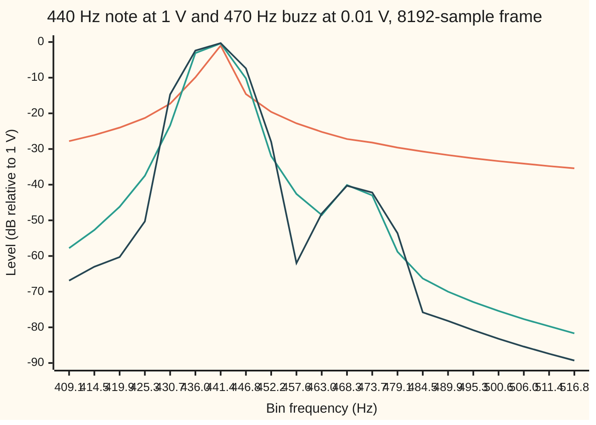

# Windows: a recording has to stop, so energy leaks between frequencies

[Syllabus](../../../SYLLABUS.md) → [Engineering mathematics](../README.md) → [Signals](../README.md#s05) → Windows

---

## General Overview

A guitar recording at 44,100 samples a second holds a loud A at 440 Hz (hertz, cycles per second), 1 volt high at the microphone. Thirty hertz above it sits a faint buzz at 470 Hz, a loose fret rattling. The buzz is 0.01 volts: 40 dB (decibels) quieter, a hundredth of the height.

A technician cuts out 8192 samples, 185.8 ms (milliseconds) of sound, and runs the FFT, the fast way to compute the discrete Fourier transform ([The DFT and the FFT](02-discrete-fourier-transform-and-the-fft.md)). The question: is there a buzz, and how loud?

Cut the samples out as they are and the answer is wrong. The FFT sorts the sound into frequency bins, slots 5.383 Hz apart. The 440 Hz note does not stay in its own frequency bin. Its energy spreads across the whole spectrum, and at 468.3 Hz, the bin nearest the buzz, the note's spill-over is 26.93 dB below the note.

The buzz, at about 40 dB down, is buried 14.47 dB under it. This spill-over is **spectral leakage**. It happens because the recording had to stop, and the cut fell partway through a cycle.

The cure is a **window**: a set of weights that fades the frame in and out before the FFT. With the Hann window, a single smooth hump, the spill-over at 468.3 Hz drops to −55.51 dB and the buzz stands 14.98 dB clear of it. Every window pays for its quiet skirt with a wider central peak, though, so the right window depends on how close and how quiet the tone being hunted is.

**Cutting a recording short multiplies it by a window, which spreads every tone into the window's own spectrum; a tapered window trades a wider central peak for far lower spill-over, and the job decides which matters more.**

**What kind of fact this is:** an identity, proved on this card in Why it works (the windowed spectrum is the window's spectrum moved onto each tone), plus a design rule built on it for choosing a window.

### The picture: one frame, three windows



Orange: the plain cut, no taper. Green: Hann. Dark blue: Blackman, a three-term taper. All three peak near 441.4 Hz, the note.

The orange line slides smoothly downhill past 468.3 Hz with no bump: the buzz is invisible. The green and blue lines dip to −48.5 and −48.1 dB at 463.0 Hz, then rise to −40.1 and −40.3 dB at 468.3 Hz: that bump is the buzz, read within half a decibel of its true −40 dB.

---

## The formula

Notation first, in words. The recording is $x[n]$, sample number $n$, taken $f_s$ times a second; square brackets count samples ([Sampling](01-sampling-and-the-nyquist-theorem.md)).

A frame is $N$ samples long. The **window** $w[n]$ is the weight given to sample $n$ before the transform.

As on this shelf, $j$ is the square root of −1; the rest of the library writes $i$. The DFT's output $X[k]$ sits in **bin** $k$, at frequency $k f_s/N$: the bins are $f_s/N$ apart.

The windowed DFT:

$$X[k] = \sum_{n=0}^{N-1} w[n]\,x[n]\,e^{-j2\pi kn/N}$$

**Read it aloud:** weight each sample by the window, then measure how much of each bin's frequency the weighted frame holds.

The window's own spectrum, at an offset of $d$ bins (any real $d$, not only whole numbers):

$$W(d) = \sum_{n=0}^{N-1} w[n]\,e^{-j2\pi dn/N}$$

**The leakage identity.** A tone $x[n] = A\cos(2\pi f_0 n/f_s)$ sits $\beta = f_0N/f_s$ bins up the scale, and

$$X[k] = \frac{A}{2}\Big[\,W(k-\beta) + W(k+\beta)\,\Big]$$

**Read it aloud:** a windowed tone shows up as the window's own spectrum, centred on the tone, plus a mirror copy centred on minus the tone.

For the plain cut, $w[n] = 1$, the window spectrum has a closed form:

$$\lvert W_{\text{rect}}(d)\rvert = \left\lvert\frac{\sin(\pi d)}{\sin(\pi d/N)}\right\rvert \approx N\left\lvert\frac{\sin(\pi d)}{\pi d}\right\rvert$$

The four windows on this card are all **cosine windows**, built from three fixed numbers $a_0, a_1, a_2$:

$$w[n] = a_0 - a_1\cos\frac{2\pi n}{N} + a_2\cos\frac{4\pi n}{N}$$

with $(a_0, a_1, a_2)$ = (1, 0, 0) for the plain cut ("rect", short for rectangular), (0.5, 0.5, 0) for Hann, (0.54, 0.46, 0) for Hamming and (0.42, 0.5, 0.08) for Blackman. A tone's amplitude is read back from its bin as

$$\hat A = \frac{2\,\lvert X[k]\rvert}{a_0 N}$$

| Symbol | Plain meaning | In our example | Push it up and the answer… |
| --- | --- | --- | --- |
| $x[n]$, $n$ | the recording, in volts; the sample number | note plus buzz; 0 to 8191 | — |
| $N$ | samples in the frame | 8192, which is 185.8 ms | bins crowd closer; peaks narrow; leakage at a fixed hertz gap falls |
| $f_s$ | sampling rate, samples per second | 44,100 Hz | bins spread apart for the same $N$ |
| $w[n]$ | the window: the weight on sample $n$ | Hann, 0 at the ends, 1 in the middle | — |
| $a_0, a_1, a_2$ | the cosine window's recipe | Hann: 0.5, 0.5, 0 | more taper: lower sidelobes (the small humps beside the peak), wider main lobe (the central peak) |
| $k$ | bin number; bin $k$ is at $kf_s/N$ Hz | bin 87 is 468.3 Hz | — |
| $X[k]$, $j$, $e$ | the windowed DFT in bin $k$; the square root of −1; $e^{j\theta} = \cos\theta + j\sin\theta$, a spinning arrow | Hann bin 87: −40.07 dB | — |
| $A$, $f_0$ | a tone's amplitude and frequency | 1 V at 440 Hz; 0.01 V at 470 Hz | bigger $A$, proportionally bigger leakage |
| $\beta$ | the tone's place on the bin scale, $f_0N/f_s$ | 81.7342 and 87.3070 | — |
| $W(d)$, $d$, $\delta$ | the window's spectrum; an offset in bins; delta, the buzz's offset from its nearest bin | $d$ = 5.2658 from the note to bin 87; $\delta$ = 0.3070 | farther: less leakage |
| $\hat A$ | amplitude read back from a bin | the 1 V note, Hann, bin 82: −0.40 dB | — |
| ENBW | equivalent noise bandwidth, in bins | 1.5 for Hann | more noise counted in each bin |

### When it holds

- **The tone is steady across the frame.** The identity treats each tone as one fixed frequency and level. A note that decays or bends inside 185.8 ms smears further, and the [Spectrograms](09-short-time-fourier-and-spectrograms.md) card handles that case.
- **Leakage vanishes only for a whole number of cycles.** Move the note to exactly bin 82, 441.43 Hz, and the plain cut leaks nothing: every other bin is below a billionth of the peak. A real note never lines up like that, and here the frame holds 81.73 cycles.
- **Bins far from 0 and $f_s/2$.** The mirror term $W(k+\beta)$ is centred below 0 Hz, far from these bins, so it is tiny here; the code still includes it. Near 0 Hz the two copies overlap and the read-back formula is off.
- **Outside the range: a frame too short for the gap.** At 2048 samples, 46.4 ms, the tones are only 1.39 bins apart and no window here shows the buzz. The best margin is the plain cut's −26.7 dB, because its main lobe is the narrowest; every taper does worse.

---

## Why it works

### Step 0: the transform sees the frame as one turn of a loop

The DFT treats the frame as if it repeats forever: sample 8191 is followed by sample 0 again. If the note fits a whole number of cycles, the loop joins seamlessly and the note is one pure frequency, landing in one bin.

Here the frame holds 81.73 cycles. The note starts the frame at 1 V, but the next sample after the frame's end would be far from 1 V, so the looped signal jumps by 1.099 V at the seam once every 185.8 ms.

A jump needs many frequencies to build, and their sizes shrink only slowly, like one over the frequency: the same slow tail the square wave has in [Convergence](../../08-Differential%20equations%20and%20dynamics/09-Fourier%20Series/02-convergence-jumps-and-gibbs.md). That slow tail, centred on the note, is the leakage.

So leakage is not noise or a fault: it is the true spectrum of a looped frame with a jump in it. The cure is to remove the jump.

### Step 1: a cut is a multiplication, and multiplying moves the window's spectrum

Writing $w[n]x[n]$ treats the cut as a multiplication, which it is: the plain cut multiplies the endless recording by 1 inside the frame and 0 outside.

Now put in one tone. A cosine is two spinning arrows, $\cos(2\pi\beta n/N) = \tfrac12\big(e^{j2\pi\beta n/N} + e^{-j2\pi\beta n/N}\big)$. Take the arrow $e^{j2\pi\beta n/N}$ and put it in the windowed DFT:

$$\sum_n w[n]\,e^{j2\pi\beta n/N}e^{-j2\pi kn/N} = \sum_n w[n]\,e^{-j2\pi(k-\beta)n/N} = W(k-\beta).$$

The second arrow gives $W(k+\beta)$ the same way. Add them with the factor $A/2$ and the leakage identity is proved. The bins sample the window's spectrum $W$, slid over to sit on the tone.

The consequence is the whole card: **what a tone looks like in the spectrum is decided by the window, not by the tone.** Every tone is drawn with the same brush. A loud tone's brush strokes reach far, and anything quieter beneath them is painted over.

### Step 2: the plain cut's spectrum has zeros on every bin and a slow tail

For $w[n] = 1$, $W_{\text{rect}}(d)$ is a geometric series, a sum where each term is the previous one times the same factor $e^{-j2\pi d/N}$. Its sum is

$$W_{\text{rect}}(d) = \frac{1 - e^{-j2\pi d}}{1 - e^{-j2\pi d/N}} = e^{-j\pi d(N-1)/N}\,\frac{\sin(\pi d)}{\sin(\pi d/N)}.$$

Read three facts off it.

- **Zero at every whole $d$ except 0.** A tone exactly on a bin puts nothing in any other bin. That is the "whole number of cycles" case.
- **First zero at 1 bin.** The central hump, the **main lobe**, runs from −1 to +1 bin.
- **The humps beyond, the sidelobes, shrink like $1/(\pi d)$.** The first is at $d$ = 1.4303 bins, found where $\tan(\pi d) = \pi d$, and sits 13.26 dB below the peak. Doubling the distance halves the height: 6.02 dB per doubling, called 6 dB per octave. The code measures 5.77 dB between 8 and 16 bins.

At $d$ = 5.2658 bins, the distance from the note to bin 87, the plain cut's spill-over is −27.0 dB by the large-$N$ shortcut and −26.93 dB exactly. A tone 40 dB down cannot show through that.

### Step 3: a taper is three shifted copies that cancel each other's tails

Hann's window is $\tfrac12 - \tfrac12\cos(2\pi n/N)$. Write the cosine as two arrows again: each arrow slides the plain spectrum by one bin. So

$$W_{\text{Hann}}(d) = \tfrac12 W_{\text{rect}}(d) - \tfrac14 W_{\text{rect}}(d-1) - \tfrac14 W_{\text{rect}}(d+1).$$

Far from the centre, the three copies are nearly the same size with signs arranged to cancel. Using the large-$N$ form, a shift of one bin flips the sign of both the phase factor and the sine, $\sin(\pi(d\pm1)) = -\sin(\pi d)$, so the two flips cancel, and the three terms combine to

$$\lvert W_{\text{Hann}}(d)\rvert \approx \frac N2\,\left\lvert\frac{\sin(\pi d)}{\pi d}\right\rvert\cdot\frac{1}{\lvert d^2 - 1\rvert}.$$

The extra factor $1/(d^2-1)$ makes the tail fall like $1/d^3$: 18.06 dB per doubling instead of 6.02. The code measures 17.41 dB. In the time picture, the Hann window starts and ends at zero with zero slope, so the looped frame has no jump and no kink, and a smoother signal has a faster-shrinking spectrum, the same rule as in [Convergence](../../08-Differential%20equations%20and%20dynamics/09-Fourier%20Series/02-convergence-jumps-and-gibbs.md).

At $d$ = 5.2658, dividing the plain cut's value by $d^2-1$ takes −27.0 dB down to −55.5 dB, against −55.51 dB exactly. The buzz itself sits $\delta$ = 0.3070 bins from bin 87 and reads −40.5 dB there. It stands about 15 dB clear.

<details>
<summary>Detailed step: how the three Hann terms combine</summary>

For large $N$, $W_{\text{rect}}(d) \approx N e^{-j\pi d}\sin(\pi d)/(\pi d)$. Shifting by one bin flips the sign twice, once in the phase $e^{-j\pi(d\pm1)}$ and once in $\sin(\pi(d\pm1))$, so $W_{\text{rect}}(d\pm1) \approx N e^{-j\pi d}\sin(\pi d)/(\pi(d\pm1))$. Then

$$W_{\text{Hann}}(d) \approx N e^{-j\pi d}\,\frac{\sin(\pi d)}{\pi}\left[\frac{1}{2d} - \frac{1}{4(d-1)} - \frac{1}{4(d+1)}\right] = N e^{-j\pi d}\,\frac{\sin(\pi d)}{\pi}\cdot\frac{-1}{2d(d^2-1)}.$$

The bracket's three terms nearly cancel: what is left falls like $1/d^3$. At $d = 1$ the $(d-1)$ term's zero meets a zero of $\sin$, and the limit is finite: $\lvert W_{\text{Hann}}(1)\rvert = N/4$, so Hann's first true zero is at 2 bins. The code does not use this shortcut for its main numbers; it uses the exact three-term sum and checks it against the FFT.

</details>

### Step 4: the price is a wider main lobe

The same cancellation that kills the tail fills in the plain cut's zero at 1 bin. Hann's main lobe runs out to 2 bins, Blackman's (five copies) to 3. In the time picture, a taper gives the frame's ends little weight, so the recording is effectively shorter, and a shorter recording has a blurrier spectrum.

The four windows, each measured from its own spectrum by the code:

| Window | Main lobe ends at | Highest sidelobe | Tail per doubling | ENBW | Worst scallop |
| --- | ---: | ---: | ---: | ---: | ---: |
| rect | 1.00 bins | −13.26 dB | 5.77 dB | 1.0000 bins | 3.92 dB |
| Hann | 2.00 bins | −31.47 dB | 17.41 dB | 1.5000 bins | 1.42 dB |
| Hamming | 2.00 bins | −42.68 dB | 5.22 dB | 1.3628 bins | 1.75 dB |
| Blackman | 3.00 bins | −58.11 dB | 16.88 dB | 1.7268 bins | 1.10 dB |

Hamming tunes its two numbers to cancel the first sidelobe, so the highest one left, −42.68 dB, sits further out. But it stops at 0.08 instead of 0 at the frame's ends. That small jump brings back the slow 6 dB tail.

Blackman spends a third cosine to get both a deep first sidelobe and a fast tail, and pays with the widest main lobe. A Kaiser window has a single knob that slides between these extremes.

### Step 5: reading levels honestly

Three corrections turn a bin's number into volts.

- **Coherent gain.** The window shrinks the tone's peak by its average weight, $a_0$: Hann's peak is half the plain cut's. Divide by $a_0N/2$, which is the $\hat A$ formula.
- **Scalloping.** A tone between two bins is read off the side of the main lobe. At the worst place, half a bin off, the plain cut reads 3.92 dB low and Hann 1.42 dB low. Here the note sits close to bin 82, and the plain cut reads it at −1.03 dB, Hann at −0.40 dB.
- **Noise bandwidth.** Noise is spread over all frequencies, and a wider main lobe collects more of it into each bin. The **equivalent noise bandwidth** (ENBW) counts how many bins' worth, $N\sum w^2/(\sum w)^2$: 1.5 for Hann, so Hann's noise floor sits $10\log_{10}1.5$ = 1.76 dB above the plain cut's.

### Step 6: choosing a window for a job

The rule follows from the brush picture. Count the gap in bins, the hertz gap times $N/f_s$. Read the loud tone's leakage at that distance, taking the worst value within half a bin, since the bins can fall anywhere. Subtract it from the quiet tone's level. A positive **margin** means the quiet tone shows.

For the 30 Hz gap and the 40 dB contrast, at four frame lengths:

| Frame | Gap in bins | rect | Hann | Hamming | Blackman |
| ---: | ---: | ---: | ---: | ---: | ---: |
| 2048 samples, 46.4 ms | 1.39 | −26.7 dB | −35.3 dB | −34.2 dB | −36.4 dB |
| 4096 samples, 92.9 ms | 2.79 | −22.2 dB | −8.5 dB | **4.7 dB** | −11.4 dB |
| 8192 samples, 185.8 ms | 5.57 | −15.3 dB | 13.9 dB | 3.2 dB | **23.3 dB** |
| 16384 samples, 371.5 ms | 11.15 | −8.8 dB | 32.4 dB | 8.1 dB | **40.2 dB** |

At 92.9 ms the buzz sits at 2.79 bins, inside Blackman's 3-bin main lobe and on Hann's first sidelobe; only Hamming's narrow lobe and deep first sidelobe clear it. At 185.8 ms and beyond the gap is wide enough that the deep, fast-falling tails win, and Blackman leads. The plain cut needs 47,104 samples, 1.07 s, before its slow tail drops below the buzz.

So: **close and loud-ish, choose a narrow main lobe; far and faint, choose deep sidelobes; and when neither works, record for longer.**

---

## Worked numbers, by hand

Hann window, 8192-sample frame, reading bin 87 with the large-$N$ shortcuts of Steps 2 and 3.

| Step | Arithmetic | Value |
| --- | --- | --- |
| Bin spacing | 44,100 ÷ 8192 | 5.383 Hz |
| Note on the bin scale | 440 ÷ 5.383 | 81.7342 bins |
| Buzz on the bin scale | 470 ÷ 5.383 | 87.3070 bins; nearest bin 87, at 468.3 Hz |
| Note to bin 87 | $d$ = 87 − 81.7342 | 5.2658 bins |
| Plain cut's spill-over there | $20\log_{10}\lvert\sin(\pi d)/(\pi d)\rvert$ | −27.0 dB |
| Hann's spill-over there | the plain value divided by $d^2 - 1$, in dB | −55.5 dB |
| Buzz to bin 87 | $\delta$ = 87.3070 − 87 | 0.3070 bins |
| Buzz's own reading | $0.01 \times \dfrac{\sin(\pi\delta)/(\pi\delta)}{1-\delta^2}$, in dB | −40.5 dB |
| Margin | −40.5 − (−55.5) | **15.0 dB; exactly 14.98 dB** |

The buzz stands 15 dB clear of the note's spill-over: on an analyser screen it is a clean bump, and bin 87 reads −40.07 dB against the true −40.

### What breaks if you drop a piece

| Mistake | Comes out at | What went wrong |
| --- | --- | --- |
| No window on the 185.8 ms frame | bin 87 reads −27.19 dB; margin −14.47 dB | the note's slow sidelobe tail sits above the buzz |
| Hann, read without dividing by $a_0$ | the 1 V note reads −6.42 dB | Hann halves every peak; the coherent gain was not undone |
| Blackman on a 92.9 ms frame | margin −11.4 dB | the buzz is 2.79 bins away, inside Blackman's 3-bin main lobe |
| Zero padding the 92.9 ms Hann frame ×4 | bins 2.692 Hz apart, margin still −8.5 dB | padding draws the same curve with more points; a real 371.5 ms frame, same bin spacing, gives 32.4 dB |
| Noise per bin read through Hann, no correction | 1.76 dB too high | each Hann bin collects 1.5 bins' worth of noise |
| A 46.4 ms frame, any window | best margin −26.7 dB, the plain cut; tapers −34.2 to −36.4 dB | 1.39 bins apart: no taper can split what the frame length cannot |

---

## Code, from first principles, and it actually runs

The script builds the 8192 samples, applies each window, and runs an FFT written out below. It takes **four independent roads** to the spectrum: the FFT of the samples; the closed form from shifted plain kernels; a direct sum at bin 87 with no FFT; and the large-$N$ shortcut of the hand table. FFT and closed form must agree to a billionth at bins 60 to 109. Side checks: the plain cut's first sidelobe, measured and found by solving $\tan(\pi d) = \pi d$; Hann's ENBW from its samples against $(a_0^2 + a_1^2/2)/a_0^2$ = 1.5; and the zero-padded spectrum against the unpadded one.

### Python

```python
# Windows and spectral leakage -- the check behind the card.  Standard library only.
# One frame of a guitar recording at 44.1 kHz holds a loud 440 Hz note and a faint
# 470 Hz buzz, 40 dB quieter.  Roads to each windowed spectrum: the FFT of the samples
# (written out below), the closed form (shifted copies of the plain window's spectrum),
# a direct sum at one bin, and the large-N shortcut used by hand.  Nothing imported knows the answer.
from math import cos, sin, pi, log10

FS, N = 44100.0, 8192                      # sampling rate (Hz) and frame length (samples)
BIN = FS / N                               # bin spacing, Hz
WIN = {"rect": (1.0, 0.0, 0.0), "Hann": (0.5, 0.5, 0.0),
       "Hamming": (0.54, 0.46, 0.0), "Blackman": (0.42, 0.5, 0.08)}   # w = a0 - a1 cos + a2 cos 2x
LOUD, BUZZ = (1.0, 440.0), (0.01, 470.0)   # (amplitude in volts, frequency in Hz)

def window(a, n=N):
    return [a[0] - a[1] * cos(2 * pi * i / n) + a[2] * cos(4 * pi * i / n) for i in range(n)]

def fft(x):                                # radix-2, length a power of two
    a, n, j = list(x), len(x), 0
    for i in range(1, n):                  # bit-reversed order first
        b = n >> 1
        while j & b: j ^= b; b >>= 1
        j |= b
        if i < j: a[i], a[j] = a[j], a[i]
    size = 2
    while size <= n:
        h = size // 2
        tw = [complex(cos(2 * pi * k / size), -sin(2 * pi * k / size)) for k in range(h)]
        for s in range(0, n, size):
            for k in range(h):
                u, v = a[s + k], a[s + k + h] * tw[k]
                a[s + k], a[s + k + h] = u + v, u - v
        size *= 2
    return a

def kernel(d, n=N):                        # the plain window's spectrum, d bins off centre
    if abs(d - round(d)) < 1e-12 and round(d) % n == 0: return complex(n, 0)
    ph = -pi * d * (n - 1) / n
    return complex(cos(ph), sin(ph)) * (sin(pi * d) / sin(pi * d / n))

def W(a, d, n=N):                          # any cosine window = shifted plain kernels
    return (a[0] * kernel(d, n) - a[1] / 2 * (kernel(d - 1, n) + kernel(d + 1, n))
            + a[2] / 2 * (kernel(d - 2, n) + kernel(d + 2, n)))

def closed(a, tones, k, n=N):              # X at bin k (may be fractional), by closed form
    return sum(A / 2 * (W(a, k - f * n / FS, n) + W(a, k + f * n / FS, n)) for A, f in tones)

def db(z, a, n=N): return 20 * log10(2 * abs(z) / (a[0] * n))   # dB relative to 1 volt

def signal(tones, n=N): return [sum(A * cos(2 * pi * f * i / FS) for A, f in tones) for i in range(n)]

x = signal((LOUD, BUZZ))
print(f"frame {N} samples = {1000 * N / FS:.1f} ms, bin spacing {BIN:.3f} Hz")
print(f"note at bin {440 / BIN:.4f}, buzz at bin {470 / BIN:.4f}, {30 / BIN:.2f} bins apart")
print(f"cycles of 440 Hz in the frame {440 * N / FS:.2f}; seam jump {1 - cos(2 * pi * 440 * N / FS):.3f} V")

# ---- each window's own shape, measured on its closed-form spectrum ----
print("window     a0    a1    a2  null_bins  sidelobe_dB  falloff_dB/oct  ENBW_bins  scallop_dB")
props = {}
for name, a in WIN.items():
    w = window(a)
    enbw = N * sum(v * v for v in w) / sum(w) ** 2
    mag = lambda d: abs(W(a, d)) / abs(W(a, 0))
    grid = [i / 100 for i in range(1, 2001)]
    null = next(d for d in grid if mag(d) < 1e-6)            # first zero of the main lobe
    side = 20 * log10(max(mag(d) for d in grid if d > null))
    env = lambda lo: max(mag(lo + i / 100) for i in range(101))
    props[name] = (null, side, 20 * log10(env(8) / env(16)), enbw, -20 * log10(mag(0.5)))
    print(f"{name:<9}{a[0]:5.2f} {a[1]:5.2f} {a[2]:5.2f} {null:7.2f} {side:11.2f} {props[name][2]:13.2f} "
          f"{enbw:12.4f} {props[name][4]:10.2f}")
lo, hi = 1.3, 1.49                          # plain window's first sidelobe: tan(pi x) = pi x
for _ in range(60):
    xs = (lo + hi) / 2
    lo, hi = (xs, hi) if sin(pi * xs) / cos(pi * xs) < pi * xs else (lo, xs)
side_theory = 20 * log10(abs(sin(pi * xs) / (pi * xs)))
print(f"plain first sidelobe from sin(pi x)/(pi x): x = {xs:.4f} bins, {side_theory:.2f} dB; "
      f"tails 1/d and 1/d^3 fall {20 * log10(2):.2f} and {60 * log10(2):.2f} dB per doubling")

# ---- the example, 8192 samples: FFT of the samples against the closed form ----
spec, gap = {}, 0.0
for name, a in WIN.items():
    X = fft([complex(v * s, 0) for v, s in zip(window(a), x)])
    gap = max(gap, max(abs(X[k] - closed(a, (LOUD, BUZZ), k)) / N for k in range(60, 110)))
    spec[name] = [db(X[k], a) for k in range(N // 2)]
print(f"chart, Hz      " + " ".join(f"{k * BIN:6.1f}" for k in range(76, 97)))
for name in WIN:
    print(f"chart, {name:<8}" + " ".join(f"{spec[name][k]:6.1f}" for k in range(76, 97)))
k87, hw = round(470 / BIN), window(WIN["Hann"])
direct = sum(v * s * complex(cos(2 * pi * k87 * i / N), -sin(2 * pi * k87 * i / N))
             for i, (v, s) in enumerate(zip(hw, x)))
print(f"FFT vs closed form, bins 60-109: agree to 1e-9: {'yes' if gap < 1e-9 else 'no'}; "
      f"Hann bin {k87} by direct sum {db(direct, WIN['Hann']):.2f} dB")
print("window    bin87_dB  leak_only_dB  buzz_only_dB  margin_dB  note_peak_dB")
show = {}
for name, a in WIN.items():
    leak, own = db(closed(a, (LOUD,), k87), a), db(closed(a, (BUZZ,), k87), a)
    show[name] = own - leak
    print(f"{name:<9}{spec[name][k87]:9.2f} {leak:12.2f} {own:13.2f} {own - leak:10.2f} {max(spec[name][78:86]):12.2f}")
d, e = k87 - 440 / BIN, 470 / BIN - k87     # the same three Hann numbers by the large-N shortcut
sinc = lambda t: sin(pi * t) / (pi * t)
print(f"by hand: d = {d:.4f}, delta = {e:.4f} bins, plain leak {20 * log10(abs(sinc(d))):.1f} dB, Hann leak "
      f"{20 * log10(abs(sinc(d) / (1 - d * d))):.1f} dB, Hann buzz {20 * log10(0.01 * sinc(e) / (1 - e * e)):.1f} dB")

# ---- the trade: frame length against window, buzz margin over the worst nearby leakage ----
print("frame      ms   bins_apart    rect    Hann  Hamming  Blackman  (margin_dB)")
marg = {}
for n in (2048, 4096, 8192, 16384):
    sep = 30 * n / FS
    m = [-40 - 20 * log10(max(abs(W(a, sep + (i - 50) / 100, n)) for i in range(101)) / (a[0] * n))
         for a in WIN.values()]
    marg[n] = dict(zip(WIN, m))
    print(f"{n:6d} {1000 * n / FS:7.1f} {sep:10.2f} " + " ".join(f"{v:7.1f}" for v in m))
n = 8192
while -40 - 20 * log10(max(abs(kernel(30 * n / FS + (i - 50) / 100, n)) for i in range(101)) / n) < 0:
    n += 1
print(f"plain window first shows the buzz at {n} samples = {n / FS:.2f} s")
hx = [complex(v * s, 0) for v, s in zip(window(WIN["Hann"], 4096), signal((LOUD, BUZZ), 4096))]
plain, pad = fft(hx), fft(hx + [0j] * 3 * 4096)    # zero padding x4: the same curve, sampled finer
kz = round(4 * 470 * 4096 / FS)
zgap = max(max(abs(pad[4 * k] - plain[k]) for k in range(4096)),
           max(abs(pad[kz + i] - closed(WIN["Hann"], (LOUD, BUZZ), (kz + i) / 4, 4096)) for i in range(-8, 9))) / 4096
print(f"Hann, 4096 frame padded x4 to {FS / 16384:.3f} Hz bins: same curve as unpadded and closed form "
      f"to 1e-9: {'yes' if zgap < 1e-9 else 'no'}")
on = max(abs(closed(WIN["rect"], ((1.0, 82 * BIN),), k)) / N for k in range(60, 110) if k != 82)
print(f"plain window, tone exactly on bin 82 ({82 * BIN:.2f} Hz): every other bin below 1e-9: {'yes' if on < 1e-9 else 'no'}")
print(f"mistake: Hann read without dividing by a0: note peak {spec['Hann'][82] + 20 * log10(0.5):.2f} dB")
print(f"mistake: noise per bin with Hann, no ENBW correction: {10 * log10(props['Hann'][3]):.2f} dB high")
loud_buzz = db(closed(WIN["rect"], ((0.1, 470.0),), k87), WIN["rect"]) - db(closed(WIN["rect"], (LOUD,), k87), WIN["rect"])
print(f"try: buzz raised to 0.1 V (20 dB down), plain-window margin at bin 87 {loud_buzz:.2f} dB")

assert gap < 1e-9,                                          "FFT must equal the shifted-kernel closed form"
assert abs(db(direct, WIN["Hann"]) - spec["Hann"][k87]) < 1e-9, "direct sum must equal the FFT bin"
assert zgap < 1e-9,                                         "zero padding samples the same curve"
assert abs(props["rect"][1] - side_theory) < 0.01,          "plain sidelobe vs the sinc's first peak"
assert abs(props["Hann"][3] - 1.5) < 1e-9,                  "Hann ENBW vs (a0^2 + a1^2/2)/a0^2"
assert abs(20 * log10(abs(sinc(d) / (1 - d * d))) - (db(closed(WIN["Hann"], (LOUD,), k87), WIN["Hann"]))) < 0.2, "shortcut"
assert show["rect"] < -6 and show["Hann"] > 6 and show["Blackman"] > 6, "plain hides the buzz; tapers show it"
assert marg[4096]["Hamming"] > 0 > marg[4096]["Blackman"] and marg[8192]["Blackman"] > marg[8192]["Hamming"], "trade"
assert on < 1e-9,                                           "a whole number of cycles leaks nothing"
print("ALL CHECKS PASS")
```

**Ran 2026-11-11 on macOS, Python 3.14.10, standard library only. All checks passed. Output, pasted from the run:**

```
frame 8192 samples = 185.8 ms, bin spacing 5.383 Hz
note at bin 81.7342, buzz at bin 87.3070, 5.57 bins apart
cycles of 440 Hz in the frame 81.73; seam jump 1.099 V
window     a0    a1    a2  null_bins  sidelobe_dB  falloff_dB/oct  ENBW_bins  scallop_dB
rect      1.00  0.00  0.00    1.00      -13.26          5.77       1.0000       3.92
Hann      0.50  0.50  0.00    2.00      -31.47         17.41       1.5000       1.42
Hamming   0.54  0.46  0.00    2.00      -42.68          5.22       1.3628       1.75
Blackman  0.42  0.50  0.08    3.00      -58.11         16.88       1.7268       1.10
plain first sidelobe from sin(pi x)/(pi x): x = 1.4303 bins, -13.26 dB; tails 1/d and 1/d^3 fall 6.02 and 18.06 dB per doubling
chart, Hz       409.1  414.5  419.9  425.3  430.7  436.0  441.4  446.8  452.2  457.6  463.0  468.3  473.7  479.1  484.5  489.9  495.3  500.6  506.0  511.4  516.8
chart, rect     -27.8  -26.1  -24.0  -21.3  -17.3   -9.9   -1.0  -14.6  -19.6  -22.8  -25.2  -27.2  -28.2  -29.6  -30.7  -31.7  -32.6  -33.4  -34.1  -34.8  -35.4
chart, Hann     -57.8  -52.7  -46.2  -37.5  -23.4   -3.1   -0.4  -10.2  -32.0  -42.6  -48.5  -40.1  -43.0  -58.8  -66.3  -70.0  -72.9  -75.4  -77.7  -79.7  -81.7
chart, Hamming  -46.1  -45.4  -45.7  -57.0  -28.5   -3.9   -0.5  -12.5  -44.4  -47.1  -43.9  -40.6  -40.7  -47.5  -48.2  -48.9  -49.7  -50.4  -51.1  -51.7  -52.3
chart, Blackman -66.9  -63.0  -60.3  -50.3  -14.7   -2.4   -0.3   -7.4  -28.0  -62.0  -48.1  -40.3  -42.2  -53.6  -75.8  -78.2  -80.8  -83.2  -85.4  -87.4  -89.3
FFT vs closed form, bins 60-109: agree to 1e-9: yes; Hann bin 87 by direct sum -40.07 dB
window    bin87_dB  leak_only_dB  buzz_only_dB  margin_dB  note_peak_dB
rect        -27.19       -26.93        -41.40     -14.47        -1.03
Hann        -40.07       -55.51        -40.53      14.98        -0.40
Hamming     -40.55       -45.60        -40.65       4.95        -0.49
Blackman    -40.28       -65.08        -40.41      24.67        -0.31
by hand: d = 5.2658, delta = 0.3070 bins, plain leak -27.0 dB, Hann leak -55.5 dB, Hann buzz -40.5 dB
frame      ms   bins_apart    rect    Hann  Hamming  Blackman  (margin_dB)
  2048    46.4       1.39   -26.7   -35.3   -34.2   -36.4
  4096    92.9       2.79   -22.2    -8.5     4.7   -11.4
  8192   185.8       5.57   -15.3    13.9     3.2    23.3
 16384   371.5      11.15    -8.8    32.4     8.1    40.2
plain window first shows the buzz at 47104 samples = 1.07 s
Hann, 4096 frame padded x4 to 2.692 Hz bins: same curve as unpadded and closed form to 1e-9: yes
plain window, tone exactly on bin 82 (441.43 Hz): every other bin below 1e-9: yes
mistake: Hann read without dividing by a0: note peak -6.42 dB
mistake: noise per bin with Hann, no ENBW correction: 1.76 dB high
try: buzz raised to 0.1 V (20 dB down), plain-window margin at bin 87 5.53 dB
ALL CHECKS PASS
```

### Rust

```rust
// Windows and spectral leakage -- the check behind the card.  Standard library only, no crates.
// Same frame, same tones, same roads as the Python: the FFT of the samples, the closed form
// built from shifted plain kernels, a direct sum at one bin, and the large-N shortcut.
use std::f64::consts::PI;

const FS: f64 = 44100.0; const N: usize = 8192; // sampling rate (Hz) and frame length (samples)
const NAMES: [&str; 4] = ["rect", "Hann", "Hamming", "Blackman"];
const WIN: [[f64; 3]; 4] = [[1.0, 0.0, 0.0], [0.5, 0.5, 0.0], [0.54, 0.46, 0.0], [0.42, 0.5, 0.08]];
const LOUD: (f64, f64) = (1.0, 440.0); const BUZZ: (f64, f64) = (0.01, 470.0);

#[derive(Clone, Copy)]
struct C { re: f64, im: f64 } // a complex number, j = sqrt(-1)
fn c(re: f64, im: f64) -> C { C { re, im } }
fn add(a: C, b: C) -> C { c(a.re + b.re, a.im + b.im) }  fn sub(a: C, b: C) -> C { c(a.re - b.re, a.im - b.im) }
fn mul(a: C, b: C) -> C { c(a.re * b.re - a.im * b.im, a.re * b.im + a.im * b.re) }
fn sc(s: f64, a: C) -> C { c(s * a.re, s * a.im) }  fn abs(a: C) -> f64 { a.re.hypot(a.im) }

fn window(a: &[f64; 3], n: usize) -> Vec<f64> {
    (0..n).map(|i| a[0] - a[1] * (2.0 * PI * i as f64 / n as f64).cos() + a[2] * (4.0 * PI * i as f64 / n as f64).cos()).collect()
}

fn fft(x: &[C]) -> Vec<C> { // radix-2, length a power of two
    let (mut a, n, mut j) = (x.to_vec(), x.len(), 0usize);
    for i in 1..n { // bit-reversed order first
        let mut b = n >> 1;
        while j & b != 0 { j ^= b; b >>= 1; }
        j |= b;
        if i < j { a.swap(i, j); }
    }
    let mut size = 2;
    while size <= n {
        let h = size / 2;
        let tw: Vec<C> = (0..h).map(|k| c((2.0 * PI * k as f64 / size as f64).cos(), -(2.0 * PI * k as f64 / size as f64).sin())).collect();
        for s in (0..n).step_by(size) {
            for k in 0..h {
                let (u, v) = (a[s + k], mul(a[s + k + h], tw[k]));
                a[s + k] = add(u, v); a[s + k + h] = sub(u, v);
            }
        }
        size *= 2;
    }
    a
}

fn kernel(d: f64, n: usize) -> C { // the plain window's spectrum, d bins off centre
    if (d - d.round()).abs() < 1e-12 && (d.round() as i64).rem_euclid(n as i64) == 0 { return c(n as f64, 0.0); }
    let ph = -PI * d * (n as f64 - 1.0) / n as f64;
    sc((PI * d).sin() / (PI * d / n as f64).sin(), c(ph.cos(), ph.sin()))
}

fn wk(a: &[f64; 3], d: f64, n: usize) -> C { // any cosine window = shifted plain kernels
    let t1 = sc(a[1] / 2.0, add(kernel(d - 1.0, n), kernel(d + 1.0, n)));
    let t2 = sc(a[2] / 2.0, add(kernel(d - 2.0, n), kernel(d + 2.0, n)));
    add(sub(sc(a[0], kernel(d, n)), t1), t2)
}

fn closed(a: &[f64; 3], tones: &[(f64, f64)], k: f64, n: usize) -> C { // X at bin k, by closed form
    let mut z = c(0.0, 0.0);
    for &(amp, f) in tones { z = add(z, sc(amp / 2.0, add(wk(a, k - f * n as f64 / FS, n), wk(a, k + f * n as f64 / FS, n)))); }
    z
}

fn db(z: C, a: &[f64; 3], n: usize) -> f64 { 20.0 * (2.0 * abs(z) / (a[0] * n as f64)).log10() }

fn signal(tones: &[(f64, f64)], n: usize) -> Vec<f64> {
    (0..n).map(|i| tones.iter().fold(0.0, |s, &(amp, f)| s + amp * (2.0 * PI * f * i as f64 / FS).cos())).collect()
}

fn maxf(v: impl Iterator<Item = f64>) -> f64 { v.fold(f64::NEG_INFINITY, f64::max) }  fn yn(b: bool) -> &'static str { if b { "yes" } else { "no" } }

fn main() {
    let (bin, x) = (FS / N as f64, signal(&[LOUD, BUZZ], N));
    println!("frame {} samples = {:.1} ms, bin spacing {:.3} Hz", N, 1000.0 * N as f64 / FS, bin);
    println!("note at bin {:.4}, buzz at bin {:.4}, {:.2} bins apart", 440.0 / bin, 470.0 / bin, 30.0 / bin);
    println!("cycles of 440 Hz in the frame {:.2}; seam jump {:.3} V", 440.0 * N as f64 / FS, 1.0 - (2.0 * PI * 440.0 * N as f64 / FS).cos());

    // ---- each window's own shape, measured on its closed-form spectrum ----
    println!("window     a0    a1    a2  null_bins  sidelobe_dB  falloff_dB/oct  ENBW_bins  scallop_dB");
    let mut props = vec![];
    for (name, a) in NAMES.iter().zip(WIN.iter()) {
        let w = window(a, N);
        let sw: f64 = w.iter().sum();
        let enbw = N as f64 * w.iter().map(|v| v * v).sum::<f64>() / sw.powi(2);
        let mag = |d: f64| abs(wk(a, d, N)) / abs(wk(a, 0.0, N));
        let grid: Vec<f64> = (1..2001).map(|i| i as f64 / 100.0).collect();
        let null = *grid.iter().find(|&&d| mag(d) < 1e-6).unwrap(); // first zero of the main lobe
        let side = 20.0 * maxf(grid.iter().filter(|&&d| d > null).map(|&d| mag(d))).log10();
        let env = |lo: f64| maxf((0..101).map(|i| mag(lo + i as f64 / 100.0)));
        let p = (null, side, 20.0 * (env(8.0) / env(16.0)).log10(), enbw, -20.0 * mag(0.5).log10());
        println!("{:<9}{:5.2} {:5.2} {:5.2} {:7.2} {:11.2} {:13.2} {:12.4} {:10.2}", name, a[0], a[1], a[2], p.0, p.1, p.2, p.3, p.4);
        props.push(p);
    }
    let (mut lo, mut hi, mut xs) = (1.3f64, 1.49f64, 0.0f64); // plain first sidelobe: tan(pi x) = pi x
    for _ in 0..60 {
        xs = (lo + hi) / 2.0;
        if (PI * xs).sin() / (PI * xs).cos() < PI * xs { lo = xs; } else { hi = xs; }
    }
    let side_theory = 20.0 * ((PI * xs).sin() / (PI * xs)).abs().log10();
    println!("plain first sidelobe from sin(pi x)/(pi x): x = {:.4} bins, {:.2} dB; tails 1/d and 1/d^3 fall {:.2} and {:.2} dB per doubling", xs, side_theory, 20.0 * 2f64.log10(), 60.0 * 2f64.log10());

    // ---- the example, 8192 samples: FFT of the samples against the closed form ----
    let (mut spec, mut gap) = (vec![], 0.0f64);
    for a in WIN.iter() {
        let xw: Vec<C> = window(a, N).iter().zip(x.iter()).map(|(v, s)| c(v * s, 0.0)).collect();
        let xf = fft(&xw);
        gap = gap.max(maxf((60..110).map(|k| abs(sub(xf[k], closed(a, &[LOUD, BUZZ], k as f64, N))) / N as f64)));
        spec.push((0..N / 2).map(|k| db(xf[k], a, N)).collect::<Vec<f64>>());
    }
    println!("chart, Hz      {}", (76..97).map(|k| format!("{:6.1}", k as f64 * bin)).collect::<Vec<_>>().join(" "));
    for (i, name) in NAMES.iter().enumerate() {
        println!("chart, {:<8}{}", name, (76..97).map(|k| format!("{:6.1}", spec[i][k])).collect::<Vec<_>>().join(" "));
    }
    let k87 = (470.0 / bin).round() as usize;
    let hw = window(&WIN[1], N);
    let mut direct = c(0.0, 0.0);
    for i in 0..N {
        let g = 2.0 * PI * k87 as f64 * i as f64 / N as f64;
        direct = add(direct, sc(hw[i] * x[i], c(g.cos(), -g.sin())));
    }
    println!("FFT vs closed form, bins 60-109: agree to 1e-9: {}; Hann bin {} by direct sum {:.2} dB", yn(gap < 1e-9), k87, db(direct, &WIN[1], N));
    println!("window    bin87_dB  leak_only_dB  buzz_only_dB  margin_dB  note_peak_dB");
    let mut show = vec![];
    for (i, a) in WIN.iter().enumerate() {
        let (leak, own) = (db(closed(a, &[LOUD], k87 as f64, N), a, N), db(closed(a, &[BUZZ], k87 as f64, N), a, N));
        show.push(own - leak);
        println!("{:<9}{:9.2} {:12.2} {:13.2} {:10.2} {:12.2}", NAMES[i], spec[i][k87], leak, own, own - leak, maxf(spec[i][78..86].iter().cloned()));
    }
    let (d, e) = (k87 as f64 - 440.0 / bin, 470.0 / bin - k87 as f64); // the large-N shortcut
    let sinc = |t: f64| (PI * t).sin() / (PI * t);
    let hann_hand = 20.0 * (sinc(d) / (1.0 - d * d)).abs().log10();
    println!("by hand: d = {:.4}, delta = {:.4} bins, plain leak {:.1} dB, Hann leak {:.1} dB, Hann buzz {:.1} dB",
             d, e, 20.0 * sinc(d).abs().log10(), hann_hand, 20.0 * (0.01 * sinc(e) / (1.0 - e * e)).log10());

    // ---- the trade: frame length against window, buzz margin over the worst nearby leakage ----
    println!("frame      ms   bins_apart    rect    Hann  Hamming  Blackman  (margin_dB)");
    let mut marg = vec![];
    for n in [2048usize, 4096, 8192, 16384] {
        let sep = 30.0 * n as f64 / FS;
        let m: Vec<f64> = WIN.iter().map(|a| -40.0 - 20.0 * (maxf((0..101).map(|i| abs(wk(a, sep + (i as f64 - 50.0) / 100.0, n)))) / (a[0] * n as f64)).log10()).collect();
        println!("{:6} {:7.1} {:10.2} {}", n, 1000.0 * n as f64 / FS, sep, m.iter().map(|v| format!("{:7.1}", v)).collect::<Vec<_>>().join(" "));
        marg.push(m);
    }
    let mut n = 8192usize;
    while -40.0 - 20.0 * (maxf((0..101).map(|i| abs(kernel(30.0 * n as f64 / FS + (i as f64 - 50.0) / 100.0, n)))) / n as f64).log10() < 0.0 { n += 1; }
    println!("plain window first shows the buzz at {} samples = {:.2} s", n, n as f64 / FS);
    let hx: Vec<C> = window(&WIN[1], 4096).iter().zip(signal(&[LOUD, BUZZ], 4096).iter()).map(|(v, s)| c(v * s, 0.0)).collect();
    let (plain, mut padded) = (fft(&hx), hx.clone()); padded.extend(vec![c(0.0, 0.0); 3 * 4096]);
    let pad = fft(&padded); // zero padding x4: the same curve, sampled finer
    let kz = (4.0 * 470.0 * 4096.0 / FS).round() as i64;
    let zgap = maxf((0..4096).map(|k| abs(sub(pad[4 * k], plain[k])))).max(maxf((-8..9i64).map(|i| {
        abs(sub(pad[(kz + i) as usize], closed(&WIN[1], &[LOUD, BUZZ], (kz + i) as f64 / 4.0, 4096))) }))) / 4096.0;
    println!("Hann, 4096 frame padded x4 to {:.3} Hz bins: same curve as unpadded and closed form to 1e-9: {}", FS / 16384.0, yn(zgap < 1e-9));
    let on = maxf((60..110).filter(|&k| k != 82).map(|k| abs(closed(&WIN[0], &[(1.0, 82.0 * bin)], k as f64, N)) / N as f64));
    println!("plain window, tone exactly on bin 82 ({:.2} Hz): every other bin below 1e-9: {}", 82.0 * bin, yn(on < 1e-9));
    println!("mistake: Hann read without dividing by a0: note peak {:.2} dB", spec[1][82] + 20.0 * 0.5f64.log10());
    println!("mistake: noise per bin with Hann, no ENBW correction: {:.2} dB high", 10.0 * props[1].3.log10());
    let loud_buzz = db(closed(&WIN[0], &[(0.1, 470.0)], k87 as f64, N), &WIN[0], N) - db(closed(&WIN[0], &[LOUD], k87 as f64, N), &WIN[0], N);
    println!("try: buzz raised to 0.1 V (20 dB down), plain-window margin at bin 87 {:.2} dB", loud_buzz);

    assert!(gap < 1e-9, "FFT must equal the shifted-kernel closed form");
    assert!((db(direct, &WIN[1], N) - spec[1][k87]).abs() < 1e-9, "direct sum must equal the FFT bin");
    assert!(zgap < 1e-9, "zero padding samples the same curve");
    assert!((props[0].1 - side_theory).abs() < 0.01, "plain sidelobe vs the sinc's first peak");
    assert!((props[1].3 - 1.5).abs() < 1e-9, "Hann ENBW vs (a0^2 + a1^2/2)/a0^2");
    assert!((hann_hand - db(closed(&WIN[1], &[LOUD], k87 as f64, N), &WIN[1], N)).abs() < 0.2, "shortcut");
    assert!(show[0] < -6.0 && show[1] > 6.0 && show[3] > 6.0, "plain hides the buzz; tapers show it");
    assert!(marg[1][2] > 0.0 && 0.0 > marg[1][3] && marg[2][3] > marg[2][2], "trade");
    assert!(on < 1e-9, "a whole number of cycles leaks nothing");
    println!("ALL CHECKS PASS");
}
```

**Ran 2026-11-11 on macOS, rustc 1.98.1, no crates. All checks passed. Output, pasted from the run:**

```
frame 8192 samples = 185.8 ms, bin spacing 5.383 Hz
note at bin 81.7342, buzz at bin 87.3070, 5.57 bins apart
cycles of 440 Hz in the frame 81.73; seam jump 1.099 V
window     a0    a1    a2  null_bins  sidelobe_dB  falloff_dB/oct  ENBW_bins  scallop_dB
rect      1.00  0.00  0.00    1.00      -13.26          5.77       1.0000       3.92
Hann      0.50  0.50  0.00    2.00      -31.47         17.41       1.5000       1.42
Hamming   0.54  0.46  0.00    2.00      -42.68          5.22       1.3628       1.75
Blackman  0.42  0.50  0.08    3.00      -58.11         16.88       1.7268       1.10
plain first sidelobe from sin(pi x)/(pi x): x = 1.4303 bins, -13.26 dB; tails 1/d and 1/d^3 fall 6.02 and 18.06 dB per doubling
chart, Hz       409.1  414.5  419.9  425.3  430.7  436.0  441.4  446.8  452.2  457.6  463.0  468.3  473.7  479.1  484.5  489.9  495.3  500.6  506.0  511.4  516.8
chart, rect     -27.8  -26.1  -24.0  -21.3  -17.3   -9.9   -1.0  -14.6  -19.6  -22.8  -25.2  -27.2  -28.2  -29.6  -30.7  -31.7  -32.6  -33.4  -34.1  -34.8  -35.4
chart, Hann     -57.8  -52.7  -46.2  -37.5  -23.4   -3.1   -0.4  -10.2  -32.0  -42.6  -48.5  -40.1  -43.0  -58.8  -66.3  -70.0  -72.9  -75.4  -77.7  -79.7  -81.7
chart, Hamming  -46.1  -45.4  -45.7  -57.0  -28.5   -3.9   -0.5  -12.5  -44.4  -47.1  -43.9  -40.6  -40.7  -47.5  -48.2  -48.9  -49.7  -50.4  -51.1  -51.7  -52.3
chart, Blackman -66.9  -63.0  -60.3  -50.3  -14.7   -2.4   -0.3   -7.4  -28.0  -62.0  -48.1  -40.3  -42.2  -53.6  -75.8  -78.2  -80.8  -83.2  -85.4  -87.4  -89.3
FFT vs closed form, bins 60-109: agree to 1e-9: yes; Hann bin 87 by direct sum -40.07 dB
window    bin87_dB  leak_only_dB  buzz_only_dB  margin_dB  note_peak_dB
rect        -27.19       -26.93        -41.40     -14.47        -1.03
Hann        -40.07       -55.51        -40.53      14.98        -0.40
Hamming     -40.55       -45.60        -40.65       4.95        -0.49
Blackman    -40.28       -65.08        -40.41      24.67        -0.31
by hand: d = 5.2658, delta = 0.3070 bins, plain leak -27.0 dB, Hann leak -55.5 dB, Hann buzz -40.5 dB
frame      ms   bins_apart    rect    Hann  Hamming  Blackman  (margin_dB)
  2048    46.4       1.39   -26.7   -35.3   -34.2   -36.4
  4096    92.9       2.79   -22.2    -8.5     4.7   -11.4
  8192   185.8       5.57   -15.3    13.9     3.2    23.3
 16384   371.5      11.15    -8.8    32.4     8.1    40.2
plain window first shows the buzz at 47104 samples = 1.07 s
Hann, 4096 frame padded x4 to 2.692 Hz bins: same curve as unpadded and closed form to 1e-9: yes
plain window, tone exactly on bin 82 (441.43 Hz): every other bin below 1e-9: yes
mistake: Hann read without dividing by a0: note peak -6.42 dB
mistake: noise per bin with Hann, no ENBW correction: 1.76 dB high
try: buzz raised to 0.1 V (20 dB down), plain-window margin at bin 87 5.53 dB
ALL CHECKS PASS
```

### Lean

Lean proves the card's three exact facts for every frame length, window and tone, and checks four example numbers.

- Take any frame length $N$, any window $w[n]$, and a steady tone $A\cos(2\pi f_0 n/f_s)$. Then $X[k] = \frac{A}{2}[W(k-\beta) + W(k+\beta)]$ at every bin $k$, whole or not.
- Take the plain cut and a whole number $d$ that is not a multiple of $N$. Then $W(d) = 0$, which is why a whole number of cycles leaks nothing.
- Take any cosine window. Then its spectrum is shifted copies of the plain cut's spectrum $W_{\text{rect}}$. The weights are $a_0$ at no shift, $-a_1/2$ one bin either way, and $a_2/2$ two bins either way.
- The note sits between bins 81 and 82, and the buzz is nearest bin 87.
- Hann's ENBW formula gives exactly 1.5 bins, and Hann's weight on sample 0 is 0.

The plain cut's closed form, every decibel reading and the window table are left to the Python and Rust checks.

```lean
-- Windows: for every frame length N and every real window, the windowed DFT of a steady tone A cos(2π f₀ n / f_s) is A/2 times the window's spectrum moved onto plus and minus the tone; the plain cut's spectrum is zero at every whole offset that is not a multiple of N; and every cosine window's spectrum is shifted copies of the plain cut's.
import Mathlib.Analysis.SpecialFunctions.Trigonometric.Basic
import Mathlib.Analysis.SpecialFunctions.Complex.Circle
import Mathlib.Algebra.BigOperators.Group.Finset.Basic
import Mathlib.Tactic.NormNum

open Complex Finset
open Real (pi)

/-! Conventions, as on the card.
* A frame is the samples `n = 0, 1, …, N - 1`; the window gives sample `n` the real weight `w n`.
* `j` on the card is Lean's `I`, the square root of -1.
* The window's spectrum at an offset of `d` bins (any real `d`) is
  `W(d) = ∑_{n<N} w[n] e^(-j 2π d n / N)`.
* A cosine window has weights `a₀ - a₁ cos(2πn/N) + a₂ cos(4πn/N)`; the plain cut is `(1, 0, 0)`,
  Hann `(1/2, 1/2, 0)`, Hamming `(0.54, 0.46, 0)`, Blackman `(0.42, 0.5, 0.08)`. -/

/-- The window's own spectrum, `d` bins off centre: `W(d) = ∑_{n<N} w[n] e^(-j 2π d n / N)`. -/
noncomputable def windowSpectrum (N : ℕ) (w : ℕ → ℝ) (d : ℝ) : ℂ :=
  ∑ n ∈ range N, (w n : ℂ) * cexp (-((2 * pi * d * n / N : ℝ) : ℂ) * I)

/-- **The leakage identity.** Take any frame length `N`, any real window `w`, and a steady tone
`x[n] = A cos(2π f₀ n / f_s)` sampled `f_s` times a second, which sits `β = f₀ N / f_s` bins up
the scale. Then the windowed DFT at bin `k`,
`X[k] = ∑_{n<N} w[n] x[n] e^(-j 2π k n / N)`, equals `(A/2) [W(k - β) + W(k + β)]`:
the window's own spectrum centred on the tone, plus a mirror copy centred on minus the tone.
(Stated for every real `k`, so it covers the whole-number bins and the zero-padded ones.) -/
theorem windowed_tone_dft_eq_shifted_window_spectrum (N : ℕ) (w : ℕ → ℝ)
    (A f₀ f_s k : ℝ) :
    ∑ n ∈ range N, (w n : ℂ) * ((A * Real.cos (2 * pi * f₀ * n / f_s) : ℝ) : ℂ) *
        cexp (-((2 * pi * k * n / N : ℝ) : ℂ) * I) =
      ((A / 2 : ℝ) : ℂ) *
        (windowSpectrum N w (k - f₀ * N / f_s) + windowSpectrum N w (k + f₀ * N / f_s)) := by
  unfold windowSpectrum
  rw [← sum_add_distrib, mul_sum]
  refine sum_congr rfl fun n hn => ?_
  have hN : (N : ℝ) ≠ 0 := by
    have := mem_range.mp hn
    exact_mod_cast (by omega : N ≠ 0)
  have hinv : (N : ℝ) * (N : ℝ)⁻¹ = 1 := mul_inv_cancel₀ hN
  set θ : ℝ := 2 * pi * f₀ * n / f_s with hθ
  set φ : ℝ := 2 * pi * k * n / N with hφ
  have h1 : 2 * pi * (k - f₀ * N / f_s) * n / N = φ - θ := by
    rw [hθ, hφ]; simp only [div_eq_mul_inv]
    linear_combination (-(2 * pi * f₀ * f_s⁻¹ * n)) * hinv
  have h2 : 2 * pi * (k + f₀ * N / f_s) * n / N = φ + θ := by
    rw [hθ, hφ]; simp only [div_eq_mul_inv]
    linear_combination (2 * pi * f₀ * f_s⁻¹ * n) * hinv
  rw [h1, h2]
  push_cast
  rw [Complex.cos]
  have e1 : -((φ : ℂ) - θ) * I = -(φ : ℂ) * I + θ * I := by ring
  have e2 : -((φ : ℂ) + θ) * I = -(φ : ℂ) * I + -(θ * I) := by ring
  rw [e1, e2, Complex.exp_add, Complex.exp_add]
  ring_nf

/-- **A whole number of cycles leaks nothing.** The plain cut (`w[n] = 1` for every sample)
has a spectrum that is zero at every whole-number offset `d` that is not a multiple of `N`:
a tone exactly on a bin puts nothing into the other bins. -/
theorem rect_window_spectrum_eq_zero_at_whole_offsets (N : ℕ) (d : ℤ) (hd : ¬ (N : ℤ) ∣ d) :
    windowSpectrum N (fun _ => 1) d = 0 := by
  unfold windowSpectrum
  rcases Nat.eq_zero_or_pos N with h0 | hpos
  · subst h0; simp
  have hN : (N : ℝ) ≠ 0 := by exact_mod_cast hpos.ne'
  set r : ℂ := cexp (-((2 * pi * d / N : ℝ) : ℂ) * I) with hr
  have hterm : ∀ n : ℕ, ((1 : ℝ) : ℂ) * cexp (-((2 * pi * (d : ℝ) * n / N : ℝ) : ℂ) * I) = r ^ n := by
    intro n
    rw [hr, ← Complex.exp_nat_mul]
    push_cast; ring_nf
  simp only [hterm]
  have hrN : r ^ N = 1 := by
    rw [hr, ← Complex.exp_nat_mul]
    rw [Complex.exp_eq_one_iff]
    refine ⟨-d, ?_⟩
    have hNc : (N : ℂ) ≠ 0 := by exact_mod_cast hpos.ne'
    push_cast
    field_simp
  have hr1 : r ≠ 1 := by
    intro h
    rw [hr, Complex.exp_eq_one_iff] at h
    obtain ⟨m, hm⟩ := h
    have hNc : (N : ℂ) ≠ 0 := by exact_mod_cast hpos.ne'
    have hpi : (pi : ℂ) ≠ 0 := by exact_mod_cast Real.pi_ne_zero
    push_cast at hm
    have : (d : ℂ) = -m * N := by
      field_simp at hm
      linear_combination -hm
    apply hd
    refine ⟨-m, ?_⟩
    have : ((d : ℤ) : ℂ) = (((N : ℤ) * (-m) : ℤ) : ℂ) := by push_cast; rw [this]; ring
    exact_mod_cast this
  have := geom_sum_mul r N
  rw [hrN, sub_self] at this
  exact (mul_eq_zero.mp this).resolve_right (sub_ne_zero.mpr hr1)

/-- **A taper is shifted copies of the plain cut.** For any frame length `N` and any cosine
window `w[n] = a₀ - a₁ cos(2πn/N) + a₂ cos(4πn/N)`, its spectrum at every offset `d` is
`a₀ W_rect(d) - (a₁/2)[W_rect(d-1) + W_rect(d+1)] + (a₂/2)[W_rect(d-2) + W_rect(d+2)]`.
For Hann, `(a₀, a₁, a₂) = (1/2, 1/2, 0)`, this is
`W_Hann(d) = ½ W_rect(d) - ¼ W_rect(d-1) - ¼ W_rect(d+1)`. -/
theorem cosine_window_spectrum_eq_shifted_rect (N : ℕ) (a₀ a₁ a₂ d : ℝ) :
    windowSpectrum N
        (fun n => a₀ - a₁ * Real.cos (2 * pi * n / N) + a₂ * Real.cos (4 * pi * n / N)) d =
      (a₀ : ℂ) * windowSpectrum N (fun _ => 1) d
        - ((a₁ / 2 : ℝ) : ℂ) *
            (windowSpectrum N (fun _ => 1) (d - 1) + windowSpectrum N (fun _ => 1) (d + 1))
        + ((a₂ / 2 : ℝ) : ℂ) *
            (windowSpectrum N (fun _ => 1) (d - 2) + windowSpectrum N (fun _ => 1) (d + 2)) := by
  unfold windowSpectrum
  simp only [← sum_add_distrib, mul_sum, ← sum_sub_distrib]
  refine sum_congr rfl fun n _ => ?_
  set φ : ℝ := 2 * pi * d * n / N with hφ
  set α : ℝ := 2 * pi * n / N with hα
  have h4 : 4 * pi * n / N = 2 * α := by rw [hα]; ring
  have hm1 : 2 * pi * (d - 1) * n / N = φ - α := by rw [hφ, hα]; ring
  have hp1 : 2 * pi * (d + 1) * n / N = φ + α := by rw [hφ, hα]; ring
  have hm2 : 2 * pi * (d - 2) * n / N = φ - 2 * α := by rw [hφ, hα]; ring
  have hp2 : 2 * pi * (d + 2) * n / N = φ + 2 * α := by rw [hφ, hα]; ring
  rw [h4, hm1, hp1, hm2, hp2]
  push_cast
  rw [Complex.cos, Complex.cos]
  have e1 : -((φ : ℂ) - α) * I = -(φ : ℂ) * I + α * I := by ring
  have e2 : -((φ : ℂ) + α) * I = -(φ : ℂ) * I + -(α * I) := by ring
  have e3 : -((φ : ℂ) - 2 * α) * I = -(φ : ℂ) * I + (2 * α) * I := by ring
  have e4 : -((φ : ℂ) + 2 * α) * I = -(φ : ℂ) * I + -((2 * α) * I) := by ring
  rw [e1, e2, e3, e4]
  simp only [Complex.exp_add]
  ring_nf

-- The 440 Hz note in the 8192-sample frame at 44,100 Hz sits at β = 440 · 8192 / 44100,
-- between bins 81 and 82 (81.7342 on the card), so it is not a whole number of cycles.
example : (81 : ℚ) < 440 * 8192 / 44100 ∧ (440 * 8192 / 44100 : ℚ) < 82 := by norm_num

-- The 470 Hz buzz sits at 470 · 8192 / 44100 bins (87.3070 on the card); its nearest bin is 87.
example : (87 : ℚ) < 470 * 8192 / 44100 ∧ (470 * 8192 / 44100 : ℚ) < 87 + 1 / 2 := by norm_num

-- Hann's equivalent noise bandwidth: (a₀² + a₁²/2) / a₀² with a₀ = a₁ = 1/2 is exactly 3/2 bins.
example : (((1 : ℚ) / 2) ^ 2 + ((1 : ℚ) / 2) ^ 2 / 2) / ((1 : ℚ) / 2) ^ 2 = 3 / 2 := by norm_num

-- Hann starts the frame at zero: w[0] = 1/2 - 1/2 cos 0 = 0.
example : (1 / 2 : ℝ) - 1 / 2 * Real.cos (2 * pi * (0 : ℕ) / 8192) = 0 := by norm_num

#print axioms windowed_tone_dft_eq_shifted_window_spectrum
#print axioms rect_window_spectrum_eq_zero_at_whole_offsets
#print axioms cosine_window_spectrum_eq_shifted_rect
```

**Checked 2026-11-14 on macOS, Lean 4.36.0-rc2, Mathlib v4.36.0-rc2. Every proof is complete and uses only Lean's standard axioms. Output, pasted from the run:**

```
'windowed_tone_dft_eq_shifted_window_spectrum' depends on axioms: [propext, Classical.choice, Quot.sound]
'rect_window_spectrum_eq_zero_at_whole_offsets' depends on axioms: [propext, Classical.choice, Quot.sound]
'cosine_window_spectrum_eq_shifted_rect' depends on axioms: [propext, Classical.choice, Quot.sound]
```

> [!TIP]
> **Try changing**
> - **Guess first: halve the frame.** The `4096` row of the frame table is this experiment. The tones are 2.79 bins apart. Hann's margin falls to −8.5 dB and Blackman's to −11.4 dB; only Hamming shows the buzz, at 4.7 dB.
> - **Guess first: double the frame.** Read the `16384` row, 371.5 ms. Hann rises to 32.4 dB and Blackman to 40.2 dB, but the plain cut is still at −8.8 dB. It needs 1.07 s.
> - **Guess first: a louder buzz.** Set `BUZZ = (0.1, 470.0)`, 20 dB down. Every window shows it now, even the plain cut, whose margin at bin 87 becomes 5.53 dB. (The hide-the-buzz assert then fails, as it should.)
> - **Guess first: tune the note onto a bin.** Set `LOUD = (1.0, 82 * BIN)`, 441.43 Hz. The plain cut stops leaking: its leak-only reading at bin 87 drops to rounding error, as the on-bin line predicts, so the buzz shows without any taper. (The shortcut assert, written for 440 Hz, then fails, as it should.)

---

## The usual mistake

> [!warning]
> **Believing finer bins mean finer detail.** Zero padding, adding zeros to the frame before the FFT, makes the bins closer: the 92.9 ms frame padded ×4 has bins 2.692 Hz apart. But it draws the same curve with more points; the code checks the padded and unpadded spectra agree to a billionth. The main lobe's width is set by how long the recording is, not by the bin spacing. The padded Hann frame still hides the buzz at −8.5 dB, while a real 371.5 ms recording, with the same bin spacing, shows it at 32.4 dB.
>
> Four smaller traps:
> - **Leaving the window off because the FFT "doesn't need one".** The plain cut is a window, the worst one for faint tones: the buzz is buried by 14.47 dB.
> - **Forgetting the coherent gain.** A 1 V note through Hann reads −6.42 dB unless the bin is divided by $a_0N/2$, not $N/2$.
> - **Comparing noise floors across windows.** Hann counts 1.5 bins of noise per bin, so its floor reads 1.76 dB higher than the plain cut's for the same noise.
> - **Trusting a single bin's level.** Between bins the peak reads low, by up to 3.92 dB for the plain cut and 1.42 dB for Hann.

---

## Where you meet it in real life

- **Spectrum analysers.** Bench analysers and audio software offer a window menu; Hann is the usual default, and a "flat-top" window, whose very flat main lobe nearly removes scalloping, is chosen when the exact level of a tone matters.
- **Machine condition monitoring.** A bearing fault shows as a faint tone near the loud shaft-speed tone. Vibration analysers use low-sidelobe windows and long frames for exactly the margin calculation of Step 6.
- **Radar and sonar.** A small target beside a large one is a quiet tone beside a loud one, in a spectrum of echo delays or Doppler shifts. Systems taper their arrays and pulses with Kaiser or similar windows to push the big echo's sidelobes below the small one.
- **Designing filters.** Cutting an ideal filter's response short leaks in the same way, and the same windows tame it: [Digital filters](04-digital-filters-fir-and-iir.md).

> **Say it back**
> A recording has to stop, and cutting it is multiplying by a window. The transform then draws every tone with the window's own spectrum, so a loud tone's skirts can bury a quiet one nearby: the plain cut hides a buzz 40 dB down and 30 Hz away by 14.47 dB. A taper fades the frame's ends to zero, removing the jump at the seam, and its skirts fall far faster: Hann shows the same buzz 14.98 dB clear. The price is a wider central peak, so close tones need a narrow lobe, faint tones need deep sidelobes, and only a longer recording improves both. Read levels back by undoing the window's gain, and count its noise bandwidth.

---

## What this builds on

- [The DFT and the FFT](02-discrete-fourier-transform-and-the-fft.md): the transform, its bins $f_s/N$ apart, and the fast algorithm written out in the code here. This card asks what happens when a tone does not land on a bin.
- [Convergence](../../08-Differential%20equations%20and%20dynamics/09-Fourier%20Series/02-convergence-jumps-and-gibbs.md): a function with a jump has Fourier coefficients that shrink only like one over the frequency. The seam in a plain-cut frame is that jump, and the slow tail is the leakage.

## Where this goes next

- [Digital filters](04-digital-filters-fir-and-iir.md): the window method for FIR (finite impulse response, no feedback) filters, where the same main-lobe-against-sidelobe trade sets a filter's transition width (how sharply it switches from passing to blocking) and its stopband depth (how far down it pushes what it blocks).
- [Spectral estimation](06-spectral-estimation-and-periodograms.md): averaging windowed spectra of many frames to measure noise, where the ENBW correction becomes essential.
- [Spectrograms](09-short-time-fourier-and-spectrograms.md): sliding a window along a changing sound, where the window's length also sets how sharply events are placed in time.
- Short-time Fourier transform (planned): the sliding windowed transform as an invertible tool, with overlap and reconstruction.

This card treats each tone as steady inside the frame; how sharply a window can pin down a tone whose pitch changes as it plays is the question it leaves open.

---

## Sources

Verified 2026-11-11: every link below resolves to the publisher's page.

- Harris, Fredric J. "On the Use of Windows for Harmonic Analysis with the Discrete Fourier Transform." *Proceedings of the IEEE* 66, no. 1 (1978): 51–83. [doi:10.1109/PROC.1978.10837](https://doi.org/10.1109/PROC.1978.10837). The standard survey: leakage from the seam, and the table of sidelobe levels, noise bandwidths and scalloping losses that the code's measurements reproduce.
- Blackman, R. B., and J. W. Tukey. "The Measurement of Power Spectra from the Point of View of Communications Engineering — Part I." *Bell System Technical Journal* 37, no. 1 (1958): 185–282. [doi:10.1002/j.1538-7305.1958.tb03874.x](https://doi.org/10.1002/j.1538-7305.1958.tb03874.x). Where the Hann and Blackman tapers entered spectrum measurement.
- Nuttall, Albert H. "Some Windows with Very Good Sidelobe Behavior." *IEEE Transactions on Acoustics, Speech, and Signal Processing* 29, no. 1 (1981): 84–91. [doi:10.1109/TASSP.1981.1163506](https://doi.org/10.1109/TASSP.1981.1163506). Cosine windows tuned for deeper sidelobes or faster tails, and how the end conditions set the tail's slope.
- Kaiser, J. F., and R. W. Schafer. "On the Use of the I0-Sinh Window for Spectrum Analysis." *IEEE Transactions on Acoustics, Speech, and Signal Processing* 28, no. 1 (1980): 105–107. [doi:10.1109/TASSP.1980.1163349](https://doi.org/10.1109/TASSP.1980.1163349). The one-knob window that trades main-lobe width for sidelobe level continuously.
