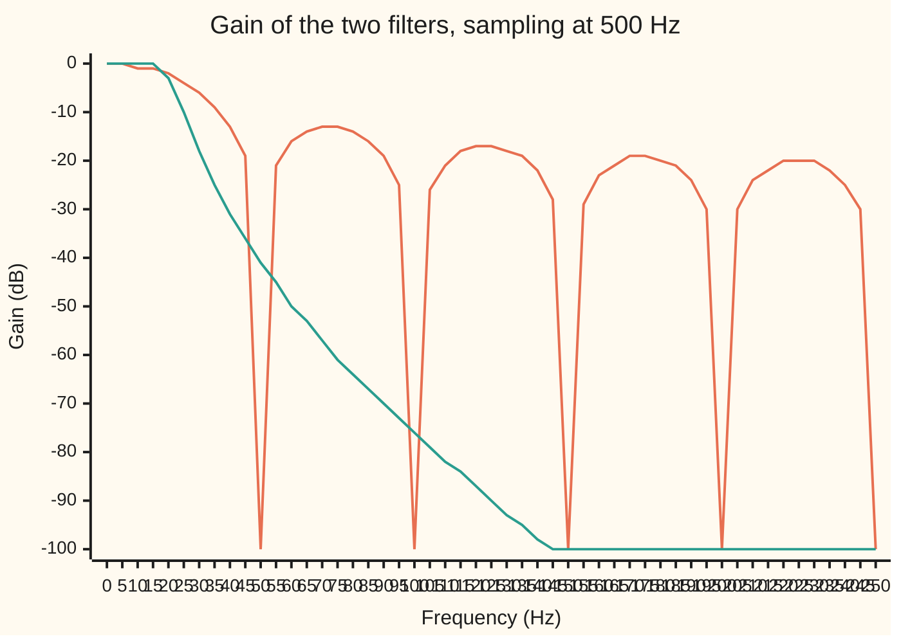
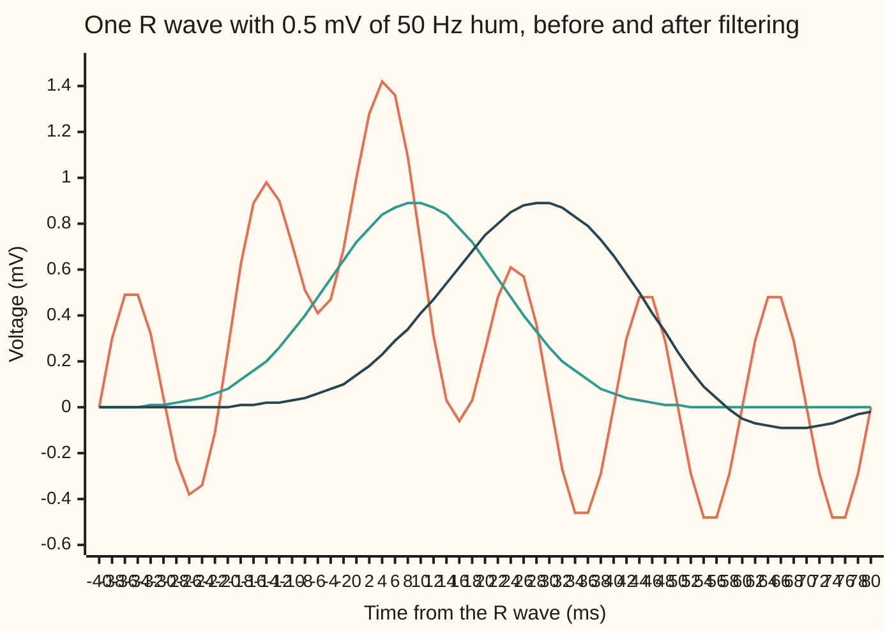

# Digital filters: weight the last few inputs, or feed the output back

[Syllabus](../../../SYLLABUS.md) → [Engineering mathematics](../README.md) → [Signals](../README.md#s05) → Digital filters

---

## General Overview

A heart monitor records an electrocardiogram (ECG): the heart's electrical signal, read from skin electrodes. It takes 500 readings a second. Each beat's tallest spike, the R wave, is about 1 mV (a thousandth of a volt). The building's wiring adds a steady 50 Hz hum, here 0.5 mV, half the size of the beat. On screen the trace looks like a fuzzy rope. The engineer wants the hum gone, without losing the shape of the beat.

A digital filter is a short rule run once per reading: it makes each output from recent numbers. There are two kinds. A **FIR** filter (finite impulse response: one lone spike in, and the output is back to zero a few readings later) adds up the last few *inputs*, each times a fixed weight. An **IIR** filter (infinite impulse response) also adds in its own last few *outputs*. That feedback lets a few numbers do the work of many.

This card designs one of each to the same spec. The FIR averages the last 10 readings. Ten readings at 500 a second span 20 ms, exactly one cycle of the hum, and any sine averaged over a whole cycle is zero. The IIR is a fifth-order Butterworth low-pass (it keeps slow waves and cuts fast ones): 11 multiplies per reading, with the flattest possible gain at low frequencies. Both meet the spec. They differ in everything else. The average lets muscle noise at 75 Hz through at 22 % of its size. The Butterworth cuts it to a thousandth, but it delays the slow parts of the beat by 26 ms and the faster parts by up to 41 ms. That uneven delay bends the beat's shape.

**An FIR filter weights the last few inputs and so has no feedback, can be exactly symmetric, and then delays every frequency equally; an IIR filter feeds its output back, which buys a much sharper cut per multiply but gives up that equal delay.**

**What kind of fact this is:** a design method resting on theorems. The gain formulas, the order rule and the delay results are proved on this card in Why it works. The ECG and its hum are a model with stated assumptions.

### The picture: how much of each frequency gets through



Orange: the 10-reading moving average. Teal: the fifth-order Butterworth. Gain is in decibels (dB), 20 log10 of the factor a wave's height is multiplied by: −20 dB keeps a tenth, −40 dB a hundredth ([Bode plots](../02-Linear%20Systems%20and%20Transforms/04-frequency-response-and-bode-plots.md)). The average's notches at 50, 100, 150, 200 and 250 Hz go to minus infinity and are drawn at −100. Between them it bounces back to −13 dB. The Butterworth falls smoothly and never comes back up.

---

## The formula

Notation first. The readings are x[n], the outputs y[n], where n counts readings. The sampling rate is $f_s$ = 500 Hz, and $f_s/2$ = 250 Hz is the Nyquist frequency, the fastest wave the readings can show ([Sampling](01-sampling-and-the-nyquist-theorem.md)). A frequency f in hertz becomes an angle per reading, $\omega = 2\pi f / f_s$ radians: 50 Hz is $\omega = 0.2\pi$, a fifth of a half-turn. As on [The z-transform](../02-Linear%20Systems%20and%20Transforms/08-z-transform-and-discrete-time-systems.md), $z^{-1}$ is the one-reading delay and j is the square root of −1 (the rest of the library writes i).

**An FIR filter** weights the last M inputs:

$$y[n] = \sum_{k=0}^{M-1} b_k\, x[n-k], \qquad \text{moving average: } b_k = \frac{1}{M}.$$

**An IIR filter** also feeds back its last N outputs:

$$y[n] = \sum_{k=0}^{N} b_k\, x[n-k] \;-\; \sum_{k=1}^{N} a_k\, y[n-k], \qquad H(z) = \frac{b_0 + b_1 z^{-1} + \dots + b_N z^{-N}}{1 + a_1 z^{-1} + \dots + a_N z^{-N}}.$$

**Read it aloud:** the output is a weighted sum of recent inputs, minus a weighted sum of recent outputs; the FIR simply has no second sum.

A steady sine at angle ω per reading comes out as the same sine, multiplied in size by $|H(e^{j\omega})|$ and shifted. For the two designs here those gains have closed forms:

$$\text{moving average: } |H| = \left|\frac{\sin(M\omega/2)}{M \sin(\omega/2)}\right|, \qquad \text{Butterworth: } |H|^2 = \frac{1}{1 + \bigl(\tan(\omega/2) / \tan(\omega_c/2)\bigr)^{2N}}.$$

**Read it aloud:** the average's gain is a ratio of sines that is zero whenever M ω/2 is a whole number of half-turns; the Butterworth keeps half the power at the cutoff and falls away steadily beyond it.

**The spec, and the order it forces.** Keep at least half the power (the −3 dB point) up to 20 Hz. Cut everything from 49.8 to 50.2 Hz by at least A = 40 dB: 0.5 mV of hum then drops below 5 µV. The average needs M = $f_s$/50 = 10. The Butterworth needs the smallest whole N with

$$N \;\ge\; \frac{\log_{10}\bigl(10^{A/10} - 1\bigr)}{2 \log_{10}\bigl(\tan(\omega_s/2) / \tan(\omega_c/2)\bigr)} = \frac{3.99996}{0.8168} = 4.897, \qquad N = 5.$$

| Symbol | Plain meaning | In our example | Push it up and the answer… |
| --- | --- | --- | --- |
| $x[n]$, $y[n]$, $n$ | reading in and filtered value out, in mV; the reading's count | 500 readings a second | — |
| $f_s$ | sampling rate | 500 Hz | both filters need more taps or a higher order for the same spec |
| $f$, $\omega$ | a frequency in Hz; the same as an angle per reading, $2\pi f/f_s$ | 50 Hz is 0.2π rad | — |
| $M$ | how many readings the average spans (its taps) | 10, one mains cycle | notches move down; the kept band (the passband) sags |
| $b_k$, $a_k$, $k$ | weight on the input k readings back; weight on the output k readings back | $b_k$ = 0.1 for the average | — |
| $z^{-1}$, $H$ | one-reading delay; the transfer function, what the filter does to each frequency | $\lvert H\rvert$ = 0.0087 at 50.2 Hz (Butterworth) | — |
| $N$ | the IIR's order: how many past outputs it feeds back | 5 | sharper cut, more multiplies, more delay |
| $f_c$, $\omega_c$ | the Butterworth's cutoff, where it keeps half the power | 20 Hz, 0.08π rad | more of the beat kept, less hum cut |
| $\omega_s$, $A$, $r$ | the edge where the cut band (the stopband) starts; the cut demanded there; $\tan(\omega_s/2)/\tan(\omega_c/2)$, the warped edge ratio | 49.8 Hz; 40 dB; 2.5610 | a higher order (smaller $r$ also raises it) |
| $\tau_g$, $D$ | group delay: how long a narrow band of frequencies near f is held up; a delay counted in readings | 9 ms (average); 25.62 to 41.45 ms (Butterworth); D = 4.5 readings | — |
| $s$, $\Omega$, $\Omega_c$, $p_k$, $\theta_k$ | the Laplace variable of the analogue prototype; its angular frequency and cutoff; a pole (a root of H's bottom) and its angle | pole radii in z: 0.9259, 0.8155, 0.7757 | pole nearer the unit circle: sharper, longer ringing |

### When it holds

- **The filter is linear and the same every reading.** Then each frequency passes on its own and the gain formulas apply. Clip the amplifier, or change the weights mid-record, and new frequencies appear that no gain curve predicts.
- **The hum stays near 50 Hz.** The spec allows 49.8 to 50.2 Hz. At 51 Hz the average cuts only 34.01 dB and fails; the Butterworth still cuts 41.95 dB.
- **The sampling rate is a whole multiple of the hum.** 500 = 10 × 50, so a 10-reading average spans one cycle exactly. On 60 Hz mains at the same rate, 500/60 is not whole, and the nearest average (8 readings) cuts the hum by only 27.42 dB.
- **The beat's useful content sits below 20 Hz.** It does for a heart-rate monitor. A diagnostic ECG needs content up to 150 Hz, so it cannot use a 20 Hz low-pass at all; it removes hum another way (see Where you meet it).
- **The IIR's poles stay inside the unit circle.** Here the largest pole radius is 0.9259. A pole outside makes the output grow without limit ([The z-transform](../02-Linear%20Systems%20and%20Transforms/08-z-transform-and-discrete-time-systems.md)).

---

## Why it works

### Step 0: every steady sine comes out as itself, resized and shifted

A filter that is linear and the same every reading cannot invent frequencies. Feed it $x[n] = e^{j\omega n}$, a wave turning ω radians per reading. Each delayed copy is $e^{j\omega(n-k)} = e^{-j\omega k}\, e^{j\omega n}$: the same wave times a fixed complex number. A weighted sum of such copies is still the same wave, times $H(e^{j\omega})$. Its size $|H|$ is the gain and its angle is the phase shift. A real sine is two of these waves turning opposite ways, so it gets the same gain. Designing a filter means placing that gain where you want it. Across a whole signal, filtering multiplies each frequency's share by $H$ ([Convolution](../../07-Complex%20analysis/08-Transforms%20in%20Outline/04-convolution-theorem.md)).

### Step 1: the moving average has zeros exactly on the hum

The average's transfer function is a geometric series in $z^{-1}$:

$$H(z) = \frac{1}{M}\sum_{k=0}^{M-1} z^{-k} = \frac{1}{M}\,\frac{1 - z^{-M}}{1 - z^{-1}}.$$

The top is zero wherever $z^{M} = 1$: at the M points spaced evenly round the unit circle. The bottom cancels the one at z = 1, so the average passes a constant unchanged. The other nine sit at angles $2\pi k/10$, that is at frequencies $k f_s/M$ = 50, 100, 150, 200 and 250 Hz, plus their mirror images. On the circle, $z = e^{j\omega}$, and taking the size of top over bottom gives the ratio of sines in the formula. The plain reason: ten readings 2 ms apart cover one 20 ms cycle of the hum, and a whole cycle of a sine averages to zero. The hum's harmonics, 100 Hz and up, fit whole cycles too.

Each notch is narrow: 47.85 dB at 50.2 Hz, only 34.01 dB at 51 Hz.

### Step 2: symmetric weights delay every frequency equally

The average's weights read the same forwards and backwards: $b_k = b_{M-1-k}$. Pair the first weight with the last, the second with the second-to-last, and so on. Each pair adds $e^{-j\omega k} + e^{-j\omega(M-1-k)}$, which is $e^{-j\omega (M-1)/2}$ times the real number $2\cos\bigl(\omega((M-1)/2 - k)\bigr)$. So

$$H(e^{j\omega}) = e^{-j\omega (M-1)/2} \times (\text{a real number}).$$

The phase is a straight line in ω. A phase of $-\omega D$ is a pure delay of D readings for every frequency at once. Here D = 4.5 readings, 9 ms. The group delay, $\tau_g = -d(\text{phase})/d\omega$, is the slope of that line; the code measures it at 5 Hz and at 30 Hz and gets 9.000 ms both times. Every part of the beat arrives 9 ms late and in step. The shape is smoothed but not bent.

### Step 3: feedback buys sharpness, and the Butterworth places the poles

The average's sharpness is fixed by its length. To cut 40 dB at every frequency above 49.8 Hz while keeping 20 Hz, a symmetric FIR needs many taps: a Hamming-window design ([Windows](03-windows-and-spectral-leakage.md)) needs 53. Feedback is the shortcut. Each fed-back output carries the whole past, so the impulse response never quite ends. In H(z) the feedback weights make a denominator. Its roots are poles, and a pole near the unit circle at angle ω lifts the gain near that frequency.

The Butterworth chooses the poles so that the gain is as flat as possible near 0 Hz. [Sampling](01-sampling-and-the-nyquist-theorem.md) already uses its gain and poles; here is why it is the flattest. Start in continuous time, with the Laplace variable s. Ask for a power gain $1/(1 + (\Omega/\Omega_c)^{2N})$ at angular frequency Ω. Expanded for small Ω it is $1 - (\Omega/\Omega_c)^{2N} + \dots$. Its first 2N − 1 derivatives at zero vanish, and no other N-pole filter does better. That is "maximally flat". Its poles solve $1 + (s/j\Omega_c)^{2N} = 0$: 2N points evenly spaced on a circle of radius $\Omega_c$. The N in the left half-plane give a stable filter.

### Step 4: the bilinear transform carries the design across, bending the frequency axis

To turn the continuous design into a rule run every reading, replace each integrator by the trapezoid rule ([Numerical integration](../../06-Calculus%20and%20analysis/04-Integrals/08-numerical-integration.md)). In transfer-function terms that substitutes

$$s = \frac{z - 1}{z + 1}, \qquad z = \frac{1 + s}{1 - s},$$

with the time step folded into the frequency scale. This is the Tustin method of [Discretising a design](../02-Linear%20Systems%20and%20Transforms/09-zero-order-hold-and-tustin-discretisation.md). The left half of the s-plane maps to the inside of the unit circle, so a stable prototype gives a stable filter. On the circle, $z = e^{j\omega}$ gives $s = j\tan(\omega/2)$. So the continuous frequency Ω and the digital ω are tied by $\Omega = \tan(\omega/2)$. The whole infinite Ω axis is squeezed into 0 to 250 Hz.

That squeeze is why the formulas carry tangents. Design the prototype with cutoff $\tan(\omega_c/2)$, a step called prewarping. Then the digital filter keeps half the power at exactly 20 Hz, and its gain is the Butterworth formula with tangents. The map also sends s = ∞ to z = −1. So all five zeros land at z = −1, and the gain at 250 Hz is exactly zero. That is why the top of H(z) is $(1 + z^{-1})^5$, the weights 1, 5, 10, 10, 5, 1 times a scale that makes the gain at 0 Hz exactly 1.

### Step 5: the order comes from one inequality

Asking for A dB at the stopband edge, $1 + r^{2N} \ge 10^{A/10}$, gives the order rule of [Sampling](01-sampling-and-the-nyquist-theorem.md). The one change is Step 4's tangent warp: $r = \tan(\omega_s/2)/\tan(\omega_c/2)$, 2.5610 here, replaces the plain frequency ratio. The gain only ever falls, so meeting the spec at 49.8 Hz meets it above too. The code also searches orders 1, 2, 3, … and checks the spec directly; both say 5.

### Step 6: feedback costs equal delay

An IIR filter's impulse response runs on forever. Exactly linear phase needs it to read the same backwards as forwards about some middle reading. A response that starts at reading 0 and never ends has no middle, so a causal IIR filter cannot have exactly linear phase. The Butterworth's delay changes with frequency. At 0 Hz it follows from the poles: each pole $p_k = \Omega_c e^{j\theta_k}$ contributes $-\cos\theta_k / \Omega_c$, and the five add up to $1/(\sin(\pi/2N)\,\Omega_c)$. With $\Omega_c = 2 f_s \tan(\omega_c/2)$ in rad/s, that is 25.62 ms. The code measures the phase slope of the actual filter and gets the same 25.62 ms. Near the cutoff the delay peaks at 41.45 ms, at 18.5 Hz. The slow parts of a beat arrive about 26 ms late, its sharpest parts up to 41.45 ms late. That spread is what bends the shape.

<details>
<summary>The delay at 0 Hz, line by line</summary>

The prototype is $H(s) = \prod_k \frac{-p_k}{s - p_k}$. For small Ω, the factor's phase at $s = j\Omega$ is $-\arg(1 - j\Omega/p_k) \approx \Omega\,\mathrm{Re}(1/p_k)$, so its delay is $-\mathrm{Re}(1/p_k) = -\cos\theta_k/\Omega_c$. The angles are $\theta_k = \pi/2 + (2k+1)\pi/(2N)$, so $-\cos\theta_k = \sin\bigl((2k+1)\pi/(2N)\bigr)$. The sum of those sines for k = 0 to N − 1 is $1/\sin(\pi/(2N))$, which is 3.236 for N = 5. In rad/s the bilinear map reads $\Omega = 2 f_s \tan(\omega/2)$, which near 0 Hz is $f_s\,\omega = 2\pi f$: the two frequency scales agree there, so the digital delay at 0 Hz equals the prototype's.

</details>

---

## Worked numbers, by hand

The spec at $f_s$ = 500 Hz: half power kept to 20 Hz, 40 dB cut from 49.8 to 50.2 Hz.

| Step | Arithmetic | Value |
| --- | --- | --- |
| average's length | 500 readings/s ÷ 50 cycles/s | M = 10, 20 ms |
| average at 20 Hz | sin(0.4π) ÷ (10 sin(0.04π)) = 0.9511 ÷ 1.2533 | 0.7588, −2.40 dB: passes |
| average at 50.2 Hz | ratio of sines, just off the notch | −47.85 dB: passes |
| warped edge ratio | tan(π·49.8/500) ÷ tan(π·20/500) = 0.32353 ÷ 0.12633 | 2.5610 |
| Butterworth order | log10(9999) ÷ (2 log10 2.5610) = 3.99996 ÷ 0.8168 | 4.897, so N = 5 |
| Butterworth at 50.2 Hz | 1 ÷ √(1 + (tan(0.1004π)/0.12633)^10) | 0.0087, −41.21 dB |
| delay, average | (10 − 1) ÷ 2 = 4.5 readings at 2 ms | 9 ms, every frequency |
| delay, Butterworth at 0 Hz | 3.236 ÷ (2 × 500 × 0.12633) s | 25.62 ms |
| hum left from 0.5 mV at 50.2 Hz | 0.5 mV × gain | average **2.03 µV**, Butterworth **4.35 µV** |

Both filters bring 0.5 mV of hum below the 5 µV the spec allows. The choice between them is decided by everything else: what leaks through between notches, how the beat's shape survives, and the cost.

### What breaks if you drop a piece

| Mistake | Comes out at | What went wrong |
| --- | --- | --- |
| Average 9 readings, not 10 | −19.08 dB at 50 Hz | 18 ms is not one hum cycle, so the notch misses 50 Hz |
| Butterworth of order 4 | −32.68 dB at 49.8 Hz | one pole short of the order rule; fails the 40 dB spec |
| Mains drifts to 51 Hz | average −34.01 dB, Butterworth −41.95 dB | the average's notch is narrow; the Butterworth's cut is broad |
| Assume the Butterworth delays the beat like the average, 9 ms | the R peak lands at +28 ms | its delay runs from 25.62 to 41.45 ms and depends on frequency |

---

## One heartbeat, reading by reading

A filter has memory, so a beat comes out smeared over the next few dozen readings. Both filters remove the hum; the puzzle is why their outputs still look different.

Feed in one synthetic beat with 0.5 mV of 50 Hz hum on top. The R wave is a bell-shaped spike 1.000 mV tall, centred at t = 0, with a width of 12 ms either side. A small P wave comes 200 ms before and a T wave 250 ms after. The code runs both filters over all 500 readings.

| Output | R peak height | R peak time | Dip below the clean trace after the peak |
| --- | --- | --- | --- |
| the clean beat | 1.000 mV | 0 ms | none |
| moving average | 0.894 mV | +10 ms | none |
| Butterworth | 0.893 mV | +28 ms | −0.092 mV |
| Butterworth, run forward then backward | 0.861 mV | 0 ms | −0.050 mV |

**Force one: smoothing.** Both filters remove the spike's sharpest parts, so both peaks drop by about a tenth. That is the price of any 20 Hz low-pass on a 12 ms spike.

**Force two: delay.** The average holds everything up by 9 ms; its peak shows at +10 ms because readings fall every 2 ms. The Butterworth holds the slow parts up by 26 ms and the sharp parts by up to 41 ms, so its peak lands at +28 ms.

**Force three: ringing.** All the average's weights are positive, so it can never make a dip that was not in the input. The Butterworth's poles are complex numbers off the real axis, so its response oscillates and swings below zero after the spike: a 0.092 mV dip just after the R wave. In an ECG, that stretch is the ST segment, which doctors read for signs of a heart attack.

The three forces, from the table:

```
Force one, smoothing: R peak height (mV)
  clean          ████████████████████  1.000
  moving avg     ██████████████████    0.894
  Butterworth    ██████████████████    0.893
Force two, delay: R peak time after the true peak (ms)
  moving avg     ███████               +10
  Butterworth    ████████████████████  +28
Force three, ringing: dip below the clean trace after the peak (mV)
  moving avg                           0.000
  Butterworth    ████████████████████  0.092
```



Orange: the recorded trace, beat plus hum. Teal: the moving average, smooth and 9 ms late, never below zero. Dark: the Butterworth, later still, and dipping below zero after the spike.

Running the Butterworth forward over the record, then again backward over its output, cancels the delay exactly: the second pass delays by the same amount in the opposite direction. The peak returns to 0 ms and the cut doubles in dB. This only works on a recording that is already complete, never live.

---

## Code, from first principles, and it actually runs

The script builds both filters from their definitions: the average from its length, the Butterworth from its poles on a circle, mapped through the bilinear transform and multiplied out into weights. Nothing imported knows anything about filters. It reaches each answer by three independent roads. Road one is the closed-form gain. Road two evaluates H(z) on the unit circle from the actual weights. Road three runs the difference equation on a long sine and measures what comes out once it has settled. The delay at 0 Hz is checked by the pole formula against the measured phase slope, and the order by the inequality against a search. Then it sizes the Hamming FIR, rechecks it by Step 2's cosine sum on a finer grid, and runs the heartbeat.

### Python

```python
# Digital filters, FIR and IIR -- the check behind the card.  Standard library only.
# Remove 50 Hz mains hum from an ECG sampled at FS = 500 Hz.  One spec for both filters:
# keep half the power or more up to 20 Hz; cut 49.8 to 50.2 Hz by at least 40 dB.
# FIR: a 10-tap moving average.  IIR: a 5th-order Butterworth by the bilinear transform.
# Roads: closed-form gain against H(z) summed from the coefficients; a simulated sine
# measured once settled; group delay from the phase slope against the pole formula.
import math, cmath
FS, HUM, FP, FLO, FHI, ATT = 500.0, 50.0, 20.0, 49.8, 50.2, 40.0
def db(g): return 20 * math.log10(g) if g > 1e-12 else -math.inf
def H(b, a, f, fs=FS):                            # road 1: H(z) on the unit circle
    w = 2 * math.pi * f / fs                      # radians per sample; z^-k = e^(-j w k)
    def poly(c): return sum(v * cmath.exp(-1j * w * k) for k, v in enumerate(c))
    return poly(b) / poly(a)
def run(b, a, x):                                 # road 3: the difference equation
    y = []
    for n in range(len(x)):
        acc = sum(b[k] * x[n - k] for k in range(len(b)) if n >= k)
        y.append(acc - sum(a[k] * y[n - k] for k in range(1, len(a)) if n >= k))
    return y
def settled_amp(b, a, f, secs=6):                 # amplitude over the last 5 s, whole cycles
    x = [math.sin(2 * math.pi * f * n / FS) for n in range(int(secs * FS))]
    y = run(b, a, x)[-int(5 * FS):]
    n0 = int((secs - 5) * FS)
    s = sum(v * math.sin(2 * math.pi * f * (n0 + i) / FS) for i, v in enumerate(y))
    c = sum(v * math.cos(2 * math.pi * f * (n0 + i) / FS) for i, v in enumerate(y))
    return 2 * math.hypot(s, c) / len(y)
def gdelay(b, a, f, d=1e-4):                      # group delay, ms, from the phase slope
    dph = cmath.phase(H(b, a, f + d) / H(b, a, f - d))
    return -dph / (2 * math.pi * 2 * d) * 1000
# ---- the FIR: average one full mains cycle ----
M = round(FS / HUM)
ma = [1.0 / M] * M
def ma_formula(f):                                # road 2: sin(M w/2) / (M sin(w/2))
    w = 2 * math.pi * f / FS
    return abs(math.sin(M * w / 2) / (M * math.sin(w / 2))) if f else 1.0
# ---- the IIR: Butterworth poles on a circle, mapped by the bilinear transform ----
def butter(N, fc):
    Wc = math.tan(math.pi * fc / FS)              # prewarped cutoff
    s = [Wc * cmath.exp(1j * math.pi * (2 * k + N + 1) / (2 * N)) for k in range(N)]
    poles = [(1 + p) / (1 - p) for p in s]
    a = [1 + 0j]
    for p in poles:
        a = [u - p * v for u, v in zip(a + [0], [0] + a)]
    a = [c.real for c in a]
    b = [float(math.comb(N, k)) for k in range(N + 1)]   # N zeros at z = -1
    g = sum(a) / sum(b)                           # unit gain at 0 Hz
    return [g * c for c in b], a, poles, Wc
def bw_formula(f, N, Wc): return 1 / math.sqrt(1 + (math.tan(math.pi * f / FS) / Wc) ** (2 * N))
Ws = math.tan(math.pi * FLO / FS) / math.tan(math.pi * FP / FS)
N = math.ceil(math.log10(10 ** (ATT / 10) - 1) / (2 * math.log10(Ws)))
b, a, poles, Wc = butter(N, FP)
band = [FLO + (FHI - FLO) * i / 40 for i in range(41)]
def meets(bb, aa): return min(-db(abs(H(bb, aa, f))) for f in band) >= ATT and abs(H(bb, aa, FP)) ** 2 >= 0.5 - 1e-9
brute = next(n for n in range(1, 12) if meets(*butter(n, FP)[:2]))
print(f"spec: fs {FS:.0f} Hz; half power or more to {FP:.0f} Hz; {ATT:.0f} dB off over {FLO:.1f}-{FHI:.1f} Hz")
print(f"moving average: M = {M} taps = {M / FS * 1000:.0f} ms, one mains cycle")
print(f"Butterworth: warped edge ratio {Ws:.4f}; order by formula {N}, by search {brute}")
tp, ts = math.tan(math.pi * FP / FS), math.tan(math.pi * FLO / FS)
print(f"by hand: tan(pi {FLO:.1f}/500) {ts:.5f}, tan(pi {FP:.0f}/500) {tp:.5f}, log10(9999) {math.log10(9999):.5f}, "
      f"2 log10(ratio) {2 * math.log10(Ws):.4f}, N >= {math.log10(9999) / (2 * math.log10(Ws)):.3f}")
print(f"by hand: sin(0.4 pi) {math.sin(0.4 * math.pi):.4f}, 10 sin(0.04 pi) {10 * math.sin(0.04 * math.pi):.4f}, average at 20 Hz "
      f"{ma_formula(20):.4f}; 1/sin(pi/10) {1 / math.sin(math.pi / 10):.3f}; Butterworth at 50.2 Hz {bw_formula(50.2, N, Wc):.4f}")
print("b x 10^4 =", " ".join(f"{c * 1e4:.6f}" for c in b))
print("a =", " ".join(f"{c:.6f}" for c in a))
print("pole radii", " ".join(f"{abs(p):.4f}" for p in poles))
print("gain dB      f(Hz):  10.0   15.0   20.0   30.0   49.8   50.0   50.2   75.0")
fs_ = [10, 15, 20, 30, 49.8, 50, 50.2, 75]
for name, bb, aa in [("moving avg", ma, [1.0]), ("Butterworth", b, a)]:
    print(f"{name:12s}        " + " ".join(f"{db(abs(H(bb, aa, f))):6.2f}" for f in fs_))
amp = {f: (settled_amp(ma, [1.0], f), settled_amp(b, a, f)) for f in (20.0, 50.2, 75.0)}
for f, (u, v) in amp.items():
    print(f"simulated sine {f:4.1f} Hz, settled amplitude: moving avg {u:.6f}, Butterworth {v:.6f}")
print(f"0.5 mV of hum at {FHI:.1f} Hz leaves: moving avg {500 * amp[50.2][0]:.2f} uV, Butterworth {500 * amp[50.2][1]:.2f} uV")
grid = [0.25 * i for i in range(1001)]
e1 = max(abs(abs(H(ma, [1.0], f)) - ma_formula(f)) for f in grid)
e2 = max(abs(abs(H(b, a, f)) - bw_formula(f, N, Wc)) for f in grid[:-1])
print(f"formula and H(z) agree to 1e-12 (moving avg), 1e-9 (Butterworth): {'yes' if e1 < 1e-12 and e2 < 1e-9 else 'no'}")
for f in (49.5, 50.5, 51.0):
    print(f"mains drifts to {f:.1f} Hz: moving avg {db(ma_formula(f)):.2f} dB, Butterworth {db(bw_formula(f, N, Wc)):.2f} dB")
gd0 = 1000 / (math.sin(math.pi / (2 * N)) * 2 * FS * Wc)
gds = [gdelay(b, a, f) for f in (0.01, 5, 10, 15)]
peak = max((gdelay(b, a, 0.1 * i), 0.1 * i) for i in range(1, 251))
print(f"group delay ms: moving avg {gdelay(ma, [1.0], 5):.3f} at 5 Hz, {gdelay(ma, [1.0], 30):.3f} at 30 Hz")
print(f"Butterworth at 0, 5, 10, 15 Hz: " + ", ".join(f"{g:.2f}" for g in gds) + f"; peak {peak[0]:.2f} at {peak[1]:.1f} Hz")
print(f"Butterworth at 0 Hz by the pole formula: {gd0:.2f} ms")
# ---- what it would cost to match the Butterworth everywhere with linear phase ----
def hamming_fir(L, fc, fs=FS):
    h = [(0.54 - 0.46 * math.cos(2 * math.pi * k / (L - 1))) *
         (math.sin(2 * math.pi * fc / fs * (k - (L - 1) / 2)) / (math.pi * (k - (L - 1) / 2)) if 2 * k != L - 1 else 2 * fc / fs)
         for k in range(L)]
    return [v / sum(h) for v in h]
stop = [FLO + 0.4 * i for i in range(501)]
def full_spec(h, fs=FS): return abs(H(h, [1.0], FP, fs)) ** 2 >= 0.5 and max(abs(H(h, [1.0], f, fs)) for f in stop) <= 10 ** (-ATT / 20)
L = next(L for L in range(11, 201, 2) if full_spec(hamming_fir(L, (FP + FLO) / 2)))
print(f"Hamming-window FIR meeting 40 dB at every f >= {FLO:.1f} Hz: {L} taps, delay {(L - 1) / 2 / FS * 1000:.0f} ms")
print(f"multiplies per sample: moving avg {M} (1 as a running sum), Butterworth {len(b) + len(a) - 1}, Hamming FIR {L}")
def cos_gain(h, f):                               # road 2 for a symmetric FIR: a real cosine sum (Step 2)
    return abs(sum(v * math.cos(2 * math.pi * f / FS * (k - (len(h) - 1) / 2)) for k, v in enumerate(h)))
hL, hL2 = hamming_fir(L, (FP + FLO) / 2), hamming_fir(L - 2, (FP + FLO) / 2)
pk, pk2 = [max(cos_gain(h, FLO + 0.05 * i) for i in range(4001)) for h in (hL, hL2)]   # 0.05 Hz steps to 249.8 Hz
print(f"  by cosine sum, 0.05 Hz grid: worst stopband gain {L} taps {db(pk):.2f} dB, {L - 2} taps {db(pk2):.2f} dB; {L} taps at {FP:.0f} Hz {db(cos_gain(hL, FP)):.2f} dB")
# ---- one heartbeat with 0.5 mV of hum, through both filters ----
def ecg(t):
    g = lambda amp, mu, sd: amp * math.exp(-((t - mu) / sd) ** 2 / 2)
    return g(0.15, -0.2, 0.025) + g(1.0, 0.0, 0.012) + g(0.3, 0.25, 0.04)
T0 = 250                                          # the R wave is at sample 250, t = 0
clean = [ecg((n - T0) / FS) for n in range(500)]
noisy = [v + 0.5 * math.sin(2 * math.pi * HUM * (n - T0) / FS) for n, v in enumerate(clean)]
y_ma, y_bw = run(ma, [1.0], noisy), run(b, a, noisy)
y_zp = run(b, a, run(b, a, noisy)[::-1])[::-1]   # forward, then backward in time
for name, y in [("clean", clean), ("moving avg", y_ma), ("Butterworth", y_bw), ("forward-backward", y_zp)]:
    k = max(range(T0 - 50, T0 + 50), key=lambda i: y[i])
    dip = min(y[k:k + 40]) - min(clean[k:k + 40])
    print(f"R peak {name:16s}: {y[k]:.3f} mV at {(k - T0) / FS * 1000:+5.0f} ms; dip below clean {dip:+.3f} mV")
idx = range(T0 - 20, T0 + 41)
print("chart, t ms   " + " ".join(f"{(i - T0) * 2:5d}" for i in idx))
for name, y in [("noisy", noisy), ("moving avg", y_ma), ("Butterworth", y_bw)]:
    print(f"chart, {name:11s} " + " ".join(f"{y[i]:5.2f}" for i in idx))
print("chart, f Hz   " + " ".join(f"{5 * i:4d}" for i in range(51)))
for name, bb, aa in [("moving avg", ma, [1.0]), ("Butterworth", b, a)]:
    print(f"chart, {name:11s} " + " ".join(f"{round(max(db(abs(H(bb, aa, 5 * i))), -100)):4d}" for i in range(51)))
# ---- what breaks ----
m9 = abs(H([1 / 9] * 9, [1.0], HUM))
b4, a4 = butter(N - 1, FP)[:2]
print(f"breaks: 8-tap average at 60 Hz {db(abs(H([1 / 8] * 8, [1.0], 60))):.2f} dB; 9-tap average at 50 Hz {db(m9):.2f} dB; order {N - 1} Butterworth at {FLO:.1f} Hz {db(abs(H(b4, a4, FLO))):.2f} dB")
order = lambda fs, fp: math.ceil(math.log10(10 ** (ATT / 10) - 1) / (2 * math.log10(math.tan(math.pi * FLO / fs) / math.tan(math.pi * fp / fs))))
L1k = next(L for L in range(11, 401, 2) if full_spec(hamming_fir(L, (FP + FLO) / 2, 1000.0), 1000.0))
print(f"try: fs 1000 Hz: average {round(1000 / HUM)} taps, Butterworth order {order(1000.0, FP)} ({2 * order(1000.0, FP) + 1} multiplies), "
      f"Hamming FIR {L1k} taps; FP 25 Hz: Butterworth order {order(FS, 25.0)} ({2 * order(FS, 25.0) + 1} multiplies)")
assert abs(H(ma, [1.0], HUM)) < 1e-12 and N == 5 == brute and e1 < 1e-12 and e2 < 1e-9
assert all(abs(u - abs(H(ma, [1.0], f))) < 1e-9 and abs(v - bw_formula(f, N, Wc)) < 1e-6 for f, (u, v) in amp.items())
assert abs(gds[0] - gd0) < 1e-3 and abs(gdelay(ma, [1.0], 30) - (M - 1) / 2 / FS * 1000) < 1e-6
assert meets(ma, [1.0]) and meets(b, a) and not meets(b4, a4) and max(abs(p) for p in poles) < 1
assert pk <= 10 ** (-ATT / 20) < pk2 and cos_gain(hL, FP) ** 2 >= 0.5 and not full_spec(ma)
print("ALL CHECKS PASS")
```

**Ran 2026-11-11 on macOS, Python 3.14.10, standard library only. All checks passed. Output, pasted from the run:**

```
spec: fs 500 Hz; half power or more to 20 Hz; 40 dB off over 49.8-50.2 Hz
moving average: M = 10 taps = 20 ms, one mains cycle
Butterworth: warped edge ratio 2.5610; order by formula 5, by search 5
by hand: tan(pi 49.8/500) 0.32353, tan(pi 20/500) 0.12633, log10(9999) 3.99996, 2 log10(ratio) 0.8168, N >= 4.897
by hand: sin(0.4 pi) 0.9511, 10 sin(0.04 pi) 1.2533, average at 20 Hz 0.7588; 1/sin(pi/10) 3.236; Butterworth at 50.2 Hz 0.0087
b x 10^4 = 0.213962 1.069808 2.139615 2.139615 1.069808 0.213962
a = 1.000000 -4.187300 7.069723 -6.009958 2.570429 -0.442209
pole radii 0.9259 0.8155 0.7757 0.8155 0.9259
gain dB      f(Hz):  10.0   15.0   20.0   30.0   49.8   50.0   50.2   75.0
moving avg           -0.57  -1.31  -2.40  -5.89 -47.78   -inf -47.85 -13.14
Butterworth          -0.00  -0.23  -3.01 -17.97 -40.84 -41.03 -41.21 -60.57
simulated sine 20.0 Hz, settled amplitude: moving avg 0.758822, Butterworth 0.707107
simulated sine 50.2 Hz, settled amplitude: moving avg 0.004051, Butterworth 0.008697
simulated sine 75.0 Hz, settled amplitude: moving avg 0.220269, Butterworth 0.000937
0.5 mV of hum at 50.2 Hz leaves: moving avg 2.03 uV, Butterworth 4.35 uV
formula and H(z) agree to 1e-12 (moving avg), 1e-9 (Butterworth): yes
mains drifts to 49.5 Hz: moving avg -39.77 dB, Butterworth -40.56 dB
mains drifts to 50.5 Hz: moving avg -39.94 dB, Butterworth -41.49 dB
mains drifts to 51.0 Hz: moving avg -34.01 dB, Butterworth -41.95 dB
group delay ms: moving avg 9.000 at 5 Hz, 9.000 at 30 Hz
Butterworth at 0, 5, 10, 15 Hz: 25.62, 26.28, 28.86, 36.16; peak 41.45 at 18.5 Hz
Butterworth at 0 Hz by the pole formula: 25.62 ms
Hamming-window FIR meeting 40 dB at every f >= 49.8 Hz: 53 taps, delay 52 ms
multiplies per sample: moving avg 10 (1 as a running sum), Butterworth 11, Hamming FIR 53
  by cosine sum, 0.05 Hz grid: worst stopband gain 53 taps -42.04 dB, 51 taps -39.31 dB; 53 taps at 20 Hz -0.05 dB
R peak clean           : 1.000 mV at    +0 ms; dip below clean +0.000 mV
R peak moving avg      : 0.894 mV at   +10 ms; dip below clean +0.000 mV
R peak Butterworth     : 0.893 mV at   +28 ms; dip below clean -0.092 mV
R peak forward-backward: 0.861 mV at    +0 ms; dip below clean -0.050 mV
chart, t ms     -40   -38   -36   -34   -32   -30   -28   -26   -24   -22   -20   -18   -16   -14   -12   -10    -8    -6    -4    -2     0     2     4     6     8    10    12    14    16    18    20    22    24    26    28    30    32    34    36    38    40    42    44    46    48    50    52    54    56    58    60    62    64    66    68    70    72    74    76    78    80
chart, noisy        0.00  0.30  0.49  0.49  0.32  0.04 -0.23 -0.38 -0.34 -0.11  0.25  0.62  0.89  0.98  0.90  0.71  0.51  0.41  0.47  0.69  1.00  1.28  1.42  1.36  1.09  0.71  0.31  0.03 -0.06  0.03  0.25  0.48  0.61  0.57  0.36  0.04 -0.27 -0.46 -0.46 -0.29  0.00  0.30  0.48  0.48  0.29  0.00 -0.29 -0.48 -0.48 -0.29  0.00  0.29  0.48  0.48  0.29  0.00 -0.29 -0.48 -0.48 -0.29  0.00
chart, moving avg   0.00  0.00  0.00  0.00  0.01  0.01  0.02  0.03  0.04  0.06  0.08  0.12  0.16  0.20  0.26  0.33  0.40  0.48  0.56  0.64  0.72  0.78  0.84  0.87  0.89  0.89  0.87  0.84  0.78  0.72  0.64  0.56  0.48  0.40  0.33  0.26  0.20  0.16  0.12  0.08  0.06  0.04  0.03  0.02  0.01  0.01  0.00  0.00  0.00  0.00  0.00  0.00  0.00  0.00  0.00  0.00  0.00  0.00  0.00  0.00  0.00
chart, Butterworth -0.00  0.00  0.00  0.00  0.00  0.00 -0.00 -0.00 -0.00 -0.00  0.00  0.01  0.01  0.02  0.02  0.03  0.04  0.06  0.08  0.10  0.14  0.18  0.23  0.29  0.34  0.41  0.47  0.54  0.61  0.68  0.75  0.80  0.85  0.88  0.89  0.89  0.87  0.83  0.79  0.73  0.66  0.58  0.50  0.41  0.33  0.24  0.16  0.09  0.04 -0.01 -0.05 -0.07 -0.08 -0.09 -0.09 -0.09 -0.08 -0.07 -0.05 -0.03 -0.02
chart, f Hz      0    5   10   15   20   25   30   35   40   45   50   55   60   65   70   75   80   85   90   95  100  105  110  115  120  125  130  135  140  145  150  155  160  165  170  175  180  185  190  195  200  205  210  215  220  225  230  235  240  245  250
chart, moving avg     0    0   -1   -1   -2   -4   -6   -9  -13  -19 -100  -21  -16  -14  -13  -13  -14  -16  -19  -25 -100  -26  -21  -18  -17  -17  -18  -19  -22  -28 -100  -29  -23  -21  -19  -19  -20  -21  -24  -30 -100  -30  -24  -22  -20  -20  -20  -22  -25  -30 -100
chart, Butterworth    0    0    0    0   -3  -10  -18  -25  -31  -36  -41  -45  -50  -53  -57  -61  -64  -67  -70  -73  -76  -79  -82  -84  -87  -90  -93  -95  -98 -100 -100 -100 -100 -100 -100 -100 -100 -100 -100 -100 -100 -100 -100 -100 -100 -100 -100 -100 -100 -100 -100
breaks: 8-tap average at 60 Hz -27.42 dB; 9-tap average at 50 Hz -19.08 dB; order 4 Butterworth at 49.8 Hz -32.68 dB
try: fs 1000 Hz: average 20 taps, Butterworth order 6 (13 multiplies), Hamming FIR 103 taps; FP 25 Hz: Butterworth order 7 (15 multiplies)
ALL CHECKS PASS
```

### Rust

Same roads, same numbers. Rust has no complex type in its standard library, so a small one is written out.

```rust
// Digital filters, FIR and IIR -- the check behind the card.  Rust std only, no crates.
// Remove 50 Hz mains hum from an ECG sampled at FS = 500 Hz.  One spec for both filters:
// keep half the power or more up to 20 Hz; cut 49.8 to 50.2 Hz by at least 40 dB.
// FIR: a 10-tap moving average.  IIR: a 5th-order Butterworth by the bilinear transform.
// Same roads as the Python: formula against H(z); a simulated sine; group delay two ways.
use std::f64::consts::PI;
const FS: f64 = 500.0; const HUM: f64 = 50.0; const FP: f64 = 20.0;
const FLO: f64 = 49.8; const FHI: f64 = 50.2; const ATT: f64 = 40.0;
#[derive(Clone, Copy)]
struct C { re: f64, im: f64 }
impl C {
    fn add(self, o: C) -> C { C { re: self.re + o.re, im: self.im + o.im } }
    fn sub(self, o: C) -> C { C { re: self.re - o.re, im: self.im - o.im } }
    fn mul(self, o: C) -> C { C { re: self.re * o.re - self.im * o.im, im: self.re * o.im + self.im * o.re } }
    fn div(self, o: C) -> C { let d = o.re * o.re + o.im * o.im;
        C { re: (self.re * o.re + self.im * o.im) / d, im: (self.im * o.re - self.re * o.im) / d } }
    fn cis(t: f64) -> C { C { re: t.cos(), im: t.sin() } }
    fn abs(self) -> f64 { self.re.hypot(self.im) }
    fn arg(self) -> f64 { self.im.atan2(self.re) }
}
fn db(g: f64) -> f64 { if g > 1e-12 { 20.0 * g.log10() } else { f64::NEG_INFINITY } }
fn h(b: &[f64], a: &[f64], f: f64) -> C { hs(b, a, f, FS) }
fn hs(b: &[f64], a: &[f64], f: f64, fs: f64) -> C { // road 1: H(z) on the unit circle
    let w = 2.0 * PI * f / fs;
    let poly = |c: &[f64]| c.iter().enumerate().fold(C { re: 0.0, im: 0.0 },
        |s, (k, &v)| s.add(C::cis(-w * k as f64).mul(C { re: v, im: 0.0 })));
    poly(b).div(poly(a))
}
fn run(b: &[f64], a: &[f64], x: &[f64]) -> Vec<f64> { // road 3: the difference equation
    let mut y: Vec<f64> = Vec::new();
    for n in 0..x.len() {
        let mut acc = 0.0; let mut fb = 0.0;
        for k in 0..b.len() { if n >= k { acc += b[k] * x[n - k]; } }
        for k in 1..a.len() { if n >= k { fb += a[k] * y[n - k]; } }
        y.push(acc - fb);
    }
    y
}
fn settled_amp(b: &[f64], a: &[f64], f: f64) -> f64 { // amplitude over the last 5 s of 6
    let x: Vec<f64> = (0..3000).map(|n| (2.0 * PI * f * n as f64 / FS).sin()).collect();
    let y = run(b, a, &x); let (mut s, mut c) = (0.0, 0.0);
    for i in 0..2500 { let t = 2.0 * PI * f * (500 + i) as f64 / FS;
        s += y[500 + i] * t.sin(); c += y[500 + i] * t.cos(); }
    2.0 * s.hypot(c) / 2500.0
}
fn gdelay(b: &[f64], a: &[f64], f: f64) -> f64 {
    let d = 1e-4; -h(b, a, f + d).div(h(b, a, f - d)).arg() / (2.0 * PI * 2.0 * d) * 1000.0
}
fn ma_formula(m: usize, f: f64) -> f64 {
    let w = 2.0 * PI * f / FS;
    if f == 0.0 { 1.0 } else { ((m as f64 * w / 2.0).sin() / (m as f64 * (w / 2.0).sin())).abs() }
}
fn butter(n: usize, fc: f64) -> (Vec<f64>, Vec<f64>, Vec<C>, f64) {
    let wc = (PI * fc / FS).tan(); let one = C { re: 1.0, im: 0.0 };
    let poles: Vec<C> = (0..n).map(|k| { let s = C::cis(PI * (2 * k + n + 1) as f64 / (2 * n) as f64)
        .mul(C { re: wc, im: 0.0 }); one.add(s).div(one.sub(s)) }).collect();
    let mut a = vec![one];
    for p in &poles {
        let mut na = vec![C { re: 0.0, im: 0.0 }; a.len() + 1];
        for i in 0..na.len() { let u = if i < a.len() { a[i] } else { na[i] };
            na[i] = if i > 0 { u.sub(p.mul(a[i - 1])) } else { u }; }
        a = na;
    }
    let a: Vec<f64> = a.iter().map(|c| c.re).collect();
    let mut b = vec![1.0f64]; for k in 1..=n { b.push(b[k - 1] * (n + 1 - k) as f64 / k as f64); }
    let g = a.iter().sum::<f64>() / b.iter().sum::<f64>();
    (b.iter().map(|c| g * c).collect(), a, poles, wc)
}
fn bw_formula(f: f64, n: usize, wc: f64) -> f64 { 1.0 / (1.0 + ((PI * f / FS).tan() / wc).powi(2 * n as i32)).sqrt() }
fn meets(b: &[f64], a: &[f64]) -> bool {
    let worst = (0..41).map(|i| -db(h(b, a, FLO + (FHI - FLO) * i as f64 / 40.0).abs())).fold(f64::INFINITY, f64::min);
    worst >= ATT && h(b, a, FP).abs().powi(2) >= 0.5 - 1e-9
}
fn hamming_fir(l: usize, fc: f64, fs: f64) -> Vec<f64> {
    let hh: Vec<f64> = (0..l).map(|k| { let m = k as f64 - (l - 1) as f64 / 2.0;
        let win = 0.54 - 0.46 * (2.0 * PI * k as f64 / (l - 1) as f64).cos();
        win * if 2 * k != l - 1 { (2.0 * PI * fc / fs * m).sin() / (PI * m) } else { 2.0 * fc / fs } }).collect();
    let s: f64 = hh.iter().sum(); hh.iter().map(|v| v / s).collect()
}
fn full_spec(hh: &[f64], fs: f64) -> bool {
    hs(hh, &[1.0], FP, fs).abs().powi(2) >= 0.5 &&
    (0..501).map(|i| hs(hh, &[1.0], FLO + 0.4 * i as f64, fs).abs()).fold(0.0, f64::max) <= 10f64.powf(-ATT / 20.0)
}
fn cos_gain(hh: &[f64], f: f64) -> f64 { // road 2 for a symmetric FIR: a real cosine sum (Step 2)
    hh.iter().enumerate().map(|(k, v)| v * (2.0 * PI * f / FS * (k as f64 - (hh.len() - 1) as f64 / 2.0)).cos()).sum::<f64>().abs()
}
fn ecg(t: f64) -> f64 {
    let g = |amp: f64, mu: f64, sd: f64| amp * (-((t - mu) / sd).powi(2) / 2.0).exp();
    g(0.15, -0.2, 0.025) + g(1.0, 0.0, 0.012) + g(0.3, 0.25, 0.04)
}
fn main() {
    let m = (FS / HUM).round() as usize; let ma = vec![1.0 / m as f64; m]; let one = [1.0];
    let ws = (PI * FLO / FS).tan() / (PI * FP / FS).tan();
    let n = ((10f64.powf(ATT / 10.0) - 1.0).log10() / (2.0 * ws.log10())).ceil() as usize;
    let (b, a, poles, wc) = butter(n, FP);
    let brute = (1..12).find(|&k| { let (bb, aa, _, _) = butter(k, FP); meets(&bb, &aa) }).unwrap();
    println!("spec: fs {:.0} Hz; half power or more to {:.0} Hz; {:.0} dB off over {:.1}-{:.1} Hz", FS, FP, ATT, FLO, FHI);
    println!("moving average: M = {} taps = {:.0} ms, one mains cycle", m, m as f64 / FS * 1000.0);
    println!("Butterworth: warped edge ratio {:.4}; order by formula {}, by search {}", ws, n, brute);
    let (tp, ts) = ((PI * FP / FS).tan(), (PI * FLO / FS).tan());
    println!("by hand: tan(pi {:.1}/500) {:.5}, tan(pi {:.0}/500) {:.5}, log10(9999) {:.5}, 2 log10(ratio) {:.4}, N >= {:.3}",
        FLO, ts, FP, tp, 9999f64.log10(), 2.0 * ws.log10(), 9999f64.log10() / (2.0 * ws.log10()));
    println!("by hand: sin(0.4 pi) {:.4}, 10 sin(0.04 pi) {:.4}, average at 20 Hz {:.4}; 1/sin(pi/10) {:.3}; Butterworth at 50.2 Hz {:.4}",
        (0.4 * PI).sin(), 10.0 * (0.04 * PI).sin(), ma_formula(m, 20.0), 1.0 / (PI / 10.0).sin(), bw_formula(50.2, n, wc));
    let j = |v: Vec<String>, sep: &str| v.join(sep);
    println!("b x 10^4 = {}", j(b.iter().map(|c| format!("{:.6}", c * 1e4)).collect(), " "));
    println!("a = {}", j(a.iter().map(|c| format!("{:.6}", c)).collect(), " "));
    println!("pole radii {}", j(poles.iter().map(|p| format!("{:.4}", p.abs())).collect(), " "));
    println!("gain dB      f(Hz):  10.0   15.0   20.0   30.0   49.8   50.0   50.2   75.0");
    let fs_ = [10.0, 15.0, 20.0, 30.0, 49.8, 50.0, 50.2, 75.0];
    for (name, bb, aa) in [("moving avg", &ma[..], &one[..]), ("Butterworth", &b[..], &a[..])] {
        println!("{:12}        {}", name, j(fs_.iter().map(|&f| format!("{:6.2}", db(h(bb, aa, f).abs()))).collect(), " "));
    }
    let amp: Vec<(f64, f64, f64)> = [20.0, 50.2, 75.0].iter().map(|&f| (f, settled_amp(&ma, &one, f), settled_amp(&b, &a, f))).collect();
    for &(f, u, v) in &amp { println!("simulated sine {:4.1} Hz, settled amplitude: moving avg {:.6}, Butterworth {:.6}", f, u, v); }
    println!("0.5 mV of hum at {:.1} Hz leaves: moving avg {:.2} uV, Butterworth {:.2} uV", FHI, 500.0 * amp[1].1, 500.0 * amp[1].2);
    let e1 = (0..1001).map(|i| (h(&ma, &one, 0.25 * i as f64).abs() - ma_formula(m, 0.25 * i as f64)).abs()).fold(0.0, f64::max);
    let e2 = (0..1000).map(|i| (h(&b, &a, 0.25 * i as f64).abs() - bw_formula(0.25 * i as f64, n, wc)).abs()).fold(0.0, f64::max);
    println!("formula and H(z) agree to 1e-12 (moving avg), 1e-9 (Butterworth): {}", if e1 < 1e-12 && e2 < 1e-9 { "yes" } else { "no" });
    for f in [49.5, 50.5, 51.0] {
        println!("mains drifts to {:.1} Hz: moving avg {:.2} dB, Butterworth {:.2} dB", f, db(ma_formula(m, f)), db(bw_formula(f, n, wc)));
    }
    let gd0 = 1000.0 / ((PI / (2 * n) as f64).sin() * 2.0 * FS * wc);
    let gds: Vec<f64> = [0.01, 5.0, 10.0, 15.0].iter().map(|&f| gdelay(&b, &a, f)).collect();
    let peak = (1..251).map(|i| (gdelay(&b, &a, 0.1 * i as f64), 0.1 * i as f64)).fold((f64::MIN, 0.0), |p, q| if q.0 > p.0 { q } else { p });
    println!("group delay ms: moving avg {:.3} at 5 Hz, {:.3} at 30 Hz", gdelay(&ma, &one, 5.0), gdelay(&ma, &one, 30.0));
    println!("Butterworth at 0, 5, 10, 15 Hz: {}; peak {:.2} at {:.1} Hz", j(gds.iter().map(|g| format!("{:.2}", g)).collect(), ", "), peak.0, peak.1);
    println!("Butterworth at 0 Hz by the pole formula: {:.2} ms", gd0);
    let l = (11..201).step_by(2).find(|&l| full_spec(&hamming_fir(l, (FP + FLO) / 2.0, FS), FS)).unwrap();
    println!("Hamming-window FIR meeting 40 dB at every f >= {:.1} Hz: {} taps, delay {:.0} ms", FLO, l, (l - 1) as f64 / 2.0 / FS * 1000.0);
    println!("multiplies per sample: moving avg {} (1 as a running sum), Butterworth {}, Hamming FIR {}", m, b.len() + a.len() - 1, l);
    let (hl, hl2) = (hamming_fir(l, (FP + FLO) / 2.0, FS), hamming_fir(l - 2, (FP + FLO) / 2.0, FS));
    let fine = |hh: &[f64]| (0..4001).map(|i| cos_gain(hh, FLO + 0.05 * i as f64)).fold(0.0, f64::max); // 0.05 Hz steps to 249.8 Hz
    let (pk, pk2) = (fine(&hl), fine(&hl2));
    println!("  by cosine sum, 0.05 Hz grid: worst stopband gain {} taps {:.2} dB, {} taps {:.2} dB; {} taps at {:.0} Hz {:.2} dB", l, db(pk), l - 2, db(pk2), l, FP, db(cos_gain(&hl, FP)));
    let t0 = 250usize;
    let clean: Vec<f64> = (0..500).map(|i| ecg((i as f64 - t0 as f64) / FS)).collect();
    let noisy: Vec<f64> = clean.iter().enumerate().map(|(i, v)| v + 0.5 * (2.0 * PI * HUM * (i as f64 - t0 as f64) / FS).sin()).collect();
    let (y_ma, y_bw) = (run(&ma, &one, &noisy), run(&b, &a, &noisy));
    let mut rev = y_bw.clone(); rev.reverse(); let mut y_zp = run(&b, &a, &rev); y_zp.reverse();
    let minv = |v: &[f64]| v.iter().cloned().fold(f64::INFINITY, f64::min);
    for (name, y) in [("clean", &clean), ("moving avg", &y_ma), ("Butterworth", &y_bw), ("forward-backward", &y_zp)] {
        let k = (t0 - 50..t0 + 50).fold(t0 - 50, |p, i| if y[i] > y[p] { i } else { p });
        let dip = minv(&y[k..k + 40]) - minv(&clean[k..k + 40]);
        println!("R peak {:16}: {:.3} mV at {:+5.0} ms; dip below clean {:+.3} mV", name, y[k], (k as f64 - t0 as f64) / FS * 1000.0, dip);
    }
    println!("chart, t ms   {}", j((t0 - 20..t0 + 41).map(|i| format!("{:5}", (i as i64 - t0 as i64) * 2)).collect(), " "));
    for (name, y) in [("noisy", &noisy), ("moving avg", &y_ma), ("Butterworth", &y_bw)] {
        println!("chart, {:11} {}", name, j((t0 - 20..t0 + 41).map(|i| format!("{:5.2}", y[i])).collect(), " "));
    }
    println!("chart, f Hz   {}", j((0..51).map(|i| format!("{:4}", 5 * i)).collect(), " "));
    for (name, bb, aa) in [("moving avg", &ma[..], &one[..]), ("Butterworth", &b[..], &a[..])] {
        println!("chart, {:11} {}", name, j((0..51).map(|i| format!("{:4}", db(h(bb, aa, 5.0 * i as f64).abs()).max(-100.0).round() as i64)).collect(), " "));
    }
    let m9 = h(&[1.0 / 9.0; 9], &one, HUM).abs();
    let (b4, a4, _, _) = butter(n - 1, FP);
    println!("breaks: 8-tap average at 60 Hz {:.2} dB; 9-tap average at 50 Hz {:.2} dB; order {} Butterworth at {:.1} Hz {:.2} dB",
        db(h(&[1.0 / 8.0; 8], &one, 60.0).abs()), db(m9), n - 1, FLO, db(h(&b4, &a4, FLO).abs()));
    let order = |fs: f64, fp: f64| ((10f64.powf(ATT / 10.0) - 1.0).log10() / (2.0 * ((PI * FLO / fs).tan() / (PI * fp / fs).tan()).log10())).ceil() as usize;
    let l1k = (11..401).step_by(2).find(|&l| full_spec(&hamming_fir(l, (FP + FLO) / 2.0, 1000.0), 1000.0)).unwrap();
    println!("try: fs 1000 Hz: average {} taps, Butterworth order {} ({} multiplies), Hamming FIR {} taps; FP 25 Hz: Butterworth order {} ({} multiplies)",
        (1000.0 / HUM).round() as usize, order(1000.0, FP), 2 * order(1000.0, FP) + 1, l1k, order(FS, 25.0), 2 * order(FS, 25.0) + 1);
    assert!(h(&ma, &one, HUM).abs() < 1e-12 && n == 5 && brute == 5 && e1 < 1e-12 && e2 < 1e-9);
    assert!(amp.iter().all(|&(f, u, v)| (u - h(&ma, &one, f).abs()).abs() < 1e-9 && (v - bw_formula(f, n, wc)).abs() < 1e-6));
    assert!((gds[0] - gd0).abs() < 1e-3 && (gdelay(&ma, &one, 30.0) - (m - 1) as f64 / 2.0 / FS * 1000.0).abs() < 1e-6);
    assert!(meets(&ma, &one) && meets(&b, &a) && !meets(&b4, &a4) && poles.iter().all(|p| p.abs() < 1.0));
    assert!(pk <= 10f64.powf(-ATT / 20.0) && 10f64.powf(-ATT / 20.0) < pk2 && cos_gain(&hl, FP).powi(2) >= 0.5 && !full_spec(&ma, FS));
    println!("ALL CHECKS PASS");
}
```

**Ran 2026-11-11 on macOS, rustc 1.98.1, no crates. All checks passed. Output, pasted from the run:**

```
spec: fs 500 Hz; half power or more to 20 Hz; 40 dB off over 49.8-50.2 Hz
moving average: M = 10 taps = 20 ms, one mains cycle
Butterworth: warped edge ratio 2.5610; order by formula 5, by search 5
by hand: tan(pi 49.8/500) 0.32353, tan(pi 20/500) 0.12633, log10(9999) 3.99996, 2 log10(ratio) 0.8168, N >= 4.897
by hand: sin(0.4 pi) 0.9511, 10 sin(0.04 pi) 1.2533, average at 20 Hz 0.7588; 1/sin(pi/10) 3.236; Butterworth at 50.2 Hz 0.0087
b x 10^4 = 0.213962 1.069808 2.139615 2.139615 1.069808 0.213962
a = 1.000000 -4.187300 7.069723 -6.009958 2.570429 -0.442209
pole radii 0.9259 0.8155 0.7757 0.8155 0.9259
gain dB      f(Hz):  10.0   15.0   20.0   30.0   49.8   50.0   50.2   75.0
moving avg           -0.57  -1.31  -2.40  -5.89 -47.78   -inf -47.85 -13.14
Butterworth          -0.00  -0.23  -3.01 -17.97 -40.84 -41.03 -41.21 -60.57
simulated sine 20.0 Hz, settled amplitude: moving avg 0.758822, Butterworth 0.707107
simulated sine 50.2 Hz, settled amplitude: moving avg 0.004051, Butterworth 0.008697
simulated sine 75.0 Hz, settled amplitude: moving avg 0.220269, Butterworth 0.000937
0.5 mV of hum at 50.2 Hz leaves: moving avg 2.03 uV, Butterworth 4.35 uV
formula and H(z) agree to 1e-12 (moving avg), 1e-9 (Butterworth): yes
mains drifts to 49.5 Hz: moving avg -39.77 dB, Butterworth -40.56 dB
mains drifts to 50.5 Hz: moving avg -39.94 dB, Butterworth -41.49 dB
mains drifts to 51.0 Hz: moving avg -34.01 dB, Butterworth -41.95 dB
group delay ms: moving avg 9.000 at 5 Hz, 9.000 at 30 Hz
Butterworth at 0, 5, 10, 15 Hz: 25.62, 26.28, 28.86, 36.16; peak 41.45 at 18.5 Hz
Butterworth at 0 Hz by the pole formula: 25.62 ms
Hamming-window FIR meeting 40 dB at every f >= 49.8 Hz: 53 taps, delay 52 ms
multiplies per sample: moving avg 10 (1 as a running sum), Butterworth 11, Hamming FIR 53
  by cosine sum, 0.05 Hz grid: worst stopband gain 53 taps -42.04 dB, 51 taps -39.31 dB; 53 taps at 20 Hz -0.05 dB
R peak clean           : 1.000 mV at    +0 ms; dip below clean +0.000 mV
R peak moving avg      : 0.894 mV at   +10 ms; dip below clean +0.000 mV
R peak Butterworth     : 0.893 mV at   +28 ms; dip below clean -0.092 mV
R peak forward-backward: 0.861 mV at    +0 ms; dip below clean -0.050 mV
chart, t ms     -40   -38   -36   -34   -32   -30   -28   -26   -24   -22   -20   -18   -16   -14   -12   -10    -8    -6    -4    -2     0     2     4     6     8    10    12    14    16    18    20    22    24    26    28    30    32    34    36    38    40    42    44    46    48    50    52    54    56    58    60    62    64    66    68    70    72    74    76    78    80
chart, noisy        0.00  0.30  0.49  0.49  0.32  0.04 -0.23 -0.38 -0.34 -0.11  0.25  0.62  0.89  0.98  0.90  0.71  0.51  0.41  0.47  0.69  1.00  1.28  1.42  1.36  1.09  0.71  0.31  0.03 -0.06  0.03  0.25  0.48  0.61  0.57  0.36  0.04 -0.27 -0.46 -0.46 -0.29  0.00  0.30  0.48  0.48  0.29  0.00 -0.29 -0.48 -0.48 -0.29  0.00  0.29  0.48  0.48  0.29  0.00 -0.29 -0.48 -0.48 -0.29  0.00
chart, moving avg   0.00  0.00  0.00  0.00  0.01  0.01  0.02  0.03  0.04  0.06  0.08  0.12  0.16  0.20  0.26  0.33  0.40  0.48  0.56  0.64  0.72  0.78  0.84  0.87  0.89  0.89  0.87  0.84  0.78  0.72  0.64  0.56  0.48  0.40  0.33  0.26  0.20  0.16  0.12  0.08  0.06  0.04  0.03  0.02  0.01  0.01  0.00  0.00  0.00  0.00  0.00  0.00  0.00  0.00  0.00  0.00  0.00  0.00  0.00  0.00  0.00
chart, Butterworth -0.00  0.00  0.00  0.00  0.00  0.00 -0.00 -0.00 -0.00 -0.00  0.00  0.01  0.01  0.02  0.02  0.03  0.04  0.06  0.08  0.10  0.14  0.18  0.23  0.29  0.34  0.41  0.47  0.54  0.61  0.68  0.75  0.80  0.85  0.88  0.89  0.89  0.87  0.83  0.79  0.73  0.66  0.58  0.50  0.41  0.33  0.24  0.16  0.09  0.04 -0.01 -0.05 -0.07 -0.08 -0.09 -0.09 -0.09 -0.08 -0.07 -0.05 -0.03 -0.02
chart, f Hz      0    5   10   15   20   25   30   35   40   45   50   55   60   65   70   75   80   85   90   95  100  105  110  115  120  125  130  135  140  145  150  155  160  165  170  175  180  185  190  195  200  205  210  215  220  225  230  235  240  245  250
chart, moving avg     0    0   -1   -1   -2   -4   -6   -9  -13  -19 -100  -21  -16  -14  -13  -13  -14  -16  -19  -25 -100  -26  -21  -18  -17  -17  -18  -19  -22  -28 -100  -29  -23  -21  -19  -19  -20  -21  -24  -30 -100  -30  -24  -22  -20  -20  -20  -22  -25  -30 -100
chart, Butterworth    0    0    0    0   -3  -10  -18  -25  -31  -36  -41  -45  -50  -53  -57  -61  -64  -67  -70  -73  -76  -79  -82  -84  -87  -90  -93  -95  -98 -100 -100 -100 -100 -100 -100 -100 -100 -100 -100 -100 -100 -100 -100 -100 -100 -100 -100 -100 -100 -100 -100
breaks: 8-tap average at 60 Hz -27.42 dB; 9-tap average at 50 Hz -19.08 dB; order 4 Butterworth at 49.8 Hz -32.68 dB
try: fs 1000 Hz: average 20 taps, Butterworth order 6 (13 multiplies), Hamming FIR 103 taps; FP 25 Hz: Butterworth order 7 (15 multiplies)
ALL CHECKS PASS
```

The two outputs match line for line.

What each filter costs per reading, in multiplies (one mark per 2):

```
moving average, as a running sum   ▏ 1
moving average, 10 weights         █████ 10
Butterworth, order 5               █████▌ 11
Hamming-window FIR, 53 weights     ██████████████████████████▌ 53
```

The average can run as a running sum, $y[n] = y[n-1] + (x[n] - x[n-10])/10$. That is feedback, yet the response still ends after 10 readings: the pole at z = 1 is cancelled by a zero. The Hamming FIR matches the Butterworth's cut everywhere above 49.8 Hz with equal delay for every frequency. It pays five times the multiplies and 52 ms of delay.

> [!TIP]
> **Try changing**
> Guess first, then run it. The asserts are pinned to this spec, so most of these stop the script after printing. The `try:` line answers the first and last.
> - **Sample at 1,000 Hz.** Set `FS = 1000.0`. Guess first: does the average get longer or shorter in time? It stays 20 ms, now 20 taps. The Butterworth needs order 6 (13 multiplies), and the Hamming FIR 103 taps.
> - **Widen the drift allowance to ±0.5 Hz.** Set `FLO, FHI` to `49.5, 50.5`. Guess which filter fails. The average does: −39.77 dB at 49.5 Hz. The Butterworth still passes.
> - **Move to 60 Hz mains.** Set `HUM = 60.0` with the band at 59.8 to 60.2 Hz. Guess first: is 500/60 a whole number? It is not. The average rounds to 8 readings, which cuts 60 Hz by only 27.42 dB, and the notch assert stops the run.
> - **Ask for 25 Hz instead of 20.** Set `FP = 25.0`. The Butterworth rises to order 7 (15 multiplies), since the gap to 49.8 Hz narrows. The average's length cannot change, so it cannot follow.

---

## The usual mistake

> [!warning]
> **Judging a filter only by its gain.** Both filters pass the hum spec, and the Butterworth's gain curve looks far better. But it delays the beat's slow parts by 25.62 ms and its sharp parts by up to 41.45 ms, and it adds a 0.092 mV dip after every R wave. On an ECG that dip sits where doctors look for heart damage. Check the group delay and the step or pulse response, not just the gain.
>
> - **Making the average the wrong length.** Only a whole hum cycle cancels. Nine readings at 500 Hz cut 50 Hz by just 19.08 dB.
> - **Trusting a notch to stay on the hum.** The average's notch is narrow. At 51 Hz it cuts only 34.01 dB.
> - **Forgetting to prewarp.** The bilinear transform squeezes frequencies together. Design the prototype at 20 Hz without the tangent and the cutoff lands below 20 Hz; the further up the band, the worse the miss.
> - **Rounding the order down.** The rule gives 4.897. Order 4 cuts only 32.68 dB at 49.8 Hz.

---

## Where you meet it in real life

- **Heart monitors and wearables.** A rate monitor wants the beat's timing, not its fine shape, so a strong low-pass is acceptable. Many front ends sample at a whole multiple of the mains frequency so that a short average notches the hum for almost nothing.
- **Diagnostic ECG machines.** These must keep content up to 150 Hz, so a 20 Hz low-pass is ruled out. They use a narrow notch filter at 50 or 60 Hz, or estimate the hum and subtract it. Offline software runs IIR filters forward and backward to remove their delay.
- **Audio.** A guitar recording at 44.1 kHz is equalised by chains of second-order IIR sections, a few multiplies each. Mastering tools that must not smear transients use long linear-phase FIRs instead, and accept the delay.
- **Finance and dashboards.** A 10-day moving average of a price is this card's FIR. An exponentially weighted average is the simplest IIR, for example $y[n] = 0.9\, y[n-1] + 0.1\, x[n]$: one fed-back output, and every past price still counts a little.

> **Say it back**
> A digital filter makes each output from recent numbers. An FIR uses only recent inputs; an IIR also feeds back recent outputs. Averaging exactly one hum cycle, 10 readings at 500 Hz, cancels 50 Hz completely and delays every frequency by the same 9 ms, but leaks noise between its notches. A fifth-order Butterworth meets the same spec with 11 multiplies and cuts everything above 50 Hz by at least 41 dB. Its feedback makes the delay change with frequency, from 25.62 to 41.45 ms, and makes it ring after a sharp spike.

---

## What this builds on

- [The z-transform](../02-Linear%20Systems%20and%20Transforms/08-z-transform-and-discrete-time-systems.md): the one-reading delay $z^{-1}$, transfer functions as ratios of polynomials, and why poles must sit inside the unit circle.
- [Windows](03-windows-and-spectral-leakage.md): the Hamming window, used here to size the linear-phase FIR that matches the Butterworth.
- [Numerical integration](../../06-Calculus%20and%20analysis/04-Integrals/08-numerical-integration.md): the trapezoid rule, which becomes the bilinear transform when it replaces an integrator.

## Where this goes next

- [Changing rate](05-resampling-decimation-and-interpolation.md): a low-pass filter must come before throwing readings away, and the running-sum average is the cheap filter used there.
- [Wiener and LMS](07-adaptive-and-optimal-filters.md): filters whose weights are chosen from the data, including one that tracks the hum as it drifts.
- [Wavelets](08-wavelets-and-multiresolution.md): pairs of short FIR filters that split a signal into coarse and fine parts, again and again.
- The convolution theorem (planned): Step 0's multiplication by H, proved in full in harmonic analysis.
- Blurring and unblurring (planned): the same filters in two dimensions, on images.
- Mallat's algorithm (planned): the fast way to run wavelet filters.
- Filter banks (planned): many filters side by side, each taking one band.

Left open: how to get an FIR as sharp as the Butterworth with far fewer than 53 multiplies, which is where optimal (equiripple) design and multirate tricks come in.

---

## Sources

Verified 2026-11-11: every link below resolves to the publisher's page.

- Tustin, A. "A Method of Analysing the Behaviour of Linear Systems in Terms of Time Series." *Journal of the Institution of Electrical Engineers, Part IIA* 94, no. 1 (1947): 130–142. [doi:10.1049/ji-2a.1947.0020](https://doi.org/10.1049/ji-2a.1947.0020). The bilinear substitution used in Step 4.
- Harris, Fredric J. "On the Use of Windows for Harmonic Analysis with the Discrete Fourier Transform." *Proceedings of the IEEE* 66, no. 1 (1978): 51–83. [doi:10.1109/PROC.1978.10837](https://doi.org/10.1109/PROC.1978.10837). The Hamming window's shape and sidelobe level, behind the 53-tap FIR.
- Hogenauer, Eugene B. "An Economical Class of Digital Filters for Decimation and Interpolation." *IEEE Transactions on Acoustics, Speech, and Signal Processing* 29, no. 2 (1981): 155–162. [doi:10.1109/TASSP.1981.1163535](https://doi.org/10.1109/TASSP.1981.1163535). The moving average run as a running sum, with no multiplies.
- Kligfield, Paul, et al. "Recommendations for the Standardization and Interpretation of the Electrocardiogram, Part I." *Circulation* 115, no. 10 (2007): 1306–1324. [doi:10.1161/CIRCULATIONAHA.106.180200](https://doi.org/10.1161/CIRCULATIONAHA.106.180200). The bandwidth an ECG must keep, and how filtering distorts it.
- Levkov, Chavdar, et al. "Removal of Power-Line Interference from the ECG: A Review of the Subtraction Procedure." *BioMedical Engineering OnLine* 4 (2005): 50. [doi:10.1186/1475-925X-4-50](https://doi.org/10.1186/1475-925X-4-50). Mains hum in ECGs, why plain notches and low-passes fall short, and the subtraction method.
